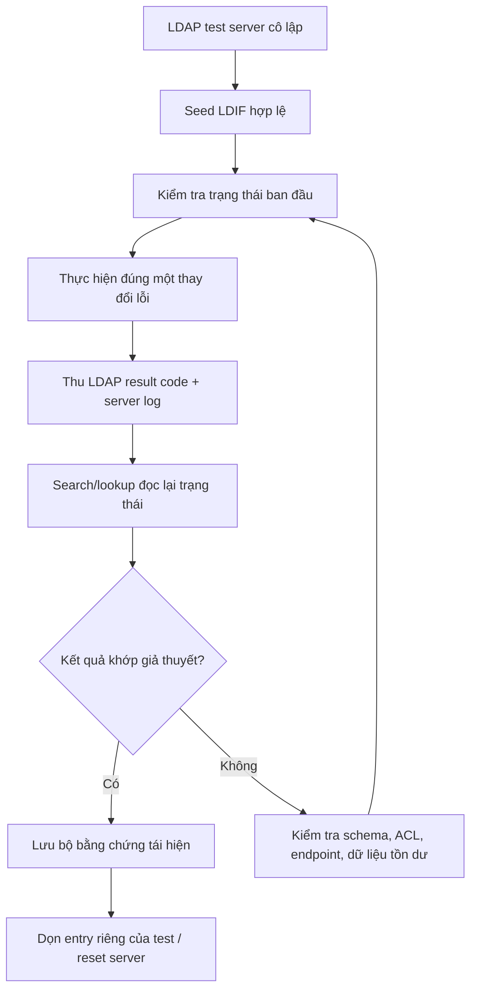

# Tạo DIT nhỏ để tái hiện lỗi có thể kiểm chứng

Trong **Spring LDAP**, một lỗi tìm kiếm hoặc cập nhật entry thường liên quan đến nhiều yếu tố cùng lúc: **DN**, search base, filter, schema, object class, ACL, kết nối TLS, máy chủ được chọn và dữ liệu hiện có. Nếu chỉ thử lại trên một directory thật chứa hàng chục nghìn entry, việc phân biệt lỗi mã Java với lỗi dữ liệu hay cấu hình rất khó.

Một phương pháp debugging hiệu quả là tạo **DIT (Directory Information Tree) nhỏ, cô lập và xác định trước trạng thái**, sau đó tái hiện **một lỗi tại một thời điểm**. Bằng cách đó, người học có thể biết rõ request nào đã gửi, server trả mã gì và entry có thật sự thay đổi hay không. Mục tiêu không phải là dựng một bản sao toàn bộ production, mà là tạo một **minimal reproducible example (MRE)** có thể chạy lại, đo lường và chia sẻ an toàn.

Bài này thuộc chương **Debugging** của module **SPRING_LDAP**, tập trung vào cách tổ chức dữ liệu thử nghiệm, thao tác bằng LDAP CLI và `LdapTemplate`, đọc log và viết kiểm thử tích hợp có thể kiểm chứng. Nguyên tắc áp dụng tương tự cho `LdapClient` và LDAP ODM nếu chúng dùng cùng schema và directory.

## 1. Mục tiêu học tập

Sau khi hoàn thành bài, bạn có thể:

1. Giải thích cấu trúc một DIT theo base DN, OU, entry và RDN.
2. Tạo bộ **LDIF fixture** nhỏ có schema hợp lệ, cho phép Add/Search/Modify kiểm tra được.
3. Phân biệt **dữ liệu chuẩn để kiểm chứng** với **dữ liệu lỗi được thêm có chủ ý**.
4. Tái hiện lỗi schema, member trùng, search base sai và lỗi quyền với những phép thử được kiểm soát.
5. Ghi nhận đủ **tiền điều kiện – hành động – LDAP result code – trạng thái sau**.
6. Cấu hình `LdapContextSource`, dùng `LdapTemplate` và viết JUnit integration test kiểm tra dữ liệu thật.
7. Đảm bảo bài thử có thể lặp lại và dọn dẹp an toàn, không can thiệp directory production.

## 2. DIT là gì, và vì sao phải làm nhỏ?

**DIT** là cây entry của directory. Mỗi entry có một **Distinguished Name (DN)**; DN được cấu thành từ các **Relative Distinguished Name (RDN)**, ngăn cách bằng dấu phẩy trong biểu diễn chuỗi.

Trong ví dụ này:

```text
dc=example,dc=org
├── ou=people
│   └── uid=an
└── ou=groups
    └── cn=editors
```

| Thành phần | DN đầy đủ | Ý nghĩa |
|---|---|---|
| Base | `dc=example,dc=org` | Naming context dùng cho fixture |
| OU người dùng | `ou=people,dc=example,dc=org` | Nhánh chứa tài khoản |
| User | `uid=an,ou=people,dc=example,dc=org` | Một entry kiểu `inetOrgPerson` |
| OU nhóm | `ou=groups,dc=example,dc=org` | Nhánh chứa nhóm |
| Group | `cn=editors,ou=groups,dc=example,dc=org` | Một entry kiểu `groupOfNames` |

Nếu `LdapContextSource` của Spring LDAP đã cấu hình `base = dc=example,dc=org`, DN đối số dùng với `LdapTemplate` thường là **tương đối với base**, ví dụ `uid=an,ou=people`. Ngược lại, giá trị thuộc tính `member` của nhóm thường chứa **DN đầy đủ** của user.

### Vì sao cấu trúc này đủ cho việc debug?

Cây có đúng những yếu tố cần kiểm tra:

- **Một naming context** để xác minh base DN và DN được nối đúng.
- **Hai OU** để phân biệt nhánh người dùng và nhánh nhóm.
- **Một user hợp lệ** để kiểm tra Search/Modify.
- **Một group hợp lệ** để kiểm tra thuộc tính `member` và lỗi thêm giá trị trùng.
- **Một entry lỗi tạo riêng theo từng bài thử** để kiểm tra phản hồi server, không làm hỏng fixture chuẩn.

Đừng nhập toàn bộ directory production, password, nhóm thật hay thông tin cá nhân chỉ để tái hiện một lỗi schema. Một DIT nhỏ giúp xác định kết quả dự kiến trước khi chạy, tránh nhiễu từ dữ liệu cũ.

## 3. Nguyên tắc xây dựng MRE có thể kiểm chứng

Một bài thử tốt không chỉ “làm lỗi xảy ra lại”, mà còn chứng minh được **lỗi do đâu**.

| Yêu cầu | Cách thực hiện |
|---|---|
| **Cô lập** | LDAP server/container/in-memory directory dành riêng cho test, không dùng production |
| **Tối thiểu** | Chỉ giữ entry và thuộc tính liên quan đến giả thuyết cần kiểm tra |
| **Đúng schema** | Seed dữ liệu chuẩn trước; bật schema validation nếu cần test schema |
| **Tất định** | UID cố định trong môi trường reset được hoặc UID duy nhất theo mỗi test |
| **Một biến mỗi lần** | So sánh fixture hợp lệ và fixture sai khác đúng một điều kiện |
| **Quan sát được** | Lưu operation ID, endpoint, DN, mã lỗi và kết quả Search sau thao tác |
| **Lặp lại được** | Seed lại trạng thái ban đầu trước mỗi ca test |
| **Dọn dẹp an toàn** | Chỉ xóa entry do bài test tạo, trong test subtree đã xác định |

Không nên dùng rollback thông thường của JPA/JDBC để “dọn dữ liệu LDAP”: LDAP không tự tham gia SQL transaction. Nếu dùng cơ chế bù trừ của Spring LDAP, thao tác ngược vẫn có thể thất bại; **test fixture phải có bước xác nhận và cleanup riêng**.

### Mô hình thử nghiệm



## 4. Chuẩn bị LDAP server thử nghiệm

Có thể sử dụng một instance **OpenLDAP**, **ApacheDS** hoặc **UnboundID In-Memory Directory Server**, tùy hệ thống đang phát triển. Mỗi sản phẩm có cách khai báo naming context, tài khoản quản trị, schema và log khác nhau. Bài này **giả định** bạn đã tạo một instance thử nghiệm với các điều kiện:

- Naming context hỗ trợ `dc=example,dc=org` hoặc cho phép tạo base entry này.
- Có tài khoản bind thử nghiệm đủ quyền đọc/ghi **trong phạm vi fixture**.
- Có schema chuẩn chứa `organizationalUnit`, `inetOrgPerson` và `groupOfNames`.
- **Schema validation đang bật** nếu mục tiêu là tái hiện lỗi vi phạm schema.
- Có LDAP endpoint được bảo vệ bằng **LDAPS** hoặc **StartTLS** và chứng chỉ được client tin cậy.
- Có cách truy cập server log phù hợp; nếu chỉ kiểm thử LDAP in-memory, cần xác định cơ chế quan sát request/result tương ứng.

Các lệnh `ldapadd`, `ldapmodify`, `ldapsearch` và `ldapwhoami` bên dưới dùng cú pháp phổ biến của **OpenLDAP command-line tools**. Chúng là ví dụ dành cho máy có cài công cụ tương ứng, không phải mã để chạy trực tiếp trong một chương trình Java.

**Giới hạn an toàn:** Chỉ chạy trên instance test hoặc naming context riêng đã được phê duyệt. Không dùng lệnh recursive delete với base DN của tổ chức. Không tắt kiểm tra chứng chỉ TLS; nếu gặp lỗi truststore, sửa cấu hình tin cậy trước.

### Kiểm tra kết nối trước khi seed

```bash
ldapwhoami -x \
  -H "ldaps://ldap-test.example.org:636" \
  -D "cn=test-writer,ou=service-accounts,dc=example,dc=org" -W
```

`-W` yêu cầu nhập password tương tác, tránh đặt password trực tiếp vào command line và shell history. Đây là lệnh xác minh bind, **không phải** test schema hay test Search. Nếu nó thất bại, cần xử lý kết nối/TLS/credential trước khi đi tiếp.

Nếu server chỉ cung cấp `ldap://...:389` kèm StartTLS, dùng cờ `-ZZ` theo tài liệu công cụ và cấu hình chứng chỉ hợp lệ. Không đổi `ldaps://` sang `ldap://` không mã hóa như một biện pháp “sửa lỗi”.

## 5. LDIF fixture: đúng một user và một group

**LDIF (LDAP Data Interchange Format)** biểu diễn entry và các thay đổi LDAP dưới dạng văn bản. Tạo một file test có tên ví dụ `seed-dit.ldif` với nội dung sau.

```ldif
dn: dc=example,dc=org
objectClass: top
objectClass: dcObject
objectClass: organization
dc: example
o: Example Test Directory

dn: ou=people,dc=example,dc=org
objectClass: top
objectClass: organizationalUnit
ou: people

dn: ou=groups,dc=example,dc=org
objectClass: top
objectClass: organizationalUnit
ou: groups

dn: uid=an,ou=people,dc=example,dc=org
objectClass: top
objectClass: person
objectClass: organizationalPerson
objectClass: inetOrgPerson
uid: an
cn: An Nguyen
sn: Nguyen
displayName: An Nguyen
mail: an@example.org

dn: cn=editors,ou=groups,dc=example,dc=org
objectClass: top
objectClass: groupOfNames
cn: editors
member: uid=an,ou=people,dc=example,dc=org
```

### Giải thích lựa chọn thuộc tính

- Base entry dùng `dcObject` và `organization` để khai báo `dc`, `o` trong một kiểu kết hợp thường gặp. Định nghĩa và khả năng thêm base phụ thuộc cấu hình server.
- OU dùng `organizationalUnit`, có `ou` tương ứng.
- User dùng `inetOrgPerson` kế thừa `organizationalPerson` và `person`; cần `cn` và `sn` từ `person`. Thuộc tính `uid` phù hợp với ví dụ và là RDN.
- Group dùng `groupOfNames`, yêu cầu `cn` và ít nhất một giá trị `member` theo schema thông thường; giá trị `member` được ghi bằng **DN đầy đủ** của An.

Một số sản phẩm directory hoặc chính sách của tổ chức dùng schema riêng, chỉ cho phép những OU/object class nhất định hoặc không cho tạo base entry theo cách trên. Trong trường hợp đó, hãy **điều chỉnh fixture theo schema đã được kiểm chứng**, nhưng vẫn giữ nguyên nguyên tắc ít entry và một lỗi mỗi lần.

### Seed vào server rỗng

```bash
ldapadd -x \
  -H "ldaps://ldap-test.example.org:636" \
  -D "cn=test-writer,ou=service-accounts,dc=example,dc=org" -W \
  -f seed-dit.ldif
```

Cần tạo các entry cha trước entry con. Lệnh này phù hợp khi naming context còn trống và quyền cho phép tạo base. **Nếu base/OU đã có sẵn**, không chạy lại toàn bộ file rồi coi lỗi `entryAlreadyExists (68)` là lỗi của ứng dụng; thay vào đó dùng fixture riêng cho server hiện tại hoặc reset instance thử nghiệm về trạng thái đã định.

### Kiểm chứng seed bằng Search

```bash
ldapsearch -LLL -x \
  -H "ldaps://ldap-test.example.org:636" \
  -D "cn=test-writer,ou=service-accounts,dc=example,dc=org" -W \
  -b "dc=example,dc=org" -s sub \
  "(objectClass=*)" dn objectClass uid cn sn member
```

Một bộ fixture thành công phải có **5 entry**: base, hai OU, một user và một group. Nếu server trả nhiều hoặc ít hơn, phải giải thích rõ khác biệt trước khi dùng dữ liệu làm baseline. Với người dùng, kiểm tra `sn=Nguyen`; với nhóm, kiểm tra `member` trỏ đúng DN của An.

Kiểm tra riêng hai entry để giảm nhiễu:

```bash
ldapsearch -LLL -x \
  -H "ldaps://ldap-test.example.org:636" \
  -D "cn=test-writer,ou=service-accounts,dc=example,dc=org" -W \
  -b "uid=an,ou=people,dc=example,dc=org" -s base \
  "(objectClass=*)" objectClass uid cn sn

ldapsearch -LLL -x \
  -H "ldaps://ldap-test.example.org:636" \
  -D "cn=test-writer,ou=service-accounts,dc=example,dc=org" -W \
  -b "cn=editors,ou=groups,dc=example,dc=org" -s base \
  "(objectClass=*)" cn member
```

Các lệnh này chỉ truy vấn những thuộc tính cần quan sát; chúng **không chứng minh mọi thuộc tính đều hiển thị** nếu ACL đang giới hạn quyền đọc.

## 6. Ca tái hiện 1: thiếu thuộc tính `sn`

Giả thuyết: một lệnh Add `inetOrgPerson` bị từ chối vì thiếu thuộc tính `sn` bắt buộc do object class cha `person` quy định.

Tạo file riêng `bad-missing-sn.ldif` với **chỉ một entry lỗi**, không sửa fixture chuẩn `uid=an`:

```ldif
dn: uid=an-bad,ou=people,dc=example,dc=org
objectClass: top
objectClass: person
objectClass: organizationalPerson
objectClass: inetOrgPerson
uid: an-bad
cn: An Bad
```

Chạy Add trên test server:

```bash
ldapadd -x \
  -H "ldaps://ldap-test.example.org:636" \
  -D "cn=test-writer,ou=service-accounts,dc=example,dc=org" -W \
  -f bad-missing-sn.ldif
```

Với server đang thực thi schema đúng, kỳ vọng điển hình là **`objectClassViolation (65)`** vì `sn` bị thiếu. Nội dung thông điệp chi tiết có thể khác giữa sản phẩm.

**Điểm kiểm chứng quan trọng:** Sau khi Add bị từ chối, entry `uid=an-bad` **không được tạo**. Đọc lại bằng tìm kiếm trên OU:

```bash
ldapsearch -LLL -x \
  -H "ldaps://ldap-test.example.org:636" \
  -D "cn=test-writer,ou=service-accounts,dc=example,dc=org" -W \
  -b "ou=people,dc=example,dc=org" -s one \
  "(uid=an-bad)" dn cn sn
```

Trong điều kiện ACL cho phép xem entry, kết quả đúng của ca lỗi là **không có entry nào khớp filter**. Nếu Add bất ngờ thành công, cần kiểm tra server có bật schema enforcement không, schema áp dụng cho naming context nào và entry đã có từ trước hay chưa; **không vội kết luận RFC định nghĩa `person` không cần `sn`**.

### Thử đối chứng

Tạo entry giống hệt nhưng thêm:

```ldif
sn: Bad
```

Khi thử đối chứng, hãy dùng UID khác hoặc reset dữ liệu để tránh lỗi trùng DN. Nếu entry hợp lệ được tạo thành công, cặp thử này cho bằng chứng mạnh rằng **chỉ khác biệt `sn` ảnh hưởng kết quả**.

| Biến kiểm soát | Request hợp lệ | Request lỗi |
|---|---|---|
| Parent DN | `ou=people,...` | Cùng OU |
| Object classes | `inetOrgPerson` và các class cha | Giống hệt |
| `cn` | Có | Có |
| `sn` | Có | **Thiếu** |
| Kỳ vọng | Add thành công | Bị từ chối do schema |
| Dữ liệu sau | Entry tồn tại | Entry lỗi không tồn tại |

## 7. Ca tái hiện 2: thêm giá trị `member` đã tồn tại

Giả thuyết: ứng dụng lỗi khi thêm user vào nhóm vì DN thành viên đã có trong nhóm.

Fixture đã chứa:

```ldif
dn: cn=editors,ou=groups,dc=example,dc=org
objectClass: groupOfNames
cn: editors
member: uid=an,ou=people,dc=example,dc=org
```

Tạo file `bad-duplicate-member.ldif`:

```ldif
dn: cn=editors,ou=groups,dc=example,dc=org
changetype: modify
add: member
member: uid=an,ou=people,dc=example,dc=org
```

Thực thi:

```bash
ldapmodify -x \
  -H "ldaps://ldap-test.example.org:636" \
  -D "cn=test-writer,ou=service-accounts,dc=example,dc=org" -W \
  -f bad-duplicate-member.ldif
```

Với schema và quyền phù hợp, kết quả thường gặp là **`attributeOrValueExists (20)`**: giá trị `member` đã có. Đọc lại nhóm để xác nhận membership không bị nhân đôi hoặc xóa nhầm.

**Phân biệt nguyên nhân:** nếu nhận `insufficientAccessRights (50)`, lỗi hiện tại có thể là ACL, chưa đủ cơ sở kết luận member trùng. Nếu nhận `noSuchObject (32)`, cần kiểm tra DN group và endpoint. Không nên coi bất kỳ exception nào trong Java đều đồng nghĩa với cùng một root cause.

### Vì sao ca này hữu ích trong Spring LDAP?

Trong provisioning service, thao tác kiểu:

```java
ModificationItem addMember = new ModificationItem(
    DirContext.ADD_ATTRIBUTE,
    new BasicAttribute(
        "member", "uid=an,ou=people,dc=example,dc=org"));

ldapTemplate.modifyAttributes(groupDn,
        new ModificationItem[] { addMember });
```

có thể lỗi khi chạy lại sau timeout hoặc khi thao tác đã được xử lý trước đó. Kiểm tra trạng thái group trước khi retry giúp xác định DN đã có chưa; tuy nhiên **read-then-write không tự cung cấp isolation**, vì client khác có thể thay đổi group giữa hai thao tác. Với workflow cần chống xung đột mạnh, cân nhắc cập nhật có điều kiện nếu server/client hỗ trợ.

## 8. Ca tái hiện 3: sai search base và phạm vi Search

Giả thuyết: chức năng tìm user trả rỗng hoặc báo entry không tồn tại vì **search base không bao phủ user đích**, không phải vì dữ liệu chưa được seed.

### Trường hợp A: base đúng nhưng filter không khớp

```bash
ldapsearch -LLL -x \
  -H "ldaps://ldap-test.example.org:636" \
  -D "cn=test-writer,ou=service-accounts,dc=example,dc=org" -W \
  -b "ou=people,dc=example,dc=org" -s one \
  "(uid=khong-ton-tai)" dn uid cn
```

Request có thể thành công với **0 entry khớp**. Đây **không đồng nghĩa** server báo lỗi `noSuchObject`.

### Trường hợp B: base chỉ nhóm, không chứa user

```bash
ldapsearch -LLL -x \
  -H "ldaps://ldap-test.example.org:636" \
  -D "cn=test-writer,ou=service-accounts,dc=example,dc=org" -W \
  -b "ou=groups,dc=example,dc=org" -s sub \
  "(uid=an)" dn uid
```

Search chạy trong nhánh nhóm nên không trả entry `uid=an,ou=people,...`. Cây có dữ liệu, nhưng phạm vi Search sai.

### Trường hợp C: base DN không tồn tại

```bash
ldapsearch -LLL -x \
  -H "ldaps://ldap-test.example.org:636" \
  -D "cn=test-writer,ou=service-accounts,dc=example,dc=org" -W \
  -b "ou=not-found,dc=example,dc=org" -s base \
  "(objectClass=*)" dn
```

Ở directory thông thường, một Search trên base entry không tồn tại có thể nhận **`noSuchObject (32)`**. Cần quan sát phản hồi server và quyền của principal, vì ACL hoặc policy có thể che giấu sự tồn tại của entry.

### Ba kết quả cần phân biệt

| Kết quả | Ý nghĩa | Cách xử lý |
|---|---|---|
| Search success, **0 entry** | Filter/scope không khớp dữ liệu nhìn thấy được | Kiểm tra filter, search base, scope, ACL |
| `noSuchObject (32)` | Base/object mục tiêu không tồn tại hoặc không truy cập được theo server | Kiểm tra DN, base, routing và quyền |
| Lỗi filter ở client/server | Filter không hợp cú pháp hoặc bị từ chối | Dùng builder/parameterization, kiểm tra escape |

Không chuyển “không có kết quả” thành “LDAP server bị lỗi” trong API nếu thực tế request đã thành công.

## 9. Từ fixture LDIF sang Spring LDAP

### 9.1. Cấu hình `LdapContextSource` nhất quán với test

Ví dụ Java cấu hình Spring dùng cùng base DN của fixture:

```java
import org.springframework.context.annotation.Bean;
import org.springframework.context.annotation.Configuration;
import org.springframework.core.env.Environment;
import org.springframework.ldap.core.LdapTemplate;
import org.springframework.ldap.core.support.LdapContextSource;

@Configuration
public class TestDirectoryConfig {

    @Bean
    public LdapContextSource ldapContextSource(Environment env) {
        LdapContextSource source = new LdapContextSource();
        source.setUrl(env.getRequiredProperty("test.ldap.url"));
        source.setBase("dc=example,dc=org");
        source.setUserDn(env.getRequiredProperty("test.ldap.bind-dn"));
        source.setPassword(env.getRequiredProperty("test.ldap.bind-password"));
        return source;
    }

    @Bean
    public LdapTemplate ldapTemplate(LdapContextSource source) {
        return new LdapTemplate(source);
    }
}
```

Ví dụ cấu hình thử nghiệm:

```properties
test.ldap.url=ldaps://ldap-test.example.org:636
test.ldap.bind-dn=cn=test-writer,ou=service-accounts,dc=example,dc=org
# test.ldap.bind-password: cung cấp qua secret manager/biến môi trường
```

Đừng đưa mật khẩu thực vào file được commit, không dùng `ldap://` không mã hóa cho thao tác bind với credential thật, và không tắt hostname/certificate verification để vượt lỗi TLS.

**Bẫy thường gặp:** Khi đã đặt `source.setBase("dc=example,dc=org")`, gọi `ldapTemplate.lookup("uid=an,ou=people,dc=example,dc=org")` có thể dẫn tới việc kết hợp base không đúng. Hãy dùng DN **tương đối** trong template, ví dụ `uid=an,ou=people`, và kiểm tra cách provider xử lý `Name`/`String` theo phiên bản đang sử dụng.

### 9.2. Search với builder, không ghép filter thủ công

```java
import java.util.List;
import org.springframework.ldap.core.AttributesMapper;
import org.springframework.ldap.core.LdapTemplate;
import org.springframework.ldap.query.LdapQuery;
import org.springframework.ldap.query.LdapQueryBuilder;

public class PersonLookup {

    private final LdapTemplate ldapTemplate;

    public PersonLookup(LdapTemplate ldapTemplate) {
        this.ldapTemplate = ldapTemplate;
    }

    public List<String> findCnByUid(String uid) {
        LdapQuery query = LdapQueryBuilder.query()
                .base("ou=people")
                .where("uid").is(uid);

        return ldapTemplate.search(
                query,
                (AttributesMapper<String>) attrs -> {
                    if (attrs.get("cn") == null) {
                        return null;
                    }
                    return (String) attrs.get("cn").get();
                });
    }
}
```

Với fixture đã seed, `findCnByUid("an")` dự kiến trả một kết quả `"An Nguyen"`. `findCnByUid("khong-ton-tai")` dự kiến trả danh sách rỗng, nếu quyền tìm kiếm cho phép.

Sử dụng `LdapQueryBuilder` để dựng điều kiện thay vì ghép chuỗi filter từ dữ liệu người dùng. Không log filter chứa thông tin cá nhân quá mức cần thiết. Khi filter không khớp, kiểm tra thêm schema, search scope và ACL.

### 9.3. Java Add một entry sai schema có chủ đích

```java
import javax.naming.Name;
import javax.naming.directory.Attributes;
import javax.naming.directory.BasicAttribute;
import javax.naming.directory.BasicAttributes;

import org.springframework.ldap.core.LdapTemplate;
import org.springframework.ldap.support.LdapNameBuilder;

public class SchemaReproduction {

    private final LdapTemplate ldapTemplate;

    public SchemaReproduction(LdapTemplate ldapTemplate) {
        this.ldapTemplate = ldapTemplate;
    }

    public void addPersonWithoutSurname(String uid) {
        Name relativeDn = LdapNameBuilder.newInstance("ou=people")
                .add("uid", uid)
                .build();

        Attributes attrs = new BasicAttributes(true);
        BasicAttribute classes = new BasicAttribute("objectClass");
        classes.add("top");
        classes.add("person");
        classes.add("organizationalPerson");
        classes.add("inetOrgPerson");

        attrs.put(classes);
        attrs.put("uid", uid);
        attrs.put("cn", "Schema Bad");
        // Cố ý KHÔNG có "sn" -> vi phạm MUST của person.

        ldapTemplate.bind(relativeDn, null, attrs);
    }
}
```

Từ đó có thể so sánh:

- **LDAP CLI cũng bị từ chối, Java cũng bị từ chối** → nhiều khả năng quy tắc server/schema là nguyên nhân chung.
- **CLI thành công nhưng Java thất bại** → kiểm tra payload thực tế, base DN, principal, endpoint, bộ lọc/mapping, cách biểu diễn `Attributes` và exception.
- **Java thành công bất ngờ** → xác minh schema enforcement, server đúng hay chưa và dữ liệu test có thực sự khác fixture chuẩn không.

Không được kết luận “LDAP sai” chỉ từ một exception Java nếu chưa biết request nào đến server và trạng thái thực.

## 10. Viết integration test có assertion trạng thái

Mục tiêu test không chỉ là nhận một exception. Với một lỗi Add bị từ chối, cần kiểm tra **entry chưa tồn tại sau lỗi**. Với lỗi Add member trùng, cần kiểm tra **dữ liệu group không bị thay đổi ngoài ý muốn**.

Dưới đây là khung JUnit 5 cho ca thiếu `sn`; giả sử Spring test context đã cấu hình `LdapTemplate` trỏ tới một directory **cô lập, reset được và đang bật schema enforcement**:

```java
import java.util.List;

import org.junit.jupiter.api.Test;
import org.springframework.beans.factory.annotation.Autowired;
import org.springframework.boot.test.context.SpringBootTest;
import org.springframework.ldap.core.AttributesMapper;
import org.springframework.ldap.core.LdapTemplate;
import org.springframework.ldap.query.LdapQueryBuilder;

import static org.junit.jupiter.api.Assertions.*;

@SpringBootTest
class DirectorySchemaIntegrationTest {

    @Autowired
    private LdapTemplate ldapTemplate;

    @Test
    void addWithoutSnIsRejectedAndEntryIsAbsent() {
        String uid = "schema-bad-test-001";
        SchemaReproduction reproduction =
                new SchemaReproduction(ldapTemplate);

        // Fixture phải bảo đảm UID này chưa tồn tại trước test.
        RuntimeException failure = assertThrows(
                RuntimeException.class,
                () -> reproduction.addPersonWithoutSurname(uid));

        assertNotNull(failure);

        List<String> matches = ldapTemplate.search(
                LdapQueryBuilder.query()
                        .base("ou=people")
                        .where("uid").is(uid),
                (AttributesMapper<String>) attrs ->
                        (String) attrs.get("uid").get());

        assertTrue(matches.isEmpty(),
                "Entry bị từ chối không được xuất hiện trên server");
    }
}
```

**Điểm cần hoàn thiện trước khi đưa vào test suite thực tế:**

- Tạo fixture/reset instance trước mỗi ca, bảo đảm `schema-bad-test-001` chưa tồn tại.
- Test nên xác minh **mã LDAP result 65** từ phản hồi/server log hoặc lớp exception đã được xác nhận của phiên bản sử dụng, thay vì chỉ kiểm tra `RuntimeException` quá rộng.
- Dùng search/lookup qua **kết nối độc lập** nếu muốn chứng minh trạng thái server sau request; cùng template cũng có thể đọc được nhưng độc lập giúp loại bỏ một số nhầm lẫn về context và cache.
- Không dùng rollback JDBC hay `@Transactional` trên phương thức test như cách dọn dữ liệu LDAP.
- Dọn entry test nếu test thất bại ngoài dự kiến hoặc server chấp nhận entry bất thường; chỉ xóa DN nằm trong phạm vi fixture được phép.

### Kiểm thử nhóm trùng member

Khung kiểm thử khác nên:

1. Đọc trước danh sách giá trị `member` của `cn=editors`.
2. Thực hiện `ADD_ATTRIBUTE member=uid=an,ou=people,dc=example,dc=org`.
3. Ghi nhận lỗi trả về dự kiến (thường là mã 20).
4. Đọc lại nhóm.
5. Xác nhận giá trị `member` được giữ nguyên, không có thay đổi phụ.

Đừng dựa vào thứ tự hiển thị của tập thuộc tính đa trị; hãy so sánh **tập giá trị sau chuẩn hóa thích hợp** và theo matching rule của schema.

## 11. Đọc LDAP result code và server log đúng cách

Một MRE cần có **bằng chứng từ hai phía**:

- **Client:** request, DN, endpoint, thời điểm, loại exception và LDAP result code nếu có.
- **Server:** operation, DN, mã lỗi, connection/operation ID và nguyên nhân cụ thể (nếu cấu hình log cho phép).

### Bảng chẩn đoán nhanh

| LDAP result code | Ý nghĩa điển hình | Tình huống trong DIT nhỏ |
|---:|---|---|
| **0** | `success` | Seed hợp lệ, Search đúng |
| **65** | `objectClassViolation` | Add `inetOrgPerson` thiếu `sn` |
| **20** | `attributeOrValueExists` | Thêm lại cùng giá trị `member` |
| **32** | `noSuchObject` | Lookup/Search tại base entry không tồn tại |
| **68** | `entryAlreadyExists` | Seed lại entry mà không reset |
| **17** | `undefinedAttributeType` | Dùng thuộc tính tùy biến chưa được schema định nghĩa |
| **21** | `invalidAttributeSyntax` | Giá trị không hợp syntax của attribute type |
| **50** | `insufficientAccessRights` | Principal không có quyền Add/Modify |
| **49** | `invalidCredentials` | Bind principal/password không hợp lệ |
| **34** | `invalidDNSyntax` | DN không parse được |
| **53** | `unwillingToPerform` | Server từ chối do policy/trạng thái riêng |

**Không có ánh xạ một-một tuyệt đối:** cùng một request có thể vi phạm nhiều ràng buộc, và các sản phẩm directory có cách ưu tiên trả lỗi khác nhau. Nếu principal thiếu quyền, server có thể không tiết lộ chi tiết schema. Chẩn đoán dựa trên **mã trả thực, trạng thái server và log đúng request**.

### Log minh họa, không phải định dạng chuẩn sản phẩm

```text
2026-11-27T10:20:15Z server=ldap-test
  conn=42 op=8 ADD dn="uid=an-bad,ou=people,dc=example,dc=org"
2026-11-27T10:20:15Z server=ldap-test
  conn=42 op=8 RESULT err=65
  detail="required attribute sn missing"
```

Đây là ví dụ **giả định**. Trong OpenLDAP, 389 Directory Server, Active Directory hay dịch vụ directory managed, cấu trúc log và khả năng ghi chi tiết khác nhau. Khi điều tra:

1. Xác nhận đúng **máy chủ** đang nhận request, không chỉ hostname load balancer.
2. Ghép **thời điểm + server + connection ID + operation ID + DN**; op ID có thể không duy nhất toàn cụm.
3. Đọc mã lỗi và chỉ dùng phần detail nếu log thực có cung cấp.
4. So sánh payload đã được loại bí mật với schema và entry trước thao tác.
5. Ghi nhận kết quả Search sau khi request lỗi.
6. Tắt mức log debug tăng cường khi hoàn tất; không đưa bind password, `userPassword` hoặc dữ liệu cá nhân thật vào báo cáo.

**Nếu không thấy log Add/Modify:** trước hết kiểm tra client có kết nối thành công chưa, TLS/bind có lỗi không, request có đi tới đúng server không và mức logging có ghi nhận operation đó không. Không vội quy lỗi cho schema khi request chưa tới server.

## 12. Khi test không tái hiện được lỗi production

Đây là trường hợp rất thường gặp. Một fixture nhỏ có thể thiếu điều kiện quan trọng dù đã mô phỏng đúng DN và thuộc tính.

| Test không giống production vì... | Cách kiểm tra |
|---|---|
| Schema enforcement khác nhau | So sánh schema, object class, attribute type, kiểm tra validation trên test server |
| ACL khác nhau | Tái hiện với principal test có quyền tương đương, không dùng admin để che lỗi |
| Base DN hoặc naming context khác | Log DN đầy đủ, kiểm tra `ContextSource.setBase` và endpoint |
| Parent OU hoặc group khác | Seed đúng điều kiện tồn tại và membership ban đầu |
| Search scope khác | So sánh `BASE`, `ONELEVEL` và `SUBTREE` |
| Filter bị escape khác | Dùng `LdapQueryBuilder` và xem điều kiện thực tế |
| LDAP server khác phiên bản | Ghi lại sản phẩm/version, schema, policy |
| Có proxy/load balancer | Xác định server thực nhận request, tránh đọc nhầm replica |
| Dữ liệu tồn dư sau lần thử trước | Reset fixture, dùng UID riêng cho test |
| Schema caching hoặc replication lag | Đọc cùng endpoint writer; kiểm tra trạng thái đồng bộ |
| Pooling/TLS khác | Xác minh kết nối, bind identity, truststore và connection policy |
| ODM sinh thêm thuộc tính | So sánh request/LDIF thực, mapping `@Entry`/`@Attribute` và giá trị null |

Cách mở rộng MRE phù hợp là **bổ sung từng điều kiện còn thiếu** (ví dụ thêm group, đổi principal, thay search base), mỗi lần giữ lại bằng chứng quan sát. Không nhập cả production database hoặc chạy lại hàng nghìn request ngay từ đầu.

### Kỹ thuật “rút gọn dần”

Giả sử lỗi xảy ra khi ứng dụng provision user có 30 thuộc tính:

1. Tạo fixture chỉ có `objectClass`, `uid`, `cn`, `sn`.
2. Xác nhận Add hợp lệ.
3. Thêm từng nhóm thuộc tính nghi vấn.
4. Khi lỗi xuất hiện, chia nhóm đó thành các phần nhỏ hơn.
5. Kiểm tra thuộc tính/tổ hợp tối thiểu gây lỗi và log server tương ứng.

Đôi khi lỗi chỉ xuất hiện khi **hai thuộc tính tương tác** hoặc một object class bổ sung thay đổi tập MUST/MAY. Vì vậy, không dừng khi bỏ một thuộc tính mà lỗi tạm biến mất; phải thử lại điều kiện đối chứng để xác nhận giả thuyết.

## 13. Mẫu báo cáo MRE có thể chia sẻ trong nhóm

Một báo cáo tốt cần đủ thông tin để đồng nghiệp thực hiện lại nhưng **không chứa secret hoặc dữ liệu thật**.

| Trường | Ví dụ |
|---|---|
| Mã ca | `LDAP-MRE-003` |
| Mục tiêu | Xác nhận Add user thiếu `sn` bị schema từ chối |
| Directory/server | LDAP test instance, product/version đã ghi rõ |
| Base DN | `dc=example,dc=org` |
| Seed | 5 entry: base, 2 OU, user, group |
| Principal | Tên vai trò `test-writer`, **không kèm password** |
| Endpoint | LDAP test writer, TLS xác thực |
| Tiền điều kiện | `uid=an-bad` chưa tồn tại; schema validation bật |
| Request | `Add uid=an-bad` với `inetOrgPerson` thiếu `sn` |
| Kỳ vọng | Result code thường là 65; entry không tồn tại |
| Quan sát | Mã lỗi thực, server log, kết quả Search sau lỗi |
| Biện pháp đối chứng | Thêm `sn` trên UID khác và thử Add |
| Kết luận | Schema `person` yêu cầu `sn` trong môi trường thử |
| Cleanup | Không còn entry test ngoài fixture |

Lưu cả **giá trị quan sát thực** nếu khác kỳ vọng, và ghi rõ lý do đã kiểm tra. Báo cáo “test thành công” nhưng không chứa mã lỗi hoặc trạng thái đọc lại chỉ là ghi chú, chưa phải bằng chứng.

### Hai trạng thái phải tách biệt

**Kỳ vọng:** “Add thiếu `sn` sẽ bị từ chối”.

**Quan sát:** “Server thử nghiệm đã trả code 65 cho DN X vào thời điểm Y; Search sau đó không thấy entry X”.

Không ghi một kỳ vọng thành kết quả thực nghiệm khi chưa chạy lệnh. Điều này đặc biệt quan trọng với sự cố liên quan LDAP server khác phiên bản, schema tùy chỉnh hoặc ACL.

## 14. Dọn dẹp và chạy lại một cách an toàn

Fixture trở nên không đáng tin nếu một lần chạy lỗi để lại entry ngoài dự kiến. Nên ưu tiên **hủy và khởi tạo lại instance test/container** hoặc xóa **đúng những entry có operation ID/test prefix** mà bài test tạo.

Nếu phải dọn thủ công:

1. Đọc lại DN đích và xác nhận nó nằm trong test subtree.
2. Xác nhận entry thuộc bài test, không phải dữ liệu có trước.
3. Với entry con, xem có phụ thuộc group hoặc entry khác không.
4. Xóa từng entry test bằng quyền phù hợp; đọc lại xác nhận.
5. Seed fixture về trạng thái chuẩn và so sánh danh sách DN.

Không dùng những thao tác như xóa đệ quy base DN chỉ vì việc đó tiện trong local test. Quy tắc đặt tên test nên rõ ràng, ví dụ `uid=mre-...` dưới `ou=people` trong instance riêng. Nếu dùng UUID để tránh xung đột, phải ghi lại UID thực trong log test để truy vết.

### Kiểm tra “reset đạt” trước khi chạy ca tiếp

- Base, `ou=people`, `ou=groups`, `uid=an`, `cn=editors` tồn tại.
- User An có `cn` và `sn`.
- Group editors chứa đúng giá trị `member` dự kiến.
- Không còn `uid=an-bad` hoặc các test UID ngoài danh sách.
- Không còn tác vụ LDAP asynchronous/replication đang làm thay đổi fixture ở nền.
- Test đang dùng đúng URL, bind identity và base DN.

**Chỉ khi baseline khớp**, kết quả ở ca tiếp theo mới có giá trị so sánh.

## 15. Bài tập thực hành

Hãy xây dựng một DIT thử nghiệm gồm 5 entry như phần 5 và hoàn thành các yêu cầu:

1. Seed bộ LDIF hợp lệ, vẽ DIT, đọc lại user và group.
2. Tạo entry `inetOrgPerson` thiếu `sn`, lưu mã lỗi thực tế, đọc lại để chứng minh entry không tồn tại.
3. Thêm lại một DN đã nằm trong `member` của nhóm editors, ghi nhận mã lỗi và xác minh membership không thay đổi.
4. Thử một Search từ nhánh `ou=groups` với filter `(uid=an)`; giải thích vì sao không tìm thấy An mà server vẫn hoạt động bình thường.
5. Đổi search base thành DN không tồn tại; phân biệt `noSuchObject` với Search thành công trả 0 entry.
6. Viết một service Spring LDAP dùng `LdapQueryBuilder` tìm user theo UID; kiểm tra kết quả cho `an` và UID không tồn tại.
7. Viết integration test dùng `LdapTemplate.bind` gây lỗi thiếu `sn`; thêm assertion kiểm tra trạng thái LDAP sau lỗi.
8. Dùng server log để ghép một request với mã lỗi, loại bỏ thông tin nhạy cảm trước khi viết báo cáo.
9. Reset fixture, chạy lại toàn bộ bài test; so sánh các kết quả giữa hai lần.
10. Nếu một lỗi chỉ xảy ra trên production, lập bảng những khác biệt về schema, ACL, endpoint, TLS, connection pooling và dữ liệu cần tái hiện thêm trên test.

**Tiêu chí hoàn thành:** Có LDIF seed hợp lệ, từng lỗi chỉ thay đổi một điều kiện có chủ đích, có mã lỗi và kết quả đọc lại, có test lặp được sau reset, không sử dụng dữ liệu production và không cần đoán nguyên nhân từ một exception duy nhất.

## 16. Những sai lầm thường gặp

**“Có exception tức là đã tái hiện đúng lỗi.”** Chưa đủ. Phải xác nhận **loại lỗi**, mã kết quả, request, server và trạng thái sau. Exception do TLS cũng là exception nhưng không chứng minh lỗi schema.

**“Search trả rỗng tức là entry không tồn tại.”** Không chắc. Search base, scope, filter, ACL và replica lag đều có thể khiến entry không xuất hiện với principal/endpoint đang dùng.

**“Dùng admin account cho test là gần production.”** Sai nếu ứng dụng thật dùng service account hạn chế. Test admin có thể che lỗi ACL. Dùng principal test với quyền tương đương trong phạm vi cô lập.

**“Lệnh `ldapadd` của fixture lỗi 68 nghĩa là schema sai.”** Không. `entryAlreadyExists (68)` thường nghĩa là DN đã tồn tại; phải reset hoặc tránh nhập trùng.

**“Bộ dữ liệu càng giống production càng tốt.”** Dữ liệu phong phú có thể hữu ích trong kiểm thử hiệu năng/hệ thống, nhưng **debug nguyên nhân cần fixture tối thiểu**. Không sao chép dữ liệu người dùng thực nếu không cần và chưa được cho phép.

**“Một lần test pass nghĩa là bug chắc chắn đã hết.”** Cần test đối chứng, lặp lại sau reset và xác minh server, schema, ACL thật có khớp điều kiện xuất hiện lỗi hay không.

## 17. Ghi nhớ

Để debug Spring LDAP hiệu quả, hãy bắt đầu bằng **DIT nhỏ và xác định**: một base DN, hai OU, một user hợp lệ, một group hợp lệ. Từ baseline đó, thay đổi đúng một điều kiện nhằm tái hiện từng lỗi, rồi **đối chiếu kết quả của client với server log và dữ liệu đọc lại**.

Một ca tái hiện được coi là **có thể kiểm chứng** khi có tiền điều kiện rõ ràng, request chính xác, mã lỗi quan sát thực tế, trạng thái sau thao tác, phép thử đối chứng và quy trình reset/cleanup an toàn. Cách làm này giúp phân biệt vấn đề schema, DN, filter, ACL, TLS và kết nối trước khi sửa mã `LdapTemplate`, `LdapClient` hoặc ODM.

### Tài liệu tham khảo

- [RFC 4512 — LDAP: Directory Information Models](https://www.rfc-editor.org/rfc/rfc4512): DIT, entry, DN, object class và schema.
- [RFC 4511 — LDAP: The Protocol](https://www.rfc-editor.org/rfc/rfc4511): Add, Modify, Search và LDAP result code.
- [RFC 4514 — String Representation of Distinguished Names](https://www.rfc-editor.org/rfc/rfc4514): biểu diễn và escape DN.
- [RFC 2798 — Definition of the inetOrgPerson LDAP Object Class](https://www.rfc-editor.org/rfc/rfc2798): định nghĩa `inetOrgPerson`.
- [Spring LDAP — Reference Documentation](https://docs.spring.io/spring-ldap/reference/): `ContextSource`, `LdapTemplate`, truy vấn, DN, ODM và test.
- Tài liệu và log đúng **LDAP server/version của môi trường kiểm thử**: quy tắc schema enforcement, thiết lập naming context, ACL và cấu hình logging.
