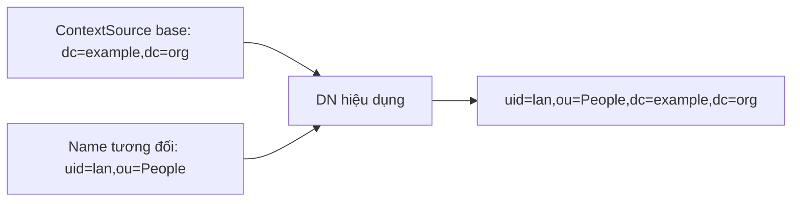

# Tạo DN bằng builder thay vì nối chuỗi thủ công

## Mục tiêu bài học

Trong **SPRING_LDAP**, tên phân biệt (*Distinguished Name*, **DN**) xuất hiện ở hầu hết thao tác với dịch vụ thư mục: đọc một entry, tạo tài khoản, sửa thuộc tính, đổi tên, chuyển entry và xóa dữ liệu. Việc tạo DN đúng cú pháp và đúng vị trí trong cây là điều kiện để các thao tác `LdapTemplate`, `LdapClient` và LDAP ODM chạy chính xác.

Sau bài học này, bạn có thể:

- Nhận diện phần **RDN**, **DN đầy đủ**, và DN tương đối so với `ContextSource`.
- Giải thích vì sao nối chuỗi thủ công có thể tạo DN sai hoặc đưa dữ liệu đầu vào vào cấu trúc tên ngoài ý định.
- Dùng **`LdapNameBuilder`** của Spring LDAP để thêm các thành phần RDN một cách có cấu trúc.
- Phân biệt cách tạo DN với cách tạo LDAP search filter, và áp dụng đúng trong `LdapTemplate`.
- Viết kiểm thử cho DN có dấu phẩy, dấu cộng, dấu gạch chéo ngược và khoảng trắng; tránh lỗi “nhân đôi base DN”.

## 1. DN là tên có cấu trúc, không phải chuỗi tùy ý

Giả sử directory server quản lý người dùng trong nhánh `ou=People,dc=example,dc=org`. Một entry có DN:

```text
uid=lan,ou=People,dc=example,dc=org
```

Các thành phần, từ trái sang phải:

| Thành phần | Vai trò |
| --- | --- |
| `uid=lan` | **RDN** (*Relative Distinguished Name*) của entry Lan |
| `ou=People` | RDN của entry cha chứa người dùng |
| `dc=example,dc=org` | Hậu tố cây thư mục trong ví dụ |
| Toàn bộ tên | **DN** xác định vị trí của entry trong cây thông tin thư mục (**DIT**) |

Một DN được tạo từ **dãy RDN**, trong đó mỗi RDN gồm loại thuộc tính và giá trị. Phần giá trị có thể chứa những ký tự đòi hỏi quy tắc biểu diễn đặc biệt, như dấu phẩy hoặc dấu cộng. Máy chủ không hiểu DN đơn giản bằng cách “tách chuỗi theo dấu phẩy” trong mọi tình huống.

Ví dụ người dùng có mã định danh thật là `lan,admin`. Dấu phẩy nằm **trong giá trị uid**, nên một cách biểu diễn hợp lệ của RDN phải escape dấu phẩy:

```text
uid=lan\,admin,ou=People,dc=example,dc=org
```

Trong chuỗi biểu diễn DN ở trên, `\,` là dấu phẩy thuộc giá trị `uid`; dấu phẩy không escape sau `admin` mới phân tách RDN với nhánh `ou=People`. Giá trị logic của `uid` vẫn là `lan,admin`, không có dấu gạch chéo ngược được thêm vào dữ liệu gốc.

**Quy tắc quan trọng:** Phân biệt **giá trị thuộc tính** với **cú pháp biểu diễn giá trị ấy trong DN**. Khi bạn xây dựng DN, hãy truyền giá trị thô cho API có khả năng xử lý RDN, thay vì tự escape rồi nối chuỗi.

## 2. Rủi ro của cách nối chuỗi thủ công

Đoạn mã dưới đây trông đơn giản:

```java
String userDn = "uid=" + uidFromRequest
        + ",ou=People,dc=example,dc=org";
```

Với `uidFromRequest = "lan"`, kết quả đúng như dự kiến. Nhưng nếu `uidFromRequest = "lan,admin"`, kết quả sẽ thành:

```text
uid=lan,admin,ou=People,dc=example,dc=org
```

Chuỗi đó **không biểu diễn một giá trị uid có dấu phẩy theo ý định**: trình phân tích DN có thể coi `admin` là một thành phần RDN mới không hợp lệ. Với những giá trị khác có dạng `x,ou=Other`, việc nối chuỗi còn có thể làm thay đổi cấu trúc tên cần truy cập nếu đầu vào không được xử lý.

Các trường hợp thường gây lỗi gồm:

| Dữ liệu gốc | Rủi ro khi nối thẳng vào RDN |
| --- | --- |
| `lan,admin` | Dấu phẩy bị hiểu là phân cách RDN |
| `a+b` | Dấu cộng có thể bị hiểu là ký hiệu của RDN đa thành phần |
| `north\\south` | Dấu gạch chéo ngược có ý nghĩa escape trong cú pháp DN |
| ` Alice` hoặc `Alice ` | Khoảng trắng ở đầu/cuối cần biểu diễn đúng theo quy tắc DN |
| `#support` | Ký tự `#` tại đầu giá trị có quy tắc escape riêng |
| Tên chứa dấu nháy, dấu chấm phẩy hoặc ký tự đặc biệt khác | Có thể bị phân tích sai hoặc tạo tên không hợp lệ |

Thêm các thao tác `replace(",", "\\,")` thủ công cũng chưa đủ: một giá trị có nhiều ký tự đặc biệt, có ký tự escape vốn có hoặc có Unicode cần được xử lý nhất quán. Việc escape lặp hai lần có thể khiến tên được tìm không còn trùng với tên entry thật.

Đặc biệt, đây cũng là **cách làm sai**:

```java
// Vẫn nối input trước khi parser đọc DN: không khắc phục vấn đề.
String dnText = "uid=" + uidFromRequest + ",ou=People";
javax.naming.ldap.LdapName dn =
        new javax.naming.ldap.LdapName(dnText);
```

`new LdapName(String)` **phân tích một chuỗi DN đã được xây dựng**, không thể tự phân biệt dấu phẩy nào đến từ dữ liệu người dùng. Hãy tạo RDN từ **hai đối số riêng**: loại thuộc tính và giá trị thô.

## 3. `LdapNameBuilder`: tạo DN qua từng thành phần

Spring LDAP cung cấp **`org.springframework.ldap.support.LdapNameBuilder`**. Builder nhận từng cặp tên thuộc tính/giá trị rồi tạo đối tượng tên LDAP theo quy tắc encoding của RDN.

Ví dụ tạo DN đầy đủ:

```java
import javax.naming.Name;
import org.springframework.ldap.support.LdapNameBuilder;

String uid = "lan";

Name fullDn = LdapNameBuilder.newInstance("dc=example,dc=org")
        .add("ou", "People")
        .add("uid", uid)
        .build();

System.out.println(fullDn);
// uid=lan,ou=People,dc=example,dc=org
```

Cách đọc chuỗi lời gọi:

1. `newInstance("dc=example,dc=org")` khởi tạo builder với **DN nền đã được tin cậy và cấu hình trước**.
2. `add("ou", "People")` thêm RDN của nhánh người dùng.
3. `add("uid", uid)` thêm RDN của entry cần thao tác, truyền **giá trị thô** làm dữ liệu.
4. `build()` trả đối tượng `Name` có thể sử dụng với các API LDAP.

Trong cách sử dụng này, gọi `add` theo **thứ tự từ nhánh cha đến entry con**. Chuỗi DN hiển thị có entry cụ thể nhất ở bên trái. Nếu đảo thứ tự `add`, tên cuối cùng sẽ mô tả cây khác.

Khi giá trị chứa dấu phẩy, builder xử lý việc biểu diễn:

```java
String uid = "lan,admin"; // Giá trị thô, chưa escape

Name fullDn = LdapNameBuilder.newInstance("dc=example,dc=org")
        .add("ou", "People")
        .add("uid", uid)
        .build();

System.out.println(fullDn);
// uid=lan\,admin,ou=People,dc=example,dc=org
```

Tập trung vào điểm quan trọng: RDN cuối cùng chứa **một giá trị uid duy nhất là `lan,admin`**, chứ không tạo thêm cấp mới trong DIT.

### 3.1. Tạo DN tương đối

Nếu ứng dụng đã cấu hình base DN `dc=example,dc=org` trong `ContextSource`, thì nhiều thao tác của Spring LDAP dùng **DN tương đối với base đó**.

```java
import javax.naming.Name;
import org.springframework.ldap.support.LdapNameBuilder;

Name relativeUserDn = LdapNameBuilder.newInstance()
        .add("ou", "People")
        .add("uid", "lan")
        .build();

System.out.println(relativeUserDn);
// uid=lan,ou=People
```

DN tương đối ở đây là một tên LDAP hợp lệ trong phạm vi context; khi ghép theo cấu hình base của `ContextSource`, nó tương ứng entry đầy đủ:

```text
uid=lan,ou=People,dc=example,dc=org
```

Không có quy tắc rằng mọi DN trong code đều phải chứa `dc=example,dc=org`. **Đúng hay sai phụ thuộc API nhận DN và base đã cấu hình.**

### 3.2. Trường hợp dùng DN đã biết

Khi bạn có sẵn một DN **đáng tin cậy, đúng cú pháp** lấy từ cấu hình hoặc một kết quả LDAP, builder có thể khởi tạo từ DN đó rồi nối thêm nhánh con:

```java
Name userDn = LdapNameBuilder
        .newInstance("ou=People,dc=example,dc=org")
        .add("uid", "lan")
        .build();
```

Không nên đưa nguyên một DN do client gửi lên vào `newInstance(...)` rồi mặc định rằng nó an toàn. Đầu vào vẫn có thể chỉ đến nhánh ngoài phạm vi được phép; **builder hỗ trợ cú pháp và escaping**, còn kiểm tra chính sách phạm vi và quyền truy cập là trách nhiệm riêng.

## 4. `Name`, `LdapName`, `Rdn` và `LdapNameBuilder` liên hệ thế nào?

Spring LDAP tận dụng các lớp Java Naming and Directory Interface (**JNDI**) trong JDK:

| Thành phần | Gói Java | Nhiệm vụ |
| --- | --- | --- |
| `Name` | `javax.naming` | Interface chung biểu diễn tên có các thành phần |
| `LdapName` | `javax.naming.ldap` | Biểu diễn và phân tích DN theo cú pháp LDAP |
| `Rdn` | `javax.naming.ldap` | Biểu diễn một Relative Distinguished Name |
| `LdapNameBuilder` | `org.springframework.ldap.support` | API thuận tiện để tạo tên LDAP theo từng RDN |

Ngay cả khi ứng dụng dùng Spring Boot 3 và một số thư viện chuyển từ `javax.*` sang `jakarta.*`, JNDI là API của JDK và vẫn dùng các tên gói **`javax.naming.*`**. Đừng đổi import của `Name` và `LdapName` thành `jakarta.naming.*`.

Bạn cũng có thể tạo RDN với JNDI:

```java
import javax.naming.ldap.Rdn;

Rdn rdn = new Rdn("uid", "lan,admin");
System.out.println(rdn);
// uid=lan\,admin
```

Builder thường dễ đọc hơn khi tên gồm nhiều cấp và cần ghép với nhánh gốc đã có. `Rdn` hữu ích khi cần thao tác trực tiếp với một thành phần tên, hoặc kiểm thử giá trị được parser trả về.

### Có phải `add("uid", ...) ` tạo RDN đa trị?

Không. Hai lời gọi:

```java
LdapNameBuilder.newInstance()
        .add("ou", "People")
        .add("uid", "lan")
        .build();
```

tạo **hai cấp tên**. Một RDN đa trị thực sự có dạng như `cn=Lan+uid=lan`, nghĩa là hai attribute-value assertion thuộc **cùng một RDN**. Không được suy rằng hai lần gọi `add` tạo RDN đa trị. Bài này dùng RDN một thành phần, là lựa chọn phổ biến và dễ quản lý cho entry người dùng.

## 5. Ghép DN đúng với `ContextSource` và `LdapTemplate`

Đây là điểm dễ mắc lỗi ngay cả khi đã dùng builder.

Giả sử cấu hình Spring Boot:

```properties
spring.ldap.urls=ldaps://ldap.example.org:636
spring.ldap.base=dc=example,dc=org
spring.ldap.username=cn=svc-reader,ou=Services,dc=example,dc=org
spring.ldap.password=${LDAP_BIND_PASSWORD}
```

`spring.ldap.base` xác định phần base của context. Đối với các thao tác nhận DN tương đối trong `LdapTemplate`, hãy tạo:

```java
Name userDn = LdapNameBuilder.newInstance()
        .add("ou", "People")
        .add("uid", uid)
        .build();
```

**Không truyền DN đầy đủ chứa base một lần nữa** vào những thao tác vốn áp base đó. Nếu dùng `uid=lan,ou=People,dc=example,dc=org` như một DN tương đối so với `dc=example,dc=org`, ngữ cảnh hiệu dụng có thể thành tên bị **lặp base** hoặc truy cập thất bại.

Sơ đồ:



### 5.1. Dùng `Name` để đọc một entry đã biết DN

Nếu đã biết `uid` là RDN được chọn cho entry và nhánh `ou=People` là chính xác:

```java
import javax.naming.Name;
import javax.naming.directory.Attributes;
import org.springframework.ldap.core.LdapTemplate;
import org.springframework.ldap.support.LdapNameBuilder;

class DirectoryReader {
    private final LdapTemplate ldapTemplate;

    DirectoryReader(LdapTemplate ldapTemplate) {
        this.ldapTemplate = ldapTemplate;
    }

    String readDisplayName(String uid) {
        Name dn = LdapNameBuilder.newInstance()
                .add("ou", "People")
                .add("uid", uid)
                .build();

        return ldapTemplate.lookup(
                dn,
                (Attributes attrs) -> (String) attrs.get("cn").get()
        );
    }
}
```

`lookup` đọc **đúng entry tại DN đã cho**. Nếu entry không tồn tại, thao tác có thể phát sinh ngoại lệ liên quan đến tên không tồn tại. Trong ứng dụng thật, cần xử lý lỗi phù hợp và kiểm tra thuộc tính `cn` có hiện diện, được phép đọc hay không.

### 5.2. Khi chưa biết DN: hãy tìm bằng filter

Không phải mọi directory đều dùng `uid` làm RDN. Người dùng có thể được đặt theo `cn`, hoặc nằm ở nhiều OU khác nhau. Nếu chỉ biết `uid` mà **không biết DN**, không nên dựng một DN rồi giả định entry nằm ở đó.

Hãy tìm kiếm theo thuộc tính:

```java
import static org.springframework.ldap.query.LdapQueryBuilder.query;

var entries = ldapTemplate.search(
        query().base("ou=People")
                .where("objectClass").is("inetOrgPerson")
                .and("uid").is(uidFromRequest),
        (Attributes attrs) -> (String) attrs.get("cn").get()
);
```

`LdapNameBuilder` giải quyết **cú pháp DN**; `LdapQueryBuilder` giải quyết **cấu trúc search query/filter**. Không dùng DN builder như một cách escape filter, cũng không dùng filter encoder để tạo RDN: hai loại cú pháp có quy tắc escape riêng.

| Bạn có dữ liệu nào? | Thao tác phù hợp | Công cụ |
| --- | --- | --- |
| Biết DN (và base) chính xác của entry | `lookup` / `modifyAttributes` / `rename` / `unbind` | `LdapNameBuilder` để tạo `Name` |
| Biết `uid` nhưng chưa chắc entry nằm ở nhánh nào | `search` theo filter trong scope được cấp quyền | `LdapQueryBuilder`, `LdapTemplate` hoặc `LdapClient` |
| Có giá trị DN đã được server trả về | Xử lý `Name`/DN của kết quả, đối chiếu với base và quyền | `LdapName`, API mapping của Spring LDAP |
| Cần tạo DN cho entry mới | Xác định nhánh cha + RDN mới, bảo đảm schema | `LdapNameBuilder` |

## 6. Dùng DN builder cho thêm, sửa, đổi tên và xóa

Việc tạo `Name` đúng làm cho các thao tác ghi dễ đọc hơn, nhưng **không thay thế** việc kiểm tra schema, quyền và khả năng tồn tại của entry. Chỉ chạy các ví dụ ghi trên directory thử nghiệm.

### 6.1. Tạo entry

Ví dụ dùng `LdapTemplate.bind(Name, Object, Attributes)` để thêm một entry người dùng thử nghiệm:

```java
import javax.naming.Name;
import javax.naming.directory.BasicAttribute;
import javax.naming.directory.BasicAttributes;
import org.springframework.ldap.support.LdapNameBuilder;

String uid = "trainee01";
Name dn = LdapNameBuilder.newInstance()
        .add("ou", "People")
        .add("uid", uid)
        .build();

BasicAttributes attributes = new BasicAttributes(true);
BasicAttribute objectClasses = new BasicAttribute("objectClass");
objectClasses.add("top");
objectClasses.add("person");
objectClasses.add("organizationalPerson");
objectClasses.add("inetOrgPerson");
attributes.put(objectClasses);
attributes.put("uid", uid);
attributes.put("cn", "Trainee One");
attributes.put("sn", "One");

ldapTemplate.bind(dn, null, attributes);
```

Để chạy được, `ou=People` phải tồn tại, schema của server phải hỗ trợ các object class và attribute này, DN chưa bị trùng và tài khoản bind phải có quyền thêm entry. Một DN hợp lệ không tự động biến thao tác thêm thành hợp lệ.

### 6.2. Sửa thuộc tính mà không đổi DN

Nếu chỉ thay email, không cần dựng DN mới hay đổi vị trí entry:

```java
import javax.naming.directory.DirContext;
import javax.naming.directory.BasicAttribute;
import javax.naming.directory.ModificationItem;

Name dn = LdapNameBuilder.newInstance()
        .add("ou", "People")
        .add("uid", "trainee01")
        .build();

ModificationItem[] changes = {
    new ModificationItem(
        DirContext.REPLACE_ATTRIBUTE,
        new BasicAttribute("mail", "trainee01@example.org")
    )
};

ldapTemplate.modifyAttributes(dn, changes);
```

RDN của entry thường không nên dựa trên giá trị thuộc tính dễ thay đổi. Nếu username hoặc vị trí entry thay đổi, cần cân nhắc tác động đến tên định danh và các tham chiếu bên ngoài.

### 6.3. Đổi tên entry

Thao tác `rename` nhận hai DN; builder giúp tránh ghép đường dẫn thủ công:

```java
Name oldDn = LdapNameBuilder.newInstance()
        .add("ou", "People")
        .add("uid", "trainee01")
        .build();

Name newDn = LdapNameBuilder.newInstance()
        .add("ou", "People")
        .add("uid", "trainee02")
        .build();

ldapTemplate.rename(oldDn, newDn);
```

Hai DN được tính tương đối so với cùng `ContextSource` base. Đổi tên hoặc chuyển nhánh có thể tác động đến nhóm chứa thuộc tính tham chiếu DN; máy chủ có thể có hoặc không có cơ chế tự cập nhật tham chiếu. Luôn kiểm tra trạng thái entry và quan hệ liên quan sau thao tác.

### 6.4. Xóa một entry thử nghiệm

```java
Name dn = LdapNameBuilder.newInstance()
        .add("ou", "People")
        .add("uid", "trainee02")
        .build();

ldapTemplate.unbind(dn);
```

Tên phương thức `unbind` ở đây là **xóa entry**, không phải thao tác ngắt phiên đăng nhập người dùng trong luồng xác thực LDAP. Không thử `unbind` trên entry thật nếu chưa có quy trình phê duyệt và sao lưu phù hợp.

Trong cùng dự án, bạn có thể tổ chức mã tạo DN thành một phương thức dùng lại:

```java
import javax.naming.Name;
import org.springframework.ldap.support.LdapNameBuilder;

final class DirectoryNames {
    private DirectoryNames() {}

    static Name userDn(String uid) {
        if (uid == null || uid.isBlank()) {
            throw new IllegalArgumentException("uid must not be blank");
        }
        return LdapNameBuilder.newInstance()
                .add("ou", "People")
                .add("uid", uid)
                .build();
    }
}
```

Phương thức `userDn` vừa chuẩn hóa đường dẫn vừa kiểm tra yêu cầu nghiệp vụ tối thiểu. Builder đảm nhiệm escaping; còn chính sách cho phép/không cho phép một giá trị `uid` nhất định vẫn cần validation theo hệ thống của bạn.

## 7. Kiểm thử DN bằng cách phân tích lại cấu trúc

Một bài kiểm thử tốt không nên chỉ so sánh với một chuỗi tự nối thủ công. Hãy **đọc lại RDN đã tạo** để xác nhận dữ liệu đầu vào được giữ thành *một giá trị*, không biến thành cấp tên mới.

Ví dụ với JUnit 5:

```java
import static org.junit.jupiter.api.Assertions.assertEquals;

import javax.naming.Name;
import javax.naming.ldap.LdapName;
import org.junit.jupiter.api.Test;
import org.springframework.ldap.support.LdapNameBuilder;

class DirectoryNamesTest {

    @Test
    void keepsCommaInsideUidValue() {
        String rawUid = "lan,admin";

        Name name = LdapNameBuilder.newInstance()
                .add("ou", "People")
                .add("uid", rawUid)
                .build();

        LdapName ldapName = (LdapName) name;

        assertEquals(2, ldapName.size());
        assertEquals("uid",
                ldapName.getRdn(ldapName.size() - 1).getType());
        assertEquals(rawUid,
                ldapName.getRdn(ldapName.size() - 1).getValue());
        assertEquals("People", ldapName.getRdn(0).getValue());
    }
}
```

**Chú ý thứ tự API JNDI:** `LdapName.getRdn(0)` trả RDN ít đặc thù nhất (ở đây là `ou=People`); RDN của entry cuối cùng được lấy bằng `getRdn(size() - 1)`. Thứ tự index này **khác thứ tự đọc chuỗi DN từ trái sang phải**.

Hãy mở rộng kiểm thử với các giá trị:

```text
lan
lan,admin
a+b
north\south
 Alice
Alice 
#support
O'Connor
Nguyễn Văn An
```

Với mỗi giá trị, xác nhận **số RDN không thay đổi**, RDN cuối cùng có type `uid`, và `getValue()` khớp **chính xác dữ liệu gốc**. Với khoảng trắng ở cuối, phải giữ nguyên chuỗi input khi kiểm thử, không dùng `trim()` vô tình thay đổi giá trị.

Thêm ít nhất ba bài kiểm thử tích hợp trên directory test:

1. Tạo hoặc lookup entry bằng DN có RDN đặc biệt mà schema cho phép, rồi đọc lại đúng entry.
2. Cấu hình `ContextSource` có base khác với chuỗi DN của test, và xác nhận DN tương đối được áp đúng một lần.
3. Thử sử dụng DN trỏ ra ngoài nhánh được cấp quyền, kiểm chứng ACL hoặc validation thực sự từ chối; builder không đảm nhiệm chính sách này.

Một unit test kiểm tra escaping chứng minh **DN được tạo đúng**; nó không chứng minh máy chủ LDAP chấp nhận entry, schema cho phép `uid` đó, hay tài khoản hiện tại có quyền thao tác.

## 8. Các lỗi thường gặp và cách xử lý

| Triệu chứng | Nguyên nhân thường gặp | Cách sửa |
| --- | --- | --- |
| DN bị sai khi `uid` chứa dấu phẩy | Nối chuỗi thủ công | `add("uid", rawUid)` trong builder |
| DN có dấu `\\` dư hoặc lookup không tìm thấy | Escape bằng tay rồi truyền lại giá trị đã escape cho builder | Truyền giá trị **thô** đúng một lần |
| Tên chứa base DN hai lần | Dùng DN đầy đủ với `ContextSource` đã khai báo base | Truyền DN tương đối khi API yêu cầu |
| LDAP trả lỗi `noSuchObject` | Sai nhánh, sai tên hoặc entry cha chưa tồn tại | Kiểm tra cây DIT và DN hiệu dụng |
| LDAP trả lỗi `invalidDNSyntax` | Giá trị DN bị ghép sai hoặc parser không đọc được | Dùng `LdapNameBuilder`, kiểm tra dữ liệu đầu vào |
| Lookup không thấy tài khoản dù search theo `uid` tìm được | RDN thực tế không phải `uid`, hoặc entry nằm nhánh khác | Search trước để xác định DN thực |
| Ghi entry gặp lỗi schema | Thiếu object class/attribute bắt buộc hoặc kiểu dữ liệu không hợp lệ | Kiểm tra schema server |
| Đổi DN xong nhóm không còn nhận thành viên | Tham chiếu nhóm vẫn chứa DN cũ | Kiểm tra cơ chế cập nhật tham chiếu của server |
| Dùng `LdapNameBuilder` mà filter vẫn bị injection | DN builder không bảo vệ syntax của filter | Dùng query/filter builder đúng mục đích |
| Có DN hợp lệ nhưng thao tác bị từ chối | Account không đủ quyền LDAP | Kiểm tra ACL và danh tính bind, không nâng quyền tùy tiện |

### Checklist trước khi đưa đoạn mã DN vào ứng dụng

- **Nguồn của base DN** là cấu hình hoặc dữ liệu đã tin cậy; không lấy trực tiếp từ người dùng cuối.
- **Tên attribute** dùng làm RDN (như `uid`, `cn`) được hệ thống quy định rõ, không cho phép người dùng tự chọn tùy ý.
- **Giá trị attribute** đi vào `add(attribute, rawValue)` ở dạng thô, không tự escape trước.
- **DN tương đối hay tuyệt đối** được lựa chọn theo `ContextSource` và API nhận tên.
- **Builder chỉ tạo tên**; schema, quyền, sự tồn tại và chính sách ứng dụng được kiểm chứng riêng.
- **Có test** cho giá trị chứa dấu phân cách và cho thao tác trên server LDAP thử nghiệm.
- **Thông tin nhạy cảm** trong DN hoặc log được cân nhắc che bớt tùy dữ liệu; DN không phải lúc nào cũng an toàn để ghi vào log.

## 9. Bài tập tổng hợp: tạo DN của người dùng và nhóm

**Bối cảnh:** Ứng dụng Spring LDAP dùng base `dc=example,dc=org`, lưu người dùng trực tiếp dưới `ou=People` và nhóm dưới `ou=Groups`.

**Yêu cầu:**

1. Viết `Name userDn(String uid)` trả về DN tương đối `uid=<giá trị>,ou=People`.
2. Viết `Name groupDn(String cn)` trả về DN tương đối `cn=<giá trị>,ou=Groups`.
3. Thử với `uid="lan,admin"` và `cn="Developers+QA"`. Đọc lại bằng `LdapName.getRdn(...)` để chứng minh từng giá trị vẫn thuộc đúng **một RDN**.
4. Dùng `ldapTemplate.lookup(userDn("lan"))` để đọc entry Lan nếu entry tồn tại trong directory thử nghiệm.
5. Thử `lookup` với `uid` không tồn tại; phân biệt trường hợp này với trường hợp cấu hình sai base DN hoặc mất kết nối.

**Gợi ý lời giải cho phần tạo tên:**

```java
import javax.naming.Name;
import org.springframework.ldap.support.LdapNameBuilder;

final class DirectoryDnFactory {
    static Name userDn(String uid) {
        return LdapNameBuilder.newInstance()
                .add("ou", "People")
                .add("uid", uid)
                .build();
    }

    static Name groupDn(String cn) {
        return LdapNameBuilder.newInstance()
                .add("ou", "Groups")
                .add("cn", cn)
                .build();
    }
}
```

Đối với mã production, bổ sung validation phù hợp cho `uid`, `cn` và các quy tắc nghiệp vụ. Không xem việc escape thành công là quyền được truy cập mọi entry do người dùng yêu cầu.

### Câu hỏi tự kiểm tra

**1.** Nếu `ContextSource` đã đặt `dc=example,dc=org`, bạn nên truyền DN nào cho `LdapTemplate.lookup` để đọc Lan?

**Trả lời:** `uid=lan,ou=People` là DN tương đối theo base của context, giả sử Lan nằm ở nhánh này.

**2.** `uid="lan,admin"` là một giá trị hay hai RDN?

**Trả lời:** Đó là **một giá trị uid**. Builder biểu diễn dấu phẩy trong giá trị theo cú pháp DN, không tạo thêm cấp tên.

**3.** `new LdapName("uid=" + rawUid + ",ou=People")` có tự xử lý an toàn input không?

**Trả lời:** Không. Parser chỉ nhận chuỗi sau khi đã bị nối; nó không biết ranh giới giữa dữ liệu và cú pháp.

**4.** Khi chỉ biết tên tài khoản nhưng không biết entry đang ở đâu, có nên tự dựng DN theo một OU cố định?

**Trả lời:** Chỉ khi mô hình dữ liệu bảo đảm vị trí đó. Nếu không, hãy search bằng filter trong phạm vi phù hợp để lấy DN thực.

**5.** Dùng builder có thay thế việc kiểm tra ACL, schema hoặc TLS không?

**Trả lời:** Không. Builder chỉ giúp tạo tên đúng cú pháp; schema, phân quyền và bảo mật kết nối là các tầng riêng.

## Kết luận

**`LdapNameBuilder` là cách nên dùng để tạo DN động trong Spring LDAP**, vì mã thể hiện rõ cấu trúc cây và tách giá trị RDN khỏi cú pháp của DN. Hãy truyền giá trị thô vào `add(attribute, value)`, chọn DN tương đối hoặc tuyệt đối theo `ContextSource`, và dùng search/filter builder khi bài toán là **tìm entry theo điều kiện**.

Khi kết hợp với `LdapTemplate`, `LdapClient` hoặc ODM, việc tạo DN có cấu trúc giúp giảm lỗi tên và làm thao tác entry dễ kiểm thử hơn. Dù vậy, ứng dụng vẫn phải kiểm tra schema, nhánh được phép truy cập, quyền LDAP, kết nối TLS và lỗi từ server.

### Tài liệu tham khảo

- **RFC 4512** — LDAP Directory Information Models (entry, attribute, schema, DN).
- **RFC 4514** — LDAP: String Representation of Distinguished Names.
- **RFC 4515** — LDAP: String Representation of Search Filters; quy tắc escape khác với DN.
- **Java SE JNDI API** — `javax.naming.Name`, `javax.naming.ldap.LdapName` và `Rdn`.
- **Spring LDAP Reference Documentation** — `LdapNameBuilder`, quản lý DN trong `ContextSource` và thao tác với `LdapTemplate`.
