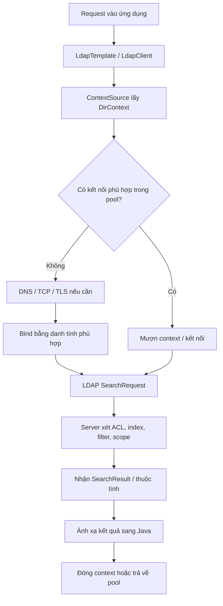

# Chi phí bind, search và tạo context trong Spring LDAP

Trong ứng dụng dùng **Spring LDAP**, độ trễ của một lời gọi tra cứu thư mục không chỉ đến từ việc máy chủ tìm entry. Ứng dụng còn có thể phải mở kết nối mạng, thương lượng TLS, thực hiện LDAP `bind`, nhận kết quả `search` và ánh xạ dữ liệu Java. Nếu bỏ qua các bước này, ta dễ tối ưu filter trong khi nút thắt thực sự là tạo kết nối mới cho từng request, hoặc bật pooling nhưng vẫn phải chờ hàng đợi của pool.

Bài học thuộc chương **Hiệu năng**, tập trung vào cách nhận diện, đo và tối ưu chi phí **tạo context – bind – search** khi dùng `ContextSource`, `LdapTemplate`, `LdapClient` hoặc LDAP Object-Directory Mapping (ODM). Ví dụ dùng cây thư mục giả định `dc=example,dc=org` với người dùng nằm tại `ou=people,dc=example,dc=org`.

## 1. Ba loại chi phí nằm ở đâu?

Hãy phân biệt các khái niệm sau:

| Khái niệm | Bản chất | Nơi có thể tốn thời gian |
| --- | --- | --- |
| **Context** | Đối tượng `DirContext`/`LdapContext` của JNDI, được `ContextSource` cung cấp để thực hiện thao tác | Lấy context từ pool hoặc tạo mới; có thể kéo theo DNS, TCP, TLS và mở phiên LDAP |
| **Bind** | Thao tác LDAP xác lập danh tính/xác thực trên kết nối, thường với DN và mật khẩu hoặc cơ chế SASL | Trao đổi yêu cầu–phản hồi qua mạng và kiểm tra thông tin xác thực ở máy chủ |
| **Search** | Truy vấn trên một base DN, search scope và LDAP filter để lấy entry/attribute | Đợi pool/kết nối; kiểm tra quyền; xử lý index/filter; duyệt entry; truyền kết quả; giải mã/ánh xạ |
| **Đóng/trả context** | Kết thúc sử dụng đối tượng JNDI sau một thao tác | Trả kết nối vào pool nếu pooling hợp lệ, hoặc đóng kết nối; có thể tạo thêm chi phí trong chu kỳ sống |

`LdapTemplate` quản lý việc lấy và giải phóng context cho phần lớn thao tác của nó. `LdapClient` cung cấp API kiểu fluent ở cấp cao hơn nhưng cuối cùng vẫn dựa trên kết nối/context LDAP; ODM bổ sung chi phí ánh xạ entry thành đối tượng. Vì vậy, đổi tên API không tự động loại bỏ chi phí mạng.

### Luồng của một truy vấn



Sơ đồ cho thấy một *kịch bản điển hình*, không phải cam kết mỗi lần gọi đều phát sinh `BindRequest`. Một context mới có thể dùng thông tin xác thực đã cấu hình, còn context lấy từ pool có thể tái sử dụng kết nối đã bind. Hành vi chính xác phụ thuộc JNDI provider, loại xác thực, TLS và cấu hình pooling. JNDI cũng có thể trì hoãn mở kết nối tới khi thao tác mạng thực sự diễn ra; đừng suy ra chi phí từ số lần gọi constructor.

## 2. Tách chi phí kết nối, bind và search

Có thể dùng mô hình gần đúng để lập kế hoạch đo:

```text
Lần đầu / không tái sử dụng:
T ≈ T_DNS + T_TCP + T_TLS + T_bind + T_search + T_transfer + T_mapping

Tái sử dụng kết nối đã bind bằng tài khoản dịch vụ:
T ≈ T_borrow_pool + T_search + T_transfer + T_mapping

Xác thực mật khẩu người dùng bằng LDAP bind:
T ≈ T_tìm_DN_nếu_cần + T_kết_nối_người_dùng + T_user_bind (+ T_đọc_thuộc_tính)
```

Đây là **các thành phần cần đo**, không phải phép cộng hoàn toàn độc lập trong mọi JNDI provider. Ví dụ, DNS có thể được cache, TLS có thể nối lại phiên, hay một lời gọi "lấy context" đã bao gồm TCP và bind. Khi thu thập số đo, phải định nghĩa ranh giới của từng phép đo để tránh cộng trùng.

Ví dụ giả định cho một thao tác tìm người dùng, trên cùng mạng và cùng server:

| Thành phần giả định | Mỗi request mở kết nối mới | Tái sử dụng kết nối tài khoản dịch vụ |
| --- | ---: | ---: |
| Thiết lập TCP/TLS | 18 ms | 0 ms |
| Bind dịch vụ | 6 ms | 0 ms |
| Mượn context từ pool | 0 ms | 1 ms |
| Server xử lý search và trả dữ liệu | 9 ms | 9 ms |
| Ánh xạ kết quả | 2 ms | 2 ms |
| **Tổng minh họa** | **35 ms** | **12 ms** |

Các con số trên chỉ nhằm chỉ ra thành phần có thể tiết kiệm; chúng **không phải benchmark Spring LDAP**. Với search nặng 500 ms, cải thiện kết nối 20 ms sẽ có tác động nhỏ hơn. Với một truy vấn tra cứu rất nhanh, cùng 20 ms đó có thể chiếm phần lớn độ trễ.

## 3. Chi phí tạo context và cấu hình `ContextSource`

Trong Spring LDAP, `LdapContextSource` là nơi cấu hình địa chỉ máy chủ, base DN, danh tính truy cập và thuộc tính JNDI. Thông thường, tạo bean `LdapTemplate` không đồng nghĩa ngay lập tức tạo một kết nối LDAP cho mỗi request; thao tác LDAP sẽ yêu cầu `ContextSource` cung cấp context thích hợp.

Ví dụ cấu hình bean Java (Java 17+, Spring Framework/Spring LDAP tương thích):

```java
import java.util.HashMap;
import java.util.Map;

import org.springframework.context.annotation.Bean;
import org.springframework.context.annotation.Configuration;
import org.springframework.ldap.core.LdapTemplate;
import org.springframework.ldap.core.support.LdapContextSource;

@Configuration
class LdapConfiguration {

    @Bean
    LdapContextSource ldapContextSource() {
        LdapContextSource source = new LdapContextSource();
        source.setUrl("ldaps://directory.example.org:636");
        source.setBase("dc=example,dc=org");
        source.setUserDn("cn=svc-reader,ou=system,dc=example,dc=org");
        source.setPassword(System.getenv("LDAP_BIND_PASSWORD"));

        Map<String, Object> environment = new HashMap<>();
        environment.put("com.sun.jndi.ldap.connect.timeout", "3000");
        environment.put("com.sun.jndi.ldap.read.timeout", "3000");
        source.setBaseEnvironmentProperties(environment);
        return source;
    }

    @Bean
    LdapTemplate ldapTemplate(LdapContextSource ldapContextSource) {
        return new LdapTemplate(ldapContextSource);
    }
}
```

Ở đây:

- `setBase("dc=example,dc=org")` khiến các base tương đối như `ou=people` được giải quyết trong cây đó. Không ghép lại `dc=example,dc=org` vào query nếu API đang dùng base tương đối, nếu không DN có thể sai.
- `connect.timeout` giới hạn thời gian thiết lập kết nối và, trong một số cấu hình JNDI pooling, cả thời gian chờ mượn kết nối; `read.timeout` giới hạn thời gian chờ phản hồi ở tầng JNDI. Chúng **khác** với `timeLimit` của LDAP search.
- `ldaps://` bảo vệ đường truyền khi chứng chỉ và tên máy chủ được xác thực đúng. Cần cấu hình truststore thích hợp; tuyệt đối không vô hiệu hóa kiểm tra chứng chỉ để lấy thêm hiệu năng.
- Mật khẩu tài khoản dịch vụ lấy từ biến môi trường chỉ là ví dụ tối thiểu. Trong triển khai thực tế nên dùng cơ chế cấp phát secret được quản lý và không ghi thông tin xác thực ra log.

### Những yếu tố làm chi phí tạo kết nối tăng

1. **Đường đi mạng:** độ trễ tới domain controller/LDAP server, DNS hoặc cân bằng tải; kết nối giữa nhiều vùng địa lý thường chậm hơn.
2. **TLS:** full handshake, kiểm tra chứng chỉ và khả năng reuse phiên TLS; mở kết nối liên tục lặp lại phần việc này.
3. **Hạn mức của server:** giới hạn kết nối, tốc độ bind, giới hạn hoạt động song song và tài nguyên CPU.
4. **Referrals và nhiều URL:** truy vấn chuyển sang máy chủ khác có thể cần kết nối hoặc bind bổ sung.
5. **Pool không đủ hoặc kết nối hết hạn:** request chờ mượn, hoặc mượn phải kết nối bị server đóng rồi tạo lại.

**Dấu hiệu thực tế:** nếu p95 của một lookup tăng đúng lúc số lần mở TCP, handshake TLS hoặc bind/giây tăng, hãy kiểm tra vòng đời context trước khi sửa LDAP filter.

## 4. Chi phí bind: tài khoản dịch vụ khác đăng nhập người dùng

**Service bind** dùng một danh tính kỹ thuật (ví dụ `cn=svc-reader,...`) để tra cứu và có thể được tái sử dụng cho các thao tác có quyền giống nhau. **User bind** dùng danh tính và mật khẩu của chính người đăng nhập để server xác thực. Hai mục đích không thể tráo đổi.

Trong Spring LDAP, một cách xác thực phổ biến là tìm DN người dùng rồi thử bind bằng DN và mật khẩu được cung cấp. Với biến thể `LdapTemplate.authenticate(base, filter, password)`, tài liệu API mô tả quy trình gồm tìm entry khớp duy nhất và dùng DN nhận được để bind; do đó một lần đăng nhập có thể bao gồm **ít nhất một search và một user bind**.

Ví dụ:

```java
import org.springframework.ldap.core.LdapTemplate;
import org.springframework.ldap.filter.EqualsFilter;

class DirectoryAuthentication {
    private final LdapTemplate ldapTemplate;

    DirectoryAuthentication(LdapTemplate ldapTemplate) {
        this.ldapTemplate = ldapTemplate;
    }

    boolean checkPassword(String uid, String password) {
        // Phải kiểm tra uid/password hợp lệ trước khi gọi.
        EqualsFilter filter = new EqualsFilter("uid", uid);
        return ldapTemplate.authenticate(
            "ou=people",
            filter.encode(),
            password
        );
    }
}
```

`EqualsFilter` tạo biểu thức filter có escaping cho giá trị truyền vào. Phương thức ba tham số trả về boolean cho trường hợp xác thực thông thường; vẫn cần xử lý riêng lỗi kết nối, lỗi server và các ngoại lệ thích hợp với phiên bản thư viện đang dùng. Không log mật khẩu, không ghép trực tiếp `uid` vào filter và không thực hiện bind ẩn danh ngoài chủ đích ứng dụng (đặc biệt khi mật khẩu rỗng).

Điểm cần nhớ khi tối ưu:

- **Tra cứu bằng service account:** reuse kết nối phù hợp thường giúp tránh nhiều lần kết nối/bind dịch vụ.
- **Đăng nhập bằng mật khẩu người dùng:** vẫn phải chứng minh thông tin xác thực với server theo chính sách; không được lấy một kết nối đã bind bằng service account làm bằng chứng mật khẩu người dùng đúng.
- **Biết DN người dùng từ quy tắc đáng tin cậy:** một số hệ thống có thể bind trực tiếp, tránh bước search DN; chỉ làm vậy nếu cấu trúc DN và quy tắc nhận dạng thực sự ổn định, an toàn.
- **Bind thất bại cũng tốn tài nguyên:** brute force hoặc nhiều lần thử sai có thể gây tải; bảo vệ đầu vào bằng rate limiting, chính sách khóa tài khoản và giám sát phù hợp.

Lưu ý riêng: `ContextSource.getContext(principal, credentials)` trong Spring LDAP chủ ý không sử dụng **native JNDI connection pooling** cho trường hợp cung cấp thông tin xác thực cụ thể, để thay đổi mật khẩu có hiệu lực kịp thời. Vì vậy không nên kỳ vọng bật `setPooled(true)` sẽ làm mọi user bind trở nên "miễn phí".

## 5. Chi phí search: chọn đúng base, scope, filter và thuộc tính

Độ trễ search phụ thuộc cả cách client đặt câu hỏi lẫn khả năng của directory server. Bốn thông số cơ bản là:

| Thông số | Ảnh hưởng đến hiệu năng | Cách chọn |
| --- | --- | --- |
| **Base DN** | Xác định nhánh thư mục phải xét | Thu hẹp tới `ou=people`, `ou=groups` hoặc nhánh cần tìm |
| **Search scope** | `OBJECT` / `ONELEVEL` / `SUBTREE` tương ứng mức duyệt | Dùng scope hẹp nhất vẫn đủ kết quả; `ONELEVEL` không tìm sâu vào OU con |
| **Filter** | Quyết định số entry ứng viên và khả năng dùng index | Ưu tiên equality trên thuộc tính được index (như `uid` nếu server đã cấu hình index) |
| **Returning attributes** | Quyết định lượng dữ liệu truyền và công ánh xạ | Chỉ lấy `cn`, `mail`… khi không cần ảnh, blob hoặc toàn bộ attribute |

Ví dụ search được giới hạn rõ ràng:

```java
import java.util.List;
import org.springframework.ldap.core.AttributesMapper;
import org.springframework.ldap.core.LdapTemplate;
import org.springframework.ldap.query.LdapQuery;
import org.springframework.ldap.query.LdapQueryBuilder;
import org.springframework.ldap.query.SearchScope;

record UserView(String commonName, String email) {}

class DirectoryUsers {
    private final LdapTemplate ldapTemplate;

    DirectoryUsers(LdapTemplate ldapTemplate) {
        this.ldapTemplate = ldapTemplate;
    }

    List<UserView> findByUid(String uid) {
        LdapQuery query = LdapQueryBuilder.query()
            .base("ou=people")
            .searchScope(SearchScope.ONELEVEL)
            .attributes("cn", "mail")
            .countLimit(50)
            .timeLimit(2000)
            .where("uid").is(uid);

        return ldapTemplate.search(
            query,
            (AttributesMapper<UserView>) attrs -> {
                String cn = attrs.get("cn") == null
                    ? null : String.valueOf(attrs.get("cn").get());
                String mail = attrs.get("mail") == null
                    ? null : String.valueOf(attrs.get("mail").get());
                return new UserView(cn, mail);
            }
        );
    }
}
```

`LdapQueryBuilder` hỗ trợ `base`, `searchScope`, `attributes`, `countLimit` và `timeLimit`. Trong ví dụ, cả giới hạn kết quả và thời gian đều có chủ đích; các giá trị phải chọn theo yêu cầu nghiệp vụ, server và SLO thực tế. `timeLimit(2000)` là tham số thời gian tìm kiếm tính bằng mili giây, không thay thế timeout kết nối/đọc. Nếu người dùng được tổ chức trong nhiều OU lồng nhau thì `ONELEVEL` sẽ bỏ sót họ; cần đổi sang `SUBTREE` hoặc thiết kế lại base.

### Vì sao một filter có thể rất đắt?

- `(uid=alice)` thường hiệu quả nếu `uid` có index tương ứng, nhưng schema/index của từng server mới quyết định kết quả.
- `(cn=*an*)` có wildcard đầu hoặc giữa có thể khó tận dụng index hơn và phải duyệt nhiều ứng viên.
- `(objectClass=*)` cùng `SUBTREE` tại root rộng dễ lấy quá nhiều entry.
- Filter gồm nhiều nhánh `OR` hoặc các phép kết hợp phức tạp làm tăng chi phí lập kế hoạch và so khớp; index và tối ưu của từng sản phẩm LDAP có thể khác nhau.
- Dù server trả đúng vài entry, yêu cầu toàn bộ attribute, đặc biệt attribute nhị phân hoặc nhiều giá trị, vẫn có thể gây chậm do truyền mạng và mapping.

**Bảo mật liên quan trực tiếp đến hiệu năng:** dùng `LdapQueryBuilder.where(...).is(value)` hoặc lớp `Filter` để escape dữ liệu nhập. Nối thẳng input vào `(uid=...)` vừa mở đường LDAP injection vừa có thể làm query ngoài ý muốn tốn tài nguyên. Giới hạn số kết quả ở client không thay thế việc server áp size limit, time limit và access control.

### Search hàng loạt và phân trang

Một giao diện hiển thị 500 thành viên có thể gây **N+1 search** nếu tìm danh sách rồi lại tra thêm từng người. Tùy mô hình dữ liệu, cân nhắc lấy đúng thuộc tính ngay trong một search, dùng filter nhóm có giới hạn kích thước, hoặc chia batch hợp lý. Với truy vấn nhiều entry, xem xét **LDAP Simple Paged Results** (RFC 2696) nếu directory server hỗ trợ; phân trang giảm lượng dữ liệu mỗi lần trả nhưng không khiến một filter xấu tự động rẻ đi. Khi phân trang phải xử lý cookie, giới hạn server và thay đổi dữ liệu giữa các trang.

Với ODM, chỉ ánh xạ những gì cần cho use case; với `LdapClient`, vẫn đặt base, filter, scope và attributes tương đương. Đo cả thời gian mapping vì chi phí tạo đối tượng/đọc thuộc tính lớn có thể lấn át thời gian server tìm kiếm.

## 6. Pooling: giảm tạo context nhưng không xóa mọi chi phí

**Connection/context pooling** tái sử dụng kết nối LDAP đã được thiết lập để nhiều thao tác tuần tự không phải tạo kết nối và bind dịch vụ liên tục. Spring LDAP có hai hướng dễ gặp:

| Cách tiếp cận | Đặc điểm chính | Lưu ý |
| --- | --- | --- |
| **Native JNDI pooling** (`LdapContextSource.setPooled(true)`) | Pool do Java LDAP provider quản lý; ít tùy chọn kiểm tra và bảo trì | Mặc định `false` trong Spring LDAP; cấu hình nhiều thuộc tính ở cấp JVM; có hạn chế với TLS và thay đổi trạng thái kết nối |
| **Spring LDAP `PoolingContextSource`** | Bọc `ContextSource` và quản lý pool, cho phép kiểm tra context còn dùng được | Có chi phí mượn/trả và validation; cần chọn kích thước, timeout, kiểm tra idle phù hợp |

Nên đánh giá cơ chế `PoolingContextSource` theo version đang dùng nếu cần cấu hình và giám sát pool chi tiết. Đặc biệt, `PoolingContextSource` giả định các context loại read-only (và read-write tương ứng) có cùng môi trường xác thực. **Không bọc `ContextSource` lấy user principal động từ `AuthenticationSource` rồi dùng chung pool**, vì một context đã xác thực bằng người dùng trước có thể được tái sử dụng sai danh tính cho người sau. Đây là vấn đề an toàn dữ liệu chứ không chỉ vấn đề hiệu năng.

Không bật native JNDI pooling một cách mặc định khi dùng **StartTLS** hoặc khi thay đổi principal/trạng thái bảo mật trên kết nối. JNDI không theo dõi đầy đủ các thay đổi đó. Với **LDAPS**, điều kiện pooling và hỗ trợ SSL phụ thuộc cấu hình JNDI/JVM; kiểm chứng thực nghiệm trên deployment cụ thể. Ưu tiên cấu hình TLS an toàn và pool được thư viện hỗ trợ rõ ràng.

Pool cũng không vô hạn. Giả sử server xử lý tối đa 20 truy vấn đồng thời nhanh nhưng pool chỉ cho phép 4 context: 16 request còn lại có thể nằm ở hàng đợi dù server chưa quá tải. Ngược lại, tăng pool quá lớn có thể đẩy server vào giới hạn kết nối/bind, làm tail latency xấu đi.

Các thông số cần cân nhắc cùng nhau:

1. **Max active/total**: số kết nối có thể sử dụng cùng lúc, tương quan với tải đồng thời và sức chứa server.
2. **Max/min idle và thời gian sống**: tránh tạo lại khi tải dao động nhưng không giữ quá nhiều kết nối không dùng.
3. **Validation khi borrow/idle**: giảm lỗi do kết nối chết; mỗi phép thử có thể thêm một LDAP search và latency.
4. **Pool wait timeout**: chặn thời gian xếp hàng quá lâu; phối hợp với `connect.timeout`, `read.timeout` và deadline của request.
5. **Phân tách danh tính**: pool của tài khoản dịch vụ có quyền cố định; xử lý user bind theo vòng đời xác thực riêng.

Một `DirContext` mượn từ pool cần được hoàn trả qua cơ chế do Spring quản lý. Không giữ context trong biến singleton, cache tùy tiện hoặc dùng chung một instance `DirContext` cho nhiều thread. Dùng `LdapTemplate` để tránh rò rỉ do quên giải phóng tài nguyên.

## 7. Đo và xác định nút thắt

Cần tối thiểu hai lớp quan sát: **client (ứng dụng)** và **directory server**.

| Quan sát | Ví dụ chỉ số | Câu hỏi chẩn đoán |
| --- | --- | --- |
| End-to-end tại client | throughput, p50/p95/p99 theo loại thao tác | Search hay login nào đang chậm? |
| Kết nối và TLS | kết nối mới/giây, TLS handshake, lỗi connect, DNS | Có tạo kết nối lại liên tục không? |
| Pool | active/idle, pending/wait time, borrow timeout, validation failure | Request chờ pool hay chờ server? |
| Bind | bind/giây theo loại service/user, lỗi xác thực tổng hợp | Một request phát sinh mấy lần bind? |
| Search | số truy vấn, scope/filter **đã phân loại**, số entry/bytes, server time | Search rộng hoặc không có index? |
| Server | CPU, I/O, search candidates/examined, index usage, giới hạn size/time | Bản thân directory server bị nghẽn? |

Gắn thời gian cho **toàn bộ** lời gọi LDAP trước, sau đó chia nhỏ bằng metric của pool/server hoặc trace ở môi trường được phép. Không thể suy ra chắc chắn từng thành phần từ một stopwatch bao quanh `ldapTemplate.search`. Khi gắn metric, dùng nhãn cố định như `operation=searchByUid`, `result=success/error`; không đưa password, DN đầy đủ, filter có giá trị cá nhân hoặc UID người dùng vào tag/log.

Ví dụ dùng Micrometer đo latency tổng thể:

```java
import io.micrometer.core.instrument.MeterRegistry;
import io.micrometer.core.instrument.Timer;
import java.util.List;
import org.springframework.ldap.core.AttributesMapper;
import org.springframework.ldap.core.LdapTemplate;
import org.springframework.ldap.query.LdapQuery;

class MeasuredDirectoryLookup {
    private final LdapTemplate ldapTemplate;
    private final Timer searchTimer;

    MeasuredDirectoryLookup(LdapTemplate ldapTemplate,
                            MeterRegistry registry) {
        this.ldapTemplate = ldapTemplate;
        this.searchTimer = Timer.builder("directory.ldap.operation")
            .description("Thoi gian xu ly LDAP tu phia ung dung")
            .tag("operation", "searchByUid")
            .register(registry);
    }

    List<String> findNames(LdapQuery query) {
        return searchTimer.record(() ->
            ldapTemplate.search(
                query,
                (AttributesMapper<String>) attrs -> attrs.get("cn") == null
                    ? "" : String.valueOf(attrs.get("cn").get())
            )
        );
    }
}
```

`Timer` đo thời gian đến khi `search` trả về và mapping hoàn tất; nó **bao gồm cả thời gian chờ pool** nếu có. Để tìm nguyên nhân p99 tăng, đối chiếu cùng thời điểm với metric LDAP server, pool, lỗi kết nối và TLS, không chỉ nhìn một biểu đồ tổng.

### Quy trình benchmark có thể tái lập

1. **Đặt mục tiêu**: ví dụ "p95 tra cứu uid dưới 80 ms ở 150 request/giây" và xác định tỉ lệ read/login/write.
2. **Chuẩn bị dữ liệu giống thật**: số entry, độ sâu OU, index, ACL và độ dài attribute; dùng dữ liệu test, không dùng mật khẩu thật.
3. **Làm ấm ứng dụng**: khởi tạo JVM, cache liên quan, pool/TLS theo kịch bản; tách kết quả cold start và steady state.
4. **Chạy ba kịch bản**: không pooling, pooling ở mức hợp lý, pooling lớn hơn; với mỗi kịch bản giữ nguyên filter, dữ liệu, số concurrent client.
5. **Đo riêng**: tra cứu service bind, đăng nhập user bind, filter rộng, filter có index; đo p50/p95/p99, throughput và tỷ lệ lỗi trong thời gian đủ dài.
6. **Kiểm tra hạn mức**: timeout, rate limit, LDAP server size limit, số kết nối, server CPU; giá trị nhanh do query trả thiếu entry không phải tối ưu thành công.
7. **So sánh có kiểm soát**: thay đổi một tham số chính mỗi lần; ghi cấu hình, workload, số mẫu và phân phối độ trễ để người khác tái tạo.

Đừng chỉ lấy trung bình: vài lần reconnect hoặc hết kết nối trong pool có thể làm p99 rất cao trong khi p50 vẫn đẹp.

## 8. Chẩn đoán tình huống thường gặp

| Triệu chứng | Giả thuyết cần kiểm tra | Thử nghiệm hoặc hướng xử lý |
| --- | --- | --- |
| Lookup đơn giản đôi khi chậm ~100–300 ms | Kết nối/TLS được tạo lại, DNS chậm, pool hết hạn | So sánh cold/warm, đếm connect/bind, kiểm tra pool và mạng |
| CPU LDAP server cao, search chậm ổn định | Filter không dùng index, base quá rộng hoặc nhiều entry | Thu hẹp base/scope, xem explain/statistics/index của server |
| p95 tăng khi có nhiều người dùng đồng thời | Pool wait, server giới hạn kết nối/worker | Đo active/pending, tăng có kiểm soát, giảm concurrency |
| Đăng nhập chậm nhưng đọc hồ sơ nhanh | Search DN + bind người dùng; chính sách auth hoặc tuyến tới server khác | Đo từng bước auth, kiểm tra base/filter DN, không bỏ qua bind |
| Sau thời gian idle, request đầu tiên lỗi | Kết nối stale bị server/load balancer đóng | Thiết lập validation/eviction, timeout và retry chọn lọc |
| Dữ liệu hiển thị thiếu sau tối ưu | Scope/size limit nhỏ hơn hoặc pagination chưa đủ | Kiểm tra tổng số entry kỳ vọng và xử lý result code/cookie |
| Dùng pool có vẻ không nhanh hơn | Search là nút thắt hoặc validation/pool wait quá lớn | So sánh metric từng lớp; kiểm tra timeout và pool size |

**Retry có điều kiện:** có thể thử lại một thao tác *chỉ đọc* sau lỗi kết nối ngắn hạn, với backoff và deadline. Không retry vô hạn, không tự động lặp bind sai mật khẩu, và đặc biệt thận trọng với thao tác thêm/sửa/xóa entry vì server có thể đã áp dụng thay đổi dù client nhận timeout.

## 9. Bài thực hành: tìm nút thắt trong một luồng đăng nhập

Giả sử một API đăng nhập đang làm như sau:

1. Dùng tài khoản dịch vụ tìm `uid` trong `ou=people` để lấy DN người dùng.
2. Bind với DN và mật khẩu người dùng để xác thực.
3. Dùng tài khoản dịch vụ tìm thông tin nhóm theo `member=<user DN>`.
4. Đổi các thuộc tính cần thiết thành response.

Yêu cầu thực hành:

- Vẽ chuỗi thao tác và đánh dấu chỗ nào là **service search**, **user bind**, **group search** và **context acquisition**.
- Đặt metric cho mỗi bước (không ghi credential hoặc UID thật); đo p50/p95/p99 tại tải thấp và tải đồng thời.
- Thu hẹp base/scope; chọn thuộc tính cần trả; kiểm tra index cho `uid` và `member` theo loại server.
- Thử pooling **chỉ cho ngữ cảnh service account cố định**, đo lại kết nối mới, pool wait, bind và latency tổng.
- Xác nhận kết quả auth vẫn chính xác khi đổi mật khẩu, khóa tài khoản, người dùng trùng/không tồn tại, và khi pool có kết nối stale.

**Phân tích mẫu:** nếu phần service search tổng cộng 10 ms, user bind 40 ms và group search 15 ms, cải thiện 10 ms chi phí kết nối của service account chỉ giảm một phần latency. Bước tiếp theo nên kiểm tra tuyến mạng và chính sách bind người dùng; tuyệt đối không cache việc xác thực mật khẩu theo cách làm mất tính cập nhật hoặc bỏ qua chính sách bảo mật.

## 10. Checklist vận hành

- [ ] Phân biệt rõ **context acquisition**, **service bind**, **user bind**, **search** và mapping trong trace/metric.
- [ ] Đặt base DN, scope, filter có escaping và returning attributes đúng yêu cầu.
- [ ] Có timeout cho connect, read, search và giới hạn kết quả phù hợp.
- [ ] Pool chỉ tái sử dụng context trong cùng phạm vi danh tính/quyền; có chính sách validation, eviction và hạn mức.
- [ ] TLS và xác thực chứng chỉ được duy trì; không dùng connection reuse để bỏ qua user bind.
- [ ] Theo dõi p95/p99, lỗi, số kết nối, thời gian chờ pool và hiệu năng server.
- [ ] Kiểm thử đủ số entry, trường hợp quá hạn, thay đổi mật khẩu, lỗi kết nối và dữ liệu có nhiều OU.
- [ ] Mọi tối ưu được đánh giá bằng benchmark cùng workload, số liệu trước/sau và tỷ lệ lỗi.

## Tài liệu tham khảo

- [Spring LDAP – Advanced LDAP Queries](https://docs.spring.io/spring-ldap/reference/query-builder-advanced.html): tham số `LdapQueryBuilder` gồm base, scope, attributes, count/time limit và filter.
- [Spring LDAP – LdapTemplate API](https://docs.spring.io/spring-ldap/reference/api/java/org/springframework/ldap/core/LdapTemplate.html): search, authenticate và vòng đời thao tác.
- [Spring LDAP – Configuration](https://docs.spring.io/spring-ldap/reference/configuration.html): `ContextSource`, giới hạn mặc định và native JNDI pooling.
- [Spring LDAP – Pooling Support](https://docs.spring.io/spring-ldap/reference/pooling.html): `PoolingContextSource`, validation, cấu hình và giới hạn với xác thực động.
- [Oracle JNDI – Connection Pooling](https://docs.oracle.com/javase/jndi/tutorial/ldap/connect/pool.html): hành vi pooled connections và cảnh báo khi StartTLS/đổi trạng thái bảo mật.

