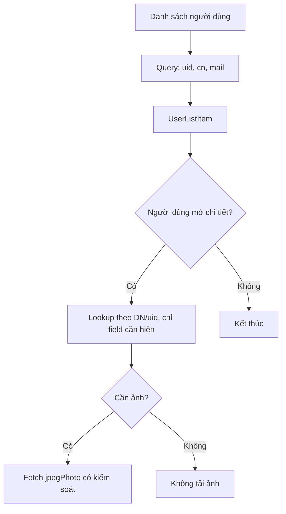

# Giảm attribute trả về không cần thiết trong Spring LDAP

Một truy vấn LDAP có thể có **filter rất chọn lọc** nhưng vẫn chậm khi mỗi kết quả trả về hàng chục thuộc tính không cần dùng, đặc biệt là ảnh, chứng chỉ, danh sách nhóm hoặc những thuộc tính đa trị lớn. Trong **Spring LDAP**, chỉ định chính xác danh sách *returning attributes* giúp giảm dữ liệu truyền qua mạng, chi phí giải mã phản hồi LDAP, cấp phát bộ nhớ và ánh xạ kết quả sang Java.

Bài thuộc chương **Hiệu năng** của **SPRING_LDAP**. Nội dung tập trung vào cách chọn thuộc tính cần lấy bằng `LdapQueryBuilder`, `LdapTemplate` và `SearchControls`; cách xử lý dữ liệu thiếu, đa trị và nhị phân; các lưu ý khi dùng `LdapClient` hoặc Object-Directory Mapping (ODM); và phương pháp đo tác động của tối ưu mà vẫn giữ đúng ngữ nghĩa, quyền truy cập, TLS và luồng xác thực.

## 1. Returning attributes là gì?

Một lệnh LDAP `SearchRequest` chứa nhiều phần: `baseObject` (base DN), `scope`, `filter`, `attributes` và các giới hạn tìm kiếm. Trường **attributes** cho server biết những kiểu thuộc tính nào cần đưa vào từng `SearchResultEntry`. Ví dụ:

```text
Search base:  ou=people,dc=example,dc=org
Scope:        SUBTREE
Filter:       (&(objectClass=inetOrgPerson)(uid=alice))
Attributes:   uid, cn, mail
```

Một entry có thể lưu:

```ldif
dn: uid=alice,ou=engineering,ou=people,dc=example,dc=org
objectClass: inetOrgPerson
uid: alice
cn: Alice Nguyen
sn: Nguyen
givenName: Alice
mail: alice@example.org
telephoneNumber: +84-28-0000-0000
description: Engineering manager
jpegPhoto:: <du-lieu-nhi-phan-minh-hoa>
userCertificate;binary:: <du-lieu-nhi-phan-minh-hoa>
```

Nếu màn hình danh sách chỉ hiển thị tên và email, client chỉ cần `cn` và `mail` (hoặc `uid` nếu dùng làm định danh). Không có lý do nghiệp vụ để tải `jpegPhoto` hoặc `userCertificate` trong mỗi dòng danh sách.

**Phân biệt quan trọng:** DN là tên của entry và được dùng để định vị; nó không phải một attribute bình thường bắt buộc phải liệt kê trong `attributes`. Giá trị `dn` ở đầu LDIF là thông tin nhận dạng entry. Trong Java, API ánh xạ khác nhau có thể cung cấp DN cùng kết quả search thông qua context hoặc tên kết quả, không phải từ `attrs.get("dn")`.

### Dữ liệu nào tạo thành chi phí?

```mermaid
flowchart LR
    A["Ứng dụng Spring LDAP"] -->|"SearchRequest: base, filter, attributes"| B["LDAP server"]
    B --> C["Đánh giá filter / ACL / index"]
    C --> D["Đọc các attribute cần trả"]
    D --> E["Mã hóa SearchResultEntry"]
    E -->|"Dữ liệu qua mạng/TLS"| F["Giải mã JNDI"]
    F --> G["AttributesMapper / ODM"]
    G --> H["DTO / API response"]
```



Giảm returning attributes chủ yếu tác động đến các khâu **đọc và tạo phần dữ liệu trả về, truyền qua mạng, giải mã và ánh xạ**. Nó **không tự động giảm số ứng viên phải xét để đánh giá filter** hoặc thay thế việc chọn base DN, scope, filter và index tốt.

## 2. Khi không chỉ định attribute, chuyện gì xảy ra?

Theo cơ chế lựa chọn attribute trong LDAP (RFC 4511), các biểu thức sau có ý nghĩa khác nhau:

| Danh sách được yêu cầu | Ý nghĩa chuẩn | Ví dụ dùng |
| --- | --- | --- |
| Không chỉ định danh sách, hoặc danh sách rỗng theo giao thức | Trả **các user attributes thông thường** của entry | Mặc định thuận tiện nhưng có nguy cơ lấy quá nhiều |
| `*` | Yêu cầu tất cả **user attributes** | Xem entry đầy đủ khi chẩn đoán có kiểm soát |
| `+` | Yêu cầu các **operational attributes** theo RFC 3673 nếu server hỗ trợ | Ví dụ xem metadata phục vụ vận hành |
| `*` cùng `+` | Yêu cầu cả user attributes và operational attributes có thể trả về | Điều tra chuyên biệt; tránh trong API thông thường |
| `1.1` | Chọn **không attribute nào** | Kiểm tra entry có tồn tại khi không cần nội dung thuộc tính |
| `uid`, `cn`, `mail` | Chỉ yêu cầu các attribute được nêu | DTO danh sách người dùng |
| `cn`, `mail`, `modifyTimestamp` | Yêu cầu cả trường nghiệp vụ và metadata cụ thể | Màn hình kiểm toán; chỉ khi quyền và server hỗ trợ |

`1.1` có ý nghĩa đặc biệt khi là yêu cầu không lấy attribute. Nếu đi kèm tên attribute khác, server bỏ qua chỉ thị `1.1` và xử lý các tên còn lại theo quy tắc của LDAP. `+` là cơ chế mở rộng; đừng mặc định server nào cũng hỗ trợ hoặc trả giống nhau. Một số server có thuộc tính vận hành riêng, ví dụ `entryUUID` hoặc `modifyTimestamp` trong những triển khai phù hợp, và có thể áp thêm ACL.

**Không phải tất cả attribute trong schema đều luôn được trả về.** Một attribute có thể thiếu vì entry không có giá trị, người dùng không có quyền đọc, server không hỗ trợ kiểu đó, attribute thuộc nhóm operational chưa được yêu cầu, hoặc provider có cách biểu diễn khác. Chọn `*` cũng không bảo đảm nhận mọi metadata vận hành.

### Những nhầm lẫn cần tránh

- **Không chọn `attributes` trong builder** thường dẫn đến hành vi trả user attributes mặc định. Không có nghĩa là "không trả attribute".
- **Filter dùng `(uid=alice)`** không có nghĩa `uid` tự xuất hiện trong kết quả khi danh sách trả về chỉ là `cn` và `mail`. Điều kiện lọc và danh sách thuộc tính trả về là hai thành phần độc lập.
- **Chỉ nhận hai field trong DTO** không đồng nghĩa server chỉ gửi hai field: nếu search vẫn yêu cầu toàn bộ user attributes, JNDI có thể đã nhận và giải mã nhiều dữ liệu trước khi mapper bỏ đi.
- **Chỉ lấy `objectClass` khi cần** cho logic mapping/schema; việc dùng `objectClass` trong filter không bắt buộc ứng dụng phải lấy giá trị này.
- **Các limit về số entry** (ví dụ `countLimit(100)`) giới hạn số kết quả, còn returning attributes giới hạn *bề rộng dữ liệu của mỗi kết quả*.

## 3. Tại sao một trường lớn có thể làm lệch toàn bộ độ trễ?

Giả sử một màn hình cần hiển thị 200 người. Mỗi người có một ảnh `jpegPhoto` trung bình 200 KiB và một số trường văn bản tổng cộng 250 byte. Đây là số liệu **giả định** để thấy độ lớn tương đối.

| Cách trả dữ liệu | Chỉ xét phần payload thuộc tính | Chi phí tiềm ẩn |
| --- | ---: | --- |
| 200 entry × 200 KiB ảnh | Khoảng **39,1 MiB** ảnh | Truyền mạng/TLS, giải mã, giữ mảng byte, GC |
| 200 entry × 250 byte text | Khoảng **48,8 KiB** text | Nhỏ hơn rất nhiều; phù hợp danh sách |
| 200 entry × 250 byte text + ảnh khi mở chi tiết một người | Khoảng 48,8 KiB + 200 KiB cho ảnh được mở | Phân bổ chi phí theo tác vụ thật |

Các giá trị chỉ là dung lượng nội dung giả định, **không phải byte trên dây**: protocol LDAP, tên thuộc tính, BER/TLS, phân trang và biểu diễn dữ liệu đều tạo thêm overhead. Ngoài ảnh, giá trị đa trị như `member` của nhóm lớn hoặc lịch sử thuộc tính tùy schema cũng có thể chiếm đáng kể tài nguyên.

Chi phí thực tế được tạo bởi:

1. **Server:** lấy/chuẩn bị dữ liệu từng attribute, kiểm tra quyền đọc và mã hóa phản hồi LDAP.
2. **Mạng:** truyền nhiều byte hơn, đặc biệt tốn thời gian qua vùng địa lý xa hoặc khi concurrent request tăng.
3. **Client JNDI:** nhận và giải mã các attribute, tạo đối tượng `Attributes`, `Attribute` và các mảng dữ liệu.
4. **Ứng dụng Spring:** ánh xạ nhiều field hoặc byte[] sang DTO/ODM, giữ object đến khi GC.
5. **Tầng API:** nếu ứng dụng lại đẩy dữ liệu vào JSON, base64 có thể làm payload tăng; tệ hơn là vô tình trả thuộc tính nhạy cảm không cần thiết.

Chỉ cần một danh sách 200 user với ảnh lớn, một phép tối ưu filter vài mili giây không bù được việc chuyển hàng chục MiB không cần thiết.

## 4. Chỉ định attributes bằng `LdapQueryBuilder`

Cách đọc code rõ ràng nhất là yêu cầu đúng những trường màn hình sử dụng:

```java
import java.util.List;
import javax.naming.NamingException;
import javax.naming.directory.Attribute;
import javax.naming.directory.Attributes;

import org.springframework.ldap.core.AttributesMapper;
import org.springframework.ldap.core.LdapTemplate;
import org.springframework.ldap.query.LdapQuery;
import org.springframework.ldap.query.LdapQueryBuilder;
import org.springframework.ldap.query.SearchScope;

record UserListItem(String uid, String displayName, String email) {}

class UserDirectory {
    private final LdapTemplate ldapTemplate;

    UserDirectory(LdapTemplate ldapTemplate) {
        this.ldapTemplate = ldapTemplate;
    }

    List<UserListItem> findByUid(String uid) {
        if (uid == null || uid.isBlank()) {
            throw new IllegalArgumentException("uid must not be blank");
        }

        LdapQuery query = LdapQueryBuilder.query()
            .base("ou=people")
            .searchScope(SearchScope.SUBTREE)
            .attributes("uid", "cn", "mail")
            .countLimit(2)
            .timeLimit(2000)
            .where("uid").is(uid);

        return ldapTemplate.search(
            query,
            (AttributesMapper<UserListItem>) attrs -> new UserListItem(
                firstString(attrs, "uid"),
                firstString(attrs, "cn"),
                firstString(attrs, "mail")
            )
        );
    }

    private static String firstString(Attributes attrs, String name)
            throws NamingException {
        Attribute attr = attrs.get(name);
        return attr == null || attr.size() == 0
            ? null
            : String.valueOf(attr.get());
    }
}
```

Đoạn code minh họa Spring LDAP cùng Java 17+:

- `base("ou=people")` là DN tương đối **nếu** `LdapContextSource` đặt base chung `dc=example,dc=org`. Nếu context không có base chung, cần truyền base DN đầy đủ phù hợp.
- `SUBTREE` cho phép tìm người trong nhiều OU con. Chọn scope và filter đúng cũng quan trọng, nhưng chúng giải quyết vấn đề khác với projection.
- `attributes("uid", "cn", "mail")` yêu cầu server chỉ gửi ba thuộc tính phục vụ `UserListItem`.
- `firstString` kiểm tra attribute bị thiếu. Trong LDAP, một field có thể không tồn tại, không được phép đọc, hoặc không được yêu cầu; mapping không nên mặc định `attrs.get(...).get()` luôn thành công.
- `countLimit(2)` chỉ là minh họa để có thể nhận biết trường hợp nhiều kết quả khi mong đợi một uid. Cần xử lý rõ các trường hợp 0/1/nhiều kết quả và lỗi do server áp giới hạn, đặc biệt ở luồng xác thực hay phân quyền.
- `timeLimit(2000)` là giới hạn thời gian search trong API truy vấn; timeout thiết lập/đọc kết nối cấu hình riêng. Chọn giá trị theo SLO thực tế.

**Vấn đề cốt lõi:** projection xảy ra ở **LDAP request**, trước khi server trả dữ liệu. Nếu viết `ldapTemplate.search(query, mapper)` nhưng bỏ `.attributes(...)` rồi chỉ giữ vài field trong mapper, tối ưu đường truyền có thể chưa xảy ra.

### Mapping tập thuộc tính không đầy đủ

Trong các directory thực tế, `mail` có thể không tồn tại, `cn` có thể có nhiều giá trị, và một attribute có thể bị che bởi ACL. Mapper phải phản ánh **hợp đồng dữ liệu**:

- Field bắt buộc: nếu thiếu, trả lỗi có ý nghĩa hoặc loại entry theo quy tắc nghiệp vụ đã định.
- Field tùy chọn: cho phép `null`/`Optional` ở tầng domain, tránh ép thành chuỗi rỗng không phân biệt.
- Field đa trị: dùng `NamingEnumeration<?>` để lấy tất cả giá trị, không dùng một `get()` rồi xem đó là toàn bộ.
- Field nhị phân: xử lý `byte[]` theo loại dữ liệu thực tế; không đổi thành `String.valueOf` và coi như nội dung ảnh/chứng chỉ.

Ví dụ đọc một attribute đa trị:

```java
import java.util.ArrayList;
import java.util.List;
import javax.naming.NamingEnumeration;
import javax.naming.NamingException;
import javax.naming.directory.Attribute;
import javax.naming.directory.Attributes;

static List<String> values(Attributes attrs, String name)
        throws NamingException {
    Attribute attribute = attrs.get(name);
    if (attribute == null) {
        return List.of();
    }

    List<String> result = new ArrayList<>();
    NamingEnumeration<?> all = attribute.getAll();
    try {
        while (all.hasMore()) {
            result.add(String.valueOf(all.next()));
        }
    } finally {
        all.close();
    }
    return result;
}
```

Nếu không yêu cầu một field, code không nên cố truy cập field đó rồi âm thầm xem `null` là giá trị thực. Đó là **"không được fetch"**, khác với **"không có giá trị"**. Việc đánh dấu projection đã dùng trong DTO hoặc tổ chức các DTO riêng theo use case giúp tránh hiểu sai.

## 5. `SearchControls`: API thấp hơn nhưng cùng cơ chế

Khi dự án dùng overload của `LdapTemplate.search` với JNDI `SearchControls`, có thể chỉ định returning attributes trực tiếp:

```java
import java.util.List;
import javax.naming.directory.SearchControls;
import org.springframework.ldap.core.AttributesMapper;
import org.springframework.ldap.core.LdapTemplate;

class SimpleDirectoryLookup {
    private final LdapTemplate ldapTemplate;

    SimpleDirectoryLookup(LdapTemplate ldapTemplate) {
        this.ldapTemplate = ldapTemplate;
    }

    List<String> listNames() {
        SearchControls controls = new SearchControls();
        controls.setSearchScope(SearchControls.SUBTREE_SCOPE);
        controls.setReturningAttributes(new String[] {"cn"});
        controls.setCountLimit(100);
        controls.setTimeLimit(2000);

        return ldapTemplate.search(
            "ou=people",
            "(objectClass=inetOrgPerson)",
            controls,
            (AttributesMapper<String>) attrs ->
                attrs.get("cn") == null
                    ? null
                    : String.valueOf(attrs.get("cn").get())
        );
    }
}
```

Đây là cùng một ý tưởng với `LdapQueryBuilder.attributes("cn")`. Chọn một kiểu API nhất quán theo codebase và nhu cầu query. **Đừng dùng code trên như endpoint mở** cho phép tải 100 người bất kỳ nếu nghiệp vụ chỉ cần tìm một uid: filter vẫn phải có tính chọn lọc, escaping và kiểm tra quyền.

Với `SearchControls`, `setReturningAttributes(null)` mang nghĩa để provider lấy các user attributes mặc định, còn mảng tên cụ thể chỉ định những gì cần trả. Nếu mục tiêu chỉ kiểm tra sự tồn tại, có thể dùng yêu cầu thuộc tính `1.1` theo khả năng provider và API đang sử dụng, thay vì truyền mảng rỗng rồi tự giả định server không trả gì.

### Kiểm tra một entry tồn tại mà không lấy attribute

Với một DN đã biết hoặc search có filter chọn lọc, giao thức LDAP hỗ trợ `1.1`:

```text
Base DN: uid=alice,ou=people,dc=example,dc=org
Scope:   OBJECT
Filter:  (objectClass=*)
Attrs:   1.1
```

Search có thể trả về entry nhận dạng theo DN nhưng không mang attribute value. Tuy nhiên:

- Entry có thể không hiện ra do ACL/visibility hoặc filter, dù tồn tại về mặt vật lý.
- `1.1` không có nghĩa "không dùng mạng": search và kiểm tra quyền vẫn diễn ra.
- Không xây API phân quyền chỉ dựa trên việc một search xem thấy DN; phải dựa vào policy và thao tác được phép tương ứng.

## 6. Thiết kế projection theo từng use case

Một service LDAP thường phục vụ nhiều luồng. Đừng dùng cùng một query "lấy tất cả" cho mọi luồng.

| Use case | Thuộc tính cần cân nhắc | Những thứ nên loại bỏ nếu không dùng |
| --- | --- | --- |
| Gợi ý tên người dùng | `uid`, `cn` | Ảnh, chứng chỉ, mô tả dài, nhóm |
| Màn hình danh sách nhân sự | `uid`, `cn`, `mail`, có thể `telephoneNumber` | Dữ liệu binary, metadata vận hành |
| Chi tiết người dùng | Các field thật sự hiển thị; ảnh tải riêng khi mở ảnh | Các attribute nội bộ không hiển thị |
| Kiểm tra tồn tại của uid | Có thể không cần attribute (`1.1`) hoặc chỉ cần định danh theo thiết kế | Toàn bộ hồ sơ |
| Lấy nhóm theo `member` | `cn`, định danh nhóm hoặc attribute quyền cần thiết | Danh sách thành viên đầy đủ nếu chỉ cần tên nhóm |
| Kiểm tra thay đổi phục vụ đồng bộ | Thuộc tính định danh và metadata hỗ trợ (ví dụ `modifyTimestamp` khi có và được phép đọc) | Ảnh/dữ liệu lớn nếu chưa cần đồng bộ |

Danh sách chỉ là gợi ý: schema, quyền và tính duy nhất khác nhau theo **OpenLDAP, Active Directory** hoặc directory tùy biến. Ví dụ `memberOf` có thể là thuộc tính backlink được tính toán ở một số server; yêu cầu nó có thể tạo chi phí khác với `cn`. Không dùng `memberOf` như thay thế phổ quát cho mô hình nhóm của mọi server.

### Tách “list view” khỏi “detail view”



**Ưu điểm:** luồng danh sách nhẹ và chỉ số p95 ổn định hơn khi số kết quả tăng; dữ liệu lớn chỉ được truyền khi có yêu cầu cụ thể. **Đánh đổi:** mở chi tiết có thể sinh thêm một lần đọc LDAP, nên cần đo tổng trải nghiệm. Nếu hầu hết người dùng luôn mở chi tiết ngay sau danh sách, hãy so sánh hai thiết kế bằng workload thực tế thay vì áp dụng tách query một cách máy móc.

### Một API nên trả DTO phù hợp

Ví dụ minh họa cấu trúc ở tầng Java:

```java
record UserListItem(String uid, String name, String email) {}

record UserDetail(
    String uid,
    String name,
    String email,
    String phone,
    String description
) {}

// Ảnh không nằm trong ListItem/Detail nếu giao diện tải ảnh riêng.
record UserPhoto(String uid, byte[] imageBytes, String contentType) {}
```

Định nghĩa riêng DTO giúp người đọc code biết rõ API nào cần attribute nào. Nếu một DTO có 40 field tùy chọn dùng chung cho mọi endpoint, nguy cơ "lấy hết để phòng khi cần" tăng lên.

## 7. Attribute nhị phân và đa trị: tối ưu ở đâu?

Các thuộc tính cần cân nhắc theo schema thực tế:

| Loại | Ví dụ thường gặp | Nguy cơ |
| --- | --- | --- |
| Ảnh | `jpegPhoto`, `thumbnailPhoto` (tùy server) | Dung lượng lớn mỗi user; nhiều mảng byte |
| Chứng chỉ | `userCertificate;binary` hoặc attribute nhị phân tương ứng | Dữ liệu nhạy cảm và nhiều byte |
| Nhóm/quan hệ | `member`, `uniqueMember`, `memberOf` (tùy schema) | Hàng trăm/hàng nghìn giá trị DN |
| Metadata | `modifyTimestamp`, `entryUUID` hoặc trường vendor | Có thể là operational attribute, cần yêu cầu riêng và phụ thuộc ACL |
| Mô tả / ghi chú | `description` hoặc attribute tùy biến | Văn bản dài, có thể chứa thông tin không nên đưa vào API |

Đối với ảnh:

1. Chỉ fetch khi client yêu cầu xem ảnh hoặc màn hình thực sự cần ảnh.
2. Giới hạn kích thước payload ở tầng API và không tự động cache dữ liệu nhạy cảm trong process không có chính sách.
3. Không đưa ảnh/chứng chỉ vào log, metric label hoặc thông báo lỗi.
4. Kiểm tra kiểu trả về: với JNDI, các attribute nhị phân phù hợp thường là `byte[]`; một số attribute binary tùy biến cần cấu hình `java.naming.ldap.attributes.binary`. Không giả định mọi giá trị đều là chuỗi.
5. Dùng TLS với chứng chỉ hợp lệ khi vận chuyển dữ liệu LDAP; tối ưu kích thước không thay thế bảo vệ đường truyền.

Đối với `member` và `memberOf`, không phải lúc nào cũng cần tải toàn bộ danh sách để kiểm tra **một** mối quan hệ. Tùy schema và ACL, một filter equality như `(&(objectClass=groupOfNames)(member=<user-DN>))` đặt tại `ou=groups` có thể phù hợp hơn truy vấn mọi nhóm rồi đọc `member` hàng loạt để lọc ở Java. Phải escape giá trị DN khi đưa vào filter và kiểm tra index hỗ trợ trên server.

**Chú ý:** `member` đôi khi có hàng nghìn giá trị và server giới hạn cách trả attribute rất lớn; một số directory có cơ chế ranged retrieval hoặc phân trang riêng. Đừng giả định một `attrs.get("member")` luôn có tất cả thành viên nếu server thực tế đã áp giới hạn.

## 8. `LdapClient` và ODM có giúp tự động cắt attributes?

Spring LDAP cung cấp `LdapTemplate`, API fluent `LdapClient` ở những phiên bản hỗ trợ, và ODM dùng annotation mapping entry thành object. **Đây là các cách gọi và ánh xạ khác nhau; quyết định bao nhiêu dữ liệu đi qua mạng vẫn phụ thuộc truy vấn gửi xuống LDAP server.**

Với `LdapClient`, hãy chọn projection/returning attributes ở API tìm kiếm tương ứng của phiên bản đang dùng; không giả định một mapper chỉ đọc `cn` khiến client tự động yêu cầu riêng `cn`.

Với ODM, ví dụ class Java chỉ khai báo `uid`, `cn`, `mail`:

```java
import javax.naming.Name;
import org.springframework.ldap.odm.annotations.Attribute;
import org.springframework.ldap.odm.annotations.Entry;
import org.springframework.ldap.odm.annotations.Id;

@Entry(base = "ou=people", objectClasses = {"inetOrgPerson"})
class DirectoryUser {
    @Id
    private Name dn;

    @Attribute(name = "uid")
    private String uid;

    @Attribute(name = "cn")
    private String commonName;

    @Attribute(name = "mail")
    private String email;
}
```

Annotation mô tả **cách ánh xạ** entry. Nó **không phải bằng chứng** ODM đã tự giới hạn `SearchRequest.attributes` chỉ còn ba field. Hãy kiểm tra API query/phiên bản Spring LDAP và trace hoặc cấu hình search thực tế khi tối ưu projection; các thao tác ODM có thể cần một số thuộc tính bổ sung phục vụ mapping (như `objectClass` hoặc định danh).

**Rủi ro của entity không đầy đủ:** nếu một đối tượng ODM được nạp với tập attribute hạn chế rồi dùng cho thao tác cập nhật/ghi lại entry, không được suy diễn rằng các thuộc tính không nạp là giá trị rỗng và đem ghi đè chúng. Nên tách model đọc (DTO) khỏi model thao tác ghi, hoặc có cơ chế theo dõi rõ attribute nào đã tải. Cập nhật LDAP nên chỉ thay đổi thuộc tính được chỉ định thông qua API cập nhật phù hợp, với kiểm soát quyền và xử lý lỗi.

## 9. Tác động tới server, mạng và bộ nhớ

Có thể mô tả gần đúng khối lượng dữ liệu trả về:

```text
Payload ≈ Tổng theo mỗi entry(
    tên thuộc tính + số giá trị + độ dài từng giá trị
)

Tổng độ trễ ứng dụng ≈
    chờ context/pool + bind nếu phát sinh + server search/ACL
  + truyền kết quả LDAP + JNDI decode + mapping + xử lý ứng dụng
```

Đây là **mô hình định tính**, không phải công thức hiệu năng tuyệt đối; các thành phần có thể chồng lấp và chi phí khác nhau theo provider/JVM/server.

Giảm attributes giúp nhất khi:

- Có nhiều entry mỗi lần search.
- Có ít nhất một field rất lớn hoặc đa trị.
- Đường truyền có latency/bandwidth hạn chế, nhiều request đồng thời.
- Ứng dụng gặp GC pressure do tạo nhiều mảng dữ liệu kết quả.
- Phần lớn màn hình/API chỉ dùng một nhóm trường nhỏ.

Giảm attributes có thể **không tạo chênh lệch đáng kể** khi:

- Search vốn chỉ trả một entry với vài attribute nhỏ.
- Nút thắt thực sự là filter không có index, ACL, CPU server hoặc hàng đợi pool.
- Ứng dụng vẫn lập tức gọi thêm nhiều search để lấy các attribute vừa loại bỏ, làm tăng số round trip.
- LDAP server vẫn tốn phần lớn thời gian đánh giá một filter rất rộng, dù payload trả về nhỏ.

Vì vậy cần đo song song **số entry trả về, payload byte, thời gian search phía server và p95/p99 phía ứng dụng**. Tối ưu chỉ phần response không chữa được filter thiếu chọn lọc.

### Ví dụ dự đoán tác động (số liệu minh họa)

| Chỉ số | Trước: lấy toàn bộ user attributes | Sau: chỉ `uid,cn,mail` |
| --- | ---: | ---: |
| Entry trả về | 100 | 100 |
| Dữ liệu thuộc tính (giả định) | 15 MiB | 25 KiB |
| Search time ở server (giả định) | 12 ms | 10 ms |
| Độ trễ p95 end-to-end (giả định) | 320 ms | 48 ms |
| Dữ liệu application cần dùng | 3 field/user | 3 field/user |

Số liệu chỉ minh họa một kịch bản trả nhiều byte; **không phải kết quả benchmark Spring LDAP**. Search time phía server thay đổi ít hơn payload là điều có thể xảy ra khi filter và số entry giữ nguyên, nhưng cần xác nhận bằng metric thực tế.

## 10. Benchmark projection cho đúng

### 10.1. Đặt giả thuyết đo được

Ví dụ: "Với endpoint liệt kê 100 người, chỉ lấy `uid, cn, mail` thay vì tất cả user attributes sẽ giảm byte phản hồi và p95, trong khi tập entry và giá trị ba trường cần dùng giữ nguyên."

Đặt hai biến thể query:

```text
A: base=ou=people, scope=SUBTREE, filter=<như nhau>,
   attrs=<mặc định toàn bộ user attributes>

B: base=ou=people, scope=SUBTREE, filter=<như nhau>,
   attrs=uid,cn,mail
```

Giữ nguyên **base, scope, filter, page size, điều kiện server, số request đồng thời và cách lập kết quả**. Nếu đổi cả filter giữa hai lần đo, không còn đo riêng tác động của projection.

### 10.2. Các metric cần thu

| Metric | Dùng để kết luận gì? | Lưu ý |
| --- | --- | --- |
| p50, p95, p99 client latency | Ảnh hưởng đến người dùng | Bao gồm context acquisition, mạng và mapper |
| Request/s và tỉ lệ lỗi | Hệ thống chịu tải có ổn định không? | Quan sát timeout, retry, size limit |
| Bytes nhận từ LDAP trên client/network | Tác động trực tiếp tới payload | Cần đo đúng kết nối/phiên; không xem JSON response là byte LDAP |
| Số entry và số giá trị nhận được | Đảm bảo không thiếu dữ liệu | Kết quả phải giống nhau ở các trường yêu cầu |
| Heap allocation và GC | Tác động của field lớn/nhị phân | Dùng profiler/JFR trong môi trường phù hợp |
| Pool wait/bind/TLS | Loại trừ nhiễu ngoài projection | Pool chờ lâu có thể lấn át mọi cải thiện |
| Server search time và index metrics | Search có phải nút thắt? | Tùy loại directory cung cấp metric khác nhau |

Không nên log DN đầy đủ, attribute nhạy cảm, ảnh, chứng chỉ hoặc filter chứa thông tin cá nhân chỉ để đo. Dùng nhãn metric có cardinality thấp, ví dụ `operation=userList` và `projection=compact/full`. Khi đo byte, phân biệt **byte trên kết nối LDAP** với **ước tính tổng độ dài giá trị attribute**.

### 10.3. Quy trình thử

1. Tạo dữ liệu test đại diện: nhiều OU, entry có/không có `mail`, entry có ảnh, attribute đa trị và ACL tương tự production.
2. Làm nóng JVM, TLS/pool và directory cache; đo riêng cold-start nếu cần.
3. Gửi cùng tập truy vấn theo hai biến thể A/B với mức đồng thời tăng dần.
4. Xác nhận kết quả **cùng entry** và các field cần dùng giống nhau; riêng A có thêm field nhưng không được làm thay đổi nghiệp vụ.
5. Ghi latency phân vị, byte, lỗi, allocation/GC và thời gian search server.
6. Kiểm tra cả truy vấn không có kết quả, chỉ một entry và hàng trăm entry.
7. Kiểm tra ảnh hưởng khi mở màn hình chi tiết (query bổ sung); đảm bảo tối ưu danh sách không làm hành trình người dùng chậm hơn vì thêm quá nhiều round trip.

**Lưu ý kiểm thử:** nếu `attributes` thiếu `uid` nhưng DTO và logic cache cần uid, một kết quả có tên/email đúng vẫn có thể gây lỗi ở bước sau. Phải kiểm tra hợp đồng dữ liệu từ LDAP đến API, không chỉ thời gian của riêng lời gọi search.

## 11. Thực hành: từ danh sách nặng sang DTO gọn

Giả sử hệ thống nội bộ dùng Spring LDAP với `LdapContextSource.setBase("dc=example,dc=org")`. Màn hình danh sách nhân sự cần `uid`, `cn`, `mail`, hiển thị 100 người ở `ou=people`. Bản đầu được viết:

```java
LdapQuery query = LdapQueryBuilder.query()
    .base("ou=people")
    .searchScope(SearchScope.SUBTREE)
    .countLimit(100)
    .where("objectClass").is("inetOrgPerson");

// Mapper chỉ đọc cn/mail, nhưng query chưa giới hạn returning attributes.
```

**Yêu cầu thực hành:**

1. Thêm chính xác danh sách trả về: `uid`, `cn`, `mail`.
2. Giải thích vì sao đổi mapper để đọc ít field hơn là chưa đủ.
3. Mô tả cách xử lý user không có email.
4. Thiết kế query mở chi tiết chỉ khi người dùng chọn một entry; ảnh `jpegPhoto` được lấy theo nhu cầu.
5. Thiết kế phép đo trước/sau: định nghĩa workload, các metric, và cách kiểm tra nội dung trả về không đổi.
6. Cho biết khi nào dùng `1.1` và vì sao `*` không đồng nghĩa tất cả operational attributes.
7. Nêu rủi ro nếu nạp entity ODM chỉ có vài field rồi dùng nó làm đầu vào ghi đè toàn bộ entry.

**Một lời giải cho câu 1:**

```java
LdapQuery query = LdapQueryBuilder.query()
    .base("ou=people")
    .searchScope(SearchScope.SUBTREE)
    .attributes("uid", "cn", "mail")
    .countLimit(100)
    .timeLimit(2000)
    .where("objectClass").is("inetOrgPerson");
```

Câu 2: mapper chỉ sử dụng vài field **sau khi kết quả đã tới ứng dụng**, còn projection chỉ định field ngay trong search request. Câu 3: email có thể `null`/không được phép đọc; UI phải hiển thị trạng thái thiếu dữ liệu hợp lệ. Câu 4: fetch riêng theo DN hoặc định danh đã xác minh và chỉ lấy trường chi tiết, không tải ảnh cho 100 người từ đầu. Câu 5: giữ nguyên filter/scope/count/entry và đo cả byte/p95/GC; giá trị ba field phải đúng ở hai bản. Câu 6: `1.1` yêu cầu không trả attribute; `*` chỉ yêu cầu user attributes. Câu 7: các field không được fetch không phải bằng chứng chúng rỗng, nên không được ghi đè hoặc xóa chúng do mapping thiếu.

## 12. Checklist ứng dụng và vận hành

- [ ] Mỗi endpoint có danh sách returning attributes đúng với DTO/use case.
- [ ] Đã phân biệt filter, base/scope, returning attributes và count/time limit.
- [ ] Không mặc định `SearchRequest.attributes` rỗng là "không trả dữ liệu".
- [ ] Biết sự khác nhau giữa `*`, `+`, `1.1` và danh sách tên attribute.
- [ ] Thuộc tính lớn/nhị phân và đa trị được tải theo nhu cầu, có kiểm soát kích thước.
- [ ] Mapper xử lý field vắng mặt, lỗi quyền và attribute đa trị đúng quy tắc.
- [ ] Các entity ODM được đọc một phần không bị dùng để xóa/ghi đè field chưa tải.
- [ ] Bản đồ DTO và projection được cập nhật cùng nhau khi yêu cầu sản phẩm đổi.
- [ ] TLS, ACL và authorization được duy trì; projection không được xem là cơ chế bảo mật.
- [ ] Đã đo p95/p99, byte, số entry, server time, allocation và kiểm chứng tính đúng trước/sau.
- [ ] Quyết định tách ảnh/chi tiết thành query riêng được kiểm tra theo luồng sử dụng thực tế.
- [ ] Xử lý lỗi timeout, size limit, kết nối, quyền và dữ liệu thiếu không bị che bởi tối ưu.

## Tài liệu tham khảo

- [RFC 4511 – Lightweight Directory Access Protocol (LDAP): The Protocol](https://www.rfc-editor.org/rfc/rfc4511): trường `attributes` trong `SearchRequest`, lựa chọn `*` và `1.1`.
- [RFC 3673 – LDAPv3: All Operational Attributes](https://www.rfc-editor.org/rfc/rfc3673): ký hiệu `+` để yêu cầu operational attributes.
- [RFC 4512 – Directory Information Models](https://www.rfc-editor.org/rfc/rfc4512): schema, user attributes và operational attributes.
- [Spring LDAP – Advanced LDAP Queries](https://docs.spring.io/spring-ldap/reference/query-builder-advanced.html): `LdapQueryBuilder`, `attributes`, scope và giới hạn truy vấn.
- [Spring LDAP – Reference Documentation](https://docs.spring.io/spring-ldap/reference/): `LdapTemplate`, `LdapClient`, ODM và cấu hình kết nối.
- [Oracle JNDI LDAP Tutorial – Search](https://docs.oracle.com/javase/jndi/tutorial/ldap/search/search.html): `SearchControls`, phạm vi search và danh sách attribute trả về.

