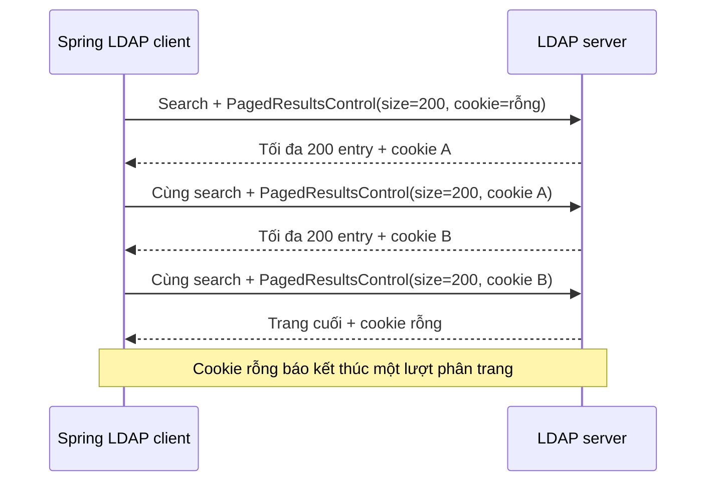
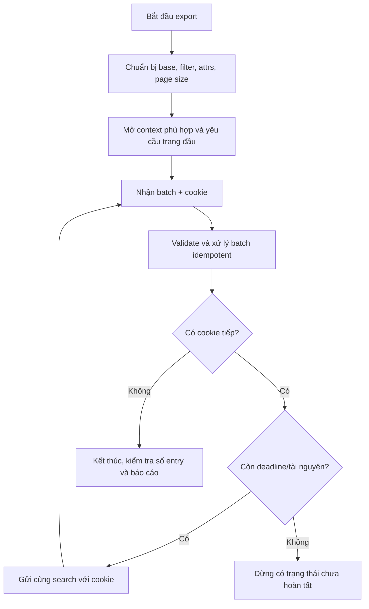

# Giới hạn kết quả và phân trang dữ liệu lớn trong Spring LDAP

Một câu lệnh tìm kiếm LDAP trả về vài entry thường dễ xử lý. Vấn đề xuất hiện khi ứng dụng cần hiển thị hàng chục nghìn tài khoản, duyệt toàn bộ thư mục để đồng bộ dữ liệu, hoặc đọc danh sách nhóm có rất nhiều thành viên. Nếu gọi một lệnh `search` rộng rồi giữ toàn bộ kết quả trong bộ nhớ, hệ thống có thể bị giới hạn bởi LDAP server, timeout, băng thông mạng và heap của JVM.

Trong chương **Hiệu năng** của **SPRING_LDAP**, bài này hướng dẫn hai kỹ thuật liên quan nhưng phục vụ mục tiêu khác nhau:

1. **Giới hạn kết quả:** kiểm soát số entry và thời gian của một search khi nghiệp vụ chỉ cần một phần kết quả.
2. **Phân trang:** lấy lần lượt nhiều phần của một tập dữ liệu lớn khi nghiệp vụ thực sự cần duyệt hết hoặc duyệt nhiều trang.

Người học sẽ thực hành với `LdapQueryBuilder`, `LdapTemplate`, `SearchControls` và `PagedResultsDirContextProcessor`; hiểu cơ chế LDAP Simple Paged Results, cookie, kết nối/context, sorting, giới hạn server, xử lý lỗi và cách đo hiệu năng. Các API `LdapClient` hoặc ODM của Spring LDAP vẫn dựa trên các khái niệm LDAP tương tự: lựa chọn API không làm mất giới hạn server hay thay đổi giao thức phân trang.

## 1. Tại sao không nên lấy toàn bộ danh sách trong một lần?

Xét hệ thống có cây thư mục giả định:

```text
dc=example,dc=org
├── ou=people
│   ├── ou=engineering
│   ├── ou=sales
│   └── ou=operations
├── ou=groups
└── ou=system
```

Ứng dụng dùng `LdapContextSource` với base `dc=example,dc=org`. Một truy vấn dạng sau có thể rất đắt:

```ldap
Base:   ou=people,dc=example,dc=org
Scope:  SUBTREE
Filter: (objectClass=inetOrgPerson)
Attrs:  *
```

Nếu có 120.000 người dùng, truy vấn có nguy cơ tạo tải trên nhiều lớp:

- **LDAP server:** xác định ứng viên, kiểm tra ACL, đọc attribute, duy trì trạng thái truy vấn và tạo phản hồi.
- **Mạng/TLS:** truyền một lượng lớn entry và các attribute, kể cả những trường màn hình không dùng.
- **JNDI/Spring LDAP:** giải mã kết quả, tạo `Attributes`/Java object, ánh xạ entry thành DTO hoặc ODM entity.
- **Heap và GC:** giữ list lớn và nhiều dữ liệu nhị phân/đa trị, gây áp lực bộ nhớ và thời gian dừng GC.
- **Vận hành:** nhiều client cùng quét directory có thể ảnh hưởng tới tốc độ đăng nhập, tra cứu hoặc ghi entry của các ứng dụng khác.

**Không phải cứ search trả 120.000 entry là server sẽ cho phép tải tất cả.** LDAP server thường áp các hạn mức như số entry tối đa, thời gian search và nguồn lực truy vấn. Các hạn mức này có thể phụ thuộc server, tài khoản, quyền, loại truy vấn và cấu hình quản trị. Ví dụ, một server có thể trả một phần kết quả kèm thông báo `sizeLimitExceeded`.

Tư duy tối ưu là: xác định tập dữ liệu thật sự cần, đặt base DN và filter có tính chọn lọc, chỉ lấy attribute phù hợp, sau đó chọn **giới hạn** hoặc **phân trang** theo nhu cầu nghiệp vụ.

## 2. Phân biệt limit, paging và streaming

| Kỹ thuật | Mục đích | Truy vấn tiếp theo | Điều kiện sử dụng |
| --- | --- | --- | --- |
| **Size/count limit** | Chỉ nhận tối đa N entry cho một search | Không có cơ chế trang kế tiếp tự động | Gợi ý tìm kiếm, kiểm tra có/không, trang đầu mà phần còn lại không cần |
| **Time limit** | Không để một search chạy quá lâu ở server/client theo ngữ cảnh cấu hình | Không có cookie hay resume tự động | Kiểm soát tài nguyên, bảo vệ deadline ứng dụng |
| **LDAP Simple Paged Results** | Đọc nhiều phần của cùng một logical search | Có cookie server trả về | Danh sách lớn hoặc batch đồng bộ, nếu server hỗ trợ |
| **Streaming/xử lý từng trang** | Không tích lũy mọi trang trong heap | Duyệt qua các trang và xử lý ngay | Export, xử lý batch, đồng bộ lớn |
| **Đồng bộ thay đổi (incremental sync)** | Chỉ lấy entry thay đổi từ lần trước | Phụ thuộc cơ chế server hỗ trợ | Đồng bộ định kỳ quy mô lớn, không nên full scan mỗi lần |

**Giới hạn kết quả không phải phân trang.** `countLimit(100)` chỉ giới hạn số kết quả có thể trả về; nó không lưu trạng thái để lấy entry thứ 101. Ngược lại, một cookie phân trang hợp lệ đại diện cho trạng thái tiếp tục truy vấn từ LDAP server, không phải số trang dạng `OFFSET 100` trong SQL.

### Minh họa một luồng đọc nhiều trang



Số entry trên một trang có thể ít hơn page size yêu cầu; giá trị 200 là mục tiêu trang, không phải cam kết server luôn trả đúng 200. Server có thể từ chối hoặc áp giới hạn khác theo cấu hình của nó.

## 3. Size limit: giới hạn số entry của một search

LDAP `SearchRequest` có trường `sizeLimit` để giới hạn số entry trả về. Trong Spring LDAP, có thể diễn đạt giới hạn qua `LdapQueryBuilder.countLimit(...)`:

```java
import java.util.List;
import javax.naming.NamingException;
import javax.naming.directory.Attribute;
import javax.naming.directory.Attributes;
import org.springframework.ldap.core.AttributesMapper;
import org.springframework.ldap.core.LdapTemplate;
import org.springframework.ldap.query.LdapQuery;
import org.springframework.ldap.query.LdapQueryBuilder;
import org.springframework.ldap.query.SearchScope;

record PersonSummary(String uid, String name) {}

class PersonSearchService {
    private final LdapTemplate ldapTemplate;

    PersonSearchService(LdapTemplate ldapTemplate) {
        this.ldapTemplate = ldapTemplate;
    }

    List<PersonSummary> findSuggestions(String prefix) {
        if (prefix == null || prefix.length() < 3) {
            throw new IllegalArgumentException("Cần ít nhất 3 ký tự");
        }

        LdapQuery query = LdapQueryBuilder.query()
            .base("ou=people")
            .searchScope(SearchScope.SUBTREE)
            .attributes("uid", "cn")
            .countLimit(25)
            .timeLimit(1500)
            .where("uid").like(prefix + "*");

        return ldapTemplate.search(query,
            (AttributesMapper<PersonSummary>) attrs -> new PersonSummary(
                first(attrs, "uid"),
                first(attrs, "cn")
            )
        );
    }

    private static String first(Attributes attrs, String name)
            throws NamingException {
        Attribute value = attrs.get(name);
        return value == null || value.size() == 0
            ? null : String.valueOf(value.get());
    }
}
```

Ví dụ dành cho chức năng gợi ý: ứng dụng **chủ ý chỉ hiển thị một số lượng kết quả hữu hạn**. `countLimit(25)` không biến truy vấn thành "trang 1"; nếu cần duyệt tiếp, phải có cơ chế paging hoặc một hợp đồng tìm kiếm khác. Prefix `uid` vẫn phải được đặt theo yêu cầu sản phẩm và cấu hình index của directory server. `.like(prefix + "*")` dùng biểu thức substring theo chủ đích; cần kiểm soát dữ liệu đầu vào và xác nhận API escaping của phiên bản Spring LDAP đang dùng. Với giá trị định danh chính xác, nên ưu tiên `.where("uid").is(uid)`.

Nếu directory server đã áp `max size limit` nhỏ hơn giá trị client yêu cầu, ứng dụng không thể tăng giới hạn đó từ phía Spring LDAP. Kết quả có thể kèm LDAP result code `sizeLimitExceeded`, mà JNDI thường chuyển thành exception. **Không được bắt exception này rồi lặng lẽ coi danh sách đã đầy đủ.**

### 3.1. `SearchControls.setCountLimit`

Với API JNDI thấp hơn, có thể chỉ định tương tự:

```java
import javax.naming.directory.SearchControls;

SearchControls controls = new SearchControls();
controls.setSearchScope(SearchControls.SUBTREE_SCOPE);
controls.setReturningAttributes(new String[] {"uid", "cn"});
controls.setCountLimit(25);
controls.setTimeLimit(1500);
```

Dùng `controls` với overload `LdapTemplate.search(base, filter, controls, mapper)` khi codebase đã dùng API này. `setCountLimit(0)` biểu thị không áp giới hạn client theo JNDI, **không có nghĩa server sẽ cho phép số lượng không giới hạn**.

### 3.2. Trường hợp giới hạn phù hợp

- Autocomplete chỉ hiển thị 10–25 gợi ý và có thông báo kết quả được rút gọn.
- Query xác minh một định danh có khớp không; giới hạn 2 entry có thể hữu ích để phát hiện sai giả định uniqueness.
- Công cụ hỗ trợ kỹ thuật chỉ lấy vài bản ghi mẫu để kiểm tra filter.

Trong các trường hợp này, giao diện cần ghi rõ "Hiển thị tối đa 25 kết quả", "Tìm cụ thể hơn" hoặc thông báo tương đương. Không nên dùng limit rồi hiển thị "Tổng cộng 25 người" nếu hệ thống còn nhiều người khớp.

**Thứ tự kết quả không được bảo đảm nếu không có cơ chế sort phù hợp.** Giới hạn 25 entry không đồng nghĩa "25 người đầu tiên theo tên", "25 người mới nhất" hay "25 kết quả phổ biến nhất".

## 4. Time limit, deadline và giới hạn server

Ba loại timeout/giới hạn thường bị nhầm với nhau:

| Thiết lập | Tầng tác động | Ý nghĩa |
| --- | --- | --- |
| `LdapQueryBuilder.timeLimit(ms)` hoặc `SearchControls.setTimeLimit(ms)` | Search qua Spring LDAP/JNDI | Yêu cầu giới hạn thời gian xử lý search; server có thể áp giới hạn riêng |
| `com.sun.jndi.ldap.connect.timeout` | JNDI provider | Giới hạn thời gian kết nối, có thể liên quan đến chờ kết nối tùy provider/pooling |
| `com.sun.jndi.ldap.read.timeout` | JNDI provider | Giới hạn chờ phản hồi mạng khi đọc |
| Deadline của API/request | Ứng dụng | Ngân sách thời gian **cho toàn bộ luồng**, gồm nhiều trang, mapping và thao tác khác |
| Max search time phía server | Directory server | Chính sách quản trị, có thể thấp hơn giới hạn client yêu cầu |

Ví dụ một trang mất tối đa 2 giây không có nghĩa 500 trang sẽ kết thúc trước 2 giây. Duyệt toàn bộ vẫn có thể mất hàng phút, nên công việc batch phải có **deadline tổng**, cơ chế hủy, giới hạn số trang và cách báo trạng thái tiến độ.

Khi hết hạn, directory server có thể trả `timeLimitExceeded`; client có thể gặp read timeout hoặc lỗi I/O riêng. Cần phân biệt lỗi mạng, lỗi giới hạn server, quyền không đủ, cookie không còn hợp lệ và lỗi ánh xạ. Không tự động coi một danh sách bị cắt vì timeout là dữ liệu đầy đủ.

## 5. LDAP Simple Paged Results (RFC 2696)

**Simple Paged Results** là một *LDAP control* hỗ trợ chia kết quả tìm kiếm thành các trang. Trong RFC 2696, client gửi:

- `size`: kích thước trang mong muốn (số entry).
- `cookie`: opaque byte sequence do server trả từ trang trước; trang đầu dùng cookie rỗng.

Server trả:

- Các entry thuộc trang hiện tại.
- Response control có `size` ước tính tổng số entry nếu server cung cấp; giá trị này không nhất thiết chính xác và có thể bằng 0 khi không biết.
- Cookie để lấy trang kế tiếp. **Cookie rỗng** báo kết thúc.

Cookie là **opaque token**: ứng dụng chỉ lưu/chuyển nguyên vẹn, không giải mã, sửa, sắp xếp, tăng giá trị hay suy ra "số trang". Nó có thể phụ thuộc vào trạng thái tìm kiếm phía server và vòng đời kết nối; không mặc định dùng lại sau khi server restart, load balancer đổi backend hoặc người dùng quay lại sau nhiều giờ.

Một request tiếp theo phải nhất quán về **base, scope, filter, danh sách attribute và các search controls liên quan**. Thay đổi filter hoặc sort giữa các trang làm kết quả không còn thuộc cùng một logical search.

### Phân trang có giải quyết được size limit không?

Thường, LDAP server hỗ trợ paged results để client đọc một tập dữ liệu lớn qua nhiều response nhỏ, ngay cả khi server áp hạn mức số entry cho một search thông thường. Nhưng **không phải cơ chế vượt mọi giới hạn**:

- Server có thể không hỗ trợ control, từ chối request, giới hạn page size hoặc giới hạn tổng công việc.
- Thời gian, ACL, filter không được index và tài nguyên server vẫn chi phối toàn bộ lượt duyệt.
- Mỗi page có thêm round trip và trạng thái duyệt.
- Một số server có giới hạn đặc thù về paging cookie, dữ liệu nhóm rất lớn hay số kết quả tối đa.
- Khi server trả lỗi, client phải xác định đã xử lý bao nhiêu trang và có được phép tiếp tục không.

Vì vậy cần xác nhận hỗ trợ RFC 2696 từ tài liệu và cấu hình directory server đang dùng; không gắn mặc định một con số page size cho mọi OpenLDAP, Active Directory hoặc sản phẩm khác.

## 6. Dùng `PagedResultsDirContextProcessor` trong Spring LDAP

Spring LDAP cung cấp `PagedResultsDirContextProcessor` để quản lý request/response controls và cookie. Với `LdapTemplate.search`, phải truyền processor tới overload hỗ trợ `DirContextProcessor`.

Ví dụ **đọc một trang** với tài khoản dịch vụ có quyền đọc danh sách:

```java
import java.util.List;
import org.springframework.ldap.control.PagedResultsCookie;
import org.springframework.ldap.control.PagedResultsDirContextProcessor;
import org.springframework.ldap.core.AttributesMapper;
import org.springframework.ldap.core.LdapTemplate;
import org.springframework.ldap.query.LdapQuery;
import org.springframework.ldap.query.LdapQueryBuilder;
import org.springframework.ldap.query.SearchScope;

// Trong service đã được inject ldapTemplate:
int pageSize = 200;

LdapQuery query = LdapQueryBuilder.query()
    .base("ou=people")
    .searchScope(SearchScope.SUBTREE)
    .attributes("uid", "cn", "mail")
    .where("objectClass").is("inetOrgPerson");

PagedResultsDirContextProcessor pageControl =
    new PagedResultsDirContextProcessor(pageSize);

List<String> firstPage = ldapTemplate.search(
    query,
    (AttributesMapper<String>) attrs ->
        attrs.get("uid") == null
            ? "" : String.valueOf(attrs.get("uid").get()),
    pageControl
);

PagedResultsCookie nextCookie = pageControl.getCookie();
boolean morePages = pageControl.hasMore();
```

Đoạn code minh họa luồng lấy **một trang** và cookie của nó. Trong ứng dụng thật cần kiểm tra xử lý exception, giá trị `uid` bắt buộc, quyền truy cập, timeout và yêu cầu sorting; không dùng chuỗi rỗng thay một định danh bị thiếu ở nghiệp vụ quan trọng.

### 6.1. Duyệt nhiều trang trên cùng một context

Với một số directory server/triển khai, cookie và trạng thái paged search gắn với **cùng kết nối LDAP**. Tạo một `LdapTemplate.search(...)` mới có thể khiến Spring LDAP mượn context khác từ pool; nếu server ràng buộc cookie vào kết nối cũ, trang tiếp theo có thể lỗi hoặc cho kết quả không mong muốn.

Spring LDAP có `SingleContextSource` để thực hiện nhiều lời gọi bằng một context trong phạm vi callback. Mẫu sau giữ cùng context cho một lượt duyệt, xử lý từng batch ngay và không giữ toàn bộ kết quả:

```java
import java.util.List;
import java.util.function.Consumer;
import org.springframework.ldap.control.PagedResultsDirContextProcessor;
import org.springframework.ldap.core.AttributesMapper;
import org.springframework.ldap.core.ContextSource;
import org.springframework.ldap.core.LdapOperations;
import org.springframework.ldap.core.support.SingleContextSource;
import org.springframework.ldap.query.LdapQuery;
import org.springframework.ldap.query.LdapQueryBuilder;
import org.springframework.ldap.query.SearchScope;

class PagedDirectoryReader {
    private static final int PAGE_SIZE = 200;
    private final ContextSource contextSource;

    PagedDirectoryReader(ContextSource contextSource) {
        this.contextSource = contextSource;
    }

    void forEachPeoplePage(Consumer<List<String>> onPage) {
        SingleContextSource.doWithSingleContext(
            contextSource,
            (LdapOperations operations) -> {
                LdapQuery query = LdapQueryBuilder.query()
                    .base("ou=people")
                    .searchScope(SearchScope.SUBTREE)
                    .attributes("uid")
                    .where("objectClass").is("inetOrgPerson");

                PagedResultsDirContextProcessor paging =
                    new PagedResultsDirContextProcessor(PAGE_SIZE);

                do {
                    List<String> batch = operations.search(
                        query,
                        (AttributesMapper<String>) attrs ->
                            attrs.get("uid") == null
                                ? "" : String.valueOf(attrs.get("uid").get()),
                        paging
                    );
                    onPage.accept(batch); // Xử lý/ghi từng trang, không gom hết vào heap.

                    if (!paging.hasMore()) {
                        break;
                    }
                    paging = new PagedResultsDirContextProcessor(
                        PAGE_SIZE, paging.getCookie()
                    );
                } while (true);

                return null;
            }
        );
    }
}
```

**Lưu ý về API:** tên package và overload có thể thay đổi giữa các dòng phiên bản Spring LDAP; khi tích hợp, kiểm tra `LdapOperations.search`, `SingleContextSource` và `PagedResultsDirContextProcessor` đúng phiên bản thư viện của dự án. Đoạn ví dụ minh họa cơ chế **một context, nhiều lần search, cookie liên tiếp**. Callback `onPage` phải xử lý batch đồng bộ, có giới hạn thời gian và không tạo tác vụ bất đồng bộ giữ tham chiếu tới context sau khi callback kết thúc.

Các hệ quả vận hành:

- Một lượt quét rất dài giữ context/kết nối trong thời gian dài, làm tăng áp lực lên pool. Giới hạn độ dài batch, concurrency và thời gian giữ kết nối.
- Với luồng xác thực người dùng, không reuse kết nối đã bind bằng service account như bằng chứng xác thực mật khẩu người dùng. Phân trang danh sách nên dùng context phù hợp với danh tính/ACL của người gọi.
- Cookie chỉ có ý nghĩa trong **cùng logical search**. Nếu retry sau lỗi giữa chừng, cần dựa trên tính chất server: có nơi tiếp tục được, có nơi phải khởi động lại và xử lý trùng lặp.
- Việc stream từng batch làm giảm heap, nhưng không làm tổng số round trip, số entry cần đọc hay tải server tự biến mất.

### 6.2. Vì sao không dùng `countLimit(pageSize)` để đi từng trang?

Một số người thử gọi `countLimit(200)` hai lần và mong lần thứ hai tự trả entry 201–400. LDAP không giữ con trỏ giữa hai search thông thường. Hai truy vấn giống nhau có thể trả lại cùng entry, hoặc entry theo thứ tự khác nhau nếu không có sort. **Paging yêu cầu control và cookie**, không phải lặp query với size limit.

Khi dùng Simple Paged Results, cần chọn search limits sao cho không vô tình cắt mỗi trang hay kết thúc cuộc tìm kiếm; test cụ thể với provider và server vì cách áp size/time limit có thể khác nhau.

## 7. Phân trang trong API cho người dùng cuối

Một API web như `GET /directory/users?page=3` gợi ý rằng ứng dụng có thể nhảy trực tiếp đến trang bất kỳ. Nhưng Simple Paged Results **không hỗ trợ OFFSET trực tiếp**: để lấy trang 3 thường phải có cookie sau trang 2. Cookie có thể gắn với trạng thái server và không phù hợp làm token dài hạn.

Có hai nhóm thiết kế phổ biến:

| Mục tiêu | Thiết kế gợi ý | Điểm cần chú ý |
| --- | --- | --- |
| Trang "Tải thêm" theo thứ tự | Token tiếp tục do backend quản lý, phản ánh cookie khi còn hợp lệ | Giới hạn thời gian sống; lưu trạng thái phiên/kết nối nếu server yêu cầu |
| Đồng bộ/export theo batch | Duyệt tất cả trang trong một job, xử lý ngay mỗi batch | Giới hạn concurrency và timeout tổng; checkpoint ở nơi có cơ chế đồng bộ phù hợp |
| UI muốn nhảy tới trang 57 | Cân nhắc backend index/cache riêng hoặc cơ chế duyệt có thứ tự được server hỗ trợ | LDAP paged results không có offset hay nhảy ngẫu nhiên chuẩn |
| Search kết quả ít | Không nhất thiết cần paging | Giới hạn hợp lý, filter cụ thể và trả thông báo kết quả rút gọn |

Không đưa raw LDAP cookie trực tiếp cho client không đáng tin cậy nếu không có thiết kế bảo vệ trạng thái: cookie có thể bộc lộ chi tiết server, bị sửa/đánh tráo giữa người dùng hoặc bị replay khi không còn hiệu lực. Nếu cần token trình duyệt, backend nên cấp token **opaque có ràng buộc người dùng, query, quyền và thời hạn**, kiểm tra toàn vẹn và giới hạn kích thước/trang truy cập. Đây là một lựa chọn thiết kế ứng dụng; không phải hành vi mặc định của Spring LDAP.

### 7.1. Cookie và việc đóng phiên phân trang

Theo RFC 2696, cookie có thể được dùng trong request tiếp theo với page size bằng 0 để hủy một paged-results sequence khi không muốn tiếp tục. Việc đóng/giải phóng context đúng cách vẫn cần thiết. Cách thực hiện phụ thuộc API hỗ trợ và server; không tự giả định bỏ cookie thì server ngay lập tức giải phóng toàn bộ trạng thái. Đặt deadline để tránh người dùng mở trang đầu rồi để phiên tồn tại vô thời hạn.

## 8. Thứ tự kết quả, entry thay đổi và tính nhất quán

LDAP search thông thường **không bảo đảm thứ tự kết quả toàn cục**. Nếu UI cần "sắp theo tên tăng dần" hoặc một job kỳ vọng tính tái lập, cần cơ chế sort phía server phù hợp, chẳng hạn **Server Side Sorting** (RFC 2891) khi server hỗ trợ. Sắp xếp riêng *mỗi* page phía Java không tạo ra thứ tự toàn cục giữa các trang.

Ngay cả khi có sort, sự thay đổi dữ liệu trong lúc phân trang có thể gây:

- Entry mới xuất hiện hoặc bị xóa giữa hai page.
- Entry bị đổi tên/move sang OU khác trong vùng search.
- Attribute dùng để sort thay đổi, khiến vị trí tương đối thay đổi.
- Entry bị xử lý lặp hoặc bị bỏ sót tùy cách server hiện thực paging/sort.

RFC 2696 **không mặc nhiên cung cấp snapshot isolation**. Đừng coi "đã duyệt hết cookie" là bằng chứng danh sách phản ánh một ảnh chụp tại một thời điểm.

Nếu use case là **đồng bộ danh tính chính xác**, cần xác định yêu cầu nhất quán và cơ chế của directory server: change log, đồng bộ gia tăng, cookie đồng bộ, DirSync hoặc công cụ tương ứng khi được hỗ trợ. Đối với full scan, dùng định danh ổn định của entry và xử lý idempotent/dedup khi phù hợp; kiểm tra lựa chọn `entryUUID`, `objectGUID` hoặc thuộc tính vendor trong schema thực tế và quyền đọc.

### Ví dụ một lượt quét dài

Giả sử có 120.000 người dùng và page size 200:

```text
Số trang lý tưởng ≈ 120.000 / 200 = 600 trang

Giả sử mỗi trang cần 30 ms mạng và xử lý:
600 × 30 ms = 18 giây (chưa tính biến động và lưu downstream)
```

Đây chỉ là phép tính minh họa. Nếu page size 20, số trang tăng lên khoảng 6.000 và overhead round trip có thể rất lớn. Nếu page size 5.000, một page có thể tốn nhiều bộ nhớ, chậm hoặc bị server giới hạn. Không có page size tối ưu chung cho mọi hệ thống.

## 9. Chọn page size theo workload

| Page size | Điểm có lợi | Rủi ro cần đo |
| --- | --- | --- |
| Nhỏ (ví dụ 50) | Batch nhẹ, phản hồi đầu nhanh, bộ nhớ thấp | Nhiều round trip, cookie/control overhead |
| Vừa (ví dụ 200–500) | Cân bằng số round trip và kích thước batch | Phụ thuộc kích thước attribute và server |
| Lớn (ví dụ 1.000+) | Ít page hơn nếu server cho phép | Băng thông/bộ nhớ tăng, p95 mỗi page có thể cao, giới hạn server |

Các số là **điểm khởi đầu thử nghiệm**, không phải khuyến cáo mặc định theo sản phẩm. Nếu mỗi entry có `jpegPhoto` vài trăm KiB, 200 entry có thể đã quá lớn. Cần ưu tiên returning attributes như `uid`, `cn`, `mail` và loại bỏ ảnh/chứng chỉ khi không dùng.

Để chọn, xét đồng thời:

1. **Độ lớn entry sau projection:** byte trung bình, p95 kích thước payload, field nhị phân và đa trị.
2. **Độ trễ mạng:** RTT, khoảng cách giữa application và LDAP server, TLS.
3. **Hạn mức server:** page size cho phép, số concurrent paged searches và thời gian giữ trạng thái.
4. **Pool và thread:** một lượt quét giữ connection bao lâu, có cản các request đăng nhập hay không.
5. **Downstream:** database/queue có xử lý kịp mỗi batch không, có backpressure và checkpoint không.
6. **Mục tiêu nghiệp vụ:** cần trả trang đầu nhanh hay phải hoàn tất một job theo deadline.

Với export 120.000 người, đừng gom tất cả `List<Person>` trong bộ nhớ rồi mới ghi file. Hãy xử lý/ghi từng trang và giải phóng batch; giới hạn các job chạy cùng lúc. Khi lỗi, retry hữu hạn với backoff, và hiểu rõ tính nhất quán trước khi chọn resume bằng cookie hay restart.

## 10. Kiểm thử lỗi và biên của paged search

Một implementation phân trang phải được thử nhiều hơn trường hợp "hai trang đều thành công".

| Trường hợp | Điều cần xác nhận |
| --- | --- |
| Tổng entry bằng 0 | Kết thúc đúng, cookie rỗng/không có trang tiếp |
| Tổng entry ít hơn page size | Một trang, không lặp vô hạn |
| Tổng entry đúng bằng page size | Không dựa vào `batch.size() < pageSize` để quyết định dừng; dùng response cookie |
| Tổng entry bằng page size + 1 | Trả đủ entry cuối, không bỏ sót |
| Server trả ít entry hơn page size khi vẫn còn cookie | Tiếp tục dựa vào cookie, không đoán từ độ dài batch |
| Cookie hết hạn/không hợp lệ | Thông báo lỗi rõ, restart nếu phù hợp, có chiến lược dedup |
| Connection mất giữa chừng | Kiểm tra hành vi server và giao thức; không tùy tiện dùng cookie trên context mới |
| Filter, base hoặc sort thay đổi | Bắt đầu logical search mới, không tái dùng cookie |
| Server không hỗ trợ paging control | Phát hiện `unavailableCriticalExtension` hoặc lỗi tương ứng; xử lý fallback rõ |
| `sizeLimitExceeded`/`timeLimitExceeded` | Không coi dữ liệu nhận trước lỗi là toàn bộ |
| Entry thay đổi giữa hai trang | Ghi nhận tính nhất quán, kiểm tra quy tắc idempotent |
| Thiếu quyền đọc attribute | DTO xử lý field thiếu hoặc lỗi quyền; không đánh đồng với giá trị rỗng |

**Tránh vòng lặp vô hạn:** chỉ tiếp tục khi server báo còn cookie; có deadline tổng, giới hạn số trang/entry tối đa hợp lý, và quan sát trạng thái cookie. Không suy ra còn trang chỉ từ việc trang trước có đủ 200 entry.

## 11. Đo hiệu năng và tải hệ thống

### 11.1. Chỉ số nên thu thập

| Metric | Ý nghĩa |
| --- | --- |
| `ldap.search.page.duration` (p50/p95/p99) | Thời gian của mỗi page; phân biệt với tổng lượt quét |
| `ldap.search.scan.duration` | Thời gian từ trang đầu tới khi hết cookie |
| Entry/page và tổng entry | Hiệu quả page size và kiểm tra đủ kết quả |
| Bytes/page | Tác động của returning attributes, mạng và TLS |
| Page count + số search request | Overhead do quá nhiều trang |
| Pool wait, active/idle, connect/bind | Có nghẽn context hoặc thay kết nối trong lượt quét không |
| Timeout/size-limit/cookie errors | Mức ổn định và độ phù hợp của limit |
| Heap allocation/GC | Liệu batch lớn hoặc tích lũy kết quả có gây áp lực bộ nhớ |
| Server CPU, search time, index/candidates | Server có đang quét nhiều entry hoặc quá tải không |

Nhìn riêng p95 **mỗi trang** có thể đánh lạc hướng: 1000 trang × 30 ms vẫn có thể làm job rất lâu. Cần báo cả **thời gian hoàn tất một lượt quét** và tỷ lệ thành công, đồng thời đếm số entry thực sự xử lý.

Không ghi raw cookie, DN đầy đủ, filter chứa dữ liệu cá nhân hoặc thông tin xác thực vào log/metric label. Dùng nhãn ổn định như `operation=peopleExport`, `pageSize=200` và `result=success/error`; không dùng `uid` từng người làm metric tag.

### 11.2. Kịch bản benchmark có thể lặp lại

1. **Chọn dữ liệu đại diện:** ví dụ 10.000, 100.000 entry; vài OU con; thuộc tính nhỏ/đa trị; dữ liệu được phép dùng để thử.
2. **Giữ nguyên logical search:** base, scope, filter, returning attributes, tài khoản và quyền truy cập.
3. **Thử ba page size:** ví dụ 50, 200, 500 dưới tải thấp và tải đồng thời; warm up JVM, connection/TLS và cache server.
4. **Đo client và server:** tổng thời gian quét, số trang, bytes, p95/p99, CPU, pool wait, GC, lỗi.
5. **So kết quả:** số entry/kết quả cần thiết, không có trùng lặp bất thường, xử lý field thiếu và tính nhất quán theo yêu cầu.
6. **Thử lỗi có kiểm soát:** ngắt kết nối giữa trang, server giới hạn size/time, hết deadline, đổi dữ liệu và cookie không hợp lệ.
7. **Chọn cấu hình có bằng chứng:** page size và concurrency đạt SLO mà không gây nghẽn đăng nhập/search khác.

Bảng dữ liệu sau **chỉ minh họa** cách đánh giá, không phải benchmark của Spring LDAP:

| Page size | Số trang cho 100.000 entry (lý tưởng) | Tổng thời gian minh họa | Peak memory minh họa |
| ---: | ---: | ---: | ---: |
| 50 | 2.000 | 95 s | 25 MiB |
| 200 | 500 | 42 s | 40 MiB |
| 500 | 200 | 35 s | 95 MiB |

Không nên chọn 500 chỉ vì thời gian tổng thấp nhất nếu server áp page size nhỏ hơn, bộ nhớ vượt hạn mức hoặc p99 của request đăng nhập xấu đi. Trong production cần phối hợp người quản trị directory để quyết định giới hạn, index và tải cùng lúc.

## 12. Bài thực hành: export người dùng quy mô lớn

### Đề bài

Ứng dụng Spring LDAP dùng:

- URL `ldaps://directory.example.org:636` với TLS/certificate được kiểm tra hợp lệ.
- `LdapContextSource` đặt base `dc=example,dc=org`, tài khoản dịch vụ chỉ có quyền đọc cần thiết.
- Người dùng ở nhiều OU con dưới `ou=people`, khoảng 80.000 entry.
- Cần xuất `uid`, `cn`, `mail` để đồng bộ một hệ thống khác.
- LDAP server có thể hỗ trợ Simple Paged Results, giới hạn số entry cho query thông thường.

Hãy thiết kế job xử lý từng trang:



**Các câu hỏi cần trả lời:**

1. Vì sao `countLimit(500)` không đủ để export 80.000 entry?
2. Với page size 200, số trang kỳ vọng khoảng bao nhiêu? Nếu có page cuối không đủ 200, xác định kết thúc bằng tín hiệu nào?
3. Tại sao job nên dùng một context phù hợp xuyên suốt sequence nếu server ràng buộc cookie vào connection?
4. Làm sao để job không giữ cả 80.000 entry trong heap?
5. Phải làm gì khi server trả `sizeLimitExceeded`, `timeLimitExceeded` hoặc cookie không còn hợp lệ?
6. Vì sao không được khẳng định export là snapshot tại một thời điểm chỉ nhờ paging?
7. Thử nghiệm nào chứng minh projection và page size vừa nhanh vừa không làm mất dữ liệu?

### Hướng giải

- Câu 1: count limit dừng một search mà không cung cấp vị trí tiếp tục; dùng RFC 2696 nếu directory hỗ trợ và yêu cầu duyệt nhiều trang.
- Câu 2: khoảng `80.000 / 200 = 400` trang khi server trả đủ 200 mỗi trang. Kết thúc theo **response cookie rỗng**, không theo độ dài batch.
- Câu 3: server có thể giữ trạng thái/cookie trên kết nối; một context ổn định giúp bảo toàn sequence, nhưng phải giữ connection hữu hạn và theo dõi pool.
- Câu 4: ghi xuống đích theo từng trang, giải phóng batch và áp dụng backpressure; không tích lũy list dài trong JVM.
- Câu 5: phân biệt giới hạn server, timeout và lỗi mạng; ngừng với trạng thái chưa hoàn tất, retry có giới hạn, kiểm tra tính hợp lệ của cookie và cơ chế restart/dedup.
- Câu 6: entry có thể đổi, chuyển OU hoặc bị xóa/thêm giữa các request; paging không cam kết snapshot.
- Câu 7: giữ nguyên search, so số định danh hợp lệ, phân tích lỗi/trùng/thiếu và đo tổng lượt quét, p95, pool wait, bytes, GC và tải server.

## 13. Checklist khi triển khai

- [ ] Tách bạch **giới hạn số entry** với **cơ chế phân trang có cookie**.
- [ ] Chọn base DN, scope, filter/index có tính chọn lọc và chỉ lấy attribute cần dùng.
- [ ] Đặt size/time/read/connect limit và deadline cho **toàn bộ** workflow.
- [ ] Xác minh server hỗ trợ Simple Paged Results và các giới hạn thực tế.
- [ ] Dùng response cookie để biết còn trang; không dựa vào kích thước batch.
- [ ] Giữ cùng logical search; bảo đảm context/connection tương thích với chính sách cookie của server.
- [ ] Tránh tích lũy toàn bộ entry; xử lý từng batch và kiểm soát backpressure.
- [ ] Có chính sách retry/dedup khi cookie hết hạn, server failover hoặc dữ liệu thay đổi.
- [ ] Không coi paging là snapshot isolation hoặc bằng chứng danh sách đã đầy đủ khi có lỗi.
- [ ] Dùng sorting chuẩn nếu cần thứ tự; không giả định LDAP trả kết quả theo thứ tự cố định.
- [ ] Duy trì TLS hợp lệ, ACL, phân tách service bind và user bind, bảo vệ cookie/token.
- [ ] Đo p95/p99 mỗi page **và** thời gian toàn lượt quét; theo dõi tác động lên server/pool.
- [ ] Kiểm thử 0 entry, đúng page size, page size + 1, cookie rỗng, timeout và dữ liệu thay đổi.

## Tài liệu tham khảo

- [RFC 2696 – LDAP Control Extension for Simple Paged Results Manipulation](https://www.rfc-editor.org/rfc/rfc2696): cấu trúc request/response control, cookie, điều kiện kết thúc và hủy sequence.
- [RFC 4511 – LDAP: The Protocol](https://www.rfc-editor.org/rfc/rfc4511): `SearchRequest`, `sizeLimit`, `timeLimit`, `SearchResultEntry` và result codes.
- [RFC 2891 – LDAP Control Extension for Server Side Sorting of Search Results](https://www.rfc-editor.org/rfc/rfc2891): sorting do LDAP server thực hiện.
- [Spring LDAP Reference Documentation](https://docs.spring.io/spring-ldap/reference/): `LdapTemplate`, `LdapQueryBuilder`, context source và advanced LDAP controls.
- [Spring LDAP API Documentation](https://docs.spring.io/spring-ldap/docs/current/api/): `PagedResultsDirContextProcessor`, `PagedResultsCookie` và `SingleContextSource`.
- [Oracle JNDI Tutorial – Search Controls](https://docs.oracle.com/javase/jndi/tutorial/ldap/search/search.html): `SearchControls`, scope, returning attributes và limits.

