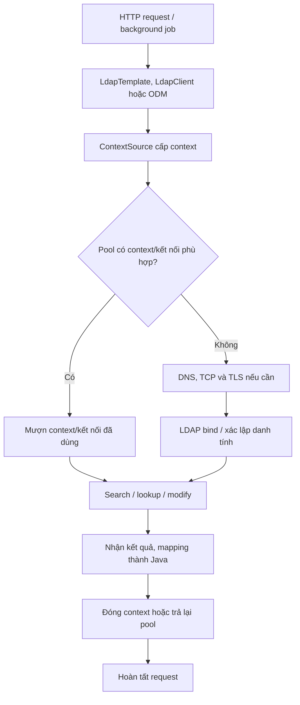
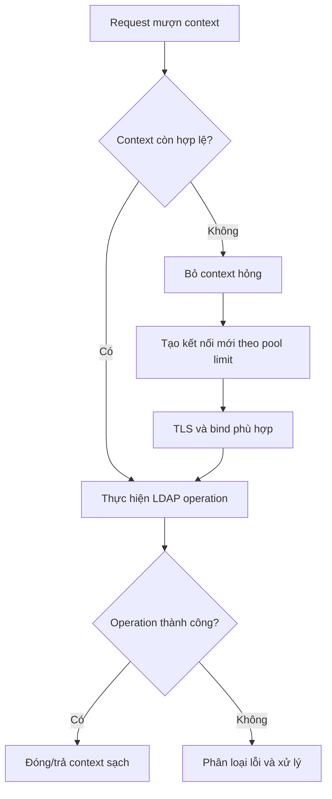

# Connection pooling và reuse context trong Spring LDAP

Mỗi lần ứng dụng truy vấn LDAP, nó cần một ngữ cảnh (`DirContext` hoặc `LdapContext`) để nói chuyện với máy chủ thư mục. Nếu tạo kết nối mới và bind lại bằng tài khoản dịch vụ cho từng request, chi phí DNS, TCP, TLS và xác thực có thể lớn hơn thời gian tìm một entry đã được index. **Connection pooling** giúp tái sử dụng tài nguyên kết nối; **reuse context** cho phép nhiều thao tác có liên quan dùng một ngữ cảnh trong phạm vi đã kiểm soát. Hai kỹ thuật liên quan nhưng không đồng nghĩa.

Bài thuộc chương **Hiệu năng** của **SPRING_LDAP**. Người học sẽ phân biệt vòng đời `ContextSource`, `LdapTemplate`, `LdapClient` và ODM; so sánh native JNDI pooling với cơ chế pooling của Spring LDAP; cấu hình và giám sát pool; giữ đúng danh tính khi bind, đảm bảo TLS; và kiểm thử độ trễ, kết nối chết, thay đổi mật khẩu, tải đồng thời. Mục tiêu không chỉ là giảm thời gian kết nối mà còn **không làm sai quyền truy cập và kết quả xác thực**.

## 1. Chi phí của một thao tác LDAP đến từ đâu?

Trên một triển khai điển hình, một request của ứng dụng có thể đi qua các bước:



Đây là **luồng khái niệm**, không phải cam kết rằng mọi lời gọi API đều thực hiện TCP hoặc `BindRequest`. JNDI provider có thể mở kết nối một cách lazy; một context đã bind được lấy từ pool có thể không cần bind lại; server cũng có thể đóng kết nối sau thời gian idle.

Một mô hình gần đúng giúp tìm thành phần cần đo:

```text
Không tái sử dụng:
 T ≈ T_lấy_context + T_DNS/TCP + T_TLS + T_bind
   + T_search + T_truyền_kết_quả + T_mapping

Có pool:
 T ≈ T_chờ_pool + T_kiểm_tra_kết_nối(nếu có)
   + T_search + T_truyền_kết_quả + T_mapping
```

Các thành phần không phải lúc nào cũng tách biệt hoàn toàn. Ví dụ `getReadOnlyContext()` có thể bao gồm thiết lập kết nối và bind; phép kiểm tra context lúc mượn cũng có thể gửi một search LDAP. Khi đo cần định nghĩa rõ ranh giới, tránh cộng trùng.

**Ví dụ số liệu giả định, không phải benchmark:** lookup `uid` mất 8 ms trên server, còn kết nối TCP/TLS và bind tốn 30 ms. Nếu mỗi request tạo kết nối mới, tổng gần 38 ms cộng mapping; nếu tái sử dụng đúng cách, có thể tiến gần 8 ms cộng thời gian mượn pool và mapping. Nhưng nếu search mất 600 ms do filter thiếu index, pooling không sửa được nút thắt đó.

## 2. Context, connection và danh tính có gì khác nhau?

Trong Spring LDAP, tên các đối tượng rất dễ bị nhầm:

| Thành phần | Vai trò | Lưu ý khi tái sử dụng |
| --- | --- | --- |
| `ContextSource` | Factory cung cấp context cho thao tác LDAP | Thường là bean dùng chung, cấu hình URL, base DN, tài khoản dịch vụ |
| `DirContext` / `LdapContext` | Đối tượng JNDI đại diện một ngữ cảnh directory | Mang trạng thái bảo mật, có vòng đời; không tự ý dùng chung qua thread |
| LDAP connection | Kết nối mạng đến máy chủ; thường có danh tính sau bind | Có thể được tái sử dụng hoặc bị server đóng khi idle |
| `LdapTemplate` | Điều phối lời gọi và xử lý lấy/đóng context | Thường là bean singleton; phù hợp để tái sử dụng qua nhiều request |
| `LdapClient` | API fluent sử dụng hạ tầng Spring LDAP bên dưới | Không tự loại bỏ chi phí kết nối/bind nếu context không được reuse |
| ODM mapper | Chuyển entry thành entity | Chi phí mapping độc lập với pooling; không phải pool kết nối |
| Pool | Giữ tài nguyên đã tạo để cho mượn khi cần | Có giới hạn, hàng đợi, validation, timeout và các vấn đề danh tính |

Có hai ý nghĩa của từ "reuse":

1. **Reuse kết nối vật lý:** mỗi thao tác có thể tạo/nhận một wrapper context nhưng dùng lại TCP/TLS session và bind identity trước đó, nếu provider/pool hỗ trợ.
2. **Reuse chính một context trong một chuỗi thao tác:** ví dụ nhiều page của cùng một LDAP paged search dùng chung ngữ cảnh và cookie; mục tiêu là giữ trạng thái liên tiếp, không chỉ tiết kiệm handshake.

Tái sử dụng một bean `LdapTemplate` ở nhiều thread là bình thường; tái sử dụng **cùng một `DirContext` mutable** trong singleton hoặc cho nhiều thread truy cập đồng thời thì không an toàn. Một context mượn từ pool phải được hoàn trả sau thao tác; không giữ qua request hoặc cất trong cache tùy ý.

### Ba kiểu bind không được đánh đồng

- **Service bind:** danh tính kỹ thuật như `cn=svc-reader,ou=system,dc=example,dc=org`, thường phục vụ tìm kiếm/đọc hồ sơ theo quyền cố định. Đây là ứng viên phổ biến cho pooling.
- **User bind:** dùng DN và mật khẩu của người đăng nhập để xác thực; phải kiểm tra thông tin hiện tại theo chính sách máy chủ. Không thay thế bước này bằng kết nối của service account.
- **Anonymous bind:** danh tính ẩn danh khi server cho phép. Quyền và dữ liệu nhìn thấy có thể rất khác service/user bind; không trộn pool các kiểu danh tính.

**Nguyên tắc cốt lõi:** một kết nối đang bind dưới danh tính A không được cấp cho thao tác cần quyền của B chỉ vì nó đang idle. Pool cần phân tách theo loại context và thông tin xác thực phù hợp.

## 3. Hai cơ chế pooling thường gặp

Spring LDAP có thể làm việc với **native JNDI LDAP connection pooling** của Java provider hoặc một **context pool do Spring LDAP quản lý**. Tùy phiên bản, package/module của managed pool có thể khác (chẳng hạn `spring-ldap-pool2`); vì vậy phải đối chiếu tài liệu API của đúng bản đang dùng trước khi áp dụng cấu hình.

| Tiêu chí | Native JNDI connection pooling | Spring LDAP `PoolingContextSource` |
| --- | --- | --- |
| Lớp quản lý | JNDI LDAP service provider | Thành phần pooling trong Spring LDAP (và thư viện pool bên dưới) |
| Đối tượng dùng lại | Kết nối LDAP vật lý đủ điều kiện | Context được mượn/trả qua `ContextSource` |
| Cấu hình khởi đầu | `LdapContextSource.setPooled(true)` | Bọc một `ContextSource` bằng `PoolingContextSource` |
| Kiểm soát pool | Một số thuộc tính ở mức JVM/provider | Nhiều chính sách mượn/trả, validation, idle/eviction, giới hạn tùy phiên bản |
| Kiểm tra kết nối chết | Hạn chế; cơ chế do JNDI quyết định | Có thể cấu hình validator/test on borrow/idle |
| Danh tính động | Cần tránh reuse sai thông tin xác thực | Pool context cố định; không trộn principal của người dùng |
| TLS | Đòi hỏi hiểu giới hạn provider, đặc biệt StartTLS | Cần đảm bảo cùng trạng thái bảo mật và cấu hình TLS an toàn |

**Không bật cả hai lớp pooling một cách tùy tiện.** Khi có pool do Spring LDAP quản lý, thường nên để native JNDI pooling của context nguồn **tắt** để tránh hai lớp pool khó quan sát và khó kiểm soát vòng đời. Kiểm thử behavior thực tế theo phiên bản/thư viện đang triển khai.

### 3.1. Native JNDI pooling

`LdapContextSource.setPooled(true)` yêu cầu JNDI provider dùng cơ chế pooling kết nối khi đủ điều kiện. Với provider LDAP mặc định của JDK, nhiều tham số được xác định bằng system properties và một số chỉ có hiệu lực khi pool được khởi tạo:

- `com.sun.jndi.ldap.connect.pool.maxsize`: số kết nối tối đa trong pool theo cơ chế provider.
- `com.sun.jndi.ldap.connect.pool.prefsize` và `com.sun.jndi.ldap.connect.pool.initsize`: tham số kích thước ưu tiên/ban đầu.
- `com.sun.jndi.ldap.connect.pool.timeout`: thời gian idle tối đa của kết nối trong pool.
- `com.sun.jndi.ldap.connect.pool.protocol`: tập giao thức đủ điều kiện; mặc định là `plain`, cần cấu hình rõ nếu muốn cho `ssl` vào pool và provider hỗ trợ.
- `com.sun.jndi.ldap.connect.pool.authentication`: loại xác thực đủ điều kiện, thường `none` và `simple` theo cấu hình mặc định.

Ý nghĩa và phạm vi của các giá trị phụ thuộc JDK/provider. Không coi `maxsize` hoặc `timeout` là công cụ bảo đảm toàn bộ ứng dụng sẽ luôn có đúng N kết nối, vì danh tính kết nối, pool identity, idle cleanup và cách provider tạo pool còn ảnh hưởng.

Native pooling chỉ xảy ra khi kết nối **đủ điều kiện**: provider có thể không pool kết nối sử dụng các tính năng làm thay đổi trạng thái, đặc biệt với **StartTLS**. Không tìm cách ép pooling bằng cách vô hiệu hóa TLS hoặc kiểm tra chứng chỉ.

### 3.2. Spring LDAP managed pooling

`PoolingContextSource` bọc `ContextSource`, duy trì tập context và cung cấp chúng cho lời gọi Spring LDAP theo chính sách pool. Tùy phiên bản API, pool có thể quản lý read-only/read-write context tách nhau; các cấu hình gồm giới hạn số active/idle, timeout chờ, kiểm tra khi borrow và kiểm tra kết nối idle.

Lợi điểm là nhìn rõ **thời gian chờ lấy context**, số context idle/active và tác động của validator; có thể tránh trao context đã bị server/load balancer đóng. Đánh đổi là mỗi lần validate có thể phát sinh LDAP operation, và pool quá nhỏ dễ làm request xếp hàng.

Pool không được phép dùng chung giữa các principal động nếu những principal đó tạo ra các quyền khác nhau. Đặc biệt, không bọc một `ContextSource` được cấu hình `AuthenticationSource` lấy principal theo request bằng pool dùng chung nếu không có cơ chế đảm bảo phân tách danh tính đúng: context của request trước có thể được phát lại cho request khác.

## 4. Cấu hình `LdapContextSource` và `LdapTemplate`

Trước tiên, cấu hình nền tảng rõ ràng, với tài khoản dịch vụ cố định và TLS:

```java
import java.util.Map;

import org.springframework.context.annotation.Bean;
import org.springframework.context.annotation.Configuration;
import org.springframework.ldap.core.LdapTemplate;
import org.springframework.ldap.core.support.LdapContextSource;

@Configuration
class DirectoryConfiguration {

    @Bean
    LdapContextSource directoryContextSource() {
        LdapContextSource source = new LdapContextSource();
        source.setUrl("ldaps://directory.example.org:636");
        source.setBase("dc=example,dc=org");
        source.setUserDn("cn=svc-reader,ou=system,dc=example,dc=org");
        source.setPassword(System.getenv("LDAP_SERVICE_PASSWORD"));
        source.setBaseEnvironmentProperties(Map.of(
            "com.sun.jndi.ldap.connect.timeout", "3000",
            "com.sun.jndi.ldap.read.timeout", "5000"
        ));

        // Mặc định không bật native JNDI pooling.
        // Chọn và cấu hình một cơ chế pooling sau khi kiểm thử.
        source.setPooled(false);
        return source;
    }

    @Bean
    LdapTemplate ldapTemplate(LdapContextSource directoryContextSource) {
        return new LdapTemplate(directoryContextSource);
    }
}
```

Các timeout trong ví dụ là **giá trị minh họa**, phải tính từ deadline của request, RTT thực tế và khả năng server. `connect.timeout`, `read.timeout` ở JNDI khác `timeLimit` trên LDAP search. `setUrl("ldaps://...")` yêu cầu triển khai truststore và xác thực chứng chỉ/tên server đúng chuẩn; không thay bằng kết nối không mã hóa để tăng tốc.

Nếu chỉ dùng **native JNDI pooling** và đã xác minh provider, cấu hình tối thiểu liên quan là:

```java
// Ví dụ thay đổi có chủ đích trên context source của tài khoản dịch vụ:
source.setPooled(true);

// Nếu dùng LDAPS, cấu hình cho phép pooling kết nối SSL của
// JNDI provider phải được thực hiện trước khi pool khởi tạo,
// chẳng hạn JVM property:
// -Dcom.sun.jndi.ldap.connect.pool.protocol=plain ssl
//
// Chỉ dùng khi phiên bản JDK/provider và mô hình TLS phù hợp;
// đây không phải cấu hình dành cho StartTLS.
```

Thuộc tính JVM chứa dấu cách trong giá trị phải được **quote đúng** theo launcher/shell đang sử dụng. Đồng thời lưu ý native pool không cung cấp mức độ giám sát và validation giống một pool chuyên dụng; kiểm tra kỹ lúc kết nối bị firewall hoặc load balancer đóng vì idle.

### 4.1. Dùng `PoolingContextSource` có kiểm soát

Đối với dự án dùng module pooling tương thích (ví dụ nhóm Spring LDAP 3.x có `spring-ldap-pool2`), kiểu cấu hình sau thể hiện cách tổ chức bean. **Tên package và thuộc tính quản lý pool cần xác minh với đúng phiên bản dependency**:

```java
// Ví dụ cho biến thể API spring-ldap-pool2; kiểm tra bản thư viện đang dùng.
import org.springframework.context.annotation.Bean;
import org.springframework.context.annotation.Configuration;
import org.springframework.ldap.core.LdapTemplate;
import org.springframework.ldap.core.support.LdapContextSource;
import org.springframework.ldap.pool2.factory.PoolingContextSource;
import org.springframework.ldap.pool2.validation.DefaultDirContextValidator;

@Configuration
class DirectoryPoolConfiguration {

    @Bean
    PoolingContextSource pooledDirectoryContextSource(
            LdapContextSource directoryContextSource) {

        // directoryContextSource là nguồn đã cấu hình service DN, TLS,
        // và setPooled(false) như phần trước.
        PoolingContextSource pooled = new PoolingContextSource();
        pooled.setContextSource(directoryContextSource);
        pooled.setDirContextValidator(new DefaultDirContextValidator());
        pooled.setTestOnBorrow(true);
        return pooled;
    }

    @Bean
    LdapTemplate pooledLdapTemplate(PoolingContextSource pooledDirectoryContextSource) {
        return new LdapTemplate(pooledDirectoryContextSource);
    }
}
```

Mẫu bean minh họa cách nối thành phần; không nên đồng thời khai báo thêm một `LdapTemplate` không pooled và inject mơ hồ vào cùng service. Với Spring Boot, kiểm tra cấu hình tự động hiện hữu trước khi tạo bean mới. Các knob như `maxTotal`, `maxIdle`, `minIdle`, `maxWait`, validation idle và eviction phải đặt theo API thực tế của **phiên bản pool**; không sao chép tên setter từ Apache Commons Pool/Jedis sang Spring LDAP nếu chưa xác minh.

**Validation có giá:** `DefaultDirContextValidator` hoặc validator tùy biến có thể gửi LDAP request mỗi lần test. Bật `testOnBorrow` giúp tránh phát connection chết nhưng thêm độ trễ cho tất cả lần mượn; so sánh với `testWhileIdle`, các chính sách idle eviction và lỗi stale thực tế. Validation query phải nhẹ, có quyền truy cập hợp lệ và có timeout; không dùng một filter quét cả directory.

## 5. Vòng đời lấy và hoàn trả context

Với phần lớn search/update, hãy để `LdapTemplate` hoặc `LdapClient` quản lý context:

```java
import java.util.List;
import org.springframework.ldap.core.AttributesMapper;
import org.springframework.ldap.core.LdapTemplate;
import org.springframework.ldap.query.LdapQuery;
import org.springframework.ldap.query.LdapQueryBuilder;
import org.springframework.ldap.query.SearchScope;

class EmployeeLookup {
    private final LdapTemplate ldapTemplate;

    EmployeeLookup(LdapTemplate ldapTemplate) {
        this.ldapTemplate = ldapTemplate;
    }

    List<String> findByUid(String uid) {
        LdapQuery query = LdapQueryBuilder.query()
            .base("ou=people")
            .searchScope(SearchScope.SUBTREE)
            .attributes("uid", "cn")
            .countLimit(2)
            .where("uid").is(uid);

        return ldapTemplate.search(query,
            (AttributesMapper<String>) attrs ->
                attrs.get("cn") == null
                    ? null : String.valueOf(attrs.get("cn").get())
        );
    }
}
```

Mỗi lời gọi trên có thể lấy và hoàn trả context thông qua `ContextSource`. Nếu context source là pooled source, thao tác mượn/trả là trách nhiệm của hạ tầng. `LdapTemplate` singleton không đồng nghĩa chỉ có một LDAP connection; các request đồng thời vẫn có thể mượn nhiều connection nếu pool đủ và quyền phù hợp.

Khi thực sự cần JNDI API trực tiếp, phải đóng context đúng cách:

```java
import javax.naming.NamingException;
import javax.naming.directory.DirContext;
import org.springframework.ldap.core.ContextSource;

class DirectContextRead {
    private final ContextSource contextSource;

    DirectContextRead(ContextSource contextSource) {
        this.contextSource = contextSource;
    }

    void readOne() throws NamingException {
        DirContext context = contextSource.getReadOnlyContext();
        try {
            var attrs = context.getAttributes(
                "uid=alice,ou=people", new String[] {"uid", "cn"});
            // Đọc attrs tại đây, tránh giữ context hoặc lazy references.
        } finally {
            context.close(); // Với pooled source: trả context về pool.
        }
    }
}
```

`DirContext.close()` khác với việc buộc TCP connection đóng ngay: cơ chế pool có thể giữ nó để tái sử dụng. Ngược lại, quên `close()` thường gây rò rỉ context, pool cạn và request tiếp theo kẹt chờ.

Với ứng dụng thực tế, nên dùng template/client trừ khi API cần một tính năng đặc thù; giảm lỗi thủ công về vòng đời và exception.

### Những lỗi vòng đời thường gặp

- Lưu `DirContext` vào field singleton rồi gọi cùng lúc từ nhiều request.
- Lấy context khi bắt đầu request nhưng không đóng ở nhánh exception.
- Mượn context trong một thread rồi dùng trong callback bất đồng bộ sau khi request kết thúc.
- Tạo lại `LdapContextSource`/pool cho mỗi HTTP request: pool không kịp warm-up và còn tăng số kết nối.
- Tạo pool không giới hạn theo tenant hoặc mỗi uid, làm số pool/connection tăng tuyến tính theo số người dùng.
- Gọi `getContext(principal, credentials)` cho đăng nhập và giả định nó cùng chính sách pooling như context service cố định.

## 6. Reuse context cho chuỗi thao tác có trạng thái

Có những tình huống phải giữ cùng context qua nhiều thao tác trong một scope giới hạn. Ví dụ **LDAP Simple Paged Results** theo RFC 2696 có cookie từ trang trước; một số directory server gắn cookie vào connection đã tạo sequence.

Spring LDAP cung cấp `SingleContextSource` để thực hiện nhiều lời gọi `LdapOperations` trên cùng ngữ cảnh trong một callback:

```java
import java.util.List;
import org.springframework.ldap.core.AttributesMapper;
import org.springframework.ldap.core.ContextSource;
import org.springframework.ldap.core.LdapOperations;
import org.springframework.ldap.core.support.SingleContextSource;
import org.springframework.ldap.query.LdapQuery;
import org.springframework.ldap.query.LdapQueryBuilder;

class RelatedReads {
    private final ContextSource contextSource;

    RelatedReads(ContextSource contextSource) {
        this.contextSource = contextSource;
    }

    void work() {
        SingleContextSource.doWithSingleContext(
            contextSource,
            (LdapOperations operations) -> {
                LdapQuery q = LdapQueryBuilder.query()
                    .base("ou=people")
                    .attributes("uid")
                    .where("uid").is("alice");

                List<String> first = operations.search(
                    q,
                    (AttributesMapper<String>) attrs ->
                        String.valueOf(attrs.get("uid").get())
                );

                // Thực hiện những thao tác tiếp theo trong cùng callback,
                // khi thật sự có yêu cầu giữ một context.
                // Dùng 'first' hoặc xử lý kết quả, không trả context ra ngoài.
                return null;
            }
        );
    }
}
```

Trong ví dụ này không có lý do bắt buộc phải dùng một context chỉ để chạy một search; đây là **mẫu phạm vi callback** để áp dụng khi có chuỗi thao tác cần đồng nhất connection. Khi thiết kế thật phải đặt deadline và đảm bảo không giữ một connection lâu vô hạn. Cần kiểm tra chữ ký `SingleContextSource.doWithSingleContext` theo phiên bản Spring LDAP; API callback và package có thể thay đổi theo dòng thư viện.

**Không nhầm context reuse với transaction database.** Hai LDAP search trên cùng context không tự động cung cấp snapshot nhất quán. Một chuỗi modify cũng không tự động trở thành atomic multi-entry transaction; LDAP server chỉ đảm bảo thuộc tính giao dịch khi có cơ chế cụ thể được hỗ trợ.

## 7. Pooling và xác thực người dùng: ranh giới bảo mật

Phần quan trọng nhất của pooling là danh tính.

Giả sử hệ thống đăng nhập:

1. Service account search `uid=alice` để tìm DN thật của tài khoản.
2. User bind bằng DN đó và password do Alice gửi để chứng minh thông tin xác thực.
3. Sau khi xác thực thành công, service account có thể đọc những attribute ứng dụng được phép dùng.

Hai loại bind có mục đích khác nhau. **Không được trả lời "đúng mật khẩu" chỉ vì một connection service account đang có sẵn**.

Trong Spring LDAP, `LdapContextSource.getContext(principal, credentials)` được thiết kế không sử dụng native JNDI pooling cho kết nối với danh tính được cung cấp tại runtime. Lý do quan trọng là đảm bảo mật khẩu mới/khóa tài khoản không bị kết nối cũ che mất khi xác thực lại. Đừng tự bọc user-specific context vào một pool service account dùng chung để "tối ưu" login.

Một ví dụ xác thực thường dùng `LdapTemplate.authenticate`, gồm tìm DN (trong trường hợp cần tìm) rồi thử user bind:

```java
import org.springframework.ldap.core.LdapTemplate;
import org.springframework.ldap.filter.EqualsFilter;

class AccountAuthentication {
    private final LdapTemplate ldapTemplate;

    AccountAuthentication(LdapTemplate ldapTemplate) {
        this.ldapTemplate = ldapTemplate;
    }

    boolean authenticate(String uid, String password) {
        if (uid == null || uid.isBlank()
                || password == null || password.isEmpty()) {
            return false;
        }

        EqualsFilter userFilter = new EqualsFilter("uid", uid);
        return ldapTemplate.authenticate(
            "ou=people",
            userFilter.encode(),
            password
        );
    }
}
```

`EqualsFilter` escape giá trị filter theo cú pháp LDAP. Triển khai thực tế cần xử lý riêng lỗi kết nối, lỗi server và lỗi xác thực; không log password, không dùng empty password để tạo anonymous bind ngoài chủ đích. Nếu tài khoản cần khóa ngay khi đổi mật khẩu, phải kiểm thử chính sách cụ thể với server và provider; connection reuse không được phép phá vỡ yêu cầu đó.

### Pooling có thể làm lộ dữ liệu qua quyền không?

Có, nếu dùng sai danh tính hoặc lưu trạng thái:

- A được quyền xem nhóm quản trị; context bind A bị đưa vào pool dùng chung.
- B chỉ được quyền xem nhóm công khai nhưng vô tình mượn lại context của A.
- LDAP server xử lý search dưới danh tính A, dẫn tới khả năng đọc vượt quyền.

Ngoài principal, context còn có trạng thái như request controls, môi trường JNDI và StartTLS; nếu thay đổi trong khi mượn mà không khôi phục đúng trước khi trả, request sau có thể chịu ảnh hưởng. Vì vậy chọn cơ chế pooling phù hợp, không tự viết "danh sách context" giản đơn, kiểm thử riêng identity/ACL isolation.

**Pool giới hạn theo principal cố định** phù hợp nhất với một service account có quyền tối thiểu. Nếu cần multi-tenant, hãy tách namespace/credential/ACL theo thiết kế xác thực rõ ràng; không trộn kết nối của hai tenant dựa trên việc cùng server URL.

## 8. TLS, StartTLS và tính hợp lệ của connection reuse

Spring LDAP có thể kết nối LDAP qua:

- `ldaps://...:636`: TLS ngay khi mở kết nối.
- `ldap://...:389` kết hợp **StartTLS**: nâng cấp một kết nối có sẵn lên TLS theo cơ chế LDAP extended operation.
- `ldap://...:389` không TLS: chỉ thích hợp môi trường được phép theo mô hình bảo mật; không dùng cho truyền credential nhạy cảm trên mạng không tin cậy.

**StartTLS đặc biệt nhạy cảm với pooling**: nó thay đổi trạng thái bảo mật của kết nối đang dùng. Native JNDI connection pooling không được thiết kế để theo dõi đầy đủ thay đổi StartTLS state; việc trả một connection vào pool sau khi nâng/hạ cấp TLS có nguy cơ không an toàn. Tránh dùng native JNDI pooling cho StartTLS, theo cảnh báo của tài liệu JNDI; khi yêu cầu StartTLS, dùng tích hợp quản lý lifecycle và kiểm thử quyền/TLS theo đúng phiên bản Spring LDAP.

Với LDAPS, pooling vẫn phải đảm bảo:

1. Truststore có CA phù hợp và certificate chain hợp lệ.
2. Hostname verification đúng với endpoint; không bypass SSL validation.
3. Pool không tái sử dụng connection giữa cấu hình trust/credentials khác nhau ngoài thiết kế.
4. Khi server đổi chứng chỉ, phải kiểm thử cách tạo lại connection và quá trình certificate validation; kết nối TLS tồn tại có thể không trải qua handshake mới ngay.
5. Nếu cân nhắc native JNDI SSL pooling, phải xác nhận provider được cấu hình để `ssl` nằm trong loại protocol được pool.

Mở thêm connection song song có thể làm tăng TLS handshake và áp lực CPU; ngược lại giữ connection idle quá lâu có thể gặp firewall/server idle timeout. Pooling là bài toán cân bằng hiệu năng, độ tin cậy và an toàn.

## 9. Sizing pool và xử lý hàng đợi

Một pool có kích thước **không đủ** làm request chờ mượn context; một pool **quá lớn** khiến server phải giữ nhiều session, xử lý nhiều bind hoặc query đồng thời và dễ đụng giới hạn tài nguyên.

### Ước lượng ban đầu bằng thông lượng và thời gian giữ connection

Định luật Little cho hệ thống ổn định gợi ý:

```text
Số thao tác đồng thời trung bình ≈
  request mỗi giây × thời gian giữ connection mỗi request (giây)
```

Ví dụ **giả định**: endpoint dùng LDAP 200 lần/giây, mỗi lượt giữ connection trung bình 40 ms:

```text
200 request/s × 0,040 s ≈ 8 thao tác LDAP đồng thời trung bình
```

Con số **8** là ước lượng trung bình, không phải cấu hình `maxTotal=8` bắt buộc. Tải có burst, p95 dài hơn trung bình, query phức tạp, đồng bộ batch, validation và job nền. Cần thử sức tải với concurrency thực tế và giám sát hàng đợi pool để chọn mức headroom.

| Tham số cần theo dõi | Nếu quá thấp | Nếu quá cao |
| --- | --- | --- |
| Max active/total | Nhiều request chờ, timeout, tail latency cao | Tốn socket/memory server; áp lực concurrent search |
| Min idle | Cold start sau khoảng idle, tăng TLS/bind lúc burst | Giữ tài nguyên thừa, connection dễ stale |
| Max idle | Đóng rồi mở lại thường xuyên khi tải dao động | Giữ nhiều kết nối không hoạt động |
| Max wait | Request lỗi sớm khi burst | Request treo lâu, che mất nghẽn pool |
| Validation frequency | Mượn context chết và lỗi request | Tăng round trip, CPU server và thời gian borrow |
| Idle eviction | Nhiều connection quá hạn ở pool | Evict quá mạnh gây churn kết nối/TLS |

Tên thuộc tính setter/bean cụ thể thay đổi theo `PoolingContextSource` và thư viện pool của phiên bản bạn dùng. Bảng mô tả **khái niệm cần cấu hình/đo**, không phải danh sách API bảo đảm có trong mọi phiên bản.

### Pool per instance khác tổng số connection

Nếu một ứng dụng có 12 replica và mỗi replica cho tối đa 30 connection, directory server có thể thấy **tới khoảng 360 connection** từ riêng ứng dụng này khi tất cả pool phát triển hết. Thêm job export, retry và nhiều service khác sẽ tăng số đó. Khi đặt limit phải tính theo toàn cụm và hạn mức của directory server/load balancer, không chỉ một JVM.

### Pool không thay thế giới hạn tải

Ngay cả khi có 100 connection, gửi 100 search nặng cùng lúc có thể làm directory server nghẽn. Với batch/export, cân nhắc giới hạn số worker, backpressure và lịch chạy; với login, ưu tiên độ trễ và tỉ lệ thành công. Tăng pool là một **giả thuyết để kiểm chứng**, không phải cách sửa mặc định cho mọi p99 cao.

## 10. Kết nối stale, validation, eviction và retry

Directory server, firewall hoặc load balancer có thể đóng TCP connection sau một khoảng idle. Pool phía client vẫn có thể tưởng connection còn sống; request đầu sau thời gian yên lặng gặp lỗi connection reset/communication exception.

Một chuỗi chẩn đoán:



Các biện pháp thường dùng:

- **Test on borrow:** xác minh connection trước khi cấp cho request; tăng latency khi borrow.
- **Test while idle:** kiểm tra và loại bỏ connection chết trong pool định kỳ; cần eviction scheduler phù hợp.
- **Idle timeout/eviction:** loại connection quá lâu không dùng trước khi server/firewall xử lý.
- **Read/connect timeout:** đặt giới hạn để request không chờ vô hạn sau sự cố mạng.
- **Failover/load balancing:** khi endpoint đổi máy chủ, cookie paging hoặc trạng thái session có thể không còn dùng được.
- **Retry có chọn lọc:** chỉ thử lại thao tác an toàn và có giới hạn; phân biệt đọc, ghi và xác thực.

**Đối với search chỉ đọc**, có thể retry một số lỗi kết nối tạm thời sau backoff, với tổng deadline. **Đối với add/modify/delete/rename**, một timeout không chứng minh server chưa áp thay đổi. Retry mù có thể nhân đôi tác động hoặc gây lỗi trùng entry; cần idempotency, kiểm tra trạng thái và xử lý theo semantics của thao tác. **Đối với user bind sai mật khẩu**, không retry nhiều lần vô điều kiện vì có thể gây khóa tài khoản hoặc hỗ trợ brute force.

Validation trên mỗi borrow có thể chính nó gọi server; nếu validator dùng filter rộng hoặc quyền không đủ, pool trở thành nguồn tải/lỗi. Chọn validator phù hợp với DN/base và ACL của tài khoản dịch vụ, và đo thời gian validate.

## 11. Ghi metric để biết pooling có hiệu quả hay không

Đo riêng tác động của context/pool, thay vì chỉ nhìn độ trễ `ldapTemplate.search`.

| Metric | Câu hỏi cần trả lời |
| --- | --- |
| Thời gian end-to-end p50/p95/p99 theo operation | Người dùng nhận kết quả nhanh hơn bao nhiêu? |
| Thời gian mượn context / pool wait | Request chờ pool hay chờ server? |
| Active/idle/pending của pool | Pool có chạm ngưỡng, bão hòa hoặc phân phối lệch? |
| New connections và TLS handshakes/giây | Có giảm connection churn không? |
| Service bind và user bind/giây | Tối ưu có đúng đối tượng, không thay đổi xác thực? |
| Context validation count/time/failure | Validation có đắt hoặc sai cấu hình không? |
| Search time phía server, số entry và bytes | Search/filter hay network/mapping mới là nút thắt? |
| Connection errors, borrow timeout, read timeout | Sức chịu lỗi của pool và server |
| Server CPU, socket/session limit | Pool tăng có làm server quá tải? |
| JVM heap allocation/GC, thread blocked | Pool có giảm việc tạo tài nguyên và chờ? |

**Không log password, raw credential, private DN hoặc thông tin người dùng trong metric tag.** Dùng tên hoạt động cố định như `operation=searchByUid` hoặc `operation=authenticate` và kết quả phân loại. Lưu ý LDAP error `invalidCredentials` có thể là kết quả nghiệp vụ của user bind; đừng lẫn với lỗi pool/mạng.

### Ví dụ đo độ trễ search ở tầng ứng dụng

```java
import java.util.List;
import io.micrometer.core.instrument.MeterRegistry;
import io.micrometer.core.instrument.Timer;
import org.springframework.ldap.core.AttributesMapper;
import org.springframework.ldap.core.LdapTemplate;
import org.springframework.ldap.query.LdapQuery;

class TimedLookup {
    private final LdapTemplate ldapTemplate;
    private final Timer searchTimer;

    TimedLookup(LdapTemplate ldapTemplate, MeterRegistry registry) {
        this.ldapTemplate = ldapTemplate;
        this.searchTimer = Timer.builder("ldap.operation.duration")
            .description("LDAP search end-to-end duration at client")
            .tag("operation", "personLookup")
            .register(registry);
    }

    List<String> search(LdapQuery query) {
        return searchTimer.record(() ->
            ldapTemplate.search(query,
                (AttributesMapper<String>) attrs ->
                    attrs.get("uid") == null
                        ? "" : String.valueOf(attrs.get("uid").get())
            )
        );
    }
}
```

`Timer` đo từ khi gọi tới khi mapper hoàn tất, **gồm thời gian borrow/validation nếu có**. Nó không tách riêng networking, bind hoặc server search. Để tìm phần nào giảm sau pooling, đối chiếu với metric của pool và LDAP server, socket/TLS metrics hoặc trace phù hợp ở môi trường kiểm soát.

### Benchmark A/B đúng cách

1. **Giữ nguyên workload:** cùng base DN, scope, filter, returning attributes, kích thước kết quả, số người dùng test và quyền truy cập.
2. **Thử chế độ không pooling:** đo latency, kết nối mới/giây, TLS handshake, bind, lỗi, CPU server dưới tải ổn định.
3. **Thử pooling có kiểm soát:** cùng request rate và concurrency; làm ấm pool phù hợp trước khi đo steady state; đo cold start riêng.
4. **Thử nhiều giới hạn pool:** ví dụ nhỏ/vừa/lớn; quan sát active, idle, pending, timeout, server CPU và p99.
5. **Thử validator:** so sánh test-on-borrow với chính sách idle validation trên workload có thời gian nghỉ dài.
6. **Thử hỏng kết nối:** server restart, load balancer idle timeout, mạng mất ngắn hạn, shutdown theo quy trình có kiểm soát; xác định có retry sai hay gây rò rỉ không.
7. **Kiểm chứng quyền:** service lookup vẫn đúng, user bind chịu tác động ngay của mật khẩu đổi và khóa tài khoản, không lẫn principal.
8. **Đánh giá tổng thể:** p95/p99, throughput, tỷ lệ lỗi và tài nguyên **cả application lẫn server**; chỉ chọn cấu hình có kết quả đúng và ổn định.

Bảng dưới đây **chỉ là dữ liệu minh họa cách đọc kết quả**, không phải benchmark Spring LDAP:

| Phương án | p95 search client | Kết nối mới/giây | Pool wait p95 | Nhận xét |
| --- | ---: | ---: | ---: | --- |
| Không pooling | 85 ms | 180 | Không có | TCP/TLS và bind lặp lại nhiều |
| Pool 4 context | 70 ms | 5 | 32 ms | Pool nhỏ, nhiều request chờ |
| Pool 16 context | 29 ms | 1 | 3 ms | Cân bằng tốt trong tải thử |
| Pool 128 context | 41 ms | 1 | 1 ms | Server/luồng đồng thời có thể bị quá tải |

Số liệu này minh họa tại sao pool lớn hơn không nhất thiết nhanh hơn. Cần kiểm chứng giá trị thực tế, đặc biệt khi hệ thống có nhiều replica hoặc các luồng search, bind và modify khác nhau.

## 12. Sự cố điển hình và cách khoanh vùng

| Triệu chứng | Giả thuyết cần kiểm tra | Hướng kiểm chứng |
| --- | --- | --- |
| p50 nhanh nhưng p99 cao | Pool cạn khi burst, validation, connection stale | Biểu đồ active/pending và thời gian borrow |
| Request đầu sau 30 phút idle lỗi | Firewall/load balancer đóng TCP | Test-on-borrow/idle eviction và heartbeat phù hợp |
| Bật pool mà login vẫn chậm | User bind phải xác thực thật; DN search vẫn đắt | Tách thời gian service search với user bind |
| Thay mật khẩu nhưng test login vẫn "đúng" | Reuse sai context/principal hoặc cache xác thực không hợp lệ | Kiểm tra code path `authenticate`, identity/ACL và chính sách pooling |
| Dữ liệu người A xuất hiện ở request B | Trộn principal trong pool hoặc sai caching/authorization | Dừng reuse identity động; kiểm thử quyền từng user |
| Pool active cao và không giảm | Rò rỉ context, callback giữ lâu, job export | Kiểm tra `close()`, lifecycle và thời gian giữ |
| Server CPU cao sau khi tăng pool | Quá nhiều search đồng thời/filter thiếu index | Giảm concurrency, xem search statistics/index |
| StartTLS lỗi ngẫu nhiên sau pooling | Tái sử dụng kết nối với TLS state không phù hợp | Tắt native pool cho StartTLS, kiểm tra lifecycle |
| Chỉ một vài tenant lỗi quyền | Sai tách pool/credential/config giữa tenant | Kiểm tra pool identity và ACL theo tenant |
| Thông lượng không đổi sau pooling | Server search/filter là nút thắt | Đo search time phía server và số ứng viên/index |

## 13. Bài thực hành: tối ưu directory service có login và lookup

### Bối cảnh

Một ứng dụng Spring LDAP chạy trên bốn replica, kết nối `ldaps://directory.example.org:636`. Directory có khoảng 100.000 người dùng dưới `ou=people,dc=example,dc=org`. Dịch vụ có hai luồng:

- **Tra cứu hồ sơ:** service account `cn=svc-reader,ou=system,dc=example,dc=org` tìm `uid` theo filter equality, trả `cn` và `mail`.
- **Đăng nhập:** service account tìm DN người dùng, sau đó user bind bằng mật khẩu vừa nhập.

Hiện tại p95 tra cứu là 120 ms ở tải 100 request/giây; p95 đăng nhập là 160 ms. Mục tiêu là cải thiện độ trễ mà vẫn giữ xác thực, TLS và quyền đọc an toàn.

### Nhiệm vụ

1. Vẽ lifecycle cho mỗi luồng và phân biệt context của service bind, user bind, `search` và mapping.
2. Đặt pool cho **service account cố định**; giải thích vì sao không dùng pool chung để bỏ qua user bind.
3. Chọn 3 cấu hình max pool size hợp lý để thử trên **mỗi replica**, tính số connection tối đa của cả bốn replica.
4. Xây đo p50/p95/p99, active/idle/pending, borrow latency, connect/TLS/bind, server search time và tỷ lệ lỗi.
5. Tạo thử nghiệm sau idle, server restart, mật khẩu người dùng đổi, tài khoản bị khóa và hai user có ACL khác nhau.
6. Thử validator trên borrow và khi idle; đo thêm latency và số LDAP operation mà validator tạo ra.
7. Đề xuất hành vi khi pool hết connection, khi kết nối stale và khi timeout xảy ra trong một thao tác modify.

### Gợi ý hướng giải

- Dùng `LdapContextSource` chung với service DN và TLS hợp lệ; bọc bởi một pool có chính sách giới hạn/validation. `LdapTemplate` dùng lại qua các request nhưng mỗi operation mượn/trả context.
- Xác thực mật khẩu vẫn cần user bind riêng theo cơ chế hiện hành; không tái sử dụng một kết nối đã xác thực bởi người khác để suy luận mật khẩu đúng.
- Nếu thử max pool 8, 16, 32 context mỗi replica, tổng khả năng cấp connection từ ứng dụng lần lượt có thể tới khoảng 32, 64, 128; cần tính thêm các pool/định danh khác và không mặc định tất cả thực sự được tạo.
- Tăng pool chỉ thành công nếu lookup p95/p99 giảm, tỷ lệ lỗi không tăng, server không quá tải, và test ACL/user password vẫn đúng.
- Khi stale, loại connection hỏng, xây lại khi có ngân sách thời gian và retry chỉ phù hợp với thao tác idempotent; không retry mù ghi entry nếu chưa xác định server đã thực hiện hay chưa.

### Câu hỏi tự đánh giá

**1. `LdapTemplate` singleton có phải một kết nối LDAP singleton không?** Không. Template là API dùng chung để thực thi; số connection phụ thuộc `ContextSource` và pool.

**2. Vì sao test-on-borrow có thể làm chậm lookup?** Mỗi lần mượn có thể phát sinh validation qua mạng; đây là chi phí đổi lấy giảm rủi ro nhận context chết.

**3. Vì sao maxTotal=100 trên mỗi replica có thể nguy hiểm?** Nhiều replica nhân tổng khả năng connection, làm tăng concurrency và tải server; phải tính quota toàn cụm.

**4. Một context được bind service account có được dùng để xác thực mật khẩu user không?** Không. Bind của service account không chứng minh mật khẩu người dùng; cần xác thực theo danh tính người dùng và chính sách thực tế.

**5. Có thể giữ một context qua nhiều trang LDAP paged results không?** Có, trong một scope có deadline, qua cơ chế phù hợp như `SingleContextSource`; việc này phục vụ trạng thái paged search và không tạo snapshot isolation.

## 14. Checklist đưa vào vận hành

- [ ] Đã xác định rõ loại context, danh tính bind, quyền và cách kết nối/TLS tương ứng.
- [ ] Chỉ chọn **một** tầng pooling chính cho service account theo phiên bản Spring LDAP/JNDI đang dùng.
- [ ] `ContextSource` được cấu hình như bean dùng chung; không tạo pool mới trên mỗi request.
- [ ] `LdapTemplate`/`LdapClient` quản lý lấy và hoàn trả context; `DirContext` thủ công luôn được `close()`.
- [ ] Không chia sẻ một `DirContext` mutable giữa nhiều thread hoặc giữ lâu hơn phạm vi cần thiết.
- [ ] Service bind và user bind được tách rõ; đổi mật khẩu/khóa tài khoản vẫn có tác dụng.
- [ ] Không tái sử dụng context của principal/tenant khác; ACL và authorization được kiểm thử.
- [ ] TLS và xác thực chứng chỉ được giữ nguyên; không dùng native pooling cho StartTLS tùy tiện.
- [ ] Đã cấu hình giới hạn pool, thời gian chờ mượn, validation và idle eviction hợp lý.
- [ ] Đã tính max connection cho **toàn bộ replica** và các job nền.
- [ ] Có chiến lược xử lý connection stale, server restart, failover và timeout.
- [ ] Retry phân biệt read/write/auth; không gửi lại modify một cách mù quáng.
- [ ] Theo dõi p50/p95/p99, borrow wait, active/idle/pending, connect/bind, validation và tải server.
- [ ] A/B benchmark cùng workload và xác nhận **đúng dữ liệu, quyền, xác thực**, không chỉ tăng throughput.

## Tài liệu tham khảo

- [Spring LDAP Reference – Pooling Support](https://docs.spring.io/spring-ldap/reference/pooling.html): pooling context, validation và những lưu ý khi dùng authentication source.
- [Spring LDAP Reference – Configuration](https://docs.spring.io/spring-ldap/reference/configuration.html): `ContextSource`, native JNDI pooling, timeout và cấu hình.
- [Spring LDAP Reference Documentation](https://docs.spring.io/spring-ldap/reference/): sử dụng `LdapTemplate`, `LdapClient`, ODM và các API liên quan.
- [Spring LDAP API Documentation](https://docs.spring.io/spring-ldap/docs/current/api/): `LdapContextSource`, `PoolingContextSource` và `SingleContextSource` theo phiên bản.
- [Oracle JNDI Tutorial – LDAP Connection Pooling](https://docs.oracle.com/javase/jndi/tutorial/ldap/connect/pool.html): điều kiện JNDI pooling, cấu hình, cơ chế identity và StartTLS.
- [Oracle JNDI Tutorial – How Connections Work](https://docs.oracle.com/javase/jndi/tutorial/ldap/connect/create.html): tạo, dùng và đóng kết nối LDAP thông qua JNDI.
- [RFC 4511 – Lightweight Directory Access Protocol](https://www.rfc-editor.org/rfc/rfc4511): bind, search, request/response và result code.
- [RFC 2696 – LDAP Simple Paged Results](https://www.rfc-editor.org/rfc/rfc2696): cookie và vòng đời tìm kiếm theo trang.

