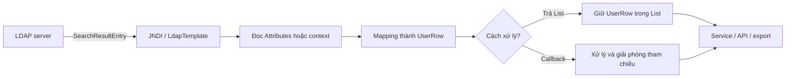

# Mapping callback so với gom toàn bộ kết quả trong Spring LDAP

Khi tìm một người dùng theo `uid`, ứng dụng **Spring LDAP** thường nhận vài đối tượng Java nên một `List` kết quả rất tiện. Nhưng với một job đồng bộ 200.000 entry, cách dùng `ldapTemplate.search(query, mapper)` có thể khiến JVM giữ hàng trăm nghìn đối tượng cùng lúc. Một chiến lược khác là **xử lý từng entry bằng callback**, chuyển ngay dữ liệu cần thiết sang nơi tiêu thụ rồi bỏ tham chiếu. Hai cách đều ánh xạ LDAP entry sang dữ liệu ứng dụng, nhưng khác nhau ở nơi lưu kết quả và vòng đời xử lý.

Bài thuộc chương **Hiệu năng** của module **SPRING_LDAP**. Người học sẽ so sánh `AttributesMapper`, `ContextMapper`, `NameClassPairCallbackHandler` và cách các API `LdapTemplate`, `LdapClient` hoặc ODM trả dữ liệu; đánh giá ảnh hưởng đến heap, GC, kết nối và xử lý lỗi; kết hợp callback với phân trang khi dữ liệu rất lớn; và thiết kế benchmark có kiểm tra tính đúng đắn, TLS và quyền truy cập directory.

## 1. Ba bước trong một LDAP search

Hãy xét directory giả định có base `dc=example,dc=org`, người dùng ở nhiều OU dưới `ou=people`. Ứng dụng cần đọc `uid`, `cn` và `mail` của các entry thuộc `inetOrgPerson`.



Có ba khâu cần phân biệt:

1. **Search ở server:** base DN, scope, filter, ACL và index quyết định tập entry được tìm. Callback không tự thay đổi chi phí này.
2. **Nhận và ánh xạ:** JNDI cung cấp `SearchResult` hoặc `Attributes`; ứng dụng tạo DTO hay entity. Mỗi entry vẫn phải được truyền và xử lý.
3. **Giữ hay tiêu thụ kết quả:** ứng dụng có thể gom mọi DTO vào một `List` hoặc xử lý từng entry rồi bỏ tham chiếu. Đây là khác biệt chính của bài.

**Nguyên tắc quan trọng:** `AttributesMapper` là callback **ánh xạ từng entry**, nhưng overload `LdapTemplate.search(query, AttributesMapper<T>)` **vẫn gom toàn bộ giá trị trả về vào một `List<T>`**. Muốn tránh list tổng hợp ở phía Spring LDAP, phải chọn overload xử lý bằng `NameClassPairCallbackHandler` hoặc một cách duyệt tương đương đã được xác minh theo phiên bản.

## 2. Những API dễ bị nhầm lẫn

| API/cách sử dụng | Đơn vị callback nhận | Giá trị trả về từ lời gọi search | Đặc điểm bộ nhớ ứng dụng |
| --- | --- | --- | --- |
| `LdapTemplate.search(query, AttributesMapper<T>)` | `Attributes` của từng entry | `List<T>` | Giữ các đối tượng `T` đã map đến khi list được giải phóng |
| `LdapTemplate.search(query, ContextMapper<T>)` | Context của entry, thường `DirContextOperations` | `List<T>` | Vẫn gom kết quả vào list, có thể đọc DN và thông tin context |
| `LdapTemplate.search(query, NameClassPairCallbackHandler)` | `NameClassPair`, với search thông thường là `SearchResult` | `void` | Có thể xử lý từng entry mà không lập list tổng hợp |
| Callback nhưng tự `list.add(...)` | Từng entry | `void` | **Vẫn** có bộ nhớ tăng theo số entry |
| Lấy nhiều trang rồi `all.addAll(page)` | Mỗi trang chứa nhiều entry | List tổng sau khi duyệt | Pool/LDAP phân trang nhưng JVM vẫn gom toàn bộ |
| Phân trang và xử lý từng trang | Các batch có kích thước hữu hạn | Tùy implementation | Có thể giữ bộ nhớ theo kích thước batch |
| ODM `find(...)` trả danh sách entity | Entity được map | Thường là `List<Entity>` | Chịu chi phí gom entity và các field được nạp |
| API có tên `Stream` | Phụ thuộc implementation và phiên bản | `Stream<T>` | **Không được tự suy ra** kết nối LDAP đang được đọc lazy hay bộ nhớ hằng số |

`ContextMapper` hữu ích khi mapping cần DN hoặc metadata của context; `AttributesMapper` phù hợp khi chỉ cần các giá trị attribute. Cả hai đều giúp viết code ánh xạ ngắn gọn, nhưng trong overload trả `List`, ứng dụng vẫn phải đủ heap cho toàn bộ kết quả map.

`LdapClient` cung cấp cú pháp fluent trong các phiên bản hỗ trợ; ODM cung cấp ánh xạ entry thành entity. Việc sử dụng API cấp cao hơn không đảm bảo tự động giảm số entry hoặc bộ nhớ tổng hợp. Khi tối ưu, hãy xem **kiểu kết quả cuối cùng và cách thư viện thực thi việc duyệt**, không dựa vào tên `map` hay `stream`.

## 3. Cách 1: ánh xạ và gom kết quả bằng `List`

Đây là cách dễ đọc, phù hợp với một truy vấn nhỏ và có giới hạn.

```java
import java.util.List;
import javax.naming.NamingException;
import javax.naming.directory.Attribute;
import javax.naming.directory.Attributes;

import org.springframework.ldap.core.AttributesMapper;
import org.springframework.ldap.core.LdapTemplate;
import org.springframework.ldap.query.LdapQuery;
import org.springframework.ldap.query.LdapQueryBuilder;
import org.springframework.ldap.query.SearchScope;

record UserRow(String uid, String commonName, String email) {}

class UserLookup {
    private final LdapTemplate ldapTemplate;

    UserLookup(LdapTemplate ldapTemplate) {
        this.ldapTemplate = ldapTemplate;
    }

    List<UserRow> searchUsers(String uid) {
        LdapQuery query = LdapQueryBuilder.query()
            .base("ou=people")                    // Base tương đối của ContextSource
            .searchScope(SearchScope.SUBTREE)
            .attributes("uid", "cn", "mail")      // Không lấy jpegPhoto
            .countLimit(2)                       // Mong đợi không quá một uid
            .timeLimit(2000)
            .where("uid").is(uid);               // Escaping giá trị filter

        return ldapTemplate.search(
            query,
            (AttributesMapper<UserRow>) attrs -> new UserRow(
                first(attrs, "uid"),
                first(attrs, "cn"),
                first(attrs, "mail")
            )
        );
    }

    private static String first(Attributes attrs, String name)
            throws NamingException {
        Attribute value = attrs.get(name);
        return value == null || value.size() == 0
            ? null
            : String.valueOf(value.get());
    }
}
```

Giả sử `LdapContextSource.setBase("dc=example,dc=org")`: query base `ou=people` sẽ tìm trong nhánh người dùng dưới suffix đó. Dùng `SUBTREE` vì người dùng có thể ở các OU con; trong trường hợp tất cả user nằm trực tiếp dưới một OU, `ONELEVEL` có thể thích hợp hơn.

Trong ví dụ, server có thể trả 0, 1 hoặc nhiều kết quả (hay áp giới hạn lỗi), nên nghiệp vụ cần xử lý đầy đủ; `countLimit(2)` **không thay thế ràng buộc uniqueness và kiểm tra lỗi kết quả bị cắt**. Để đăng nhập, chỉ đọc một hồ sơ theo uid cũng **không thay thế user bind** nhằm xác thực mật khẩu.

### Vì sao cách này tiện?

- Mọi đối tượng đã nằm trong bộ nhớ để lọc, sắp xếp cục bộ hoặc trả sang service khác.
- Dễ unit test mapping từ `Attributes`, dễ xử lý số entry nhỏ.
- Toàn bộ thao tác LDAP được thư viện quản lý, gồm lấy và đóng/trả context sau search.
- Lỗi mapping xuất hiện trong lúc search; khi search thành công, list đã sẵn sàng để dùng.

Tuy vậy, `List<UserRow>` là một **tập kết quả đầy đủ** ở client. Với 100.000 entry, chương trình thường tạo 100.000 DTO, các chuỗi được giữ lại và các phần tử list; nếu còn parse nhiều attribute lớn hoặc chuyển sang JSON, heap và GC có thể tăng đáng kể.

### Một mapper ngắn không đồng nghĩa bộ nhớ nhỏ

Mẫu sau có vẻ gọn:

```java
List<String> names = ldapTemplate.search(
    query,
    (AttributesMapper<String>) attrs ->
        String.valueOf(attrs.get("cn").get())
);
```

Spring LDAP vẫn thu thập tất cả giá trị `String` được mapper trả. Nếu 80.000 người khớp, `names` vẫn có thể chứa 80.000 chuỗi. Việc mapper chỉ trả một field giúp giảm kích thước mỗi phần tử, nhưng **không thay đổi thực tế list tăng theo số kết quả**.

Thêm `.stream()` phía sau cũng không khắc phục:

```java
ldapTemplate.search(query, mapper)  // Search đã gom List<T>.
    .stream()
    .forEach(this::process);
```

`Stream` ở ví dụ này chỉ duyệt list **sau** khi mọi entry đã được map. Với phương thức `searchForStream(...)` ở phiên bản Spring LDAP có hỗ trợ, phải đọc hợp đồng và implementation cụ thể để biết có materialize trước hay không; chỉ thấy kiểu `Stream<T>` không đủ để kết luận bộ nhớ hằng số hoặc truyền dữ liệu từ server theo từng phần.

## 4. Cách 2: xử lý từng entry bằng `NameClassPairCallbackHandler`

Spring LDAP có overload:

```java
void LdapTemplate.search(
    LdapQuery query,
    NameClassPairCallbackHandler callbackHandler
);
```

Ở một search thông thường, handler nhận một `SearchResult` dưới dạng `NameClassPair` cho từng entry được duyệt. Thay vì trả danh sách, code xử lý ngay rồi bỏ tham chiếu.

```java
import java.util.function.Consumer;

import javax.naming.NameClassPair;
import javax.naming.NamingException;
import javax.naming.directory.Attribute;
import javax.naming.directory.Attributes;
import javax.naming.directory.SearchResult;

import org.springframework.ldap.core.LdapTemplate;
import org.springframework.ldap.core.NameClassPairCallbackHandler;
import org.springframework.ldap.query.LdapQuery;
import org.springframework.ldap.query.LdapQueryBuilder;
import org.springframework.ldap.query.SearchScope;

record ExportUser(String uid, String name, String email) {}

class UserExportReader {
    private final LdapTemplate ldapTemplate;

    UserExportReader(LdapTemplate ldapTemplate) {
        this.ldapTemplate = ldapTemplate;
    }

    void forEachUser(Consumer<ExportUser> sink) {
        LdapQuery query = LdapQueryBuilder.query()
            .base("ou=people")
            .searchScope(SearchScope.SUBTREE)
            .attributes("uid", "cn", "mail")
            .where("objectClass").is("inetOrgPerson");

        NameClassPairCallbackHandler handler = pair -> {
            // Với một LDAP search, kết quả nhận được là SearchResult.
            if (!(pair instanceof SearchResult result)) {
                throw new IllegalStateException(
                    "Expected LDAP SearchResult, got: " + pair.getClass());
            }

            Attributes attrs = result.getAttributes();
            ExportUser user = new ExportUser(
                requiredString(attrs, "uid"),
                optionalString(attrs, "cn"),
                optionalString(attrs, "mail")
            );
            sink.accept(user);  // Xử lý ngay; không có List toàn cục ở đây.
        };

        ldapTemplate.search(query, handler);
    }

    private static String requiredString(Attributes attrs, String name)
            throws NamingException {
        Attribute value = attrs.get(name);
        if (value == null || value.size() == 0) {
            throw new NamingException("Missing required attribute: " + name);
        }
        return String.valueOf(value.get());
    }

    private static String optionalString(Attributes attrs, String name)
            throws NamingException {
        Attribute value = attrs.get(name);
        return value == null || value.size() == 0
            ? null
            : String.valueOf(value.get());
    }
}
```

Khác biệt quan trọng:

- `NameClassPairCallbackHandler` **không trả về DTO cho thư viện gom lại**. Thư viện gọi `handleNameClassPair(...)` cho mỗi kết quả trong quá trình duyệt `NamingEnumeration`.
- `sink` nhận `ExportUser` đã ánh xạ. Nếu nó ghi ngay xuống nơi tiêu thụ rồi bỏ tham chiếu, ứng dụng có thể không phải giữ danh sách toàn bộ người dùng.
- `sink` **không được giữ** `SearchResult`, `Attributes` hoặc context JNDI để dùng sau khi search kết thúc. Hãy copy đúng trường cần thiết thành DTO bất biến trong phạm vi callback.
- Trong ví dụ, `uid` được xem là field bắt buộc. Với schema khác, phải thay attribute cho đúng (ví dụ Active Directory có thể dùng `sAMAccountName` tùy bài toán).
- Nếu sink ném `RuntimeException`, search có thể kết thúc giữa chừng; phần đã xử lý trước đó có thể còn tác dụng. Phải thiết kế khả năng phục hồi/idempotency cho công việc ghi dữ liệu.

**Sử dụng callback không đồng nghĩa server chỉ truyền một entry mỗi request.** LDAP/JNDI vẫn có buffering ở provider, server vẫn thực hiện search, và một cuộc search lớn vẫn có thể bị size/time limit. Lợi ích dễ kiểm soát nhất là **không tạo một `List` ứng dụng chứa mọi DTO**.

### Một lỗi triển khai làm mất lợi ích

```java
List<ExportUser> everyone = new ArrayList<>();

ldapTemplate.search(query, (NameClassPairCallbackHandler) pair -> {
    SearchResult result = (SearchResult) pair;
    everyone.add(mapEntry(result.getAttributes()));
});

// Đây vẫn là gom toàn bộ kết quả, chỉ đổi API.
```

Nếu callback đưa mọi kết quả vào một list dùng chung, peak heap vẫn có thể tăng theo N. Điều quyết định không phải "có callback không", mà là **đối tượng sau callback được giữ sống bao lâu**.

## 5. So sánh chính xác về bộ nhớ, GC, độ trễ và tài nguyên

| Góc nhìn | Mapper trả `List<T>` | Callback xử lý từng entry |
| --- | --- | --- |
| Peak heap do tập DTO đã map | Thường tăng theo số lượng N | Có thể gần cố định nếu sink không giữ kết quả |
| Áp lực GC | Nhiều đối tượng giữ sống lâu hơn | Có thể giảm, nhưng vẫn cấp phát DTO ngắn hạn |
| Thời gian tìm kiếm phía LDAP server | Theo base/filter/index/ACL | Không tự thay đổi nếu query giống hệt |
| Dữ liệu truyền mạng | Theo số entry/attributes | Về cơ bản như nhau nếu logical search giống nhau |
| Lỗi mapping ở entry thứ N | Search không hoàn thành list bình thường | Các entry trước có thể đã được xử lý/ghi |
| Độ tiện khi trả API | Dễ trả list với số kết quả nhỏ | Cần sink, batch hoặc pagination ở tầng API |
| Sử dụng connection | Giữ context trong thời gian search | Nếu sink chậm, có thể giữ connection lâu hơn |
| Khả năng tách xử lý khỏi LDAP read | Sau search, có list độc lập | Cần copy dữ liệu/chốt batch trước khi context đóng |
| Quản lý giao dịch downstream | Có thể ghi sau khi đọc đầy đủ | Cần checkpoint, transaction theo batch và idempotency |

Mô hình bộ nhớ rất gần đúng:

```text
Mapper + List:
  Peak memory phần kết quả ≈ N × (DTO + các chuỗi/byte[] giữ lại)
                        + bộ nhớ danh sách và đối tượng trung gian

Callback + sink không giữ:
  Peak memory phần kết quả ≈ DTO đang xử lý
                        + buffer/batch có giới hạn
                        + dữ liệu tạm mà JNDI/provider sử dụng
```

Ví dụ **giả định**: 100.000 DTO cùng các chuỗi giữ lại chiếm trung bình khoảng 500 byte/entry. Chỉ phần đối tượng giữ lại đã có thể vào khoảng 50 MB (đơn vị thập phân), chưa tính list, JNDI, GC, TLS hoặc dữ liệu binary. Nếu dùng callback và batch 200 entry, phần DTO giữ lại của batch có thể nhỏ hơn đáng kể. **Đây không phải benchmark thực tế hay cam kết số byte của JVM**: kích thước chuỗi, layout đối tượng, compressed oops, cache và provider đều ảnh hưởng.

### O(N) có nghĩa gì trong tình huống này?

- `List` giữ N đối tượng map có **độ phức tạp bộ nhớ O(N)** cho tập kết quả trong ứng dụng.
- Callback xử lý rồi bỏ tham chiếu có thể giữ **O(1)** hoặc **O(B)** đối tượng map do ứng dụng nắm, với B là kích thước batch.
- Điều đó **không bảo đảm toàn bộ hệ thống LDAP chỉ dùng O(1) bộ nhớ**: thư viện JNDI, socket, TLS, server và downstream vẫn có bộ đệm.
- Tổng số entry cần xét trên server có thể không thay đổi; callback là tối ưu quản lý kết quả, không thay cho query chọn lọc.

Độ trễ end-to-end cũng không tự giảm: nếu sink ghi từng DTO xuống database qua mạng, callback có thể làm một cuộc LDAP search kéo dài, ảnh hưởng tới context pool và các request khác. Phải đo **cả thời gian giữ connection** và thời gian hoàn tất workload, không chỉ heap.

## 6. Xử lý theo batch: cân bằng bộ nhớ với thông lượng

Gọi database/HTTP cho **mỗi** entry từ callback thường tạo N round trip downstream. Một thiết kế trung gian là gom **tối đa B DTO** thành một batch, ghi một lần rồi xóa buffer. Như vậy vẫn không giữ toàn bộ N.

```java
import java.util.ArrayList;
import java.util.List;

interface UserBatchStore {
    // Triển khai phải có chính sách ghi idempotent và xử lý lỗi.
    void upsertBatch(List<ExportUser> users);
}

class SyncService {
    private static final int BATCH_SIZE = 200;

    private final UserExportReader reader;
    private final UserBatchStore store;

    SyncService(UserExportReader reader, UserBatchStore store) {
        this.reader = reader;
        this.store = store;
    }

    void synchronize() {
        List<ExportUser> batch = new ArrayList<>(BATCH_SIZE);

        reader.forEachUser(user -> {
            batch.add(user);
            if (batch.size() >= BATCH_SIZE) {
                // Snapshot để implementation không giữ list sắp bị clear().
                store.upsertBatch(List.copyOf(batch));
                batch.clear();
            }
        });

        if (!batch.isEmpty()) {
            store.upsertBatch(List.copyOf(batch));
            batch.clear();
        }
    }
}
```

Ở đây bộ nhớ do ứng dụng giữ cho danh sách đồng bộ có giới hạn khoảng B phần tử. Nhưng batch **được ghi trong lúc LDAP callback đang chạy**: nếu database chậm, LDAP context có thể bị giữ lâu. Mẫu này phù hợp khi downstream đủ nhanh và số job song song được giới hạn; không phải tối ưu tốt cho mọi workload.

Cần kiểm tra:

1. `upsertBatch` có bảo đảm dữ liệu đầu vào không bị sửa sau gọi không? `List.copyOf` giúp tách snapshot.
2. Nếu batch cuối có 37 entry, có được flush không? Ví dụ trên có.
3. Nếu batch thứ 10 lỗi, 9 batch trước đã commit chưa? Cần trạng thái *partial* và retry idempotent.
4. Nếu ứng dụng ngừng giữa chừng, làm sao tiếp tục mà không làm sai dữ liệu? Cần checkpoint theo định danh/nguồn và chiến lược dedup, không chỉ biến `lastIndex` trong JVM.
5. Nếu nhiều worker cùng chạy, có đụng giới hạn LDAP server hoặc connection pool không? Cần giới hạn concurrency.

### Tách đọc LDAP khỏi downstream bằng queue có giới hạn

Một mô hình khác là producer đọc LDAP và gửi DTO vào queue **bounded**, consumer ghi database theo batch:


Tuy nhiên, queue không phải phép màu: nếu consumer chậm, producer **phải chờ** để không tăng bộ nhớ vô hạn, vì vậy context LDAP vẫn có thể bị giữ lâu. Nếu xử lý bất đồng bộ, phải copy thành DTO bất biến trước khi đưa queue; không truyền `SearchResult`/`Attributes` hay `DirContext` ra khỏi callback.

Nếu cần hoàn toàn tách thời gian giữ LDAP connection khỏi downstream chậm, hãy **dùng paged search để lấy một batch nhỏ, đóng/hoàn thành scope của batch theo protocol hợp lệ, rồi xử lý** hoặc chuyển batch đã copy vào một tầng staging có quản lý. Với RFC 2696, cookie và trạng thái server có thể yêu cầu giữ cùng connection qua các trang; do đó không thể tùy tiện mở/đóng context giữa các trang trên mọi server. Quyết định thiết kế cần dựa trên giao thức, server cụ thể và deadline.

## 7. Kết hợp callback với giới hạn kết quả và LDAP paging

Khi cần 10 gợi ý tên người dùng, `List<T>` với `countLimit(10)` thường vừa đủ. Khi cần **duyệt hết 500.000 entry** để đồng bộ, callback đơn thuần chưa giải quyết:

- Hạn mức `sizeLimit` của directory server.
- Hạn mức `timeLimit` hoặc read timeout.
- Search không có index, trả nhiều attribute hoặc chứa dữ liệu binary lớn.
- Một kết nối bị giữ suốt cuộc search rất dài.
- Tính nhất quán khi entry thay đổi trong lúc duyệt.

Giải pháp thường là **LDAP Simple Paged Results** (RFC 2696): request trang đầu có page size, server trả entry và cookie; client gửi cookie trong request tiếp theo; cookie rỗng nghĩa là kết thúc sequence. Xử lý từng trang bằng callback rồi bỏ batch là một cách để vừa giảm bộ nhớ vừa hợp tác với giới hạn server.

### 7.1. Ví dụ với `SearchControls`, processor và một context

Ví dụ dưới đây minh họa cách dùng **Spring LDAP 3.3 / 4.0** với `PagedResultsDirContextProcessor`. Trong các API mới hơn, class này đã được đánh dấu deprecated để chuyển sang `PagedResultsControlExchangeDirContextProcessor`; khi áp dụng cần kiểm tra phiên bản thư viện và cách khởi tạo processor tương ứng.

```java
import java.util.function.Consumer;

import javax.naming.directory.SearchControls;
import javax.naming.directory.SearchResult;

import org.springframework.ldap.control.PagedResultsDirContextProcessor;
import org.springframework.ldap.core.ContextSource;
import org.springframework.ldap.core.LdapOperations;
import org.springframework.ldap.core.NameClassPairCallbackHandler;
import org.springframework.ldap.core.support.SingleContextSource;

class PagedUserReader {
    private static final int PAGE_SIZE = 200;

    private final ContextSource contextSource;

    PagedUserReader(ContextSource contextSource) {
        this.contextSource = contextSource;
    }

    void forEachUid(Consumer<String> consumer) {
        SearchControls controls = new SearchControls();
        controls.setSearchScope(SearchControls.SUBTREE_SCOPE);
        controls.setReturningAttributes(new String[] {"uid"});
        controls.setTimeLimit(3000);

        // Cookie được processor cập nhật sau mỗi paged response.
        PagedResultsDirContextProcessor page =
            new PagedResultsDirContextProcessor(PAGE_SIZE);

        SingleContextSource.doWithSingleContext(
            contextSource,
            (LdapOperations ops) -> {
                do {
                    ops.search(
                        "ou=people",
                        "(objectClass=inetOrgPerson)",
                        controls,
                        (NameClassPairCallbackHandler) pair -> {
                            SearchResult result = (SearchResult) pair;
                            var attr = result.getAttributes().get("uid");
                            if (attr == null || attr.size() == 0) {
                                throw new IllegalStateException(
                                    "uid attribute is required");
                            }
                            consumer.accept(String.valueOf(attr.get()));
                        },
                        page
                    );
                } while (page.hasMore());

                return null;
            }
        );
    }
}
```

Điểm cần hiểu trước khi sao chép mẫu:

- `SingleContextSource` giữ một context qua các lần tìm trong callback. Nhiều server gắn cookie vào **cùng connection**, nên mở một context hoàn toàn mới giữa các trang có thể làm cookie không hợp lệ.
- `PAGE_SIZE` là kích thước trang yêu cầu, không phải `SearchControls.setCountLimit(PAGE_SIZE)`. Size limit không phải cursor và có thể làm kết quả bị cắt.
- `page.hasMore()` dùng phản hồi của server. Không dựa vào `số entry vừa trả < PAGE_SIZE` vì trang cuối và hành vi server có thể khác.
- Không tích lũy `List` qua các trang; `consumer` nhận từng `uid`. Nếu consumer tự thêm vào list lớn, lợi ích bộ nhớ vẫn mất.
- Trong mã thật phải thêm deadline tổng, giới hạn số trang/tải đồng thời, kiểm tra server hỗ trợ paging, xử lý cookie lỗi, lỗi mạng, bảo mật và tính idempotent downstream.
- Nếu LDAP server trả nhiều entry nhưng đổi dữ liệu giữa các trang, RFC 2696 **không mặc nhiên cho snapshot isolation**. Đồng bộ đòi hỏi tính chính xác cao cần cơ chế change tracking hoặc thiết kế chống trùng/bỏ sót phù hợp với server.

**Lưu ý lỗi giữa chừng:** callback đã ghi một số entry xuống DB rồi server báo timeout ở trang sau. Toàn bộ export phải được đánh dấu *chưa hoàn tất*. Không coi phần đã ghi là ảnh chụp đầy đủ; không retry mù bằng cookie đã hết hạn. Thiết kế restart/idempotency dựa trên khóa ổn định và cơ chế đồng bộ của server.

## 8. Chọn callback, List hay paging theo use case

| Bài toán | Hướng triển khai phù hợp | Lý do |
| --- | --- | --- |
| Lấy đúng một tài khoản theo uid | `searchForObject`/truy vấn đơn, hoặc `List` có kiểm tra 0/1/>1 | Dữ liệu rất ít, ngữ nghĩa kết quả cần rõ |
| Autocomplete tối đa 20 gợi ý | `AttributesMapper` + `List`, limit rõ | Đơn giản và số entry hữu hạn |
| Danh sách người dùng có 100 mục/trang | LDAP paging hoặc truy vấn giới hạn theo thiết kế | Không cần giữ toàn directory trong mỗi request |
| Xuất 300.000 user sang file | Paging + callback/batch writer | Giảm bộ nhớ, kiểm soát lỗi và hiệu năng |
| Đồng bộ định kỳ số thay đổi nhỏ | Cơ chế incremental/change tracking nếu server hỗ trợ | Tránh full scan lặp lại |
| Tổng hợp số lượng entry | Callback tăng bộ đếm hoặc cơ chế server hỗ trợ | Không cần giữ toàn bộ DTO |
| Ánh xạ object phong phú có DN và metadata | `ContextMapper`/ODM có projection thích hợp | Cần context metadata; lưu ý kích thước list |
| Dữ liệu nhóm nhiều attribute đa trị | Chọn attributes và xử lý từng entry/batch | Tránh kéo toàn bộ dữ liệu không cần thiết |

Với **LDAP Object-Directory Mapping (ODM)**, ví dụ `find(...)` trả `List<Entity>` không thích hợp cho full export rất lớn nếu giữ nguyên tất cả entity. Có thể dùng truy vấn projection sang DTO gọn, callback tại tầng template hoặc phân trang theo phiên bản API. Khi nạp thiếu attribute, không được dùng entity đọc một phần để ghi đè/xóa những attribute chưa từng fetch.

**Không có API nào tự thay thế thiết kế query:** luôn chọn base DN đúng nhánh, scope phù hợp, filter escape an toàn và có tính chọn lọc, cùng tập returning attributes tối thiểu. Pooling và TLS giúp quản lý kết nối an toàn; chúng không giúp giảm bộ nhớ của một list khổng lồ nếu ứng dụng chủ động giữ N DTO.

## 9. Lỗi callback thường gặp

### 9.1. Side effect giữa search nhưng không đánh dấu partial

Trong cách gom List, một lỗi ở entry 500 có thể làm lời gọi search thất bại trước khi caller dùng list. Trong cách callback, 499 entry trước **có thể đã được ghi thành công**. Hãy phân loại kết quả: hoàn tất, thất bại một phần, retry được hay cần đối soát. Chỉ ghi checkpoint sau khi batch đã commit, và khi retry phải tránh duplicate tác động.

LDAP không cung cấp transaction đa entry cho một toàn bộ lượt search/export. Transaction của database đích cũng không tự bao trùm LDAP search. Nếu phải có tính nguyên tử ở tầng đích, cân nhắc staging, đánh dấu run ID, chỉ publish snapshot khi job thành công, hoặc hỗ trợ rollback rõ ràng.

### 9.2. Tạo I/O chậm trong callback

`NameClassPairCallbackHandler` chạy trong quá trình thư viện duyệt search results. Một lệnh HTTP hoặc ghi DB chậm ngay trong handler kéo dài thời gian sử dụng context, có thể làm pool wait tăng cho request khác. Đo **thời gian callback/entry**, **thời gian giữ LDAP context** và **thời gian xử lý toàn job**. Hạn chế gọi dịch vụ ngoài theo từng entry; cân nhắc batch và concurrency có kiểm soát.

### 9.3. Giữ đối tượng JNDI sau khi callback kết thúc

Một `SearchResult` chứa các đối tượng JNDI, không nên đưa thẳng vào queue hoặc cache để dùng ở thread khác. Sao chép các giá trị cần thiết thành DTO bất biến; với binary attribute, cân nhắc độ dài và clone mảng byte khi cần quyền sở hữu dữ liệu rõ ràng. Không giữ `DirContext` trong singleton hoặc sử dụng sau khi Spring đã đóng/trả pool.

### 9.4. Giấu lỗi timeout, referral và size limit

`LdapTemplate` có thể chuyển `NamingException` sang exception theo Spring. Directory server cũng có thể gửi kết quả một phần trước khi báo `sizeLimitExceeded`, `timeLimitExceeded` hoặc lỗi referral. Trong callback, việc đã xử lý một vài entry **không có nghĩa lượt search hoàn tất**. Không bắt mọi exception rồi trả "success" chỉ vì counter > 0. Thiết kế logic phân loại lỗi và retry phù hợp; không retry vô hạn.

### 9.5. Không kiểm tra field vắng mặt hoặc đa trị

Nếu query chỉ trả `uid,cn,mail`, đọc `jpegPhoto` từ callback đương nhiên có thể ra `null`. Field vắng mặt cũng có thể do ACL hoặc schema. Đối với `member` hay `memberOf` đa trị, `Attribute.get()` chỉ cho một giá trị; muốn toàn bộ phải duyệt `NamingEnumeration<?>` và đóng enumeration khi cần. Không chuyển `byte[]` sang `String.valueOf` rồi coi như dữ liệu nhị phân được giải mã đúng.

### 9.6. Bất đồng bộ không giới hạn

Nếu callback tạo `CompletableFuture` mới cho mỗi entry và ghi vào danh sách futures, số task và object có thể tăng không giới hạn. Hãy dùng bounded queue/semaphore và chính sách backpressure; nếu không đủ dung lượng, producer phải chờ, ngừng an toàn hoặc tách công việc thành trang/batch. Không sử dụng cùng một `DirContext` trên nhiều thread để xử lý song song.

## 10. Benchmark: cần chứng minh điều gì?

Giả thuyết: "Với cùng 100.000 LDAP entry và cùng dữ liệu cần lưu, callback xử lý batch 200 phần tử giảm peak heap/GC so với mapper trả List, trong khi tổng thời gian export và lỗi vẫn ở mức chấp nhận được."

Một benchmark nên giữ các yếu tố này không đổi:

- Cùng directory server/instance, TLS, tài khoản, ACL và cơ chế kết nối.
- Cùng base DN, scope, filter, index và returning attributes.
- Cùng tổng số entry, phân phối kích thước attribute và cùng kết quả cuối.
- Cùng số job song song, page size (nếu có), số lần warm-up và tải nền.
- Cùng sink downstream hoặc cùng một mock sink có mô phỏng thời gian xử lý; nếu một bên ghi DB còn bên kia chỉ tạo list thì so sánh không công bằng.

### Metric phải đo

| Metric | Cần quan sát gì? |
| --- | --- |
| Peak live heap / allocation rate | Tổng số DTO giữ lại và tốc độ cấp phát |
| GC pause count/time | Áp lực bộ nhớ khi số entry tăng |
| End-to-end job time | Bao lâu để đọc và xử lý đủ toàn bộ entry |
| LDAP search duration / page duration | Thời gian gọi directory; khác với downstream |
| Connection pool active/pending/wait | Callback I/O chậm có làm cạn pool không |
| Throughput entry/giây | Tốc độ hoàn tất mục tiêu thực |
| Số entry thành công/thất bại/trùng | Tính đúng đắn và retry |
| Số byte LDAP / returning attributes | Tránh khác biệt payload che mất ảnh hưởng mapping |
| CPU/IO của LDAP server và DB đích | Tách nút thắt directory khỏi downstream |
| p95/p99 callback processing time | Có entry bất thường hoặc thao tác sink chậm không |

Có thể dùng Micrometer để đo end-to-end và callback, đồng thời dùng JFR/heap profiler để quan sát allocation và live heap. Lấy metric tại cùng tải và nhiều kích cỡ dữ liệu; **không chỉ nhìn thời gian trung bình**.

### Minh họa cách đọc kết quả

Các con số sau hoàn toàn **giả định**, không phải benchmark Spring LDAP:

| Phương án | Số entry | Peak live heap (minh họa) | Tổng thời gian (minh họa) | Bài học |
| --- | ---: | ---: | ---: | --- |
| Mapper + `List` | 100.000 | 180 MiB | 20 s đọc + 12 s ghi | Giữ cả kết quả trước khi ghi |
| Callback, ghi DB từng entry | 100.000 | 70 MiB | 190 s | Ít heap nhưng quá nhiều round trip |
| Callback, batch 200 | 100.000 | 75 MiB | 31 s | Bộ nhớ thấp, thông lượng cân bằng |
| Paging 200 + callback/batch | 100.000 | 80 MiB | 36 s | Kiểm soát page size, thêm overhead cookie |

Nếu ứng dụng có nhiều thread hoặc JVM cache đã nóng, số liệu có thể khác hẳn. Phương án nhanh hơn không mặc nhiên tốt hơn nếu gây timeout LDAP server, rò rỉ context hoặc khiến đồng bộ thiếu entry. **Thước đo cuối cùng là đúng dữ liệu với tài nguyên và độ trễ đáp ứng SLO.**

### Bộ kiểm thử tối thiểu

1. **0, 1, N entry:** cả hai cách phải xử lý cùng tập entry trong điều kiện ổn định và quyền tương đương.
2. **Attribute thiếu/đa trị/binary:** mapper và callback dùng hợp đồng dữ liệu nhất quán.
3. **Lỗi tại entry thứ k:** xác nhận `List` không bị sử dụng khi search fail; callback báo partial và checkpoint đúng.
4. **Downstream chậm:** đo pool wait và heap; bounded buffer không được tăng vô hạn.
5. **Size/time limit của server:** kết quả không bị đánh dấu "đầy đủ" khi tìm kiếm bị cắt.
6. **Paged search:** tổng entry không bị lặp/bỏ sót bất thường, xử lý cookie cuối và cookie lỗi.
7. **ACL giữa các principal:** không lẫn kết quả tài khoản A sang B khi reuse context/pool.
8. **TLS và thông tin nhạy cảm:** không log mật khẩu, DN/UID có định danh cá nhân, ảnh hoặc raw callback content vào metric tags.

## 11. Bài thực hành: refactor job xuất directory

### Bối cảnh

Ứng dụng dùng Spring LDAP với `LdapContextSource` trên `ldaps://directory.example.org:636`, base `dc=example,dc=org`. Tài khoản service chỉ có quyền đọc những attribute cần thiết. Một job mỗi đêm đồng bộ khoảng 150.000 user ở các OU con của `ou=people`. Phần dữ liệu cần xuất là `uid`, `cn`, `mail`. Bản code đầu tiên:

```java
LdapQuery query = LdapQueryBuilder.query()
    .base("ou=people")
    .searchScope(SearchScope.SUBTREE)
    .where("objectClass").is("inetOrgPerson");

List<UserRow> all = ldapTemplate.search(query, mapper);

// Giữ List lớn rồi ghi từng record ra database.
for (UserRow user : all) {
    database.save(user);
}
```

### Nhiệm vụ

1. Giải thích vì sao `mapper` không đảm bảo không gom kết quả khi overload trả `List` được dùng.
2. Viết lại theo `NameClassPairCallbackHandler` và DTO bất biến, chọn đúng ba attribute.
3. Thêm buffer tối đa 200 DTO để viết batch, đảm bảo có flush batch cuối.
4. Thiết kế cơ chế xử lý một batch thất bại mà không coi job là hoàn thành.
5. Bổ sung paged results nếu directory giới hạn số entry một search; kiểm tra cookie và kết nối.
6. So sánh peak heap, GC, thời gian giữ connection và thời gian hoàn tất cả job.
7. Giải thích vì sao một callback tạo futures không giới hạn cũng có thể gây thiếu bộ nhớ.

**Gợi ý lời giải:**

- Query nên thêm `.attributes("uid","cn","mail")`, giữ base/scope/filter phù hợp.
- Dùng `ldapTemplate.search(query, (NameClassPairCallbackHandler) pair -> ...)` để nhận mỗi `SearchResult`, copy thành DTO, xử lý qua một consumer.
- Consumer gom tối đa 200 DTO, gọi `upsertBatch` idempotent, `clear()`, và flush phần còn lại khi search thành công.
- Nếu LDAP search lỗi sau một số batch, job phải ở trạng thái **partial/failed**; dùng run ID và checkpoint thích hợp, đối soát hoặc restart với dedup.
- Nếu dùng RFC 2696, giữ logical search và context theo yêu cầu server, kết thúc bằng cookie rỗng. Không giả định paging đảm bảo snapshot.
- Nếu sink chậm, giảm số lượt gọi downstream hoặc tách theo các trang/batch có giới hạn; không cố tăng queue vô hạn để làm đẹp thời gian callback.

### Câu hỏi tự kiểm tra

**Callback khác `AttributesMapper` ở điểm nào?** `AttributesMapper` cũng được gọi cho từng entry, nhưng các overload `search` trả `List` gom giá trị map. Handler dạng `void` cho phép xử lý entry ngay và không cần list chung.

**Callback có chắc chắn dùng O(1) bộ nhớ không?** Không. Sink có thể giữ tất cả DTO, JNDI/provider có thể buffer, hoặc queue bất đồng bộ không giới hạn. Chỉ phần bộ nhớ **ứng dụng quản lý và giữ lại** có thể được giới hạn bằng thiết kế.

**Dùng `stream()` trên `List` sau LDAP search có giúp giảm peak heap lúc search không?** Không, vì list đã được tạo trước khi stream bắt đầu duyệt.

**Có thể ghi DB trong callback không?** Có, nhưng có thể giữ LDAP connection lâu, làm tăng lỗi/độ trễ khi DB chậm và gây side effect một phần. Cần timeout, batch, retry/idempotency và kiểm soát kết nối.

**Khi nào vẫn nên trả `List`?** Với truy vấn thật sự nhỏ, có count limit hợp lý, muốn xử lý tất cả kết quả cùng lúc hoặc trả response nhỏ cho một request.

## 12. Checklist áp dụng

- [ ] Hiểu rõ overload nào trả `List<T>` và overload nào xử lý qua `NameClassPairCallbackHandler`.
- [ ] Không nhầm mapper nhận từng entry với ứng dụng không tích lũy toàn bộ kết quả.
- [ ] Không thêm `.stream()` sau `search(..., mapper)` rồi coi là streaming từ LDAP.
- [ ] Cấu hình base DN, scope, filter escaping và returning attributes đúng use case.
- [ ] Chỉ giữ DTO cần thiết; không giữ `SearchResult`, `Attributes` hoặc `DirContext` sau callback.
- [ ] Kiểm soát bộ nhớ với batch/queue bounded; tránh futures không giới hạn.
- [ ] Có deadline tổng và thời gian xử lý callback hữu hạn để không chiếm pool quá lâu.
- [ ] Xử lý đầy đủ kết quả 0/1/nhiều entry, field vắng mặt và lỗi size/time limit.
- [ ] Tách trạng thái job thành complete/partial/failed, dùng checkpoint và idempotency khi có side effect.
- [ ] Dùng LDAP paging nếu cần duyệt nhiều entry và server hỗ trợ; quản lý cookie/context đúng giao thức.
- [ ] Duy trì TLS, ACL và xác thực; không dùng callback để bỏ qua quyền truy cập.
- [ ] Benchmark cùng workload, so peak heap, GC, pool wait, throughput, latency và tính đúng.
- [ ] Xác minh API `LdapClient`, ODM và các processor theo đúng phiên bản Spring LDAP dùng trong dự án.

## Tài liệu tham khảo

- [Spring LDAP – LdapTemplate API](https://docs.spring.io/spring-ldap/reference/api/java/org/springframework/ldap/core/LdapTemplate.html): overload `search` dùng `AttributesMapper`, `ContextMapper`, `NameClassPairCallbackHandler` và hành vi trả kết quả.
- [Spring LDAP – Adding Missing Overloaded API Methods](https://docs.spring.io/spring-ldap/reference/adding-missing-overloaded-api-methods.html): `SearchExecutor`, callback và các handler thu thập kết quả.
- [Spring LDAP – Processing the DirContext](https://docs.spring.io/spring-ldap/reference/processing-the-dircontext.html): `DirContextProcessor`, Simple Paged Results và lý do cần một connection qua các page.
- [Spring LDAP – PagedResultsDirContextProcessor API](https://docs.spring.io/spring-ldap/docs/3.3.x/api/org/springframework/ldap/control/PagedResultsDirContextProcessor.html): processor phân trang trong Spring LDAP 3.x.
- [RFC 4511 – Lightweight Directory Access Protocol](https://www.rfc-editor.org/rfc/rfc4511): `SearchRequest`, `SearchResultEntry`, limit và result code.
- [RFC 2696 – Simple Paged Results](https://www.rfc-editor.org/rfc/rfc2696): page size, cookie và kết thúc một lượt phân trang.

