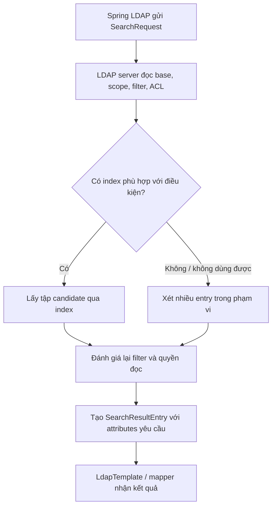
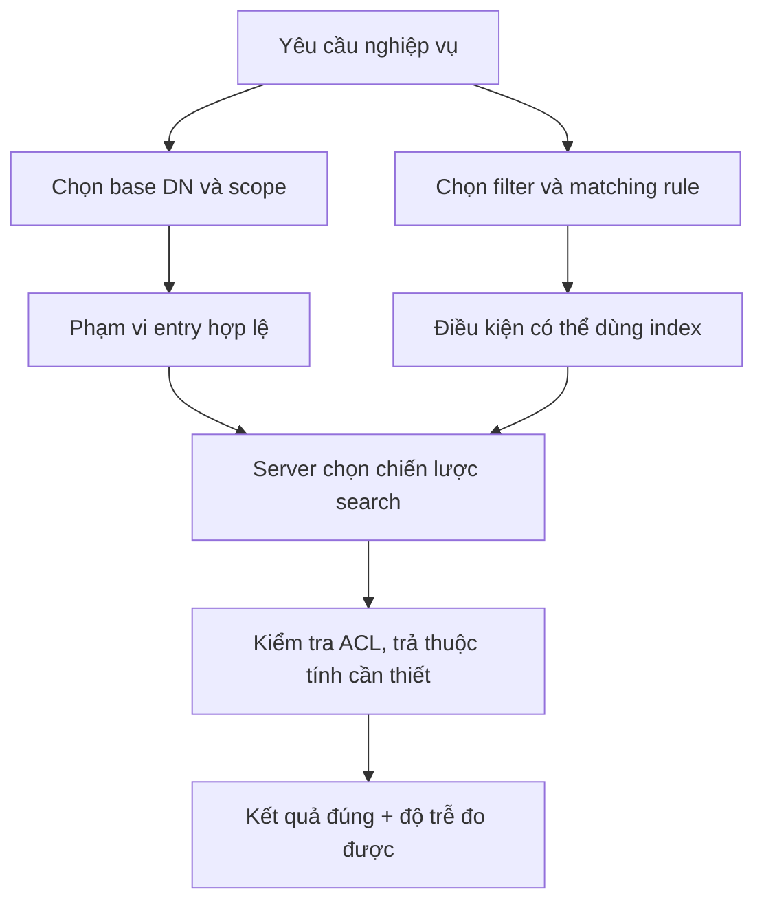

# Index attribute ở LDAP server và ảnh hưởng truy vấn

Một truy vấn **Spring LDAP** có thể trả về đúng một tài khoản nhưng mất nhiều giây nếu directory server phải kiểm tra hàng trăm nghìn entry để tìm ra tài khoản đó. Ngược lại, một điều kiện có **index phù hợp** có thể giúp server nhanh chóng xác định tập ứng viên cần so khớp. Vì index được xây dựng và duy trì **ở LDAP server**, hiệu năng không chỉ phụ thuộc vào Java code hoặc `LdapTemplate`.

Bài thuộc chương **Hiệu năng** của **SPRING_LDAP**. Người học sẽ hiểu equality, presence, substring và approximate index; mối liên hệ giữa schema, matching rule, base DN, scope, filter và index; ảnh hưởng tới tìm người dùng/nhóm; cách viết truy vấn có thể tận dụng index bằng `LdapQueryBuilder`, `LdapTemplate`, `LdapClient`; và cách phối hợp quản trị viên để đo, thêm hoặc điều chỉnh index mà vẫn giữ an toàn TLS, quyền truy cập và tính đúng của truy vấn.

> **Phạm vi:** LDAP là một giao thức; cách xây dựng, chọn và thống kê index là chi tiết triển khai của directory server (OpenLDAP, Active Directory, 389 Directory Server, v.v.). Không có thuộc tính hay cú pháp index nào bảo đảm hiệu quả giống nhau trên mọi máy chủ.

## 1. Index ở LDAP server giải quyết vấn đề gì?

Giả sử directory lưu 800.000 entry dưới `dc=example,dc=org` và yêu cầu tìm tài khoản có `uid=alice`:

```ldap
Base DN: ou=people,dc=example,dc=org
Scope:   SUBTREE
Filter:  (&(objectClass=inetOrgPerson)(uid=alice))
Attrs:   uid, cn, mail
```

Nếu server có equality index phù hợp với `uid`, nó có thể dùng một cấu trúc tra cứu dựa trên giá trị đã chuẩn hóa để xác định nhanh entry ứng viên. Nếu không có index hoặc không thể dùng index vì filter/matching rule, server có thể phải xem xét một tập entry lớn hơn nhiều.



Index làm việc ở khâu **tìm ứng viên**, nhưng không loại bỏ toàn bộ phần việc khác: server vẫn có thể cần kiểm tra filter, ACL, đọc attribute, truyền kết quả và ghi thống kê. Một index tốt cũng không cứu được API cố tải hàng chục nghìn entry kèm ảnh lớn.

### Ba số lượng phải phân biệt

| Đại lượng | Ý nghĩa | Ví dụ minh họa |
| --- | --- | --- |
| **Entry trong search scope** | Số entry thuộc base DN và độ sâu được tìm | 500.000 entry dưới `ou=people` |
| **Candidate/examined** | Số entry server xem xét khi chạy filter, tùy bộ tối ưu và index | Có thể chỉ vài entry nếu `uid` được index |
| **Entry khớp/trả về** | Số entry thỏa filter và ACL rồi được trả về, còn phụ thuộc limit | 1 entry Alice |

**Một kết quả không đồng nghĩa một candidate.** Search không dùng index vẫn có thể trả về đúng một entry nhưng đã xét gần toàn bộ nhánh. Ngược lại, index giúp tìm ứng viên nhưng server có thể vẫn lọc tiếp và loại một số entry.

Một chỉ số mô tả tính chọn lọc của điều kiện là:

```text
Tỷ lệ khớp = số entry thỏa điều kiện / số entry trong phạm vi

Ví dụ giả định: 1 / 500.000 = 0,0002%
```

Đây là **tỷ lệ kết quả**, không phải phép đo candidate mà server thực sự xét. Cần thống kê server để kết luận có sử dụng index hay không.

## 2. Những loại index thường gặp

Nhiều LDAP server có khả năng tạo index phục vụ các phép so khớp khác nhau. Tên gọi và mức độ hỗ trợ phụ thuộc sản phẩm/backend.

| Kiểu index | Filter liên quan | Vai trò | Cẩn trọng |
| --- | --- | --- | --- |
| **Equality** (`eq`) | `(uid=alice)`, `(mail=alice@example.org)` | Tra cứu giá trị chính xác theo equality matching rule | Index phải phù hợp schema và kiểu so khớp |
| **Presence** (`pres`) | `(mail=*)` | Hỗ trợ kiểm tra thuộc tính có tồn tại | Nếu gần như mọi entry có `mail`, điều kiện vẫn ít chọn lọc |
| **Substring** (`sub`) | `(cn=Al*)`, `(cn=*ali*)` | Hỗ trợ một số dạng tìm theo chuỗi con | Có thể tốn dung lượng và không hỗ trợ đều mọi dạng wildcard |
| **Approximate** (`approx`) | `(cn~=Alice)` | Tìm gần đúng theo matching rule/thuật toán server hỗ trợ | Kết quả và index rất đặc thù sản phẩm |
| **Index đặc thù server** | Theo control/attribute/matching rule của sản phẩm | Ví dụ tìm kiếm toàn văn hay thuộc tính được đánh dấu index trong schema | Không mặc định là một phần của LDAP chuẩn |

Không nên gọi `(cn=*Alice*)` là equality lookup; nó là substring filter. Tạo equality index cho `cn` không nhất thiết làm substring search nhanh. Tương tự, presence index không thay cho equality index khi tra `uid=alice`.

### 2.1. Equality index: lựa chọn điển hình cho identifier

Các trường thường được cân nhắc: `uid`, `mail`, `employeeNumber`, `member` hoặc thuộc tính định danh theo schema thực tế. Trong Microsoft Active Directory, các ví dụ thường gặp là `sAMAccountName` và `userPrincipalName`, nhưng tính duy nhất, partition/domain và trạng thái index phải kiểm tra riêng.

Ví dụ:

```ldap
(uid=alice)
(mail=alice@example.org)
(member=uid=alice,ou=engineering,ou=people,dc=example,dc=org)
```

Điều kiện `member` dùng DN làm **giá trị thuộc tính**; index và matching rule DN cần được server hỗ trợ đúng. Đối với sơ đồ nhóm kiểu `groupOfNames`, truy vấn tìm các nhóm chứa một user là tình huống equality index trên `member` có thể đặc biệt đáng cân nhắc. Tuy nhiên, server có thể tổ chức membership hoặc backlink theo cách khác, nên không áp dụng một cấu hình index mù quáng.

**Equality index không bảo đảm tính duy nhất.** Hai entry có thể cùng giá trị `uid` nếu schema/chính sách server không cấm. Ứng dụng dùng `searchForObject` hoặc xác thực theo uid phải xử lý rõ các trường hợp 0, 1 và nhiều entry.

### 2.2. Presence index: “có thuộc tính” chưa chắc chọn lọc

Filter:

```ldap
(mail=*)
```

có thể được index cho thao tác kiểm tra tồn tại attribute. Nhưng nếu 95% entry có `mail`, lượng kết quả vẫn rất lớn. Presence index chỉ hỗ trợ tìm entry ứng viên, **không giảm số kết quả trả về** khi nghiệp vụ yêu cầu trả tất cả.

Thay vì lấy mọi tài khoản có email rồi lọc `uid` ở Java, hãy dùng filter chính xác hơn:

```ldap
(&(mail=*)(uid=alice))
```

Điều kiện `uid=alice` thường mới là phần chọn lọc mạnh nếu có equality index phù hợp. Việc thêm điều kiện `(mail=*)` cũng làm đổi yêu cầu nghiệp vụ: chỉ trả tài khoản có email.

### 2.3. Substring index: tiện cho tìm tên nhưng có chi phí

Các filter sau có đặc điểm khác nhau:

```ldap
(cn=Ali*)
(cn=*lice)
(cn=*lic*)
(cn=*a*)
```

Server có thể dùng substring index với các đoạn đầu/cuối/giữa, nhưng thuật toán và khả năng tận dụng tùy implementation. Một filter với đoạn tìm quá ngắn như `*a*` thường khớp nhiều entry và có thể bị đánh giá rất đắt dù đã tạo index.

Biện pháp phía ứng dụng:

1. Chỉ bật tìm substring khi use case thực sự yêu cầu.
2. Đặt độ dài tối thiểu cho chuỗi nhập, debounce ở giao diện và giới hạn kết quả hiển thị.
3. Ưu tiên tìm đúng identifier hoặc prefix nếu thiết kế nghiệp vụ cho phép.
4. Đo workload với tên phổ biến, dữ liệu Unicode, tên dài và nhiều người cùng tên.
5. Kiểm chứng index substring có tác dụng với server đang dùng trước khi mở rộng quy mô.

**Không đổi một filter từ equality sang substring chỉ vì người dùng muốn tìm linh hoạt hơn mà bỏ qua chi phí.** Chức năng tìm kiếm tên tự do quy mô lớn đôi khi phù hợp với một search index chuyên dụng hơn là ép LDAP thực hiện full-text search.

### 2.4. Approximate matching và ngữ nghĩa khác nhau

`(cn~=Alice)` là approximate filter theo cú pháp LDAP, nhưng **không có một thuật toán so khớp gần đúng duy nhất** bắt buộc cho mọi server. Có directory không hỗ trợ approximate match hoặc không có index cho matching rule liên quan; kết quả có thể khác xa kỳ vọng.

Trước khi sử dụng, cần xác minh:

- Attribute có approximate matching rule tương ứng hay không.
- Directory server có thực thi và index được rule đó hay không.
- Kết quả có phù hợp với ngôn ngữ, dấu tiếng Việt và case folding hay không.
- Số candidate, độ trễ và tỷ lệ lỗi khi dữ liệu lớn.

Đừng dùng approximate lookup làm cơ chế xác định duy nhất một tài khoản để đăng nhập.

## 3. Schema và matching rule quyết định ý nghĩa index

LDAP server không nhất thiết lập chỉ mục các chuỗi theo byte nguyên bản. **Schema** định nghĩa attribute type, syntax, các matching rule như equality và substring. Server có thể chuẩn hóa giá trị (chẳng hạn xử lý case, khoảng trắng hoặc DN) trước khi tạo khóa index và so khớp filter.

Ví dụ giả định:

```text
uid:       case-insensitive equality theo schema/server cụ thể
member:    DN matching rule
cn:        directory string; có thể dùng substring matching rule
objectGUID: dữ liệu binary/định danh đặc thù Active Directory
```

Vì vậy:

- Không tự giả định `uid=ALICE` và `uid=alice` luôn giống hoặc khác nhau: xem equality matching rule thực tế.
- Không xem `String.equalsIgnoreCase` ở Java là phép thay thế chính xác cho LDAP matching rule.
- Attribute nhị phân, UUID hoặc DN có cách biểu diễn và escaping riêng, cần dùng filter phù hợp.
- Một custom attribute nếu không có matching rule/index tương ứng có thể không hưởng lợi từ một equality filter đơn giản.
- Schema và ACL ảnh hưởng cả **khả năng trả kết quả**; "không thấy entry" chưa đủ kết luận server không tìm thấy hoặc index sai.

**Index phải phù hợp với phép so khớp thật mà filter yêu cầu**, không chỉ phù hợp tên thuộc tính. Đừng kết luận tạo index đã thành công chỉ vì cấu hình có dòng tên attribute; cần so sánh thống kê query trước/sau.

## 4. Base DN, scope và filter: index không làm chúng trở nên vô nghĩa

Một equality lookup có index tốt vẫn có thể hưởng lợi từ base DN chặt chẽ:

| Cấu hình | Ý nghĩa | Đánh đổi |
| --- | --- | --- |
| Base `dc=example,dc=org` + `SUBTREE` | Tìm toàn bộ cây | Bao phủ rộng, có thể xét nhiều nhánh/ACL |
| Base `ou=people,dc=example,dc=org` + `SUBTREE` | Chỉ tìm khu người dùng và OU con | Phù hợp tài khoản phân tán qua các OU con |
| Base `ou=engineering,ou=people,dc=example,dc=org` + `ONELEVEL` | Chỉ entry con trực tiếp ở engineering | Nhanh hơn có thể, nhưng bỏ sót người trong OU con |
| Base là DN chính xác + `OBJECT` | Kiểm tra đúng một entry đã biết DN | Không cần search rộng khi đã có định danh tin cậy |

Không được chọn `ONELEVEL` để làm đẹp biểu đồ hiệu năng nếu nghiệp vụ cần tìm người dùng nằm trong các OU lồng nhau. Cũng không nên mở rộng tới root chỉ vì một DN không tìm được; có thể do base sai, filter sai, ACL hoặc entry không tồn tại.

### Sơ đồ mối quan hệ



Thứ tự biểu thức trong một filter `AND` **không bảo đảm thứ tự đánh giá** của directory server. Ví dụ hai filter:

```ldap
(&(objectClass=inetOrgPerson)(uid=alice))
(&(uid=alice)(objectClass=inetOrgPerson))
```

có cùng ý nghĩa logic, trừ những trường hợp đặc thù ngoài phạm vi ví dụ. Server có thể tối ưu dựa trên index/statistics; thay thứ tự chuỗi filter không phải phương pháp sửa thiếu index.

### AND, OR, NOT ảnh hưởng số candidate

- `(&(uid=alice)(objectClass=inetOrgPerson))` là giao của hai điều kiện; nếu `uid` rất chọn lọc và có index, server có thể dùng tập ứng viên nhỏ.
- `(|(uid=alice)(mail=alice@example.org))` là hợp của hai nhánh. Nếu một nhánh không có index hoặc khớp nhiều, chi phí OR có thể tăng.
- `(!(accountStatus=inactive))` là điều kiện phủ định trên **thuộc tính minh họa, không chuẩn chung**; nó có thể khớp phần lớn entry và khó tận dụng index.
- `(objectClass=*)` thường khớp rất rộng; khi scope là `SUBTREE` ở root có thể gây tải lớn.

Không phải mọi LDAP server lập kế hoạch như nhau. Khi một filter tổ hợp chậm, hãy thu thập thông số thực tế thay vì đoán dựa trên biểu thức Boolean.

## 5. Viết query có tính chọn lọc trong Spring LDAP

Ví dụ với `LdapContextSource` được cấu hình base `dc=example,dc=org` và account service chỉ có quyền đọc cần thiết. Ta muốn tìm user bằng uid, chỉ lấy vài thuộc tính:

```java
import java.util.List;
import javax.naming.NamingException;
import javax.naming.directory.Attribute;
import javax.naming.directory.Attributes;

import org.springframework.ldap.core.AttributesMapper;
import org.springframework.ldap.core.LdapTemplate;
import org.springframework.ldap.query.LdapQuery;
import org.springframework.ldap.query.LdapQueryBuilder;
import org.springframework.ldap.query.SearchScope;

record UserSummary(String uid, String commonName, String email) {}

class IndexedUserLookup {
    private final LdapTemplate ldapTemplate;

    IndexedUserLookup(LdapTemplate ldapTemplate) {
        this.ldapTemplate = ldapTemplate;
    }

    List<UserSummary> findByUid(String uid) {
        if (uid == null || uid.isBlank()) {
            throw new IllegalArgumentException("uid must not be blank");
        }

        LdapQuery query = LdapQueryBuilder.query()
            .base("ou=people")
            .searchScope(SearchScope.SUBTREE)
            .attributes("uid", "cn", "mail")
            .countLimit(2)
            .timeLimit(2000)
            .where("objectClass").is("inetOrgPerson")
            .and("uid").is(uid);

        return ldapTemplate.search(query,
            (AttributesMapper<UserSummary>) attrs -> new UserSummary(
                stringOrNull(attrs, "uid"),
                stringOrNull(attrs, "cn"),
                stringOrNull(attrs, "mail")
            )
        );
    }

    private static String stringOrNull(Attributes attrs, String id)
            throws NamingException {
        Attribute attr = attrs.get(id);
        return attr == null || attr.size() == 0
            ? null
            : String.valueOf(attr.get());
    }
}
```

Điểm cần nắm:

1. `.where("uid").is(uid)` tạo **equality filter** theo ngữ nghĩa của Spring LDAP; giá trị đầu vào được escape để ngăn sửa cấu trúc LDAP filter.
2. `.base("ou=people")` dùng base **tương đối** khi `ContextSource` có base `dc=example,dc=org`. Không ghép suffix hai lần.
3. `.searchScope(SearchScope.SUBTREE)` tìm user cả trong các OU con.
4. `.attributes("uid", "cn", "mail")` giảm payload trả về; **không tự tạo hay thay đổi index**.
5. `.countLimit(2)` có thể hỗ trợ phát hiện nhiều match khi nghiệp vụ kỳ vọng định danh duy nhất; phải xử lý mọi kết quả 0/1/nhiều và lỗi do server size/time limit.
6. `.timeLimit(2000)` điều khiển thời gian search ở tầng query, khác `com.sun.jndi.ldap.connect.timeout` và `com.sun.jndi.ldap.read.timeout` ở JNDI.
7. Một query có filter chọn lọc **không chứng minh index tồn tại**; phải kiểm tra cấu hình và thống kê server.

Với `LdapClient`, cách tổ chức câu lệnh có thể khác theo phiên bản API nhưng vẫn cần base, filter, scope, attributes và limits tương đương. ODM chuyển entry sang object, không tự cấu hình index server. Khi mapping entity có nhiều thuộc tính, hãy chỉ fetch những field cần thiết thay vì tưởng rằng index sẽ giải quyết chi phí truyền dữ liệu.

### Vì sao filter phải escape giá trị đầu vào?

Ví dụ người dùng nhập `alice*)(objectClass=*)`. Nếu nối trực tiếp thành:

```java
// Không làm: input có thể thay đổi cấu trúc filter.
String filter = "(uid=" + uid + ")";
```

thì có thể mở đường LDAP injection, trả thêm entry hoặc tạo một query rộng ngoài chủ đích. Dùng `LdapQueryBuilder` hoặc `EqualsFilter` của Spring LDAP để escape **giá trị** theo RFC 4515. Nếu input được dùng để xây DN/base DN, phải dùng cơ chế escape **DN** riêng như `LdapNameBuilder`; escaping filter và DN không thay thế nhau.

## 6. Tìm nhóm theo member: một ví dụ index khác biệt

Một ứng dụng phân quyền có thể cần truy vấn "Alice thuộc nhóm nào?". Với schema `groupOfNames`, nhóm thường có thuộc tính đa trị `member` chứa DN của thành viên.

```ldap
Base:   ou=groups,dc=example,dc=org
Scope:  SUBTREE
Filter: (&(objectClass=groupOfNames)(member=uid=alice,ou=people,dc=example,dc=org))
Attrs:  cn
```

Nếu có nhiều nhóm và mỗi nhóm chứa nhiều giá trị `member`, tìm theo equality trên `member` có thể hiệu quả **khi** server có index phù hợp. Nhưng:

- `groupOfNames` và `member` là một mô hình; schema khác có thể dùng `groupOfUniqueNames`/`uniqueMember`, `memberOf` hoặc cấu trúc đặc thù.
- Giá trị `member` là DN, cần đi qua builder/escaping filter đúng quy tắc, không ghép chuỗi từ input thô.
- `memberOf` có thể là backlink được tính toán hoặc thuộc tính vận hành trên một số server; không giả định nó luôn có sẵn hay được index.
- Index trên `member` có thể lớn và tốn công ghi khi nhóm thay đổi thường xuyên; phải đo tải ghi và kích thước thực tế.

Code query tương ứng:

```java
LdapQuery query = LdapQueryBuilder.query()
    .base("ou=groups")
    .searchScope(SearchScope.SUBTREE)
    .attributes("cn")
    .countLimit(200)
    .where("objectClass").is("groupOfNames")
    .and("member").is(userDn);
```

`countLimit(200)` chỉ là giá trị ví dụ; nếu user có thể thuộc trên 200 nhóm, một danh sách bị giới hạn **không được coi là dữ liệu phân quyền đầy đủ**. Cần phân trang hoặc một hợp đồng đọc rõ giới hạn theo nghiệp vụ; **không dùng kết quả không đầy đủ để quyết định quyền**.

## 7. Index được quản trị ở server, không nằm trong client code

Một nhầm lẫn phổ biến là nghĩ rằng dùng `LdapTemplate.search(...)` hay `.where("uid").is(...)` sẽ tự làm server tạo index. Thực tế:

- Spring LDAP **xây và gửi LDAP request**, nhận result và ánh xạ dữ liệu.
- **Directory server** định nghĩa schema, matching rule, backend lưu trữ và index, rồi chọn kế hoạch tìm kiếm.
- Cần quyền quản trị riêng để thay đổi index. Một service account dùng cho đọc/xác thực thông thường **không cần** và không nên có quyền sửa index.
- Tạo/sửa index có thể cần rebuild và tạo tải đáng kể; nó phải đi qua quy trình thay đổi được quản lý.

### 7.1. Ví dụ cấu hình tư duy cho OpenLDAP

Với backend thích hợp của OpenLDAP (chẳng hạn MDB) và một cấu hình đã được quản trị viên kiểm tra, các ý tưởng index có thể trông như sau:

```ldif
# Minh họa cú pháp attribute olcDbIndex trong cn=config.
# KHÔNG phải bản vá LDIF có thể áp dụng trực tiếp.
olcDbIndex: objectClass eq
olcDbIndex: uid eq
olcDbIndex: mail eq
olcDbIndex: cn sub
olcDbIndex: member eq
```

Lưu ý:

- `olcDbIndex` nằm trong entry cấu hình **database backend**, không phải entry người dùng ở `ou=people`.
- Vị trí DN của database, schema và index được hỗ trợ tùy phiên bản, backend và topology.
- Các giá trị trên **không phải một tập index mặc định nên bật hết**. Index `cn sub` hoặc `member eq` có thể tăng đáng kể disk/index-maintenance cost.
- Thêm cấu hình index không đồng nghĩa dữ liệu hiện có đã được index đầy đủ; với triển khai cần rebuild/reindex, phải làm theo hướng dẫn an toàn của phiên bản/backend, có kiểm tra backup và kế hoạch bảo trì.
- Nếu quản trị viên sửa thuộc tính đa trị trong cấu hình, phải tránh vô tình thay thế các cấu hình index đang hoạt động.

**Không** chạy lệnh ghi `cn=config` hay reindex trên production chỉ dựa vào bài học. Đây là nhiệm vụ của người vận hành LDAP server với quyền phù hợp, quy trình thay đổi và kế hoạch rollback đã xác minh.

### 7.2. Active Directory và các directory khác

Trong Active Directory, khả năng index có thể liên quan đến thuộc tính schema, chẳng hạn cờ `searchFlags` và đặc tính từng attribute. Một số thuộc tính được index sẵn theo thiết kế; một số loại tìm kiếm chịu ảnh hưởng domain partition, Global Catalog, link-value, ACL và các cơ chế tối ưu đặc thù. Sửa schema/index có tác động lan rộng và có thể cần đồng bộ giữa các domain controller.

Với 389 Directory Server hoặc sản phẩm khác, cơ chế quản trị index, việc rebuild và thống kê truy vấn cũng có cú pháp riêng. **Không sao chép cấu hình `olcDbIndex` của OpenLDAP sang Active Directory** hoặc coi một ví dụ của vendor là chuẩn LDAP chung.

### 7.3. Quy trình yêu cầu index qua quản trị viên

Một yêu cầu thay đổi có căn cứ nên chứa:

1. **Use case:** tìm uid khi đăng nhập, tra nhóm của user, autocomplete theo tên, hay đồng bộ định kỳ.
2. **Filter template:** ví dụ `(&(objectClass=inetOrgPerson)(uid={escapedValue}))`, base và scope thật, không chứa thông tin nhạy cảm.
3. **Tải hiện tại:** request/giây, đồng thời, thời gian p50/p95/p99, truy vấn có/không có kết quả.
4. **Bằng chứng server:** chỉ số candidates/examined, index hit/miss hoặc cơ chế chẩn đoán được sản phẩm hỗ trợ.
5. **Đề xuất index:** attribute, loại equality/presence/substring, matching rule tương ứng.
6. **Chi phí dự tính:** dung lượng index, tốc độ add/modify/delete/rename, CPU/I/O khi rebuild, tác động replication.
7. **Đánh giá an toàn:** phạm vi quyền, thay đổi ACL/schema nếu có, cửa sổ bảo trì và rollback.
8. **Tiêu chí chấp nhận:** cùng kết quả nghiệp vụ, latency cải thiện có ý nghĩa và tải ghi vẫn đạt SLO.

## 8. Index không miễn phí: tác động lên ghi và vận hành

Mỗi khi một entry được thêm, sửa hoặc xóa, directory server có thể cần cập nhật các chỉ mục liên quan. Index càng nhiều chưa chắc tổng hệ thống càng nhanh.

| Chi phí | Khi thêm index có thể xảy ra | Cách kiểm tra |
| --- | --- | --- |
| **Dung lượng lưu trữ** | Tăng dữ liệu index, có thể lớn với multi-value/substring | Giám sát disk/index size theo backend |
| **CPU khi ghi** | Phải tạo/cập nhật khóa index | Benchmark add/modify/delete theo workload thực |
| **I/O và cache** | Index mới cạnh tranh cache với dữ liệu khác | Quan sát page faults, I/O wait, cache hit |
| **Replication** | Thay đổi schema/cấu hình/index và rebuild có tác động theo topology | Kiểm tra tài liệu vendor và trạng thái replica |
| **Thời gian rebuild** | Reindex dữ liệu cũ có thể tiêu tốn đáng kể tài nguyên | Lập lịch, đo trên staging có quy mô tương đương |
| **Khóa và downtime** | Một số thao tác rebuild có thể yêu cầu downtime hoặc thay đổi cách phục vụ query | Theo quy trình sản phẩm cụ thể |
| **Độ phức tạp vận hành** | Phải theo dõi index stale/corrupt, thay đổi schema | Health check, backup, rollback, cảnh báo |

Một thuộc tính chỉ được dùng một lần mỗi tháng không nhất thiết đáng tạo substring index tốn dung lượng. Ngược lại, attribute được tra hàng trăm lần/giây bằng equality có thể có giá trị rất lớn. Quyết định phải dựa trên **tần suất query, độ chọn lọc, index hiện có và chi phí cập nhật**.

Thậm chí index đúng nhưng server vẫn chậm khi:

- Một filter khớp hàng chục nghìn entry, phải đọc và trả tất cả.
- Returning attributes chứa ảnh, certificate hoặc thuộc tính đa trị lớn.
- Server chịu tải ghi/replication cao và cache index bị đẩy khỏi RAM.
- Pool của ứng dụng bị cạn hoặc kết nối TLS liên tục tạo lại.
- Truy vấn thực hiện trên replica/partition khác nơi đã kiểm tra cấu hình.
- Server phải áp ACL phức tạp trên lượng kết quả lớn.

Vì vậy hiệu năng cần được nhìn theo toàn bộ đường đi, từ request của ứng dụng tới phản hồi LDAP.

## 9. Đo xem index có được dùng và có lợi không

Một phép đo chỉ bọc quanh `ldapTemplate.search(...)` cho biết **độ trễ phía client**, gồm chờ connection pool, TCP/TLS/bind nếu phát sinh, xử lý server, truyền dữ liệu và mapping. Để đánh giá hiệu quả index, cần quan sát thêm ở **server**.

| Tín hiệu | Nguồn đo | Dùng để trả lời |
| --- | --- | --- |
| Query count và throughput | App/LDAP server | Search nào được gọi nhiều nhất? |
| p50/p95/p99 end-to-end | App timer/tracing | Người dùng thực sự chờ bao lâu? |
| Search execution time | LDAP server log/metric | Bản thân server có chậm không? |
| Candidate/examined count | Công cụ chẩn đoán server, nếu có | Server có xét quá nhiều entry? |
| Index utilization/notes | Server diagnostic log, nếu có | Query đã dùng index phù hợp chưa? |
| Returned entries và bytes | Client/server | Result quá lớn hay attribute quá nặng? |
| Bind/connection/pool wait | App, JNDI, pool | Chậm do network/context hay do index? |
| CPU, I/O, cache và disk | LDAP server | Tải server/index đang nghẽn đâu? |
| Write throughput và latency | LDAP server | Thêm index có làm chậm add/modify/delete? |
| Error, size/time limit | App và server | Truy vấn có bị cắt kết quả hoặc timeout? |

Không phải sản phẩm directory nào cũng cung cấp số candidate hoặc explain plan theo cùng một API. Hãy dùng công cụ chẩn đoán chính thức của server đang vận hành, tránh suy đoán chỉ từ tên filter.

### Ví dụ số liệu đo (hoàn toàn giả định)

Cùng base, scope, filter, dữ liệu và tải đồng thời:

| Kịch bản | Candidate server xét (minh họa) | Entry trả | p95 search client (minh họa) |
| --- | ---: | ---: | ---: |
| `(uid=alice)` không dùng equality index | 500.000 | 1 | 420 ms |
| `(uid=alice)` dùng equality index phù hợp | 2 | 1 | 21 ms |
| `(objectClass=inetOrgPerson)` có index | 350.000 | 350.000 | Rất cao |
| `(cn=*an*)` có substring index nhưng khớp rộng | 90.000 | 40.000 | Cao |

Các con số **không phải benchmark Spring LDAP hay OpenLDAP**. Chúng minh họa rằng index có thể giảm candidate nhưng không bảo đảm giảm số entry trả về hoặc toàn bộ chi phí response. `objectClass` vẫn là điều kiện nghiệp vụ hữu ích dù nhiều giá trị phổ biến; không phải lúc nào cũng đủ chọn lọc.

### Phân biệt cold cache và warm cache

Một query đầu tiên sau restart có thể tốn nhiều I/O hơn khi dữ liệu/index chưa được cache. Vì vậy nên đo cả:

- **Cold-ish start:** lượt đầu sau khi môi trường test được khởi tạo theo quy trình đã xác định.
- **Steady state:** nhiều lượt sau warm-up với concurrency ổn định.
- **No-match:** truy vấn không tìm thấy entry, có thể bộc lộ thiếu index rõ hơn tìm thấy sớm.
- **High-cardinality và low-cardinality:** uid hiếm so với `objectClass` hoặc tên phổ biến.
- **Write-heavy period:** ảnh hưởng của cập nhật index khi dữ liệu thường xuyên thay đổi.

Đừng chọn thông số cấu hình chỉ vì một lần query giảm từ 400 ms xuống 20 ms trên máy test nhỏ. Cần lặp đủ số mẫu và xem p95/p99, lỗi, tải nền, disk, replication.

### Đo bằng Micrometer ở tầng ứng dụng

Đo tổng thời gian để đối chiếu với log/metric server:

```java
import java.util.List;

import io.micrometer.core.instrument.MeterRegistry;
import io.micrometer.core.instrument.Timer;
import org.springframework.ldap.core.AttributesMapper;
import org.springframework.ldap.core.LdapTemplate;
import org.springframework.ldap.query.LdapQuery;

class TimedDirectorySearch {
    private final LdapTemplate ldapTemplate;
    private final Timer timer;

    TimedDirectorySearch(LdapTemplate ldapTemplate,
                         MeterRegistry registry) {
        this.ldapTemplate = ldapTemplate;
        this.timer = Timer.builder("directory.ldap.search")
            .tag("operation", "findByUid")
            .description("LDAP search duration at application")
            .register(registry);
    }

    List<String> run(LdapQuery query) {
        return timer.record(() -> ldapTemplate.search(
            query,
            (AttributesMapper<String>) attrs ->
                attrs.get("uid") == null
                    ? null : String.valueOf(attrs.get("uid").get())
        ));
    }
}
```

Timer này **không xác nhận index đã được dùng**; nó chỉ giúp quan sát kết quả ở ứng dụng. Khi ghi metric, không dùng `uid`, DN đầy đủ, mật khẩu hoặc filter chứa thông tin cá nhân làm label vì làm lộ dữ liệu và tăng cardinality. Có thể dùng `operation=findByUid`, `result=success/error` và tên endpoint cố định.

## 10. Quy trình benchmark trước/sau thay đổi index

Giả sử quản trị viên đề xuất equality index cho `uid`. Một thử nghiệm đáng tin nên:

1. **Chốt yêu cầu nghiệp vụ:** ví dụ "tìm người dùng theo uid trong mọi OU con dưới `ou=people`". Kết quả khi có index phải giống khi chưa có index, kể cả trường hợp không tồn tại và trùng.
2. **Ghi lại server/schema:** loại directory, version, backend, index hiện tại, matching rule của `uid`, dữ liệu, topology và tài khoản/ACL.
3. **Giữ query cố định:** base DN, scope, filter, attributes, count/time limits và kết quả mapper phải giống nhau.
4. **Ghi tải nền:** số app replica, kết nối pool, concurrent search, tỉ lệ đăng nhập, cập nhật người dùng và nhóm.
5. **Đo trước:** p50/p95/p99, server search duration, candidate/examined nếu có, response bytes, CPU/I/O và latency thao tác ghi.
6. **Quản trị viên triển khai index:** theo quy trình backup, thay đổi và reindex nếu cần trên đúng backend/replica; kiểm tra index được khởi tạo thành công.
7. **Đo sau cùng workload:** warm-up tương đương, cùng số lượng mẫu, đối chiếu query có/không có kết quả và dữ liệu nhiều OU.
8. **Kiểm tra side effect:** disk/index size, tốc độ add/modify/delete, replication, CPU và ổn định dịch vụ khác.
9. **Ra quyết định:** chỉ giữ index khi lợi ích tìm kiếm xứng đáng với chi phí vận hành và tính đúng không đổi.

Nếu cùng lúc đổi filter từ `(cn=*alice*)` sang `(uid=alice)` **và** thêm index, kết quả nhanh hơn là có thể nhưng bạn không biết phần cải thiện thuộc về query hay index. Hãy thay một nhóm tham số mỗi lần và ghi rõ sự khác biệt.

### Một trường hợp đặc biệt: search có paging

LDAP Simple Paged Results (RFC 2696) giúp đọc nhiều phần của kết quả lớn nhưng **không tạo index** và không biến filter kém chọn lọc thành filter rẻ. Server vẫn phải xác định dữ liệu trong logical search; paging giảm kích thước mỗi phản hồi và giúp ứng dụng xử lý từng batch. Với tập lớn, cần đo cả tổng thời gian duyệt tất cả page, không chỉ p95 một page, đồng thời xử lý cookie và không coi paging là snapshot isolation.

## 11. Bài thực hành: đề xuất index dựa trên workload

### Bối cảnh

Ứng dụng sử dụng Spring LDAP để:

1. **Đăng nhập:** tìm DN bằng `uid` rồi dùng LDAP user bind để xác thực mật khẩu.
2. **Danh bạ nhân sự:** tìm người theo prefix của `cn`.
3. **Phân quyền:** tìm nhóm có attribute `member` chứa DN một người dùng.
4. **Đồng bộ:** định kỳ đọc danh sách người dùng theo batch.

Directory mẫu có khoảng 1.000.000 entry (giả định), phân tán trong nhiều OU; kết nối LDAPS và service account với quyền đọc đã được cấu hình. Quản trị viên quan sát tìm kiếm theo `uid` chậm và muốn biết có cần bổ sung index.

### Nhiệm vụ

1. Viết base, scope, filter và returning attributes phù hợp cho ba loại tìm kiếm đầu tiên.
2. Phân loại kiểu index nên **đánh giá** cho `uid`, `cn`, `member`. Giải thích vì sao không thể chỉ tạo `uid eq` cho mọi use case.
3. Nêu cách chứng minh `uid` equality index thực sự giúp giảm số candidate và độ trễ.
4. Thiết kế thử nghiệm no-match, uid có thật, tên phổ biến và nhóm lớn.
5. Nêu chi phí có thể tăng sau khi thêm `cn sub` hoặc `member eq`.
6. Giải thích vì sao database/app cache hoặc pool kết nối không thay thế được server index cho filter tốn nhiều candidate.
7. Thiết kế quy trình thay đổi index an toàn: staging, backup, maintenance/reindex, đo sau thay đổi và rollback.
8. Xác định các lỗi bảo mật cần tránh trong lúc tối ưu: LDAP injection, filter quá rộng, thay đổi ACL, user bind bị bỏ qua.

### Một lời giải tham khảo

| Use case | Filter minh họa | Index cần đánh giá | Điều kiện tiên quyết |
| --- | --- | --- | --- |
| Tra uid | `(&(objectClass=inetOrgPerson)(uid=alice))` | `uid` equality | Schema và tính duy nhất/ACL được xác nhận |
| Tìm tên theo prefix | `(&(objectClass=inetOrgPerson)(cn=Nguy*))` | `cn` substring | Server hỗ trợ; tránh tìm 1 ký tự quá rộng |
| Tìm nhóm của Alice | `(&(objectClass=groupOfNames)(member=<DN-user>))` | `member` equality | Đúng schema nhóm và DN matching rule |
| Đồng bộ tất cả user | `(objectClass=inetOrgPerson)` | Tùy server, workload và cách sync | Filter có thể trả rất nhiều entry; cần paging/incremental sync |

Dù đã có `uid eq`, đăng nhập vẫn phải xác thực bằng **user bind** theo quy tắc của hệ thống. Index chỉ giúp tìm DN/entry nhanh hơn; nó không chứng minh mật khẩu là đúng. Với trường hợp kết quả trùng/không tồn tại, ứng dụng phải xử lý chặt chẽ thay vì chọn entry đầu tiên.

### Tự kiểm tra

**Câu 1.** `(uid=alice)` trả đúng một entry sau 450 ms. Có thể kết luận index không tồn tại không?  
**Gợi ý:** Không. Có thể do pool, TLS, máy chủ quá tải hoặc index lạnh. Cần thông số server/candidate để xác nhận.

**Câu 2.** Vì sao `(cn=*an*)` có thể chậm dù đã tạo substring index?  
**Gợi ý:** Đoạn tìm quá phổ biến; nhiều ứng viên và kết quả vẫn phải được xử lý/trả về.

**Câu 3.** Index trên `uid` có thay thế `.attributes("uid","cn","mail")` không?  
**Gợi ý:** Không. Index hỗ trợ tìm ứng viên, returning attributes giảm payload dữ liệu được trả.

**Câu 4.** Tăng số lượng index có thể làm gì với throughput ghi?  
**Gợi ý:** Tạo thêm thao tác cập nhật index, I/O, disk và có thể tăng chi phí bảo trì/replication.

**Câu 5.** Một filter dùng equality trên `member` có áp dụng cho mọi LDAP server không?  
**Gợi ý:** Không. Phải xác nhận server/schema có `member`, giá trị DN và matching rule phù hợp.

## 12. Checklist triển khai

- [ ] Đã xác nhận schema, matching rule và loại directory server thực tế.
- [ ] Chọn base DN, scope và filter phù hợp trước khi yêu cầu thêm index.
- [ ] Biết equality, presence, substring, approximate filter/index khác nhau thế nào.
- [ ] Không giả định một attribute đã có index chỉ vì nó thường dùng (ví dụ `uid`, `mail`).
- [ ] Có thống kê server về candidate/index usage hoặc phương thức chẩn đoán phù hợp.
- [ ] Không đánh đồng "trả 1 entry" với "đã xét 1 entry".
- [ ] Chỉ yêu cầu returning attributes cần thiết; giới hạn hoặc phân trang khi dữ liệu lớn.
- [ ] Không nối input thô vào LDAP filter/DN; dùng builder/escaping theo ngữ cảnh.
- [ ] Không thay đổi quyền đọc, service/user bind hoặc xác thực TLS khi tối ưu.
- [ ] Có baseline p50/p95/p99, query có/không khớp và dữ liệu đủ lớn.
- [ ] Đã đánh giá tác động của index tới thao tác ghi, disk, cache và replication.
- [ ] Thay đổi index do quản trị viên thực hiện trên backend thích hợp, có kế hoạch reindex và rollback.
- [ ] Kiểm tra kết quả, quyền và tỷ lệ lỗi không đổi sau tối ưu.
- [ ] Không coi paging hoặc connection pooling là cách sửa filter thiếu index.

## Tài liệu tham khảo

- [RFC 4511 – LDAP: The Protocol](https://www.rfc-editor.org/rfc/rfc4511): search request, filter, scope, result và các result code.
- [RFC 4512 – LDAP: Directory Information Models](https://www.rfc-editor.org/rfc/rfc4512): schema, attribute types và object classes.
- [RFC 4515 – String Representation of Search Filters](https://www.rfc-editor.org/rfc/rfc4515): cú pháp và escaping LDAP filter.
- [RFC 4517 – Syntaxes and Matching Rules](https://www.rfc-editor.org/rfc/rfc4517): matching rule giúp xác định ý nghĩa equality/substring.
- [OpenLDAP Administrator's Guide – Database Backends and Indexing](https://www.openldap.org/doc/admin24/tuning.html): cấu hình index và lựa chọn chỉ mục cho OpenLDAP.
- [Spring LDAP – Building Advanced LDAP Queries](https://docs.spring.io/spring-ldap/reference/query-builder-advanced.html): `LdapQueryBuilder`, base/scope/filter, projection và limits.
- [Spring LDAP Reference Documentation](https://docs.spring.io/spring-ldap/reference/): `LdapTemplate`, `LdapClient`, ODM, ContextSource và xử lý kết nối.

