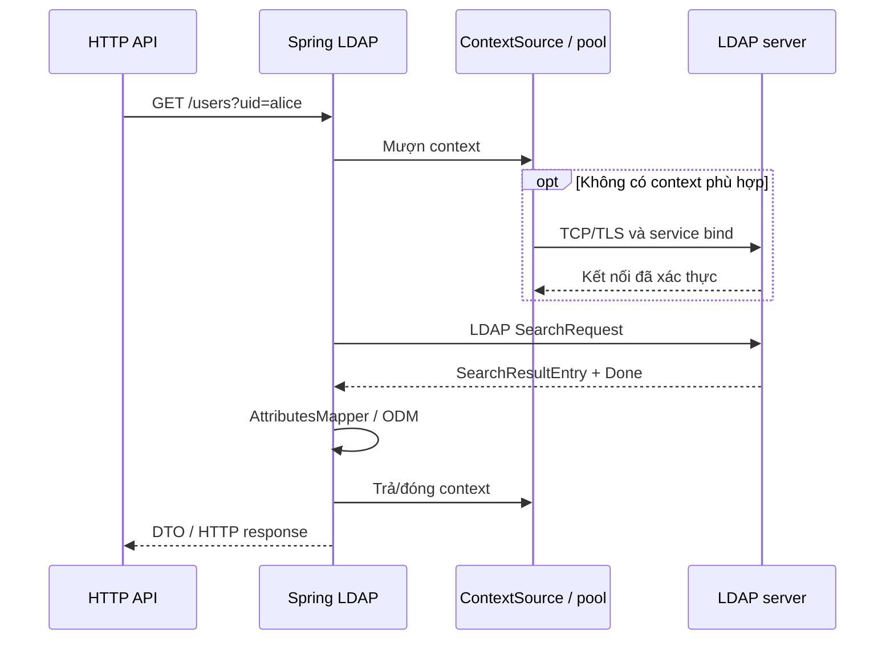
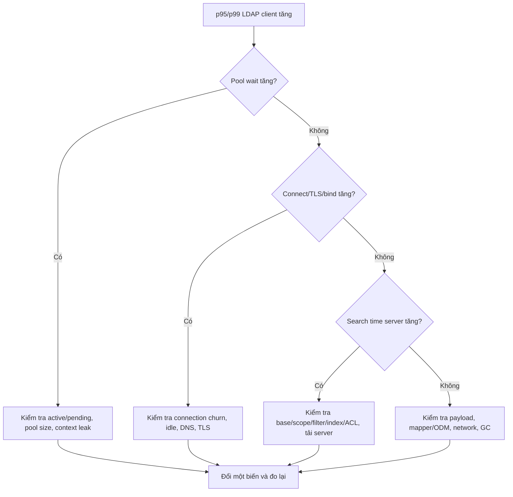

# Đo độ trễ, throughput và tỷ lệ lỗi trong Spring LDAP

Một endpoint tra cứu người dùng có thể đạt trung bình 15 ms nhưng thỉnh thoảng mất 2 giây. Một hệ thống khác xử lý 1.000 yêu cầu/giây nhưng 8% yêu cầu lỗi khi tải tăng. Nếu chỉ nhìn vào thời gian trung bình hoặc số request đã hoàn tất, cả hai hệ thống đều có thể bị đánh giá nhầm là nhanh. Để tối ưu **Spring LDAP**, cần đo đồng thời **độ trễ (latency), thông lượng (throughput) và tỷ lệ lỗi (error rate)** theo từng loại thao tác, trong điều kiện tải có thể tái lập.

Bài thuộc chương **Hiệu năng** của module **SPRING_LDAP**. Người học sẽ biết đặt ranh giới phép đo cho `ContextSource`, `LdapTemplate`, `LdapClient`, ODM và LDAP server; phân biệt service bind với user bind; ghi metric bằng Micrometer; tính phân vị p50/p95/p99, tốc độ và tỷ lệ lỗi; nhận diện bottleneck từ kết nối TLS, pooling, search, mapping, ACL hoặc schema/index; thiết kế benchmark và SLO mà không ghi lộ thông tin nhạy cảm của thư mục.

## 1. Xác định đúng đơn vị đo trước khi tối ưu

Trước khi viết code instrumentation, phải định nghĩa **một operation là gì**. Một request ứng dụng có thể thực hiện nhiều LDAP operation:



Thời gian HTTP request có thể bao gồm xác thực phiên, business logic, cache, queue, DB và serialize JSON. Thời gian bọc một lời gọi `ldapTemplate.search(...)` có thể bao gồm lấy context, chờ pool, kết nối/TLS/bind nếu phải tạo mới, LDAP search, truyền kết quả và ánh xạ. **Nó không phải thuần "server search time".**

Bảng ranh giới đo:

| Tên phép đo | Bắt đầu | Kết thúc | Trả lời câu hỏi |
| --- | --- | --- | --- |
| HTTP end-to-end | Request tới web server | HTTP response hoàn tất | Người dùng chờ bao lâu? |
| LDAP client operation | Trước lời gọi `LdapTemplate`/`LdapClient` | API LDAP trả về hoặc ném lỗi | Ứng dụng tốn bao lâu cho LDAP? |
| Context acquisition / pool wait | Trước khi lấy context | Có context sử dụng được | Nghẽn pool, tạo kết nối hay validation? |
| LDAP bind | Khi bắt đầu trao đổi bind phù hợp | Nhận kết quả bind | Xác thực user/service mất bao lâu? |
| LDAP search server-side | Server nhận và xử lý search | Server kết thúc search | Index/filter/ACL có chậm? |
| Mapping | Mapper bắt đầu nhận dữ liệu | DTO/entity được tạo xong | JNDI/ODM/DTO có quá nặng? |
| Multi-page scan | Gửi request trang đầu | Trang cuối và kết quả downstream hoàn tất | Một job đồng bộ thực sự mất bao lâu? |

Các ranh giới có thể lồng nhau. Không cộng các metric tổng hợp khác nhau rồi giả định chính xác tuyệt đối: có thành phần chồng lấp, được đo ở các máy khác nhau và có sai lệch đồng hồ. Hãy sử dụng trace/correlation ID an toàn để so sánh cùng request và thống kê server khi cần.

### Các operation nên theo dõi riêng

- **`searchByUid`**: truy vấn định danh chính xác, thường kỳ vọng 0/1 entry.
- **`searchPeople`**: tìm danh bạ có filter, count limit hoặc paging.
- **`authenticateUser`**: có thể gồm tìm DN người dùng rồi bind với mật khẩu.
- **`readGroups`**: tra nhóm theo `member` hoặc schema tương ứng.
- **`addEntry` / `modifyEntry` / `deleteEntry`**: thao tác ghi với ý nghĩa lỗi và retry khác search.
- **`directorySyncPage`**: một trang của quá trình quét; đồng thời phải đo tổng `directorySyncJob`.

Không gộp mọi thứ vào một timer `ldap.duration` rồi suy ra nguyên nhân: một tìm kiếm trả một entry và một export 200.000 entry khác nhau quá lớn về workload.

## 2. Latency: trung bình, p50, p95 và p99

**Latency** là khoảng thời gian từ thời điểm bắt đầu tới thời điểm kết thúc operation đã định nghĩa. Đơn vị thường là ms hoặc giây. Các phân vị mô tả sự phân bố:

| Chỉ số | Ý nghĩa | Điểm mạnh / hạn chế |
| --- | --- | --- |
| `mean` (trung bình) | Tổng thời gian chia số phép đo | Dễ hiểu, nhưng bị lệch do outlier |
| `p50` (median) | Khoảng 50% phép đo không vượt quá mức này | Đại diện luồng điển hình |
| `p95` | Khoảng 95% phép đo không vượt mức này | Cho biết trải nghiệm chậm ở đuôi |
| `p99` | Khoảng 99% phép đo không vượt mức này | Nhạy với pool wait, GC, reconnect, server overload |
| `max` | Giá trị lớn nhất trong cửa sổ đo | Dễ dao động khi số mẫu nhỏ; khó so sánh riêng lẻ |
| Histogram | Số phép đo nằm trong các khoảng độ trễ | Dùng tính phân vị tổng hợp khi xuất metric phù hợp |

Ví dụ giả định: 10.000 search có p50 = 20 ms, p95 = 95 ms, p99 = 430 ms, max = 2.500 ms. Trung bình có thể trông ổn nhưng một phần người dùng chờ lâu hơn đáng kể. Với hệ thống xác thực, cần quan tâm p95/p99 của **user bind** và **toàn bộ login**, không chỉ service search.

**p95 không có nghĩa 95% yêu cầu "chạy đúng 95 ms".** Nó có nghĩa gần 95% quan sát có latency không vượt quá phân vị đó theo quy tắc ước tính được dùng. Phân vị cũng thay đổi theo cửa sổ thời gian, số mẫu và cấu hình histogram.

### Hai lỗi thường gặp khi báo p95

1. **Lấy trung bình p95 từ nhiều instance.** Trung bình p95 của ba replica không phải p95 toàn cụm. Nếu cần tổng hợp, dùng histogram có bucket tương thích và tính lại phân vị từ tổng bucket; hoặc tập hợp raw observations được cho phép.
2. **Đo p95 của các request thành công nhưng bỏ qua timeout.** Nếu request chậm nhất bị timeout và không được đưa vào metric, p95 nhìn có vẻ cải thiện trong khi trải nghiệm người dùng tệ đi. Ghi cả những operation kết thúc bằng lỗi/timeout, với kết quả được phân loại.

Trong load test, phải bảo đảm máy tạo tải không nghẽn, cửa sổ đo đủ mẫu và đồng hồ monotonic được dùng trong instrumentation để đo duration. Đừng so sánh hai phép đo có workload khác nhau rồi cho rằng sự chênh lệch là do tối ưu code.

## 3. Throughput: tốc độ hoàn thành công việc

**Throughput** cho biết lượng operation hoàn tất trong một đơn vị thời gian; thường biểu diễn request/giây (RPS), LDAP search/giây hoặc entry/giây cho job đồng bộ.

```text
Throughput hoàn thành = số operation hoàn tất / khoảng thời gian quan sát

Ví dụ: 9.600 search hoàn tất trong 120 giây
        => throughput = 9.600 / 120 = 80 search/giây
```

Cần phân biệt ba đại lượng:

| Đại lượng | Ví dụ | Tác dụng |
| --- | --- | --- |
| **Offered load / arrival rate** | Client gửi 120 request/giây | Đo mức tải tác động vào hệ thống |
| **Completion throughput** | Server trả xong 95 request/giây | Đo mức phục vụ thực tế, có thể gồm success và error |
| **Successful throughput** | 87 operation/giây thành công | Đo công việc hữu ích thực sự hoàn tất |

Nếu client gửi 120 request/giây nhưng hệ thống chỉ hoàn tất 95 request/giây trong một khoảng và queue đang tăng, không được kết luận "hệ thống xử lý 120 RPS". Ngược lại, một dịch vụ có thể trả hàng trăm lỗi rất nhanh, khiến throughput tổng tăng mà hiệu năng nghiệp vụ lại giảm.

Với LDAP, một **HTTP request không nhất thiết tương đương một LDAP request**:

```text
1 API login có thể =
  1 service search để tìm DN
+ 1 user bind để kiểm tra mật khẩu
+ 1 search đọc thuộc tính/nhóm (nếu cần)
```

Vì vậy cần đo song song **HTTP RPS**, **LDAP operations/giây theo loại** và **successful logins/giây**. Một tối ưu bỏ search DN chỉ hợp lệ nếu hệ thống biết được DN chính xác, an toàn và vẫn thực hiện xác thực đúng.

### Little's Law và số thao tác đồng thời

Trong trạng thái ổn định, số thao tác đang xử lý trung bình được ước lượng bằng:

```text
L ≈ λ × W

L: số thao tác đang xử lý trung bình
λ: tốc độ hoàn thành trung bình (operation/giây)
W: thời gian ở trong hệ thống trung bình (giây)
```

Ví dụ giả định: 200 LDAP operation/giây, mỗi operation giữ connection trung bình 40 ms → khoảng 8 operation đồng thời trung bình. **Đây không phải max pool size bắt buộc**: burst, p99, timeouts, validation, CPU server và các job nền có thể yêu cầu mức dự phòng khác. Nếu pool quá lớn, hệ thống lại có thể gây quá tải server.

## 4. Error rate: phải định nghĩa thế nào là lỗi

**Tỷ lệ lỗi** thường là số operation thuộc nhóm lỗi chia cho tổng số operation được tính trong cùng khoảng:

```text
Error rate (%) = số operation lỗi / số operation được tính × 100%

Ví dụ: 120 lỗi kỹ thuật / 10.000 operation hoàn tất = 1,2%
```

Tuy nhiên, "lỗi" có nhiều nghĩa. Nên tách **kết quả nghiệp vụ dự kiến** và **lỗi hạ tầng / vi phạm hợp đồng**.

| Tình huống | Cách phân loại gợi ý | Tại sao |
| --- | --- | --- |
| Search uid không tồn tại và use case cho phép | `not_found` (business outcome) | Không nhất thiết là lỗi directory |
| Login sai mật khẩu | `rejected_credentials` (authentication outcome) | Là đăng nhập thất bại, không mặc nhiên là lỗi vận hành LDAP |
| Lỗi kết nối, reset, DNS/TLS handshake thất bại | `connection_error` | Lỗi hạ tầng cần cảnh báo |
| Không mượn được context vì pool cạn | `pool_timeout` | Nút thắt client/pool |
| LDAP `timeLimitExceeded` | `search_timeout` hoặc nhóm tương đương | Search chưa hoàn tất |
| LDAP `sizeLimitExceeded` | `result_limit` | Có thể đã nhận một phần dữ liệu, cần xử lý |
| LDAP `insufficientAccessRights` | `authorization_denied` | Xem use case để phân loại lỗi truy cập hay thiếu quyền hợp lệ |
| Filter sai cú pháp | `invalid_filter` | Lỗi logic hoặc input chưa được xử lý đúng |
| Server unavailable / busy | `server_unavailable` / `server_busy` | Lỗi hệ thống hoặc quá tải |
| Mapper ném exception do thiếu attribute bắt buộc | `mapping_error` | Có thể là sai hợp đồng schema/projection |
| Không bind được vì mật khẩu service account sai | `service_auth_error` | Lỗi cấu hình nghiêm trọng |
| User bind bị từ chối theo chính sách tài khoản | `rejected_credentials` hoặc `policy_rejection` | Không gộp chung với timeout hay lỗi mạng |

Khi dùng `LdapTemplate.authenticate(...)`, một số trường hợp xác thực không thành công có thể trả `false` thay vì ném exception; đo metric chỉ trong `catch` sẽ **bỏ sót tỷ lệ đăng nhập bị từ chối**. Ngược lại, không nên tính mọi password sai vào *technical error rate*, vì một cuộc tấn công nhập mật khẩu sai có thể làm metric hạ tầng méo dù LDAP server hoạt động tốt.

Một dashboard hữu ích có ít nhất ba chỉ số tách riêng: **LDAP technical error rate**, **login rejection rate**, **login success rate**. Với xuất dữ liệu hoặc thao tác ghi, có thể cần thêm `partial_result` để phân biệt kết quả chưa hoàn tất và thành công.

### Denominator phải rõ ràng

Với 1.000 LDAP operation trong 5 phút gồm 900 thành công, 50 `not_found`, 30 mật khẩu sai và 20 lỗi kết nối:

- Nếu use case coi `not_found` và mật khẩu sai là kết quả dự kiến, **technical error rate = 20/1.000 = 2%**.
- Nếu xét riêng luồng login, **failed-login rate** có thể tính số rejected login trên tổng login attempt, nhưng không thể lấy 30 chia cho 1.000 nếu 1.000 gồm cả search/modify.
- Nếu có request chưa hoàn tất khi kết thúc cửa sổ đo, cần tách attempted/completed/in-flight và không dùng số hoàn tất để che mất request đang tồn đọng.

Không dùng một chỉ số "success = không ném exception" để đánh giá mọi loại thao tác.

## 5. Chọn metric và label trong Micrometer

Micrometer là cơ chế phổ biến để ghi metric trong ứng dụng Spring. `Timer` đo duration kèm số lần quan sát; `Counter` đo sự kiện tích lũy; `Gauge` phản ánh giá trị tức thời như số context đang hoạt động. Nếu dùng Spring Boot Actuator, có thể xuất các metric đã đăng ký qua hệ thống monitoring hỗ trợ (cần cấu hình exporter và quyền truy cập phù hợp).

Một quy ước đặt tên gợi ý:

| Metric | Loại | Label có cardinality thấp |
| --- | --- | --- |
| `directory.ldap.operation.duration` | Timer/histogram | `operation`, `result` |
| `directory.ldap.context.borrow.duration` | Timer | `pool`, `result` |
| `directory.ldap.operation.attempts` | Counter | `operation`, `outcome` |
| `directory.ldap.pool.active` | Gauge | `pool` |
| `directory.ldap.pool.idle` | Gauge | `pool` |
| `directory.ldap.pool.pending` | Gauge | `pool` |
| `directory.ldap.sync.entries` | Counter | `job`, `result` |
| `directory.ldap.sync.job.duration` | Timer | `job`, `result` |

**Không đưa `uid`, full DN, email, raw LDAP filter, mật khẩu, cookie paging, token hay dữ liệu người dùng vào metric tag.** Mỗi giá trị khác nhau tạo một time series; dữ liệu nhạy cảm và cardinality cao đều gây rủi ro. Dùng tên operation cố định như `searchByUid`, `readGroups`, `authenticateUser`, và nhóm lỗi giới hạn như `success`, `not_found`, `error`.

Các metric ở bảng là **đề xuất tên tự định nghĩa**, không phải tất cả được Spring LDAP tự động phát ra. Pool của JNDI mặc định có thể không có metric chi tiết như một pool Spring/Commons Pool được instrument; khi không có, cần đối chiếu log/metric server hoặc bổ sung đo ở hạ tầng phù hợp.

## 6. Đo search bằng `Timer.Sample` và phân loại kết quả

Ví dụ Java 17+, Spring LDAP với Micrometer. Bọc đúng lời gọi `ldapTemplate.search(...)`, dùng filter builder để escape giá trị, tránh label chứa thông tin cá nhân:

```java
import java.time.Duration;
import java.util.List;

import io.micrometer.core.instrument.MeterRegistry;
import io.micrometer.core.instrument.Timer;
import org.springframework.ldap.core.AttributesMapper;
import org.springframework.ldap.core.LdapTemplate;
import org.springframework.ldap.query.LdapQuery;
import org.springframework.ldap.query.LdapQueryBuilder;
import org.springframework.ldap.query.SearchScope;

record UserView(String name, String email) {}

class MeasuredUserDirectory {
    private final LdapTemplate ldapTemplate;
    private final MeterRegistry registry;

    MeasuredUserDirectory(LdapTemplate ldapTemplate, MeterRegistry registry) {
        this.ldapTemplate = ldapTemplate;
        this.registry = registry;
    }

    List<UserView> findByUid(String uid) {
        if (uid == null || uid.isBlank()) {
            throw new IllegalArgumentException("uid required");
        }

        LdapQuery query = LdapQueryBuilder.query()
            .base("ou=people")
            .searchScope(SearchScope.SUBTREE)
            .attributes("cn", "mail")
            .countLimit(2)
            .timeLimit(2000)
            .where("uid").is(uid);

        Timer.Sample sample = Timer.start(registry);
        String outcome = "success";
        try {
            List<UserView> rows = ldapTemplate.search(
                query,
                (AttributesMapper<UserView>) attrs -> new UserView(
                    attrs.get("cn") == null
                        ? null : String.valueOf(attrs.get("cn").get()),
                    attrs.get("mail") == null
                        ? null : String.valueOf(attrs.get("mail").get())
                )
            );
            if (rows.isEmpty()) {
                outcome = "not_found";
            }
            return rows;
        } catch (RuntimeException ex) {
            outcome = "error"; // Phân loại exception ở tầng quan sát chuyên biệt.
            throw ex;
        } finally {
            Timer timer = Timer.builder("directory.ldap.operation.duration")
                .description("Client-side Spring LDAP call latency")
                .tag("operation", "searchByUid")
                .tag("result", outcome)
                .publishPercentileHistogram()
                .serviceLevelObjectives(
                    Duration.ofMillis(50),
                    Duration.ofMillis(100),
                    Duration.ofMillis(250)
                )
                .register(registry);
            sample.stop(timer);
        }
    }
}
```

Giải thích ranh giới và trách nhiệm:

1. `Timer.start(registry)` ghi thời điểm bắt đầu bằng cơ chế đo duration; `sample.stop(timer)` ghi thời lượng ngay cả khi search ném exception.
2. Metric bao gồm việc `LdapTemplate` lấy context từ `ContextSource`, chờ pool, search, network và mapping. **Không dùng timer này làm số đo riêng của LDAP server.**
3. Kết quả `not_found` không bị tính là lỗi kỹ thuật. Nếu có nhiều entry trong luồng kỳ vọng một người dùng, service phải xử lý như lỗi hợp đồng; ví dụ trên trả list và chưa áp đặt chính sách nghiệp vụ đó.
4. `publishPercentileHistogram()` tạo histogram để backend hỗ trợ tính phân vị theo cấu hình registry. Không nên bật histogram không giới hạn cho hàng nghìn tag khác nhau.
5. `serviceLevelObjectives(...)` ghi các ngưỡng đo theo khả năng của Micrometer/backend, phù hợp phân tích số operation vượt mục tiêu.
6. Không đưa `uid` vào tag hoặc tên metric; lỗi cụ thể phải được map sang nhóm có giới hạn trước khi ghi nhãn.

Đoạn code trên dùng `outcome="error"` chung để tập trung vào việc tạo metric. Trong môi trường thật, hãy bổ sung **bộ phân loại exception** theo Spring LDAP/JNDI và LDAP result code; tuyệt đối không đưa trực tiếp `ex.getMessage()` làm label.

### Đo login mà không lẫn mật khẩu sai với lỗi server

Một flow login có thể dùng `LdapTemplate.authenticate` để tìm DN rồi thực hiện user bind. Về mặt đo đạc, nên ghi:

```text
operation=authenticateUser, result=accepted
operation=authenticateUser, result=rejected
operation=authenticateUser, result=error

Kèm timer riêng cho cả flow login nếu ứng dụng còn đọc nhóm/hồ sơ.
```

`accepted` và `rejected` là **kết quả bảo mật nghiệp vụ**; `error` là trường hợp không thể hoàn thành xác thực do lỗi kỹ thuật. Giao diện người dùng có thể cần thông báo chung không tiết lộ việc tài khoản có tồn tại hay không. Monitoring nội bộ được bảo vệ nên vẫn có thể dùng các nhóm kết quả tổng hợp để phát hiện tấn công và sự cố, nhưng không ghi username/password.

**Không bỏ user bind để giảm độ trễ login.** Reuse connection service account chỉ giúp tìm kiếm được cấp phép; không chứng minh mật khẩu của người dùng là đúng. Thay đổi mật khẩu hoặc khóa tài khoản phải có hiệu lực theo chính sách directory.

## 7. Đếm throughput và tỷ lệ lỗi từ cùng tập dữ liệu

`Timer` có count theo các label `operation` và `result`; nếu mọi operation đi qua wrapper đo này, có thể dùng count để suy ra số lần hoàn tất theo kết quả. Không nhất thiết tạo thêm một Counter trùng ý nghĩa. Khi cần theo dõi số entry xử lý trong job hoặc số lần retry, dùng Counter riêng.

Ví dụ một Counter cho entry đồng bộ đã xử lý thành công:

```java
import io.micrometer.core.instrument.Counter;
import io.micrometer.core.instrument.MeterRegistry;

class SyncMetrics {
    private final Counter completedEntries;

    SyncMetrics(MeterRegistry registry) {
        this.completedEntries = Counter.builder("directory.ldap.sync.entries")
            .description("Successfully processed directory entries")
            .tag("job", "peopleSync")
            .tag("result", "success")
            .register(registry);
    }

    void recordCommittedBatch(int committedCount) {
        if (committedCount < 0) {
            throw new IllegalArgumentException("negative count");
        }
        completedEntries.increment(committedCount);
    }
}
```

Chỉ tăng counter **sau khi batch đã commit thành công** nếu ý nghĩa metric là "entry đã đồng bộ". Nếu tăng khi mới nhận từ LDAP, metric chỉ đo "entry đã đọc" và không được đặt tên `committed`. Đếm cả job bắt đầu, thành công, partial, thất bại để có tỷ lệ hoàn thành.

### Ví dụ công thức cho dashboard Prometheus

Khi Micrometer xuất Timer dạng Prometheus histogram với tên quy đổi thành `directory_ldap_operation_duration_seconds_*`, có thể sử dụng các biểu thức **minh họa** (tên thực tế phải kiểm tra endpoint metrics/exporter):

```promql
# Tốc độ hoàn tất searchByUid, kể cả success/not_found/error:
sum(rate(directory_ldap_operation_duration_seconds_count{
  operation="searchByUid"
}[5m]))
```

```promql
# Tỷ lệ lỗi kỹ thuật của searchByUid:
sum(rate(directory_ldap_operation_duration_seconds_count{
  operation="searchByUid",result="error"
}[5m]))
/
sum(rate(directory_ldap_operation_duration_seconds_count{
  operation="searchByUid"
}[5m]))
```

```promql
# p95 qua các replica từ histogram (khi các bucket tương thích):
histogram_quantile(
  0.95,
  sum by (le) (
    rate(directory_ldap_operation_duration_seconds_bucket{
      operation="searchByUid"
    }[5m])
  )
)
```

Đo p95 theo `result` hoặc tách thành công/lỗi khi cần hiểu nguyên nhân; dashboard tổng cũng phải hiển thị tỷ lệ lỗi để tránh cảm giác "nhanh" khi các request chậm bị timeout. Các query trên chỉ hợp lệ khi histogram thật sự được xuất và nhãn đúng schema metric đã tạo; với backend khác sẽ cần cú pháp khác.

Đừng tính `mean(p95_instance)` trên nhiều replica. Histogram cho phép cộng bucket tương thích trước khi ước lượng phân vị; nếu không có histogram tương thích, báo phân vị riêng từng instance và giải thích giới hạn.

## 8. Từ metric client tới nút thắt thực tế

Khi `p99` tăng, hãy kiểm tra các tầng liên quan thay vì lập tức chỉnh filter:



Dấu hiệu thực tế để phân tích:

| Triệu chứng | Khả năng ưu tiên kiểm tra | Metric hỗ trợ |
| --- | --- | --- |
| p50 ổn nhưng p99 tăng khi burst | Pool queue, connection stale, retry | Pool pending/borrow latency, connect errors |
| Đăng nhập chậm hơn lookup | User bind, search DN, chính sách server | Login substep timer, bind failures |
| Search cùng filter chậm hơn khi DIT lớn | Index không phù hợp, ACL, filter rộng | Candidate/examined, server search time |
| Latency client cao, server search time thấp | Network/TLS, pool wait, decoding/mapping | RTT, pool metrics, allocation/GC |
| p95 cải thiện nhưng error rate tăng | Timeout nhanh hơn, pool quá nhỏ, cắt kết quả | Error count theo loại, completion rate |
| Throughput không tăng khi thêm pool | Server CPU/connection quota hoặc downstream nghẽn | Server CPU, active connections, result bytes |
| Job phân trang xử lý lâu | Quá nhiều page, sink chậm, số entry lớn | Page duration, page count, job duration |
| Thao tác modify bị timeout | Server có thể đã thay đổi entry nhưng client không nhận response | Error event, trạng thái entry, audit theo quyền |

**Truy vấn LDAP server-side:** một số directory cung cấp số candidate, index hit, thời gian search hoặc thống kê expensive queries; công cụ cụ thể phụ thuộc sản phẩm. Spring LDAP không thể tự suy ra server đã duyệt bao nhiêu entry chỉ bằng thời gian của `search`.

### Pool và context metrics không luôn có sẵn

`LdapContextSource` tạo/cho mượn context cho `LdapTemplate`. Nếu dùng native JNDI pooling, các số active/idle/pending có thể không được JNDI cung cấp qua Micrometer. Với `PoolingContextSource` và thư viện pool hỗ trợ, có thể instrument pool hoặc xuất metric theo cơ chế của phiên bản tương ứng. Nếu phải tự đo borrow, hãy bảo đảm wrapper không làm sai identity, không rò rỉ `DirContext` và không đo đếm lặp với pool.

Khi request giữ context qua nhiều trang tìm kiếm, thời gian chờ pool của request khác có thể tăng dù từng search page nhanh. Theo dõi **connection hold time**, **page count** và **total scan time** cùng nhau.

## 9. Thiết lập SLI/SLO và ngưỡng cảnh báo

Một **SLI (Service Level Indicator)** là đại lượng đo được, ví dụ p95 của `searchByUid` hoặc tỷ lệ login hoàn tất không gặp lỗi hệ thống. **SLO (Service Level Objective)** là mục tiêu trong một cửa sổ thời gian.

Ví dụ **chỉ để minh họa**:

| Operation | SLI | SLO mẫu |
| --- | --- | --- |
| Lookup uid | p95 LDAP client duration trong 30 phút | ≤ 80 ms |
| Lookup uid | technical error rate trong 30 phút | < 0,5% |
| Authenticate user | p95 toàn bộ flow login trong 30 phút | ≤ 250 ms |
| Authenticate user | infrastructure/auth-service availability | ≥ 99,9% kết quả có thể xác định |
| Export directory | tỷ lệ job hoàn tất trong deadline | ≥ 99% job theo lịch |
| Export directory | số entry commit thành công | Đối soát đủ theo yêu cầu nhất quán |

Mục tiêu phải được lựa chọn từ UX, thời gian mạng, tính chất search và năng lực server, không lấy các ngưỡng ở bảng làm chuẩn chung. Đăng nhập qua mạng liên vùng hoặc thao tác group membership phức tạp có latency khác lookup cache nóng.

### Vì sao chỉ nhìn p95 chưa đủ?

Giả sử SLO p95 dưới 80 ms. Một đợt lỗi TLS khiến 4% request timeout ở 3 giây còn 96% trả trong 25 ms: p95 có thể vẫn dưới 80 ms, nhưng nhiều người dùng gặp lỗi. Bởi vậy phải theo dõi **latency, error rate và success throughput** cùng lúc.

Khi tạo cảnh báo, ưu tiên sự cố có tác động thật như technical error rate tăng và số lần yêu cầu đủ lớn; đừng tạo cảnh báo từ một hoặc hai sample ở giờ ít tải. Có thể thêm cảnh báo pool pending, exhausted connections, server busy và budget tiêu thụ lỗi theo SLO.

### Số mẫu và thống kê

Nếu chỉ có 20 request trong một cửa sổ, p99 gần như bị chi phối bởi vài điểm cực trị và dễ dao động. Hãy hiển thị sample count bên cạnh p95/p99; mở rộng cửa sổ hoặc gộp phù hợp khi traffic thấp, nhưng ghi rõ hạn chế và không che sự cố bằng cửa sổ quá dài.

## 10. Benchmark: đo tải có kiểm soát

Tối ưu hiệu năng phải phân biệt **tải thử** với **hệ thống đang phục vụ thật**. Một benchmark đủ tin cậy cần workload giống use case.

### 10.1. Định nghĩa workload

Ví dụ một API có các đường sử dụng:

| Loại thao tác | Tỷ lệ yêu cầu giả định | Ghi chú |
| --- | ---: | --- |
| `searchByUid` | 60% | Filter equality trên uid |
| `authenticateUser` | 20% | Search DN + user bind |
| `readGroups` | 15% | Có thể query member/memberOf |
| `modifyPhone` | 5% | Viết entry với quyền thích hợp |

Đây là tỷ lệ **minh họa**. Trước khi đo, phải chốt dữ liệu test, số OU, index, ACL, trung bình và p95 kích thước attribute, tỉ lệ user tồn tại/không tồn tại, login đúng/sai và các thao tác ghi. Một benchmark chỉ gọi `(uid=alice)` lặp lại 100.000 lần có thể chủ yếu đo cache nóng; nó không đại diện cho cả directory.

### 10.2. Closed-loop và open-loop load

- **Closed-loop:** mỗi virtual user gửi request mới sau khi request trước hoàn thành. Khi server chậm, tốc độ gửi tự giảm, dễ che mất backlog thực tế.
- **Open-loop:** công cụ tạo tải cố giữ một arrival rate; khi server bão hòa, queue/timeout bộc lộ rõ hơn. Phải bảo đảm load generator đủ khả năng phát request và ghi nhận các request bỏ/hoãn.
- **Coordinated omission:** nếu load generator dừng gửi khi server chậm rồi chỉ đo các request đã được gửi/hoàn tất, tail latency có thể bị đánh giá thấp. Cần công cụ và cấu hình ghi nhận scheduled arrivals hoặc xử lý hiện tượng này một cách rõ ràng.

Để so sánh hai cấu hình pool, có thể thử tải cố định ở các mức 25, 50, 100, 200 RPS với cùng concurrency và mix operation. Tăng tải dần, theo dõi error rate để tránh gây quá tải directory server dùng chung. Không load test production ngoài phạm vi vận hành được cho phép.

### 10.3. Quy trình đo có thể lặp lại

1. **Xác định mục tiêu:** ví dụ p95 `searchByUid` < 100 ms, technical error rate < 1% ở offered load 150 RPS.
2. **Chuẩn bị môi trường:** cùng server/version, schema/index, dữ liệu đại diện, TLS, service account ACL, số replica, JVM và pool.
3. **Warm-up:** làm nóng JVM, connection pool, TLS, server cache theo quy trình xác định; ghi kết quả cold-start riêng.
4. **Lấy baseline:** đo tối thiểu duration, count, outcomes, pool active/pending, bind/search server time, CPU, GC.
5. **Thay một tham số:** ví dụ thêm filter chọn lọc, thay returning attributes, điều chỉnh max pool hoặc page size; giữ yếu tố khác không đổi.
6. **Chạy nhiều mức tải:** steady state đủ dài và các đợt burst; thu các cửa sổ và số lượng mẫu tương đương.
7. **Thử tình huống lỗi:** server restart, connection stale, TLS handshake lỗi, pool exhausted, timeout, server trả kết quả một phần hoặc quyền bị từ chối.
8. **Kiểm chứng tính đúng:** tìm đúng entry, không bỏ qua user bind, không trả nhầm ACL, không bỏ sót kết quả do size/time limit.
9. **Báo cáo:** p50/p95/p99, throughput attempted/completed/successful, error rate theo nhóm, tài nguyên, số mẫu và cấu hình.
10. **Đánh giá trước khi triển khai:** giá trị nào cải thiện, giá trị nào xấu đi, có lỗi mới hay tăng tải server không.

Nếu benchmark nhiều trang LDAP Simple Paged Results, đo **page latency** và **thời gian hoàn tất toàn bộ job**. Cookie không phải số offset và không bảo đảm snapshot nhất quán khi directory thay đổi; không so kết quả khi tập entry biến động mà không có phương pháp đối soát.

### Mẫu bảng báo cáo (toàn bộ số liệu giả định)

| Cấu hình | Offered RPS | Completed RPS | Success RPS | p95 lookup | p99 lookup | Technical error rate |
| --- | ---: | ---: | ---: | ---: | ---: | ---: |
| Không pooling | 100 | 98 | 97 | 140 ms | 420 ms | 1,0% |
| Service pool 8 | 100 | 99 | 99 | 88 ms | 280 ms | 0,2% |
| Service pool 24 | 100 | 100 | 100 | 55 ms | 130 ms | 0,1% |
| Service pool 80 | 100 | 96 | 95 | 95 ms | 610 ms | 1,1% |

Giá trị làm tròn và các tỷ lệ chỉ để minh họa, không đại diện một sản phẩm cụ thể. Đừng kết luận pool 80 luôn tệ: ở workload khác nó có thể tốt. Nhưng kết quả ví dụ nhắc rằng **pool lớn hơn có thể đẩy server vào quá tải**, và đánh giá chỉ từ p50 sẽ bỏ sót p99/error.

## 11. Những sai lầm khiến phép đo thiếu tin cậy

### Chỉ đo request thành công

Nếu timer được gọi khi `search` trả về bình thường nhưng bỏ qua nhánh exception, bạn đang đo tập request đã qua được khó khăn. Ghi duration trong `finally` hoặc cơ chế tương đương để bao gồm lỗi. Đồng thời cần theo dõi timeout/chấm dứt request từ phía caller nếu một lời gọi không trở về trong thời gian cho phép.

### Chỉ đo trung bình

Mean có thể giảm còn p99 tăng do pool wait hoặc reconnect. Luôn báo phân phối, sample count và outcome.

### So sánh request khác nhau

So sánh `(uid=alice)` trả một entry với `(cn=*a*)` trả vài nghìn entry là hai workload khác nhau. Đo tối ưu query phải giữ cùng nghiệp vụ và kỳ vọng kết quả.

### Che mất lỗi vì giới hạn kết quả

`countLimit(20)` làm response nhanh hơn nhưng có thể cắt dữ liệu người dùng cần xem. Nếu quy trình yêu cầu đủ kết quả, dùng paging, xử lý size/time limit và kiểm tra số entry thay vì công bố thành công khi chỉ nhận một phần.

### Gắn nhãn độ trễ sai

Timer bọc `LdapTemplate.search` không phải thời gian server. Muốn biết index có ích, đối chiếu metric server; muốn biết pool cạn, đối chiếu borrow wait. Trộn các ranh giới sẽ dẫn đến tối ưu sai chỗ.

### Metrics tự gây quá tải

Gắn label `uid`/DN/filter động tạo rất nhiều time series, có thể làm monitoring và JVM tốn tài nguyên, đồng thời tiết lộ thông tin. Hạn chế số giá trị tag; không ghi password, raw cookie, chứng chỉ hay dữ liệu entry vào log.

### Retry và tính một request thành nhiều thành công

Một HTTP request retry LDAP search ba lần phải đo được cả **logical request** và **LDAP attempts**. Nếu chỉ thấy 3 LDAP operation mà không biết một user request, throughput có thể bị báo cao giả. Với add/modify/delete, một timeout không chứng minh server chưa thực hiện thay đổi; retry phải theo semantics và idempotency, không lặp mù.

### Trộn lỗi nghiệp vụ với lỗi hạ tầng

Password sai có thể làm login bị từ chối nhưng LDAP server vẫn xử lý đúng. Để phát hiện vấn đề availability, phải tách rejected credentials khỏi communication timeout và server unavailable, đồng thời vẫn giám sát tỷ lệ login bị từ chối phục vụ an ninh.

## 12. Thực hành: lập dashboard chẩn đoán LDAP

Giả sử dịch vụ có ba API:

1. `GET /directory/people?uid=...`: search `uid` và trả `cn`, `mail`.
2. `POST /login`: tìm DN rồi thực hiện user bind.
3. `GET /directory/groups?member=...`: tìm nhóm theo DN thành viên, có thể nhiều entry.

Ứng dụng kết nối `ldaps://directory.example.org:636`, `ContextSource` base `dc=example,dc=org`. Các LDAP server có thể là OpenLDAP, Active Directory hoặc triển khai khác; index, ACL và cách xuất metric server cần xác minh trên thực tế.

**Yêu cầu:**

1. Xác định operation chính và các bước con cần timer riêng, không ghi lộ uid hoặc password.
2. Viết instrument cho `searchByUid` bằng `Timer.Sample` và các kết quả `success`, `not_found`, `error`.
3. Xây throughput completed/successful và technical error rate theo cửa sổ 5 phút từ các count metric.
4. Thiết kế dashboard thể hiện p50/p95/p99, RPS, error rate, pool pending, server search time và số entry trả về.
5. Với login, phân biệt `accepted`, `rejected` và `error`; giải thích tại sao không tự động tính rejected password vào technical error rate.
6. Giả sử p99 tăng từ 150 lên 900 ms khi burst, p50 chỉ tăng nhẹ; nêu ba giả thuyết và phép đo xác nhận.
7. Giả sử p95 của endpoint giảm nhưng tỷ lệ `sizeLimitExceeded` tăng; đánh giá có thể tuyên bố tối ưu thành công không.
8. Lập benchmark so sánh pool 8 và pool 24 trong khi giữ nguyên filter, ACL, TLS, dữ liệu và arrival rate.
9. Mô tả cách đo từng trang và toàn job của một export 100.000 entry, tránh tính trùng throughput từ các lần retry.

**Gợi ý giải:**

- Câu 1–3: timer tại API LDAP client, tag theo loại operation và kết quả; count qua timer hoặc counter có ý nghĩa rõ, không gắn giá trị input.
- Câu 4: cần một chart latency phân vị theo operation, một chart arrival/completion/success RPS, biểu đồ technical error rate và biểu đồ pool/server; gắn cùng cửa sổ thời gian.
- Câu 5: user bind sai mật khẩu là kết quả xác thực không thành công, nhưng có thể không phải lỗi kỹ thuật; server unavailable và pool timeout mới là vấn đề availability.
- Câu 6: kiểm tra pool pending, TLS/reconnect, server search candidate/index hoặc GC. Dựa vào metric để chọn giả thuyết đáng tin.
- Câu 7: không; một phần dữ liệu bị cắt không đáp ứng hợp đồng, cần báo lỗi, trả kết quả rút gọn có chủ đích hoặc phân trang đúng.
- Câu 8: giữ workload cố định, làm ấm tương đương và so p95/p99, success throughput, error, pool wait, server CPU. Không dùng cùng một giá trị max pool size cho mọi số replica mà không tính tổng kết nối.
- Câu 9: đo `directorySyncPage` và `directorySyncJob` riêng; đếm số entry commit thành công, dedup khi retry và báo partial nếu server/cookie lỗi.

### Bài toán số để tự kiểm tra

Trong một cửa sổ 2 phút, có 12.000 operation hoàn tất: 11.500 thành công, 300 `not_found` dự kiến, 100 rejected credentials và 100 lỗi kỹ thuật.

- **Completion throughput:** `12.000 / 120 = 100 operation/giây`.
- **Successful throughput nếu định nghĩa thành công chỉ là operation có kết quả success:** `11.500 / 120 ≈ 95,83 operation/giây`.
- **Technical error rate trên mọi operation hoàn tất:** `100 / 12.000 ≈ 0,83%`.
- **Not-found rate trong tất cả operation:** `300 / 12.000 = 2,5%`; nhưng để biết tỷ lệ không tìm thấy ở `searchByUid` phải chia trên **số searchByUid**, không chia mọi loại operation.
- **Rejected-login rate:** chưa đủ dữ liệu để tính chính xác vì chưa biết tổng số login attempt. Không tự lấy 100/12.000 làm rejected-login rate.

Đây là phép tính minh họa phục vụ định nghĩa metric; khi xây dashboard phải chốt mẫu số và ngữ nghĩa tương ứng.

## 13. Checklist đo hiệu năng Spring LDAP

- [ ] Mỗi metric có ranh giới bắt đầu/kết thúc và đơn vị đo rõ ràng.
- [ ] Tách HTTP request latency, LDAP client latency và LDAP server search time.
- [ ] Ghi p50/p95/p99, số mẫu và tỉ lệ lỗi; không chỉ xem trung bình.
- [ ] Đo arrival rate, completion throughput và successful throughput khi cần.
- [ ] Phân biệt login rejection/not-found dự kiến với lỗi hạ tầng, quyền và timeout.
- [ ] Ghi duration cho cả success và error; đếm retry attempts tách logical request.
- [ ] Instrument `LdapTemplate`/`LdapClient` có metric tag cardinality thấp.
- [ ] Không log mật khẩu, DN định danh, raw filter, LDAP cookie hoặc dữ liệu nhạy cảm.
- [ ] Theo dõi pool active/idle/pending, borrow latency, reconnect/TLS khi có nguồn số liệu.
- [ ] Đối chiếu server statistics, index, ACL, size/time limit với p99 client.
- [ ] Đo total scan time cùng page latency cho công việc phân trang.
- [ ] Benchmark cùng workload, dữ liệu, TLS, quyền, server và tải nền trước/sau.
- [ ] Kiểm thử stale connection, server restart, timeout, pool exhausted và credential rejection.
- [ ] Không giảm phân vị latency bằng cách bỏ sót kết quả hoặc bỏ qua user bind.
- [ ] Xác nhận tỷ lệ lỗi, kết quả và quyền truy cập vẫn đúng sau tối ưu.
- [ ] SLO và cảnh báo phản ánh cả độ trễ, tính khả dụng và throughput công việc hữu ích.

## Tài liệu tham khảo

- [Micrometer Reference – Timers](https://docs.micrometer.io/micrometer/reference/concepts/timers.html): `Timer`, `Timer.Sample`, histogram và phân vị.
- [Micrometer Reference – Counters](https://docs.micrometer.io/micrometer/reference/concepts/counters.html): đếm sự kiện và giải thích về counter.
- [Micrometer Reference – Histograms and Percentiles](https://docs.micrometer.io/micrometer/reference/concepts/histogram-quantiles.html): tính phân vị, SLO bucket và khả năng tổng hợp.
- [Spring LDAP Reference Documentation](https://docs.spring.io/spring-ldap/reference/): `LdapTemplate`, `LdapClient`, `ContextSource`, pooling, query builder và ODM.
- [Spring LDAP – Advanced Queries](https://docs.spring.io/spring-ldap/reference/query-builder-advanced.html): filter, base DN, scope, returning attributes và limits.
- [Spring Boot – Actuator Metrics](https://docs.spring.io/spring-boot/reference/actuator/metrics.html): sử dụng Micrometer để xuất metric trong ứng dụng Spring Boot.
- [RFC 4511 – Lightweight Directory Access Protocol (LDAP): The Protocol](https://www.rfc-editor.org/rfc/rfc4511): bind, search, search limit và result codes.
- [RFC 2696 – LDAP Simple Paged Results](https://www.rfc-editor.org/rfc/rfc2696): phân trang LDAP và cookie khi quét dữ liệu lớn.

