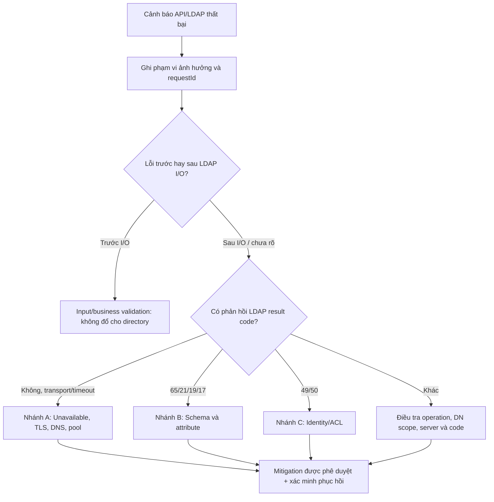

# Runbook cho lỗi LDAP unavailable hoặc schema mismatch

Khi một ứng dụng **Spring LDAP** mất khả năng tra cứu tài khoản hoặc không thể ghi entry, hai nhóm nguyên nhân thường cần phân biệt ngay là **LDAP unavailable** (dịch vụ thư mục/kết nối không sẵn sàng) và **schema mismatch** (dữ liệu hoặc thao tác không phù hợp schema của directory). Chúng có triệu chứng gần nhau ở tầng API — đăng nhập thất bại, tạo người dùng trả lỗi, đồng bộ bị kẹt — nhưng hướng xử lý, chủ sở hữu sự cố và mức độ an toàn khi retry khác nhau.

Bài thuộc chương **Vận hành** của module **SPRING_LDAP**. Đây là runbook dùng khi hệ thống truy cập LDAP qua `ContextSource`, `LdapTemplate`, `LdapClient` hoặc ODM, bao gồm kết nối TLS, bind, pooling, search, thao tác entry, xử lý lỗi và kiểm thử phục hồi. Ví dụ dùng một directory giả định có base DN `dc=example,dc=org`. Tên máy chủ, OU, ngưỡng cảnh báo và lệnh đều là **mẫu minh họa**: khi áp dụng phải dùng môi trường, quyền hạn và quy trình thay đổi được tổ chức phê duyệt.

> **Quy tắc an toàn của runbook:** Ưu tiên kiểm tra chỉ-đọc và dữ liệu đã được làm sạch. Không thử mật khẩu hàng loạt, không vô hiệu hóa TLS hoặc hostname verification, không tự ý sửa schema/ACL, không chạy ghi/xóa thử nghiệm trên production và không tự động retry thao tác ghi sau timeout khi chưa xác định trạng thái.

## 1. Tóm tắt xử lý nhanh

| Dấu hiệu đầu tiên | Giả thuyết ưu tiên | Kiểm tra ban đầu | Hành động giảm tác động |
| --- | --- | --- | --- |
| Timeout, connection refused, không phân giải DNS, TCP reset | **Unavailable** do DNS/network/server | Endpoint, DNS, TCP, trạng thái node, lỗi ở các ứng dụng khác | Chuyển sang replica đã được cấu hình/chấp thuận nếu phù hợp; giảm tải và báo sự cố phụ thuộc |
| TLS handshake/certificate/hostname failure | **Unavailable** do thiết lập kết nối bảo mật | Truststore, chuỗi chứng chỉ, tên host, thời gian, thay đổi cert gần đây | Phục hồi certificate/trust cấu hình đúng; **không tắt xác minh TLS** |
| Bind thất bại với LDAP result code 49 | **Authentication/configuration** | Phân biệt service bind với user login; trạng thái credential/secret rotation | Điều tra cấu hình và danh tính; tránh thử lặp làm khóa tài khoản |
| LDAP result code 50 khi ghi | **ACL/permission** | LDAP identity đang dùng, quyền với DN/attribute, thay đổi ACL | Điều tra quyền và chính sách cấp phát, không coi là lỗi mạng |
| LDAP result code 65 khi tạo/sửa | **Schema mismatch** | `objectClass`, `MUST/MAY`, payload và schema của server nhận request | Tạm dừng đường ghi lỗi, xem lại mapper/profile hoặc release |
| Result code 21, 19 hoặc 17 | **Syntax/constraint/schema** | Kiểu, độ dài, số lượng, tên attribute và extension | Tái hiện trên directory test, sửa dữ liệu/profile |
| Một số node hoạt động, một số node trả lỗi 65 | **Schema/replica không đồng nhất**, hoặc tuyến ghi khác nhau | So sánh schema/configuration/version giữa các node có liên quan | Tránh chuyển lưu lượng tùy tiện; phối hợp đội directory để khôi phục nhất quán |
| Một số truy vấn chậm và pool connection cạn | **Tải, timeout hoặc cấu hình pooling** | p95/p99 latency, pool wait, số kết nối, giới hạn server | Hạn chế truy vấn rộng; giảm concurrency có kiểm soát |

**Một lỗi trả từ directory không mặc nhiên là unavailable.** Ví dụ, `objectClassViolation` chứng minh server đã xử lý và từ chối thao tác theo ràng buộc schema; việc tăng timeout hoặc retry payload y hệt thường không khắc phục được.

## 2. Trước khi xử lý: phạm vi và phân quyền

Runbook áp dụng cho các tình huống:

- Search/lookup không hoạt động dù request đã qua input validation.
- Service account không thể bind hoặc request LDAP liên tục timeout.
- Create/modify/rename/delete entry thất bại sau một thay đổi ứng dụng, schema, ACL hoặc directory.
- Một số replica trả kết quả khác nhau hoặc sự cố xảy ra theo từng vùng/node.
- Các job đồng bộ thư mục thất bại, retry liên tục hoặc backlog tăng bất thường.

**Không áp dụng trực tiếp** các bước sửa dữ liệu/môi trường vào production nếu chưa được người chịu trách nhiệm cấp quyền. Người thực thi nên có khả năng:

1. Xem dashboard/log đã phân quyền của ứng dụng và dịch vụ LDAP.
2. Chạy những kiểm tra **chỉ-đọc** được tổ chức chấp thuận bằng một identity hạn chế quyền.
3. Liên hệ nhóm vận hành ứng dụng, nhóm LDAP/IAM, mạng, bảo mật hoặc đơn vị quản lý secret theo nguyên nhân.
4. Điều phối thay đổi, rollback hoặc failover qua quy trình sự cố đã quy định.

Trước khi bắt đầu, ghi lại **thời điểm**, phạm vi môi trường/region, luồng ảnh hưởng (đăng nhập, tra cứu, tạo/sửa entry), phiên bản ứng dụng, nhóm LDAP node và mức độ ảnh hưởng tới người dùng. Không ghi trực tiếp DN người dùng, email, password, full filter hay thông điệp ngoại lệ có chứa secret vào ticket công khai.

### 2.1. Xác định mức ưu tiên theo tác động

| Mức tác động minh họa | Dấu hiệu | Điều phối |
| --- | --- | --- |
| Nghiêm trọng | Không thể xác thực/tra cứu cho phần lớn người dùng, hoặc tạo/sửa tài khoản thiết yếu bị dừng | Kích hoạt quy trình incident; ưu tiên khôi phục đường phục vụ an toàn |
| Cao | Một vùng, một node, một loại thao tác ghi hoặc một nhóm người dùng bị ảnh hưởng | Đặt chủ sở hữu và kiểm soát lưu lượng, theo dõi lan rộng |
| Trung bình | Chỉ vài payload hoặc một object class mới gặp schema violation | Cách ly luồng lỗi và xử lý profile/migration |
| Thấp | Lỗi tái hiện trên staging, production chưa có ảnh hưởng | Giữ bằng chứng và xử lý qua thay đổi có kiểm thử |

Phân loại và ngưỡng thực tế phải lấy từ **SLO/runbook vận hành của tổ chức**, không dùng bảng trên để thay thế chính sách báo động nội bộ.

## 3. Quy trình triage chung theo thời gian



### 3.1. Những phút đầu tiên: xác định đúng nhóm lỗi

1. **Xác minh tín hiệu:** tỷ lệ thất bại tăng có thật không? Xảy ra ở mọi endpoint hay riêng `search`, `bind`, `modify`, `rename`?
2. **Xem bản chất exception:** timeout/communication, authentication, permission, schema violation, hay lỗi client validation?
3. **Khoanh vùng:** một pod/JVM, một region, một LDAP node, một tenant, hay toàn bộ hệ thống?
4. **Đối chiếu thay đổi gần đây:** deploy ứng dụng, cấu hình `ContextSource`, luân chuyển secret/chứng chỉ, nâng cấp LDAP, schema/ACL change, network policy.
5. **Chọn nhánh xử lý bên dưới**; không tự động coi tất cả exception từ Spring LDAP là lỗi mạng cần retry.

### 3.2. Trong giai đoạn xác minh: bảo toàn bằng chứng và giảm tác động

- Ghi mã phiên bản ứng dụng, mã thay đổi/cấu hình, loại operation và correlation ID.
- Tách **read path** khỏi **write path** vì chỉ một trong hai có thể hỏng.
- Kiểm tra lỗi có đến từ một replica cụ thể hay chỉ sau routing/failover.
- Giảm truy vấn không thiết yếu, tránh tạo bão retry; ưu tiên giới hạn số lượng job đang chạy.
- Nếu cần rollback, làm rõ trước rằng bản release cũ có tương thích dữ liệu và schema mới đã áp dụng hay không.

Không để quá trình điều tra làm thay đổi hệ thống ngoài nhu cầu. Đặc biệt, **đừng chạy nhiều lần bind thất bại bằng credential người dùng** vì có thể kích hoạt lockout.

## 4. Nhánh A — LDAP unavailable

“Unavailable” có thể biểu hiện bằng TCP timeout, `connect refused`, DNS failure, TLS handshake, LDAP result code `unavailable` (52), `busy` (51) hoặc exception kết nối do provider trả. Đây không phải cùng một nguyên nhân; cần phân lớp:

```text
Application
  └─ LdapTemplate / LdapClient / ODM
       └─ ContextSource + pool / referral handling
            └─ DNS → TCP → TLS / StartTLS → LDAP bind
                 └─ Search / modify / server processing
```

### 4.1. Checklist chẩn đoán theo tầng

| Tầng | Câu hỏi | Dấu hiệu và hướng điều tra |
| --- | --- | --- |
| DNS/service discovery | Endpoint có phân giải đúng địa chỉ hiện hành? | Không phân giải, địa chỉ cũ, SRV/service discovery đổi |
| TCP/network | Pod/host có kết nối tới LDAP port cho phép? | Refused, timeout, firewall/security group, egress policy |
| TLS | Chứng chỉ còn hạn, chain/truststore đúng, hostname đúng? | Handshake failure, PKIX/path validation, hostname mismatch |
| Bind | Identity nào bị từ chối: service hay người dùng? | Result 49, secret rotation, khóa tài khoản, chính sách password |
| ACL | Bind thành công nhưng operation bị từ chối? | Result 50, quyền trên subtree/attribute thiếu |
| Pool/context lifecycle | Kết nối cũ hoặc pool cạn? | Pool wait, stale connection, concurrent requests tăng |
| Query và server | Search quá rộng, giới hạn hoặc node quá tải? | `timeLimitExceeded`, `sizeLimitExceeded`, LDAP busy/CPU cao |
| Replica/routing | Chỉ một backend lỗi? | Lỗi tương quan host, region, replica, thời điểm failover |

Nếu DNS/TCP/TLS đã hỏng, không cần tìm lỗi `objectClass` trước. Nếu bind + search hoạt động nhưng chỉ `modify` thất bại, hãy kiểm tra ACL/schema thay vì kết luận directory unavailable.

### 4.2. Kiểm tra LDAP không làm thay đổi dữ liệu

Trong môi trường **được phép**, có thể dùng công cụ LDAP client tiêu chuẩn để kiểm tra root DSE hoặc một entry chỉ-đọc đã định nghĩa trước. Ví dụ với OpenLDAP `ldapsearch`:

```bash
# Root DSE, chỉ lấy metadata công bố (không phải server nào cũng
# cho anonymous đọc đủ; không coi access denied là mất kết nối).
ldapsearch -LLL -x \
  -H "ldaps://ldap-test.example.org:636" \
  -b "" -s base "(objectClass=*)" namingContexts supportedLDAPVersion
```

Với identity chỉ-đọc và một entry healthcheck đã được cấp phép:

```bash
# -W yêu cầu nhập mật khẩu một cách tương tác.
# KHÔNG dùng -w <password> vì dễ lộ qua command history/process list.
ldapsearch -LLL -x \
  -H "ldaps://ldap-test.example.org:636" \
  -D "cn=read-probe,ou=svc,dc=example,dc=org" -W \
  -b "ou=health,dc=example,dc=org" \
  -s base "(objectClass=*)" dn objectClass
```

Nếu hệ thống dùng **StartTLS** trên LDAP port:

```bash
ldapsearch -LLL -x -ZZ \
  -H "ldap://ldap-test.example.org:389" \
  -D "cn=read-probe,ou=svc,dc=example,dc=org" -W \
  -b "ou=health,dc=example,dc=org" \
  -s base "(objectClass=*)" dn
```

`-ZZ` yêu cầu StartTLS thành công trước khi tiếp tục. Chỉ dùng loại kết nối, host, CA bundle, account và DN đúng với môi trường; mẫu `ou=health` cần **tồn tại và được phép đọc**. Root DSE có thể bị hạn chế ACL, nên thiếu quyền đọc root DSE **không đủ** để kết luận LDAP unavailable.

Để xem chứng chỉ của một LDAPS endpoint khi chính sách cho phép:

```bash
openssl s_client \
  -connect ldap-test.example.org:636 \
  -servername ldap-test.example.org \
  -verify_return_error < /dev/null
```

Lệnh TLS kiểm tra đường kết nối và chứng chỉ ở mức TLS; **không chứng minh** bind, schema, ACL hay LDAP search sẽ hoạt động. Không chia sẻ nguyên bản output chứa tên host nội bộ ra kênh công khai. Không thêm cờ bỏ qua xác minh chứng chỉ để làm probe “xanh”.

### 4.3. Khi nào chuyển hướng sang cấu hình `ContextSource`?

Kiểm tra những biến đã được ứng dụng cấp:

- Danh sách `ldap://` hoặc `ldaps://` URL và thứ tự ưu tiên; có đang trỏ tới endpoint hợp lệ?
- `base` có đúng môi trường? DN tương đối truyền cho `LdapTemplate` có bị gắn base hai lần không?
- Bind DN/secret của tài khoản service có đúng phiên bản được phân phối qua secret manager?
- Kết nối dùng LDAPS hay StartTLS, truststore nào, hostname verification có thực thi?
- Connect timeout, read timeout, pool size, idle connection và retry policy có được cấu hình/giám sát?
- Có node mới được thêm vào sau failover, và node đó có schema/ACL tương đương?

Trong JNDI LDAP provider phổ biến, các environment property `com.sun.jndi.ldap.connect.timeout` và `com.sun.jndi.ldap.read.timeout` thường được dùng để giới hạn thời gian kết nối/đọc (đơn vị mili giây). **Cách đưa chúng vào `ContextSource` phụ thuộc cấu hình Spring LDAP và provider**; cần xác minh tại môi trường đang chạy thay vì giả định có một property Spring Boot chung cho mọi phiên bản.

Không chỉnh đồng loạt timeout cao hơn khi vấn đề là pool cạn hoặc server quá tải: điều đó có thể giữ connection/thread lâu hơn và làm hệ thống chậm trầm trọng.

### 4.4. Pooling, TLS và các kết nối cũ

Một pool có thể giữ connection đã hết hạn hoặc bị cắt bởi firewall/load balancer. Dấu hiệu thường là đợt lỗi sau khoảng idle dài, sau failover hoặc sau khi backend đổi chứng chỉ. Cần:

1. Đối chiếu tỷ lệ failure với số connection đang mượn, đang chờ và giới hạn pool.
2. Kiểm tra chính sách validation/eviction và thời gian sống của connection.
3. Xác minh account dùng cho context đã được cấp đúng identity và cách xử lý StartTLS tương thích với pooling.
4. Nếu được phê duyệt, tái tạo context/điều phối restart hoặc failover từng phần thay vì làm gián đoạn toàn bộ dịch vụ.

Không mặc định JNDI native pooling và mọi dạng StartTLS đều có thể kết hợp an toàn. Cần kiểm tra hướng dẫn phù hợp với phiên bản Spring LDAP, JNDI provider và loại `ContextSource` đang dùng; tránh tái sử dụng kết nối đã xác thực dưới danh tính không phù hợp.

## 5. Nhánh B — Schema mismatch

Schema mismatch xảy ra khi ứng dụng tạo/sửa entry với attribute, object class, syntax hoặc cấu trúc không được directory cho phép. Một số lỗi này vốn được ứng dụng nhận biết sớm; một số chỉ xuất hiện tại server do schema tùy chỉnh, plugin hoặc chênh lệch giữa các node.

### 5.1. Những LDAP result code cần phân biệt

| LDAP result code | Mã số | Nguyên nhân điển hình | Ưu tiên kiểm tra |
| --- | ---: | --- | --- |
| `objectClassViolation` | 65 | Thiếu `MUST`, class sai, attribute không được phép | Chuỗi object class, `SUP`, `MUST/MAY`, DIT content rule |
| `invalidAttributeSyntax` | 21 | Giá trị không đúng LDAP attribute syntax | Kiểu DN, số/chuỗi, encoding, format dữ liệu |
| `constraintViolation` | 19 | Ràng buộc `SINGLE-VALUE`, giá trị/dung lượng/policy không phù hợp | Schema attribute, uniqueness, giới hạn tùy server |
| `undefinedAttributeType` | 17 | Attribute type chưa được schema biết đến | Tên/alias/OID, extension chưa triển khai |
| `attributeOrValueExists` | 20 | Giá trị trùng theo matching rule của server | Thao tác `ADD`, normalization, cách xử lý nhiều giá trị |
| `noSuchAttribute` | 16 | Xóa/sửa attribute hoặc giá trị không tồn tại | Mutation item, trạng thái entry hiện tại |
| `namingViolation` | 64 | Vi phạm quy tắc đặt tên hoặc cấu trúc DIT | DN/RDN, naming context, DIT structure rule |
| `insufficientAccessRights` | 50 | ACL không cho phép thao tác | Tài khoản service, DN, operation và attribute |
| `entryAlreadyExists` | 68 | DN đích đã tồn tại | Xung đột trạng thái, không mặc định schema mismatch |

Mã số giúp **định hướng** chẩn đoán, không nhất thiết trả về cùng một loại exception ở mọi provider. Spring LDAP có cơ chế chuyển ngoại lệ JNDI thành exception runtime; nếu cần mã LDAP chính xác, sử dụng thông tin lỗi có cấu trúc và cause gốc **khi thật sự có**, không phân tích chuỗi `exception.getMessage()` như hợp đồng ổn định.

### 5.2. Ví dụ: entry `inetOrgPerson` thiếu `sn`

Một entry được ứng dụng chuẩn bị sai:

```ldif
dn: uid=alice,ou=people,dc=example,dc=org
objectClass: top
objectClass: person
objectClass: organizationalPerson
objectClass: inetOrgPerson
uid: alice
cn: Alice Nguyen
# sn chưa được gán
```

`person` là structural object class yêu cầu `cn` và `sn`. `organizationalPerson` và `inetOrgPerson` kế thừa yêu cầu đó. Một request tạo entry thiếu `sn` có thể bị server từ chối với `objectClassViolation`.

**Điều tra đúng:** xem DTO/mapping có bỏ `sn`, chuẩn hóa dữ liệu có biến nó thành rỗng, hoặc object class profile đã thay đổi. Nếu schema trên server được mở rộng, kiểm tra cả những ràng buộc mới đã áp dụng ở môi trường đích.

Không cố “sửa nhanh” bằng cách bỏ `person` khỏi `objectClass` của `inetOrgPerson` hoặc thêm nhiều structural class không cùng chuỗi kế thừa. Cần làm cho entry **đúng schema** và điều chỉnh profile/validation từ ứng dụng.

### 5.3. Schema mismatch sau deployment

Sơ đồ chẩn đoán thực tế:

```text
Một nhóm request bắt đầu trả 65 / 21 / 19 / 17
    |
    +-- Chỉ sau deploy ứng dụng?
    |     -> so sánh mapper/DTO/profile trước-sau
    |     -> kiểm tra attribute mới hoặc kiểu giá trị đổi
    |
    +-- Chỉ sau thay schema directory?
    |     -> so schema đã phê duyệt với schema đang chạy
    |     -> xác minh thứ tự rollout và tính tương thích ngược
    |
    +-- Chỉ lỗi trên một node hoặc region?
    |     -> so schema/ACL/config và replica routing
    |
    +-- Chỉ lỗi khi ADD/REMOVE/REPLACE?
          -> kiểm tra trạng thái entry sau modify,
             giá trị đa trị, RDN và thuộc tính MUST
```

Những nguồn lệch schema thường gặp:

- Code bắt đầu ghi attribute mới nhưng schema extension chưa được triển khai trên directory.
- Ứng dụng bỏ `cn`/`sn` hoặc dùng bộ `objectClass` không phù hợp.
- Một attribute được mong đợi đa trị nhưng schema khai báo `SINGLE-VALUE`.
- `member` phải chứa DN hợp lệ; mapper đưa vào UID trần hoặc chuỗi không đúng DN.
- LDIF import hoặc ODM mapping thay đổi encoding của attribute binary.
- Một phần replica chưa nhận schema update, hoặc endpoint staging/production có schema khác nhau.
- Directory có DIT content/structure rule, plugin hoặc policy riêng mà local validator chưa biết.

**Schema `MAY` không cấp quyền ghi.** Một attribute được schema cho phép vẫn có thể bị từ chối vì ACL; đừng thay đổi schema để xử lý lỗi vốn thuộc quyền.

### 5.4. Kiểm tra schema mà không sửa server

Khi được cấp quyền, có thể đọc metadata schema do server công bố. Theo LDAP, thuộc tính vận hành `subschemaSubentry` trên một entry có thể cho biết DN của subschema đang áp dụng; truy vấn schema entry để xem `objectClasses` và `attributeTypes`:

```bash
# Bước 1: đọc DN subschema áp dụng cho một entry mẫu (nếu ACL cho phép).
ldapsearch -LLL -x \
  -H "ldaps://ldap-test.example.org:636" \
  -D "cn=read-probe,ou=svc,dc=example,dc=org" -W \
  -b "ou=people,dc=example,dc=org" -s base \
  "(objectClass=*)" subschemaSubentry
```

Sau khi đã xác minh DN schema nhận được, truy vấn **đúng DN đó** bằng công cụ/quyền được phê duyệt:

```bash
# Ví dụ DN subschema, KHÔNG tự giả định mọi server đều dùng cn=subschema.
ldapsearch -LLL -x \
  -H "ldaps://ldap-test.example.org:636" \
  -D "cn=read-probe,ou=svc,dc=example,dc=org" -W \
  -b "cn=subschema" -s base "(objectClass=*)" \
  objectClasses attributeTypes
```

`cn=subschema` chỉ là ví dụ; dùng DN thực được công bố. Một số server giới hạn quyền đọc schema hoặc biểu diễn schema qua API quản trị khác. Không coi lỗi ACL khi đọc schema là bằng chứng schema không tồn tại. Khi truy vết `MUST`, cần tính cả các class kế thừa qua `SUP`; kiểm tra `SINGLE-VALUE`, syntax, alias/OID và các ràng buộc server thực thi.

Đừng công khai toàn bộ nội dung schema hoặc DN nội bộ vào ticket công khai. Nếu cần lấy snapshot để so sánh, lưu ở kho vận hành được bảo vệ, có phân quyền, thời hạn lưu giữ và kiểm soát thay đổi.

## 6. Nhánh C — Lỗi credential, ACL và lỗi ngữ cảnh

Không phải lỗi từ LDAP đều thuộc A hoặc B:

- **`invalidCredentials` (49):** với service bind, kiểm tra secret rotation, lockout và cấu hình `ContextSource`. Với user login, xem đây là kết quả xác thực người dùng, không tự kết luận directory unavailable.
- **`insufficientAccessRights` (50):** bind đã thực hiện nhưng operation thiếu quyền; so sánh ACL của đúng LDAP identity với operation cụ thể, không mặc định người dùng HTTP phải được trả `403`.
- **`noSuchObject` (32):** có thể do search base/parent DN không tồn tại, base ghép hai lần hoặc entry đã bị xóa. Một search thành công trả về 0 kết quả **khác** với lỗi `noSuchObject`.
- **`entryAlreadyExists` (68):** tạo một DN đã có sẵn, có thể do retry sau timeout hoặc race giữa nhiều writer.
- **`timeLimitExceeded` (3) / `sizeLimitExceeded` (4):** giới hạn một search, không đồng nghĩa số giá trị của attribute vượt schema.

Nếu client báo “directory unavailable” nhưng log chỉ có `invalidCredentials`, không nên bật thêm retry. Nhiều lần bind sai có thể gây khóa tài khoản; cần chuyển ngay sang quy trình IAM/secret management.

## 7. Mapping lỗi Spring LDAP phục vụ điều tra

Ở ranh giới adapter, giữ nguyên **cause nội bộ** và chuyển lỗi thành nhóm ổn định. Không cho controller ghép LDAP diagnostic vào JSON public.

Ví dụ khung xử lý một thao tác ghi sử dụng `LdapTemplate`:

```java
import org.springframework.ldap.AuthenticationException;
import org.springframework.ldap.CommunicationException;
import org.springframework.ldap.NameAlreadyBoundException;
import org.springframework.ldap.NamingException;
import org.springframework.ldap.NoPermissionException;
import org.springframework.ldap.SchemaViolationException;
import org.springframework.ldap.core.LdapTemplate;

enum DirectoryFailureKind {
    UNAVAILABLE,
    SCHEMA_MISMATCH,
    AUTHENTICATION_FAILURE,
    PERMISSION_FAILURE,
    CONFLICT,
    OTHER
}

final class DirectoryOperationFailure extends RuntimeException {
    private final DirectoryFailureKind kind;

    DirectoryOperationFailure(
            DirectoryFailureKind kind, Throwable cause) {
        super(kind.name(), cause);
        this.kind = kind;
    }

    DirectoryFailureKind kind() {
        return kind;
    }
}

// Đặt bên trong adapter, với template và DN/Attributes đã validation.
void createEntry(
        LdapTemplate template,
        javax.naming.Name relativeDn,
        javax.naming.directory.Attributes attributes) {
    try {
        template.bind(relativeDn, null, attributes);
    } catch (NameAlreadyBoundException ex) {
        throw new DirectoryOperationFailure(
                DirectoryFailureKind.CONFLICT, ex);
    } catch (SchemaViolationException ex) {
        throw new DirectoryOperationFailure(
                DirectoryFailureKind.SCHEMA_MISMATCH, ex);
    } catch (NoPermissionException ex) {
        throw new DirectoryOperationFailure(
                DirectoryFailureKind.PERMISSION_FAILURE, ex);
    } catch (AuthenticationException ex) {
        throw new DirectoryOperationFailure(
                DirectoryFailureKind.AUTHENTICATION_FAILURE, ex);
    } catch (CommunicationException ex) {
        throw new DirectoryOperationFailure(
                DirectoryFailureKind.UNAVAILABLE, ex);
    } catch (NamingException ex) {
        throw new DirectoryOperationFailure(
                DirectoryFailureKind.OTHER, ex);
    }
}
```

Ví dụ là **khung phân loại ban đầu**: trong hệ thống thật cần kiểm tra các exception được provider bọc, timeout, TLS, constraint, invalid attribute syntax và hành vi theo phiên bản Spring LDAP. Không phải mọi lỗi kết nối đều trực tiếp là `CommunicationException`, cũng không phải mọi schema mismatch đều ném chính xác một class `SchemaViolationException`.

Khi có thông tin nguyên nhân đầy đủ trong kênh log được bảo vệ, có thể dùng mã LDAP server để hỗ trợ điều tra. Đừng lập trình theo chuỗi `message.contains("LDAP: error code 65")` làm cơ sở duy nhất; thông điệp provider không phải API ổn định và có thể chứa dữ liệu nhạy cảm.

### 7.1. Không tiết lộ chi tiết LDAP ra API public

| Nhóm lỗi nội bộ | Phản hồi API thường phù hợp | Điều không nên công bố |
| --- | --- | --- |
| Input invalid trước I/O | `400`/`422` với lỗi field đã kiểm soát | Giá trị input nhạy cảm, DN/filter được dựng |
| DN conflict khi create | `409` nếu caller có quyền biết trạng thái | DN đầy đủ của entry hoặc cấu trúc OU |
| Schema mismatch do mapping/release | Thường `500` và mã lỗi ứng dụng ổn định | `objectClass` đầy đủ, schema diagnostic |
| Service bind/ACL failure | Thường lỗi vận hành nội bộ `500` | Service bind DN, secret hoặc chính sách ACL |
| Directory unavailable | `503` hoặc lỗi upstream phù hợp kiến trúc | Host, port, TLS chain, tên replica |
| Timeout sau thao tác ghi | Thông báo chưa xác định kết quả, có mã theo dõi | Khẳng định ghi đã rollback nếu chưa có bằng chứng |

Một lỗi user-login `invalidCredentials` có thể dẫn đến `401` theo hợp đồng đăng nhập, nhưng **khác** với service-account bind thất bại trong một endpoint tạo người dùng.

## 8. Mitigation theo nguyên nhân, không retry mù quáng

### 8.1. Khi LDAP thật sự unavailable

Biện pháp tùy kiến trúc và quyền được phê duyệt:

1. Kích hoạt alert/incident tương ứng và liên hệ owner của LDAP endpoint.
2. Giảm concurrency của job đồng bộ, dừng một phần traffic không thiết yếu hoặc sử dụng circuit breaker để hạn chế bão request.
3. Thẩm định replica/failover đã cấu hình; chỉ chuyển hướng đến node có **schema, ACL và dữ liệu nhất quán** cần thiết cho luồng hiện tại.
4. Nếu sai secret/certificate/config từ deploy gần nhất, rollback hoặc sửa cấu hình qua quy trình thay đổi; không bypass TLS.
5. Khi phục hồi kết nối, tăng traffic có kiểm soát và quan sát tải/p95 latency thay vì mở toàn bộ queue ngay lập tức.

**Đọc và ghi khác nhau:**

- Search/lookup có thể retry giới hạn (timeout, exponential backoff, jitter) khi lỗi tạm thời và phù hợp SLO; kết quả có thể thay đổi giữa hai lần đọc.
- Với `bind`/create, `modify`, `delete`, `modifyDN`: sau timeout, server **có thể đã thực thi** nhưng client mất phản hồi. Retry lệnh ghi giống hệt có thể gây conflict hoặc hiệu ứng kép.
- Cần **idempotency và đối chiếu trạng thái** theo nghiệp vụ trước khi retry ghi; một lần lookup sau timeout không đủ để chứng minh mọi hiệu ứng đã hoàn toàn nhất quán.

Không có cấu hình “retry=true” chung nào thay thế được đánh giá hiệu ứng của từng LDAP operation.

### 8.2. Khi schema mismatch

1. **Khoanh vùng dữ liệu và release gây lỗi**: chỉ một `objectClass` mới, chỉ sau migration, hay một kiểu update?
2. **Dừng đường ghi sai** hoặc hạn chế feature mới có thể tạo dữ liệu không tương thích; giữ đường đọc an toàn nếu còn hoạt động.
3. **So sánh profile ứng dụng với schema server**: các `MUST` kế thừa, `MAY`, `SINGLE-VALUE`, syntax, naming rule và ACL.
4. **Tái hiện trong LDAP test** có schema/config đại diện trước khi sửa production.
5. Chọn biện pháp:
   - Rollback ứng dụng nếu release thêm attribute chưa được schema cho phép và rollback tương thích dữ liệu hiện có.
   - Triển khai schema change qua quy trình phê duyệt nếu đó là thay đổi mong đợi, bao gồm xác minh node/replica và ứng dụng cũ.
   - Sửa DTO/mapper/validation hoặc dữ liệu nguồn nếu lỗi nằm ở payload.
6. Kiểm thử thao tác ghi đại diện **trên môi trường test**, rồi triển khai và xác minh bằng thao tác đã được phép trên production.

**Không sửa schema production tại chỗ chỉ vì nhận code 65**, không tắt schema enforcement, không thêm structural object class không liên quan và không cho request tùy ý chọn `objectClass`.

### 8.3. Điều kiện rollback và lưu ý migration

Rollback ứng dụng không phải lúc nào cũng an toàn: schema migration có thể làm thay đổi định nghĩa attribute, plugin, entry hiện có hoặc đường ghi. Trước rollback phải kiểm tra:

- Phiên bản cũ có đọc được dữ liệu mới không?
- Schema mới có tính tương thích ngược không?
- Replica nào đã áp dụng thay đổi?
- Có job đang chạy với payload hoặc queue theo format mới?
- Cần đóng băng thao tác ghi, chuyển đổi dữ liệu hay hoàn tất migration theo thứ tự nào?

Rollback **schema** thường nhạy cảm hơn rollback ứng dụng; có thể không khả thi nếu dữ liệu đã được ghi theo schema mới. Cần có kế hoạch khôi phục do nhóm directory/IAM phê duyệt, thay vì tự suy đoán `ldapmodify` có thể hoàn tác mọi thứ.

## 9. Theo dõi phục hồi bằng những tín hiệu có nghĩa

Các metric giúp phân biệt “kết nối đã mở” với “nghiệp vụ đã hoạt động”:

| Nhóm metric | Tín hiệu | Ý nghĩa |
| --- | --- | --- |
| Availability | Tỷ lệ thành công của **probe chỉ-đọc** với đúng identity và base | Phụ thuộc LDAP thực sự phục vụ được thao tác cơ bản |
| Latency | p50/p95/p99 theo loại operation | Có thể phát hiện tải/pool dù chưa timeout |
| Error classification | `unavailable`, `schema_mismatch`, `auth`, `permission`, `conflict` | Nhìn thấy sự đổi loại lỗi sau mitigation |
| Connection/pool | Active, idle, wait time, eviction/stale connection | Điều tra nghẽn connection |
| LDAP nodes | Failure và latency theo node/region **trong hệ thống quan sát nội bộ** | Phát hiện replica/routing không đồng nhất |
| Queue đồng bộ | Backlog, oldest age, retry count, dead-letter | Đo ảnh hưởng kéo dài sau khi kết nối phục hồi |
| Business success | Tạo người dùng hợp lệ thành công, đọc được entry vừa ghi trong test/luồng đã phê duyệt | Xác minh end-to-end thay vì chỉ ping port |

Không gắn `uid`, email, DN, filter hoặc request ID làm **metric label** có cardinality cao. Các thông tin nhạy cảm nếu cần chẩn đoán sâu chỉ nên xuất hiện trong log được bảo vệ và đã làm sạch.

### 9.1. Probe/readiness phải ít quyền và ít tải

Một probe thích hợp nên:

- Dùng một identity chỉ-đọc dành cho healthcheck nếu chính sách cho phép.
- Truy vấn một entry **cố định và có thật** trong nhánh test/health được cấp quyền, với scope phù hợp.
- Có timeout và tần suất hợp lý, không chạy một truy vấn subtree rộng mỗi giây.
- Trả kết quả nội bộ như `UP`, `DEGRADED`, `DOWN` mà không công bố LDAP URL, DN hoặc exception thô.
- Phân biệt **liveness của JVM** với **readiness phục vụ truy cập LDAP**. Không cần khởi động lại mọi pod liên tục chỉ vì LDAP upstream bị lỗi tạm thời.

Một TCP healthcheck xanh chỉ chứng minh cổng mở; nó không xác minh bind/search/ACL hay schema. Một probe chỉ-đọc xanh cũng **không chứng minh** đường ghi đang hoạt động hoặc schema đã tương thích với payload mới.

### 9.2. Mẫu log sự cố đã làm sạch

```json
{
  "event": "ldap.operation.failed",
  "operation": "createPerson",
  "failureClass": "SCHEMA_MISMATCH",
  "appVersion": "release-42",
  "region": "zone-a",
  "requestId": "req-8c21",
  "ldapResultCode": 65
}
```

`ldapResultCode` chỉ ghi khi trích xuất được **một cách đáng tin cậy**. Có thể giữ original exception trong kênh log bảo vệ để điều tra, nhưng phải kiểm tra nội dung có DN, filter, hostname hoặc giá trị attribute cá nhân hay không. Không log credential, password, private key, `userPassword`, toàn bộ `Attributes` hoặc nội dung binary nhạy cảm.

## 10. Điều kiện xác nhận đã phục hồi

Không đóng incident chỉ vì một thao tác `ldapsearch` thành công. Một checklist nghiệm thu nên có:

- [ ] DNS, TCP và TLS đến các LDAP endpoint cần thiết hoạt động đúng cấu hình bảo mật.
- [ ] Service bind bằng identity dự kiến thành công; không có đợt `invalidCredentials` mới.
- [ ] Search/lookup đại diện thành công với scope và quyền đúng.
- [ ] Những operation ghi bị ảnh hưởng có kết quả hợp lệ trên **đường kiểm thử hoặc canary được phê duyệt**; không ghi dữ liệu thử lên cây production tùy ý.
- [ ] Tỷ lệ exception `UNAVAILABLE`/`SCHEMA_MISMATCH` trở về ngưỡng SLO đã định trong một khoảng quan sát đủ đại diện.
- [ ] Không còn khác biệt schema/ACL có liên quan giữa các node đang nhận traffic.
- [ ] Backlog/retry queue giảm, không có bão retry sau khi khôi phục.
- [ ] Không còn thao tác ghi có kết quả không xác định cần đối soát.
- [ ] Không có biện pháp khắc phục tạm thời làm giảm an toàn TLS, ACL hoặc khả năng audit.
- [ ] Chủ sở hữu ứng dụng và LDAP/IAM xác nhận phạm vi tác động đã được giải quyết.

Nếu chỉ đường search phục hồi nhưng create/modify còn lỗi schema, incident **chưa phục hồi đầy đủ** cho chức năng ghi.

## 11. Diễn tập runbook trong môi trường test

Nên diễn tập định kỳ trên directory test có schema, TLS và ACL đại diện, không cố tình gây lỗi trên production. Ma trận đề xuất:

| Kịch bản | Cách mô phỏng an toàn trong test | Kết quả cần quan sát |
| --- | --- | --- |
| LDAP không sẵn sàng | Dừng test container hoặc chặn egress **trong môi trường cô lập** | Nhận biết `UNAVAILABLE`, không lộ endpoint, retry có giới hạn |
| DNS/port sai | Trỏ test `ContextSource` đến endpoint giả được kiểm soát | Connect timeout và alert thích hợp |
| TLS chain không được tin cậy | Dùng CA test không nằm trong truststore test | Fail closed, không bỏ qua certificate verification |
| Service credential sai | Dùng identity test không còn hiệu lực | Phân loại authentication failure, không thử lặp vượt lockout |
| ACL từ chối modify | Bind identity test chỉ-đọc | Phân loại permission failure, không gán input sai |
| Thiếu `sn` với `inetOrgPerson` | Gửi entry giả trong LDAP test | Server từ chối schema, mapping lỗi phù hợp |
| Attribute không được schema biết | Dùng tên attribute test chưa định nghĩa | Nhận biết `undefinedAttributeType` hoặc phản hồi tương ứng |
| Sai `SINGLE-VALUE` | Gửi nhiều giá trị trong attribute test có constraint | Điều tra constraint/schema, không retry y nguyên |
| Chênh lệch schema node | Dùng hai test node có schema khác nhau được định trước | Phát hiện triệu chứng theo node, không kết luận mạng chung |
| Timeout sau create | Fault injection khiến phản hồi bị mất sau khi server có thể xử lý | Không retry ghi mù quáng, đối chiếu trạng thái |
| Failover/reconnect | Khởi động lại backend test và kiểm tra pool | Không giữ vô hạn connection cũ, phục hồi trong SLO |

Với Spring LDAP, unit test có thể mock `LdapTemplate` để xác minh adapter phân loại exception và HTTP handler ẩn thông tin nhạy cảm. **Integration test** mới xác nhận schema, bind, TLS, ACL, pooling và hành vi của server thật.

## 12. Mẫu biên bản sự cố và bàn giao

Sử dụng mẫu tối thiểu dưới đây, điền bằng **metadata đã được phép lưu trong kênh nội bộ**:

```text
INCIDENT: <mã sự cố>
Khi bắt đầu: <thời điểm, múi giờ>
Môi trường / vùng: <prod / staging / region>
Ảnh hưởng: <login / search / create / modify; quy mô>
Tình trạng: <investigating / mitigated / resolved>
Owner: <application / LDAP-IAM / network / security>

Dấu hiệu:
  - Nhóm lỗi: <UNAVAILABLE / SCHEMA_MISMATCH / AUTH / ACL / OTHER>
  - Operation: <bind / search / modify / rename / delete>
  - Tỷ lệ lỗi, latency, backlog: <số liệu có nguồn>
  - RequestId mẫu đã làm sạch: <id>

Thay đổi gần đây:
  - App version / config: <phiên bản>
  - LDAP schema / ACL / cert / endpoint: <mã change>

Kiểm tra đã làm:
  - Probe chỉ-đọc và trạng thái TLS: <kết quả>
  - Schema/profile hoặc replica diff: <kết quả>
  - Dấu hiệu không nhất quán dữ liệu: <có/không/chưa rõ>

Mitigation / rollback:
  - Hành động được phê duyệt: <mô tả>
  - Người chấp thuận và thời điểm: <thông tin>
  - Rủi ro còn tồn tại: <mô tả>

Xác nhận phục hồi:
  - Error rate và latency: <đạt/chưa đạt>
  - Search/bind/canary được phép: <đạt/chưa đạt>
  - Backlog và thao tác ghi chưa xác định: <trạng thái>

Theo dõi:
  - Root cause / corrective action: <owner + deadline>
  - Test giám sát và tài liệu cần bổ sung: <mô tả>
```

Không chép trực tiếp mật khẩu, full DN, schema dump, raw filter hoặc thông điệp lỗi provider vào báo cáo công khai. Nếu điều tra yêu cầu những dữ liệu đó, lưu ở kênh điều tra có quyền truy cập, phân loại và thời hạn lưu giữ phù hợp.

## 13. Checklist nhớ nhanh cho người trực vận hành

- [ ] Phân biệt **unavailable, schema mismatch, authentication, ACL, conflict và input error** trước khi quyết định retry.
- [ ] Kiểm tra phạm vi lỗi theo endpoint, operation, ứng dụng, node và thời điểm thay đổi.
- [ ] Ưu tiên probe chỉ-đọc với identity giới hạn quyền; bảo vệ TLS, hostname và secret.
- [ ] Với unavailable, chẩn đoán lần lượt DNS → TCP → TLS → bind → pool → operation.
- [ ] Với schema mismatch, đối chiếu object class, `SUP`, `MUST/MAY`, attribute syntax và các node server.
- [ ] Không nhầm `invalidCredentials` của service bind với lỗi người dùng nhập sai mật khẩu.
- [ ] Không coi `sizeLimitExceeded` của search là giới hạn số giá trị của attribute.
- [ ] Không parse exception message như giao thức ổn định và không tiết lộ thông tin LDAP trong API.
- [ ] Không tăng timeout hoặc retry ghi mù quáng khi server có thể đã thực thi.
- [ ] Không sửa schema/ACL production, không tắt TLS và không ép failover ngoài quy trình phê duyệt.
- [ ] Đảm bảo mitigation không làm tồn tại luồng ghi không tương thích hoặc replica thiếu schema.
- [ ] Xác minh **cả đường đọc và đường ghi** cùng backlog trước khi kết luận phục hồi.
- [ ] Ghi biên bản, owner, root cause và hành động ngăn tái diễn; diễn tập trên LDAP test.

**Kết luận:** Một runbook Spring LDAP hữu ích không chỉ liệt kê exception. Nó phải chỉ rõ cách **nhận diện đúng nguyên nhân, kiểm tra mà không gây thêm rủi ro, giảm tác động theo từng nhóm lỗi và xác minh phục hồi từ góc độ nghiệp vụ**. Với `LDAP unavailable`, ưu tiên mạng, TLS, bind, pool và trạng thái node; với `schema mismatch`, ưu tiên profile object class/attribute, thay đổi schema và tính nhất quán giữa các replica. Trong cả hai tình huống, bảo toàn bí mật, không retry ghi thiếu kiểm soát và phối hợp đúng chủ sở hữu hệ thống là điều kiện vận hành an toàn.
