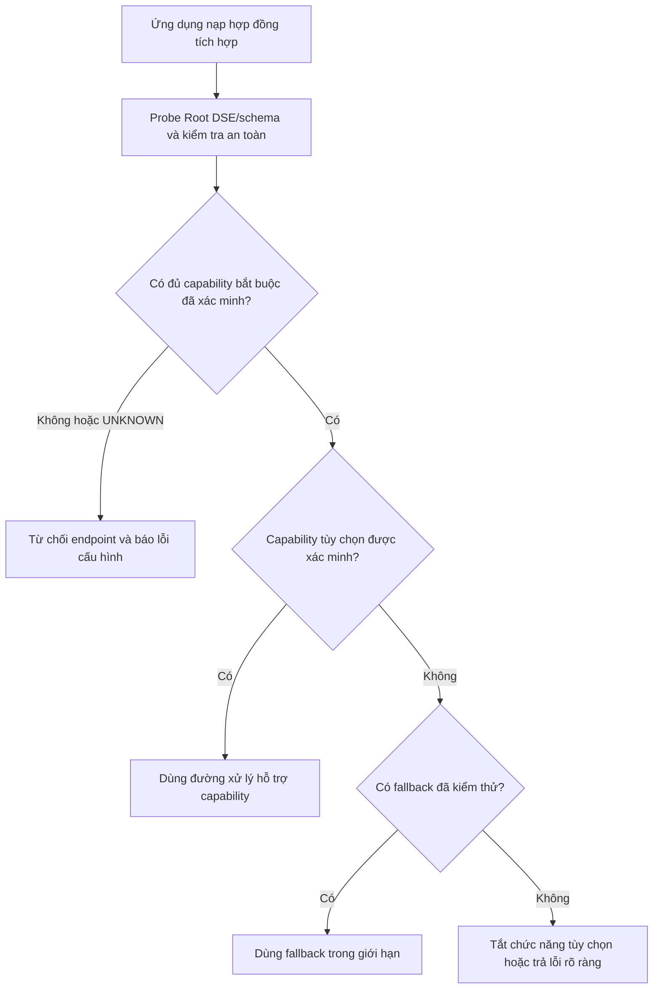

# Ghi rõ capability của LDAP server trong hợp đồng tích hợp Spring LDAP

Một ứng dụng dùng Spring LDAP có thể hoạt động tốt trên một LDAP server, nhưng lỗi khi chuyển môi trường, đổi nhà cung cấp directory hoặc chạy qua load balancer: phân trang không được hỗ trợ, thuộc tính `entryUUID` không tồn tại, tìm kiếm không có quyền đọc, hoặc StartTLS không thực hiện được. Các lỗi này thường xuất hiện muộn vì ứng dụng **ngầm giả định** mọi LDAP server hỗ trợ cùng một tập tính năng.

Trong thiết kế ứng dụng, cần đưa các **capability của LDAP server** (khả năng server cung cấp) vào **hợp đồng tích hợp**: một bản mô tả có phiên bản, xác định ứng dụng cần gì, server nào đang cung cấp, bằng chứng kiểm tra ở đâu, và ứng dụng xử lý thế nào khi điều kiện thay đổi. Hợp đồng này bổ sung cho cấu hình `ContextSource`, các truy vấn `LdapTemplate`/`LdapClient` và quy tắc ánh xạ ODM.

Bài học tập trung vào thiết kế hợp đồng, cách khám phá và xác thực capability, cùng tình huống triển khai thực tế. Không có một lệnh LDAP nào bảo đảm tự khám phá được mọi giới hạn hoặc quyền của server.

## 1. Tại sao capability phải được ghi thành hợp đồng?

Giả sử ứng dụng quản lý nhân sự cần tìm người dùng theo `uid`, đọc `cn`/`mail` và xuất danh sách hàng nghìn entry bằng phân trang. Trên môi trường thử nghiệm, directory hỗ trợ Simple Paged Results Control nên ứng dụng hoạt động bình thường. Khi chạy trên cụm mới, một endpoint không quảng bá control này; ứng dụng vẫn cố phân trang, rồi trả dữ liệu thiếu hoặc lỗi.

Thay vì viết giả định “LDAP nào cũng phân trang được” vào code, hợp đồng cần trả lời:

- **Ứng dụng cần những tính năng nào?** LDAPv3, kết nối TLS đã xác thực, naming context, schema, tìm kiếm subtree, phân trang, giới hạn dữ liệu...
- **Tính năng có được server quảng bá không?** Root DSE có `supportedControl`, `supportedExtension` và các trường liên quan.
- **Tính năng có được kiểm chứng bằng tài khoản ứng dụng không?** Quyền đọc thuộc tính, xử lý cookie phân trang, behavior của matching rule, giới hạn kích thước...
- **Điều gì xảy ra nếu thiếu tính năng?** Dừng khởi động, từ chối endpoint, chuyển hướng sang cơ chế đã kiểm chứng, hoặc tắt một chức năng tùy chọn.
- **Bản ghi này còn hiệu lực tới khi nào?** Kèm endpoint, môi trường, bind role, thời điểm xác minh và chính sách đánh giá lại.

Một capability có thể “được hỗ trợ về kỹ thuật” nhưng “không được phép dùng với tài khoản hiện tại”. Ví dụ server quảng bá một control không có nghĩa ACL cho phép truy vấn dữ liệu cần thiết, hoặc proxy không chuyển tiếp toàn bộ control đó.

## 2. Phân loại capability trước khi kiểm tra

| Nhóm | Câu hỏi về hợp đồng | Nguồn bằng chứng chính |
|---|---|---|
| **Kết nối và xác thực** | Dùng LDAPv3? LDAPS hay StartTLS? SASL mechanism nào? Bind identity nào? | Root DSE, TLS handshake, bind test với quyền thực tế. |
| **Cây thư mục** | Naming context nào? Base DN tìm người dùng ở đâu? Có referral? | `namingContexts`, thao tác base search, dữ liệu/test theo từng nhánh. |
| **Schema** | `objectClass`, attribute và matching rule có đúng kỳ vọng? | `subschemaSubentry`, schema server, entry test. |
| **Tìm kiếm** | Scope, filter, alias/referral và quyền xem entry hoạt động ra sao? | Integration test với `LdapTemplate` và cùng bind role. |
| **LDAP controls** | Paged Results, server-side sorting hoặc control đặc thù có sẵn? | `supportedControl` cộng bài test hành vi. |
| **Extended operations** | Có StartTLS hoặc Password Modify không? | `supportedExtension` cộng thử nghiệm hợp lệ với quyền và transport phù hợp. |
| **Giới hạn và vận hành** | Giới hạn trang, số entry, timeout, rate, kết nối đồng thời? | Cấu hình/quy định server, đo thử tải có kiểm soát, quan sát production. |
| **Khả năng theo nhà cung cấp** | Thuộc tính đặc thù và cơ chế đồng bộ có tồn tại? | Tài liệu vendor, Root DSE nếu có, kiểm thử trên đúng phiên bản/endpoint. |

Cần phân biệt **thuộc tính của giao thức LDAP** với **đặc điểm triển khai của một directory**. Chẳng hạn `uid`, `inetOrgPerson` hay kiểu quan hệ nhóm có thể được thiết kế khác nhau giữa OpenLDAP, Active Directory và các server khác. Hợp đồng dựa trên schema đang dùng, không suy ra chỉ từ tên thương mại của nhà cung cấp.

## 3. Root DSE: điểm khởi đầu để khám phá capability

**Root DSE** (Root Directory Server-Specific Entry) là entry đặc biệt tại DN rỗng (`""`). LDAP client có thể thực hiện search với **base DN rỗng** và **scope base/object** để đọc những thuộc tính server công bố. Những thuộc tính thường có ích gồm:

| Thuộc tính Root DSE | Ý nghĩa | Giới hạn suy luận |
|---|---|---|
| `supportedLDAPVersion` | Phiên bản giao thức LDAP server quảng bá, ví dụ `3`. | Chưa chứng minh ứng dụng đã cấu hình giao thức hoặc xác thực đúng. |
| `supportedControl` | Các OID control được server công bố. | Control có mặt chưa bảo đảm mọi request/role được dùng thành công. |
| `supportedExtension` | Các OID extended operation mà server công bố. | Quảng bá StartTLS chưa chứng minh TLS handshake/chứng chỉ hợp lệ. |
| `supportedFeatures` | OID feature theo quy định server hỗ trợ. | Một số server công bố ít hoặc không có thông tin. |
| `supportedSASLMechanisms` | Cơ chế SASL server quảng bá. | Chưa chứng minh client đã cấu hình và dùng được cơ chế đó. |
| `namingContexts` | Naming context server công bố. | Không nhất thiết mọi nhánh đều truy cập được bằng bind account. |
| `subschemaSubentry` | DN của subentry chứa schema để truy vấn tiếp. | Có thể thiếu, bị giới hạn quyền đọc hoặc khác giữa triển khai. |

### 3.1. Truy vấn Root DSE bằng `ldapsearch`

Ví dụ trên directory **thử nghiệm** dùng LDAPS:

```bash
ldapsearch -LLL -x \
  -H ldaps://ldap.example.test:636 \
  -D "uid=reader,ou=service,dc=example,dc=test" -W \
  -b "" -s base "(objectClass=*)" \
  supportedLDAPVersion namingContexts \
  supportedControl supportedExtension supportedFeatures \
  supportedSASLMechanisms subschemaSubentry
```

- `-b ""` chỉ rõ **DN rỗng** của Root DSE; `-s base` chỉ đọc chính entry đó.
- `-W` nhắc nhập mật khẩu tương tác; không đưa secret vào command-line hay log.
- Xác thực chứng chỉ CA và hostname khi dùng LDAPS. Không tắt kiểm tra TLS để lấy capability.
- Query nên được thực hiện với danh tính và endpoint gần nhất với cấu hình thực của ứng dụng; thử nghiệm bằng tài khoản quản trị có thể đưa ra kết luận sai về ACL.
- Root DSE có thể cho phép đọc ẩn danh hoặc giới hạn thuộc tính tùy server. **Không thấy một thuộc tính không tự động có nghĩa capability bị thiếu**; kết quả có thể là *chưa xác minh*.

**Cảnh báo riêng với Spring LDAP:** nếu `LdapContextSource` đã cấu hình `base=dc=example,dc=test`, lời gọi `LdapTemplate.search("", ...)` thông thường sẽ bắt đầu từ **base đã cấu hình**, không phải Root DSE. Để probe Root DSE, dùng context chuyên biệt với base rỗng (hoặc JNDI client được cấu hình chính xác) và bảo đảm cùng endpoint, TLS, bind role như ứng dụng. Đừng nhầm DN rỗng của Root DSE với chuỗi base tương đối rỗng trong template đã có base.

### 3.2. Những OID thường gặp

OID là mã nhận diện giao thức, không phải tên hàm Spring LDAP. Khi ghi hợp đồng, lưu **OID và mục đích**, sau đó liên kết với code sử dụng.

| Capability | OID thường gặp | Chỗ kiểm tra |
|---|---|---|
| Simple Paged Results Control (RFC 2696) | `1.2.840.113556.1.4.319` | `supportedControl` và thử phân trang nhiều page. |
| Server-side Sort Request Control (RFC 2891) | `1.2.840.113556.1.4.473` | `supportedControl` và thử sắp xếp trên tập nhiều entry. |
| StartTLS extended operation | `1.3.6.1.4.1.1466.20037` | `supportedExtension` và bắt tay TLS thực tế. |
| Password Modify extended operation (RFC 3062) | `1.3.6.1.4.1.4203.1.11.1` | `supportedExtension` và kiểm thử theo quyền của role chuyên biệt. |

Không suy luận “LDAPS không dùng được” chỉ vì `supportedExtension` không có StartTLS. LDAPS và StartTLS là hai phương thức thiết lập kênh TLS khác nhau. Cả hai đều phải đáp ứng chính sách mã hóa, xác thực chứng chỉ và hostname khi được chọn.

Control server-side sort có **response control riêng** và quy tắc xử lý thất bại riêng; chỉ nhận diện OID request chưa đủ để biết kết quả cuối cùng đã sắp đúng. Các capability như VLV, persistent search, đồng bộ thay đổi hoặc ranged retrieval có thể đặc thù theo vendor: chỉ thêm vào hợp đồng khi ứng dụng thật sự sử dụng và đã xác minh trên server đích.

## 4. Kiểm tra Root DSE bằng Java độc lập với base Spring LDAP

Một probe nhỏ dùng JNDI giúp đọc Root DSE mà không vô tình áp dụng base đã cấu hình trong `LdapTemplate`. Ví dụ sau giả định URL **LDAPS**, chính sách TLS và truststore được cấu hình chính xác ngoài đoạn mã, và credential được lấy từ kho secret. Đoạn mã chỉ trả kết quả kiểm tra capability, không ghi giá trị credential hay response vào log.

```java
import java.util.Hashtable;
import javax.naming.Context;
import javax.naming.NamingException;
import javax.naming.directory.Attribute;
import javax.naming.directory.Attributes;
import javax.naming.directory.DirContext;
import javax.naming.directory.InitialDirContext;

public final class RootDseProbe {
    public record AdvertisedCapabilities(
            boolean ldapV3,
            boolean pagedResults,
            boolean startTls,
            boolean hasNamingContexts) {}

    public AdvertisedCapabilities inspect(
            String ldapsUrl, String bindDn, Object secret)
            throws NamingException {

        Hashtable<String, Object> env = new Hashtable<>();
        env.put(Context.INITIAL_CONTEXT_FACTORY,
                "com.sun.jndi.ldap.LdapCtxFactory");
        env.put(Context.PROVIDER_URL, ldapsUrl);
        env.put(Context.SECURITY_AUTHENTICATION, "simple");
        env.put(Context.SECURITY_PRINCIPAL, bindDn);
        env.put(Context.SECURITY_CREDENTIALS, secret);

        DirContext ctx = new InitialDirContext(env);
        try {
            // DN rỗng tại Root DSE, KHÔNG dùng base tương đối
            // của LdapTemplate đã cấu hình.
            Attributes root = ctx.getAttributes("", new String[] {
                    "supportedLDAPVersion",
                    "supportedControl",
                    "supportedExtension",
                    "namingContexts"
            });

            return new AdvertisedCapabilities(
                    contains(root, "supportedLDAPVersion", "3"),
                    contains(root, "supportedControl",
                            "1.2.840.113556.1.4.319"),
                    contains(root, "supportedExtension",
                            "1.3.6.1.4.1.1466.20037"),
                    root.get("namingContexts") != null);
        } finally {
            ctx.close();
        }
    }

    private static boolean contains(
            Attributes attrs, String name, String value)
            throws NamingException {
        Attribute attr = attrs.get(name);
        return attr != null && attr.contains(value);
    }
}
```

Đoạn mã mô tả những gì Root DSE **quảng bá**, không chứng minh quyền thực thi hoặc giới hạn vận hành. Giá trị `false` cũng có thể là do thuộc tính bị ẩn/không trả về; trong hợp đồng sản xuất nên mô hình hóa trạng thái `UNKNOWN` riêng, thay vì tự động xem `false` là “không hỗ trợ”. Nếu probe không thể bind hoặc đọc Root DSE, báo lỗi rõ ràng và không tiếp tục suy diễn khả năng từ tên vendor.

Với ứng dụng Spring LDAP, có thể chạy probe này trong một tác vụ kiểm tra cấu hình hoặc integration test; thực hiện kiểm chứng thực tế bằng `LdapTemplate`/`LdapClient` sau đó. Đừng chạy một probe tốn tài nguyên trên từng request nghiệp vụ; lưu kết quả theo endpoint/role và kiểm tra lại khi có thay đổi.

## 5. Root DSE chưa đủ: kiểm tra schema và hành vi thực tế

### 5.1. Tìm schema từ `subschemaSubentry`

Một ứng dụng ánh xạ user sang `inetOrgPerson` thường cần xác minh:

- `objectClasses` có class được dùng trong các thao tác tìm/tạo entry, và các superclass/thuộc tính MUST/MAY phù hợp.
- `attributeTypes` có `uid`, `cn`, `sn`, `mail`, `member` hoặc các thuộc tính đặc thù ứng dụng đang dùng, với cú pháp/single-value/multi-value đúng dự kiến.
- `matchingRules` hỗ trợ cách equality, substring hoặc ordering mà filter phụ thuộc.
- Operational attributes như `entryUUID` hoặc `modifyTimestamp` có tồn tại và được **phép đọc** không; không phải directory nào cũng dùng cùng tên hoặc format.
- Quy tắc đặt RDN/DN và quan hệ nhóm thành viên phù hợp thiết kế thực tế.

Lấy DN `subschemaSubentry` từ Root DSE hoặc entry phù hợp rồi tra cứu tại DN đó, ví dụ:

```bash
# Thay <SUBSCHEMA_DN> bằng DN thực tế server trả về.
ldapsearch -LLL -x \
  -H ldaps://ldap.example.test:636 \
  -D "uid=reader,ou=service,dc=example,dc=test" -W \
  -b "<SUBSCHEMA_DN>" -s base "(objectClass=*)" \
  objectClasses attributeTypes matchingRules
```

Nếu schema chỉ cho phép một số thuộc tính hoặc quyền truy cập hạn chế, phải ghi nhận **không đủ bằng chứng** và lấy thông tin qua kênh quản trị được cấp quyền. Không coi schema trên một server bất kỳ là chuẩn cho mọi endpoint.

### 5.2. Chứng minh “được phép dùng” bằng phép thử

Chỉ đọc OID và schema không giải quyết được các câu hỏi như “service account có đọc được `mail` không?” hoặc “đi qua proxy có nhận đủ các trang không?”. Dùng bộ entry giả và cùng role ứng dụng để kiểm thử:

| Năng lực ứng dụng cần | Phép thử tích hợp | Điều kiện PASS có ý nghĩa |
|---|---|---|
| Tìm user | `LdapTemplate.search(...)` với base/filter/scope cố định | Tìm đúng entry, không nhận ngoài nhánh; đủ attributes để mapping. |
| Đọc thuộc tính | Yêu cầu `uid`, `cn`, `mail` rõ ràng | Entry test trả đúng thuộc tính được quyền xem và đúng kiểu. |
| Phân trang | Tạo hơn một trang entry, đi qua tất cả cookie | Không bỏ sót/trùng ngoài dự kiến; xử lý trang cuối và cookie kết thúc. |
| Sắp xếp phía server | Tìm tập có nhiều giá trị và so với thứ tự dự kiến | Kết quả và response control xác nhận sorting thành công. |
| TLS | Kết nối qua phương thức đã chọn với CA/hostname thật | Bắt tay thành công, không có fallback plaintext. |
| Referral | Dùng tình huống có/không có referral được kiểm soát | Chính sách follow/ignore/throw và kết quả cuối đúng hợp đồng. |
| Quyền ghi/đổi mật khẩu | Thử bằng role riêng trong directory test | Chỉ thao tác được mục đã cấp quyền, không mở quyền ngoài ý định. |

Lưu ý Simple Paged Results là cơ chế **truy xuất nhiều trang**, không tự tạo ảnh chụp nhất quán của directory đang thay đổi. Khi có thêm/xóa/sửa entry trong lúc quét, việc nhận đủ các trang không bảo đảm snapshot; nếu nghiệp vụ yêu cầu tính nhất quán mạnh, cần thiết kế đồng bộ/đánh dấu phiên bản và xác minh hỗ trợ riêng.

Các giới hạn vận hành như size limit, max page size, timeout, throttling, chính sách connection pooling hoặc tỷ lệ referral lỗi thường **không có đầy đủ trong Root DSE**. Phải ghi nguồn thực tế từ tài liệu/cấu hình quản trị hoặc các bài test có kiểm soát, và tránh biến một giới hạn đo ở môi trường dev thành giả định cứng cho production.

## 6. Thiết kế hợp đồng tích hợp có thể kiểm toán

Hợp đồng nên thuộc quyền sở hữu của nhóm phát triển ứng dụng cùng nhóm quản trị directory. Mỗi capability cần ghi rõ:

1. **Tên và ngữ nghĩa**: ứng dụng dùng làm gì, tham chiếu protocol/OID/schema nào.
2. **Tính bắt buộc**: `required` hay `optional`, lý do và hành vi khi thiếu.
3. **Trạng thái bằng chứng**: server **advertised**, phép thử **verified**, hoặc `UNKNOWN`.
4. **Phạm vi xác minh**: endpoint/cluster, môi trường, phiên bản, naming context, bind role và phương thức TLS.
5. **Giới hạn**: page size, timeout, size limit, subset dữ liệu/scope, điều kiện ACL.
6. **Chủ sở hữu và thời điểm**: ai xác nhận, khi nào, kiểm thử nào và lúc nào phải kiểm tra lại.

Ví dụ YAML sau là **hợp đồng minh họa cho một LDAP server giả định trong môi trường test**, không phải cấu hình đã đo từ một hệ thống thật:

```yaml
contractVersion: 1
integrationId: people-directory
environment: test
endpointId: ldap-test-a
endpoint: ldaps://ldap.example.test:636
bindRole: app-directory-reader           # Không chứa bind DN hoặc secret
namingContext: dc=example,dc=test
checkedAtUtc: "2026-11-27T00:00:00Z"

requirements:
  ldapVersion: "3"
  tls:
    mode: LDAPS
    certificateAndHostnameValidated: true
    required: true
  search:
    baseDn: ou=people,dc=example,dc=test
    scope: SUBTREE
    objectClass: inetOrgPerson
    readableAttributes: [uid, cn, mail]
    verified: true
  paging:
    required: true
    oid: "1.2.840.113556.1.4.319"
    advertised: true
    verified: true
    testedPageSize: 200
    verificationCase: search-paging-multi-page-01
  serverSideSort:
    required: false
    oid: "1.2.840.113556.1.4.473"
    advertised: false
    verified: false
    fallback: bounded-client-sort-only
    fallbackMaximumEntries: 500
  passwordModify:
    required: false
    allowedForThisRole: false

failurePolicy:
  requiredCapabilityMissing: reject-endpoint
  unknownRequiredCapability: reject-endpoint
  optionalCapabilityMissing: use-verified-fallback-only

verification:
  owner: directory-integration-team
  evidence: integration-tests-on-test-directory
  recheckOn:
    - endpoint-change
    - directory-upgrade
    - bind-role-or-acl-change
    - tls-certificate-or-security-policy-change
```

Các cờ `verified: true`, `advertised: true` và giới hạn `testedPageSize` chỉ là **giá trị minh họa**. Trong dự án thực, các giá trị phải được tạo từ kết quả kiểm tra có nguồn gốc cụ thể. Nếu không chắc chắn, dùng trạng thái `UNKNOWN` và hành vi fail phù hợp, đừng điền `true` để cho qua bước triển khai.

**Chú ý quan trọng:** fallback sắp xếp phía client chỉ đúng khi toàn bộ tập kết quả nằm trong giới hạn đã xác minh và ứng dụng đã lấy **đủ** entry trước khi sort. Không sort riêng từng trang rồi nối trang nếu API yêu cầu thứ tự toàn cục ổn định. Nếu kết quả vượt giới hạn, hãy từ chối chức năng hoặc thay đổi yêu cầu, tránh silently trả dữ liệu sai.

## 7. Dùng hợp đồng để thiết kế Spring LDAP

Có thể chia việc kiểm tra thành ba thời điểm:

- **Build/integration test**: kiểm tra filter, schema, attribute mapping, paging, sort và các thao tác đặc thù trên directory thử nghiệm tương thích.
- **Khởi động hoặc admission check**: xác nhận server đích đáp ứng các capability **bắt buộc** và policy TLS; không nhận endpoint chưa đủ bằng chứng.
- **Trong vận hành**: quan sát lỗi control, timeout, giới hạn, thay đổi schema/ACL; kích hoạt đánh giá lại hợp đồng khi có drift, thay đổi server hoặc certificate.

Sơ đồ lựa chọn hành vi:



Ứng dụng có thể định nghĩa một lớp capability độc lập với API LDAP cụ thể:

```java
public record DirectoryCapabilities(
        boolean pagedResultsVerified,
        boolean serverSortVerified,
        boolean ldapsVerified) {}

public final class DirectoryPolicy {
    public static void validateRequired(DirectoryCapabilities caps) {
        if (!caps.ldapsVerified()) {
            throw new IllegalStateException(
                    "Directory endpoint lacks verified TLS transport");
        }
        if (!caps.pagedResultsVerified()) {
            throw new IllegalStateException(
                    "Required LDAP paging is unavailable");
        }
    }
}
```

Đây là logic admission **minh họa** cho ứng dụng bắt buộc dùng LDAPS và paging. Trong sản phẩm thực, cần biểu diễn thêm `UNKNOWN`, endpoint, role, chi tiết giới hạn và nguồn bằng chứng; `boolean` chỉ đủ cho ví dụ nhỏ. Lớp policy không được tự ý nâng quyền, tắt xác thực TLS hoặc chuyển sang plain LDAP để hoàn thành yêu cầu.

Khi gọi `LdapTemplate` hoặc `LdapClient`, mã nghiệp vụ chỉ được sử dụng control đã chọn nếu policy cho phép. Ví dụ, phân trang trong Spring LDAP có thể dùng `PagedResultsDirContextProcessor` với cấu hình thích hợp; cần xử lý cookie qua các lần gọi, dừng khi server báo hoàn tất, và đối chiếu số lượng trên data set cố định. Đây là phần **xác minh hành vi**, không được coi `supportedControl` là bằng chứng đủ.

ODM và mapper cũng phải tuân thủ hợp đồng schema. Nếu server thay `entryUUID` bằng một thuộc tính định danh khác, cần thay chiến lược mapping/identity một cách có chủ đích; không nên âm thầm lấy `cn` làm ID vì thường không ổn định hoặc không duy nhất.

## 8. Khi có nhiều LDAP server hoặc load balancer

Một địa chỉ logic có thể trỏ tới nhiều node, các node có thể khác phiên bản, config hoặc ACL. Không đủ khi một node quảng bá paging rồi giả định mọi node cùng hỗ trợ.

| Tình huống | Rủi ro | Yêu cầu hợp đồng |
|---|---|---|
| Nhiều node sau load balancer | Node A có control, node B thiếu | Xác minh mọi node có thể phục vụ request, hoặc bảo đảm routing đến tập node tương thích. |
| Môi trường dev khác production | Schema/size limit/quyền đọc khác | Hợp đồng và kết quả test theo **mỗi môi trường**, có cơ chế so sánh. |
| Directory upgrade | Attribute, matching rule, control thay đổi | Chạy lại bộ compatibility test và version hóa hợp đồng. |
| Tài khoản bind bị đổi quyền | Root DSE vẫn quảng bá capability nhưng search thất bại | Kiểm tra dưới role thực tế sau thay đổi ACL. |
| Thay TLS hoặc CA | LDAP vẫn chạy nhưng client không xác thực được | Probe bắt tay theo trust policy; không bỏ qua certificate validation. |
| Dùng failover URLs trong `ContextSource` | Ứng dụng đổi endpoint ở lần gọi sau | Định danh và giám sát endpoint thực tế, không chỉ hostname cấu hình. |

Với luồng phân trang, một page cookie có thể mang trạng thái gắn với server cụ thể. Đổi server giữa các request có thể làm cookie không còn hợp lệ, tùy triển khai. Hãy kiểm tra đặc tính này với topology thực và áp dụng session affinity/routing phù hợp hoặc thiết kế restart có kiểm soát; **không giả định cookie dùng được trên mọi node**.

## 9. Checklist ký duyệt và bài thực hành

Trước khi coi tích hợp hoàn tất, nhóm phát triển và quản trị directory cần chứng minh:

- [ ] Hợp đồng ghi rõ endpoint, môi trường, bind role và thời điểm xác minh.
- [ ] Phân biệt `advertised`, `verified` và `UNKNOWN`; không dùng Root DSE như bằng chứng duy nhất.
- [ ] Naming context/base DN, schema, attributes và matching rules phù hợp use case.
- [ ] TLS/LDAPS/StartTLS được xác thực đầy đủ; không có đường fallback xuống plaintext.
- [ ] Các control/extended operation bắt buộc có OID và bài test thực tế dưới role ứng dụng.
- [ ] Phân trang nhiều trang, sorting và giới hạn kết quả được kiểm thử bằng dữ liệu giả đủ lớn.
- [ ] ACL, referral, size/time limit, timeout và đặc tính vendor đã được ghi rõ khi liên quan.
- [ ] Fallback chỉ áp dụng cho capability tùy chọn, có điều kiện giới hạn và kiểm thử tương ứng.
- [ ] Các node, môi trường, phiên bản và thay đổi cấu hình đều có quy trình đánh giá lại.
- [ ] Log/probe không phát tán bind secret, DN người dùng, raw filter chứa PII hoặc thuộc tính nhạy cảm.

**Bài thực hành:** có hai endpoint LDAP thử nghiệm, A quảng bá và đã qua test Simple Paged Results, B không quảng bá OID đó. Ứng dụng cần xuất 10.000 user mỗi lần và phải trả **đủ toàn bộ dữ liệu**.

1. Xác định paging là capability `required` hay `optional`. Với yêu cầu xuất đủ dữ liệu lớn, cách đơn giản và an toàn là xem nó là **required**, trừ khi có phương án khác đã được kiểm chứng đáp ứng đầy đủ tính đúng đắn và giới hạn.
2. Chạy probe Root DSE trên A và B; ghi các trường `advertised`, `verified`, endpoint, role và thời điểm.
3. Trên A, chạy integration test qua nhiều trang để chứng minh cơ chế đọc và cookie hoạt động. Trên B, không tự động giả định không hỗ trợ chỉ vì Root DSE thiếu thuộc tính; có thể cần probe chuyên biệt/tra cứu cấu hình server. Cho đến khi có bằng chứng, ghi `UNKNOWN` hoặc `UNAVAILABLE` theo kết quả.
4. Cấu hình admission check từ chối node chưa được xác minh khi paging là bắt buộc. Nếu load balancer trỏ tới cả A và B, sửa routing/topology hoặc yêu cầu nâng capability trước khi triển khai.
5. Mô tả hai sự kiện cần recheck: **thay service account/ACL** và **nâng cấp server**. Giải thích vì sao Root DSE có thể không đổi mà hành vi truy vấn vẫn đổi.

**Câu hỏi tự kiểm tra:** vì sao server quảng bá `supportedControl=1.2.840.113556.1.4.319` chưa đủ để ứng dụng cam kết xuất đủ dữ liệu? Vì control được quảng bá chỉ là một phần bằng chứng; còn phải kiểm tra quyền của bind role, giới hạn page/size/time, quá trình dùng cookie qua nhiều lần gọi, routing qua nhiều node và cách xử lý directory thay đổi trong lúc đọc.

Một hợp đồng tích hợp Spring LDAP tốt biến các giả định ngầm thành yêu cầu **có thể kiểm tra, có chủ sở hữu và có hành vi khi không thỏa mãn**. Bắt đầu với Root DSE/schema để biết server tuyên bố hỗ trợ gì, xác minh khả năng thực tế với cùng role và topology, rồi dùng kết quả đó để điều khiển cấu hình `ContextSource`, truy vấn `LdapTemplate`/`LdapClient` và mapping ODM một cách an toàn.
