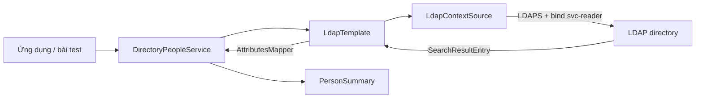
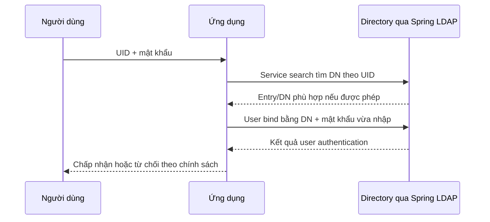

# Thực hành tổng hợp: Cấu hình ContextSource với base DN và bind account

## 1. Mục tiêu và bối cảnh

Một ứng dụng Spring Boot cần đọc thông tin nhân viên từ LDAP directory nhưng không được truy cập bằng tài khoản quản trị. Nhóm phát triển tạo một **bind account** chỉ có quyền tìm kiếm và đọc những thuộc tính cần thiết, cấu hình **base DN** cho vùng dữ liệu ứng dụng, rồi sử dụng **Spring LDAP** để tìm entry theo `uid`.

Trong chương **Thực hành tổng hợp** của module **SPRING_LDAP**, bài này kết hợp kiến thức DN, schema, LDAP filter, `LdapTemplate`, `LdapClient`, ODM, `ContextSource`, xác thực, TLS, xử lý lỗi và kiểm thử an toàn. Trọng tâm trực tiếp là **cấu hình `LdapContextSource` với base DN và service bind account**, sau đó chứng minh bằng truy vấn thực tế rằng hệ thống dùng đúng server, đúng danh tính và đúng phạm vi tìm kiếm.

**Sau bài học, người học cần:**

1. Giải thích được sự khác biệt giữa `ContextSource.setBase(...)`, `setUserDn(...)` và DN của entry tìm kiếm.
2. Tạo Spring-managed bean `LdapContextSource` kết nối LDAPS bằng bind account; không hard-code mật khẩu.
3. Cấu hình `LdapTemplate` trên context đó và viết search có filter an toàn, scope phù hợp, chỉ lấy attribute cần thiết.
4. Kiểm thử thành công/không tìm thấy, base sai, bind sai, ACL thiếu, TLS không hợp lệ và lỗi kết nối.
5. Phân biệt service bind dùng để đọc directory với user bind dùng để xác thực mật khẩu.
6. Nộp bằng chứng kiểm thử đã ẩn thông tin nhạy cảm và checklist trước khi vận hành.

**Công nghệ minh họa:** Java 17+, Spring Boot 3.x, Spring LDAP 3.x, JNDI `javax.naming`, một LDAP server thử nghiệm. Tên package/method và cấu hình cụ thể cần được đối chiếu với phiên bản thực tế khi tích hợp. Bài viết là hướng dẫn và ví dụ, **không tuyên bố code đã chạy trên một server thật**.

## 2. Sơ đồ thư mục và thông số lab

Giả sử DIT (*Directory Information Tree*) của môi trường thử nghiệm như sau:

```text
dc=example,dc=org
├── ou=people
│   ├── uid=linh
│   │   ├── objectClass: inetOrgPerson
│   │   ├── uid: linh
│   │   ├── cn: Linh Tran
│   │   └── mail: linh@example.org
│   └── ou=engineering
│       └── uid=an
│           ├── objectClass: inetOrgPerson
│           ├── uid: an
│           └── cn: An Nguyen
├── ou=groups
│   └── cn=developers
└── ou=system
    └── cn=svc-reader
```

Đây là **cây minh họa**, không phải dữ liệu LDAP/LDIF hoàn chỉnh. DN đầy đủ của các entry mẫu được nối từ RDN của entry và những cấp cha. Ví dụ:

| Khái niệm | Giá trị mẫu | Vai trò |
| --- | --- | --- |
| Server URL | `ldaps://directory.example.org:636` | Endpoint LDAP bảo vệ bằng TLS |
| Context base DN | `dc=example,dc=org` | Suffix được cấu hình trong `LdapContextSource` |
| Service bind DN | `cn=svc-reader,ou=system,dc=example,dc=org` | Danh tính kỹ thuật dùng cho search |
| Search base tương đối | `ou=people` | Vùng tìm kiếm từ context base |
| Base DN search đầy đủ | `ou=people,dc=example,dc=org` | Base server nhận khi dùng query mẫu |
| DN của Linh | `uid=linh,ou=people,dc=example,dc=org` | Entry trực tiếp trong `ou=people` |
| DN của An | `uid=an,ou=engineering,ou=people,dc=example,dc=org` | Entry ở OU lồng nhau |
| LDAP filter | `(&(objectClass=inetOrgPerson)(uid=linh))` | Điều kiện tìm đúng loại entry và uid |
| Returning attributes | `uid`, `cn`, `mail` | Trường cần hiển thị |

**Phân biệt ba loại DN:**

- **Base DN**: vùng gốc của những thao tác tương đối với `ContextSource`; nó **không phải tài khoản đăng nhập**.
- **Bind DN**: danh tính của account kết nối vào LDAP server; quyền truy cập được kiểm soát bởi ACL/chính sách server.
- **Entry DN**: tên duy nhất của một entry trong DIT; có thể được tìm thấy sau search hoặc dùng để lookup trực tiếp.

Nếu directory thật dùng `dc=corp,dc=example,dc=org` hoặc schema Active Directory khác, cần thay toàn bộ tham số tương ứng. Không suy rằng `uid`, `inetOrgPerson` hoặc `ou=people` có sẵn trong mọi hệ thống.

### Kiến trúc request cần hoàn thành



`ContextSource` quản lý cách tạo context; `LdapTemplate` quản lý thao tác search/lookup và vòng đời context. `LdapClient` là API fluent ở phiên bản hỗ trợ, còn ODM ánh xạ LDAP entry thành object. Các API đó **không tự tạo service account hoặc ACL trên server**.

## 3. Điều kiện chuẩn bị trước khi lập trình

Cần có một server **lab/test** mà bạn được phép kết nối, không tự ý sử dụng directory production cho thử nghiệm phá kết nối hoặc sai mật khẩu.

**Đầu vào cần xin từ người quản trị LDAP:**

- FQDN, port và phương thức TLS chính thức của server.
- Naming context/base DN thực tế.
- Service bind DN có quyền search subtree `ou=people` và đọc `uid`, `cn`, `mail`.
- Secret tương ứng, được cấp qua kênh bảo mật.
- Một `uid` thử nghiệm có thật và một `uid` xác nhận không tồn tại.
- Thông tin schema/matching rule, nhóm/OU con và ACL cần kiểm thử.
- CA certificate hoặc truststore tin cậy cho LDAP server.

Không dùng `rootdn` hoặc domain admin thay service account chỉ vì tiện; ưu tiên quyền **đọc tối thiểu** và khả năng thu hồi/rotate mật khẩu.

### Kiểm tra server bằng CLI khi được cho phép

Trên máy có OpenLDAP client và CA trust đã được thiết lập, có thể dùng:

```bash
# -W: nhập mật khẩu ở lời nhắc; không đặt mật khẩu vào -w/command line.
ldapwhoami -x \
  -H ldaps://directory.example.org:636 \
  -D "cn=svc-reader,ou=system,dc=example,dc=org" \
  -W

# Với ldapsearch CLI, -b nhận base DN ĐẦY ĐỦ.
ldapsearch -LLL -x \
  -H ldaps://directory.example.org:636 \
  -D "cn=svc-reader,ou=system,dc=example,dc=org" \
  -W \
  -b "ou=people,dc=example,dc=org" -s sub \
  "(&(objectClass=inetOrgPerson)(uid=linh))" \
  uid cn mail
```

Kết quả mong đợi khi dữ liệu mẫu tồn tại là entry có `uid=linh` cùng các field được phép đọc. Lỗi `invalidCredentials`, `noSuchObject` và lỗi chứng chỉ cần được xử lý theo nguyên nhân, không dùng tùy chọn bỏ xác minh TLS.

**Lưu ý:** CLI OpenLDAP có cấu hình CA riêng (ví dụ `LDAPTLS_CACERT`), trong khi Java dùng truststore/provider TLS của JVM. CLI chạy được không tự chứng minh JVM đã được cấu hình trust đúng.

## 4. Tạo Spring Boot project

Có thể dùng một project Spring Boot Java 17+ đã có plugin quản lý dependency, thêm các dependency tối thiểu trong Gradle:

```groovy
// Phần dependencies của build.gradle; project cần sẵn plugin Spring Boot
// và dependency management/BOM phiên bản tương thích.
dependencies {
    implementation 'org.springframework.boot:spring-boot-starter'
    implementation 'org.springframework.ldap:spring-ldap-core'

    testImplementation 'org.springframework.boot:spring-boot-starter-test'
}
```

Không cần tạo REST endpoint chỉ để kiểm thử connection. Nếu dự án có `spring-boot-starter-data-ldap` và tự cấu hình `spring.ldap.*`, hãy kiểm tra các bean đã tồn tại để tránh tạo `LdapTemplate` hoặc `ContextSource` trùng nhau. Lab này dùng bean **cấu hình thủ công** với prefix `practice.ldap`.

Cấu trúc minh họa:

```text
src/main/java/org/example/ldappractice/
├── LdapPracticeApplication.java
├── DirectoryLdapConfiguration.java
└── DirectoryPeopleService.java

src/main/resources/application.yml
src/test/java/org/example/ldappractice/
└── DirectoryPeopleIntegrationTest.java
```

Lớp khởi động:

```java
package org.example.ldappractice;

import org.springframework.boot.SpringApplication;
import org.springframework.boot.autoconfigure.SpringBootApplication;

@SpringBootApplication
public class LdapPracticeApplication {
    public static void main(String[] args) {
        SpringApplication.run(LdapPracticeApplication.class, args);
    }
}
```

## 5. Cấu hình thuộc tính và secret

Trong `application.yml`, khai báo:

```yaml
practice:
  ldap:
    url: ${APP_LDAP_URL:ldaps://directory.example.org:636}
    base-dn: ${APP_LDAP_BASE_DN:dc=example,dc=org}
    bind-dn: ${APP_LDAP_BIND_DN:cn=svc-reader,ou=system,dc=example,dc=org}
    bind-password: ${APP_LDAP_BIND_PASSWORD}
    people-base: ${APP_LDAP_PEOPLE_BASE:ou=people}
```

Ý nghĩa:

- `APP_LDAP_URL`: endpoint thật, dùng LDAPS với hostname khớp certificate.
- `APP_LDAP_BASE_DN`: naming context chung, ví dụ `dc=example,dc=org`.
- `APP_LDAP_BIND_DN`: DN đầy đủ của **service account**, không phải DN người dùng đang đăng nhập.
- `APP_LDAP_BIND_PASSWORD`: secret bắt buộc, không có fallback mặc định trong lab.
- `APP_LDAP_PEOPLE_BASE`: OU tương đối với context base để tìm người dùng.

Không đưa password thật vào `application.yml`, source control, log hoặc ảnh chụp màn hình. Trong production, ưu tiên secret manager và cơ chế rotate. Không sử dụng password rỗng: tùy server/JNDI, credential rỗng có thể dẫn tới hành vi anonymous bind ngoài chủ đích.

**Ví dụ cách phân biệt hai base:**

```text
ContextSource.setBase("dc=example,dc=org")
LdapQueryBuilder.base("ou=people")

=> Search base tương ứng:
   ou=people,dc=example,dc=org

Không ghi lại suffix trong query base:
   ou=people,dc=example,dc=org
vì có nguy cơ thành DN lặp:
   ou=people,dc=example,dc=org,dc=example,dc=org
```

## 6. Khởi tạo `LdapContextSource` và `LdapTemplate`

Tạo `DirectoryLdapConfiguration.java`:

```java
package org.example.ldappractice;

import java.util.HashMap;
import java.util.Map;

import org.springframework.beans.factory.annotation.Value;
import org.springframework.context.annotation.Bean;
import org.springframework.context.annotation.Configuration;
import org.springframework.ldap.core.LdapTemplate;
import org.springframework.ldap.core.support.LdapContextSource;

@Configuration
public class DirectoryLdapConfiguration {

    @Bean
    public LdapContextSource directoryContextSource(
            @Value("${practice.ldap.url}") String url,
            @Value("${practice.ldap.base-dn}") String baseDn,
            @Value("${practice.ldap.bind-dn}") String bindDn,
            @Value("${practice.ldap.bind-password}") String bindPassword) {

        if (url == null || !url.startsWith("ldaps://")) {
            throw new IllegalArgumentException(
                "Lab yêu cầu ldaps:// với certificate hợp lệ");
        }
        if (baseDn == null || baseDn.isBlank()
                || bindDn == null || bindDn.isBlank()
                || bindPassword == null || bindPassword.isEmpty()) {
            throw new IllegalArgumentException(
                "Cần base DN, bind DN và bind password không rỗng");
        }

        LdapContextSource source = new LdapContextSource();
        source.setUrl(url);
        source.setBase(baseDn);
        source.setUserDn(bindDn);    // Service DN đầy đủ.
        source.setPassword(bindPassword);
        source.setPooled(false);    // Baseline: chưa bật JNDI native pooling.

        Map<String, Object> environment = new HashMap<>();
        environment.put("com.sun.jndi.ldap.connect.timeout", "3000");
        environment.put("com.sun.jndi.ldap.read.timeout", "5000");
        source.setBaseEnvironmentProperties(environment);

        // Spring sẽ gọi afterPropertiesSet() trong lifecycle của bean.
        return source;
    }

    @Bean
    public LdapTemplate directoryLdapTemplate(
            LdapContextSource directoryContextSource) {
        return new LdapTemplate(directoryContextSource);
    }
}
```

### 6.1. Đọc các dòng quan trọng

| Cấu hình | Tác dụng | Khi cấu hình sai |
| --- | --- | --- |
| `source.setUrl(url)` | Xác định máy chủ, giao thức, cổng | DNS, connection, TLS handshake thất bại |
| `source.setBase(baseDn)` | Đặt suffix cho thao tác DN tương đối | Query có thể tìm sai subtree |
| `source.setUserDn(bindDn)` | Định danh service account được dùng để bind | LDAP bind bị từ chối hoặc sai quyền |
| `source.setPassword(...)` | Credential của service bind | `invalidCredentials`/account policy |
| `source.setPooled(false)` | Loại trừ native JNDI pooling khỏi baseline | Khi bật pooling phải quản lý danh tính và validation |
| `setBaseEnvironmentProperties` | Timeout JNDI connect/read | Không có kiểm soát thời gian mạng thích hợp |
| `new LdapTemplate(source)` | API tìm kiếm, đọc, ghi dùng nguồn trên | Inject nhầm bean có thể đọc sai directory |

Các giá trị timeout là **ví dụ**; phải điều chỉnh theo SLO/độ trễ mạng và cấu hình server. `com.sun.jndi.ldap.connect.timeout` và `com.sun.jndi.ldap.read.timeout` là thuộc tính của JNDI provider, khác với LDAP search time limit.

**Không gọi `afterPropertiesSet()` thủ công** trong bean `@Configuration`: Spring quản lý lifecycle của đối tượng. Nếu tự tạo `LdapContextSource` ngoài container thì quy trình khởi tạo có thể khác.

### 6.2. Tại sao một bean được dùng chung nhưng không dùng chung một `DirContext`?

`LdapTemplate` có thể là singleton phục vụ nhiều request. Tuy nhiên, đó **không có nghĩa mọi request dùng một `DirContext` mutable duy nhất**. Template thực thi thao tác và quản lý cấp/đóng/trả context. Không cất một `DirContext` lấy từ `ContextSource` vào static field hay truyền sang thread khác để gọi đồng thời.

Pooling sẽ được cân nhắc khi đã biết kết nối/bind đúng và có benchmark; không bật một pool trộn danh tính service account với người dùng đang đăng nhập.

## 7. Viết service tra cứu user

Tạo `DirectoryPeopleService.java`:

```java
package org.example.ldappractice;

import java.util.List;
import javax.naming.NamingException;
import javax.naming.directory.Attribute;
import javax.naming.directory.Attributes;

import org.springframework.beans.factory.annotation.Value;
import org.springframework.ldap.core.AttributesMapper;
import org.springframework.ldap.core.LdapTemplate;
import org.springframework.ldap.query.LdapQuery;
import org.springframework.ldap.query.LdapQueryBuilder;
import org.springframework.ldap.query.SearchScope;
import org.springframework.stereotype.Service;

record PersonSummary(String uid, String name, String email) {}

@Service
public class DirectoryPeopleService {
    private final LdapTemplate ldapTemplate;
    private final String peopleBase;

    public DirectoryPeopleService(
            LdapTemplate ldapTemplate,
            @Value("${practice.ldap.people-base}") String peopleBase) {
        this.ldapTemplate = ldapTemplate;
        this.peopleBase = peopleBase;
    }

    public List<PersonSummary> findByUid(String uid) {
        if (uid == null || uid.isBlank()) {
            throw new IllegalArgumentException("uid không được rỗng");
        }

        LdapQuery query = LdapQueryBuilder.query()
            .base(peopleBase)
            .searchScope(SearchScope.SUBTREE)
            .attributes("uid", "cn", "mail")
            .countLimit(3)
            .timeLimit(2000)
            .where("objectClass").is("inetOrgPerson")
            .and("uid").is(uid);

        return ldapTemplate.search(
            query,
            (AttributesMapper<PersonSummary>) attrs -> new PersonSummary(
                firstString(attrs, "uid"),
                firstString(attrs, "cn"),
                firstString(attrs, "mail")
            )
        );
    }

    private static String firstString(Attributes attrs, String name)
            throws NamingException {
        Attribute attribute = attrs.get(name);
        return attribute == null || attribute.size() == 0
            ? null
            : String.valueOf(attribute.get());
    }
}
```

Khi `uid=linh`, Spring LDAP gửi truy vấn tương đương:

```text
Base:   ou=people,dc=example,dc=org
Scope:  SUBTREE
Filter: (&(objectClass=inetOrgPerson)(uid=linh))
Attrs:  uid, cn, mail
```

Với `SUBTREE`, user ở `ou=engineering,ou=people` cũng có thể được tìm thấy. Nếu chỉ dùng `ONELEVEL` ở `ou=people` thì user ở OU con không xuất hiện; đó là thay đổi **ngữ nghĩa search**, không phải tối ưu miễn phí.

### 7.1. Những quyết định thiết kế trong query

- `.where("uid").is(uid)` biểu diễn **equality filter** và xử lý escape của giá trị theo LDAP filter; không ghép chuỗi filter với input chưa kiểm soát.
- `.attributes("uid","cn","mail")` tránh lấy `jpegPhoto`, certificate, `memberOf` hay thuộc tính lớn không dùng.
- `.countLimit(3)` có thể giữ kết quả nhỏ cho tra cứu định danh, nhưng khi chạm server limit có thể gây exception; **không được coi kết quả một phần là đầy đủ**.
- `.timeLimit(2000)` giới hạn thời gian xử lý search theo API, không thay cho connect/read timeout.
- `firstString` kiểm tra attribute có tồn tại; `null` có thể do attribute không có giá trị hoặc ACL không cấp quyền đọc.
- `LdapTemplate.search` trả `List<PersonSummary>`: với yêu cầu tra một user, ứng dụng cần phân biệt 0, 1 và nhiều kết quả thay vì tùy tiện chọn phần tử đầu tiên.

Ví dụ xử lý kết quả sau khi search hoàn tất thành công:

```java
List<PersonSummary> matches = service.findByUid("linh");

if (matches.isEmpty()) {
    // Không có entry nhìn thấy/khớp ở phạm vi được phép.
} else if (matches.size() == 1) {
    PersonSummary person = matches.get(0);
    // Tiếp tục nghiệp vụ đã được ủy quyền.
} else {
    throw new IllegalStateException("UID không duy nhất trong phạm vi search");
}
```

Đoạn code trên không thay cho xử lý exception `sizeLimitExceeded`/`timeLimitExceeded`. Các ngoại lệ này phải được coi là **query không hoàn tất**, không phải một danh sách hoàn chỉnh.

### 7.2. Escaping filter khác escaping DN

Ví dụ nguy hiểm:

```java
// KHÔNG dùng: có nguy cơ LDAP injection.
String filter = "(uid=" + uid + ")";
```

Nếu người dùng nhập `linh*)(objectClass=*)`, việc ghép chuỗi có thể thay đổi cấu trúc filter. `LdapQueryBuilder` hoặc `EqualsFilter` đảm bảo giá trị được escape theo RFC 4515. Khi xây **DN/RDN** từ input, dùng `LdapName` hoặc `LdapNameBuilder` theo quy tắc RFC 4514; escaping filter và DN **không được dùng thay thế nhau**.

## 8. Kiểm thử tích hợp trên LDAP test server

Một unit test với mapper giả lập không thể chứng minh bind, base DN, TLS hoặc ACL thật. Bài này yêu cầu **integration test có chủ đích**, chỉ chạy khi môi trường test được bật.

Tạo `DirectoryPeopleIntegrationTest.java`:

```java
package org.example.ldappractice;

import static org.junit.jupiter.api.Assertions.*;

import java.util.List;

import org.junit.jupiter.api.Test;
import org.junit.jupiter.api.condition.EnabledIfEnvironmentVariable;
import org.springframework.beans.factory.annotation.Autowired;
import org.springframework.boot.test.context.SpringBootTest;

@SpringBootTest
@EnabledIfEnvironmentVariable(named = "RUN_LDAP_IT", matches = "true")
class DirectoryPeopleIntegrationTest {
    @Autowired
    private DirectoryPeopleService directory;

    @Test
    void findsKnownTestUser() {
        String uid = System.getenv("APP_LDAP_TEST_UID");
        assertNotNull(uid, "Cần APP_LDAP_TEST_UID cho môi trường test");

        List<PersonSummary> rows = directory.findByUid(uid);

        assertEquals(1, rows.size(), "Expected exactly one known test user");
        assertEquals(uid, rows.get(0).uid());
        assertNotNull(rows.get(0).name());
    }

    @Test
    void specialCharactersDoNotBroadenFilter() {
        String suspicious = "linh*)(objectClass=*)";

        List<PersonSummary> rows = directory.findByUid(suspicious);

        // Thường không có user tên này; nếu có thì chỉ được trả UID nguyên văn.
        assertTrue(rows.stream().allMatch(
            row -> suspicious.equals(row.uid())));
    }
}
```

**Điều kiện chạy:** cung cấp các biến `APP_LDAP_URL`, `APP_LDAP_BASE_DN`, `APP_LDAP_BIND_DN`, `APP_LDAP_BIND_PASSWORD`, `APP_LDAP_PEOPLE_BASE` và `APP_LDAP_TEST_UID` phù hợp; đặt `RUN_LDAP_IT=true`. Biến `APP_LDAP_TEST_UID` phải là một entry test đã được người quản trị cho phép dùng. Trước khi bật, xác minh môi trường thực sự là server test, không phải production.

### Ma trận test bắt buộc

| ID | Tình huống | Kỳ vọng |
| --- | --- | --- |
| T01 | URL, TLS và service bind hợp lệ | Search một user test thành công |
| T02 | User nằm trực tiếp dưới `ou=people` | Search `SUBTREE` trả đúng entry |
| T03 | User nằm ở OU con `ou=engineering` | `SUBTREE` vẫn tìm thấy; `ONELEVEL` có thể không thấy |
| T04 | UID không tồn tại | Không trả nhầm entry; kết quả 0 theo hợp đồng |
| T05 | UID chứa ký tự filter đặc biệt | Không thể sửa cấu trúc filter, không mở rộng kết quả |
| T06 | Bind password sai trong môi trường lab | Server từ chối bind; không fallback anonymous |
| T07 | Base DN không tồn tại | Lỗi noSuchObject hoặc kết quả được phân loại rõ |
| T08 | Service account không được đọc `mail` | Không tự nâng quyền; xử lý field thiếu theo thiết kế |
| T09 | JVM không tin CA hoặc hostname không khớp | TLS handshake thất bại |
| T10 | Server down hoặc kết nối bị chặn | Thất bại hữu hạn theo timeout, báo lỗi hạ tầng |
| T11 | Directory có UID trùng trong phạm vi | Ứng dụng không chọn entry đầu tùy tiện |
| T12 | Không cấp bind password | Fail fast, không thử anonymous bind |

Các test thay password, sửa ACL hoặc ngắt kết nối phải thực hiện **chỉ trong lab được quản lý**, không chạy các phép thử gây gián đoạn trên directory dùng chung.

### Tách kiểm thử cấu hình và kiểm thử nghiệp vụ

**Kiểm thử cấu hình:** bean được tạo, URL/base/bind DN thực sự được áp dụng, TLS được tin cậy, bind thành công và service account có quyền đọc tối thiểu.

**Kiểm thử nghiệp vụ:** filter tìm đúng UID, xử lý 0/1/nhiều kết quả, dữ liệu có và thiếu attribute, OU lồng nhau, giới hạn số entry và lỗi LDAP đúng cách.

Việc ứng dụng khởi động thành công **không tự chứng minh LDAP connect được**, vì provider có thể thiết lập kết nối vào thời điểm gọi search. Phải chạy ít nhất một operation thực tế.

## 9. Xác thực: service bind không phải user bind

Một account dịch vụ thường dùng để **tìm DN** hoặc đọc thuộc tính theo quyền được cấp. Khi đăng nhập, người dùng nhập username/password; ứng dụng phải kiểm tra thông tin đó theo cơ chế xác thực LDAP phù hợp, thay vì dùng kết nối service account như một bằng chứng "mật khẩu đúng".



Một API có thể dùng khi mở rộng bài lab:

```java
import org.springframework.ldap.core.LdapTemplate;
import org.springframework.ldap.filter.EqualsFilter;

class LoginCheck {
    private final LdapTemplate ldapTemplate;

    LoginCheck(LdapTemplate ldapTemplate) {
        this.ldapTemplate = ldapTemplate;
    }

    boolean authenticate(String uid, String password) {
        if (uid == null || uid.isBlank()
                || password == null || password.isBlank()) {
            return false;
        }

        EqualsFilter filter = new EqualsFilter("uid", uid);
        return ldapTemplate.authenticate(
            "ou=people",
            filter.encode(),
            password
        );
    }
}
```

Đây là **ví dụ mở rộng**, không phải lời khuyên dùng user bind cho mọi use case. Cần xử lý phân biệt mật khẩu sai, user không tồn tại, trùng UID, account locked, không kết nối được server hoặc service account thiếu quyền tra DN. Lỗi hạ tầng **không được** chuyển một cách im lặng thành "mật khẩu sai" trong monitor nội bộ.

**Không gộp context của user bind động vào pool service account dùng chung.** Principal khác nhau có quyền khác nhau, và reuse sai kết nối có thể làm sai cả ACL lẫn xác thực khi mật khẩu thay đổi.

## 10. TLS, truststore, quyền và logging

Bài lab dùng `ldaps://...:636`. Một kết nối chỉ thực sự an toàn nếu:

1. Hostname DNS khớp SAN của certificate phía server.
2. Certificate chain được ký bởi CA mà JVM tin cậy theo chính sách tổ chức.
3. Không cài `TrustManager` chấp nhận mọi certificate hoặc tắt hostname verification.
4. Không chuyển ngược sang `ldap://` không TLS để tránh lỗi chứng chỉ.
5. Secret bind account không bị ghi vào log, command line, source control hoặc exception payload trả cho user.

Ví dụ JVM options cho truststore được quản trị đúng cách:

```text
-Djavax.net.ssl.trustStore=/secure/config/directory-truststore.p12
-Djavax.net.ssl.trustStoreType=PKCS12
```

Đường dẫn chỉ là ví dụ. Nếu truststore có mật khẩu, cấp nó bằng cơ chế secret an toàn, tránh đặt mật khẩu thẳng trong shell command hoặc public file. **LDAPS** và **StartTLS** là các cách bảo vệ kết nối khác nhau; đổi URL thành `ldap://` **không tự đàm phán StartTLS**. Với StartTLS, phải chọn chiến lược và lifecycle phù hợp cho phiên bản Spring LDAP.

### Quyền tối thiểu của service bind

Service account cho bài lab chỉ cần:

- Quyền bind/search trong nhánh người dùng hợp lệ.
- Quyền đọc `uid`, `cn` và `mail` theo mục đích nghiệp vụ.
- Không cần quyền `add`, `modify`, `delete` hoặc đọc `userPassword`.
- Không cần vai trò quản trị directory.

Nếu ứng dụng đa tenant, chỉ thu hẹp base trong query **không thay thế ACL và authorization**. Account có quyền rộng hơn người gọi phải được tầng ứng dụng kiểm soát dữ liệu trả về; không trả toàn bộ entry/attributes để client tự lọc.

### Không ghi dữ liệu nhạy cảm khi debug

Có thể ghi `operation=searchByUid`, duration, kết quả success/not-found/error và nhóm lỗi có cardinality thấp. Không log mật khẩu, raw input, full DN mang thông tin cá nhân, filter chứa định danh, ảnh, certificate hoặc toàn bộ `Attributes`. Khi exception chứa server URL hoặc DN, cần cân nhắc mức log và quyền truy cập hệ thống quan sát.

## 11. Chẩn đoán theo từng lớp

| Triệu chứng | Khả năng nguyên nhân | Hướng kiểm tra |
| --- | --- | --- |
| Không mở kết nối được | DNS, port, firewall, server down | Endpoint/mạng từ nơi app thực thi |
| `SSLHandshakeException`/`PKIX path building failed` | JVM truststore, certificate chain hoặc hostname | CA, SAN, truststore được phê duyệt |
| LDAP 49 / `AuthenticationException` | Bind DN hoặc credential sai; account policy | Xác minh bind trên server test, không log password |
| LDAP 32 / `NameNotFoundException` | Base không tồn tại, suffix bị lặp hoặc sai OU | So context base với query base |
| Search trả rỗng dù đã bind | Filter/schema sai, user không tồn tại, scope sai hoặc ACL ẩn entry | Đối chiếu DIT, user test, scope, ACL |
| `mail` là null | Không tồn tại, không được cấp ACL, không được yêu cầu | Kiểm tra projection và quyền đọc |
| LDAP 50 / insufficient access | Account thiếu quyền | Làm việc với admin để cấp quyền tối thiểu |
| LDAP filter invalid | Ghép input thô hoặc syntax không hợp lệ | Dùng `LdapQueryBuilder`/`EqualsFilter` |
| Lúc nhanh lúc timeout | Server, mạng, DNS/TLS handshake, pooling | Đo connect/read/search time riêng |
| User ở OU con không tìm thấy | `ONELEVEL` trong khi entry nằm sâu hơn | Chuyển `SUBTREE` nếu nghiệp vụ cần |
| Service không hoạt động sau rotate secret | Secret cũ, connection cũ, cập nhật không đồng bộ | Quy trình rotation và recycle context an toàn |
| Kết quả thiếu dù đã có một số entry | `sizeLimitExceeded` hoặc `timeLimitExceeded` | Không nuốt lỗi/không báo kết quả đầy đủ |

Các Java exception và LDAP result code có thể được Spring LDAP/JNDI ánh xạ khác nhau tùy provider. Bảng là **định hướng chẩn đoán**, không bảo đảm mỗi server phát cùng một exception.

**Phân biệt đúng:** bind sai là vấn đề danh tính/credential; base sai là vùng tìm kiếm; filter sai là điều kiện chọn entry; ACL là quyền nhìn thấy dữ liệu. Thay toàn bộ bằng tài khoản admin hoặc filter `(objectClass=*)` ở root có thể che lỗi và tăng rủi ro bảo mật.

## 12. Ba bài tập mở rộng có kiểm soát

### Bài A — Trả DN bên cạnh attribute

Nếu cần DN để đọc entry khác, dùng `ContextMapper` với `DirContextOperations` thay vì tìm thuộc tính `dn` bằng `attrs.get("dn")`:

```java
import java.util.List;
import org.springframework.ldap.core.ContextMapper;
import org.springframework.ldap.core.DirContextOperations;
import org.springframework.ldap.core.LdapTemplate;
import org.springframework.ldap.query.LdapQuery;
import org.springframework.ldap.query.LdapQueryBuilder;

class DnLookup {
    private final LdapTemplate ldapTemplate;

    DnLookup(LdapTemplate ldapTemplate) {
        this.ldapTemplate = ldapTemplate;
    }

    List<String> findDnByUid(String uid) {
        LdapQuery query = LdapQueryBuilder.query()
            .base("ou=people")
            .where("uid").is(uid);

        return ldapTemplate.search(
            query,
            (ContextMapper<String>) context ->
                ((DirContextOperations) context).getDn().toString()
        );
    }
}
```

`getDn()` có thể trả DN tương đối với context base. Nếu cần DN đầy đủ, hãy dùng API `LdapName` theo đúng quy tắc kết hợp/escape; không ghép chuỗi từ input người dùng.

### Bài B — Thử cấu hình `spring.ldap.*` của Spring Boot

Một số project có thể dùng `spring.ldap.urls`, `spring.ldap.base`, `spring.ldap.username`, `spring.ldap.password` để Spring Boot tự tạo bean khi điều kiện auto-config phù hợp. So sánh với cấu hình thủ công:

- Source thực tế dùng URL/base/bind DN nào?
- Service có inject đúng `LdapTemplate` hay không?
- Có hai bean `ContextSource` khiến kết nối nhầm directory không?
- Sau khi chuyển cấu hình, các integration test có còn chạy đúng quyền không?

Chọn **một** mô hình cấu hình làm nguồn sự thật. Không để auto-config và bean thủ công vô tình trỏ hai server khác nhau.

### Bài C — Đo trước khi bật pooling

Thực hiện cùng một tra cứu hợp lệ dưới tải nhẹ và vừa; ghi p50/p95, connect/bind error và tài nguyên server. Khi bật pooling được hỗ trợ theo phiên bản Spring LDAP/JNDI, đo lại với **cùng base, filter, scope, ACL và TLS**. Đảm bảo service bind và user bind vẫn phân biệt; không dùng native JNDI pooling bừa bãi cho kết nối StartTLS có trạng thái.

## 13. Nhiệm vụ nộp bài và cách chấm

**Sản phẩm học viên cần nộp:**

1. Cấu hình `application.yml` có placeholder cho biến môi trường, tuyệt đối không chứa password thật.
2. `DirectoryLdapConfiguration` thể hiện rõ URL, base DN, bind account, connect/read timeout và `LdapTemplate`.
3. `DirectoryPeopleService` tìm `uid` bằng filter an toàn, đúng scope và chỉ lấy attribute cần dùng.
4. Bảng kết quả test T01–T12 trên môi trường lab; các lỗi dự kiến được ghi rõ và output đã ẩn định danh nhạy cảm.
5. Một đoạn giải thích phân biệt base DN, bind DN, entry DN, service bind và user bind.
6. Checklist bảo mật TLS, ACL và bí mật; không phải dump LDAP hay mật khẩu.

| Tiêu chí | Tỷ trọng gợi ý | Điều kiện đạt |
| --- | ---: | --- |
| ContextSource đúng naming context và bind identity | 25% | Không ghép base sai; account có DN đúng |
| TLS, secret và quyền tối thiểu | 25% | Không hard-code secret, không bypass TLS, không dùng admin |
| Query Spring LDAP đúng chức năng | 20% | Scope/filter/projection đúng, xử lý 0/1/nhiều |
| Kiểm thử, phân loại lỗi | 20% | Có happy path và các test âm thực tế |
| Giải thích và trình bày bằng chứng | 10% | Có sơ đồ, kết quả đã ẩn thông tin và lập luận rõ |

**Câu hỏi bảo vệ ngắn:**

- `setBase("dc=example,dc=org")` có phải tên đăng nhập không? **Không**, đó là suffix của context.
- Vì sao query dùng `.base("ou=people")`? **Vì context đã có suffix**, nên query dùng base tương đối.
- Bind thành công nhưng `mail` không được trả là lỗi mạng? **Không nhất thiết**; có thể do ACL, schema hoặc entry không có field.
- Tại sao không dùng service account để xác nhận password người dùng? **Vì bind service và bind user có danh tính/chức năng khác nhau**.
- Tại sao không tắt TLS verification để chạy nhanh? **Vì làm mất xác thực máy chủ và mở đường cho MITM**.
- Vì sao `SUBTREE` phù hợp với cây mẫu? **Vì có entry người dùng trong OU con**.
- Vì sao không coi một list kết quả bị `sizeLimitExceeded` là thành công? **Vì search có thể chưa hoàn tất**.

## 14. Checklist hoàn thành lab

- [ ] Có server lab và user test được phép sử dụng.
- [ ] Biết đúng naming context, base DN và bind DN đầy đủ.
- [ ] Cấu hình `LdapContextSource` dùng endpoint LDAPS hợp lệ.
- [ ] Mật khẩu bind account được cấp qua secret/env, không hard-code.
- [ ] JVM trust CA và xác minh hostname của directory server.
- [ ] Không tự ý thay chứng chỉ, ACL hoặc tài khoản production.
- [ ] `LdapTemplate` dùng đúng `ContextSource` được cấu hình.
- [ ] Query base tương đối không lặp suffix.
- [ ] Filter dùng builder/escaping, scope phù hợp và projection gọn.
- [ ] Phân biệt kết quả 0, 1, nhiều entry và lỗi search chưa hoàn tất.
- [ ] Có test user ở OU con, user không tồn tại và input đặc biệt.
- [ ] Kiểm tra sai password/bind DN, truststore, base DN và quyền đọc trong lab.
- [ ] Service bind không thay thế user bind trong flow đăng nhập.
- [ ] Có timeout, log an toàn và hướng chẩn đoán rõ ràng.
- [ ] Báo cáo đã ẩn bí mật và không chứa dữ liệu nhân viên không cần thiết.

## 15. Tài liệu tham khảo

- [Spring LDAP Reference Documentation](https://docs.spring.io/spring-ldap/reference/): `ContextSource`, `LdapTemplate`, `LdapClient`, ODM và các API truy cập directory.
- [Spring LDAP – Configuration](https://docs.spring.io/spring-ldap/reference/configuration.html): cấu hình context source, URL, base, account và kết nối.
- [Spring LDAP – Basic Usage](https://docs.spring.io/spring-ldap/reference/spring-ldap-basic-usage.html): `LdapTemplate`, search/lookup và mapping.
- [Spring LDAP – Building Advanced LDAP Queries](https://docs.spring.io/spring-ldap/reference/query-builder-advanced.html): `LdapQueryBuilder`, scope, filter và returning attributes.
- [RFC 4511 – LDAP: The Protocol](https://www.rfc-editor.org/rfc/rfc4511): bind/search, kết quả và error codes.
- [RFC 4514 – String Representation of Distinguished Names](https://www.rfc-editor.org/rfc/rfc4514): biểu diễn DN và escaping.
- [RFC 4515 – String Representation of Search Filters](https://www.rfc-editor.org/rfc/rfc4515): escaping giá trị filter.

