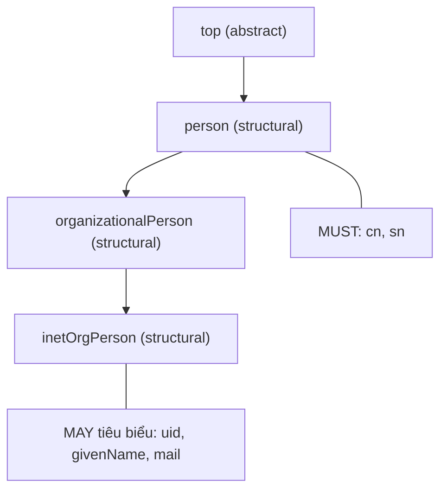

# Tạo entry với object class và attribute bắt buộc

Trong **Spring LDAP**, thao tác tạo một entry mới không đơn giản là gửi một DN và vài cặp khóa–giá trị. LDAP server sẽ kiểm tra cấu trúc DN, sự tồn tại của entry cha, quyền thêm entry và đặc biệt là **schema**: entry thuộc những `objectClass` nào, phải có những attribute gì và được phép chứa những attribute nào. Một entry thiếu `sn`, chứa attribute không được khai báo hoặc cố tạo dưới một nhánh chưa tồn tại có thể bị server từ chối ngay cả khi Java code chạy đúng.

Bài **“Tạo entry với object class và attribute bắt buộc”**, thuộc chương **Thực hành tổng hợp** của **SPRING_LDAP**, đưa người học qua một bài tập hoàn chỉnh: chuẩn bị LDAP directory và `ContextSource`, chọn `objectClass`, tạo DN, thêm entry bằng `LdapTemplate`, xác minh bằng `lookup`/`search`, kiểm tra trường hợp schema không hợp lệ và dọn dữ liệu thử nghiệm. Những nguyên tắc về DN, filter, xác thực, TLS, pooling, xử lý lỗi và kiểm thử an toàn cũng áp dụng khi triển khai tương tự bằng `LdapClient` hoặc ODM.

## 1. Bài toán, kết quả đầu ra và môi trường

**Bối cảnh:** một hệ thống quản lý nhân viên cần thêm hồ sơ người dùng vào LDAP directory thử nghiệm. Mỗi hồ sơ có một định danh `uid`, họ `sn`, tên hiển thị `cn` và có thể có `givenName`, `mail`. Hệ thống cần tạo entry thuộc lớp `inetOrgPerson` dưới nhánh `ou=people`.

Kết quả dự kiến:

```text
dc=example,dc=org
└── ou=people
    └── uid=an.nguyen
        ├── objectClass: top
        ├── objectClass: person
        ├── objectClass: organizationalPerson
        ├── objectClass: inetOrgPerson
        ├── uid: an.nguyen
        ├── cn: An Nguyễn
        ├── sn: Nguyễn
        ├── givenName: An
        └── mail: an.nguyen@example.org
```

**Điều kiện để thực hành:**

1. Có LDAP server **dành cho lab** hỗ trợ schema `inetOrgPerson` và nhánh gốc `dc=example,dc=org`.
2. Entry cha `ou=people,dc=example,dc=org` đã tồn tại và tài khoản dịch vụ có quyền thêm entry trong nhánh này.
3. Java, Spring Framework và Spring LDAP được cấu hình tương thích; ví dụ dùng `LdapTemplate` và các API trong `org.springframework.ldap.*`.
4. Kết nối dùng **LDAPS hoặc StartTLS** được thiết lập đúng trust store, xác minh chứng chỉ/hostname; credential dịch vụ được lấy từ nơi lưu secret.
5. Có tài khoản thử nghiệm quyền đọc để xác minh và, nếu cần, quyền xóa **chỉ đối với fixture do bài thực hành tạo ra**.

Các DN, địa chỉ, user và mật khẩu dưới đây là ví dụ cho môi trường lab; không gửi lệnh ghi hoặc xóa trực tiếp vào LDAP production.

### Tiêu chí hoàn thành

| Yêu cầu | Dấu hiệu đạt |
|---|---|
| Đúng DN | Entry có DN `uid=an.nguyen,ou=people,dc=example,dc=org` |
| Đúng class | `objectClass` có chuỗi lớp phù hợp với `inetOrgPerson` và schema server |
| Đủ thuộc tính bắt buộc | `cn` và `sn` có giá trị hợp lệ |
| Định danh RDN nhất quán | Giá trị `uid` trong entry khớp RDN `uid=an.nguyen` |
| Thuộc tính tùy chọn hợp lệ | `givenName` và `mail` được lưu nếu schema cho phép |
| Xác minh độc lập | `lookup` theo DN và `search` theo `uid` nhận đúng entry |
| Xử lý lỗi có kiểm soát | Thiếu `sn`, entry trùng DN, sai quyền và sai parent được phân loại |
| Dọn lab an toàn | Chỉ xóa đúng entry thử nghiệm sau khi kiểm tra DN |

## 2. Hiểu `objectClass` và thuộc tính MUST/MAY trước khi tạo

Schema LDAP quy định loại entry bằng `objectClass`. Một lớp có thể **kế thừa** lớp khác; các thuộc tính bắt buộc (`MUST`) và tùy chọn (`MAY`) được tính từ lớp đã chọn cùng các lớp cha. `inetOrgPerson` là lớp cấu trúc (structural object class) thường gặp cho hồ sơ người dùng.



| `objectClass` | Kế thừa / chức năng | Điều cần chú ý |
|---|---|---|
| `top` | Gốc trừu tượng của cây object class | Thường được khai báo trong entry |
| `person` | Lớp cấu trúc của một người, kế thừa `top` | **MUST:** `cn` và `sn` |
| `organizationalPerson` | Mở rộng `person` cho thông tin tổ chức | Kế thừa mọi yêu cầu của `person` |
| `inetOrgPerson` | Mở rộng `organizationalPerson` với thuộc tính thường dùng cho người dùng | Có thể khai báo `uid`, `givenName`, `mail` tùy schema server |

Với ví dụ trên, dù `inetOrgPerson` không trực tiếp liệt kê `sn` trong phần mở rộng của nó, entry vẫn **phải có `sn`** vì kế thừa `person`. Tương tự, `cn` là bắt buộc. `uid` trong bài là thuộc tính định danh được chọn cho RDN; bản thân việc dùng `inetOrgPerson` không biến `uid` thành `MUST` theo schema chuẩn.

**Không được nhầm ba khái niệm:**

- **`objectClass`:** tập lớp xác định mô hình và thuộc tính của entry.
- **RDN của entry:** thành phần tên tương đối, trong bài là `uid=an.nguyen`. Giá trị `uid` cần nhất quán với tên entry và quy tắc naming của server.
- **Base DN:** phần gốc mà Spring LDAP dùng để tìm và tạo entry, trong bài là `dc=example,dc=org`. Khi gọi API với DN tương đối, không lặp base DN lần nữa.

Schema thực tế có thể được mở rộng bởi tổ chức. Ví dụ một lớp phụ trợ (auxiliary class) có thể yêu cầu thêm attribute riêng. Vì vậy hãy **đọc schema trên chính LDAP server** nếu làm việc với object class hoặc thuộc tính khác bài mẫu, thay vì sao chép một danh sách `MUST`/`MAY` chung cho mọi directory.

### Không thêm attribute tùy tiện

Nếu chỉ khai báo `person` mà cố thêm `mail` hoặc `uid`, LDAP server có thể từ chối vì những attribute này không được cho phép bởi tổ hợp lớp khai báo. `inetOrgPerson` được chọn để đáp ứng mô hình cần `uid`, `givenName` và `mail`. Đừng thêm `extensibleObject` chỉ để lách kiểm tra schema: điều đó che lỗi thiết kế mô hình dữ liệu và có thể mở rộng bề mặt dữ liệu không cần thiết.

## 3. Chuẩn bị cây DN và quyền ghi trong môi trường thử nghiệm

Entry mới chỉ được thêm khi **entry cha đã tồn tại**. Với DN:

```text
uid=an.nguyen,ou=people,dc=example,dc=org
```

thì `ou=people,dc=example,dc=org` là parent bắt buộc. Nếu chưa có, người quản trị lab cần tạo parent trước bằng quyền thích hợp. Ví dụ LDIF cho parent:

```ldif
dn: ou=people,dc=example,dc=org
objectClass: top
objectClass: organizationalUnit
ou: people
```

Đối với LDAP server đã có `ou=people`, **không tạo lại** entry này. Tạo lại có thể nhận lỗi `entryAlreadyExists`, không nên chuyển thành thao tác ghi đè.

Tài khoản ứng dụng cần quyền `add` entry trong nhánh `ou=people`, đọc lại entry để xác minh và quyền xóa nếu bài lab cần cleanup. Không dùng DN quản trị toàn directory khi chỉ cần thao tác trong một nhánh. Quyền LDAP có thể phụ thuộc ACL, loại entry, thuộc tính và DN, không thể suy ra chỉ từ việc bind thành công.

### Bản LDIF chuẩn để đối chiếu

Trước khi viết Java, hãy nhìn entry mong muốn dưới dạng LDIF:

```ldif
dn: uid=an.nguyen,ou=people,dc=example,dc=org
objectClass: top
objectClass: person
objectClass: organizationalPerson
objectClass: inetOrgPerson
uid: an.nguyen
cn: An Nguyễn
sn: Nguyễn
givenName: An
mail: an.nguyen@example.org
```

Mỗi dòng `objectClass: ...` là một giá trị của **cùng thuộc tính đa trị** `objectClass`. Không ghi đè chúng bằng bốn lệnh `put("objectClass", ...)` nối tiếp trên một cấu trúc attributes đơn trị.

LDIF có quy tắc riêng khi lưu Unicode, dữ liệu nhị phân hoặc giá trị bắt đầu bằng ký tự đặc biệt. Ví dụ này giả định tệp LDIF được lưu UTF-8 hợp lệ. Các công cụ `ldapadd`/`ldapsearch` có thể giúp xác minh thủ công trong lab nhưng không thay thế bài tập Java. Khi sử dụng chúng, hãy để công cụ hỏi mật khẩu qua chế độ tương tác, không đặt secret trực tiếp trên dòng lệnh.

## 4. Cấu hình `LdapContextSource` và `LdapTemplate`

Spring LDAP dùng `ContextSource` để tạo context JNDI. `LdapTemplate` nhận `ContextSource`, sau đó tự quản lý context cho phần lớn thao tác thông thường. Ví dụ Java Config:

```java
import org.springframework.context.annotation.Bean;
import org.springframework.context.annotation.Configuration;
import org.springframework.core.env.Environment;
import org.springframework.ldap.core.LdapTemplate;
import org.springframework.ldap.core.support.LdapContextSource;

@Configuration
public class DirectoryConfiguration {

    @Bean
    public LdapContextSource ldapContextSource(Environment environment) {
        LdapContextSource source = new LdapContextSource();
        source.setUrl(environment.getRequiredProperty("app.ldap.url"));
        source.setBase(environment.getRequiredProperty("app.ldap.base"));
        source.setUserDn(
                environment.getRequiredProperty("app.ldap.bind-dn"));
        source.setPassword(
                environment.getRequiredProperty("app.ldap.bind-password"));
        return source;
    }

    @Bean
    public LdapTemplate ldapTemplate(LdapContextSource contextSource) {
        return new LdapTemplate(contextSource);
    }
}
```

Ví dụ các tham số ứng dụng:

```properties
app.ldap.url=ldaps://directory-test.example.org:636
app.ldap.base=dc=example,dc=org
app.ldap.bind-dn=cn=entry-writer,ou=services,dc=example,dc=org
# app.ldap.bind-password được cấp từ secret manager hoặc môi trường.
```

**Lưu ý bảo mật:** tên host, DN và thông tin xác thực chỉ là ví dụ. Phải xác minh chứng chỉ của LDAP server, hostname và trust chain; không tắt TLS validation để làm ví dụ chạy được. Secret không được đưa vào Git, log hoặc exception response. Nếu sử dụng pooling cho các thao tác dịch vụ, phải giữ danh tính bind ổn định và quản lý context đúng vòng đời; user authentication theo mật khẩu cá nhân là một luồng riêng.

Trong ví dụ này, `source.setBase("dc=example,dc=org")` nghĩa là các DN truyền vào `LdapTemplate.bind()` thường **tương đối** với base trên. Giá trị sẽ là `uid=an.nguyen,ou=people`, không phải DN đầy đủ có thêm `dc=example,dc=org`.

## 5. Tạo DN an toàn, đầy đủ thuộc tính và gọi `bind()`

Giải pháp nên có một lớp service nhận dữ liệu đã được kiểm tra, dùng `LdapNameBuilder` để xây DN và tạo `Attributes` với các object class phù hợp. Ví dụ Java dưới đây dùng Java record và Spring LDAP:

```java
import javax.naming.Name;
import javax.naming.directory.Attribute;
import javax.naming.directory.Attributes;
import javax.naming.directory.BasicAttribute;
import javax.naming.directory.BasicAttributes;

import org.springframework.ldap.core.LdapTemplate;
import org.springframework.ldap.support.LdapNameBuilder;

public final class PersonEntryService {
    private final LdapTemplate ldapTemplate;

    public PersonEntryService(LdapTemplate ldapTemplate) {
        this.ldapTemplate = ldapTemplate;
    }

    public record NewPerson(
            String uid, String cn, String sn,
            String givenName, String mail) {}

    public Name createPerson(NewPerson person) {
        if (person == null) {
            throw new IllegalArgumentException("Thiếu thông tin entry");
        }

        // Quy tắc uid do bài lab lựa chọn; không phải cú pháp chung của LDAP.
        if (person.uid() == null
                || !person.uid().matches("[a-z][a-z0-9._-]{2,63}")) {
            throw new IllegalArgumentException("uid không hợp lệ");
        }
        if (person.cn() == null || person.cn().isBlank()
                || person.sn() == null || person.sn().isBlank()) {
            throw new IllegalArgumentException("Thiếu cn hoặc sn");
        }

        // DN tương đối với dc=example,dc=org trong ContextSource.
        Name relativeDn = LdapNameBuilder.newInstance("ou=people")
                .add("uid", person.uid())
                .build();

        Attributes attrs = new BasicAttributes(true);
        Attribute classes = new BasicAttribute("objectClass");
        classes.add("top");
        classes.add("person");
        classes.add("organizationalPerson");
        classes.add("inetOrgPerson");
        attrs.put(classes);

        // Các attribute MUST kế thừa từ person.
        attrs.put("cn", person.cn());
        attrs.put("sn", person.sn());

        // RDN dùng uid và schema inetOrgPerson cho phép thuộc tính này.
        attrs.put("uid", person.uid());

        if (person.givenName() != null
                && !person.givenName().isBlank()) {
            attrs.put("givenName", person.givenName());
        }
        if (person.mail() != null && !person.mail().isBlank()) {
            attrs.put("mail", person.mail());
        }

        ldapTemplate.bind(relativeDn, null, attrs);
        return relativeDn;
    }
}
```

Giải thích từng phần:

- `LdapNameBuilder` xử lý cú pháp tên LDAP và tách **RDN** đúng cách. Không xây DN bằng phép nối chuỗi đầu vào chưa được escape; ở ví dụ này định dạng `uid` còn được giới hạn theo chính sách bài lab.
- `new BasicAttributes(true)` tạo tập attribute với tên attribute không phân biệt hoa thường, tương ứng đặc tính tên attribute của LDAP.
- `BasicAttribute("objectClass")` chứa nhiều giá trị vì `objectClass` là thuộc tính đa trị; mỗi lần `classes.add(...)` thêm một class vào cùng attribute.
- `cn` và `sn` được đặt rõ ràng vì `person` bắt buộc; `uid` được đặt để phù hợp RDN. `givenName` và `mail` là tùy chọn trong mô hình ví dụ.
- `ldapTemplate.bind(relativeDn, null, attrs)` yêu cầu LDAP server **thêm entry mới**; tham số object là `null` vì ta truyền trực tiếp `Attributes` theo JNDI, không bind một Java object serialized.
- Nếu DN đã tồn tại, bind thêm sẽ lỗi; không nên bắt lỗi rồi âm thầm sửa đè entry cũ.

Ứng dụng production thường có lớp DTO, validation theo chính sách tổ chức, kiểm tra tính duy nhất của `uid` và ghi audit. **Không có bước “kiểm tra trước rồi tạo” nào bảo đảm không xảy ra tranh chấp** khi hai request cùng tạo một DN; LDAP add ở server vẫn là thao tác quyết định và lỗi trùng DN phải được xử lý.

### Gọi service

```java
PersonEntryService.NewPerson user =
        new PersonEntryService.NewPerson(
                "an.nguyen",
                "An Nguyễn",
                "Nguyễn",
                "An",
                "an.nguyen@example.org");

Name createdDn = personEntryService.createPerson(user);
// createdDn: uid=an.nguyen,ou=people
```

Sau khi thao tác thành công, nếu `ContextSource` có base DN `dc=example,dc=org`, entry sẽ có DN đầy đủ `uid=an.nguyen,ou=people,dc=example,dc=org`. Không giữ `DirContext` trong một field singleton; để `LdapTemplate` quản lý việc lấy và đóng context đúng lúc.

## 6. Đọc lại entry và xác minh class, thuộc tính

Không coi “Java không ném exception” là bằng chứng duy nhất. Hãy đọc entry từ LDAP và kiểm tra dữ liệu server thực sự lưu. Việc xác minh tách biệt giúp phát hiện lỗi mapping, DN sai hoặc schema/server tự chuẩn hóa một số giá trị.

### Tra cứu trực tiếp theo DN

```java
import javax.naming.Name;
import javax.naming.directory.Attribute;
import javax.naming.directory.Attributes;
import org.springframework.ldap.core.AttributesMapper;

public boolean hasMandatoryAttributes(Name relativeDn) {
    return ldapTemplate.lookup(
            relativeDn,
            (AttributesMapper<Boolean>) attrs -> {
                Attribute objectClasses = attrs.get("objectClass");
                Attribute cn = attrs.get("cn");
                Attribute sn = attrs.get("sn");
                Attribute uid = attrs.get("uid");

                return objectClasses != null
                        && objectClasses.contains("inetOrgPerson")
                        && cn != null && cn.size() > 0
                        && sn != null && sn.size() > 0
                        && uid != null && uid.size() > 0;
            });
}
```

Đoạn trên trình bày phương pháp xác minh, có thể đặt thành method của service hoặc một lớp verification nhận `LdapTemplate`. Các attribute như `objectClass` thường không phân biệt hoa thường khi so khớp theo schema, nhưng `Attribute.contains` có thể phụ thuộc cách đối tượng client biểu diễn; trong bộ kiểm thử nghiêm ngặt nên duyệt từng giá trị và so sánh không phân biệt hoa thường cho tên class.

Để kiểm tra đúng giá trị đã gửi, không chỉ kiểm tra `size() > 0`. Cần so sánh `uid`, `cn`, `sn` và `mail` với kỳ vọng từ fixture, đồng thời kiểm tra có bị server chuẩn hóa hoặc thay đổi qua plugin/policy hay không.

### Tìm entry theo filter

```java
import java.util.List;
import org.springframework.ldap.core.AttributesMapper;
import org.springframework.ldap.query.LdapQuery;
import static org.springframework.ldap.query.LdapQueryBuilder.query;

LdapQuery q = query()
        .base("ou=people")
        .where("uid").is("an.nguyen");

List<String> commonNames = ldapTemplate.search(
        q,
        (AttributesMapper<String>) attrs ->
                (String) attrs.get("cn").get()
);
```

Với fixture này, kết quả kỳ vọng là **một** `cn` mang giá trị `An Nguyễn`. Không dựa vào thứ tự kết quả nếu nhiều entry cùng match filter. `LdapQueryBuilder` giúp escape giá trị filter; khi đầu vào do người dùng cung cấp, tuyệt đối không nối thủ công thành `"(uid=" + input + ")"`.

**Phân biệt:** `lookup` kiểm tra một DN cụ thể. `search` tìm các entry theo filter và scope; một lệnh search thành công nhưng trả nhiều entry có thể cho thấy dữ liệu vi phạm giả định “uid duy nhất” của ứng dụng.

## 7. Điều gì xảy ra khi thiếu hoặc sai thuộc tính bắt buộc?

LDAP server kiểm tra schema trước khi chấp nhận entry. Trong lab, có thể thử các biến thể bằng cách dùng UID **riêng và chưa tồn tại** cho mỗi ca kiểm thử, không sửa entry chuẩn đã tạo:

| Ca thử | Thay đổi so với entry hợp lệ | Kỳ vọng |
|---|---|---|
| Thiếu `sn` | Bỏ hẳn `attrs.put("sn", ...)` | Bị từ chối khi server thực thi schema `person` |
| Thiếu `cn` | Bỏ hẳn `cn` | Bị từ chối do thiếu thuộc tính bắt buộc |
| Thiếu `objectClass` | Không khai báo các class | Server không xác định được schema hợp lệ của entry |
| Chỉ khai báo `person` | Vẫn thêm `uid`, `mail` | Có thể bị từ chối vì attribute không được phép theo class đã khai báo |
| Sai tên attribute | `unknownAttribute` không có trong schema | Bị từ chối nếu server không nhận attribute type |
| Đặt giá trị sai kiểu | Dữ liệu không phù hợp syntax của attribute | Server có thể báo lỗi cú pháp hoặc constraint |
| DN trùng | Tạo lại cùng `uid` dưới cùng parent | Bị từ chối với mã `entryAlreadyExists` |
| Thiếu parent | Tạo dưới `ou=missing` chưa tồn tại | Bị từ chối vì không tìm thấy entry cha |
| Không đủ ACL | Dùng tài khoản chỉ có quyền read | Bị từ chối thao tác add, không tự nâng quyền |
| DN sai naming | RDN không hợp lệ theo schema/rule của server | Có thể bị từ chối bởi naming constraint |

Các lỗi xuất hiện khác nhau tùy server và cấu hình schema; không nên khẳng định mọi LDAP server trả cùng **loại exception Java**. Khi quan sát log/protocol, có thể dùng các mã LDAP result sau để định hướng:

| LDAP result code | Tên | Cách diễn giải thường gặp |
|---|---|---|
| `17` | `undefinedAttributeType` | Tên attribute không được schema nhận biết |
| `19` | `constraintViolation` | Vi phạm ràng buộc attribute hoặc schema |
| `21` | `invalidAttributeSyntax` | Giá trị không đúng syntax |
| `32` | `noSuchObject` | Entry cha hoặc đối tượng được tham chiếu không tồn tại |
| `50` | `insufficientAccessRights` | Bind DN không đủ quyền |
| `64` | `namingViolation` | DN hoặc cách đặt tên vi phạm quy tắc |
| `65` | `objectClassViolation` | Thiếu thuộc tính MUST hoặc tổ hợp class/attribute không hợp lệ |
| `68` | `entryAlreadyExists` | Entry có DN đích đã tồn tại |

Đây là những mã dùng để chẩn đoán; mã thực tế phụ thuộc lỗi và server. Trong Spring LDAP, exception JNDI có thể được chuyển đổi thành exception Spring. Ghi nhận **root cause**, LDAP result code nếu có, DN mục tiêu đã được che thông tin nhạy cảm và loại thao tác; không ghi password hoặc toàn bộ entry vào log.

### Trình tự chẩn đoán lỗi `objectClassViolation`

1. Kiểm tra entry có thuộc tính `objectClass` và class cấu trúc phù hợp với schema server không.
2. Liệt kê toàn bộ `MUST` của lớp được chọn **và các lớp cha**, không chỉ class cuối cùng.
3. Kiểm tra giá trị `cn` và `sn` thực sự có trong `Attributes` tại thời điểm gọi `bind()`.
4. Đối chiếu thuộc tính tùy chọn với `MAY` của các class hoặc auxiliary class cho phép.
5. Xác minh DN, RDN và các ràng buộc naming đặc thù của server.
6. Sau khi sửa dữ liệu, thử lại bằng **DN lab mới** hoặc dọn entry lỗi đúng quy trình; không sửa dữ liệu production để “cho phép qua test”.

## 8. Kiểm thử tích hợp và dọn fixture an toàn

Unit test có thể kiểm tra method tạo `Attributes` và `LdapName`, nhưng chỉ **integration test với LDAP server có schema thực tế** mới xác nhận server chấp nhận object class, MUST/MAY và ACL. Một bài kiểm thử dương tính nên tạo entry, đọc lại rồi xóa chính entry mà test vừa tạo.

Ví dụ JUnit 5 dưới đây là khung chạy trong test context đã cấu hình `PersonEntryService` và `LdapTemplate` trỏ đến LDAP **lab**:

```java
import static org.junit.jupiter.api.Assertions.assertEquals;
import static org.junit.jupiter.api.Assertions.assertNotNull;
import static org.junit.jupiter.api.Assertions.assertTrue;

import java.util.UUID;
import javax.naming.Name;
import javax.naming.directory.Attribute;
import org.junit.jupiter.api.Test;
import org.springframework.ldap.core.AttributesMapper;
import org.springframework.ldap.core.LdapTemplate;

class PersonEntryIntegrationTest {
    private PersonEntryService service; // Inject qua test context.
    private LdapTemplate ldapTemplate;   // Cùng LDAP server thử nghiệm.

    @Test
    void createsPersonWithRequiredAttributes() {
        String uid = "it-" + UUID.randomUUID().toString()
                .substring(0, 8);

        Name created = null;
        try {
            created = service.createPerson(
                    new PersonEntryService.NewPerson(
                            uid, "An Nguyễn", "Nguyễn",
                            "An", "an.nguyen@example.org"));

            assertNotNull(created);

            Boolean valid = ldapTemplate.lookup(created,
                    (AttributesMapper<Boolean>) attrs -> {
                        Attribute cn = attrs.get("cn");
                        Attribute sn = attrs.get("sn");
                        Attribute id = attrs.get("uid");
                        return cn != null && sn != null && id != null
                                && "An Nguyễn".equals(cn.get())
                                && "Nguyễn".equals(sn.get())
                                && uid.equals(id.get());
                    });
            assertTrue(valid);
        } finally {
            // Chỉ xóa DN mà test đã tạo thành công.
            if (created != null) {
                ldapTemplate.unbind(created);
            }
        }
    }
}
```

Trong dự án thực, khai báo test runner và inject hai dependency bằng cơ chế test Spring phù hợp. Đoạn trên cố ý để trống phần khởi tạo test context vì mỗi dự án dùng framework setup khác nhau. Nếu xảy ra timeout **sau khi server đã add nhưng trước khi client nhận xác nhận**, biến `created` có thể chưa được gán dù entry đã xuất hiện. Do đó nên dùng UID thử nghiệm duy nhất, kiểm tra trạng thái trên server và có quy trình dọn dữ liệu lab còn sót lại. Không tự động xóa dựa trên username do người dùng truyền vào.

### Ca âm tính với `sn` thiếu

Tạo một `Attributes` như ví dụ, nhưng **bỏ** `attrs.put("sn", ...)`; sử dụng một UID thử nghiệm riêng. Với server có kiểm tra schema đúng, lệnh `ldapTemplate.bind(...)` phải bị từ chối. Trong test, kiểm tra lỗi theo kiểu exception/mã result mà **LDAP server lab** thực sự trả; ví dụ có thể thấy result code `65` `objectClassViolation`. Nếu server vẫn chấp nhận entry, hãy kiểm tra schema mode hoặc tính năng schema enforcement trước khi kết luận rằng `sn` không bắt buộc.

Kiểm tra thêm ca thiếu `cn`, thiếu `ou=people`, DN trùng, tài khoản không có quyền add và thuộc tính không thuộc schema. Mỗi test cần fixture độc lập, tên DN phân biệt và cleanup có kiểm soát.

## 9. Các lỗi thiết kế thường gặp trong thao tác add

### 9.1. Nhầm DN tương đối và DN tuyệt đối

Nếu `ContextSource` đã cấu hình base `dc=example,dc=org` mà code vẫn truyền nguyên DN `uid=an.nguyen,ou=people,dc=example,dc=org` như DN tương đối, ứng dụng có thể truy cập sai vị trí hoặc lặp base tùy API. Hãy thống nhất quy ước: code thao tác trên **DN tương đối** với base do context source quản lý.

### 9.2. Bỏ sót MUST được kế thừa

Một lập trình viên thấy class cuối là `inetOrgPerson` rồi chỉ đặt `uid`, `mail`, `givenName`. Nhưng `person` là lớp cha và `cn`/`sn` vẫn bắt buộc. Hãy vẽ chuỗi kế thừa và tổng hợp MUST trước khi tạo entry.

### 9.3. Dùng `modifyAttributes` thay cho add

`bind()`/LDAP add dùng để tạo entry. `modifyAttributes()` thay đổi **entry đang tồn tại**, không tự tạo parent hay entry mới. Không dùng logic “thử modify, lỗi thì add” thiếu kiểm soát vì có thể che lỗi quyền, schema hoặc gây tranh chấp khi hai request đồng thời.

### 9.4. Tự tạo DN hoặc filter bằng nối chuỗi

Giá trị có dấu phẩy, dấu cộng, dấu gạch chéo ngược hoặc dấu cách đầu/cuối cần DN escaping đúng. `LdapNameBuilder` cho DN và `LdapQueryBuilder` cho filter là hai API với mục đích khác nhau. Không dùng cùng một hàm escape cho cả hai cú pháp.

### 9.5. Quá tin vào kiểm tra dữ liệu ở client

Client validation giúp giảm lỗi rõ ràng nhưng không thay thế schema của LDAP server. Kiểm tra “uid chưa tồn tại” trước khi add cũng không xóa được race condition: hai request có thể cùng đọc “chưa tồn tại” rồi cùng add. Server là nơi quyết định thao tác add; hãy xử lý lỗi trùng một cách có chủ đích.

### 9.6. Retry thao tác ghi khi không biết server đã xử lý chưa

Khi socket đứt hoặc client timeout sau khi gửi LDAP add, server có thể đã tạo entry nhưng phản hồi chưa đến. Không retry vô hạn. Dùng context hợp lệ mới để kiểm tra DN và thuộc tính trước khi quyết định có thử lại hoặc báo tình trạng chưa xác định.

### 9.7. Pool sai danh tính xác thực

Nếu sử dụng pool để thêm entry bằng tài khoản dịch vụ cố định, mọi context dùng lại phải giữ đúng DN dịch vụ và quyền tối thiểu. Không bọc context của user bind thay đổi theo request vào pool dùng chung; điều này có thể khiến lệnh ghi chạy bằng quyền của người khác. Khi có lỗi, template phải giải phóng context; tránh giữ wrapper sau `close()`.

## 10. Bài tập mở rộng và bảng tự đánh giá

Sau khi tạo thành công entry chuẩn, thực hành theo ba cấp độ:

**Cấp độ A — đúng schema:** tạo thêm một `inetOrgPerson` có `uid` mới, `cn`/`sn` khác, bỏ `mail` để xác minh đây là thuộc tính tùy chọn. Sau đó thử thiếu `sn` trên một DN lab khác để quan sát schema violation.

**Cấp độ B — dữ liệu đặc biệt:** chọn `cn` chứa dấu phẩy hoặc Unicode, ví dụ `Trần, Minh Anh`; giữ DN tạo bằng builder và đọc lại giá trị. Nếu muốn `uid` chứa ký tự ngoài policy minh họa, phải thay đổi validation theo chính sách fixture, **không** ghép DN thủ công. Thử search theo `uid` có dấu `*` để xác nhận equality filter không bị mở rộng thành wildcard.

**Cấp độ C — lỗi và bảo mật:** thử bind dưới tài khoản chỉ đọc, thêm entry vào parent không tồn tại, tạo DN trùng, restart LDAP server lab khi thao tác đang thực hiện và đánh giá trạng thái chưa xác định. Xác minh rằng log không có secret, TLS được kiểm tra và fixture được dọn an toàn.

| Câu hỏi tự đánh giá | Kỳ vọng trả lời |
|---|---|
| Vì sao thêm `inetOrgPerson` cần `cn` và `sn`? | Vì MUST kế thừa từ `person` |
| `uid` có phải MUST của `inetOrgPerson` không? | Không trong schema chuẩn; bài dùng làm định danh RDN |
| Vì sao phải có `ou=people` trước khi add user? | LDAP không tự tạo entry cha |
| Vì sao dùng `BasicAttribute("objectClass")` với nhiều `add()`? | `objectClass` là attribute đa trị |
| `bind(relativeDn, null, attrs)` làm gì? | Yêu cầu LDAP server tạo entry tại DN tương đối |
| Vì sao cần cả `lookup` và `search` sau khi add? | Kiểm tra DN, dữ liệu thực và khả năng tìm kiếm theo filter |
| Nếu gặp `objectClassViolation`, kiểm tra gì trước? | Các class, MUST kế thừa, attribute được phép và naming |
| Vì sao không được tự động retry add sau timeout? | Server có thể đã tạo entry, phản hồi bị mất |
| Vì sao không dùng DN admin cho bài lab? | Nguyên tắc quyền tối thiểu và giảm phạm vi ảnh hưởng |

**Kết luận:** để tạo một entry LDAP đúng chuẩn, cần xuất phát từ **schema**, xác định lớp cấu trúc và các thuộc tính `MUST` được kế thừa, xây **DN đúng cấu trúc**, gửi `Attributes` hợp lệ và để **LDAP server** kiểm tra quyền cũng như ràng buộc. Spring LDAP cung cấp `LdapNameBuilder` và `LdapTemplate.bind()` để thực hiện phần client rõ ràng, nhưng chỉ phép xác minh trên server cùng các ca kiểm thử âm tính mới chứng minh giải pháp hoạt động an toàn.

### Tài liệu tham khảo

- [Spring LDAP Reference Documentation](https://docs.spring.io/spring-ldap/reference/)
- [Spring LDAP Javadoc — LdapTemplate](https://docs.spring.io/spring-ldap/docs/current/api/org/springframework/ldap/core/LdapTemplate.html)
- [RFC 4512 — LDAP Directory Information Models](https://www.rfc-editor.org/rfc/rfc4512)
- [RFC 4517 — LDAP Syntaxes and Matching Rules](https://www.rfc-editor.org/rfc/rfc4517)
- [RFC 2798 — Definition of inetOrgPerson Object Class](https://www.rfc-editor.org/rfc/rfc2798)
- [RFC 4514 — String Representation of Distinguished Names](https://www.rfc-editor.org/rfc/rfc4514)
