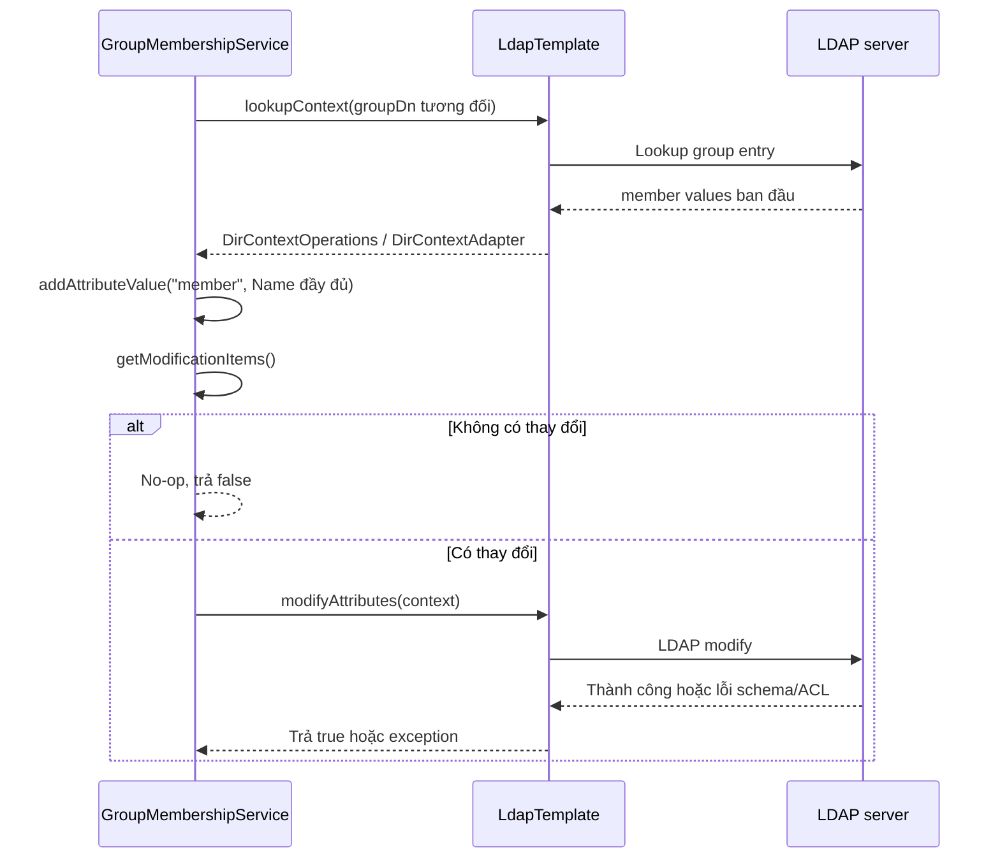

# Thực hành tổng hợp: Cập nhật attribute đa trị bằng DirContextAdapter trong Spring LDAP

## Mục tiêu và kết quả cần đạt

Đây là bài thực hành tổng hợp trong module **Spring LDAP**. Bạn sẽ vận dụng DN, schema, filter/search, `ContextSource`, `LdapTemplate`, `LdapClient`, ODM, xác thực, TLS, pooling, xử lý lỗi và kiểm thử để xây một thao tác thực tế: **quản lý các giá trị của attribute `member` trên một nhóm LDAP mà không làm mất những thành viên đã có**.

Sau bài này, bạn có thể:

1. Phân biệt attribute đơn trị và đa trị; hiểu tại sao `member` chứa nhiều **DN đầy đủ**.
2. Dùng `LdapTemplate.lookupContext(Name)` để tải entry, nhận đối tượng `DirContextOperations` do `DirContextAdapter` triển khai.
3. Chọn đúng `addAttributeValue`, `removeAttributeValue`, `setAttributeValues` và tránh dùng `setAttributeValue` sai mục đích.
4. Xem `getModificationItems()` và hiểu cách adapter theo dõi chênh lệch trong **update mode**.
5. Kiểm thử giá trị trùng, DN tương đương, thành viên cuối cùng, ACL, ghi đồng thời và lỗi LDAP.
6. Thực hành an toàn với LDAPS/StartTLS, tài khoản quyền tối thiểu, tên DN được escape và kết nối được quản lý bởi Spring.

> **Phạm vi:** bài tập dùng directory thử nghiệm dưới `dc=example,dc=org`. Không gửi thao tác ghi này lên LDAP production. Mỗi LDAP server có schema, matching rule và ACL riêng; cần kiểm thử tích hợp trước khi vận hành.

## 1. Bài toán: thêm, xóa và thay danh sách thành viên nhóm

Ứng dụng có nhóm `cn=developers`. Ban đầu nhóm có hai thành viên `lan`, `nam`. Yêu cầu thêm `mai` mà vẫn giữ các giá trị trước đó, thêm lại `mai` không tạo trùng, sau đó bỏ riêng `nam`.

```text
dc=example,dc=org                      <- ContextSource base
├── ou=people
│   ├── uid=lan
│   ├── uid=nam
│   └── uid=mai
└── ou=groups
    └── cn=developers
        member: uid=lan,ou=people,dc=example,dc=org
        member: uid=nam,ou=people,dc=example,dc=org
```

| Trạng thái | Danh sách `member` mong đợi |
| --- | --- |
| Ban đầu | `lan`, `nam` |
| Sau `addMember("developers", "mai")` | `lan`, `nam`, `mai` |
| Thêm `mai` lần nữa | Vẫn `lan`, `nam`, `mai` |
| Xóa `nam` | `lan`, `mai` |
| Thử xóa thành viên cuối cùng của `groupOfNames` | Bị từ chối vì `member` bắt buộc có ít nhất một giá trị |

### Fixture LDIF

Nhập dữ liệu dưới đây vào directory thử nghiệm hỗ trợ schema chuẩn `inetOrgPerson` và `groupOfNames`:

```ldif
dn: dc=example,dc=org
objectClass: top
objectClass: domain
dc: example

dn: ou=people,dc=example,dc=org
objectClass: top
objectClass: organizationalUnit
ou: people

dn: ou=groups,dc=example,dc=org
objectClass: top
objectClass: organizationalUnit
ou: groups

dn: uid=lan,ou=people,dc=example,dc=org
objectClass: top
objectClass: person
objectClass: organizationalPerson
objectClass: inetOrgPerson
uid: lan
cn: Lan Nguyen
sn: Nguyen

dn: uid=nam,ou=people,dc=example,dc=org
objectClass: top
objectClass: person
objectClass: organizationalPerson
objectClass: inetOrgPerson
uid: nam
cn: Nam Tran
sn: Tran

dn: uid=mai,ou=people,dc=example,dc=org
objectClass: top
objectClass: person
objectClass: organizationalPerson
objectClass: inetOrgPerson
uid: mai
cn: Mai Pham
sn: Pham

dn: cn=developers,ou=groups,dc=example,dc=org
objectClass: top
objectClass: groupOfNames
cn: developers
member: uid=lan,ou=people,dc=example,dc=org
member: uid=nam,ou=people,dc=example,dc=org
```

**Về schema:** `groupOfNames` cần có `cn` và **ít nhất một** `member`. Một số triển khai dùng `groupOfUniqueNames`/`uniqueMember` hoặc mô hình nhóm của Active Directory; không dùng code cố định `member` cho chúng mà chưa xem schema. LDAP không đảm bảo có thứ tự ổn định cho tập giá trị `member`.

## 2. Thuộc tính đa trị và ba loại LDAP modify

LDAP entry chứa các attribute; schema quy định attribute có được phép mang nhiều giá trị hay không. Giá trị `member` là một **DN**, chẳng hạn `uid=lan,ou=people,dc=example,dc=org`; nó khác với thuộc tính `uid` chỉ chứa `lan`. DN dùng để định vị một entry, còn `uid` có thể trùng ở hai OU khác nhau.

| LDAP modify operation | Ý nghĩa | Tình huống |
| --- | --- | --- |
| `DirContext.ADD_ATTRIBUTE` | Thêm giá trị vào attribute | Thêm một thành viên mới |
| `DirContext.REMOVE_ATTRIBUTE` | Bỏ giá trị đã chỉ định hoặc toàn attribute | Xóa một thành viên |
| `DirContext.REPLACE_ATTRIBUTE` | Thay tập giá trị của attribute | Đồng bộ toàn danh sách từ nguồn chuẩn |

`DirContextAdapter` giúp viết ở mức cao hơn:

- `addAttributeValue("member", dn)` thêm một giá trị nếu chưa có.
- `removeAttributeValue("member", dn)` bỏ đúng giá trị khớp.
- `setAttributeValues("member", values)` đặt toàn bộ giá trị mong muốn, mặc định không quan tâm thứ tự.
- `setAttributeValue("member", dn)` đặt một giá trị, **không dùng để thêm** nếu muốn giữ những thành viên khác.

Trong **update mode**, adapter theo dõi dữ liệu ban đầu và dữ liệu sau thay đổi, rồi tạo `ModificationItem[]` thông qua `getModificationItems()`. Không nhất thiết mỗi `addAttributeValue` sẽ tương ứng chính xác một `ADD_ATTRIBUTE` trên mọi trường hợp; kiểm tra mảng modifications khi cần phân tích concurrency.

## 3. Cấu hình Spring LDAP để thực hành

Ví dụ ứng dụng Spring Boot đã thêm dependency hỗ trợ Spring LDAP, dùng một tài khoản test chỉ có quyền đọc người dùng và sửa `member` ở nhóm được phép.

```yaml
spring:
  ldap:
    urls: ldaps://ldap-test.example.org:636
    base: dc=example,dc=org
    username: ${LDAP_WRITER_DN}
    password: ${LDAP_WRITER_PASSWORD}
```

Các secret trên lấy từ môi trường/secret manager, không commit giá trị thật. Cấu hình truststore/SSL đúng để **xác minh certificate và hostname** của LDAP server; không bỏ kiểm tra TLS. Nếu dùng StartTLS, cần cấu hình chiến lược riêng và kiểm soát pooling, không dùng kết nối simple bind chưa bảo vệ.

Với `ContextSource` base `dc=example,dc=org`:

- `cn=developers,ou=groups` là **DN tương đối** mà `LdapTemplate` nhận để lookup/modify.
- `uid=mai,ou=people,dc=example,dc=org` là **DN đầy đủ**, được lưu làm giá trị `member`.
- Người gọi phải được cấp quyền quản lý nhóm, được kiểm tra ở tầng service/API; quyền LDAP ACL của tài khoản bind là lớp bảo vệ tiếp theo.
- `LdapTemplate` quản lý các context trong operation đồng bộ, giảm nguy cơ leak `DirContext`; không giữ context qua request hoặc thread khác.

## 4. Quy trình đọc – sửa – ghi



`lookupContext(Name)` trả `DirContextOperations`, thường là `DirContextAdapter` do `DefaultDirObjectFactory` tạo. Adapter đã có DN và snapshot của entry, ở **update mode** phù hợp cho `modifyAttributes(context)`. Không tự tạo `new DirContextAdapter()` rỗng để cập nhật entry hiện có, vì thiếu trạng thái gốc và DN cần thiết.

`modifyAttributes(DirContextOperations)` lấy DN và `ModificationItem[]` từ adapter để thực hiện LDAP modify. Dùng `rebind` toàn entry cho thao tác thêm một giá trị vừa thừa vừa có thể ảnh hưởng các thuộc tính ngoài dự định.

## 5. Service hoàn chỉnh: thêm member

Ta dùng `LdapNameBuilder` thay vì ghép DN từ chuỗi thô. `add(String key, Object value)` tạo RDN đúng cú pháp, giúp escape ký tự đặc biệt trong `uid`/`cn`; tuy nhiên, escape **không thay thế ủy quyền**.

```java
package example.directory.group;

import javax.naming.Name;
import org.springframework.ldap.core.DirContextOperations;
import org.springframework.ldap.core.LdapTemplate;
import org.springframework.ldap.support.LdapNameBuilder;
import org.springframework.stereotype.Service;

@Service
public class GroupMembershipService {
    private static final String GROUPS_BASE = "ou=groups";
    private static final String DIRECTORY_ROOT = "dc=example,dc=org";

    private final LdapTemplate ldap;

    public GroupMembershipService(LdapTemplate ldap) {
        this.ldap = ldap;
    }

    public boolean addMember(String groupCn, String userUid) {
        Name groupDn = groupRelativeDn(groupCn);
        Name memberDn = memberFullDn(userUid);

        // Caller phải được phép sửa group; member phải là user hợp lệ.
        DirContextOperations group = ldap.lookupContext(groupDn);
        group.addAttributeValue("member", memberDn);

        if (group.getModificationItems().length == 0) {
            return false; // Đã là thành viên, không cần ghi.
        }
        ldap.modifyAttributes(group);
        return true;
    }

    private Name groupRelativeDn(String cn) {
        requirePart(cn, "groupCn");
        return LdapNameBuilder.newInstance(GROUPS_BASE)
            .add("cn", cn).build();
    }

    private Name memberFullDn(String uid) {
        requirePart(uid, "userUid");
        return LdapNameBuilder.newInstance(DIRECTORY_ROOT)
            .add("ou", "people")
            .add("uid", uid).build();
    }

    private static void requirePart(String value, String label) {
        if (value == null || value.isBlank()) {
            throw new IllegalArgumentException(label + " is required");
        }
    }
}
```

**Điểm cần nắm vững:**

1. `groupRelativeDn("developers")` → `cn=developers,ou=groups`; `memberFullDn("mai")` → `uid=mai,ou=people,dc=example,dc=org`.
2. `lookupContext` trả về đối tượng có snapshot. `addAttributeValue` chỉ thay đổi trạng thái local của adapter, **chưa ghi server**.
3. `getModificationItems()` cho biết có thay đổi để ghi hay không; thêm DN đã tồn tại có thể là no-op.
4. Chỉ `ldap.modifyAttributes(group)` mới thực sự ghi directory. Nếu server từ chối do schema/ACL, phương thức ném exception; không trả `true` trước khi gọi thành công.
5. Service không cache `DirContextOperations` và không truyền nó sang task bất đồng bộ. Với nhu cầu cập nhật độc lập giữa request, mỗi request lookup/modify theo thời điểm của mình.

**Giới hạn của ví dụ:** xây DN thành viên từ `uid` chỉ đúng với cấu trúc fixture này. Nếu người dùng có thể nằm trong OU khác nhau, phải tìm entry trong nhánh đã cho phép rồi sử dụng **DN đầy đủ thực tế**. Không cho client gửi arbitrary DN nếu chưa kiểm tra authorization và phạm vi được phép sửa.

## 6. DN là giá trị đặc biệt: dùng `Name` để tránh trùng giả

Hai chuỗi mô tả DN có thể khác cách viết chữ hoa tên RDN, dấu cách nhưng vẫn biểu diễn cùng distinguished name. So sánh chuỗi thuần sẽ dễ nhầm:

```text
DN đang lưu trên server:
  uid=lan,ou=people,dc=example,dc=org

DN được đưa vào API:
  UID=lan, OU=people, DC=example, DC=org

String.equals(...)    -> hai chuỗi khác ký tự
Name/LdapName equality -> có thể biểu diễn cùng cấu trúc DN
```

`DirContextAdapter` có xử lý riêng cho `javax.naming.Name`. Khi các phương thức `addAttributeValue`, `removeAttributeValue`, `setAttributeValue` hoặc `setAttributeValues` nhận `Name`, adapter sử dụng **ngữ nghĩa so sánh DN** để tính thay đổi; đây là một cải tiến quan trọng khi cập nhật thành viên nhóm.

```java
import javax.naming.Name;
import org.springframework.ldap.core.DirContextOperations;
import org.springframework.ldap.support.LdapUtils;

DirContextOperations group = ldap.lookupContext(
    LdapUtils.newLdapName("cn=developers,ou=groups"));

Name sameLan = LdapUtils.newLdapName(
    "UID=lan, OU=people, DC=example, DC=org");
group.addAttributeValue("member", sameLan);

// Với fixture đã chứa DN tương đương: không phát sinh thay đổi.
int modifications = group.getModificationItems().length;
```

Đoạn ngắn này giả định biến `ldap` là `LdapTemplate` trong một service. Khi so sánh giá trị **không phải DN** (ví dụ `mail`, `telephoneNumber`), dùng kiểu dữ liệu tương ứng và matching rule của schema, không chuyển chúng thành `Name`.

**Lưu ý:** adapter có thể xác định hai DN tương đương khi tính diff, nhưng LDAP server vẫn áp các quy tắc riêng. Nên kiểm thử từng server (OpenLDAP, Active Directory, 389 Directory Server...) với dữ liệu thực tế, nhất là khi attribute trả về có định dạng DN đã chuẩn hóa khác nhau.

## 7. Thực hành tiếp: xóa đúng một thành viên

Chèn phương thức sau **vào chính lớp `GroupMembershipService` ở mục 5** (các helper dựng DN và field `ldap` đã có):

```java
public boolean removeMember(String groupCn, String userUid) {
    Name groupDn = groupRelativeDn(groupCn);
    Name memberDn = memberFullDn(userUid);
    DirContextOperations group = ldap.lookupContext(groupDn);

    // Chụp số lượng trước khi thay đổi, phục vụ kiểm tra schema.
    String[] originalMembers = group.getStringAttributes("member");

    group.removeAttributeValue("member", memberDn);
    if (group.getModificationItems().length == 0) {
        return false; // Giá trị không tồn tại theo dữ liệu nhìn thấy.
    }

    // groupOfNames bắt buộc còn ít nhất một member.
    if (originalMembers == null || originalMembers.length <= 1) {
        throw new IllegalStateException(
            "Cannot remove the last member from groupOfNames"
        );
    }

    ldap.modifyAttributes(group);
    return true;
}
```

Phương thức `removeAttributeValue("member", memberDn)` chỉ yêu cầu xóa **giá trị được chỉ định**, giữ lại các giá trị khác. Với fixture:

```text
Trước:
  member: uid=lan,ou=people,dc=example,dc=org
  member: uid=nam,ou=people,dc=example,dc=org
  member: uid=mai,ou=people,dc=example,dc=org

Gọi removeMember("developers", "nam")

Sau:
  member: uid=lan,ou=people,dc=example,dc=org
  member: uid=mai,ou=people,dc=example,dc=org
```

Kiểm tra số lượng trên client **chỉ cải thiện thông báo lỗi**, không bảo đảm tính đúng đắn khi có hai yêu cầu xóa đồng thời. Server vẫn phải kiểm tra schema bắt buộc; nếu hai request cùng đọc nhóm có hai thành viên rồi mỗi request xóa một người, server có thể chấp nhận một thao tác và từ chối thao tác còn lại. Không chuyển exception thành “đã xóa” nếu LDAP từ chối.

Đặc biệt, nếu tài khoản bind **không được đọc attribute `member`** nhưng lại có quyền sửa, dữ liệu local có thể thiếu giá trị. `removeAttributeValue` trên adapter sẽ coi attribute không có và **không sinh thay đổi**, dù server đang lưu nó. Khi đó cần sửa ACL/returning attributes hoặc dùng `ModificationItem` trực tiếp theo hợp đồng nghiệp vụ, thay vì kết luận người đó không phải thành viên.

## 8. Thay toàn bộ tập giá trị: `setAttributeValues`

Có những use case khác với “thêm một người”: một nguồn dữ liệu chuẩn yêu cầu nhóm phải **chính xác** gồm `lan` và `mai`, không có ai khác. Khi đó `setAttributeValues` phù hợp vì ý định là đồng bộ **toàn bộ tập**.

Chèn tiếp phương thức vào `GroupMembershipService`:

```java
import java.util.Set; // Đặt import ở đầu file Java.

public boolean replaceMembers(String groupCn, Set<String> userUids) {
    if (userUids == null || userUids.isEmpty()) {
        throw new IllegalArgumentException(
            "groupOfNames requires at least one member"
        );
    }

    Name[] desired = userUids.stream()
        .map(this::memberFullDn)
        .distinct()
        .toArray(Name[]::new);

    DirContextOperations group = ldap.lookupContext(
        groupRelativeDn(groupCn));
    group.setAttributeValues("member", desired);

    if (group.getModificationItems().length == 0) {
        return false;
    }
    ldap.modifyAttributes(group);
    return true;
}
```

Trong Java, dòng `import java.util.Set;` phải được chuyển lên đầu source file khi ghép ví dụ. Lệnh:

```java
replaceMembers("developers", Set.of("lan", "mai"));
```

sẽ yêu cầu nhóm có tập `member` tương ứng với hai DN đó. Nếu trước đó nhóm còn `nam`, giá trị `nam` sẽ bị xóa. Đây là hành vi **có chủ đích** khi đồng bộ toàn bộ danh sách; đừng dùng nó trong endpoint “thêm một thành viên”.

### Thứ tự, duplicate và empty values

- `setAttributeValues("member", desired)` mặc định **không quan tâm thứ tự**; một mảng chỉ thay đổi thứ tự không nhất thiết phát sinh sửa đổi. LDAP group membership thường được xem như tập, không phải danh sách có vị trí.
- Có overload `setAttributeValues(name, values, boolean orderMatters)` khi ứng dụng thực sự có attribute mà thứ tự quan trọng; chỉ bật khi **schema và server** hỗ trợ ý nghĩa đó.
- Dùng `Name[]` cho DN-valued `member` để adapter so sánh chính xác hơn.
- Theo API, đặt giá trị `null` hoặc mảng rỗng sẽ **loại bỏ attribute**. Đối với `groupOfNames`, `member` bắt buộc tồn tại, nên thao tác đó có thể bị server từ chối với lỗi schema.
- `setAttributeValues` có thể sinh một hoặc nhiều `ModificationItem` để biểu diễn chênh lệch; **không giả định luôn là một `REPLACE_ATTRIBUTE`** nếu chưa kiểm tra kết quả thực tế.

### Tránh nhầm hai ý định

| Yêu cầu nghiệp vụ | Method nên dùng | Rủi ro nếu chọn sai |
| --- | --- | --- |
| Thêm một thành viên | `addAttributeValue` | Dùng `setAttributeValue` có thể làm mất thành viên cũ |
| Bỏ một thành viên | `removeAttributeValue` | Dùng `setAttributeValues` từ snapshot thiếu giá trị có thể xóa nhầm người khác |
| Đồng bộ toàn bộ danh sách | `setAttributeValues` | Dùng `addAttributeValue` sẽ để lại thành viên cần loại bỏ |
| Chỉ sửa `description` đơn trị | `setAttributeValue` | Không cần xử lý như membership |

## 9. Quan sát `ModificationItem[]` và giới hạn của snapshot

Sau khi gọi một phương thức sửa, `DirContextAdapter` theo dõi thay đổi chưa lưu. Có thể xem:

```java
import javax.naming.directory.ModificationItem;

DirContextOperations ctx = ldap.lookupContext(
    groupRelativeDn("developers"));
ctx.addAttributeValue("member", memberFullDn("mai"));

ModificationItem[] changes = ctx.getModificationItems();
String[] names = ctx.getNamesOfModifiedAttributes();

// Chỉ khi có thay đổi, mới gửi LDAP modify.
if (changes.length != 0) {
    ldap.modifyAttributes(ctx);
}
```

Ví dụ dùng các helper trong `GroupMembershipService`. `getNamesOfModifiedAttributes()` có thể dùng kiểm tra rằng **chỉ `member`** được sửa. Tuy nhiên, **không log nguyên `ModificationItem[]`** ở production nếu nó chứa DN/attribute có dữ liệu cá nhân.

### `update()` trên adapter không có nghĩa “lưu lên server”

`DirContextAdapter.update()` làm sạch các thay đổi được adapter theo dõi, cập nhật trạng thái local và khiến `getModificationItems()` trở thành mảng rỗng. Nó **không thay cho `ldap.modifyAttributes(ctx)`**. Nếu vô tình gọi `ctx.update()` trước khi truyền modifications cho `LdapTemplate`, bạn có thể làm mất danh sách cần gửi.

Luồng đúng:

```text
lookupContext()
  -> addAttributeValue()/removeAttributeValue()/setAttributeValues()
  -> getModificationItems() (có thể dùng để kiểm tra)
  -> ldap.modifyAttributes(ctx)
  -> lookupContext() lần nữa để xác minh trạng thái server
```

Đừng dùng lại một adapter cũ để ghi nhiều lần qua nhiều request. Sau khi modify, dữ liệu trên server có thể đã được người khác sửa; **lookup lại** trước khi áp dụng thay đổi mới.

### Ghi đồng thời và khả năng mất cập nhật

Hai thao tác song song có thể cùng đọc snapshot:

```text
T0: Group đang có member {lan, nam}
T1: Request A đọc {lan, nam}, định thêm mai
T2: Request B đọc {lan, nam}, định thêm binh
T3: A ghi modifications
T4: B ghi modifications được tính từ snapshot cũ
T5: Trạng thái cuối phụ thuộc loại modification, server và xung đột
```

Khi mục đích chỉ là **thêm hoặc bỏ một giá trị** và cần tránh làm mất cập nhật từ request khác, hãy kiểm tra `ModificationItem[]` được adapter tạo ra. Nếu operation thực tế thay cả attribute, request đồng thời có thể gây **lost update**. Khi thao tác nhiều người cùng lúc là yêu cầu nghiệp vụ cốt lõi, cân nhắc **LDAP modify ADD/REMOVE một giá trị trực tiếp** hoặc cơ chế conditional update/assertion control nếu directory hỗ trợ.

Đừng coi chuỗi **read → modify** ở client là giao dịch ACID nhiều bước. Server áp dụng một LDAP Modify request theo quy tắc LDAP, nhưng toàn bộ workflow gồm lookup, kiểm tra quyền, ghi và đọc lại có thể chịu tranh chấp.

## 10. Khi nào sử dụng `ModificationItem` trực tiếp?

`DirContextAdapter` tiện khi muốn **đọc entry, thay đổi có ý nghĩa nghiệp vụ, để framework tính diff**. Nhưng có trường hợp bạn biết chính xác thao tác LDAP cần gửi và **không cần đọc tập giá trị hiện tại**.

Ví dụ: thêm một DN cụ thể bằng `ADD_ATTRIBUTE`:

```java
import javax.naming.Name;
import javax.naming.directory.BasicAttribute;
import javax.naming.directory.DirContext;
import javax.naming.directory.ModificationItem;

void addMemberDirectly(String groupCn, String uid) {
    Name groupDn = groupRelativeDn(groupCn);
    Name personDn = memberFullDn(uid);

    ModificationItem change = new ModificationItem(
        DirContext.ADD_ATTRIBUTE,
        new BasicAttribute("member", personDn.toString())
    );
    ldap.modifyAttributes(
        groupDn, new ModificationItem[] {change});
}
```

Đây là phương thức minh họa nằm trong service đã có field `ldap` và helper dựng DN. Nó gửi **thao tác thêm giá trị** mà không phải tải toàn bộ `member` về client trước.

**Trade-off:**

- Nếu DN đó đã là thành viên, LDAP server có thể trả lỗi **attribute or value exists**, thay vì cho `false` dạng no-op ở service sử dụng adapter. Hãy xử lý lỗi theo hợp đồng; không catch mọi exception thành “đã có member”.
- Nếu xóa một giá trị bằng `REMOVE_ATTRIBUTE` khi giá trị không tồn tại, server có thể trả lỗi **no such attribute**; cần quyết định có xem đó là idempotent hay báo cho người gọi.
- Dùng thao tác trực tiếp có thể giảm rủi ro stale snapshot khi update cùng một attribute, nhưng không thay thế **authorization, schema, referential integrity** hay ràng buộc concurrency của directory.
- Thao tác nhóm còn liên quan đến người dùng có tồn tại hay không. LDAP server có thể **không** tự bảo đảm DN trong `member` thực sự trỏ đến một entry hợp lệ; kiểm tra ở tầng nghiệp vụ nếu cần.

### So sánh lựa chọn

| Cách làm | Khi nào phù hợp | Lưu ý |
| --- | --- | --- |
| `lookupContext` → `addAttributeValue` → `modifyAttributes(ctx)` | Cần đọc group, không ghi nếu đã tồn tại, kết hợp một số thay đổi | Dựa trên snapshot, phải chú ý concurrency/attribute visibility |
| `lookupContext` → `setAttributeValues` → `modifyAttributes(ctx)` | Muốn thay **toàn bộ** tập giá trị theo nguồn chuẩn | Có thể xóa giá trị mới phát sinh trong thời gian chờ |
| `ldap.modifyAttributes(dn, ModificationItem[])` | Biết rõ một LDAP ADD/REMOVE/REPLACE cần thực hiện | Server quyết định lỗi trùng, không tồn tại và schema |
| `LdapClient.modify(dn).attributes(items).execute()` | Muốn dùng API fluent tương ứng của Spring LDAP | Cần phiên bản Spring LDAP hỗ trợ `LdapClient` |
| ODM Repository `save(entity)` | CRUD trên entity với mapping hoàn chỉnh | Không mặc định biểu diễn chính xác “chỉ thêm một member” |

Một số thuộc tính **operational** không được server trả về khi lookup mặc định, dù thực tế đang có giá trị. Trong trường hợp đó, `removeAttributeValue` trên adapter có thể không có tác dụng vì adapter không biết giá trị cũ. Tài liệu Spring LDAP khuyến nghị lookup yêu cầu rõ attribute đó hoặc dùng `ModificationItem` trực tiếp. Nguyên tắc tương tự hữu ích cho các thuộc tính bị ACL che hoặc kết quả trả về không đầy đủ.

## 11. Kiểm thử tích hợp: xác nhận trạng thái sau khi ghi

Một unit test mock `LdapTemplate` chỉ chứng minh service gọi API; **integration test** với LDAP server mới xác minh đầy đủ schema, DN equality, duplicate handling, modify result và ACL. Dùng directory/container LDAP thử nghiệm với dữ liệu LDIF mục 1, xóa và nạp lại fixture trước mỗi test cần tính độc lập.

### Test add / duplicate / remove

Ví dụ dùng Spring Boot Test, JUnit 5 và chính `GroupMembershipService` ở các mục trước:

```java
package example.directory.group;

import static org.junit.jupiter.api.Assertions.*;

import java.util.Arrays;
import java.util.Set;
import java.util.stream.Collectors;
import javax.naming.Name;
import org.junit.jupiter.api.Test;
import org.springframework.beans.factory.annotation.Autowired;
import org.springframework.boot.test.context.SpringBootTest;
import org.springframework.ldap.core.DirContextOperations;
import org.springframework.ldap.core.LdapTemplate;
import org.springframework.ldap.support.LdapUtils;

@SpringBootTest
class GroupMembershipIntegrationTest {
    @Autowired GroupMembershipService service;
    @Autowired LdapTemplate ldap;

    private Set<Name> members() {
        DirContextOperations ctx = ldap.lookupContext(
            LdapUtils.newLdapName("cn=developers,ou=groups"));
        String[] values = ctx.getStringAttributes("member");
        assertNotNull(values, "Fixture group must have member attribute");
        return Arrays.stream(values)
            .map(LdapUtils::newLdapName)
            .collect(Collectors.toSet());
    }

    private Name person(String uid) {
        return LdapUtils.newLdapName(
            "uid=" + uid + ",ou=people,dc=example,dc=org"
        );
    }

    @Test
    void addThenRemoveOnlyChangesRequestedMembership() {
        // Fixture ban đầu: lan và nam, chưa có mai.
        assertEquals(Set.of(person("lan"), person("nam")), members());

        assertTrue(service.addMember("developers", "mai"));
        assertEquals(
            Set.of(person("lan"), person("nam"), person("mai")),
            members()
        );

        // Đã có mai: adapter tạo zero modifications.
        assertFalse(service.addMember("developers", "mai"));
        assertEquals(3, members().size());

        assertTrue(service.removeMember("developers", "nam"));
        assertEquals(Set.of(person("lan"), person("mai")), members());

        // Xóa lại không làm mất giá trị còn lại.
        assertFalse(service.removeMember("developers", "nam"));
        assertEquals(Set.of(person("lan"), person("mai")), members());
    }
}
```

**Điều kiện test:** đoạn `person(uid)` chỉ dùng dữ liệu fixture có UID đơn giản do test tự đặt; không dùng cách ghép chuỗi đó cho input từ request. `members()` dùng `Set<Name>` nên không phụ thuộc thứ tự các giá trị `member` mà LDAP server trả về. Nếu test chạy nhiều lần trên cùng directory không reset fixture, test sẽ thất bại vì state đã thay đổi; đây là đặc tính đúng của integration test có ghi dữ liệu.

### Test DN tương đương và thay toàn bộ tập

Bạn có thể bổ sung vào cùng test class, sau khi **khôi phục fixture ban đầu**:

```java
@Test
void equivalentDnIsNotAddedTwice() {
    // Fixture đã có uid=lan,ou=people,...
    DirContextOperations group = ldap.lookupContext(
        LdapUtils.newLdapName("cn=developers,ou=groups"));
    group.addAttributeValue(
        "member",
        LdapUtils.newLdapName(
            "UID=lan, OU=people, DC=example, DC=org")
    );

    assertEquals(0, group.getModificationItems().length);
    assertEquals(2, members().size());
}

@Test
void replaceMembersSetsExactlyTheExpectedSet() {
    assertTrue(service.replaceMembers(
        "developers", Set.of("lan", "mai")));

    assertEquals(Set.of(person("lan"), person("mai")), members());
    assertFalse(service.replaceMembers(
        "developers", Set.of("lan", "mai")));
}
```

Hai test này minh họa hai khía cạnh khác nhau: một test kiểm tra **so sánh DN trước khi ghi**, test còn lại kiểm tra **trạng thái thực tế sau LDAP modify**. Dữ liệu nhóm cần được khôi phục trước từng test để tránh ảnh hưởng lẫn nhau.

### Các tình huống âm tính cần có

| Test | Thao tác | Kỳ vọng |
| --- | --- | --- |
| Group DN không tồn tại | `lookupContext` tới `cn=missing` | Ném exception phù hợp; không tự tạo nhóm |
| User DN không tồn tại | Thử thêm một DN không trỏ đến entry | Tầng nghiệp vụ từ chối nếu chính sách yêu cầu; không mặc định server có referential integrity |
| Group không có quyền ghi | Dùng service account chỉ đọc | Server từ chối modify; dữ liệu nhóm không đổi |
| Thêm member trùng | Gọi add khi DN đã nằm trong tập | Adapter tạo zero modifications; method trả `false` |
| Xóa member không có | Gọi remove với DN chưa tồn tại | Method trả `false` theo snapshot đầy đủ |
| Xóa thành viên cuối | Dùng groupOfNames chỉ có một `member` | Service chặn; server cũng phải bảo vệ schema |
| Thay bằng tập rỗng | `replaceMembers(group, Set.of())` | Bị chặn trước lời gọi LDAP |
| DN có dấu phẩy/ký tự đặc biệt trong RDN | Dùng helper `LdapNameBuilder` | Tạo DN đúng cú pháp; không inject RDN mới |
| Cập nhật đồng thời | Hai request thêm/xóa khác nhau | Xác nhận hành vi thực tế và chính sách giải quyết xung đột |
| Lỗi kết nối sau lookup | Giả lập LDAP timeout/unavailable trước modify | Trả lỗi thích hợp; không báo thành công |
| TLS certificate không hợp lệ | Kết nối LDAPS tới test server không đáng tin | Không bind/gửi secret, không bỏ kiểm tra TLS |

### Kiểm tra bằng công cụ LDAP

Sau khi chạy test hoặc thao tác trong môi trường được phép, dùng `ldapsearch` để đọc **trực tiếp trạng thái server**:

```bash
ldapsearch -LLL -x \
  -H ldaps://ldap-test.example.org:636 \
  -D "cn=test-reader,ou=service-accounts,dc=example,dc=org" \
  -W \
  -b "cn=developers,ou=groups,dc=example,dc=org" \
  -s base \
  "(objectClass=groupOfNames)" cn member
```

`-W` yêu cầu nhập mật khẩu tương tác; **không** đặt password trong tham số `-w` hoặc trong log CI. `ldapsearch` dùng cấu hình trust TLS riêng của công cụ, nên thành công tại CLI chưa chứng minh truststore của JVM đang đúng. Cũng không lấy kết quả CLI làm bằng chứng Spring đã sửa attribute nếu LDAP search đang dùng account/replica khác.

## 12. Xử lý lỗi và tính nhất quán

Quy trình đọc group, kiểm tra quyền, sửa member, lưu và đọc lại gồm **nhiều bước**; không có một transaction ACID bao trọn toàn bộ workflow. LDAP server áp dụng một Modify request theo quy tắc giao thức, nhưng dữ liệu có thể thay đổi giữa lookup và modify.

| Sự cố | Điểm xảy ra | Cách giải quyết |
| --- | --- | --- |
| Group không tồn tại | `lookupContext` | Báo tài nguyên không tồn tại, không tự tạo nhóm |
| DN sai hoặc nhầm base | Dựng DN hoặc lookup | Đối chiếu gốc của `ContextSource`, DN tương đối/đầy đủ |
| ACL không cho đọc `member` | Lookup có dữ liệu thiếu | Không xem attribute không thấy là không tồn tại |
| ACL không cho ghi group | Modify | Trả lỗi phân quyền, kiểm tra ACL của bind account |
| Vi phạm schema | Xóa thành viên cuối, thay member rỗng | Giữ ràng buộc `groupOfNames` |
| Giá trị trùng hoặc không tồn tại | Direct ADD/REMOVE | Phân biệt idempotency với lỗi directory |
| Timeout hoặc mất kết nối | Lookup hoặc modify | Đọc lại trạng thái trước khi retry nếu kết quả bất định |
| Reader secret hết hạn | Bind | Không fallback anonymous, xử lý cấu hình/secret |

**Tình huống bất định:** server có thể đã áp dụng Modify nhưng kết nối bị ngắt trước khi client nhận phản hồi. Gọi lại ngay một direct `ADD_ATTRIBUTE` có thể tạo lỗi trùng. Vì vậy, khi retry sau timeout, cần kiểm tra trạng thái server mới hoặc thiết kế quy tắc idempotency rõ ràng.

### Hợp đồng kết quả ở tầng API

- `true` từ `addMember`: ghi một thay đổi thành công (có thể trả `204 No Content`).
- `false`: DN đã có theo snapshot đầy đủ, không cần ghi (có thể vẫn trả `204` với semantics idempotent).
- Exception: không xác nhận thành công; phân loại lỗi authorization/schema/not-found/temporary outage để trả `403`, `404`, `409` hoặc `503` phù hợp.

Không trả thành công chỉ vì `addAttributeValue` đã chạy: đây mới là thay đổi trên adapter local; **`ldap.modifyAttributes` mới gửi sửa đổi tới server**.

Log nên có schema được kiểm soát:

```text
event=ldap_group_membership_change
operation=add_member
outcome=success | no_change | failure
group_area=managed_groups
request_id=<server-generated-id>
duration_ms=<number>
error_category=<controlled-category-if-needed>
```

Không ghi password của LDAP bind account, user password, raw `ModificationItem[]` hoặc DN nhạy cảm không cần thiết vào log/tracing. Dùng metrics riêng cho thời gian lookup/modify, số lỗi LDAP, timeout và thời gian chờ context từ pool.

## 13. Bảo mật và vận hành trong ứng dụng thực tế

### 13.1. Group membership có thể cấp quyền

Việc thêm một DN vào `member` có thể khiến người dùng được hưởng quyền từ group trong những hệ thống downstream. Do đó, API cần:

1. Xác thực người gọi và kiểm tra người đó **được phép sửa chính nhóm này**, không cho arbitrary group DN từ request.
2. Chỉ cho phép thêm người dùng từ vùng directory đã phê duyệt; verify member DN thực sự trỏ đến entry hợp lệ nếu nghiệp vụ yêu cầu.
3. Bind bằng service account có ACL **chỉ sửa `member` ở nhóm được quản lý**, không dùng tài khoản LDAP admin.
4. Dùng `LdapNameBuilder` để tạo DN và `LdapQueryBuilder` cho search filter, thay vì nối input thô.
5. Dùng LDAPS hoặc StartTLS có xác minh certificate/hostname; không log secret hoặc hạ cấp kết nối khi TLS lỗi.

### 13.2. Không sửa nhầm `memberOf` trên người dùng

Nhiều directory có attribute backlink như `memberOf`, thường được server/plugin quản lý từ danh sách `member` trên group. Nó có thể là operational/read-only. Với fixture `groupOfNames`, muốn cập nhật membership thì **sửa `member` ở entry nhóm**, không giả định có thể `setAttributeValues("memberOf", ...)` trên entry user.

### 13.3. Context lifecycle và pooling

`LdapTemplate.lookupContext` và `modifyAttributes` là operation đồng bộ do Spring quản lý JNDI context. Không giữ `DirContextOperations` như một session-scoped field rồi để nhiều request sửa chung. Nếu viết JNDI trực tiếp, phải đóng `NamingEnumeration` và `DirContext` trong `finally`.

Khi dùng pool, cấu hình `maxTotal`, thời gian mượn hữu hạn, validation/eviction và giám sát active/idle/waiters. Không pool chung context đã bind theo những người dùng khác nhau nếu identity thay đổi theo request. Với StartTLS, tránh **JNDI native pooling** vì trạng thái TLS/bind của connection có thể không được theo dõi chính xác.

### 13.4. Group lớn và attribute không được trả đầy đủ

Một số server, đặc biệt trong môi trường có group rất lớn, giới hạn số giá trị của attribute được trả về một lần hoặc dùng cơ chế ranged retrieval. Khi đó snapshot `member` từ lookup đơn giản có thể **không đầy đủ**. Dùng `setAttributeValues` trên snapshot thiếu có thể xóa nhầm người khác; ưu tiên direct ADD/REMOVE hoặc API đọc đầy đủ theo server, rồi test tích hợp.

Không đồng nhất “attribute không có trong kết quả” với “attribute không tồn tại”: ACL, operational attribute và giới hạn trả về đều có thể ảnh hưởng.

### 13.5. Chọn đúng abstraction

Spring Data LDAP Repository thích hợp cho CRUD/derived query trên ODM entity. Với thao tác đa trị cần đọc snapshot, so sánh DN và gửi đúng LDAP Modify, service dùng `LdapTemplate`/`DirContextAdapter` thường rõ nghĩa hơn. Nếu use case chỉ gửi một LDAP ADD hoặc REMOVE, `ModificationItem` trực tiếp có thể ngắn hơn. `LdapClient` cũng có fluent modify API ở các phiên bản tương ứng, nhưng không cần đổi toàn ứng dụng sang một API duy nhất.

## 14. Bài thực hành tự triển khai

**Đề bài:** nhóm `cn=reviewers,ou=groups,dc=example,dc=org` thuộc schema `groupOfNames`, ban đầu có hai thành viên `uid=an` và `uid=binh` dưới `ou=people`.

1. Tạo fixture LDIF đúng schema, tài khoản test có quyền đọc/sửa `member`, và cấu hình `ContextSource` dùng TLS.
2. Dùng `lookupContext` và `getStringAttributes("member")` để lấy **tất cả** member; giải thích vì sao `getStringAttribute` là không đủ.
3. Thêm `uid=chi` bằng `addAttributeValue`, giữ nguyên `an` và `binh`; chạy lại để kiểm tra no-op.
4. Thêm DN `UID=chi, OU=people, DC=example, DC=org` bằng kiểu `Name`, xác nhận không bị xem là member mới.
5. Xóa riêng `uid=binh`, đọc lại group để chứng minh `an` và `chi` vẫn tồn tại.
6. Dùng `setAttributeValues` đặt toàn bộ member thành `an` và `chi`; kiểm tra không phát sinh modification nếu tập đã giống nhau.
7. Thử xóa thành viên cuối hoặc thay bằng mảng rỗng, giải thích ràng buộc schema `groupOfNames`.
8. Thử ghi đồng thời từ hai request, quan sát `getModificationItems()` và đề xuất cách tránh lost update.
9. Mô phỏng trường hợp ACL không cho xem đủ `member`; nêu khi nào cần direct `ModificationItem`.
10. Viết integration test có fixture reset, test TLS và kiểm chứng bí mật không xuất hiện trong log.

### Khung đáp án

```java
import javax.naming.Name;
import org.springframework.ldap.core.DirContextOperations;
import org.springframework.ldap.support.LdapUtils;

// Đoạn code trong service đã có LdapTemplate ldap.
Name groupDn = LdapUtils.newLdapName(
    "cn=reviewers,ou=groups"); // Tương đối với ContextSource base.
Name chiDn = LdapUtils.newLdapName(
    "uid=chi,ou=people,dc=example,dc=org"); // DN giá trị member.

DirContextOperations group = ldap.lookupContext(groupDn);
group.addAttributeValue("member", chiDn);
if (group.getModificationItems().length > 0) {
    ldap.modifyAttributes(group);
}

// Xác minh bằng một lần đọc MỚI từ server.
DirContextOperations reloaded = ldap.lookupContext(groupDn);
String[] members = reloaded.getStringAttributes("member");
```

Với dữ liệu người dùng gửi lên, phải dựng DN bằng `LdapNameBuilder` và kiểm tra quyền. Đoạn trên dùng literal cố định từ fixture để tập trung vào `DirContextAdapter`.

**Tiêu chí đạt:** thêm/xóa/đồng bộ đúng tập, không mất thành viên ngoài ý định; so sánh DN bằng `Name`; chỉ trả thành công sau LDAP modify; xử lý schema, lỗi và concurrency; bảo vệ TLS, secret và ACL.

## 15. Bảng tra nhanh và tài liệu tham khảo

| Mục đích | API cần nhớ |
| --- | --- |
| Lookup một entry để sửa | `LdapTemplate.lookupContext(Name)` |
| Đọc tất cả giá trị chuỗi | `DirContextOperations.getStringAttributes(name)` |
| Thêm/bỏ một giá trị | `addAttributeValue` / `removeAttributeValue` |
| Đặt toàn bộ tập giá trị | `setAttributeValues` |
| Xem diff trước khi ghi | `getModificationItems`, `getNamesOfModifiedAttributes` |
| Gửi diff tới directory | `LdapTemplate.modifyAttributes(DirContextOperations)` |
| Gửi LDAP ADD/REMOVE trực tiếp | `LdapTemplate.modifyAttributes(Name, ModificationItem[])` |
| Dựng DN có RDN động | `LdapNameBuilder` |
| Tìm DN người dùng theo attribute | `LdapQueryBuilder` |

Tài liệu chính thức:

- [Spring LDAP — Simplifying Attribute Access and Manipulation with DirContextAdapter](https://docs.spring.io/spring-ldap/reference/dirobjectfactory.html): cập nhật attribute, diff và DN equality.
- [Spring LDAP — DirContextAdapter API](https://docs.spring.io/spring-ldap/reference/api/java/org/springframework/ldap/core/DirContextAdapter.html): `addAttributeValue`, `removeAttributeValue`, `setAttributeValues` và update mode.
- [Spring LDAP — DirContextOperations API](https://docs.spring.io/spring-ldap/reference/api/java/org/springframework/ldap/core/DirContextOperations.html): giao diện các thao tác trên entry.
- [Spring LDAP — LdapOperations API](https://docs.spring.io/spring-ldap/reference/api/java/org/springframework/ldap/core/LdapOperations.html): `lookupContext` và `modifyAttributes`.
- [Spring LDAP — LdapNameBuilder API](https://docs.spring.io/spring-ldap/reference/api/java/org/springframework/ldap/support/LdapNameBuilder.html): cách xây DN/RDN đúng cú pháp.
- [Spring LDAP — FAQ: Operational Attributes](https://docs.spring.io/spring-ldap/reference/faq.html): giới hạn khi operational attribute không được lookup trả về.
- [Spring LDAP — Advanced LDAP Queries](https://docs.spring.io/spring-ldap/reference/query-builder-advanced.html): search base, scope, filter và escape.
- [Spring LDAP — Configuration](https://docs.spring.io/spring-ldap/reference/configuration.html): `ContextSource` và bảo mật kết nối.
- [Spring LDAP — Pooling Support](https://docs.spring.io/spring-ldap/reference/pooling.html): vòng đời context và security identity.
- [RFC 4511 — LDAP: The Protocol](https://www.rfc-editor.org/rfc/rfc4511): Modify operation, DN và attribute.

**Kết luận thực hành:** cần tách ba bước **đọc snapshot → thay đổi adapter → ghi LDAP Modify**. `DirContextAdapter` giúp xác định các giá trị đa trị thêm/bớt và dựng modification từ trạng thái gốc; kết quả đúng cuối cùng vẫn phụ thuộc DN, schema, quyền, dữ liệu thực của server và cách xử lý lỗi/ghi đồng thời.

