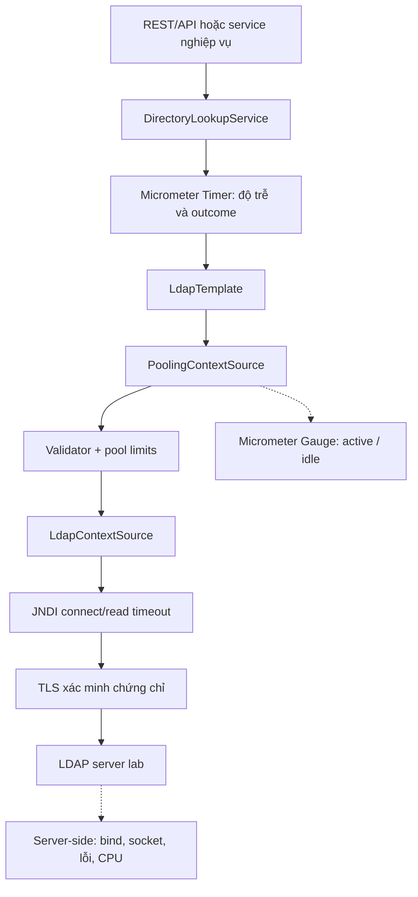

# Thêm TLS, pooling, timeout và metrics

Sau khi một ứng dụng dùng **Spring LDAP** tra cứu người dùng và nhóm thành công, bước tiếp theo để sẵn sàng vận hành là bảo vệ đường truyền, hạn chế thời gian chờ, tái sử dụng kết nối hợp lý và đo được trạng thái thực tế. Một cấu hình chạy tốt với một request chưa chắc chịu được tải cao: LDAP server có thể khởi động lại, firewall đóng kết nối idle, pool bị cạn hoặc TLS certificate hết hạn.

Trong bài **“Thêm TLS, pooling, timeout và metrics”** thuộc chương **Thực hành tổng hợp** của **SPRING_LDAP**, chúng ta sẽ mở rộng một chức năng tra cứu thư mục bằng `LdapTemplate`: thêm **LDAPS**, **`PoolingContextSource`**, **connect/read timeout** và **Micrometer metrics**. Bài cũng nêu cách kiểm thử, xử lý lỗi và bảo mật để có thể áp dụng nguyên tắc tương tự khi truy cập entry bằng `LdapClient` hoặc ODM. Các thao tác vẫn phải dùng DN, schema, filter và quyền truy cập LDAP đúng quy tắc.

> **Phạm vi bài lab:** sử dụng LDAP server thử nghiệm, một tài khoản dịch vụ quyền đọc và tập entry giả lập. Không dùng tài khoản quản trị, mật khẩu thật hoặc thực hiện fault injection trên LDAP production. Các con số timeout và pool size chỉ là giá trị thử nghiệm, cần điều chỉnh theo số liệu của môi trường thực tế.

## 1. Mục tiêu và kiến trúc hoàn chỉnh

Tình huống: API `GET /directory/users/{uid}` cần tìm tên hiển thị và email của một người dùng trong `ou=people,dc=example,dc=org`. Ban đầu, một `LdapContextSource` kết nối không có giám sát; chúng ta sẽ thêm các lớp vận hành:



Khi hoàn thành, ứng dụng cần đáp ứng:

| Yêu cầu | Bằng chứng kiểm tra |
|---|---|
| TLS đúng | Kết nối thành công với certificate hợp lệ; thất bại nếu CA/hostname không hợp lệ |
| Pool hoạt động | Context được mượn/trả; số active/idle thay đổi đúng khi chạy tải |
| Có giới hạn tài nguyên | Khi tải vượt capacity, có hàng đợi hoặc lỗi có thời hạn, không mở kết nối vô hạn |
| Timeout có tác dụng | Connect/read timeout làm yêu cầu kết thúc có kiểm soát trong tình huống được mô phỏng |
| Dữ liệu đúng | Lookup dùng filter an toàn, trả đúng entry, xử lý thuộc tính thiếu |
| Metrics có ích | Có latency, số lượt thành công/lỗi và gauge active/idle; không gắn UID hoặc password vào label |
| Phục hồi | Context stale được loại bỏ; server hoạt động trở lại thì truy vấn có thể tiếp tục |
| Bảo mật | Không log secret, không bỏ xác minh TLS, không pool user bind nhiều danh tính |

### Dữ liệu và quyền thử nghiệm

Giả sử LDAP lab đã có base `dc=example,dc=org`, nhánh `ou=people` và entry như:

```ldif
dn: uid=an.nguyen,ou=people,dc=example,dc=org
objectClass: top
objectClass: person
objectClass: organizationalPerson
objectClass: inetOrgPerson
uid: an.nguyen
cn: An Nguyễn
sn: Nguyễn
mail: an.nguyen@example.org
```

Tài khoản dịch vụ `cn=app-reader,ou=services,dc=example,dc=org` chỉ cần quyền đọc những thuộc tính được truy vấn. Trong bài này không thực hiện thêm/xóa/sửa entry, vì vậy không cần cấp quyền write.

## 2. Chuẩn bị dependency, endpoint và certificate

Trong dự án Spring phù hợp cần có các thành phần sau:

- **Spring LDAP Core** cho `LdapContextSource`, `LdapTemplate` và query builder.
- **Spring LDAP pooling** cùng dependency Commons Pool tương ứng với phiên bản đang dùng. Ví dụ Java dưới đây dùng `org.springframework.ldap.pool.factory.PoolingContextSource` (họ Commons Pool 1); constructor nhận `ContextSource` có từ Spring LDAP 4.1. Các dự án dùng `org.springframework.ldap.pool2.factory.PooledContextSource` (Commons Pool 2) phải đổi API cấu hình, không chỉ đổi tên import.
- **Micrometer Core** cho `Timer` và `Gauge`. Nếu dùng Spring Boot Actuator và backend Prometheus, cấu hình thêm thành phần tương ứng theo dự án.
- **JUnit 5** và một LDAP server lab cho integration test.

Không nên tự chọn phiên bản thư viện không tương thích với Spring/JDK hiện có. Kiểm tra dependency tree của **chính dự án** khi áp dụng mã mẫu. Bài học mô tả cách triển khai; nó không cung cấp một dự án Maven/Gradle đã được biên dịch sẵn.

### LDAPS khác LDAP thông thường ra sao?

`ldap://host:389` thường là kết nối LDAP không mặc định được TLS bảo vệ. `ldaps://host:636` thiết lập TLS khi mở kết nối, trước khi gửi thông tin xác thực. StartTLS là cơ chế nâng cấp một kết nối LDAP sang TLS theo quy trình khác; không thể thay bằng việc đơn thuần đổi URL.

Chọn **LDAPS** cho bài lab để vòng đời TLS rõ ràng. Địa chỉ minh họa:

```properties
app.ldap.url=ldaps://ldap-lab.example.org:636
app.ldap.base=dc=example,dc=org
app.ldap.bind-dn=cn=app-reader,ou=services,dc=example,dc=org
# app.ldap.bind-password phải được cấp qua secret manager hoặc môi trường chạy.
```

**Quy trình tin cậy certificate:**

1. Nhận CA certificate hoặc server certificate được quản trị viên LDAP lab cấp qua kênh đáng tin cậy.
2. Kiểm tra tên DNS, thời hạn, chuỗi tin cậy và fingerprint qua nguồn độc lập; **không** nhập bừa certificate vừa nhận từ một endpoint không xác thực.
3. Cấu hình JVM trust store chứa CA phù hợp, hoặc dùng trust store mặc định khi CA đã được JVM tin cậy.
4. Kiểm tra kết nối với hostname đúng; thử kết nối đến server giả có certificate sai để bảo đảm ứng dụng **từ chối an toàn**.

Ví dụ nhập CA **đã được xác minh** vào trust store thử nghiệm:

```bash
keytool -importcert \
  -alias ldap-lab-ca \
  -file ldap-lab-ca.pem \
  -keystore ldap-lab-truststore.p12 \
  -storetype PKCS12
```

Trong môi trường thử nghiệm, JVM có thể được cấu hình đường dẫn bằng tham số `-Djavax.net.ssl.trustStore=/path/to/ldap-lab-truststore.p12` và loại `-Djavax.net.ssl.trustStoreType=PKCS12`. Mật khẩu của trust store cần được cấp qua cơ chế secret bảo mật; tránh truyền password trực tiếp trong lệnh có thể lưu vào shell history hoặc process arguments. Một số hệ thống dùng trust store mặc định của JVM và không cần tệp riêng.

**Không dùng** custom TrustManager chấp nhận mọi certificate, bỏ hostname verification hay chuyển sang LDAP không TLS để làm bài test “xanh”.

## 3. Phân biệt ba loại timeout

Đặt mỗi timeout đúng nơi của nó:

| Loại timeout | Cấu hình minh họa | Ý nghĩa |
|---|---|---|
| TCP connect timeout | JNDI `com.sun.jndi.ldap.connect.timeout` | Giới hạn thời gian thử thiết lập kết nối đến endpoint |
| LDAP read timeout | JNDI `com.sun.jndi.ldap.read.timeout` | Giới hạn chờ phản hồi/read trong thao tác LDAP của JNDI provider |
| Pool borrow wait | `PoolingContextSource#setMaxWait(...)` | Giới hạn chờ một context có sẵn khi pool cạn và chính sách cho phép chờ |

Ví dụ đặt connect = **2.500 ms**, read = **4.000 ms**, pool wait = **1.000 ms**. Những con số này **không phải một SLA tổng 7,5 giây**: một request có thể thực hiện nhiều thao tác, có bước validation trước khi mượn, và giới hạn đọc của provider không tương đương một deadline cố định cho cả nghiệp vụ. Ứng dụng HTTP cũng cần một deadline/timeout ở tầng ngoài phù hợp.

JNDI `connect.timeout` và `read.timeout` là thuộc tính môi trường **của JNDI LDAP provider**. Nếu đổi sang provider hoặc cơ chế kết nối khác, cần kiểm tra hỗ trợ tương ứng. `maxWait` không khống chế thời gian một LDAP search chạy trên server.

Khi gặp timeout, hãy xác định giai đoạn:

```text
Request
  ├── chờ pool                  -> pool wait timeout
  ├── mở TCP / TLS / bind       -> connect/TLS/bind failure
  ├── gửi LDAP search
  └── chờ response              -> read timeout / LDAP server limit
```

Nếu lệnh **ghi** LDAP bị timeout sau khi đã gửi, server có thể đã áp dụng thay đổi. Không retry mù quáng. Bài lab chỉ dùng phép đọc để đo khả năng phục hồi an toàn.

## 4. Java Config: `LdapContextSource` với LDAPS và timeout

Ví dụ Java 17+ dùng Spring LDAP 4.1+:

```java
import java.util.Map;

import org.springframework.beans.factory.annotation.Qualifier;
import org.springframework.context.annotation.Bean;
import org.springframework.context.annotation.Configuration;
import org.springframework.core.env.Environment;
import org.springframework.ldap.core.LdapTemplate;
import org.springframework.ldap.core.support.LdapContextSource;
import org.springframework.ldap.pool.factory.PoolingContextSource;
import org.springframework.ldap.pool.validation.DefaultDirContextValidator;

@Configuration
public class LdapProductionLikeConfig {

    @Bean("rawLdapContextSource")
    LdapContextSource rawLdapContextSource(Environment env) {
        LdapContextSource source = new LdapContextSource();
        source.setUrl(env.getRequiredProperty("app.ldap.url"));
        source.setBase(env.getRequiredProperty("app.ldap.base"));
        source.setUserDn(env.getRequiredProperty("app.ldap.bind-dn"));
        source.setPassword(env.getRequiredProperty("app.ldap.bind-password"));

        // Không chồng thêm JNDI native pooling.
        source.setPooled(false);
        source.setBaseEnvironmentProperties(Map.of(
                "com.sun.jndi.ldap.connect.timeout",
                env.getProperty("app.ldap.connect-timeout-ms", "2500"),
                "com.sun.jndi.ldap.read.timeout",
                env.getProperty("app.ldap.read-timeout-ms", "4000")
        ));
        return source;
    }

    @Bean
    PoolingContextSource poolingContextSource(
            @Qualifier("rawLdapContextSource") LdapContextSource raw) {
        PoolingContextSource pool = new PoolingContextSource(raw);

        // Giá trị lab, phải đo để sizing trên thực tế.
        pool.setMaxActive(8);              // Giới hạn cho mỗi nhóm đọc/ghi.
        pool.setMaxTotal(12);              // Giới hạn tổng active.
        pool.setMaxIdle(4);                // Context idle tối đa mỗi nhóm.
        pool.setMaxWait(1_000L);           // Chờ mượn tối đa 1 giây.

        pool.setDirContextValidator(new DefaultDirContextValidator());
        pool.setTestOnBorrow(true);
        pool.setTestWhileIdle(true);
        pool.setTimeBetweenEvictionRunsMillis(60_000L);
        pool.setMinEvictableIdleTimeMillis(180_000L);
        return pool;
    }

    @Bean
    LdapTemplate ldapTemplate(PoolingContextSource pool) {
        return new LdapTemplate(pool);
    }
}
```

Ví dụ `application.properties` bổ sung:

```properties
app.ldap.connect-timeout-ms=2500
app.ldap.read-timeout-ms=4000
```

Đường dẫn trust store và secret được cấu hình **ngoài** source code. Nếu dùng Spring Boot, nguồn `app.ldap.bind-password` cần được nạp qua cơ chế secrets của môi trường chạy hoặc cấu hình bảo mật tương ứng.

**Giải thích các quyết định:**

- `source.setPooled(false)` tắt *native JNDI connection pooling*; `PoolingContextSource` là một cơ chế pool riêng, có validation và giới hạn chi tiết hơn.
- `getReadOnlyContext()` và `getReadWriteContext()` có thể dùng **nhóm pool riêng**. `maxActive` áp dụng theo nhóm; `maxTotal` giới hạn tổng ở loại pool này. Không nhầm giới hạn một JVM với tổng kết nối khi chạy nhiều replica.
- `testOnBorrow=true` giảm khả năng đưa context stale cho một request, nhưng thêm phép kiểm tra LDAP trên đường nóng. `testWhileIdle` chỉ hữu ích khi có eviction runner.
- Một context sau `close()` ở wrapper thường được **trả lại pool**, không đóng ngay socket. Nếu không trả, pool có thể cạn dù server vẫn hoạt động.
- Dữ liệu truy vấn phải đi qua builder an toàn; pool không thay thế filter escaping, ACL, schema hay phân quyền tầng nghiệp vụ.

`DefaultDirContextValidator` kiểm tra context bằng một phép LDAP nhỏ. Nếu bind DN không được quyền đọc điểm kiểm tra mặc định, validation có thể kết luận context sai dù kết nối vẫn tốt; khi đó điều chỉnh phép kiểm tra phù hợp với schema/ACL của lab. Không dùng validation như phép xác thực lại mật khẩu người dùng.

## 5. Viết một chức năng lookup có đo thời gian

Để có số liệu dùng được, ta đo toàn bộ lời gọi `LdapTemplate.search(...)` bằng **Micrometer `Timer`** và gắn nhãn kết quả `success`/`failure`. Dùng `LdapQueryBuilder` để giá trị `uid` không thể tự biến thành wildcard hoặc thay đổi cấu trúc filter.

```java
import java.util.List;
import io.micrometer.core.instrument.MeterRegistry;
import io.micrometer.core.instrument.Timer;
import org.springframework.ldap.core.AttributesMapper;
import org.springframework.ldap.core.LdapTemplate;
import org.springframework.ldap.query.LdapQuery;

import static org.springframework.ldap.query.LdapQueryBuilder.query;

public final class DirectoryLookupService {
    private final LdapTemplate ldapTemplate;
    private final MeterRegistry registry;
    private final Timer successTimer;
    private final Timer failureTimer;

    public DirectoryLookupService(
            LdapTemplate ldapTemplate, MeterRegistry registry) {
        this.ldapTemplate = ldapTemplate;
        this.registry = registry;
        this.successTimer = timer("success");
        this.failureTimer = timer("failure");
    }

    private Timer timer(String outcome) {
        return Timer.builder("ldap.lookup.duration")
                .description("End-to-end directory lookup via LdapTemplate")
                .tag("operation", "find_by_uid")
                .tag("outcome", outcome)
                .publishPercentileHistogram()
                .register(registry);
    }

    public List<String> findCommonNames(String uid) {
        if (uid == null || uid.isBlank()) {
            throw new IllegalArgumentException("uid không hợp lệ");
        }

        Timer.Sample sample = Timer.start(registry);
        boolean ok = false;
        try {
            LdapQuery q = query()
                    .base("ou=people")
                    .where("uid").is(uid);

            List<String> results = ldapTemplate.search(
                    q, (AttributesMapper<String>) attrs ->
                            attrs.get("cn") == null
                                    ? null
                                    : (String) attrs.get("cn").get());
            ok = true;
            return results;
        } finally {
            sample.stop(ok ? successTimer : failureTimer);
        }
    }
}
```

Trong ví dụ, request lookup đo **từ trước khi gọi template đến khi template trả về hoặc ném exception**; metric gồm cả thời gian mượn/trả context, validation và ánh xạ kết quả. Không phải độ trễ xử lý search riêng của LDAP server. Nếu không có `cn`, mapper minh họa trả `null`; với API sản phẩm cần định nghĩa rõ cách trả thông tin thiếu (DTO, `Optional` hoặc lỗi dữ liệu).

`Timer` giữ count, total time và histogram phục vụ percentile tùy hệ thống giám sát. Phần `finally` làm cho phép đo vẫn ghi được khi `search` gặp lỗi. Tuy nhiên, việc kiểm tra `uid` không hợp lệ ở đầu hàm xảy ra **trước** `Timer.Sample`: nếu muốn thống kê lỗi validation đầu vào, cần một metric riêng ở tầng API hoặc chuyển điểm đặt timer theo mục đích đo.

**Không sử dụng UID, DN, filter nguyên vẹn, password hoặc email làm metric label.** Chỉ dùng tập nhãn hữu hạn như `operation=find_by_uid`, `outcome=success/failure`. Nếu muốn tách nhóm lỗi mạng, TLS, bind hay pool cạn, hãy phân loại exception thành một số nhóm cố định; không nhét toàn bộ `exception.getMessage()` vào label.

## 6. Đo trạng thái pool bằng Micrometer `Gauge`

Độ trễ ứng dụng không cho biết pool đang giữ bao nhiêu context. Trong API `PoolingContextSource` của bài này, `getNumActive()` và `getNumIdle()` cung cấp thống kê số lượng tại thời điểm quan sát. Dùng `Gauge` của Micrometer để lấy snapshot:

```java
import io.micrometer.core.instrument.Gauge;
import io.micrometer.core.instrument.binder.MeterBinder;
import org.springframework.context.annotation.Bean;
import org.springframework.context.annotation.Configuration;
import org.springframework.ldap.pool.factory.PoolingContextSource;

@Configuration
public class LdapMetricsConfiguration {
    @Bean
    MeterBinder ldapPoolMeters(PoolingContextSource pool) {
        return registry -> {
            Gauge.builder("ldap.pool.active", pool,
                            PoolingContextSource::getNumActive)
                    .description("Borrowed LDAP contexts")
                    .tag("pool", "service")
                    .register(registry);

            Gauge.builder("ldap.pool.idle", pool,
                            PoolingContextSource::getNumIdle)
                    .description("Idle LDAP contexts")
                    .tag("pool", "service")
                    .register(registry);
        };
    }
}
```

Trong ứng dụng Spring Boot có Micrometer/Actuator được cấu hình phù hợp, `MeterBinder` thường được đăng ký tự động; trong ứng dụng Spring thuần, phải gọi `bindTo(registry)` bằng cơ chế khởi tạo metric của ứng dụng. Đừng tạo nhiều meter có cùng tên và tập label trùng nhau trong các lần reload.

`Gauge` cho biết **snapshot**, không đếm được mọi lần chuyển từ idle sang active giữa hai lần thu thập. Để đo thời gian **chờ mượn context** chính xác, cần instrument tại điểm borrow của pool hoặc thêm decorator `ContextSource` và đọc cả thống kê pool; không suy ra borrow latency từ `ldap.lookup.duration` một cách máy móc.

Các metric quan trọng nên kết hợp:

| Metric | Vai trò | Cảnh báo vận hành |
|---|---|---|
| `ldap.lookup.duration` | Count và histogram độ trễ LDAP lookup | p95/p99 tăng, đặc biệt nhóm failure |
| `ldap.pool.active` | Số context đang được mượn | Chạm trần liên tục hoặc không giảm khi tải giảm |
| `ldap.pool.idle` | Số context rảnh | Luôn bằng 0 khi pool có request phải chờ |
| Tỷ lệ lỗi theo nhóm | Lỗi TLS, bind, search, timeout, pool cạn | Tăng đột biến sau triển khai/rotate |
| LDAP bind/s và kết nối mở phía server | Chi phí thiết lập phiên và tài nguyên | Quá nhiều kết nối trên toàn cụm |
| CPU, bộ nhớ, GC | Tài nguyên app và LDAP server | Pool tăng có thể chuyển điểm nghẽn sang server |

Theo dõi active/idle theo **từng instance** và tổng hợp ngân sách kết nối trên toàn cụm. Một `maxTotal=12` ở mỗi replica không phải giới hạn 12 kết nối cho 10 replica.

## 7. Kiểm chứng theo từng giai đoạn, tránh đổi nhiều biến cùng lúc

Nếu bật TLS, pool, timeout và metrics cùng lúc rồi thấy p95 thay đổi, không biết yếu tố nào gây ra. Trong bài tổng hợp, hãy triển khai theo từng giai đoạn và ghi số liệu cho mỗi bước:

| Giai đoạn | Thay đổi | Đo gì? |
|---|---|---|
| A — baseline | Chỉ `LdapContextSource` và lookup, trên môi trường lab đã xác định | Số request thành công/lỗi, độ trễ, socket/bind |
| B — TLS | Bật LDAPS và trust store đúng, giữ workload | TLS handshake, lỗi certificate, p50/p95 |
| C — timeout | Thêm connect/read timeout, chưa bật pool | Cách lỗi kết thúc khi mất kết nối hoặc server không trả response |
| D — pooling | Bọc nguồn context bằng `PoolingContextSource` | p95, số lần bind, active/idle, lỗi khi pool cạn |
| E — validation | Bật `testOnBorrow` và quét idle | Tỷ lệ lỗi context stale, chi phí validation và độ trễ |
| F — metrics | Thêm timer/gauge, chạy lại cùng workload | Độ trễ overhead của instrument, dữ liệu quan sát được |

**Đối chứng phải nhất quán:** cùng DN, cùng filter, cùng kết quả mong đợi, cùng LDAP server, cùng số lượng entry, cùng quyền, cùng TLS ở các phép thử so sánh riêng tác động pool và cùng mẫu traffic. Các giai đoạn A–F là **kế hoạch triển khai**, không có nghĩa so A chưa TLS với F có TLS là một benchmark chỉ đo pooling.

Ví dụ bảng kết quả **giả định**, chỉ để luyện đọc số liệu:

| Chỉ số ở cùng 100 lookup/s | Không pool, có LDAPS | Có pool + validation |
|---|---:|---:|
| p50 lookup | 28 ms | 11 ms |
| p95 lookup | 86 ms | 39 ms |
| Lỗi | 0,2% | 0,2% |
| Kết nối/bind mới mỗi giây | 100 | 3 |
| Số kết nối LDAP đang mở trung bình | 5 | 10 |

Phần trăm cải thiện p95 trong bảng giả định:

\[
\frac{86 - 39}{86}\times100\% \approx 54{,}7\%.
\]

Điều này **không** có nghĩa pooling luôn giúp tăng tốc 54,7%. Khi search nặng trên server, lợi ích giảm chi phí kết nối có thể nhỏ; khi pool cạn, p99 có thể tăng. Cần đo nhiều lần và quan sát CPU/server connections bên cạnh latency.

## 8. Kiểm thử timeout, stale context và bảo mật

Thực hành fault injection chỉ trên LDAP server lab:

1. **Happy path:** CA hợp lệ, tài khoản dịch vụ có quyền đọc, `findCommonNames("an.nguyen")` trả một tên; `ldap.lookup.duration` ghi success.
2. **Certificate sai:** dùng endpoint/certificate không được JVM tin cậy hoặc hostname không khớp; ứng dụng phải **từ chối kết nối** và không fallback sang LDAP cleartext.
3. **Connect failure:** dùng endpoint test không chấp nhận kết nối hoặc route cố tình không phản hồi; kiểm tra connect timeout theo cấu hình/provider. Lỗi connection refused có thể trả ngay, không nhất thiết chờ hết timeout.
4. **Read timeout:** dùng LDAP server giả lập nhận kết nối nhưng không gửi response, hoặc mô phỏng server quá chậm; kiểm tra read timeout. Không dùng production để tạo tải bất thường.
5. **Pool exhaustion:** trong lab, giữ các context đã mượn đủ chạm giới hạn; request tiếp theo cần chờ theo `maxWait` rồi lỗi phù hợp. Hoàn trả từng context bằng `close()` và xác minh active giảm.
6. **Idle stale:** làm LDAP server lab restart khi pool có context idle; lần truy vấn sau phải phát hiện lỗi, loại context hỏng và phục hồi khi server có sẵn, có thể lỗi ở vài request trong giai đoạn chuyển tiếp.
7. **Thất bại do ACL:** dùng DN chỉ có quyền đọc rồi thử một thao tác bị cấm trên **entry lab**; kiểm tra lỗi quyền không bị nhầm là lỗi socket, và không nâng quyền tự động.
8. **Không có entry:** tìm một `uid` không tồn tại; kết quả rỗng không phải lỗi TLS hay lỗi server.

### Mẫu bảng quan sát test

| Tình huống | Timer outcome | Dấu hiệu pool | Kết quả cần ghi |
|---|---|---|---|
| Tìm thấy entry | success | active tăng tạm thời, sau đó giảm | Dữ liệu đúng |
| Tìm không thấy | success nếu API trả danh sách rỗng | Context được trả bình thường | Không có entry, không phải lỗi hệ thống |
| Certificate sai | failure | Không tạo được context hợp lệ | TLS failure được phân loại |
| Pool cạn | failure | active tại trần, idle thấp | Thời gian chờ và loại exception |
| Server restart | failure trong giai đoạn mất kết nối | Context stale bị loại/tạo mới | Thời gian phục hồi |
| Dữ liệu `uid` chứa `*` | success nếu query hợp lệ | Pool không đổi cơ chế | Filter equality không mở rộng thành wildcard |

Không giả định số lượng chính xác lần lỗi sau restart; điều đó phụ thuộc timing, validator, độ dài timeout và cách server khôi phục.

## 9. Kiểm thử tự động và quản lý tài nguyên

**Unit test** có thể xác minh rằng service dùng `LdapQueryBuilder` với giá trị đặc biệt, gắn metric outcome đúng khi template ném exception và cấu hình timeout được lấy từ property. **Integration test** mới chứng minh kết nối TLS, bind LDAP thật, quyền đọc và vòng đời pool như mong đợi.

Một số assertion hữu ích khi chạy integration test:

```java
// Pseudocode JUnit 5: yêu cầu @SpringBootTest hoặc context cấu hình lab.
@Test
void lookupReturnsDataAndReturnsContextToPool() {
    List<String> names = directoryLookupService
            .findCommonNames("an.nguyen");

    assertEquals(List.of("An Nguyễn"), names);
    assertEquals(0, poolingContextSource.getNumActive());
    // Số idle phụ thuộc cấu hình, validator và thời điểm lấy mẫu.
}

@Test
void queryWithWildcardDoesNotBroadenEqualityFilter() {
    List<String> result = directoryLookupService.findCommonNames("*");
    // Fixture lab không có uid literal "*" nên kết quả rỗng.
    assertTrue(result.isEmpty());
}
```

Đây là **mẫu assertion**, không phải file JUnit đã hoàn chỉnh: cần định nghĩa/import JUnit, inject `directoryLookupService`, `poolingContextSource` và khởi tạo LDAP server lab trước khi chạy. Nếu các tác vụ khác đang chạy đồng thời, `getNumActive()` của cả pool không nhất thiết bằng 0; khi kiểm thử chỉ số, dùng môi trường cô lập và đồng bộ thời điểm lấy mẫu.

Nếu cần lấy context JNDI trực tiếp, luôn trả nó trong `finally`:

```java
import javax.naming.directory.DirContext;
import org.springframework.ldap.core.ContextSource;

public void inspectBase(ContextSource source) throws Exception {
    DirContext ctx = source.getReadOnlyContext();
    try {
        ctx.getAttributes("", new String[]{"objectClass"});
    } finally {
        ctx.close(); // Với wrapper pool: hoàn trả tài nguyên.
    }
}
```

Nếu search JNDI trực tiếp trả về `NamingEnumeration`, cũng cần đóng enumeration. `LdapTemplate` thường giúp quản lý vòng đời của context cho các thao tác tiêu chuẩn. Không giữ wrapper sau `close()` hoặc dùng chung context đang active giữa nhiều thread.

Trong quá trình chạy thử, **không đưa mật khẩu vào log, tracing hoặc metric**. Không sử dụng context pool dịch vụ để xác thực từng người dùng với principal/credential động; user bind cần được tách để không tái sử dụng phiên của người khác.

## 10. Checklist triển khai và tiêu chí hoàn thành

| Hạng mục | Câu hỏi nghiệm thu | Trạng thái kỳ vọng |
|---|---|---|
| Endpoint | Có chỉ định đúng FQDN và LDAPS port? | URL rõ ràng, không hard-code endpoint production cho lab |
| Certificate | Trust store tin đúng CA và hostname được xác minh? | Certificate sai dẫn đến từ chối kết nối |
| Secret | DN dịch vụ có quyền tối thiểu và mật khẩu được cấp an toàn? | Không xuất hiện trong repository hoặc log |
| Pooling | Có chủ đích chọn Spring pool và tắt native JNDI pooling? | Không vô tình chồng hai tầng |
| Capacity | `maxActive`, `maxTotal`, `maxIdle` có số liệu nền? | Thấy active/idle, không mở kết nối vô hạn |
| Validation | Validator có quyền đọc điểm kiểm tra và hoạt động khi idle? | Context stale bị loại theo chính sách |
| Timeout | Connect, read và borrow wait đã được phân biệt? | Lỗi có giới hạn thời gian phù hợp |
| Query | Base DN, filter, attribute mapping và ACL đúng? | Tìm đúng entry, không LDAP injection |
| Metrics | Có success/failure timer và gauge active/idle? | Dashboard hiển thị p95, lỗi, trạng thái pool |
| Test phục hồi | Đã thử restart, timeout, certificate sai trong lab? | Có bằng chứng lỗi và thời gian khôi phục |
| Vòng đời | Context/`NamingEnumeration` được đóng khi lỗi? | Không rò rỉ pool active |
| Nhiều replica | Đã tính tổng ngân sách kết nối? | Không vượt giới hạn LDAP server |

### Bài tập tổng hợp

1. Tạo một LDAP lab có entry `uid=an.nguyen`. Cấu hình LDAPS và CA certificate hợp lệ; chạy lookup đầu tiên và xác minh dữ liệu.
2. Bật hai JNDI timeout ở mức có thể quan sát trong lab; mô phỏng connect/read timeout và ghi lại exception gốc.
3. Bật `PoolingContextSource`, kiểm tra `getNumActive()`/`getNumIdle()` khi có 1, 4 và nhiều request đồng thời.
4. Đăng ký `ldap.lookup.duration`, `ldap.pool.active` và `ldap.pool.idle`, rồi đọc thông số từ backend Micrometer đang dùng.
5. Chạy A/B cùng LDAPS, filter và workload với pool tắt/bật; ghi p50/p95, bind/s, lỗi và số kết nối ở server.
6. Restart LDAP lab khi pool còn idle, thử validation trước khi mượn và quan sát thời gian phục hồi.
7. Tạo báo cáo nhỏ nêu cấu hình, dữ liệu đo, rủi ro phát hiện, điều chỉnh đề xuất và bằng chứng thử certificate sai.

### Câu hỏi tự kiểm tra

1. Vì sao `maxWait` của pool không thể thay thế `com.sun.jndi.ldap.read.timeout`?
2. Vì sao sử dụng LDAPS vẫn phải kiểm tra trust chain và hostname?
3. Nếu `ldap.pool.active` liên tục chạm trần, có nên tăng pool ngay mà không đo LDAP server không?
4. `Timer` đo quanh `LdapTemplate.search` gồm những phần nào, và phần nào không thể suy ra?
5. Tại sao `Gauge` không thể cho biết mọi sự kiện borrow/return xảy ra giữa hai lần scrape?
6. Khi LDAP server khởi động lại, `testOnBorrow` giúp gì và có bảo đảm không còn request lỗi không?
7. Vì sao không đưa `uid` hay `password` vào Micrometer label?
8. Khi mở thêm nhiều replica, vì sao phải tính tổng số kết nối LDAP có thể mở trên toàn cụm?

**Kết luận:** một tích hợp Spring LDAP vận hành tốt cần kết hợp **TLS được xác minh**, **pool có giới hạn và validation**, **timeout ở đúng tầng** và **metrics đo được cả hiệu năng lẫn lỗi**. Chỉ bật các tùy chọn chưa đủ: cần kiểm tra bằng LDAP server lab, đo under load, quan sát lỗi khi context stale và bảo vệ thông tin xác thực. Khi những điều kiện đó được đáp ứng, ứng dụng có cơ sở thực tế để điều chỉnh pool và xử lý sự cố an toàn.

### Tài liệu tham khảo

- [Spring LDAP Reference — Pooling Support](https://docs.spring.io/spring-ldap/reference/pooling.html)
- [Spring LDAP API — PoolingContextSource](https://docs.spring.io/spring-ldap/reference/api/java/org/springframework/ldap/pool/factory/PoolingContextSource.html)
- [Spring LDAP API — AbstractContextSource](https://docs.spring.io/spring-ldap/docs/current/api/org/springframework/ldap/core/support/AbstractContextSource.html)
- [Oracle JNDI — LDAP Connection Creation and Timeout](https://docs.oracle.com/javase/jndi/tutorial/ldap/connect/create.html)
- [Oracle JNDI — Setting Read Timeout](https://docs.oracle.com/javase/tutorial/jndi/newstuff/readtimeout.html)
- [Micrometer — Timers](https://docs.micrometer.io/micrometer/reference/concepts/timers.html)
- [Micrometer — Gauges](https://docs.micrometer.io/micrometer/reference/concepts/gauges.html)
