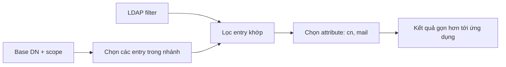

# Chọn danh sách attribute cần đọc để giảm dữ liệu trả về

## Mục tiêu bài học

Trong một dịch vụ thư mục LDAP, mỗi **entry** có thể chứa nhiều **attribute**: định danh, tên hiển thị, email, số điện thoại, thuộc tính nhóm và đôi khi cả dữ liệu nhị phân như ảnh đại diện. Khi một ứng dụng Spring chỉ cần hiển thị danh sách tên và email, yêu cầu toàn bộ attribute của mọi entry thường gây dư thừa dữ liệu.

Bài học thuộc chương **Attribute và schema** của module **SPRING_LDAP**. Bạn sẽ học cách chủ động chọn **tập attribute cần trả về** khi tìm kiếm hoặc đọc entry, và áp dụng vào `LdapTemplate`, `LdapClient` hoặc LDAP ODM theo API của phiên bản dự án đang dùng.

Sau bài học, bạn có thể:

1. Phân biệt **attribute dùng trong filter** với **attribute yêu cầu trả về**.
2. Hiểu ý nghĩa của danh sách attribute tường minh, `*`, `+` và `1.1` trong LDAP search.
3. Giảm dữ liệu nhận về bằng `ldapsearch`, `LdapQueryBuilder.attributes(...)` hoặc `SearchControls.setReturningAttributes(...)`.
4. Ánh xạ kết quả an toàn khi attribute thiếu, không được phép đọc hoặc có nhiều giá trị.
5. Kết hợp lựa chọn attribute với base DN, scope, giới hạn kết quả, TLS, quyền truy cập và kiểm thử hiệu năng.

## 1. Bài toán: trang danh bạ chỉ cần hai trường

Giả sử ứng dụng nội bộ có trang danh sách nhân viên, mỗi dòng hiển thị **họ tên** và **email**. LDAP server lưu một entry như sau:

```ldif
dn: uid=lan,ou=People,dc=example,dc=org
objectClass: inetOrgPerson
uid: lan
cn: Lan Nguyen
sn: Nguyen
givenName: Lan
mail: lan@example.org
telephoneNumber: +84 28 5555 0101
description: Engineering team
```

Trong thư mục thực tế, entry có thể còn nhiều attribute khác như `title`, `manager`, `memberOf` (nếu schema/server hỗ trợ), hoặc `jpegPhoto`. Một số attribute có nhiều giá trị; một số giá trị nhị phân có thể lớn hơn đáng kể so với tên và email.

Nếu màn hình chỉ cần `cn` và `mail`, ta muốn **server trả đúng hai attribute đó**:

```text
dn: uid=lan,ou=People,dc=example,dc=org
cn: Lan Nguyen
mail: lan@example.org
```

Ở đây, `dn` là tên của entry trong kết quả LDAP; nó **không phải một attribute thông thường được chọn qua danh sách thuộc tính**. Thao tác tìm kiếm vẫn cần định danh entry, trong khi chỉ hai attribute `cn` và `mail` được yêu cầu làm dữ liệu trả về.

So sánh:

| Kiểu yêu cầu | Nội dung trả về | Khi nào hợp lý |
| --- | --- | --- |
| Không chỉ rõ danh sách attribute | Thông thường là toàn bộ **user attributes** được phép trả về theo mặc định giao thức | Khám phá cấu trúc entry hoặc công cụ quản trị có chủ đích |
| Chỉ yêu cầu `cn`, `mail` | Hai attribute này, nếu tồn tại và được phép đọc | Danh sách nhân viên |
| Chỉ yêu cầu `uid` | Chỉ `uid`, nếu được phép đọc | Kiểm tra định danh hoặc đọc mã tài khoản |
| Không yêu cầu attribute nào | Chỉ nhận thông tin định danh/kết quả entry cần thiết | Kiểm tra entry khớp truy vấn mà chưa cần dữ liệu thuộc tính |

**Nguyên tắc:** Nếu giao diện hoặc nghiệp vụ chỉ cần vài trường, hãy mô tả rõ vài trường đó trong search request. Đây là **attribute projection**: chọn các cột thông tin cần đọc ở cấp giao thức LDAP, tương tự ý tưởng chỉ chọn các cột cần thiết trong một truy vấn dữ liệu.

## 2. Cần phân biệt ba phần của một tìm kiếm LDAP

Một truy vấn không chỉ gồm filter. Nó thường xác định:

1. **Base DN**: nhánh bắt đầu, chẳng hạn `ou=People,dc=example,dc=org`.
2. **Scope và filter**: tìm những entry nào; ví dụ tìm trong mọi cấp con và yêu cầu `(objectClass=inetOrgPerson)`.
3. **Danh sách attribute cần trả về**: lấy những trường nào từ mỗi entry khớp, chẳng hạn `cn` và `mail`.



Hai truy vấn sau có thể tìm **cùng một tập entry**, nhưng khác lượng dữ liệu trả về:

```text
Base DN : ou=People,dc=example,dc=org
Scope   : SUBTREE
Filter  : (&(objectClass=inetOrgPerson)(uid=lan))
Attrs A : *                 # các user attributes được phép trả về
Attrs B : cn, mail          # chỉ hai attribute yêu cầu
```

Các dấu `#` trong khối trên chỉ là chú thích diễn giải, không phải cú pháp của chuỗi LDAP filter.

Một điểm dễ nhầm: **attribute được dùng để lọc không bắt buộc phải nằm trong tập thuộc tính trả về**. Ví dụ filter `(uid=lan)` có thể khớp entry nhưng response chỉ có `cn` và `mail`; `uid` không tự xuất hiện trong kết quả vì được tham chiếu trong filter. Nếu ứng dụng còn cần `uid`, hãy **yêu cầu `uid` một cách tường minh**.

Ngược lại, đưa `mail` vào danh sách trả về không làm LDAP server lọc theo email. Điều kiện lọc vẫn phải được khai báo trong filter.

## 3. Cú pháp chọn attribute trong LDAP

Trong giao thức LDAP (RFC 4511), thành phần `attributes` của SearchRequest cho phép chỉ định những attribute cần trả về. Có một số trường hợp đặc biệt:

| Danh sách yêu cầu | Ý nghĩa chính |
| --- | --- |
| `cn mail` | Chỉ yêu cầu hai loại attribute `cn` và `mail` |
| `uid cn mail` | Yêu cầu ba loại attribute, đủ cho một DTO danh bạ |
| `*` | Yêu cầu tất cả **user attributes** |
| `+` | Yêu cầu tất cả **operational attributes** khi server hỗ trợ lựa chọn này |
| `* +` | Yêu cầu cả user và operational attributes |
| `1.1` | Chỉ thị đặc biệt: **không trả về attribute nào** nếu dùng một mình |
| Danh sách trống/không chỉ định ở mức giao thức | Theo mặc định, tương đương yêu cầu toàn bộ user attributes |

**User attribute** là thuộc tính dữ liệu thông thường, chẳng hạn `cn`, `sn`, `mail`, `telephoneNumber`. **Operational attribute** là thuộc tính phục vụ hoạt động của thư mục, như dấu thời gian tạo/sửa hay định danh người sửa, tùy schema và directory server.

Các khác biệt cần nhớ:

- `*` không có nghĩa “mọi thuộc tính có thể tồn tại trên server”; operational attributes thường không nằm trong tập mặc định.
- `+` là cú pháp lựa chọn operational attributes được mô tả ở RFC 3673; việc hỗ trợ và tập thuộc tính trả về tùy server và quyền.
- `1.1` phải được dùng **một mình** nếu mục đích là không yêu cầu thuộc tính nào. Không trộn nó với `cn`, `mail` và mong hành vi nhất quán.
- DN vẫn có thể có trong metadata của entry ở kết quả tìm kiếm dù không yêu cầu thuộc tính nào. Đừng mặc định có một attribute phổ quát tên `dn` để dùng thay cho tên entry trong LDAP.

### Attribute có thể nhiều giá trị

Một attribute như `mail` trong hệ thống cụ thể có thể được khai báo với nhiều giá trị, tùy schema; `member` của một nhóm thường chứa nhiều DN. Khi yêu cầu tên attribute, **server trả tập giá trị được phép đọc của attribute đó**, không mặc định chỉ một giá trị đầu tiên.

Chọn ít loại attribute làm giảm các **loại dữ liệu** được trả về, nhưng không bảo đảm response nhỏ nếu một loại có rất nhiều giá trị. Chẳng hạn, chỉ yêu cầu `member` trên nhóm có hàng nghìn thành viên vẫn có thể tạo response lớn. Một số server (đặc biệt môi trường Active Directory) có cơ chế trả giá trị theo khoảng (*range retrieval*) cho thuộc tính đa trị; đây là hành vi riêng cần tìm hiểu theo sản phẩm, không phải đồng nghĩa với phân trang kết quả tìm kiếm.

### Schema và quyền truy cập quyết định tập kết quả cuối

Yêu cầu `cn`, `mail` chỉ là một **lời đề nghị** với server:

- Nếu entry không có `mail`, kết quả có thể thiếu `mail`.
- Nếu account hiện tại không có quyền đọc `mail`, server có thể không trả nó hoặc áp dụng hành vi từ chối theo chính sách.
- Nếu attribute chưa được schema cho phép hoặc không được server nhận biết, hành vi phụ thuộc đặc tả và cấu hình server.
- Một số thuộc tính là nhạy cảm; việc ghi tên chúng trong request không cho phép vượt qua access control.

Ứng dụng vì vậy phải xử lý **attribute vắng mặt** và không coi đó là bằng chứng một thuộc tính chắc chắn không tồn tại trong thư mục.

## 4. Thực hành bằng `ldapsearch`

Giả sử server kiểm thử có TLS hợp lệ tại `ldap.example.org:636`, và account dịch vụ được cấp quyền tra cứu:

```bash
ldapsearch -LLL -x \
  -H ldaps://ldap.example.org:636 \
  -D "cn=svc-reader,ou=Services,dc=example,dc=org" \
  -W \
  -b "ou=People,dc=example,dc=org" \
  -s sub \
  "(&(objectClass=inetOrgPerson)(uid=lan))" \
  cn mail
```

Trong lệnh này, hai tham số **`cn mail` ở cuối** chính là danh sách attribute yêu cầu. Nếu tài khoản có quyền đọc cả hai giá trị, output có thể giống:

```ldif
dn: uid=lan,ou=People,dc=example,dc=org
cn: Lan Nguyen
mail: lan@example.org
```

Đổi phần cuối thành `*` để quan sát user attributes; đổi thành `1.1` để chỉ nhận tên của các entry khớp. Ví dụ:

```bash
# Chỉ yêu cầu tên và email
ldapsearch -LLL -x -H ldaps://ldap.example.org:636 \
  -D "cn=svc-reader,ou=Services,dc=example,dc=org" -W \
  -b "ou=People,dc=example,dc=org" \
  "(uid=lan)" cn mail

# Yêu cầu mọi user attribute
ldapsearch -LLL -x -H ldaps://ldap.example.org:636 \
  -D "cn=svc-reader,ou=Services,dc=example,dc=org" -W \
  -b "ou=People,dc=example,dc=org" \
  "(uid=lan)" "*"

# Không yêu cầu attribute, chỉ kiểm tra entry khớp
ldapsearch -LLL -x -H ldaps://ldap.example.org:636 \
  -D "cn=svc-reader,ou=Services,dc=example,dc=org" -W \
  -b "ou=People,dc=example,dc=org" \
  "(uid=lan)" "1.1"
```

Lệnh trên là ví dụ để thực hành, chưa thể chạy nếu chưa có máy chủ và chứng chỉ tương ứng. `-W` cho phép nhập mật khẩu qua prompt; tránh đặt mật khẩu ngay trong dòng lệnh hoặc lưu vào lịch sử shell.

**Bài tập ngắn:** Chạy ba lựa chọn khác nhau trên cùng một entry và so sánh số attribute, số dòng kết quả và kích thước phản hồi. Đảm bảo dùng **cùng filter, base, scope, quyền đọc** để so sánh hợp lý. Kích thước văn bản `ldapsearch` chỉ là một chỉ báo gần đúng cho dữ liệu ứng dụng nhận, vì định dạng LDIF và mã hóa có thể làm khác kích thước payload LDAP thực tế.

## 5. Cách chọn attribute bằng Spring LDAP

Trong ứng dụng Spring, **`ContextSource`** cung cấp ngữ cảnh kết nối LDAP, còn **`LdapTemplate`** thực hiện search/lookup và ánh xạ kết quả. `LdapClient` cung cấp API fluent ở các phiên bản hỗ trợ; **ODM** ánh xạ entry sang đối tượng khi phù hợp. Cho dù dùng API nào, mục tiêu vẫn là gửi xuống server **một danh sách attribute rõ ràng**.

Ví dụ cấu hình Spring Boot minh họa:

```properties
spring.ldap.urls=ldaps://ldap.example.org:636
spring.ldap.base=dc=example,dc=org
spring.ldap.username=cn=svc-reader,ou=Services,dc=example,dc=org
spring.ldap.password=${LDAP_BIND_PASSWORD}
```

Phải bảo đảm thư viện, TLS truststore và quyền của account dịch vụ đã được cấu hình đúng trong môi trường thử nghiệm. Các thuộc tính trên **không tự cấu hình** timeout, pool hoặc xác thực chứng chỉ cho mọi môi trường.

### 5.1. Chọn attribute với `LdapQueryBuilder`

Với Spring LDAP, `org.springframework.ldap.query.LdapQueryBuilder` có thể xây dựng truy vấn theo cấu trúc. Phương thức `attributes(...)` chỉ định dữ liệu muốn trả về:

```java
import static org.springframework.ldap.query.LdapQueryBuilder.query;

import java.util.List;
import javax.naming.NamingException;
import javax.naming.directory.Attribute;
import javax.naming.directory.Attributes;
import org.springframework.ldap.core.LdapTemplate;
import org.springframework.ldap.query.LdapQuery;
import org.springframework.ldap.query.SearchScope;

record UserPreview(String uid, String displayName, String email) {}

class DirectorySearchService {
    private final LdapTemplate ldapTemplate;

    DirectorySearchService(LdapTemplate ldapTemplate) {
        this.ldapTemplate = ldapTemplate;
    }

    List<UserPreview> findUsers(String requestedUid) {
        LdapQuery q = query()
                .base("ou=People")
                .searchScope(SearchScope.SUBTREE)
                .attributes("uid", "cn", "mail")
                .where("objectClass").is("inetOrgPerson")
                .and("uid").is(requestedUid);

        return ldapTemplate.search(q, (Attributes attrs) ->
                new UserPreview(
                        firstString(attrs, "uid"),
                        firstString(attrs, "cn"),
                        firstString(attrs, "mail")
                )
        );
    }

    private static String firstString(Attributes attrs, String id)
            throws NamingException {
        Attribute attribute = attrs.get(id);
        if (attribute == null || attribute.size() == 0) {
            return null;
        }
        Object value = attribute.get();
        return value instanceof String ? (String) value : null;
    }
}
```

Một số điểm đáng chú ý:

- `base("ou=People")` ở đây là nhánh **tương đối** so với `spring.ldap.base=dc=example,dc=org`; không lặp base DN.
- Filter sử dụng `objectClass` và `uid`, còn danh sách trả về là `uid`, `cn`, `mail`. Nếu chỉ hiển thị tên và email nhưng ứng dụng vẫn cần `uid` để dựng đường dẫn hồ sơ, yêu cầu `uid` là hợp lý.
- Dùng **query builder** cho giá trị `requestedUid` để tránh ghép input thô thành cú pháp filter.
- `firstString` trả `null` khi attribute thiếu hoặc không có dạng chuỗi. Phần giao diện/API cần quy định xử lý trường thiếu; không tự suy rằng server luôn trả tất cả thuộc tính đã yêu cầu.
- `firstString` chỉ lấy giá trị đầu tiên. Nếu yêu cầu attribute đa trị như `member`, cần xử lý toàn bộ giá trị, không dùng helper này để âm thầm bỏ phần còn lại.

Đoạn mã dùng Java có hỗ trợ `record` (Java 16 trở lên; các ứng dụng Spring Boot 3 thường dùng Java 17 trở lên). Dự án Java cũ hơn có thể thay `record` bằng POJO tương đương.

### 5.2. Chọn attribute bằng `SearchControls` của JNDI

Khi cần cấu hình tường minh mức `SearchControls`, Spring LDAP có các overload của `LdapTemplate.search` nhận đối tượng này:

```java
import javax.naming.directory.SearchControls;
import javax.naming.directory.Attributes;
import java.util.List;

SearchControls controls = new SearchControls();
controls.setSearchScope(SearchControls.SUBTREE_SCOPE);
controls.setReturningAttributes(new String[] {"uid", "cn", "mail"});
controls.setCountLimit(100);
controls.setTimeLimit(3000); // mili giây

List<String> names = ldapTemplate.search(
        "ou=People",
        "(objectClass=inetOrgPerson)",
        controls,
        (Attributes attrs) -> firstString(attrs, "cn")
);
```

Ví dụ dùng filter **cố định** để tập trung vào attribute projection. Với input của người dùng, dùng builder/escaping đúng ngữ cảnh như phần 5.1.

Trong `SearchControls`:

| Cấu hình | Ý nghĩa |
| --- | --- |
| `setReturningAttributes(new String[] {"uid", "cn", "mail"})` | Chỉ yêu cầu các attribute nêu ra |
| `setReturningAttributes(null)` | Theo mặc định JNDI, yêu cầu toàn bộ user attributes |
| `setReturningAttributes(new String[0])` | Yêu cầu **không trả attribute nào** |
| `setCountLimit(100)` | Giới hạn số entry trả về, không phải kích thước byte |
| `setTimeLimit(3000)` | Giới hạn thời gian tìm kiếm trong `SearchControls` theo mili giây |

**Phân biệt giới hạn tìm kiếm và timeout mạng:** `setTimeLimit` không thay thế hoàn toàn các thiết lập connect/read timeout của LDAP client. Nếu server không thể kết nối hoặc kết nối bị treo, ứng dụng còn cần cơ chế timeout ở mức kết nối và vận hành.

### 5.3. `LdapClient` và ODM có khác mục tiêu không?

**Không khác mục tiêu.** Khi dùng `LdapClient`, cần tìm lựa chọn trả về attribute trong API truy vấn tương ứng với phiên bản Spring LDAP đang dùng. Với **LDAP ODM**, hãy kiểm tra mapper tạo truy vấn gì và tải những trường nào: mô hình Java có mười thuộc tính không đồng nghĩa màn hình nào cũng cần cả mười.

Trong một trang danh sách chỉ hiển thị vài trường, mapping trực tiếp từ `Attributes` sang một **DTO/record gọn** thường dễ kiểm soát tập dữ liệu trả về. ODM phù hợp khi muốn quản lý entry như đối tượng miền nghiệp vụ và có ánh xạ schema rõ ràng, nhưng không nên chỉ dựa vào số trường bạn đọc sau khi mapping để kết luận server đã trả về ít dữ liệu.

**Đừng nhầm hai cách tối ưu:**

```text
Không tối ưu truyền tải:
LDAP server -> nhận toàn bộ attribute -> Java chỉ lấy cn, mail

Tối ưu truyền tải:
LDAP server -> request chỉ cn, mail -> Java nhận và dùng cn, mail
```

Chỉ cách thứ hai thực sự yêu cầu server giảm các loại attribute trong payload. Việc tạo DTO sau khi đã nhận toàn bộ entry chỉ giảm dữ liệu trong các bước xử lý sau đó.

## 6. Chọn attribute theo từng màn hình và tác vụ

Danh sách attribute tốt phụ thuộc **nhu cầu nghiệp vụ**, không có một tập cố định cho mọi LDAP search:

| Tình huống | Attribute nên cân nhắc yêu cầu | Tránh yêu cầu khi không cần |
| --- | --- | --- |
| Danh bạ tóm tắt | `uid`, `cn`, `mail` | `jpegPhoto`, `description`, thuộc tính quản trị |
| Chi tiết hồ sơ | `cn`, `givenName`, `sn`, `mail`, `telephoneNumber` | Các thuộc tính ngoài màn hình hoặc ngoài quyền |
| Kiểm tra có entry khớp username hay không | `1.1` (chỉ cần kết quả khớp) hoặc một trường tối thiểu | Toàn bộ hồ sơ |
| Đồng bộ tên và email | Định danh ổn định phù hợp schema, `cn`, `mail` | Ảnh, thuộc tính không phục vụ đồng bộ |
| Liệt kê thành viên nhóm | `member` hoặc thuộc tính nhóm thực tế do schema hỗ trợ | Dữ liệu hồ sơ đầy đủ của từng thành viên |
| Công cụ kiểm tra audit | Một số operational attributes được phép đọc | `+` toàn bộ nếu chỉ cần vài thuộc tính |

Một số directory server hoặc mô hình nhóm không sử dụng `member`, `memberOf` hay cùng tên attribute; trước khi code, cần xem **schema và quy tắc triển khai của server**. Tương tự, không nên giả định mọi hệ thống đều có `uid` hoặc `mail` trong entry người dùng.

### Trường hợp danh sách kết quả và trang chi tiết

Giả sử có 500 nhân viên:

1. Trang danh sách yêu cầu `uid`, `cn`, `mail` cho các entry trong `ou=People`.
2. Khi người dùng mở hồ sơ của một nhân viên, ứng dụng mới yêu cầu thêm `telephoneNumber`, `title` hoặc `jpegPhoto` nếu được phép đọc.
3. Khi hiển thị nhóm, ứng dụng truy vấn nhánh nhóm theo cơ chế schema của hệ thống.

Cách này thường giảm dữ liệu khi người dùng chỉ xem danh sách, nhưng có **đánh đổi số lượt truy vấn** khi mở trang chi tiết. Hãy đo nhu cầu thực tế thay vì luôn cho rằng tải ít thuộc tính là tối ưu tuyệt đối.

### Tránh truy vấn N+1 không cần thiết

Nếu một trang cần `cn` và `mail` cho 100 người, việc tìm danh sách `uid` trước rồi chạy 100 lần `lookup` riêng để lấy `mail` có thể gây nhiều lượt mạng.

Nếu dữ liệu có thể trả cùng một search, hãy yêu cầu `uid`, `cn`, `mail` **ngay trong truy vấn danh sách**. Giảm payload ở từng response không có nghĩa mọi trường đều phải tải qua một request riêng.

## 7. Đo lợi ích và các giới hạn của tối ưu hóa

Lựa chọn attribute phù hợp có thể giảm:

- **Payload truyền trên mạng:** bớt attribute và giá trị không dùng.
- **Chi phí giải mã và ánh xạ:** ít dữ liệu hơn cho thư viện và ứng dụng xử lý.
- **Bộ nhớ tạm:** ít attribute được giữ trong các object kết quả.
- **Rủi ro đưa dữ liệu thừa vào log hoặc tầng API:** dữ liệu không được yêu cầu sẽ không có trong response để vô tình sử dụng.

Tuy nhiên, không nên hứa chắc truy vấn sẽ nhanh hơn một mức cố định. Một LDAP server vẫn có thể cần đọc hoặc đánh giá nhiều thuộc tính để thực thi **filter**, ACL, index và các xử lý nội bộ, ngay cả khi chỉ trả hai attribute. Độ trễ còn chịu ảnh hưởng của base/scope, số entry khớp, TLS, đường mạng, pooling, tải máy chủ và chính sách truy cập.

### Quy trình đo trước và sau

1. Chọn tập entry đủ đại diện trong môi trường kiểm thử.
2. Giữ **cùng base DN, scope, filter, server, danh tính bind** và điều kiện kết nối.
3. Chạy phương án A yêu cầu `*`; phương án B chỉ yêu cầu `uid`, `cn`, `mail`.
4. Đếm số entry, số attribute/giá trị nhận được và đo độ trễ, byte truyền nếu có công cụ phù hợp.
5. Chạy lặp lại đủ lần để phân biệt ảnh hưởng cache, thời gian khởi tạo kết nối và dao động hệ thống.
6. Xác minh dữ liệu trả về vẫn đáp ứng chức năng; chỉ công nhận cải thiện khi chi phí tổng thể và hành vi nghiệp vụ hợp lý.

Bảng ghi kết quả có thể dùng:

| Chỉ số | Yêu cầu `*` | Yêu cầu `uid cn mail` |
| --- | --- | --- |
| Số entry khớp | Ghi từ kết quả thực nghiệm | Phải tương đương với cùng filter và quyền |
| Số loại attribute nhận | Đo | Đo |
| Tổng giá trị/byte ứng dụng nhận | Đo | Đo |
| Thời gian trung vị | Đo | Đo |
| Độ trễ cao (ví dụ p95) | Đo | Đo |
| Chức năng hiển thị có đầy đủ dữ liệu | Kiểm tra | Kiểm tra |

Không tự điền số liệu giả làm kết quả đo thực tế. Với TLS, byte trên đường truyền có overhead và mã hóa; so sánh kích thước văn bản debug với dữ liệu mạng có thể sai lệch.

### Kết hợp với những biện pháp khác

- **Base DN hẹp và scope chính xác** giảm số entry mà server cần xét.
- **Filter phù hợp và index** hỗ trợ hiệu quả tìm kiếm (phụ thuộc server).
- **Count limit, time limit và paged results** kiểm soát số entry và thời gian, theo khả năng server/client.
- **Attribute projection** kiểm soát các loại dữ liệu trên mỗi entry.
- **TLS và quyền tối thiểu** bảo vệ đường truyền và dữ liệu nhạy cảm.
- **Context/connection pooling** có thể giảm chi phí thiết lập kết nối nếu cấu hình phù hợp, nhưng phải kiểm tra tương tác TLS và danh tính bind.

Những cơ chế này giải quyết **các chiều khác nhau của vấn đề**, không thay thế lẫn nhau. Chọn ít attribute không giới hạn số entry; phân trang kết quả không giải quyết một attribute đa trị khổng lồ; cache hoặc pooling không giúp một filter quá rộng trở nên chính xác.

## 8. Bảo mật khi lựa chọn attribute

Attribute projection cũng là biện pháp **giảm dữ liệu được xử lý**, nhưng không phải ranh giới bảo mật. Nếu một account không được phép đọc `userPassword` hoặc các attribute nhạy cảm khác, chính sách **ACL của directory server** phải thực thi điều đó, kể cả khi client cố tình yêu cầu tên attribute.

Đặc biệt:

1. Không dùng account quản trị toàn quyền cho tác vụ chỉ đọc danh bạ.
2. Chỉ yêu cầu những thuộc tính có mục đích rõ ràng; tránh lấy ảnh, số điện thoại cá nhân hoặc dữ liệu quản trị khi không cần.
3. Dùng **LDAPS hoặc StartTLS được cấu hình và xác minh chứng chỉ đúng** trước khi truyền credential. Không bỏ qua xác minh máy chủ để “chạy được”.
4. Không log toàn bộ `Attributes`, đặc biệt khi chưa kiểm soát rõ những giá trị nào có thể nằm trong response.
5. Tách **LDAP authentication** (bind/kiểm tra credential) khỏi **LDAP search**. Việc tìm thấy `uid` không chứng minh mật khẩu đúng.
6. Khi chẩn đoán lỗi “thiếu attribute”, kiểm tra cả schema, ACL, entry thực tế và danh sách đã yêu cầu; không tự kết luận đó là lỗi code hoặc lỗi dữ liệu.

Nếu một màn hình hiển thị `cn` và `mail`, service nên trả DTO chứa đúng dữ liệu đó, sau đó tầng API áp dụng quy tắc hiển thị/quyền phù hợp. Lọc dữ liệu ở client sau khi truyền tải toàn bộ hồ sơ **không giảm rủi ro** dữ liệu thừa đã đi qua nhiều lớp phần mềm.

## 9. Kiểm thử: có yêu cầu đúng attribute không?

Ngoài việc kiểm tra giá trị được hiển thị, nên kiểm tra **thuộc tính thực tế server trả về**. Nếu test chỉ xác nhận `UserPreview.displayName`, code có thể vô tình lấy toàn bộ entry rồi mới bỏ các field thừa.

### Ma trận kiểm thử

| Ca thử | Điều mong đợi |
| --- | --- |
| Query yêu cầu `cn`, `mail` | Trả các giá trị được phép của hai thuộc tính; không cần có `sn`, `telephoneNumber` |
| Filter dùng `uid` nhưng không yêu cầu `uid` | Entry vẫn có thể khớp; `uid` không tự được trả về |
| Yêu cầu `uid`, `cn`, `mail` | DTO có đủ dữ liệu cần dùng nếu entry có giá trị và account có quyền |
| Entry thiếu `mail` | Mapper xử lý thiếu/null, không phát sinh `NullPointerException` |
| Account không được đọc `mail` | Kết quả hoặc lỗi phản ánh chính sách server; ứng dụng xử lý an toàn |
| Yêu cầu `1.1` | Có thể biết entry nào khớp nhưng không có attribute dữ liệu |
| Yêu cầu `*` và `+` | Phân biệt user/operational attributes tùy server hỗ trợ và ACL |
| Attribute đa trị `member` | Không âm thầm chỉ lấy giá trị đầu tiên nếu nghiệp vụ cần toàn bộ |
| Scope/base thay đổi | Số entry thay đổi theo phạm vi, không bị nhầm với ảnh hưởng của danh sách attribute |
| Server chậm, kết quả lớn | Có timeout/giới hạn phù hợp và xử lý lỗi rõ ràng |

### Ví dụ test mapper với trường thiếu

Có thể kiểm tra riêng một hàm ánh xạ attribute mà không cần kết nối LDAP server:

```java
import static org.junit.jupiter.api.Assertions.assertEquals;
import static org.junit.jupiter.api.Assertions.assertNull;

import javax.naming.NamingException;
import javax.naming.directory.BasicAttributes;
import org.junit.jupiter.api.Test;

class AttributeProjectionTest {
    @Test
    void acceptsAbsentMail() throws NamingException {
        BasicAttributes attrs = new BasicAttributes(true);
        attrs.put("uid", "lan");
        attrs.put("cn", "Lan Nguyen");

        assertEquals("Lan Nguyen", firstString(attrs, "cn"));
        assertNull(firstString(attrs, "mail"));
    }

    private static String firstString(
            javax.naming.directory.Attributes attrs, String name)
            throws NamingException {
        var attribute = attrs.get(name);
        if (attribute == null || attribute.size() == 0) {
            return null;
        }
        Object value = attribute.get();
        return value instanceof String ? (String) value : null;
    }
}
```

Unit test này kiểm tra logic ánh xạ khi `mail` vắng mặt. Để xác minh **server chỉ trả các attribute được yêu cầu**, cần integration test hoặc quan sát request/response bằng công cụ thích hợp trên directory test. Một mapper bỏ qua `telephoneNumber` không chứng minh `telephoneNumber` chưa từng được trả về.

### Những lỗi hay gặp trong ứng dụng

| Triệu chứng | Nguyên nhân có thể | Cách kiểm tra |
| --- | --- | --- |
| Kết quả vẫn có quá nhiều attribute | Chưa đặt returning attributes, hoặc mapping lấy toàn bộ entry | Xem query/projection và request thực tế |
| `attrs.get("uid")` trả `null` | Filter dùng `uid` nhưng quên yêu cầu trả `uid` | Thêm `uid` vào danh sách `attributes(...)` |
| `mail` bị thiếu dù đã yêu cầu | Entry thiếu, ACL cấm đọc hoặc khác schema | Dùng account thử nghiệm phù hợp và kiểm tra schema/ACL |
| Tham chiếu DN bị mất | Chỉ lấy attributes nhưng mapper cần cả DN của entry | Dùng metadata/context mapper phù hợp để lấy DN |
| Lấy nhóm bị thiếu thành viên | Chỉ lấy giá trị đầu của attribute đa trị, hoặc server giới hạn giá trị | Kiểm tra mọi giá trị và cơ chế trả theo khoảng của server |
| Chỉ lấy ít thuộc tính nhưng vẫn chậm | Filter/scope rộng, nhiều entry, network/server có vấn đề | Đo từng chiều: số entry, index, timeouts, payload |
| Yêu cầu `+` nhưng không thấy operational attributes | Server không hỗ trợ hoặc quyền hạn chế | Kiểm tra tài liệu server và thử attribute cụ thể |
| Dùng `1.1` mà DTO bị thiếu field | Request được thiết kế không trả attribute | Chỉ dùng `1.1` khi thực sự không cần field nào |

## 10. Bài tập tổng hợp: API danh bạ tiết kiệm dữ liệu

**Bối cảnh:** Ứng dụng Spring LDAP dùng base `dc=example,dc=org`. Người dùng nằm trong `ou=People`. Trang danh bạ hiển thị `uid`, `cn` và `mail`. Trang chi tiết có thể hiển thị thêm `telephoneNumber`.

**Yêu cầu:**

1. Tạo search theo `uid` bằng `LdapQueryBuilder`, với base `ou=People`, scope `SUBTREE` và filter dựa trên input.
2. Đặt danh sách attribute là `uid`, `cn`, `mail`; map sang `UserPreview` hoặc DTO tương đương.
3. Thêm một truy vấn dành cho trang chi tiết có yêu cầu `telephoneNumber` khi cần.
4. Xử lý entry không tồn tại, thiếu `mail`, không đủ quyền đọc, trường đa trị và lỗi kết nối.
5. Trên server thử nghiệm, so sánh response khi yêu cầu `*` với khi yêu cầu ba attribute; ghi lại số entry và số thuộc tính được trả về.
6. Đặt giới hạn truy vấn phù hợp; bảo vệ kết nối TLS; không ghi credential hay toàn bộ attribute nhạy cảm vào log.

**Tiêu chí hoàn thành:**

- Trang danh sách nhận đủ dữ liệu cần hiển thị mà không yêu cầu ảnh hoặc thuộc tính không dùng.
- Search dựa trên input an toàn, có phạm vi tìm kiếm hợp lý.
- Mapper không lỗi khi attribute thiếu; phân biệt kết quả rỗng với lỗi LDAP.
- Kết quả kiểm thử phản ánh **request và response thực tế**, không chỉ số field trên DTO.
- Có ghi nhận kết quả đo trước/sau, không khẳng định cải thiện hiệu năng khi chưa đo.

### Tự kiểm tra nhanh

**Câu 1.** Filter `(uid=lan)` đã dùng `uid`. Nếu chỉ yêu cầu `cn mail`, server có phải trả `uid` không?

**Trả lời:** Không. Attribute trong filter không mặc nhiên thuộc danh sách trả về.

**Câu 2.** `*` và `+` khác nhau thế nào?

**Trả lời:** `*` chọn user attributes; `+` chọn operational attributes khi được server hỗ trợ và được phép truy cập.

**Câu 3.** Một danh sách tìm kiếm trả 5.000 entry, mỗi entry chỉ có `cn`. Có thể kết luận response luôn nhỏ không?

**Trả lời:** Không. Số lượng entry cũng quyết định tổng dữ liệu; còn cần giới hạn, scope và có thể phân trang.

**Câu 4.** Đặt `setReturningAttributes(new String[0])` trong JNDI nhằm mục đích gì?

**Trả lời:** Yêu cầu không có attribute dữ liệu nào trong kết quả; đây không giống với `null`, vốn chọn user attributes theo mặc định.

**Câu 5.** Nếu ứng dụng không hiển thị `telephoneNumber`, chỉ bỏ field đó khỏi DTO có đủ không?

**Trả lời:** Chưa đủ để giảm tải từ LDAP server. Cần loại `telephoneNumber` khỏi **danh sách attribute yêu cầu** trong SearchRequest.

## Tổng kết

**Chọn attribute là quyết định thiết kế truy vấn, không chỉ là quyết định mapping dữ liệu ở Java.** Khi biết rõ giao diện hoặc nghiệp vụ cần `uid`, `cn`, `mail`, hãy yêu cầu trực tiếp những thuộc tính này ở cấp LDAP.

Trong Spring LDAP, bạn có thể dùng `LdapQueryBuilder.attributes(...)` hoặc `SearchControls.setReturningAttributes(...)` với `LdapTemplate`. Với `LdapClient` và ODM, cần kiểm chứng API/mapping của phiên bản đang dùng thực sự giới hạn thuộc tính được server trả về.

Tối ưu hóa này cần đi cùng DN/base, schema, filter, scope, timeouts, giới hạn kết quả, quyền tối thiểu, TLS và kiểm thử. Chỉ một tập attribute nhỏ **không bảo đảm** truy vấn chính xác, an toàn hoặc có độ trễ thấp nếu các phần còn lại được cấu hình sai.

### Tài liệu tham khảo

- **RFC 4511 — Lightweight Directory Access Protocol (LDAP): The Protocol**: `SearchRequest`, lựa chọn attribute và kết quả tìm kiếm.
- **RFC 4512 — LDAP: Directory Information Models**: attribute, schema và loại thuộc tính.
- **RFC 3673 — LDAP: All Operational Attributes**: ký hiệu `+` để lựa chọn operational attributes.
- **RFC 4515 — LDAP: String Representation of Search Filters**: cú pháp và escaping filter.
- **Spring LDAP Reference Documentation**: `LdapTemplate`, `LdapQueryBuilder`, `LdapClient`, ODM.
- **Java SE JNDI API**: `javax.naming.directory.SearchControls` và `Attributes`.
