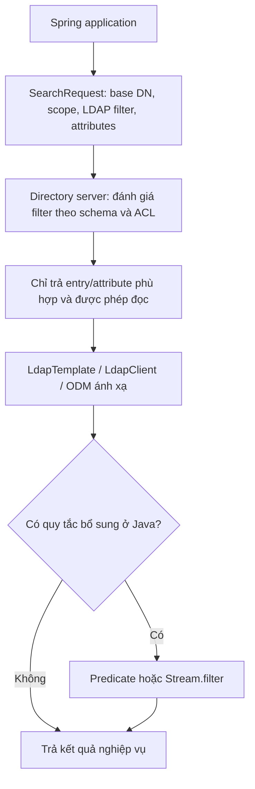
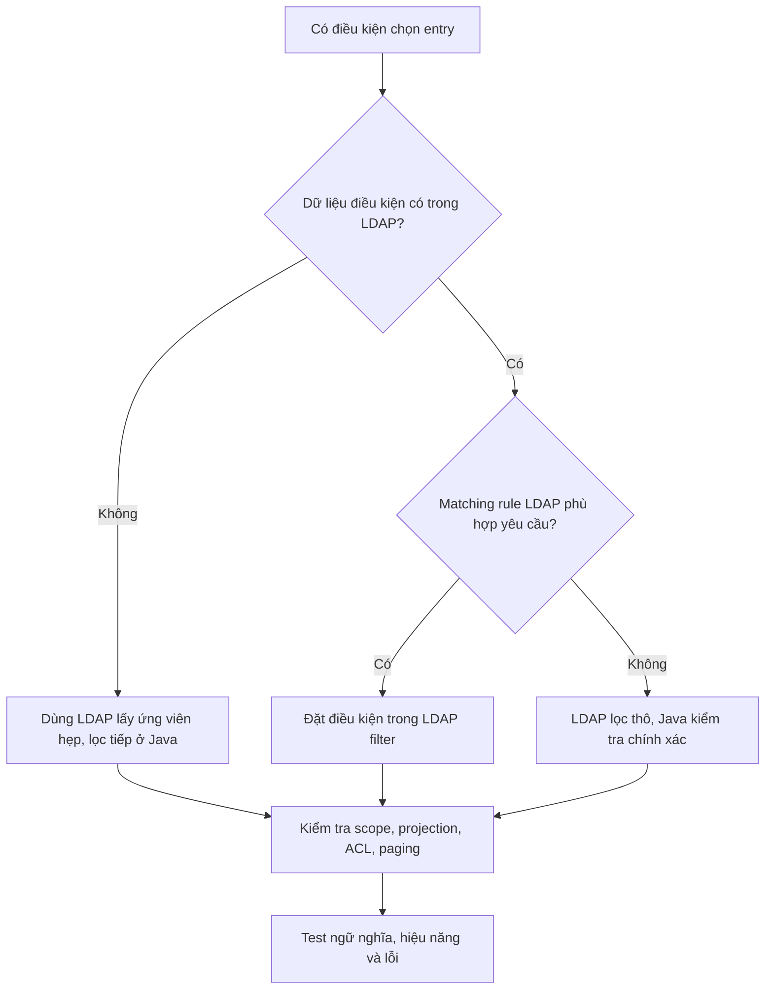

# Phân biệt filter với điều kiện Java sau khi đọc dữ liệu

## Mục tiêu bài học

Trong **SPRING_LDAP**, chúng ta thường phải chọn những entry của dịch vụ thư mục thỏa một điều kiện nào đó. Có hai nơi để thực hiện phép lọc:

- **LDAP filter:** được gửi trong yêu cầu tìm kiếm; **directory server** quyết định entry nào thỏa điều kiện rồi mới trả dữ liệu cho client.
- **Điều kiện Java:** chạy trong JVM **sau khi** ứng dụng đã nhận dữ liệu LDAP, ví dụ `if`, `Predicate` hoặc `Stream.filter(...)`.

Cả hai đều có thể cho danh sách hiển thị giống nhau trên một bộ dữ liệu nhỏ. Nhưng chúng khác nhau về **chi phí truyền dữ liệu**, **quy tắc so sánh**, **bộ nhớ**, **phân trang**, **quyền truy cập**, **xử lý lỗi** và **khả năng tối ưu của máy chủ**. Hiểu ranh giới này giúp ứng dụng Spring dùng `LdapTemplate`, `LdapClient` hoặc LDAP ODM hiệu quả và an toàn hơn.

Sau bài học, bạn có thể:

1. Nhận diện chính xác filter chạy trên LDAP server và predicate chạy trong Java.
2. Chọn base DN, scope, filter và danh sách attribute của một yêu cầu tìm kiếm.
3. Quyết định điều kiện nào nên được đẩy xuống LDAP, điều kiện nào cần giữ ở tầng ứng dụng.
4. Phân biệt cách LDAP so sánh giá trị với `String.equals`, `endsWith`, so sánh số/chuỗi và giá trị `null` của Java.
5. Nhìn ra tác động lên pagination, size limit, quyền truy cập, escaping filter và hiệu năng.
6. Viết ví dụ Spring LDAP và kiểm thử cả tập kết quả **trước** lẫn **sau** khi lọc Java.

## 1. Tình huống: tìm nhân viên thuộc phòng ban và có email công ty

Giả sử một directory server quản lý entry người dùng dưới nhánh `ou=People,dc=example,dc=org`. Các entry mẫu:

| Entry (RDN) | `departmentNumber` | `mail` | Khớp điều kiện phòng 42 và email công ty? |
| --- | --- | --- | --- |
| `uid=lan` | `42` | `lan@example.org` | Có |
| `uid=mai` | `42` | `mai@partner.net` | Không, khác domain |
| `uid=nam` | `17` | `nam@example.org` | Không, khác phòng |
| `uid=huy` | `42` | Thiếu `mail` | Không, chưa có email |

Các entry ví dụ được giả định thuộc `inetOrgPerson`. Đây là dữ liệu học tập: thuộc tính phòng có thể có tên/schema khác trên directory thực tế và phải được đối chiếu trước khi triển khai.

Ta muốn danh sách người thuộc phòng `42` với email kết thúc bằng `@example.org`. Có hai cách tiếp cận.

**Cách A — LDAP server lọc cả hai điều kiện**

```ldap
(&(objectClass=inetOrgPerson)(departmentNumber=42)(mail=*@example.org))
```

Với bộ dữ liệu trên, khi schema và matching rule phù hợp, server chọn Lan và trả entry này cho ứng dụng.

**Cách B — LDAP lọc phòng, Java lọc email**

LDAP filter:

```ldap
(&(objectClass=inetOrgPerson)(departmentNumber=42))
```

Server có thể trả **Lan, Mai, Huy**. Ứng dụng tiếp tục lọc:

```java
List<Person> result = peopleFromLdap.stream()
        .filter(p -> p.mail() != null
                && p.mail().endsWith("@example.org"))
        .toList();
```

Kết quả cuối cùng trong ví dụ vẫn là Lan, nhưng ứng dụng **đã nhận ba entry thay vì một**. Nếu số lượng nhân viên lên đến hàng trăm nghìn, chênh lệch số entry truyền và giải mã có thể đáng kể. Tuy vậy, không thể khẳng định hai cách luôn ra cùng kết quả trên dữ liệu thực tế: **LDAP matching rule** có thể khác ngữ nghĩa `String.endsWith` của Java.

## 2. Hai bước lọc nằm ở đâu trong luồng Spring LDAP?



| Tiêu chí | LDAP filter (trên server) | Điều kiện Java (sau khi đọc) |
| --- | --- | --- |
| **Vị trí thực thi** | Directory server | JVM của ứng dụng |
| **Tập dữ liệu được xem xét** | Các entry thuộc base DN/scope theo khả năng truy cập | Những entry đã được trả về cho client |
| **Ngôn ngữ** | Cú pháp filter LDAP (RFC 4515) | `if`, `Predicate`, `Stream`, logic Java |
| **Quy tắc so sánh** | LDAP schema và matching rule của server | Phép toán/kiểu dữ liệu của Java |
| **Dữ liệu trên mạng** | Có thể giảm số entry cần truyền | Không giảm số entry đã truyền tới JVM |
| **Chỉ mục** | Server có thể dùng index cho thuộc tính được lọc | Java chỉ xử lý tập kết quả đã nhận |
| **Dữ liệu ngoài directory** | Không trực tiếp truy cập thông tin chỉ có trong ứng dụng | Có thể kết hợp trạng thái phiên, cấu hình, dữ liệu nghiệp vụ |
| **Phân trang** | Điều kiện được áp trước khi server trả các trang kết quả | Lọc bớt phần đã nhận, có thể làm trang hiển thị thiếu dòng |
| **Phân quyền** | Server phải áp ACL độc lập với filter | Không thay thế ACL và quyền ứng dụng |

**Nguyên tắc cốt lõi:** Filter trong SearchRequest quyết định **entry nào được LDAP server chọn**; predicate Java quyết định **entry nào được giữ lại sau khi client đã nhận dữ liệu**.

### Base DN, scope và danh sách attribute là những lựa chọn riêng

Ví dụ một truy vấn:

```text
Base DN: ou=People,dc=example,dc=org
Scope  : SUBTREE
Filter : (&(objectClass=inetOrgPerson)(departmentNumber=42))
Attrs  : uid, cn, mail
```

- **Base DN** là nhánh bắt đầu tìm kiếm.
- **Scope** quyết định xét entry ở base (`BASE`), các con trực tiếp (`ONELEVEL`) hay toàn bộ cây con (`SUBTREE`).
- **Filter** quyết định entry nào khớp.
- **Attributes** quyết định những thuộc tính nào được yêu cầu trả về trên mỗi entry đã khớp.

Ở ví dụ trên, `departmentNumber` có trong **filter** nhưng không trong `Attrs`, nên client không nên giả định nó sẽ xuất hiện trong kết quả. Nếu Java cần so sánh lại phòng ban sau khi đọc, phải chủ động yêu cầu server trả thuộc tính đó. Khi có thể lọc ngay ở LDAP, việc tải thêm thuộc tính chỉ để tự lọc lần hai thường không cần thiết.

Trong Spring LDAP, `ContextSource` có thể đã cấu hình base `dc=example,dc=org`. Khi đó `base("ou=People")` ở query là **tương đối** với base đã cấu hình; không lặp hậu tố hai lần.

## 3. Những điều kiện nên đưa vào LDAP filter

Với thuộc tính đã có trên directory và matching rule phù hợp, nên cân nhắc đưa điều kiện vào yêu cầu search:

| Nhu cầu | Filter LDAP | Ý nghĩa |
| --- | --- | --- |
| Mã tài khoản bằng Lan | `(uid=lan)` | Equality |
| Có email | `(mail=*)` | Presence |
| Phòng 42 và có email | `(&(departmentNumber=42)(mail=*))` | AND |
| Họ Nguyễn hoặc Trần | `(|(sn=Nguyen)(sn=Tran))` | OR |
| Không khớp uid Lan | `(!(uid=lan))` | NOT theo ngữ nghĩa LDAP |
| Email có hậu tố ví dụ | `(mail=*@example.org)` | Substring, theo matching rule |
| Tên bắt đầu bằng Lan | `(cn=Lan*)` | Substring |
| Thuộc object class người dùng | `(objectClass=inetOrgPerson)` | Phân loại entry |

LDAP hỗ trợ toán tử như AND (`&`), OR (`|`), NOT (`!`), equality, presence, substring và một số phép matching khác. Nó **không** cung cấp một cơ chế tổng quát để chạy tùy ý biểu thức Java hoặc gọi một service của ứng dụng ngay trên directory server.

Ví dụ `(mail=*@example.org)` cũng **không tương đương tuyệt đối** Java `mail.endsWith("@example.org")` nếu matching rule LDAP không phân biệt hoa thường mà biểu thức Java thì phân biệt.

### Kiểm tra từ dòng lệnh với `ldapsearch`

Trong môi trường thử nghiệm đã bật TLS và có account chỉ đọc:

```bash
ldapsearch -LLL -x \
  -H ldaps://ldap.example.org:636 \
  -D "cn=svc-reader,ou=Services,dc=example,dc=org" -W \
  -b "ou=People,dc=example,dc=org" -s sub \
  "(&(objectClass=inetOrgPerson)(departmentNumber=42)(mail=*@example.org))" \
  uid cn mail
```

Trong đó `uid cn mail` là **danh sách attribute trả về**, không phải phần filter. Tùy máy chủ, quyền và dữ liệu, kết quả có thể rỗng hoặc không trả một số attribute. `-W` yêu cầu mật khẩu qua prompt; không đưa mật khẩu vào lệnh, source code hay log.

## 4. Đẩy điều kiện xuống server với Spring LDAP

Giả sử ứng dụng Spring Boot đã có dependency Spring LDAP và cấu hình:

```properties
spring.ldap.urls=ldaps://ldap.example.org:636
spring.ldap.base=dc=example,dc=org
spring.ldap.username=cn=svc-reader,ou=Services,dc=example,dc=org
spring.ldap.password=${LDAP_BIND_PASSWORD}
```

Đây là các giá trị minh họa. TLS cần xác thực chứng chỉ server đúng, secret phải được quản lý an toàn, và quyền bind của tài khoản dịch vụ phải phù hợp.

### 4.1. Tìm trong LDAP bằng `LdapQueryBuilder`

Ví dụ Java 17 sử dụng `record`:

```java
import static org.springframework.ldap.query.LdapQueryBuilder.query;

import java.util.List;
import javax.naming.NamingException;
import javax.naming.directory.Attribute;
import javax.naming.directory.Attributes;
import org.springframework.ldap.core.LdapTemplate;
import org.springframework.ldap.query.LdapQuery;
import org.springframework.ldap.query.SearchScope;

record PersonRow(String uid, String fullName, String mail) {}

class DirectoryPeopleRepository {
    private final LdapTemplate ldapTemplate;

    DirectoryPeopleRepository(LdapTemplate ldapTemplate) {
        this.ldapTemplate = ldapTemplate;
    }

    List<PersonRow> findByDepartment(String departmentNumber) {
        LdapQuery ldapQuery = query()
                .base("ou=People")
                .searchScope(SearchScope.SUBTREE)
                .attributes("uid", "cn", "mail")
                .where("objectClass").is("inetOrgPerson")
                .and("departmentNumber").is(departmentNumber);

        return ldapTemplate.search(ldapQuery, (Attributes attrs) ->
                new PersonRow(
                        firstString(attrs, "uid"),
                        firstString(attrs, "cn"),
                        firstString(attrs, "mail")
                ));
    }

    private static String firstString(Attributes attrs, String name)
            throws NamingException {
        Attribute attr = attrs.get(name);
        if (attr == null || attr.size() == 0) {
            return null;
        }
        Object value = attr.get();
        return value instanceof String ? (String) value : null;
    }
}
```

Đọc đoạn mã:

1. `base("ou=People")` và `SearchScope.SUBTREE` giới hạn phạm vi cây.
2. `where(...).and(...)` tạo **LDAP filter** cho server, không phải bộ lọc Java trên các object.
3. `attributes("uid", "cn", "mail")` giảm các loại thuộc tính được yêu cầu; `departmentNumber` vẫn có thể dùng trong filter dù không trả về.
4. `ldapTemplate.search` chuyển kết quả server sang `PersonRow`.
5. Mapper xử lý `null` khi thuộc tính thiếu. Nếu attribute là đa trị, `firstString` chỉ là ví dụ cho trường đơn giá trị; không dùng helper này khi nghiệp vụ phải đọc toàn bộ giá trị.

Nếu cần lọc cả hậu tố email và server hỗ trợ phù hợp, hãy bổ sung điều kiện substring ở **filter LDAP** bằng API builder dành cho filter của phiên bản đang chạy. Không viết chuỗi filter bằng cách nối trực tiếp giá trị người dùng.

### 4.2. Cách “đọc hết rồi lọc Java” có vấn đề gì?

Ví dụ dưới đây có thể chạy trên bộ dữ liệu nhỏ nhưng không tốt khi số entry lớn:

```java
List<PersonRow> allPeople = ldapTemplate.search(
        query().base("ou=People")
               .attributes("uid", "cn", "mail", "departmentNumber")
               .where("objectClass").is("inetOrgPerson"),
        attrs -> new PersonRow(
                firstString(attrs, "uid"),
                firstString(attrs, "cn"),
                firstString(attrs, "mail")
        )
);

List<PersonRow> companyEmail = allPeople.stream()
        .filter(p -> p.mail() != null
                && p.mail().endsWith("@example.org"))
        .toList();
```

Mã ví dụ còn chưa lọc theo phòng: nếu tiếp tục kiểm tra phòng trong Java, bạn phải ánh xạ `departmentNumber` vào DTO hoặc đọc thêm. Quan trọng hơn, các entry khác đã đi qua mạng, được giải mã và được giữ tạm trong JVM trước khi bỏ đi. Bài toán lớn còn có thể gặp giới hạn kích thước kết quả của LDAP server.

Không phải filter trên server lúc nào cũng nhanh: chi phí phụ thuộc index, schema, số entry, server và network. Nhưng nếu điều kiện LDAP được hỗ trợ với đúng ngữ nghĩa, **lọc càng sớm trên server càng giảm dữ liệu thừa chuyển tới client**.

## 5. Khi nào cần điều kiện Java sau khi đọc dữ liệu?

Một số điều kiện **không tồn tại trong dữ liệu LDAP** hoặc cần logic của ứng dụng. Ví dụ, trang danh bạ có bộ lọc “người yêu thích” do người dùng đánh dấu; danh sách `favoriteUids` nằm trong ứng dụng và không được lưu trong LDAP.

Luồng xử lý phù hợp:

1. LDAP filter chọn **ứng viên thuộc phòng 42**.
2. Java tiếp tục lọc ứng viên theo tập `favoriteUids` của người dùng.

```java
import java.util.List;
import java.util.Set;

List<PersonRow> favoritesInDepartment(
        DirectoryPeopleRepository repository,
        String departmentNumber,
        Set<String> favoriteUids) {

    List<PersonRow> candidates =
            repository.findByDepartment(departmentNumber);

    return candidates.stream()
            .filter(p -> p.uid() != null)
            .filter(p -> favoriteUids.contains(p.uid()))
            .toList();
}
```

Với bảng dữ liệu đầu bài, LDAP lọc phòng 42 sẽ trả Lan, Mai và Huy. Nếu tập `favoriteUids` là `{"lan", "nam"}`, Java chỉ giữ **Lan**: Nam nằm trong danh sách yêu thích nhưng đã bị loại bởi điều kiện phòng ở LDAP server.

Các điều kiện thường cần Java hoặc một dịch vụ nghiệp vụ:

| Điều kiện | Vì sao không thể đưa thẳng vào LDAP filter chuẩn? |
| --- | --- |
| Hồ sơ có trong danh sách yêu thích hiện tại của người xem | Thông tin này thuộc ứng dụng, không lưu ở entry LDAP |
| Xếp hạng theo một thuật toán và dữ liệu ngoài LDAP | Filter LDAP không chạy mã Java tùy ý |
| Kiểm tra quy tắc nghiệp vụ sử dụng kết quả từ một service khác | LDAP server không có ngữ cảnh từ service đó |
| Quy tắc hiển thị thay đổi theo phiên hoặc cấu hình UI | Thuộc trạng thái ứng dụng |
| Biến đổi dữ liệu thành DTO và định dạng cho giao diện | Đây là xử lý sau truy vấn, không phải điều kiện chọn entry trên server |

Nếu chỉ có ít `favoriteUids` và biết chính xác DN của chúng, một thiết kế khác có thể tìm hoặc `lookup` trực tiếp những entry đó. Nếu số lượng rất lớn, cần cân nhắc index/bộ nhớ đệm/tầng lưu trữ nghiệp vụ riêng. Chọn giải pháp dựa trên số lượt truy vấn và khối lượng dữ liệu, tránh máy móc “lọc hết ở Java” hoặc “biến mọi điều kiện thành một LDAP filter khổng lồ”.

### Đừng tự đồng nhất UI filtering với authorization

Điều kiện “yêu thích” ở trên chỉ quyết định nội dung hiển thị. Nếu ứng dụng cần kiểm soát **người dùng nào được xem entry nào**, phải có chính sách quyền rõ ràng, được áp trước khi trả dữ liệu, và quyền truy cập LDAP của account dịch vụ phải được giới hạn thích hợp. Java `.filter(canView)` chạy sau khi đã tải dữ liệu **không thay thế** ACL của LDAP.

## 6. Những khác biệt ngữ nghĩa dễ gây lỗi

Ngay cả khi hai phép lọc trông giống nhau, LDAP và Java có thể khác kết quả.

### 6.1. So sánh theo schema và matching rule

LDAP lưu giá trị theo **attribute syntax** và đánh giá các assertion bằng **matching rule** gắn với loại thuộc tính. Các quy tắc có thể quy định chuẩn hóa chữ hoa, chữ thường, khoảng trắng và cách so sánh.

Ví dụ, nếu thuộc tính `mail` có substring matching không phân biệt hoa/thường:

```ldap
(mail=*@example.org)
```

có thể khớp giá trị `LAN@EXAMPLE.ORG`. Nhưng Java:

```java
"LAN@EXAMPLE.ORG".endsWith("@example.org") // false
```

không khớp. Không được suy rằng `equalsIgnoreCase`, `toLowerCase` hay `String.compareTo` tự động mô phỏng đúng matching rule LDAP; cần xác định rõ quy tắc nghiệp vụ và kiểm thử theo schema/server.

### 6.2. Thuộc tính đa trị

Một nhóm có thể có nhiều giá trị `member`:

```ldif
dn: cn=Developers,ou=Groups,dc=example,dc=org
objectClass: groupOfNames
cn: Developers
member: uid=lan,ou=People,dc=example,dc=org
member: uid=mai,ou=People,dc=example,dc=org
```

LDAP filter:

```ldap
(member=uid=mai,ou=People,dc=example,dc=org)
```

có thể khớp nhóm nếu **một giá trị** `member` khớp theo matching rule. Trong Java, chỉ gọi `attrs.get("member").get()` có thể lấy một giá trị bất kỳ và bỏ sót những giá trị còn lại. Để tự đánh giá đầy đủ, hãy duyệt mọi giá trị của attribute hoặc dùng filter LDAP nếu nó diễn đạt đúng.

Schema nhóm có thể khác nhau giữa OpenLDAP, AD DS và các dịch vụ thư mục khác; không mặc định mọi server đều dùng `member` hay `memberOf` theo cùng cách.

### 6.3. Thuộc tính thiếu và logic phủ định

Nếu một entry không có `mail`:

- Java mapper có thể trả `null`. Giá trị `null` cũng có thể xuất hiện vì client **không yêu cầu** `mail` hoặc không được quyền đọc nó.
- LDAP presence filter `(mail=*)` kiểm tra sự hiện diện thuộc tính trong phạm vi truy vấn theo ngữ nghĩa LDAP và quyền hiện hành.
- LDAP filter phủ định `(!(mail=*@example.org))` không mặc nhiên giống với việc phủ định một biểu thức Java có thể ném `NullPointerException`.

LDAP có ngữ nghĩa đánh giá filter bao gồm trạng thái **Undefined** trong một số trường hợp (bên cạnh TRUE/FALSE). Phép NOT với các biểu thức không xác định không thể quy giản về boolean hai giá trị của Java trong mọi tình huống. Khi muốn chọn người **có email nhưng không thuộc một domain**, hãy kết hợp điều kiện hiện diện với phủ định theo đúng schema và kiểm thử thực tế, ví dụ:

```ldap
(&(mail=*)(!(mail=*@example.org)))
```

Với thuộc tính đa trị, điều kiện phủ định còn cần được đọc theo ý nghĩa “không có giá trị nào làm assertion đó khớp”, thay vì đơn giản là kiểm tra một giá trị đầu tiên trong Java.

### 6.4. Kiểu dữ liệu, dấu và khoảng trắng

Một số thuộc tính LDAP có kiểu cú pháp như DN, số nguyên, generalized time hoặc giá trị nhị phân. Java mapper có thể nhận kiểu dữ liệu khác `String`. Việc ép mọi thứ sang chuỗi rồi so sánh dễ dẫn đến lỗi và cần được đối chiếu với schema.

Hãy kiểm thử những ca biên:

- Chữ hoa/chữ thường: `LAN@example.org` và `lan@example.org`.
- Tên có khoảng trắng hoặc Unicode: `Nguyễn Văn An`.
- Entry không có thuộc tính hoặc thuộc tính có nhiều giá trị.
- Giá trị chứa các ký tự đặc biệt của LDAP filter.
- Thuộc tính có ordering/substring matching rule khác kỳ vọng Java.

**Điều kiện thực sự tương đương chỉ khi được chứng minh trên cùng tập ứng viên, cùng quy tắc so sánh và cùng cách xử lý giá trị thiếu/đa trị.**

## 7. Lọc ở Java có thể phá vỡ ý nghĩa phân trang

Giả sử LDAP server trả một trang 100 entry, Java chỉ giữ 12 entry sau `Stream.filter`:

```text
LDAP trang 1: 100 entry
Java filter : 12 entry đạt điều kiện
UI          : hiển thị 12
LDAP trang 2: có thể còn nhiều entry đạt điều kiện Java
```

Nếu giao diện yêu cầu **mỗi trang 20 hồ sơ**, lấy 20 entry LDAP rồi lọc Java sẽ không bảo đảm đủ 20 dòng. Cũng không thể suy tổng số kết quả cuối cùng từ số entry của một trang trước lọc.

Cần chọn cách tổ chức phù hợp:

1. Nếu điều kiện biểu diễn được bằng LDAP, **đưa điều kiện vào search filter trước khi phân trang**.
2. Nếu bắt buộc lọc Java, tiếp tục đọc các trang ứng viên theo một thuật toán có giới hạn cho đến khi đủ kết quả hoặc hết dữ liệu; xử lý cursor và tổng số theo **tập cuối cùng**.
3. Nếu điều kiện phức tạp và dữ liệu lớn, cân nhắc cấu trúc dữ liệu/chỉ mục riêng, hoặc một API tìm kiếm được thiết kế cho truy vấn tổng hợp.

Giới hạn trả về của server, paged results, time limit và số lượng thuộc tính là những yếu tố **độc lập**. Yêu cầu ít attribute không hạn chế số entry. Java `.limit(20)` chỉ cắt trên danh sách đã tải về, không sửa giới hạn trong SearchRequest đã được thực thi.

### Cân nhắc hiệu năng theo từng lớp

| Công cụ | Tác dụng chính |
| --- | --- |
| Base DN và scope | Giới hạn vùng dữ liệu được xét |
| LDAP filter và index của server | Chọn tập entry và có thể tối ưu đánh giá |
| Danh sách attribute trả về | Giảm loại dữ liệu mỗi entry chuyển qua mạng |
| Size/time limit và phân trang LDAP | Kiểm soát số kết quả và thời gian theo khả năng client/server |
| Java post-filter | Lọc theo logic/nguồn dữ liệu ngoài LDAP trên tập đã nhận |
| Connection/context pooling | Có thể giảm chi phí thiết lập context khi được cấu hình đúng |
| TLS | Bảo vệ truyền thông và credential, cần xác minh chứng chỉ |

Không bật pooling tùy tiện cho các context có danh tính bind khác nhau hoặc luồng StartTLS mà chưa kiểm tra tương tác giữa pool, TLS và quyền; đó là vấn đề vận hành tách biệt với chọn nơi lọc dữ liệu.

## 8. Bảo mật: chống LDAP injection và phân biệt quyền

**Không tạo LDAP filter bằng nối chuỗi với input từ người dùng**:

```java
// KHÔNG AN TOÀN: input có thể làm biến dạng cú pháp LDAP filter.
String ldapFilter = "(&(objectClass=inetOrgPerson)(uid="
        + uidFromRequest + "))";
```

Cú pháp filter LDAP (RFC 4515) có các ký tự đặc biệt như `*`, `(`, `)`, dấu gạch chéo ngược và NUL. Nếu không encode đúng ngữ cảnh, input có thể biến giá trị dự định thành toán tử, wildcard hoặc một filter khác.

Hãy truyền giá trị qua **API xây dựng filter**:

```java
import static org.springframework.ldap.query.LdapQueryBuilder.query;

var ldapQuery = query()
        .base("ou=People")
        .attributes("uid", "cn", "mail")
        .where("objectClass").is("inetOrgPerson")
        .and("uid").is(uidFromRequest);
```

`LdapQueryBuilder` giúp tách cấu trúc filter với giá trị cần escape. `LdapNameBuilder` dành cho **DN/RDN**; quy tắc escape DN (RFC 4514) khác với escape filter (RFC 4515). Không dùng một hàm escape cho cả hai.

### Một Java filter đúng vẫn có thể đi kèm luồng truy cập sai

Nếu tài khoản dịch vụ LDAP có quyền đọc rất rộng và ứng dụng tải toàn bộ hồ sơ rồi mới áp:

```java
people.stream()
      .filter(person -> canCurrentUserView(person))
      .toList();
```

thì trước khi lọc, hồ sơ đã đi qua tầng mạng, mapper và bộ nhớ JVM. Một lỗi logging, debug hoặc nhánh xử lý khác có thể tiếp xúc với dữ liệu không cần thiết. Cần:

- Quy định **ACL trên directory server** và danh tính bind có quyền tối thiểu.
- Giới hạn base DN, scope, filter và danh sách attribute theo chức năng.
- Thực thi authorization của ứng dụng phù hợp với yêu cầu người dùng, ngoài ACL của LDAP.
- Sử dụng **LDAPS hoặc StartTLS** đã xác thực certificate/hostname; không tắt xác minh chứng chỉ để kết nối được.
- Không log mật khẩu, toàn bộ attribute nhạy cảm, hoặc các dữ liệu không cần cho chẩn đoán.

LDAP search chỉ tìm dữ liệu; nó **không chứng minh người đang đăng nhập đã được xác thực**. Authentication có thể dùng bind hoặc cơ chế nhận dạng phù hợp; authorization là quyết định riêng của server/ứng dụng.

## 9. Đừng biến lỗi LDAP thành danh sách rỗng

Java filter chỉ nên hoạt động trên **kết quả tìm kiếm đã thành công**. Không nên làm:

```java
// SAI VỀ NGỮ NGHĨA: lỗi directory thành kết quả tìm kiếm rỗng.
try {
    return repository.findByDepartment(department);
} catch (Exception e) {
    return List.of();
}
```

Directory server có thể trả lỗi kết nối, timeout, credential sai, thiếu quyền, filter sai hoặc size limit. Spring LDAP ánh xạ nhiều lỗi truy cập qua lớp exception của mình; hãy phân loại lỗi theo API/phiên bản và đưa ra phản hồi nghiệp vụ phù hợp.

| Tình huống | Kết quả nên được phân biệt |
| --- | --- |
| Search chạy thành công, không entry nào khớp | Kết quả rỗng hợp lệ |
| Đã nhận 100 entry, Java filter loại hết | Kết quả sau xử lý rỗng; vẫn có entry LDAP ban đầu |
| LDAP không kết nối được | Lỗi hạ tầng, chưa thể xác định tập dữ liệu |
| Credential bind sai | Lỗi xác thực |
| Account không được search nhánh hoặc attribute | Lỗi quyền, tùy hành vi server |
| Truy vấn vượt giới hạn/thời gian | Kết quả không hoàn chỉnh hoặc lỗi giới hạn; cần xem contract của API |

Việc “không thấy người dùng” vì bị loại bởi Java filter không đồng nghĩa với việc entry không tồn tại. Nếu cần diễn đạt rõ trạng thái nghiệp vụ cho caller, hãy giữ riêng **không tìm thấy ở LDAP**, **không đạt điều kiện ứng dụng** và **truy vấn thất bại**.

## 10. Đo lường ba chiến lược một cách công bằng

Trên bốn entry mẫu đầu bài, so sánh:

| Phương án | LDAP filter | Điều kiện Java | Số entry LDAP trả (fixture mẫu) |
| --- | --- | --- | --- |
| **A** | Phòng 42 **và** mail `*@example.org` | Không cần lọc thêm | 1 |
| **B** | Chỉ phòng 42 | Lọc hậu tố email | 3 |
| **C** | Chỉ `objectClass=inetOrgPerson` | Lọc phòng và email, nếu đã tải đủ thuộc tính | 4 |

Đây là **số đếm suy ra từ dữ liệu giả định**, không phải benchmark của hệ thống thật. Với C, nếu cần lọc phòng ở Java thì phải yêu cầu/ánh xạ `departmentNumber`; chỉ map `PersonRow(uid, cn, mail)` như ví dụ ban đầu sẽ **không đủ thông tin** để làm điều đó.

Khi đo thật:

1. Giữ nguyên **server, base DN, scope, account bind và dữ liệu**.
2. Thử A, B, C với cùng yêu cầu đầu ra.
3. Ghi **số entry server trả**, số entry Java giữ và danh sách attribute được yêu cầu.
4. Đo byte truyền, thời gian mạng, thời gian mapping, thời gian filter và độ trễ tổng nếu có công cụ phù hợp.
5. Lặp đủ lần để giảm ảnh hưởng cache, pooling, TLS handshake và dao động của server.
6. Kiểm chứng dữ liệu hiển thị giống nhau theo yêu cầu nghiệp vụ, đặc biệt với các ca biến thể hoa/thường và giá trị thiếu.

Không suy rằng phương án ít entry hơn **luôn** có thời gian ngắn hơn: chi phí xây dựng/đánh giá filter phụ thuộc schema và index server. Kết luận tối ưu cần số đo và kiểm chứng đúng ngữ nghĩa.

## 11. Kiểm thử điều kiện ở cả hai phía

Unit test có thể kiểm tra predicate Java độc lập với LDAP:

```java
import static org.junit.jupiter.api.Assertions.assertEquals;
import java.util.List;
import java.util.Set;
import org.junit.jupiter.api.Test;

class PostFilterTest {
    @Test
    void keepsFavoritesOnlyAmongLdapCandidates() {
        List<PersonRow> ldapCandidates = List.of(
                new PersonRow("lan", "Lan Nguyen", "lan@example.org"),
                new PersonRow("mai", "Mai Tran", "mai@partner.net"),
                new PersonRow("huy", "Huy Le", null)
        );

        Set<String> favorites = Set.of("lan", "nam");
        List<String> output = ldapCandidates.stream()
                .filter(p -> favorites.contains(p.uid()))
                .map(PersonRow::uid)
                .toList();

        assertEquals(List.of("lan"), output);
    }
}
```

Test trên chỉ xác nhận **lọc ở Java**; nó không chứng minh LDAP filter được gửi đúng. Cần integration test trên directory test với fixture có kiểm soát:

| Ca kiểm thử | Điều cần xác minh |
| --- | --- |
| Filter phòng 42 | Server trả đúng ứng viên thuộc phòng 42 |
| Filter phòng 42 và email công ty | Tập server trả khớp schema/matching rule |
| Attribute trong filter không nằm trong projection | Dùng để lọc nhưng không tự có mặt trong response |
| Email thiếu/`null` | Mapper và post-filter không lỗi |
| Email chữ hoa | Nhận diện chênh lệch giữa LDAP substring và Java `endsWith` |
| Thuộc tính đa trị | Không làm mất các giá trị khi Java cần xét tất cả |
| Input chứa `*`, `(`, `)` hoặc dấu gạch chéo ngược | Filter builder không bị biến input thành cú pháp khác |
| Paging và post-filter | Không bỏ sót kết quả từ các trang kế tiếp |
| Bind thiếu quyền hoặc mất kết nối | Báo lỗi khác với không có kết quả |
| TLS certificate không tin cậy | Không tiếp tục truyền credential qua kết nối không an toàn |

Nếu dùng `LdapClient` API fluent hoặc ODM, hãy đối chiếu API theo phiên bản Spring LDAP. Một phép lọc trên Java object **sau khi** ODM mapping vẫn là điều kiện client-side; không mặc nhiên được chuyển thành LDAP search filter.

## 12. Cây quyết định và bài tập



**Bài tập tổng hợp:** Xây chức năng danh bạ thuộc phòng `42` với tùy chọn “chỉ xem người yêu thích”. Dùng `ContextSource` và `LdapTemplate` ở môi trường thử nghiệm.

1. Tạo search với base `ou=People`, scope `SUBTREE`, filter gồm `objectClass=inetOrgPerson` và `departmentNumber=42`.
2. Chỉ yêu cầu trả `uid`, `cn`, `mail`, map sang `PersonRow` và xử lý attribute thiếu.
3. Khi tùy chọn yêu thích bật, lọc bằng Java `favoriteUids.contains(person.uid())`; khi tắt, giữ tập LDAP trả về.
4. So sánh với phương án tải toàn bộ `ou=People` rồi dùng Java lọc phòng.
5. Kiểm tra tập kết quả trước/sau, hành vi khi giá trị mail thiếu, chữ hoa, phân trang và kết nối lỗi.
6. Ghi kết quả đo và giải thích vì sao không thể chỉ dựa vào số dòng của UI để kết luận LDAP đã lọc đúng.

**Tiêu chí đạt:** Với fixture Lan/Mai/Nam/Huy, LDAP chọn đúng Lan, Mai, Huy cho phòng 42; nếu tập yêu thích chỉ có Lan và Nam, Java cuối cùng giữ Lan. Ứng dụng không đánh đồng kết quả rỗng với lỗi LDAP, không ghép input thô vào filter, và không yêu cầu các attribute không dùng.

### Tự kiểm tra

**Câu 1.** `stream().filter(...)` có giúp giảm những entry đã được LDAP server truyền về không?

**Đáp án:** Không. Nó chỉ loại phần tử trên tập đã nhận. Muốn giảm số entry server gửi, dùng base/scope/LDAP filter phù hợp.

**Câu 2.** LDAP filter dùng `departmentNumber`. Java có tự đọc được thuộc tính này nếu request chỉ trả `uid cn mail`?

**Đáp án:** Không nên giả định. Thuộc tính dùng trong filter không tự được chọn trả về; nếu Java cần nó, hãy yêu cầu tường minh.

**Câu 3.** Vì sao `(mail=*@example.org)` không nhất thiết tương đương `mail.endsWith("@example.org")`?

**Đáp án:** LDAP dùng matching rule của schema; Java dùng quy tắc của `String`, đặc biệt có thể khác với chữ hoa/thường và chuẩn hóa.

**Câu 4.** Tại sao lọc Java trên trang LDAP đầu tiên không đủ để kết luận đã tìm hết kết quả?

**Đáp án:** Trang sau có thể còn các entry thỏa điều kiện Java; phải phân trang theo một chiến lược phù hợp với tập kết quả cuối.

**Câu 5.** Vì sao không nên bắt mọi exception LDAP và trả `List.of()`?

**Đáp án:** Nó che lỗi xác thực, thiếu quyền, timeout hoặc sự cố mạng thành kết quả rỗng giả.

## Tổng kết

**LDAP filter** được thực thi bởi directory server trước khi trả entry, dựa trên base DN, scope, schema và matching rule. **Điều kiện Java** được thực thi sau khi dữ liệu đã tới ứng dụng; nó hữu ích khi cần áp dụng quy tắc dựa trên dữ liệu/logic không có trong LDAP. Hai cách lọc có thể cho kết quả giống nhau ở một bộ dữ liệu nhỏ nhưng không mặc nhiên tương đương về chi phí, ngữ nghĩa hoặc tính an toàn.

Trong **SPRING_LDAP**, hãy dùng `LdapQueryBuilder` để biểu diễn điều kiện LDAP và `LdapTemplate.search` (hoặc API tương ứng của `LdapClient`/ODM) để lấy tập ứng viên hẹp. Sau đó mới dùng Java cho điều kiện ứng dụng thật sự cần thiết. Kiểm soát thêm **attribute projection, quyền tối thiểu, TLS, timeout, paging, pooling** và kiểm thử lỗi để hệ thống truy cập thư mục an toàn, ổn định.

### Tài liệu tham khảo

- **RFC 4511 — Lightweight Directory Access Protocol (LDAP): The Protocol**: search request, filter, kết quả và giới hạn.
- **RFC 4512 — LDAP: Directory Information Models**: schema và loại thuộc tính.
- **RFC 4515 — LDAP: String Representation of Search Filters**: cú pháp filter và escaping.
- **RFC 4517 — LDAP: Syntaxes and Matching Rules**: cách so sánh giá trị.
- **Spring LDAP Reference Documentation**: `LdapQueryBuilder`, `LdapTemplate`, `LdapClient`, LDAP ODM, xử lý lỗi.
- **Java SE JNDI API**: `Attributes`, `Attribute`, `SearchControls`.
