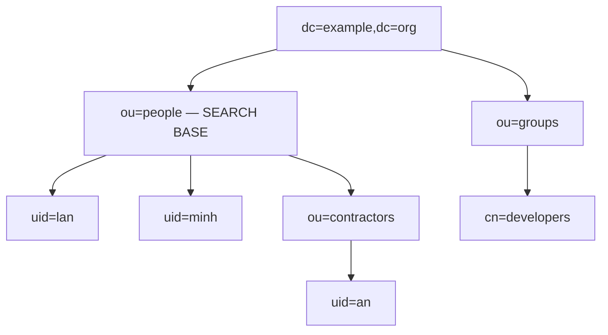

# Base object search và tìm chính entry làm base

Trong chương **Search scope** của module **SPRING_LDAP**, ta tìm hiểu cách giới hạn những entry được máy chủ LDAP xem xét khi tìm kiếm. **Base object search** là kiểu tìm kiếm chỉ xét **chính entry có Distinguished Name (DN) bằng search base**. Nó hữu ích khi ứng dụng đã biết DN và muốn kiểm tra entry đó có thỏa một LDAP filter hay không, mà không truy vấn các entry con hoặc cùng cấp.

Spring LDAP hỗ trợ thực hiện truy vấn qua `LdapTemplate`, API fluent `LdapClient` và mô hình ODM. Bất kể dùng API nào, hành vi LDAP vẫn dựa trên bộ ba **base DN – search scope – filter**. Bài học làm rõ base object search, so sánh với `lookup()` và các scope còn lại, minh họa bằng Java, đồng thời đề cập cấu hình `ContextSource`, quyền truy cập, TLS và xử lý lỗi để thao tác với dịch vụ thư mục an toàn.

**Kết quả mong đợi**

Sau bài học, bạn có thể:

1. Xác định entry nào được xét khi dùng phạm vi `OBJECT_SCOPE`.
2. Phân biệt `OBJECT_SCOPE`, `ONELEVEL_SCOPE` và `SUBTREE_SCOPE` bằng cây LDAP cụ thể.
3. Hiểu vì sao filter có thể không khớp dù entry con thỏa điều kiện.
4. Viết base object search bằng `LdapQueryBuilder` hoặc `SearchControls`.
5. Phân biệt `lookup` không có filter với `search` tại một DN có filter.
6. Xử lý DN tương đối, dữ liệu trả về, base không tồn tại, thiếu quyền và truy vấn an toàn.

## 1. Search base là entry mốc, không phải tập kết quả

LDAP lưu dữ liệu dưới dạng *Directory Information Tree* (DIT). Mỗi entry có một DN thể hiện vị trí trong cây, các thuộc tính và `objectClass` theo schema.

Xét cây thử nghiệm:

```text
dc=example,dc=org
├── ou=people
│   ├── uid=lan
│   ├── uid=minh
│   └── ou=contractors
│       └── uid=an
└── ou=groups
    └── cn=developers
```

DN của các entry trong nhánh người dùng:

```text
ou=people,dc=example,dc=org
uid=lan,ou=people,dc=example,dc=org
uid=minh,ou=people,dc=example,dc=org
ou=contractors,ou=people,dc=example,dc=org
uid=an,ou=contractors,ou=people,dc=example,dc=org
```

Giả sử một yêu cầu tìm kiếm có **search base**:

```text
ou=people,dc=example,dc=org
```

Search base là **DN của entry làm điểm mốc**. Nó không tự quyết định ta sẽ đọc entry này, đọc các entry con hay đọc toàn bộ cây con. Trách nhiệm đó thuộc về **scope**.

Entry tại chính base có thể được mô tả bằng LDIF:

```ldif
dn: ou=people,dc=example,dc=org
objectClass: top
objectClass: organizationalUnit
ou: people
description: Nhanh quan ly tai khoan nhan vien
```

Trong khi entry con Lan là một entry **khác**:

```ldif
dn: uid=lan,ou=people,dc=example,dc=org
objectClass: top
objectClass: person
objectClass: organizationalPerson
objectClass: inetOrgPerson
uid: lan
cn: Nguyen Thi Lan
sn: Nguyen
mail: lan@example.org
```

Do đó, `ou=people` không tự có thuộc tính `uid=lan` chỉ vì nó chứa entry người dùng `uid=lan` bên dưới.

## 2. Khái niệm base object search

Trong LDAP SearchRequest, **baseObject** là tên entry mốc. Khi `scope` mang giá trị **baseObject (0)**, máy chủ chỉ đánh giá filter trên **đúng entry mốc**. JNDI biểu diễn scope này bằng:

```java
SearchControls.OBJECT_SCOPE
```

Ví dụ một truy vấn:

```text
baseObject: ou=people,dc=example,dc=org
scope:      baseObject
filter:     (objectClass=organizationalUnit)
attributes: ou, description
```

Ý nghĩa: truy cập entry tại `ou=people,dc=example,dc=org`, kiểm tra xem nó có thuộc `organizationalUnit` không, và nếu phù hợp thì yêu cầu trả `ou`, `description`. Các entry `uid=lan` hoặc `uid=minh` **không được xét**, dù ở ngay dưới OU.



Trong sơ đồ, ô `ou=people` là ứng viên duy nhất của base object search. Các ô nằm dưới chỉ xuất hiện để minh họa cây.

**Hệ quả quan trọng:**

- Nếu entry base tồn tại, được phép tìm kiếm và khớp filter, truy vấn trả về **một entry phù hợp**.
- Nếu entry base tồn tại nhưng **không khớp filter**, truy vấn không có entry phù hợp, dù con của entry đó có thể khớp.
- Nếu base DN không tồn tại, máy chủ thường trả lỗi `noSuchObject` (mã LDAP 32), tùy cách server và thư viện client xử lý.
- Nếu không có quyền, kết quả có thể là lỗi hoặc thông tin bị ẩn theo chính sách ACL của server.

**Base object search có tối đa một entry phù hợp** vì một DN chỉ xác định một vị trí entry tại một thời điểm. Một lần search vẫn có thể thất bại vì network, TLS, lỗi filter hay quyền truy cập; “tối đa một” không bảo đảm request luôn thành công.

## 3. Ba search scope cần phân biệt

| LDAP scope | JNDI hằng | Xét entry tại base? | Xét con trực tiếp? | Xét cấp sâu hơn? |
| --- | --- | --- | --- | --- |
| `baseObject (0)` | `SearchControls.OBJECT_SCOPE` | Có | Không | Không |
| `singleLevel (1)` | `SearchControls.ONELEVEL_SCOPE` | Không | Có | Không |
| `wholeSubtree (2)` | `SearchControls.SUBTREE_SCOPE` | Có | Có | Có |

Giữ nguyên base là `ou=people,dc=example,dc=org` và giả định mọi entry đều có `objectClass`, tài khoản có quyền đọc chúng. Với filter `(objectClass=*)`:

| Scope | Những entry có thể xuất hiện trong kết quả |
| --- | --- |
| `OBJECT_SCOPE` | Chỉ `ou=people,dc=example,dc=org`. |
| `ONELEVEL_SCOPE` | `uid=lan`, `uid=minh` và `ou=contractors` nằm ngay dưới `ou=people`. |
| `SUBTREE_SCOPE` | Cả entry `ou=people`, ba con trực tiếp và `uid=an` nằm dưới `ou=contractors`. |

Bây giờ vẫn giữ base nhưng đổi filter thành `(objectClass=inetOrgPerson)`:

- `OBJECT_SCOPE` cho kết quả rỗng nếu entry `ou=people` không thuộc lớp `inetOrgPerson`.
- `ONELEVEL_SCOPE` có thể trả `uid=lan` và `uid=minh`.
- `SUBTREE_SCOPE` có thể trả `uid=lan`, `uid=minh` và `uid=an`.

**Scope quyết định tập entry được kiểm tra; filter quyết định những entry nào trong tập đó được chọn.** Thuộc tính yêu cầu trả về chỉ quyết định dữ liệu client muốn nhận từ các entry phù hợp, không mở rộng tập ứng viên.

Để dự đoán kết quả, luôn hỏi theo thứ tự: **base ở đâu → scope xét những entry nào → filter khớp entry nào → quyền nào cho phép đọc kết quả**.

## 4. Tìm chính entry làm base: ba ví dụ

### Ví dụ A: kiểm tra OU có đúng object class

```text
Base:   ou=people,dc=example,dc=org
Scope:  baseObject
Filter: (objectClass=organizationalUnit)
```

Nếu entry OU có `objectClass=organizationalUnit`, truy vấn trả về chính OU. Đây là cách xác minh loại entry khi ta đã biết DN.

Nếu đổi filter thành `(uid=lan)`, kết quả rỗng. Entry Lan nằm **bên dưới** `ou=people` và không được xét.

### Ví dụ B: kiểm tra một người dùng đã biết DN

```text
Base:   uid=lan,ou=people,dc=example,dc=org
Scope:  baseObject
Filter: (&(objectClass=inetOrgPerson)(uid=lan))
```

Nếu entry Lan có các thuộc tính và object class phù hợp, nó có thể được trả về. Nếu đổi filter thành `(uid=minh)`, truy vấn **không chuyển qua entry Minh** vì entry Minh có DN khác.

### Ví dụ C: kiểm tra thuộc tính tại entry base

```text
Base:   ou=people,dc=example,dc=org
Scope:  baseObject
Filter: (ou=people)
```

Truy vấn kiểm tra giá trị `ou` của **chính OU**. Nó không thực hiện việc “liệt kê mọi OU có tên people” trong toàn bộ directory.

Một base object search có thể có filter phức tạp, ví dụ:

```text
(&(objectClass=inetOrgPerson)(uid=lan)(mail=*))
```

Nhưng dù filter chứa bao nhiêu điều kiện AND/OR/NOT, nó vẫn chỉ được đánh giá trên **entry tại base DN** khi scope là `baseObject`.

## 5. Base object search khác `lookup()` thế nào?

Cả hai đều có thể truy cập một DN cụ thể, nhưng thực hiện hai ý định khác nhau:

| Câu hỏi | `LdapTemplate.lookup()` | Search với `OBJECT_SCOPE` |
| --- | --- | --- |
| Có cần biết DN? | Có | Có, làm search base. |
| Có thể áp dụng filter LDAP? | Không theo chức năng `lookup` thông thường. | Có, filter được server đánh giá. |
| Có thể lấy thuộc tính của entry? | Có | Có, khi entry khớp filter. |
| Entry tồn tại nhưng không khớp filter | Không phải tình huống của lookup. | Không có search entry phù hợp. |
| Số entry trả về | Một entry theo DN hoặc lỗi. | 0 hoặc 1 entry phù hợp, hoặc lỗi. |
| Mục đích nên chọn | Đọc entry khi đã biết DN. | Xác nhận entry đã biết DN có thỏa điều kiện. |

Nếu muốn đọc tên của Lan từ DN đã biết, `lookup(dn, mapper)` thường rõ ràng nhất. Nếu muốn kiểm tra Lan có `objectClass=inetOrgPerson` **và** có `mail` hay không, base object search diễn tả điều kiện trong cùng SearchRequest.

Tuy nhiên, filter không thay thế phân quyền. Một yêu cầu ghi sau khi search vẫn phải kiểm tra tài khoản được phép sửa, dữ liệu hiện tại và khả năng entry đã thay đổi giữa bước tìm và bước cập nhật.

## 6. DN tương đối và base DN của `ContextSource`

Một ứng dụng Spring Boot có thể cấu hình nguồn kết nối LDAP như sau:

```yaml
spring:
  ldap:
    urls: ${LDAP_URL:ldaps://ldap.example.org:636}
    base: dc=example,dc=org
    username: ${LDAP_BIND_DN}
    password: ${LDAP_BIND_PASSWORD}
```

Phần password cần được cấp qua biến môi trường hoặc secret manager. Với LDAPS/StartTLS, phải xác minh chứng chỉ và kiểm tra cấu hình trust store; không vô hiệu hóa certificate validation để cho kết nối đi qua.

Khi `ContextSource` dùng `base=dc=example,dc=org`, các thao tác `LdapTemplate` thường nhận DN **tương đối với base này**:

| DN đầy đủ tại server | DN tương đối khi gọi `LdapTemplate` |
| --- | --- |
| `ou=people,dc=example,dc=org` | `ou=people` |
| `uid=lan,ou=people,dc=example,dc=org` | `uid=lan,ou=people` |
| `cn=developers,ou=groups,dc=example,dc=org` | `cn=developers,ou=groups` |

Vì vậy, muốn xét **chính `ou=people`**, đặt search base của truy vấn là `ou=people` và scope `OBJECT_SCOPE`. Không gắn lại `dc=example,dc=org` khi API đã áp dụng base của `ContextSource`, nếu không DN có thể bị lặp và truy cập sai vị trí.

**Hai khái niệm base:**

- **Base DN của `ContextSource`:** gốc logic cho các thao tác tương đối trong ứng dụng.
- **Search base của một truy vấn:** entry mốc cụ thể được chọn cho SearchRequest.

Scope `OBJECT_SCOPE` tìm chính **search base của truy vấn**, không nhất thiết tìm entry ở gốc của `ContextSource`.

## 7. Viết base object search bằng `LdapQueryBuilder`

Spring LDAP cung cấp `LdapQueryBuilder` để xây các thành phần tìm kiếm rõ ràng. Giả sử Spring đã cung cấp bean `LdapTemplate` và entry `ou=people` tồn tại:

```java
import java.util.List;

import javax.naming.directory.SearchControls;

import org.springframework.ldap.core.AttributesMapper;
import org.springframework.ldap.core.LdapTemplate;
import org.springframework.ldap.query.LdapQuery;
import org.springframework.ldap.query.LdapQueryBuilder;

public class BaseOuSearch {

    private final LdapTemplate ldapTemplate;

    public BaseOuSearch(LdapTemplate ldapTemplate) {
        this.ldapTemplate = ldapTemplate;
    }

    public List<String> findOuAtBase() {
        LdapQuery query = LdapQueryBuilder.query()
                .base("ou=people")
                .searchScope(SearchControls.OBJECT_SCOPE)
                .attributes("ou")
                .where("objectClass").is("organizationalUnit");

        return ldapTemplate.search(
                query,
                (AttributesMapper<String>) attrs -> {
                    if (attrs.get("ou") == null) {
                        throw new IllegalStateException(
                                "Entry OU thiếu thuộc tính ou");
                    }
                    return (String) attrs.get("ou").get();
                });
    }
}
```

Cách đọc đoạn mã:

1. `base("ou=people")` xác định entry mốc trong base của `ContextSource`.
2. `searchScope(SearchControls.OBJECT_SCOPE)` chỉ cho phép xét chính entry OU.
3. `attributes("ou")` giới hạn tập thuộc tính trả về.
4. `where("objectClass").is("organizationalUnit")` xây filter equality.
5. `ldapTemplate.search()` trả `List<String>`, mặc dù kết quả thực tế của `OBJECT_SCOPE` có tối đa một entry.

Nếu entry không khớp filter, danh sách có thể rỗng. Nếu DN không tồn tại hoặc server từ chối, ứng dụng phải xử lý lỗi cụ thể; không coi mọi lỗi là kết quả rỗng.

Trong ứng dụng, có thể chuyển danh sách 0/1 phần tử thành `Optional` sau khi đã phân biệt lỗi LDAP với trường hợp filter không khớp. Không nên dùng `get(0)` khi chưa kiểm tra kích thước.

## 8. Cách dùng `SearchControls` với `LdapTemplate`

JNDI cung cấp `SearchControls` để cấu hình scope, attribute, số kết quả và thời gian. Spring LDAP có overload tìm kiếm nhận đối tượng controls:

```java
import java.util.List;
import javax.naming.directory.Attributes;
import javax.naming.directory.SearchControls;

import org.springframework.ldap.core.AttributesMapper;
import org.springframework.ldap.core.LdapTemplate;

public class BaseOuDescriptionSearch {

    private final LdapTemplate ldapTemplate;

    public BaseOuDescriptionSearch(LdapTemplate ldapTemplate) {
        this.ldapTemplate = ldapTemplate;
    }

    public List<String> descriptions() {
        SearchControls controls = new SearchControls();
        controls.setSearchScope(SearchControls.OBJECT_SCOPE);
        controls.setReturningAttributes(new String[] {"description"});
        controls.setCountLimit(1);
        controls.setTimeLimit(3000);

        return ldapTemplate.search(
                "ou=people",
                "(objectClass=organizationalUnit)",
                controls,
                (AttributesMapper<String>) (Attributes attrs) ->
                        attrs.get("description") == null
                                ? null
                                : (String) attrs.get("description").get());
    }
}
```

Trong ví dụ này:

- `setSearchScope(OBJECT_SCOPE)` là phần quyết định truy vấn chỉ xét entry base.
- `setReturningAttributes(...)` chỉ yêu cầu `description`. Nếu attribute tùy chọn vắng mặt, mapper cần xử lý phù hợp với nghiệp vụ.
- `setCountLimit(1)` là giới hạn kết quả; với base object search, số entry ứng viên đã tối đa bằng một.
- `setTimeLimit(3000)` đặt thời gian tìm kiếm tính bằng mili giây theo API JNDI. Nó không thay thế timeout kết nối, socket hay chính sách timeout của máy chủ.

Việc ghi tường minh `OBJECT_SCOPE` giúp tránh nhầm với giá trị mặc định của API hoặc một `SearchControls` được tái sử dụng từ truy vấn khác.

### Dùng `ContextMapper` khi cần thông tin của entry

Nếu cần `DirContextOperations` (ví dụ đọc thuộc tính nhiều giá trị hoặc xử lý thông tin ngữ cảnh), Spring LDAP có overload `search` nhận `ContextMapper`:

```java
import java.util.List;
import javax.naming.directory.SearchControls;

import org.springframework.ldap.core.ContextMapper;
import org.springframework.ldap.core.DirContextOperations;
import org.springframework.ldap.core.LdapTemplate;
import org.springframework.ldap.query.LdapQuery;
import org.springframework.ldap.query.LdapQueryBuilder;

record OuInfo(String organizationalUnit, String description) {}

public class OuInfoService {
    private final LdapTemplate ldapTemplate;

    public OuInfoService(LdapTemplate ldapTemplate) {
        this.ldapTemplate = ldapTemplate;
    }

    public List<OuInfo> findOuInfo() {
        LdapQuery query = LdapQueryBuilder.query()
                .base("ou=people")
                .searchScope(SearchControls.OBJECT_SCOPE)
                .attributes("ou", "description")
                .where("objectClass").is("organizationalUnit");

        return ldapTemplate.search(query,
                (ContextMapper<OuInfo>) context -> {
                    DirContextOperations entry = (DirContextOperations) context;
                    return new OuInfo(
                            entry.getStringAttribute("ou"),
                            entry.getStringAttribute("description"));
                });
    }
}
```

Để dùng ví dụ trong một dự án thực, cần đối chiếu chữ ký overload theo phiên bản Spring LDAP. API `LdapClient` có thể diễn đạt tìm kiếm theo phong cách fluent, nhưng vẫn cần đặt đúng base, scope và filter; ODM không biến truy vấn scope base thành tìm kiếm toàn cây.

## 9. Tạo DN động đúng cách

Nếu muốn tìm **chính entry người dùng** bằng DN được xây từ UID, không nên nối chuỗi trực tiếp từ đầu vào:

```java
// Không ghép DN theo cách này với dữ liệu từ request:
String unsafeDn = "uid=" + userInput + ",ou=people";
```

DN có thể chứa các ký tự cần escape (`,`, `+`, `\`...). Spring LDAP cung cấp `LdapNameBuilder` để xây từng RDN:

```java
import java.util.List;
import javax.naming.Name;
import javax.naming.directory.SearchControls;

import org.springframework.ldap.core.AttributesMapper;
import org.springframework.ldap.core.LdapTemplate;
import org.springframework.ldap.support.LdapNameBuilder;

public class ExactPersonSearch {

    private final LdapTemplate ldapTemplate;

    public ExactPersonSearch(LdapTemplate ldapTemplate) {
        this.ldapTemplate = ldapTemplate;
    }

    public List<String> findName(String userInput) {
        Name relativeDn = LdapNameBuilder.newInstance("ou=people")
                .add("uid", userInput)
                .build();

        SearchControls controls = new SearchControls();
        controls.setSearchScope(SearchControls.OBJECT_SCOPE);
        controls.setReturningAttributes(new String[] {"cn"});
        controls.setCountLimit(1);

        return ldapTemplate.search(
                relativeDn,
                "(objectClass=inetOrgPerson)",
                controls,
                (AttributesMapper<String>) attrs ->
                        (String) attrs.get("cn").get());
    }
}
```

Nếu `userInput` là `lan`, entry mốc là `uid=lan,ou=people` tương đối với base đã cấu hình. Nếu `uid=lan` có lớp `inetOrgPerson`, kết quả có thể chứa tên của Lan. Truy vấn **không** tìm một người dùng khác khi DN này không khớp.

**Escaping DN và escaping filter là hai quy tắc khác nhau.** Nếu filter cũng chứa đầu vào động, dùng `LdapQueryBuilder` hoặc API hỗ trợ parameter/escaping phù hợp; không tự chèn đầu vào vào chuỗi như `"(uid=" + userInput + ")"`. Ngoài escaping, còn phải kiểm tra UID hợp lệ, OU được phép truy cập và quyền của tài khoản bind.

## 10. Filter không khớp khác entry không tồn tại

Giả sử hai truy vấn sau có cùng `OBJECT_SCOPE`:

```text
Truy vấn 1:
Base:   uid=lan,ou=people,dc=example,dc=org
Filter: (uid=minh)

Truy vấn 2:
Base:   uid=khongco,ou=people,dc=example,dc=org
Filter: (objectClass=*)
```

**Truy vấn 1:** entry Lan có thể tồn tại nhưng không khớp filter `uid=minh`, nên không có kết quả phù hợp.

**Truy vấn 2:** DN `uid=khongco` có thể không tồn tại; server thường báo `noSuchObject`, có thể được Spring LDAP chuyển thành exception phù hợp.

Bên cạnh đó, tài khoản bind có thể không có quyền đọc/search tại nhánh đang truy cập. Tùy ACL, server có thể trả lỗi hoặc che giấu thông tin về entry. Không dựa vào một danh sách rỗng để kết luận chắc chắn entry đã bị xóa.

| Hiện tượng | Khả năng | Kiểm tra và xử lý |
| --- | --- | --- |
| Kết quả search rỗng | Filter không khớp entry tại base. | Kiểm tra base, scope và filter; không tự mở rộng scope nếu nghiệp vụ chỉ xét một DN. |
| LDAP `noSuchObject` (32) | Base DN không có, hoặc DN/nhánh không đúng. | Xác minh DN tương đối với `ContextSource` và dữ liệu trên server. |
| LDAP `insufficientAccessRights` (50) | Tài khoản bind không đủ quyền. | Kiểm tra ACL; không nâng quyền vượt nhu cầu. |
| Lỗi filter | Filter có cú pháp sai hoặc giá trị chưa escape. | Xây bằng query builder và kiểm tra đầu vào. |
| Lỗi DN | Sai RDN, dấu phân cách hoặc base bị lặp. | Dùng `LdapNameBuilder`, kiểm tra cấu trúc cây. |
| Timeout/kết nối/TLS | Không liên lạc hoặc không hoàn tất truy vấn. | Kiểm tra chứng chỉ, timeout và kết nối/pooling. |

Có thể ghi log loại lỗi và DN ở mức được phép, nhưng không ghi mật khẩu bind, token hoặc thuộc tính nhạy cảm. Với API công khai, thông báo lỗi cũng phải tuân thủ yêu cầu tránh tiết lộ sự tồn tại của tài khoản.

## 11. Root DSE cũng dùng scope base, nhưng cần hiểu DN rỗng

LDAP có entry đặc biệt **Root DSE**, thường cung cấp thông tin về năng lực máy chủ, naming contexts và các control hỗ trợ. Truy vấn Root DSE ở mức giao thức dùng **base DN rỗng** và scope `baseObject`:

```text
baseObject: ""
scope:      baseObject
filter:     (objectClass=*)
attributes: namingContexts, supportedLDAPVersion, supportedControl
```

Điểm cần phân biệt:

- Root DSE của server **không phải** entry nghiệp vụ `dc=example,dc=org`.
- Nếu `ContextSource` đã thiết lập `base=dc=example,dc=org`, search base `""` trong một API xử lý DN tương đối **có thể trỏ tới entry của base cấu hình**, không phải Root DSE của máy chủ.
- Để đọc Root DSE, phải dùng kết nối hoặc API cho phép truy cập DN rỗng thực của server theo hợp đồng API; không tự giả định `base("")` luôn có nghĩa Root DSE.
- Thuộc tính trả về của Root DSE phụ thuộc server và quyền. Không nên chạy subtree search tại root server chỉ để đọc metadata.

Trường hợp Root DSE giúp thấy rằng **scope base luôn có nghĩa xét entry tại DN đã xác định**, dù entry đó là OU thông thường, người dùng hay entry đặc biệt ở gốc giao thức.

## 12. Tác động tới hiệu năng và bảo mật

`OBJECT_SCOPE` có tập ứng viên tối đa một entry nên đặc biệt phù hợp khi đã biết DN. Tuy nhiên, nó không thay thế thiết kế kết nối và phân quyền:

1. **Thu hẹp phạm vi có chủ đích.** Không dùng `SUBTREE_SCOPE` để xác minh một DN đã biết khi không cần duyệt con.
2. **Chỉ yêu cầu attribute cần dùng.** Đọc `ou` hoặc `description` không đồng nghĩa nên tải cả dữ liệu nhạy cảm của entry.
3. **Dùng tài khoản bind quyền tối thiểu.** Scope hẹp không cho phép vượt ACL. Những chức năng ghi bằng `modifyAttributes`/`bind` cần quyền riêng phù hợp.
4. **Bảo vệ kết nối.** Sử dụng LDAPS hoặc StartTLS với xác minh chứng chỉ, secret manager cho tài khoản dịch vụ và timeout thích hợp.
5. **Kiểm tra filter và DN.** Xây DN bằng API RDN; xây filter bằng builder hoặc cơ chế escape chuẩn. Scope nhỏ không tự loại bỏ lỗi injection.
6. **Hiểu giới hạn `SearchControls`.** `countLimit(1)` không đổi ý nghĩa `OBJECT_SCOPE`; `timeLimit` không thay thế timeout TCP/TLS.
7. **Không dùng kết quả đọc như khóa trạng thái.** Một entry có thể thay đổi sau khi search. Nếu quyết định cập nhật dựa trên kết quả trước đó, cần xử lý cập nhật đồng thời theo khả năng máy chủ.
8. **Đo lường đúng chỗ.** Thời gian truy vấn còn phụ thuộc mạng, TLS, connection pooling, kiểm tra quyền và server; scope base không đảm bảo độ trễ luôn nhỏ.

Nếu chưa biết DN người dùng mà chỉ biết UID, thường cần search từ OU thích hợp với `ONELEVEL_SCOPE` hoặc `SUBTREE_SCOPE` và filter như `(uid=lan)`. `OBJECT_SCOPE` không tự định vị một UID ở bất kỳ đâu trong cây.

## 13. Kiểm thử chính entry làm base

Với LDAP thử nghiệm có dữ liệu ở mục 1, tạo một số ca kiểm thử đảm bảo hành vi không phụ thuộc suy đoán:

| Ca kiểm thử | Base / Scope / Filter | Kỳ vọng |
| --- | --- | --- |
| Trúng entry OU | `ou=people` / `OBJECT_SCOPE` / `(objectClass=organizationalUnit)` | Một entry OU phù hợp. |
| Không quét con | `ou=people` / `OBJECT_SCOPE` / `(uid=lan)` | Không trả entry Lan. |
| Trúng người dùng | `uid=lan,ou=people` / `OBJECT_SCOPE` / `(uid=lan)` | Một entry Lan phù hợp. |
| Entry đúng DN nhưng filter sai | `uid=lan,ou=people` / `OBJECT_SCOPE` / `(uid=minh)` | Không có entry phù hợp. |
| Con trực tiếp | `ou=people` / `ONELEVEL_SCOPE` / `(objectClass=inetOrgPerson)` | Lan, Minh; không có An ở tầng sâu. |
| Cây con | `ou=people` / `SUBTREE_SCOPE` / `(objectClass=inetOrgPerson)` | Lan, Minh, An. |
| Base không tồn tại | `uid=khongco,ou=people` / `OBJECT_SCOPE` / `(objectClass=*)` | Lỗi/kết quả theo server, cần ghi nhận và xử lý. |
| Thiếu quyền | Tài khoản bị hạn chế / `OBJECT_SCOPE` / filter hợp lệ | Kết quả hoặc lỗi theo ACL, không vượt quyền. |

Khi test, dùng OU tách biệt khỏi dữ liệu thật, tài khoản quyền hạn hẹp và chứng chỉ TLS đúng cấu hình. Để kiểm thử trường hợp **không quét con**, cần có ít nhất một entry con thật sự khớp filter, sau đó khẳng định base object search vẫn không trả entry con đó.

### Ví dụ khẳng định hành vi trong Java

Đây là phác thảo đoạn kiểm thử tích hợp; `ldapTemplate` trỏ tới directory thử nghiệm có dữ liệu như mô tả:

```java
LdapQuery query = LdapQueryBuilder.query()
        .base("ou=people")
        .searchScope(SearchControls.OBJECT_SCOPE)
        .where("uid").is("lan");

List<String> names = ldapTemplate.search(
        query,
        (AttributesMapper<String>) attrs ->
                (String) attrs.get("uid").get());

org.junit.jupiter.api.Assertions.assertTrue(names.isEmpty());
// OU không mang uid=lan; Lan là entry con.
```

Với filter không khớp, ví dụ này nhằm kiểm tra quy tắc scope, không khẳng định server đã trả tất cả thuộc tính hoặc người dùng Lan tồn tại. Bên cạnh kiểm thử ánh xạ `AttributesMapper`, kiểm thử tích hợp cần xác nhận thực tế scope và cách server trả lỗi.

## 14. Bài tập tự đánh giá

**Bài tập 1 — Xác định ứng viên**

Cho base `ou=people,dc=example,dc=org`, filter `(objectClass=*)` và cây trong mục 1. Hãy liệt kê những entry nằm trong phạm vi của `OBJECT_SCOPE`, `ONELEVEL_SCOPE` và `SUBTREE_SCOPE`.

**Bài tập 2 — Giữ filter, đổi base**

Giữ filter `(uid=lan)` và `OBJECT_SCOPE`. Dự đoán kết quả khi base lần lượt là:

1. `ou=people,dc=example,dc=org`.
2. `uid=lan,ou=people,dc=example,dc=org`.
3. `uid=minh,ou=people,dc=example,dc=org`.

Giải thích vì sao kết quả khác nhau dù filter không đổi.

**Bài tập 3 — Chọn API**

Ứng dụng đã biết DN `uid=lan,ou=people`. Chọn giữa `lookup` và base object search cho hai yêu cầu: (a) đọc `cn`; (b) chỉ xử lý khi entry có `objectClass=inetOrgPerson` và `mail` tồn tại.

**Bài tập 4 — Viết mã**

Với `ContextSource.base=dc=example,dc=org`, viết `LdapQueryBuilder` kiểm tra entry `ou=groups` có object class `organizationalUnit`, scope `OBJECT_SCOPE` và chỉ lấy thuộc tính `ou`.

**Bài tập 5 — Chẩn đoán lỗi**

Một người dùng đưa DN đầy đủ `uid=lan,ou=people,dc=example,dc=org` vào `LdapTemplate` đã cấu hình base `dc=example,dc=org`. Truy vấn báo không tìm thấy entry. Hãy chỉ ra nguyên nhân có thể có và cách xây DN an toàn hơn từ UID.

### Đáp án gợi ý

1. `OBJECT_SCOPE` chỉ xét `ou=people`. `ONELEVEL_SCOPE` xét Lan, Minh và OU contractors. `SUBTREE_SCOPE` xét OU people, Lan, Minh, OU contractors và An.
2. Base OU không khớp `uid=lan`; base tại Lan có thể khớp; base tại Minh không khớp. `OBJECT_SCOPE` chỉ xét entry ở chính base.
3. (a) Dùng `lookup`. (b) Dùng search `OBJECT_SCOPE` với filter `(&(objectClass=inetOrgPerson)(mail=*))` hoặc một cơ chế xác minh tương đương có phân quyền phù hợp.
4. Ví dụ:
   ```java
   LdapQuery query = LdapQueryBuilder.query()
           .base("ou=groups")
           .searchScope(SearchControls.OBJECT_SCOPE)
           .attributes("ou")
           .where("objectClass").is("organizationalUnit");
   ```
5. Có thể bị lặp `dc=example,dc=org` ở đường dẫn tương đối. Xây `LdapNameBuilder.newInstance("ou=people").add("uid", "lan").build()` để được `uid=lan,ou=people`.

## 15. Ghi nhớ

- **Base object search xét chính entry tại search base**, không xét các entry con.
- `OBJECT_SCOPE` khác `ONELEVEL_SCOPE` (chỉ con trực tiếp) và `SUBTREE_SCOPE` (base cùng toàn bộ hậu duệ).
- Scope xác định **entry nào được kiểm tra**; filter xác định **entry nào được trả về** trong số đó.
- `lookup` thích hợp khi muốn đọc một entry theo DN. Search `OBJECT_SCOPE` thích hợp khi cần server kiểm tra thêm filter trên entry đã biết DN.
- DN dùng trong `LdapTemplate` phải phù hợp với base DN của `ContextSource`. Dùng `LdapNameBuilder` cho DN động và API tạo filter an toàn khi có giá trị đầu vào.
- Không khớp filter, base không tồn tại và thiếu quyền là các trường hợp có ý nghĩa khác nhau; cần xử lý lỗi LDAP và quyền truy cập đúng.
- Giới hạn search scope giúp truy vấn rõ ràng nhưng không thay thế TLS, phân quyền, kiểm tra schema, timeout và kiểm thử tích hợp.

**Tài liệu tham khảo:** RFC 4511 (*Lightweight Directory Access Protocol: The Protocol* — SearchRequest và search scope), RFC 4512 (*LDAP Directory Information Models*), Javadoc `javax.naming.directory.SearchControls` và tài liệu Spring LDAP cho `LdapTemplate`, `LdapQueryBuilder`, `ContextSource`.


