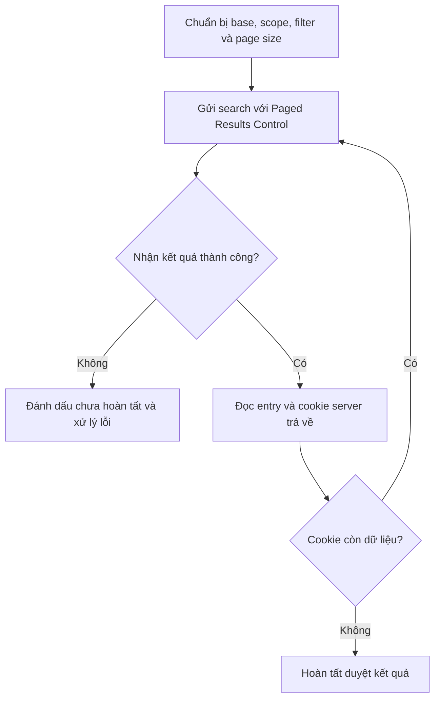

# Giới hạn số kết quả và thời gian tìm kiếm

Khi tìm kiếm trên LDAP, câu hỏi không chỉ là **“entry nào khớp filter?”** mà còn là **“cho phép trả về bao nhiêu entry và truy vấn được chạy trong bao lâu?”**. Một filter đúng vẫn có thể gây tốn tài nguyên nếu search base quá rộng, scope không phù hợp hoặc điều kiện không tận dụng được chỉ mục của LDAP server.

Trong chương **Search scope** của mô-đun **SPRING_LDAP**, bài này tập trung vào hai giới hạn của phép tìm kiếm: **size limit** (giới hạn số entry kết quả) và **time limit** (giới hạn thời gian xử lý tìm kiếm). Kiến thức này được ứng dụng trực tiếp khi dùng `LdapTemplate`, `LdapClient`, cấu hình `ContextSource`, xử lý ngoại lệ và kiểm thử truy cập LDAP an toàn.

**Sau bài học, bạn có thể:**

- Phân biệt `sizeLimit`, `timeLimit`, giới hạn do server áp đặt và timeout kết nối/mạng.
- Hiểu chính xác ý nghĩa giá trị `0` trong LDAP SearchRequest và `SearchControls` của Java.
- Đặt giới hạn bằng `ldapsearch` và Spring LDAP, đồng thời đọc kết quả khi vượt giới hạn.
- Quyết định khi nào cần thu hẹp base/scope/filter, phân trang hoặc đổi thiết kế truy vấn.
- Kiểm thử đường đi bình thường, vượt hạn mức, hết thời gian và quyền truy cập bị giới hạn.

## 1. Bối cảnh: một truy vấn LDAP gồm những gì?

Giả sử LDAP server quản lý 300.000 nhân viên dưới nhánh `ou=People,dc=example,dc=org`, gồm nhiều OU con theo địa điểm và đơn vị. Ứng dụng cần tìm người đang làm việc tại một đơn vị cụ thể.

Một LDAP SearchRequest có các thành phần quan trọng:

| Thành phần | Ví dụ | Tác dụng |
| --- | --- | --- |
| Search base | `ou=People,dc=example,dc=org` | Xác định entry gốc của vùng tìm kiếm |
| Search scope | `SUBTREE` | Bao gồm base và mọi entry hậu duệ |
| Filter | `(&(objectClass=inetOrgPerson)(departmentNumber=ENG))` | Chọn các entry thỏa điều kiện |
| Attributes | `uid`, `cn`, `mail` | Chọn trường cần trả về |
| Size limit | `50` | Client yêu cầu tối đa 50 entry kết quả |
| Time limit | `5` giây | Client yêu cầu giới hạn thời gian tìm kiếm tại LDAP server |
| Deref aliases | Tùy cấu hình | Quyết định cách xử lý alias trong truy vấn |

Lưu ý: **search base/scope/filter xác định các entry cần xét và entry có thể khớp; size/time limit giới hạn nguồn lực và lượng kết quả của phép tìm kiếm**. Những thành phần này bổ sung cho nhau, không thay thế nhau.

Ví dụ, nếu filter khớp 10.000 entry nhưng size limit là 50, ứng dụng không được xem 50 entry nhận được là **toàn bộ** kết quả. Nếu phép tìm kiếm mất quá lâu, server có thể kết thúc với lỗi giới hạn thời gian ngay cả khi client đã nhận được một phần entry.

## 2. Size limit: giới hạn số entry được trả về

Theo mô hình SearchRequest trong **RFC 4511**, `sizeLimit` là số entry kết quả tối đa mà client yêu cầu server trả về cho một phép tìm kiếm.

```text
Ứng dụng tìm các nhân viên phòng ENG
          |
          v
      LDAP search
          |
          v
  2.400 entry khớp filter
          |
          | sizeLimit = 50
          v
    Tối đa 50 entry
    và trạng thái kết thúc từ server
```

### 2.1. Size limit đếm entry, không đếm attribute

Một entry có:

- `cn`: một giá trị;
- `mail`: hai giá trị;
- `memberOf`: hàng chục giá trị (nếu server hỗ trợ);

vẫn là **một entry kết quả**, không phải hàng chục kết quả vì có nhiều attribute/giá trị.

Nếu một nhóm chứa 5.000 giá trị `member` và truy vấn trả về đúng **một entry nhóm**, `sizeLimit = 1` chưa chắc làm phản hồi nhỏ: dữ liệu của một entry có thể rất lớn. Vì vậy, cần giới hạn cả **số entry** và **danh sách thuộc tính cần đọc**.

### 2.2. Giá trị `0` có nghĩa gì?

Trong LDAP SearchRequest:

- `sizeLimit = 0`: **client không yêu cầu một giới hạn số entry cụ thể**.
- `sizeLimit = N` với `N > 0`: client yêu cầu tối đa `N` entry.

**`0` không có nghĩa server bắt buộc trả về tất cả entry.** Server vẫn có thể có giới hạn mặc định hoặc giới hạn quản trị theo tài khoản, loại tìm kiếm, chi phí truy vấn hay cấu hình triển khai.

Ví dụ:

| Client yêu cầu | Server cho phép tối đa | Điều có thể xảy ra |
| --- | --- | --- |
| `sizeLimit = 20` | 1.000 | Truy vấn dừng theo yêu cầu 20 nếu còn nhiều entry |
| `sizeLimit = 0` | 500 | Server vẫn có thể dừng khi chạm 500 |
| `sizeLimit = 2.000` | 500 | Giới hạn server có thể được áp dụng trước |
| `sizeLimit = 20` | 500 | Nếu chỉ có 12 entry khớp, có thể trả đủ 12 và thành công |

Không nên giả định kết quả là tập “20 entry đầu tiên” ổn định giữa các lần chạy. Nếu không có cơ chế sắp xếp phù hợp do server hỗ trợ, **thứ tự trả về không phải thứ tự nghiệp vụ được bảo đảm**.

### 2.3. Size limit khác phân trang

`sizeLimit = 50` không có nghĩa “trang thứ nhất của 50 kết quả” theo giao thức LDAP thông thường. Nó là **một giới hạn cho phép tìm kiếm**.

Muốn duyệt nhiều trang, client cần cơ chế như **Simple Paged Results** (RFC 2696), nếu server hỗ trợ, cùng cách quản lý cookie phân trang. **Page size = 50** và **size limit = 50** là hai ý niệm khác nhau:

| Tiêu chí | Size limit | Page size |
| --- | --- | --- |
| Mục đích | Hạn chế số entry trong một phép tìm kiếm | Chia luồng kết quả thành các đợt |
| Khi cần hơn 50 entry | Truy vấn có thể bị giới hạn | Có thể yêu cầu trang tiếp theo nếu server hỗ trợ |
| Cần cookie phân trang? | Không | Thường có |
| Có bỏ qua giới hạn server? | Không | Không |

## 3. Time limit: giới hạn thời gian tìm kiếm

Trong **RFC 4511**, `timeLimit` của SearchRequest tính theo **giây**. Giá trị `0` có nghĩa client không chỉ định giới hạn thời gian xử lý tìm kiếm. Server vẫn có thể áp đặt giới hạn của riêng mình.

```text
Client gửi search request (timeLimit = 5 giây)
                   |
                   v
         Server bắt đầu tìm kiếm
                   |
             quét / dùng index
                   |
       +-----------+------------+
       |                        |
  Hoàn thành trước hạn      Vượt giới hạn
       |                        |
  Trả entry + success       Có thể trả entry
                           rồi báo lỗi timeLimitExceeded
```

### 3.1. Đơn vị thời gian dễ nhầm

| API/công cụ | Tham số | Đơn vị |
| --- | --- | --- |
| LDAP SearchRequest (RFC 4511) | `timeLimit` | **Giây** |
| OpenLDAP `ldapsearch` | `-l 5` | **Giây** |
| JNDI `SearchControls` | `setTimeLimit(5000)` | **Mili giây** |
| Spring LDAP query API | `timeLimit(5000)` | Thường truyền qua JNDI SearchControls, theo **mili giây** |

Trong Java, `SearchControls.setTimeLimit(5000)` biểu diễn **5.000 ms**, tương ứng 5 giây. Đừng truyền `5` nếu ý định là 5 giây trong API đó.

Khi ánh xạ giữa API mili giây của Java và giới hạn giây của LDAP protocol, độ chính xác/việc làm tròn có thể phụ thuộc provider và server. Thêm nữa, thời gian trả kết quả mà ứng dụng quan sát còn gồm độ trễ mạng và các bước xử lý phía client. **Đừng dùng LDAP time limit như đồng hồ chính xác tuyệt đối cho toàn bộ HTTP request.**

### 3.2. Time limit không phải network timeout

Một ứng dụng Spring có thể chịu nhiều giới hạn thời gian khác nhau:

| Cơ chế | Áp dụng ở đâu | Ví dụ tình huống |
| --- | --- | --- |
| LDAP `timeLimit` | Thời gian server được phép xử lý search request | Filter quá rộng, index không phù hợp |
| Connect timeout | Thời gian client chờ kết nối đến LDAP server | Máy chủ không phản hồi bắt tay TCP |
| Read timeout | Thời gian client chờ dữ liệu phản hồi từ kết nối | Mạng chậm, server ngừng gửi |
| Timeout của API/HTTP request | Deadline toàn bộ request ứng dụng | Ứng dụng phải trả lời trong giới hạn SLA |
| Deadline nghiệp vụ hoặc job | Giới hạn của cả công việc gồm nhiều lần tìm kiếm | Đồng bộ định kỳ quá thời gian cho phép |

Ví dụ, đặt `timeLimit = 3` giây cho LDAP search **không bảo đảm** lời gọi ứng dụng luôn kết thúc trong 3 giây: việc tạo kết nối, bắt tay TLS, xác thực, gửi dữ liệu hoặc xử lý nhiều thao tác có thể làm tổng thời gian dài hơn.

Với JNDI LDAP provider, các cấu hình như `com.sun.jndi.ldap.connect.timeout` và `com.sun.jndi.ldap.read.timeout` thường được dùng để kiểm soát kết nối và đọc, nhưng chúng **khác mục đích** với `SearchControls.setTimeLimit(...)`. Cách cấu hình cuối cùng phải tương thích phiên bản Java, LDAP driver và `ContextSource` đang dùng.

## 4. Giới hạn client và giới hạn server tương tác thế nào?

**Client-requested limit** là mức ứng dụng mong muốn. **Server-enforced limit** là mức giới hạn thực tế do LDAP server áp dụng theo cấu hình, chính sách hoặc tài khoản truy cập.

Ví dụ hệ thống yêu cầu:

- Người dùng bình thường: tìm tối đa 500 entry trong một lần search.
- Tài khoản đồng bộ: có thể được cấp hạn mức cao hơn.
- Truy vấn client đặt `sizeLimit = 100` và `timeLimit = 5` giây.

Về mặt hành vi, server có thể kết thúc khi chạm giới hạn **chặt hơn** trong các giới hạn liên quan. Tuy nhiên, cách thông báo và cơ chế chính xác tùy LDAP server, loại giới hạn và giao thức/điều khiển hỗ trợ.

Một số nguyên nhân phổ biến:

1. **Giới hạn theo server:** số entry tối đa, thời gian truy vấn, chi phí hoặc số bản ghi được kiểm tra.
2. **Giới hạn theo người dùng/tài khoản:** bind user khác nhau có quyền và quota khác nhau.
3. **Giới hạn từ client:** giá trị `sizeLimit` / `timeLimit` trong request.
4. **Cấu hình giới hạn ứng dụng:** ví dụ API chỉ cho trả tối đa 50 bản ghi bất kể LDAP có thể trả nhiều hơn.
5. **Giới hạn tài nguyên:** mạng, bộ nhớ, số kết nối, số truy vấn đồng thời.

### 4.1. Giá trị `0` không phải “vô hạn” trong mọi lớp

Ví dụ:

```text
Client: sizeLimit = 0, timeLimit = 0
Server: max 500 entries, 10 seconds/search
Application API: max 50 items/response
```

Trong tình huống này, client **không yêu cầu giới hạn LDAP cụ thể**, nhưng server vẫn có thể áp đặt 500 entry và 10 giây; còn ứng dụng chỉ trả tối đa 50 item cho người dùng cuối. Ba tầng giới hạn phục vụ ba mục tiêu khác nhau.

### 4.2. Thu hẹp truy vấn hiệu quả hơn chỉ tăng limit

Khi có quá nhiều entry, các cải tiến thường hữu ích là:

- Dùng base DN sát vùng dữ liệu: `ou=Engineering,ou=People,...` thay vì bắt đầu ở suffix lớn nếu nghiệp vụ chỉ liên quan Engineering.
- Chọn scope `BASE` hoặc `ONELEVEL` khi không cần toàn bộ `SUBTREE`.
- Dùng filter đủ cụ thể và các thuộc tính có matching rule phù hợp.
- Tránh yêu cầu toàn bộ attribute không cần thiết; chỉ lấy `uid`, `cn` cho màn hình danh sách.
- Đối với tập dữ liệu lớn, xét phân trang nếu server hỗ trợ.
- Trao đổi với quản trị viên về index và kế hoạch truy vấn, thay vì chỉ nâng giới hạn toàn hệ thống.

**Lưu ý:** tăng limit có thể tăng tài nguyên cần dùng và làm nặng hệ thống. Các thuộc tính không được lập index hoặc phép so khớp tốn kém có thể khiến search chậm ngay cả khi chỉ cần vài entry kết quả.

## 5. Thử nghiệm với `ldapsearch`

OpenLDAP `ldapsearch` có hai tùy chọn thường dùng:

- `-z <số>`: size limit, tính theo **số entry**.
- `-l <số>`: time limit, tính theo **giây**.

Ví dụ tìm tối đa 50 entry trong vòng 5 giây xử lý LDAP search:

```bash
ldapsearch -LLL -x -H "ldaps://ldap.example.org:636" \
  -D "cn=reader,ou=ServiceAccounts,dc=example,dc=org" -W \
  -b "ou=People,dc=example,dc=org" \
  -s sub -z 50 -l 5 \
  "(&(objectClass=inetOrgPerson)(departmentNumber=ENG))" \
  uid cn mail
```

Giải thích:

| Thành phần | Ý nghĩa |
| --- | --- |
| `-H ldaps://...` | Kết nối LDAP qua TLS từ đầu phiên |
| `-D ... -W` | Bind bằng DN tài khoản đọc, nhập mật khẩu qua prompt |
| `-b ...` | Base DN |
| `-s sub` | Search scope toàn cây con |
| `-z 50` | Yêu cầu giới hạn 50 entry |
| `-l 5` | Yêu cầu giới hạn tìm kiếm 5 giây |
| Filter | Chọn người dùng thuộc phòng ENG |
| `uid cn mail` | Chỉ yêu cầu các thuộc tính cần hiển thị |

Dùng `-W` để tránh ghi mật khẩu trên command line. Với môi trường thực tế, luôn cấu hình xác thực chứng chỉ TLS đúng cách và tài khoản bind có quyền đọc tối thiểu cần thiết.

### 5.1. Nếu không muốn client đặt limit?

```bash
ldapsearch -LLL -x -H "ldaps://ldap.example.org:636" \
  -b "ou=People,dc=example,dc=org" \
  -s sub -z 0 -l 0 \
  "(objectClass=inetOrgPerson)" uid cn
```

`-z 0` và `-l 0` yêu cầu **không đặt giới hạn do client chỉ định**. Đừng hiểu rằng server chắc chắn trả về tất cả nhân viên; cấu hình server và quyền truy cập vẫn chi phối kết quả.

Lệnh ví dụ không có `-D` nên có thể thực hiện truy vấn ẩn danh nếu server cho phép; nhiều hệ thống production sẽ yêu cầu bind.

### 5.2. Quan sát kết quả bị giới hạn

Giả sử filter khớp 1.200 nhân viên nhưng client yêu cầu `-z 50`. Server có thể trả tối đa 50 entry rồi kết thúc bằng mã `sizeLimitExceeded`. Tùy công cụ, thông điệp cuối có thể tương tự:

```text
Size limit exceeded (4)
```

Nếu quá thời gian tìm kiếm, thông điệp có thể tương tự:

```text
Time limit exceeded (3)
```

**Các entry đã nhận được trước lỗi không chứng minh truy vấn thành công toàn phần.** Khi kiểm thử hoặc viết ứng dụng, cần kiểm tra **trạng thái kết thúc LDAP search**, không chỉ đếm số entry đã thấy trên màn hình.

Nếu có đúng 50 kết quả và trạng thái thành công, không thể dựa vào con số 50 để biết còn entry thứ 51 hay không nếu không có chỉ dấu bổ sung; muốn biết đầy đủ phải sử dụng cách truy vấn/đếm thích hợp với server và nghiệp vụ.

## 6. Giới hạn tìm kiếm bằng Spring LDAP

Spring LDAP cho phép gọi `LdapTemplate` với **SearchControls** của JNDI hoặc dùng đối tượng truy vấn từ `LdapQueryBuilder`. Ví dụ dưới đây giả định `ContextSource` đã cấu hình:

```java
contextSource.setBase("dc=example,dc=org");
```

Vì vậy, search base truyền vào `LdapTemplate` là `ou=People`, **tương đối với** `dc=example,dc=org`.

### 6.1. Dùng `SearchControls` với `LdapTemplate`

Đây là cách minh họa rõ nhất các tham số giới hạn trong Java:

```java
import java.util.List;
import javax.naming.directory.SearchControls;
import org.springframework.ldap.core.AttributesMapper;
import org.springframework.ldap.core.LdapTemplate;

public final class PeopleDirectory {
    private final LdapTemplate ldapTemplate;

    public PeopleDirectory(LdapTemplate ldapTemplate) {
        this.ldapTemplate = ldapTemplate;
    }

    public List<String> findPeople() {
        SearchControls controls = new SearchControls();

        // Phạm vi toàn bộ cây con dưới ou=People.
        controls.setSearchScope(SearchControls.SUBTREE_SCOPE);

        // Giới hạn số ENTRY trong một lần tìm kiếm.
        controls.setCountLimit(50L);

        // 3.000 mili giây = 3 giây (API JNDI).
        controls.setTimeLimit(3000);

        // Chỉ lấy các trường cần dùng.
        controls.setReturningAttributes(new String[] {"uid", "cn"});

        return ldapTemplate.search(
            "ou=People",
            "(objectClass=inetOrgPerson)",
            controls,
            (AttributesMapper<String>) attrs ->
                attrs.get("uid").get().toString()
        );
    }
}
```

Khi đọc code:

- `setCountLimit(50L)` đặt giới hạn 50 **entry**; giá trị `0L` có nghĩa không yêu cầu giới hạn số entry từ phía JNDI.
- `setTimeLimit(3000)` đặt giới hạn 3.000 **mili giây**; `0` có nghĩa không yêu cầu giới hạn thời gian qua SearchControls.
- `setReturningAttributes(...)` hạn chế lượng dữ liệu trên mỗi entry.
- Filter trong ví dụ là **hằng chuỗi**, không chứa đầu vào người dùng nên an toàn về mặt xây dựng cú pháp.
- `AttributesMapper` ánh xạ entry sang dữ liệu Java; trong ứng dụng thật cần xử lý trường hợp attribute không có hoặc bị ACL che.

**Quan trọng:** Khi phép tìm kiếm bị chấm dứt do giới hạn, `ldapTemplate.search(...)` có thể phát sinh ngoại lệ. Đừng viết code giả định phương thức luôn trả về một `List` ngắn, kể cả khi server đã gửi một số entry trước lỗi.

### 6.2. Dùng `LdapQueryBuilder`

Query builder giúp trình bày base/scope/filter và giới hạn trong một khai báo, đồng thời dựng filter từ giá trị một cách an toàn:

```java
import java.util.List;
import org.springframework.ldap.core.AttributesMapper;
import org.springframework.ldap.core.LdapTemplate;
import org.springframework.ldap.query.LdapQuery;
import org.springframework.ldap.query.SearchScope;

import static org.springframework.ldap.query.LdapQueryBuilder.query;

public List<String> findEngEmployees(
        LdapTemplate ldapTemplate,
        String departmentCode) {

    LdapQuery ldapQuery = query()
        .base("ou=People")
        .searchScope(SearchScope.SUBTREE)
        .countLimit(50)
        .timeLimit(3000)
        .attributes("uid", "cn")
        .where("objectClass").is("inetOrgPerson")
        .and("departmentNumber").is(departmentCode);

    return ldapTemplate.search(
        ldapQuery,
        (AttributesMapper<String>) attrs ->
            attrs.get("uid").get().toString()
    );
}
```

`departmentCode` là **giá trị được đưa vào filter**; query builder xử lý việc escape các ký tự đặc biệt đúng ngữ cảnh LDAP filter. Không nối chuỗi như `"(departmentNumber=" + departmentCode + ")"`.

Với API Spring LDAP được xây trên JNDI, `timeLimit(3000)` tương ứng thiết lập giới hạn **mili giây** của `SearchControls`. Luôn xác nhận API của phiên bản Spring LDAP mà dự án đang sử dụng khi nâng cấp thư viện.

### 6.3. Timeout mạng và `ContextSource`

Trong ứng dụng, timeout thường được cấu hình thêm ở mức JNDI environment. Chẳng hạn, với JNDI LDAP provider có thể dùng các property:

```properties
com.sun.jndi.ldap.connect.timeout=5000
com.sun.jndi.ldap.read.timeout=10000
```

Hai giá trị này tính bằng **mili giây** đối với provider tương ứng. Chúng điều khiển các hành vi liên quan kết nối/đọc, không thay thế `SearchControls.setTimeLimit(...)`.

Khi dùng pooling, TLS, hoặc provider LDAP khác, hãy kiểm tra cơ chế timeout được hỗ trợ và thời điểm cấu hình được áp dụng. Một kết nối lấy lại từ pool có thể có hành vi khác với lần tạo kết nối mới. Giới hạn của HTTP endpoint nên xét toàn bộ thời gian lấy kết nối, bind, search, xử lý dữ liệu và phản hồi.

## 7. Kết quả bị cắt và cách xử lý lỗi

LDAP có **mã kết quả** (result code) cho các tình huống giới hạn:

| LDAP result code | Mã số | Ý nghĩa phổ biến |
| --- | --- | --- |
| `success` | `0` | Search kết thúc thành công theo trạng thái server |
| `timeLimitExceeded` | `3` | Giới hạn thời gian tìm kiếm bị vượt |
| `sizeLimitExceeded` | `4` | Giới hạn số entry bị vượt |
| `adminLimitExceeded` | `11` | Vượt một giới hạn quản trị do server áp dụng |
| `unwillingToPerform` | `53` | Server không sẵn sàng thực hiện thao tác trong một số điều kiện |

`adminLimitExceeded` có thể phản ánh những giới hạn không biểu diễn trực tiếp qua `sizeLimit`/`timeLimit` của client, tùy chính sách server. Không gộp tất cả thành lỗi `sizeLimitExceeded`.

### 7.1. Không coi dữ liệu từng phần là kết quả đầy đủ

Một LDAP search có thể phát ra nhiều **SearchResultEntry** rồi mới phát **SearchResultDone**. Nếu trạng thái cuối là lỗi vượt giới hạn, danh sách đã thấy chỉ là **kết quả từng phần**.

Tình huống thực tế:

```text
GET /directory/people?department=ENG
       |
       v
LDAP search
       |
       ├── 50 entry đã đọc
       └── SearchResultDone: sizeLimitExceeded
       |
       v
Ứng dụng phải xác định đây là dữ liệu chưa đầy đủ
```

Nếu use case là “hiển thị 50 mục đầu tiên và báo còn dữ liệu”, ứng dụng phải có thiết kế phân trang hoặc chỉ báo đầy đủ dựa trên giao thức/sản phẩm. Nếu use case là “đồng bộ toàn bộ nhân viên”, việc im lặng coi 50 entry này là toàn bộ dữ liệu có thể gây hậu quả nghiêm trọng, ví dụ đánh dấu nhầm các nhân viên còn lại là đã bị xóa.

Không đồng nhất trạng thái **`PartialResultException`** của JNDI/Spring LDAP (thường liên quan cách xử lý referral trong một số trường hợp) với kết quả **bị cắt bởi size/time limit**. Xác định nguyên nhân từ ngoại lệ và LDAP result code thực tế.

### 7.2. Chiến lược xử lý theo mục đích

| Use case | Khi vượt giới hạn nên làm gì? |
| --- | --- |
| Autocomplete tìm người | Thu hẹp filter và scope; trả trạng thái yêu cầu người dùng nhập thêm ký tự nếu cần |
| Danh sách người dùng lớn | Dùng phân trang nếu server hỗ trợ; giới hạn thuộc tính, kích thước trang và deadline |
| Tìm đúng một user theo `uid` | Dùng base và filter chọn lọc; size limit nhỏ phù hợp, xử lý không có/không duy nhất |
| Đồng bộ toàn bộ directory | Không coi kết quả từng phần là snapshot hoàn chỉnh; có quy trình resume/checkpoint phù hợp |
| Báo cáo đầy đủ | Sử dụng truy vấn tối ưu, phân trang/streaming thích hợp và ghi nhận trạng thái hoàn tất |
| Truy vấn chậm bất thường | Kiểm tra index, filter, scope, quyền và giới hạn server; đo thời gian từng lớp |

Khi cần báo lỗi cho API bên ngoài, nên phân biệt trạng thái “quá nhiều kết quả”, “hết thời gian”, “không có kết quả” và “không được phép”. Không để lộ cấu trúc nội bộ LDAP hoặc thông tin nhạy cảm trong thông báo công khai.

### 7.3. Retry có giúp không?

Nếu tìm kiếm luôn vượt `sizeLimit` vì filter khớp quá nhiều entry, **retry y nguyên sẽ không giúp truy vấn trả đủ kết quả**. Cần chia nhỏ truy vấn hoặc phân trang.

Nếu bị `timeLimitExceeded` do tải tạm thời, retry có thể phù hợp với **backoff** và số lần hữu hạn. Nhưng phải xử lý được trường hợp tài nguyên server vẫn quá tải. Tạo retry liên tục, đồng thời trên nhiều request có thể làm vấn đề nặng hơn.

## 8. Phân trang khi cần nhiều kết quả

**Simple Paged Results Control** theo **RFC 2696** cho phép client yêu cầu kết quả thành từng đợt và dùng **cookie** để lấy đợt tiếp theo, nếu server hỗ trợ.

Một luồng logic:



Những điểm cần nhớ:

- **Page size** là kích thước trang được yêu cầu; server có thể áp dụng chính sách riêng.
- Cookie là dữ liệu opaque: **không tự giải mã hoặc chỉnh sửa cookie**; gửi lại theo giao thức.
- Mỗi trang vẫn có thể thất bại vì ACL, thời gian, giới hạn quản trị hoặc thay đổi trạng thái server.
- Không giả định phân trang luôn cho một **snapshot nhất quán** khi dữ liệu thay đổi giữa các trang; nếu cần đồng bộ nhất quán, cân nhắc cơ chế đồng bộ/thay đổi riêng của server.
- Không dùng size limit nhỏ như một cách “ép trang đầu”. Phân trang và tổng giới hạn truy vấn cần được thiết kế phối hợp theo khả năng của server và API client.

### 8.1. Ví dụ `ldapsearch` có phân trang

Trên phiên bản OpenLDAP client hỗ trợ extension, có thể dùng:

```bash
ldapsearch -LLL -x -H "ldaps://ldap.example.org:636" \
  -D "cn=reader,ou=ServiceAccounts,dc=example,dc=org" -W \
  -b "ou=People,dc=example,dc=org" -s sub \
  -E pr=100/noprompt \
  "(objectClass=inetOrgPerson)" uid cn
```

`-E pr=100/noprompt` yêu cầu Simple Paged Results với kích thước trang 100 và không dừng hỏi giữa các trang (cú pháp cụ thể cần kiểm tra theo phiên bản `ldapsearch`).

**Không mặc định hỗ trợ phân trang:** xác nhận LDAP server công bố Simple Paged Results Control OID `1.2.840.113556.1.4.319` hoặc kiểm thử thực tế với quyền thích hợp. Server cũng có thể áp dụng hạn mức dù control được hỗ trợ.

### 8.2. Chọn page size bao nhiêu?

Không có kích thước trang tối ưu cho mọi hệ thống:

- Trang nhỏ: ít dữ liệu mỗi lần, nhưng tăng số round-trip.
- Trang lớn: giảm số round-trip, nhưng có thể tăng chi phí bộ nhớ, phản hồi và thời gian.
- Entry chứa nhiều attribute hoặc nhiều giá trị: ngay cả trang nhỏ vẫn có thể có payload lớn.

Hãy thử trên dữ liệu đại diện, đo độ trễ và mức tài nguyên, rồi đặt một giới hạn trang phù hợp với SLA và chính sách server. Với ứng dụng có màn hình danh sách, thường nên **chỉ yêu cầu các trường cần hiển thị ở trang hiện tại**.

## 9. Hiệu năng và an toàn trong môi trường thực tế

### 9.1. Không dựa vào limit để chữa filter kém chọn lọc

Xét hai yêu cầu:

```text
A) base=dc=example,dc=org, scope=SUBTREE
   filter=(cn=*an*)               # có thể duyệt diện rộng

B) base=ou=Engineering,ou=People,dc=example,dc=org
   scope=SUBTREE
   filter=(&(objectClass=inetOrgPerson)(uid=an))
```

B thường dễ tối ưu hơn nếu cấu trúc DIT và chỉ mục phù hợp. A có thể khớp nhiều entry, tạo áp lực dù `sizeLimit` được đặt rất nhỏ.

Giới hạn số kết quả chủ yếu khống chế **dữ liệu trả về**, trong khi server có thể vẫn phải đọc/đánh giá nhiều entry trước khi tìm đủ kết quả. Time limit bảo vệ thời gian ở một mức độ nhất định nhưng không thay thế thiết kế filter và index tốt.

### 9.2. Quyền truy cập và ranh giới bảo mật

Tài khoản dùng để search chỉ thấy dữ liệu theo ACL của server. Kết quả ít hơn mong đợi có thể do quyền truy cập, không nhất thiết do `sizeLimit` hoặc filter.

- Dùng **TLS** (LDAPS hoặc StartTLS) và kiểm tra chứng chỉ.
- Dùng tài khoản bind với **quyền tối thiểu**.
- Không ghi mật khẩu hoặc toàn bộ dữ liệu nhân sự vào log.
- Escape filter bằng builder/API; không ghép chuỗi điều kiện chứa input chưa được xử lý.
- Giới hạn số request đồng thời và áp dụng quota ở tầng ứng dụng nếu cần bảo vệ LDAP server.

### 9.3. Đo đạc đúng chỉ số

Khi theo dõi truy vấn LDAP, hữu ích để ghi nhận:

| Chỉ số | Công dụng |
| --- | --- |
| Search base, scope, loại filter | Xác định vùng dữ liệu/kiểu truy vấn (ẩn dữ liệu nhạy cảm khi log) |
| Client size/time limit | Giải thích ngưỡng mong muốn của ứng dụng |
| Số entry nhận được | Ước lượng kết quả quan sát được |
| LDAP result code | Phân biệt thành công với kết quả từng phần |
| Thời gian connect, bind, search, mapping | Biết độ trễ nằm ở lớp nào |
| Số trang/cookie kết thúc | Kiểm tra tiến độ phân trang |
| Tỷ lệ timeout và retry | Phát hiện truy vấn kém hiệu quả hoặc server quá tải |

Đừng chỉ đo “đã nhận 50 kết quả trong 120 ms” rồi kết luận truy vấn thành công. Cần kiểm tra trạng thái kết thúc, số trang, filter và nhu cầu dữ liệu đầy đủ của use case.

## 10. Kiểm thử các giới hạn tìm kiếm

Một vài trường hợp kiểm thử hữu ích với dữ liệu thử nghiệm có kiểm soát:

| Tình huống | Thiết lập | Kỳ vọng |
| --- | --- | --- |
| Kết quả dưới size limit | 8 entry khớp, limit 20 | Trả đủ 8, kết thúc thành công nếu không có lỗi khác |
| Kết quả vượt size limit | 100 entry khớp, limit 10 | Không coi 10 entry là toàn bộ; kiểm tra result code/hành vi ngoại lệ |
| Server áp giới hạn riêng | Client limit `0`, server max nhỏ | Không được suy ra `0` bỏ qua quota server |
| Query quá chậm | Search rộng/filter không phù hợp, hạn thời gian ngắn | Xác nhận đường xử lý `timeLimitExceeded` hoặc timeout tương ứng |
| Read timeout mạng | Mô phỏng server không gửi dữ liệu | Phân biệt timeout socket với LDAP time limit |
| Không có quyền đọc | Bind bằng tài khoản bị giới hạn ACL | Không suy diễn thiếu dữ liệu thành lỗi limit |
| Phân trang nhiều trang | Có nhiều entry hơn page size | Duyệt cookie đến khi kết thúc; không lặp/thiếu theo kỳ vọng và giới hạn của môi trường |
| Dữ liệu thay đổi khi phân trang | Thêm/sửa/xóa trong lúc duyệt | Quan sát hành vi nhất quán thực tế; không mặc định snapshot bất biến |

**Lưu ý kiểm thử:** LDAP embedded server dành cho test có thể không áp cùng size/time limit, timeout hoặc Paged Results Control như server production. Unit test kiểm tra việc thiết lập `SearchControls`; integration test trên server gần production giúp xác nhận result code, ACL, giới hạn mặc định và cách phân trang thật.

### 10.1. Kiểm tra cấu hình giới hạn trong unit test

Nếu code tạo SearchControls qua một phương thức riêng, có thể kiểm tra trực tiếp các giá trị này:

```java
import javax.naming.directory.SearchControls;

public SearchControls peopleSearchControls() {
    SearchControls c = new SearchControls();
    c.setSearchScope(SearchControls.SUBTREE_SCOPE);
    c.setCountLimit(50L);
    c.setTimeLimit(3000);
    c.setReturningAttributes(new String[] {"uid", "cn"});
    return c;
}
```

Ví dụ assertion với JUnit:

```java
SearchControls c = peopleSearchControls();
assertEquals(SearchControls.SUBTREE_SCOPE, c.getSearchScope());
assertEquals(50L, c.getCountLimit());
assertEquals(3000, c.getTimeLimit());
assertArrayEquals(new String[] {"uid", "cn"}, c.getReturningAttributes());
```

Các assertion này chỉ xác nhận **ứng dụng đặt đúng cấu hình client**, chưa chứng minh server production sẽ thực thi giống hệt.

## 11. Tình huống vận dụng

Giả sử tổ chức lưu 20.000 entry người dùng dưới `ou=People,dc=example,dc=org`. Một màn hình tìm kiếm cho phép nhập mã phòng ban và trả 50 người mỗi trang.

**Câu 1.** Nếu client đặt `sizeLimit = 50` và truy vấn thực tế khớp 800 nhân viên, có thể khẳng định 50 entry trả về là đủ không? Vì sao?

**Câu 2.** Muốn giới hạn LDAP search khoảng 4 giây, khi dùng `SearchControls.setTimeLimit(...)` nên truyền bao nhiêu?

**Câu 3.** Client đặt `sizeLimit = 0` và `timeLimit = 0`. Server có bắt buộc xử lý không giới hạn không?

**Câu 4.** Một nhóm chỉ là một entry nhưng có 3.000 giá trị `member`. `sizeLimit = 1` có đảm bảo phản hồi nhỏ không?

**Câu 5.** Vì sao chỉ tăng `timeLimit` từ 5 lên 60 giây không phải cách giải quyết tốt nhất khi tìm kiếm luôn chậm vì `(cn=*an*)` trên toàn bộ thư mục?

**Câu 6.** Bạn dùng phân trang 100 entry/trang. Trang thứ ba có `timeLimitExceeded`. Có thể coi hai trang đầu là bản sao đầy đủ của directory tại thời điểm hiện tại không?

**Câu 7.** Trong Spring LDAP, `ContextSource.base` đã đặt `dc=example,dc=org`. Muốn tìm người trong `ou=People`, search base phải truyền cho `LdapTemplate` là gì?

### Đáp án gợi ý

1. **Không.** Size limit giới hạn số entry của một lần search, không chứng minh tập kết quả đầy đủ. Cần phân trang/cơ chế thích hợp và kiểm tra trạng thái hoàn tất.
2. **4.000**, vì `SearchControls.setTimeLimit` dùng mili giây.
3. **Không.** `0` là không yêu cầu giới hạn từ phía client; server/ứng dụng vẫn có thể áp hạn mức.
4. **Không.** Size limit đếm entry; một entry có thể chứa rất nhiều giá trị attribute.
5. Search base/filter/index có thể chưa tối ưu. Kéo dài time limit có thể làm tăng tải và thời gian phản hồi mà không giải quyết nguyên nhân.
6. **Không.** Tác vụ chưa hoàn tất; phân trang không mặc nhiên đảm bảo snapshot nhất quán khi dữ liệu thay đổi.
7. Truyền `ou=People`, DN **tương đối** với base đã cấu hình.

## 12. Ghi nhớ

**`sizeLimit` giới hạn số entry, `timeLimit` giới hạn thời gian xử lý search, và cả hai không bảo đảm bỏ qua quota của server.** Trong RFC 4511, `timeLimit` tính bằng **giây**; trong JNDI `SearchControls.setTimeLimit` và Spring LDAP query API tương ứng, đơn vị thường là **mili giây**.

Hãy bắt đầu bằng **base/scope/filter đủ chọn lọc**, chỉ lấy thuộc tính cần thiết, đặt giới hạn phù hợp, kiểm tra **LDAP result code** khi trả dữ liệu và dùng **phân trang** khi thực sự cần duyệt nhiều entry. Kết quả nhận được trước lỗi không đồng nghĩa một lần tìm kiếm đã hoàn thành.

### Tài liệu tham khảo

- [RFC 4511 — LDAP: The Protocol](https://www.rfc-editor.org/rfc/rfc4511.html): `SearchRequest`, `sizeLimit`, `timeLimit`, kết quả tìm kiếm và result code.
- [RFC 2696 — LDAP Control Extension for Simple Paged Results Manipulation](https://www.rfc-editor.org/rfc/rfc2696.html): phân trang bằng control và cookie.
- [RFC 4515 — LDAP: String Representation of Search Filters](https://www.rfc-editor.org/rfc/rfc4515.html): cú pháp và escaping của search filter.
- [Java SE — SearchControls](https://docs.oracle.com/en/java/javase/21/docs/api/java.naming/javax/naming/directory/SearchControls.html): `setCountLimit` và `setTimeLimit` của JNDI.
- [Spring LDAP Reference Documentation](https://docs.spring.io/spring-ldap/reference/): `LdapTemplate`, `LdapQueryBuilder`, `ContextSource` và truy vấn LDAP.
