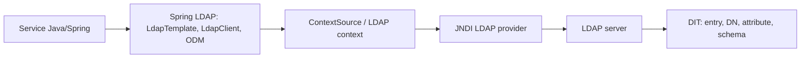

# Vì sao API JNDI khó dùng trực tiếp trong ứng dụng

## Mục tiêu bài học

Khi ứng dụng Java cần truy cập dịch vụ thư mục LDAP, lập trình viên có thể sử dụng **JNDI** (*Java Naming and Directory Interface*) ngay trong JDK. JNDI cho phép kết nối, tìm kiếm, đọc và sửa entry LDAP, nhưng đặt nhiều công việc mức thấp lên vai người viết ứng dụng: khởi tạo context, quản lý vòng đời tài nguyên, cấu hình môi trường, dựng filter, chuyển đổi `Attributes`, xử lý ngoại lệ và đóng kết nối.

**Spring LDAP** xây dựng lớp API thuận tiện phía trên cơ chế truy cập LDAP/JNDI, đặc biệt thông qua `ContextSource`, `LdapTemplate`, `LdapClient` và **ODM** (*Object-Directory Mapping*). Chủ đề của bài thuộc chương **JNDI và Spring** của module **SPRING_LDAP**: hiểu rõ giới hạn của JNDI sẽ giúp bạn lựa chọn đúng lớp trừu tượng, cấu hình xác thực/TLS, pooling và kiểm thử truy cập thư mục an toàn.

Sau khi học, bạn có thể:

1. Mô tả vai trò của JNDI, LDAP, directory server và Spring LDAP mà không nhầm lẫn giữa các khái niệm.
2. Đọc được một yêu cầu LDAP search bằng JNDI, từ `InitialLdapContext` đến `NamingEnumeration`.
3. Chỉ ra các vấn đề gây phức tạp khi lặp lại thao tác JNDI trong nhiều service Java.
4. Thực hiện cùng một truy vấn bằng `LdapTemplate` và giải thích phần công việc Spring LDAP đã đảm nhiệm.
5. Phân biệt phần Spring hỗ trợ với trách nhiệm ứng dụng vẫn phải tự xử lý: schema, base DN, filter an toàn, TLS, quyền, timeout, lỗi và kiểm thử.
6. Biết khi nào JNDI trực tiếp vẫn là một lựa chọn có lý.

## 1. JNDI và Spring LDAP nằm ở đâu?

**LDAP** (*Lightweight Directory Access Protocol*) là giao thức truy cập và thao tác dữ liệu thư mục. LDAP server (ví dụ OpenLDAP hoặc một dịch vụ thư mục hỗ trợ LDAP khác) quản lý những **entry** được định danh bằng **DN** (*Distinguished Name*), có các **attribute** và tuân theo **schema**.

**JNDI** là API Java cung cấp mô hình tên và thư mục chung. Với LDAP provider, JNDI có thể thực thi các thao tác qua giao thức LDAP. JNDI **không phải** tên khác của LDAP và cũng không phải LDAP server.

**Spring LDAP** là thư viện dành cho ứng dụng Spring/Java giúp thao tác LDAP ở mức cao hơn. Nó **không thay thế directory server**, không tự sinh schema, cũng không bỏ qua những quy tắc quyền truy cập của LDAP.



| Thành phần | Trách nhiệm chính | Ví dụ |
| --- | --- | --- |
| **LDAP server** | Lưu entry, đánh giá filter, áp schema/ACL, xử lý bind và thao tác thư mục | Entry `uid=lan,ou=People,dc=example,dc=org` |
| **JNDI** | Cung cấp `Context`, `DirContext`, `LdapContext`, `SearchControls`, kết quả và ngoại lệ mức thấp | `new InitialLdapContext(env, null)` |
| **Spring LDAP** | Quản lý truy cập theo template/fluent API, cấu hình context, mapping và chuyển đổi một số vấn đề kỹ thuật thành API Spring | `ldapTemplate.search(query, mapper)` |
| **Ứng dụng** | Xác định phạm vi dữ liệu, quy tắc nghiệp vụ, quyền, xử lý lỗi ở mức sản phẩm và cách dùng kết quả | Tìm tên/email của người dùng |

**JNDI không vô dụng hoặc đã lỗi thời chỉ vì khó dùng trực tiếp.** Nó vẫn là API cấp thấp có giá trị khi cần truy cập những khả năng cụ thể của LDAP/JNDI hoặc điều tra vấn đề provider. Khó khăn xuất hiện khi mỗi service tự lặp lại cùng logic truy cập và quản lý tài nguyên.

## 2. Bài toán xuyên suốt: tìm tên một tài khoản

Giả sử ứng dụng cần tra cứu tên hiển thị của người dùng có `uid=lan` dưới nhánh:

```text
dc=example,dc=org
└── ou=People
    ├── uid=lan
    └── uid=mai
```

Một entry ví dụ:

```ldif
dn: uid=lan,ou=People,dc=example,dc=org
objectClass: inetOrgPerson
uid: lan
cn: Lan Nguyen
sn: Nguyen
mail: lan@example.org
```

Yêu cầu nghiệp vụ: **tìm trong nhánh People** các entry có `objectClass=inetOrgPerson` và `uid` bằng giá trị nhập vào; chỉ lấy `cn` để hiển thị. Lệnh tìm kiếm có các phần độc lập:

| Thành phần | Giá trị |
| --- | --- |
| LDAP URL | `ldaps://ldap.example.org:636` |
| Search base DN | `ou=People,dc=example,dc=org` |
| Scope | `SUBTREE` |
| Filter | `(&(objectClass=inetOrgPerson)(uid=lan))` |
| Attribute trả về | `cn` |
| Danh tính kết nối | Account dịch vụ được cấp quyền đọc |

Đây là địa chỉ và dữ liệu **minh họa**; muốn chạy thật phải chuẩn bị một directory server kiểm thử, entry phù hợp, secret và chứng chỉ TLS đáng tin cậy.

## 3. Tìm kiếm bằng JNDI thuần: nhiều bước trong một nghiệp vụ nhỏ

JNDI dùng `javax.naming.Context` để khai báo thông tin khởi tạo, `javax.naming.ldap.LdapContext` để thao tác LDAP, `javax.naming.directory.SearchControls` để kiểm soát search và `NamingEnumeration<SearchResult>` để duyệt kết quả.

Đây là ví dụ Java dùng JNDI provider của JDK. Đoạn mã cố ý trình bày đủ vòng đời context và kết quả, thay vì rút gọn thành pseudo-code:

```java
import java.util.ArrayList;
import java.util.Hashtable;
import java.util.List;
import javax.naming.Context;
import javax.naming.NamingEnumeration;
import javax.naming.NamingException;
import javax.naming.directory.Attribute;
import javax.naming.directory.Attributes;
import javax.naming.directory.SearchControls;
import javax.naming.directory.SearchResult;
import javax.naming.ldap.InitialLdapContext;
import javax.naming.ldap.LdapContext;

public final class JndiDirectoryReader {

    public List<String> findDisplayNames(String uid) throws NamingException {
        String password = System.getenv("LDAP_BIND_PASSWORD");
        if (password == null || password.isEmpty()) {
            throw new IllegalStateException("Missing LDAP_BIND_PASSWORD");
        }

        Hashtable<String, Object> env = new Hashtable<>();
        env.put(Context.INITIAL_CONTEXT_FACTORY,
                "com.sun.jndi.ldap.LdapCtxFactory");
        env.put(Context.PROVIDER_URL, "ldaps://ldap.example.org:636");
        env.put(Context.SECURITY_AUTHENTICATION, "simple");
        env.put(Context.SECURITY_PRINCIPAL,
                "cn=svc-reader,ou=Services,dc=example,dc=org");
        env.put(Context.SECURITY_CREDENTIALS, password);
        env.put("com.sun.jndi.ldap.connect.timeout", "3000");
        env.put("com.sun.jndi.ldap.read.timeout", "5000");

        SearchControls controls = new SearchControls();
        controls.setSearchScope(SearchControls.SUBTREE_SCOPE);
        controls.setReturningAttributes(new String[] {"cn"});
        controls.setCountLimit(100);
        controls.setTimeLimit(3000);

        LdapContext ctx = null;
        NamingEnumeration<SearchResult> answers = null;
        try {
            ctx = new InitialLdapContext(env, null);

            // JNDI thay {0} bằng một giá trị filter đã được mã hóa phù hợp.
            answers = ctx.search(
                    "ou=People,dc=example,dc=org",
                    "(&(objectClass=inetOrgPerson)(uid={0}))",
                    new Object[] {uid},
                    controls
            );

            List<String> names = new ArrayList<>();
            while (answers.hasMore()) {
                SearchResult result = answers.next();
                Attributes attrs = result.getAttributes();
                Attribute cn = attrs.get("cn");
                if (cn != null && cn.size() > 0) {
                    Object value = cn.get();
                    if (value instanceof String) {
                        names.add((String) value);
                    }
                }
            }
            return names;
        } finally {
            try {
                if (answers != null) {
                    answers.close();
                }
            } finally {
                if (ctx != null) {
                    ctx.close();
                }
            }
        }
    }
}
```

**Những chi tiết cần chú ý:**

1. `Hashtable` chứa nhiều khóa cấu hình dưới dạng chuỗi, gồm URL, xác thực, danh tính, credential và timeout.
2. `new InitialLdapContext(env, null)` tạo LDAP context. Với simple bind và URL LDAPS, phải bảo đảm TLS được thiết lập và chứng chỉ được JVM tin cậy; cấu hình example không thay thế quy trình truststore thực tế.
3. `SearchControls` quy định **scope**, tập **attribute trả về**, số kết quả tối đa và thời gian tìm kiếm; connect/read timeout là những tùy chọn **khác**.
4. `ctx.search(..., "(uid={0})", new Object[] {uid}, ...)` dùng **filter argument substitution** của JNDI. Không thay nó bằng cách nối input vào chuỗi filter. Cơ chế substitution giúp encode ký tự đặc biệt đúng ngữ cảnh filter.
5. `NamingEnumeration` cần được duyệt và đóng; `LdapContext` cũng cần đóng kể cả khi thao tác phát sinh lỗi.
6. `Attribute` có thể không có giá trị, có nhiều giá trị hoặc không chứa `String`. Ứng dụng phải chọn cách mapping phù hợp schema.
7. Phương thức trả `List<String>` chỉ dành cho minh họa; trong nghiệp vụ xác định một người, cần quy định hành vi khi kết quả bằng 0 hoặc nhiều hơn 1.

**Độ phức tạp đã xuất hiện trước khi có logic nghiệp vụ thực sự.** Bài toán chỉ là “tìm tên”, nhưng code phải xử lý cấu hình kết nối, quản lý tài nguyên, search controls, mapping, ngoại lệ và trạng thái lỗi.

### 3.1. Quản lý `NamingEnumeration` dễ bị bỏ sót

`NamingEnumeration` không phải `List` thông thường. Với LDAP provider, việc duyệt kết quả có thể tiếp tục trao đổi với server hoặc gặp lỗi trong quá trình duyệt. Chỉ gọi `search()` thành công chưa có nghĩa đã đọc được toàn bộ kết quả.

Đoạn mã như sau dễ làm rò tài nguyên nếu không có khối `finally`:

```java
LdapContext context = new InitialLdapContext(env, null);
NamingEnumeration<SearchResult> rows =
        context.search(baseDn, filter, controls);

// Nếu mapper ném ngoại lệ, rows/context có thể không được đóng.
while (rows.hasMore()) {
    process(rows.next());
}
```

Ở ví dụ đầy đủ, `finally` bảo đảm hai lời gọi `close()` được thực hiện theo thứ tự. Dù vậy, ngoại lệ trong `close()` vẫn có thể che mất lỗi chính; production có thể cần chính sách ghi log và bảo toàn nguyên nhân cẩn thận hơn. Đây là một ví dụ nhỏ của trách nhiệm **quản lý vòng đời tài nguyên** mà lập trình viên phải tự xử lý với JNDI trực tiếp.

### 3.2. `SearchControls` là một thành phần riêng

Khi nhiều method cùng cần giới hạn, scope và attribute projection, ứng dụng có thể phải lặp lại mã:

```java
SearchControls controls = new SearchControls();
controls.setSearchScope(SearchControls.SUBTREE_SCOPE);
controls.setReturningAttributes(new String[] {"uid", "cn", "mail"});
controls.setCountLimit(100);
controls.setTimeLimit(3000);
```

`setCountLimit` chỉ giới hạn số entry; `setTimeLimit` là giới hạn tìm kiếm được biểu diễn bằng mili giây trong JNDI. Cả hai **không thay thế hoàn toàn** connect/read timeout. Nếu server mất kết nối, JVM vẫn cần cấu hình network timeout, retry và chính sách phản hồi lỗi phù hợp.

### 3.3. JNDI trả dữ liệu ở mức `Attributes`

Ứng dụng muốn DTO `UserPreview(uid, fullName, mail)` phải biết:

- Attribute có thực sự được yêu cầu trong `setReturningAttributes` chưa?
- Entry có attribute đó và tài khoản bind có được đọc không?
- Attribute có một hay nhiều giá trị, là chuỗi hay dữ liệu nhị phân?
- Mapper nên bỏ qua, trả giá trị trống hay báo lỗi khi thiếu trường bắt buộc?

Nếu mỗi chức năng tự viết `attrs.get("cn").get()`, việc xử lý `null`, giá trị thiếu và chuyển kiểu sẽ nhanh chóng lặp lại. Với attribute đa trị như `member`, lấy giá trị đầu tiên còn có thể sai chức năng.

## 4. Vì sao JNDI trực tiếp khó bảo trì trong một ứng dụng lớn?

| Khó khăn | Ví dụ trong JNDI | Hệ quả trong ứng dụng |
| --- | --- | --- |
| **Mã lặp kết nối** | Mỗi repository khởi tạo `Hashtable` và `LdapContext` | Khó chuẩn hóa URL, credential, timeout |
| **Vòng đời tài nguyên** | `NamingEnumeration.close()`, `LdapContext.close()` | Dễ quên đóng hoặc xử lý lỗi đóng chưa đúng |
| **API nhiều lớp** | `Context`, `DirContext`, `LdapContext`, `SearchControls` | Một thao tác đơn giản cần nhiều đối tượng |
| **Ngoại lệ có kiểm tra** | `NamingException` và các lớp con | Nhiều tầng `throws/catch`, mapping lỗi thiếu nhất quán |
| **Kết quả thô** | `SearchResult`, `Attributes`, `Attribute` | Lặp logic mapping, null và đa trị |
| **Tên DN và filter** | Dựng chuỗi base, RDN, filter thủ công | Có thể sai cú pháp hoặc mở rộng phạm vi truy vấn |
| **Cấu hình bảo mật phân tán** | Authentication, TLS, truststore, secret trên từng đường đi | Nguy cơ cấu hình không đồng nhất |
| **Kiểm thử** | Khó cô lập logic nghiệp vụ khi nó tự tạo context thật | Unit test nặng, phụ thuộc directory server |
| **Đổi cách kết nối** | Thay server, base DN, timeout, failover tại nhiều nơi | Tăng rủi ro hồi quy |

JNDI API có **nhiều khả năng cần thiết** và không thiếu chức năng LDAP cơ bản; vấn đề chính là mức độ trừu tượng. Nó rất gần chi tiết giao thức/provider, trong khi phần lớn chức năng ứng dụng chỉ muốn gọi các thao tác như “tìm”, “đọc”, “sửa” và “đổi tên”.

### Ví dụ khi có ba chức năng

Giả sử ứng dụng có ba service: tra cứu người dùng, đọc nhóm và cập nhật email. Nếu cả ba đều tự:

1. Khởi tạo `LdapContext`.
2. Tạo `SearchControls` hoặc `ModificationItem[]`.
3. Phân tích DN/filter.
4. Đọc `Attributes` và chuyển thành object Java.
5. Catch `NamingException`.
6. Đóng context.

thì một thay đổi chính sách kết nối hoặc xử lý lỗi phải được thực hiện ở nhiều điểm. Có thể xây dựng abstraction riêng phía trên JNDI, nhưng đó cũng chính là phần lớn công việc mà **Spring LDAP** hướng tới giải quyết.

## 5. Cùng thao tác đó với `ContextSource` và `LdapTemplate`

Spring LDAP chia công việc thành hai phần:

- **`ContextSource`** chịu trách nhiệm tạo/cung cấp LDAP context theo cấu hình chung; ví dụ `LdapContextSource` với URL, base DN, principal và credential.
- **`LdapTemplate`** thực hiện các thao tác LDAP phổ biến, điều phối lấy/đóng context và chuyển đổi ngoại lệ; lập trình viên tập trung vào **truy vấn** và **mapping**.

Nếu ứng dụng dùng Spring Boot và hỗ trợ tự động cấu hình LDAP tương ứng với phiên bản được chọn, có thể bắt đầu với các thuộc tính:

```properties
spring.ldap.urls=ldaps://ldap.example.org:636
spring.ldap.base=dc=example,dc=org
spring.ldap.username=cn=svc-reader,ou=Services,dc=example,dc=org
spring.ldap.password=${LDAP_BIND_PASSWORD}
```

Trên một dự án cấu hình Java thủ công, `LdapContextSource` và `LdapTemplate` có thể được khai báo thành bean:

```java
import org.springframework.context.annotation.Bean;
import org.springframework.context.annotation.Configuration;
import org.springframework.ldap.core.ContextSource;
import org.springframework.ldap.core.LdapTemplate;
import org.springframework.ldap.core.support.LdapContextSource;

@Configuration
class DirectoryConfiguration {

    @Bean
    LdapContextSource contextSource() {
        String password = System.getenv("LDAP_BIND_PASSWORD");
        if (password == null || password.isBlank()) {
            throw new IllegalStateException("Missing LDAP_BIND_PASSWORD");
        }

        LdapContextSource source = new LdapContextSource();
        source.setUrl("ldaps://ldap.example.org:636");
        source.setBase("dc=example,dc=org");
        source.setUserDn(
                "cn=svc-reader,ou=Services,dc=example,dc=org");
        source.setPassword(password);
        return source;
    }

    @Bean
    LdapTemplate ldapTemplate(ContextSource contextSource) {
        return new LdapTemplate(contextSource);
    }
}
```

**Chọn một cách cấu hình nhất quán** cho dự án. Nếu Spring Boot đã tạo được bean phù hợp, không tự thêm bean trùng chỉ vì muốn dùng Spring LDAP. Việc dùng `LdapContextSource` trong ví dụ thủ công nhằm làm rõ vai trò của `ContextSource`, không phải quy định bắt buộc cho mọi dự án.

Đoạn mã đọc dữ liệu bằng Spring LDAP:

```java
import static org.springframework.ldap.query.LdapQueryBuilder.query;

import java.util.List;
import javax.naming.directory.Attribute;
import javax.naming.directory.Attributes;
import org.springframework.ldap.core.LdapTemplate;
import org.springframework.ldap.query.SearchScope;

class SpringDirectoryReader {
    private final LdapTemplate ldapTemplate;

    SpringDirectoryReader(LdapTemplate ldapTemplate) {
        this.ldapTemplate = ldapTemplate;
    }

    List<String> findDisplayNames(String uid) {
        return ldapTemplate.search(
                query().base("ou=People")
                        .searchScope(SearchScope.SUBTREE)
                        .attributes("cn")
                        .where("objectClass").is("inetOrgPerson")
                        .and("uid").is(uid),
                (Attributes attrs) -> {
                    Attribute cn = attrs.get("cn");
                    if (cn == null || cn.size() == 0) {
                        return null;
                    }
                    Object first = cn.get();
                    return first instanceof String ? (String) first : null;
                });
    }
}
```

Ứng dụng thực tế có thể ánh xạ kết quả vào DTO có trường nullable hoặc từ chối dữ liệu thiếu theo quy tắc nghiệp vụ. Ví dụ trên chỉ minh họa việc yêu cầu duy nhất `cn` và tránh ném `NullPointerException` trong mapper. Nếu muốn danh sách không chứa giá trị null, xử lý rõ hợp đồng trả về của service thay vì lặng lẽ diễn giải null là “entry không tồn tại”.

### 5.1. Spring đã giúp gì?

| Công việc | JNDI trực tiếp | Spring LDAP |
| --- | --- | --- |
| Tạo context và cấu hình | Khởi tạo `Hashtable`, `InitialLdapContext` tại nơi dùng hoặc tự thiết kế factory | `ContextSource` tập trung cấu hình và cung cấp context |
| Gửi yêu cầu search | `ctx.search(base, filter, arguments, controls)` | `ldapTemplate.search(query, mapper)` |
| Dựng filter động | JNDI substitution `{0}` hoặc escape đúng ngữ cảnh | `LdapQueryBuilder` biểu diễn điều kiện bằng API |
| Khai báo phạm vi, projection | `SearchControls` | `base()`, `searchScope()`, `attributes()` |
| Duyệt/đóng kết quả | Tự quản lý `NamingEnumeration` và context | Template điều phối vòng đời thao tác thông thường |
| Mapping | Tự xử lý `SearchResult`, `Attributes` | `AttributesMapper`, `ContextMapper`, ODM nếu phù hợp |
| Lỗi truy cập | `NamingException` và các lớp con có kiểm tra | Hệ ngoại lệ runtime của Spring LDAP, có bước chuyển đổi từ JNDI |
| Cấu hình cho nhiều service | Dễ bị lặp nếu không tự xây abstraction | Inject bean dùng chung |

**Spring LDAP không xóa bỏ đặc tính của LDAP.** Khi query không có kết quả, base DN sai, ACL không cho đọc hay kết nối TLS lỗi, thư viện vẫn phải phản ánh kết quả và thất bại tương ứng. Lập trình viên vẫn chịu trách nhiệm chọn schema, điều kiện, quyền, thông báo nghiệp vụ và kiểm thử.

### 5.2. `AttributesMapper` và `ContextMapper`

Khi chỉ cần vài attribute của entry, một mapper trên `Attributes` là đủ. Nếu ứng dụng cần cả **DN của entry** và những thông tin từ `DirContextOperations`, hãy cân nhắc mapper trên context theo API Spring LDAP được dùng.

Một lỗi thường gặp là xây `UserDto` sau khi tải toàn bộ entry rồi tưởng rằng đã tối ưu network. Muốn server trả ít dữ liệu hơn, phải chỉ định **attributes trong chính LDAP search request**. Mapper có thể giúp code gọn hơn nhưng không tự làm giảm payload nếu truy vấn vẫn yêu cầu tất cả attribute.

## 6. Các kiểu truy cập Spring LDAP khác nhau

`LdapTemplate` không phải cách duy nhất, nhưng là điểm xuất phát dễ hiểu khi chuyển từ JNDI.

| API | Cách tiếp cận | Khi nào cân nhắc |
| --- | --- | --- |
| **`LdapTemplate`** | Gọi method thao tác trên context qua template, truyền `Name`, filter/query và mapper | Cần kiểm soát rõ thao tác LDAP và mapping |
| **`LdapClient`** | API fluent ở các phiên bản Spring LDAP có hỗ trợ | Muốn diễn đạt thao tác đọc/ghi theo chuỗi lời gọi rõ ràng |
| **LDAP ODM** | Ánh xạ entry/schema sang lớp Java bằng metadata/annotation thích hợp | Domain ổn định, mapping mang lại lợi ích duy trì mô hình |
| **JNDI trực tiếp** | Điều khiển `LdapContext`, `ExtendedRequest`, `SearchControls`... | Công cụ nhỏ, tích hợp đặc thù hoặc khả năng thấp mà abstraction chưa bao phủ |

Không tự suy API fluent hay annotation của ODM giống nhau ở mọi phiên bản Spring LDAP. Khi chọn `LdapClient` hoặc ODM, hãy dùng tài liệu tham khảo đúng version và kiểm thử các truy vấn/modify được tạo ra.

### 6.1. Đọc, sửa, đổi tên, xóa: cùng một bài toán vòng đời

Những thao tác thường gặp:

| Nhu cầu | JNDI | Spring LDAP (`LdapTemplate`) |
| --- | --- | --- |
| Đọc entry theo DN | `ctx.getAttributes(dn)` hoặc lookup context | `lookup(dn, mapper)` |
| Search nhiều entry | `ctx.search(...)` | `search(...)` |
| Thêm entry | `ctx.bind(...)` hoặc `createSubcontext(...)` tùy kiểu API/entry | `bind(dn, null, attributes)` hoặc API thêm entry phù hợp |
| Sửa attribute | `ctx.modifyAttributes(...)` | `modifyAttributes(...)` |
| Đổi DN/RDN | `ctx.rename(oldDn, newDn)` | `rename(oldDn, newDn)` |
| Xóa entry | `ctx.unbind(dn)` hoặc API phù hợp | `unbind(dn)` |

**Cẩn thận với chữ “bind”:** Trong LDAP, **Bind operation** là thao tác xác thực kết nối; trong API quản lý entry JNDI/Spring, method tên `bind(dn, ...)` còn có thể mang nghĩa **thêm entry**. Tên trùng nhau nhưng ngữ cảnh khác. Không coi việc `ldapTemplate.bind(...)` thêm entry là xác thực mật khẩu người dùng.

Spring giúp rút ngắn mã thao tác, nhưng thao tác ghi vẫn có thể thất bại do **entry cha không tồn tại**, **DN trùng**, **vi phạm schema**, **thiếu quyền**, **mất kết nối** hoặc **tham chiếu bị ảnh hưởng khi rename**. Không nên giả định rằng thêm hoặc đổi tên entry sẽ tự cập nhật tất cả membership ở mọi server.

### 6.2. DN và filter cần API đúng ngữ cảnh

Trong JNDI, một lỗi phổ biến là nối tên:

```java
// Không an toàn: uid từ đầu vào có thể chứa dấu phẩy, dấu cộng...
String dn = "uid=" + uidFromRequest + ",ou=People";
```

Với Spring LDAP, dùng `LdapNameBuilder` để xây dựng **DN/RDN**:

```java
import javax.naming.Name;
import org.springframework.ldap.support.LdapNameBuilder;

Name userDn = LdapNameBuilder.newInstance()
        .add("ou", "People")
        .add("uid", uidFromRequest)
        .build();
```

Giá trị truyền vào `add("uid", ...)` là **giá trị thô**, không được tự escape rồi lại đưa vào builder.

Ngược lại, với **search filter**:

```java
var q = query().base("ou=People")
        .where("objectClass").is("inetOrgPerson")
        .and("uid").is(uidFromRequest);
```

Filter và DN có quy tắc biểu diễn/escape **khác nhau** (RFC 4515 và RFC 4514). API làm cho cú pháp dễ kiểm soát hơn, nhưng không thay thế kiểm tra logic: một DN hợp lệ vẫn có thể chỉ đến nhánh mà người dùng không được truy cập, hoặc một filter hợp lệ vẫn có thể quá rộng và tốn tài nguyên.

## 7. Ngoại lệ: JNDI buộc xử lý kỹ thuật, Spring hỗ trợ phân loại

JNDI dùng `javax.naming.NamingException` và nhiều lớp con có kiểm tra. Ví dụ:

| Lỗi | Ví dụ JNDI | Phản ứng ứng dụng cần phân biệt |
| --- | --- | --- |
| Không tìm thấy DN | `NameNotFoundException` | Kiểm tra base/đường dẫn; có thể chuyển thành “không tìm thấy” |
| Sai credential | `AuthenticationException` | Xử lý thất bại xác thực |
| Không có quyền | `NoPermissionException` | Từ chối thao tác hoặc báo cấu hình quyền |
| Đứt kết nối | `CommunicationException` | Báo sự cố directory, cân nhắc retry có giới hạn |
| Lỗi tên/schema, giới hạn hoặc những lỗi khác | Các lớp con của `NamingException` | Tìm nguyên nhân, không quy chung thành “không có dữ liệu” |

Spring LDAP thường chuyển nhiều exception JNDI thành lớp exception runtime tương ứng của Spring LDAP. Điều đó giảm số `throws NamingException` ở từng service và tạo điểm xử lý thuận tiện, nhưng **không tự quyết định** ứng dụng nên trả HTTP 404, 401, 403, 503 hay một mã nghiệp vụ khác.

Đặc biệt, hai tình huống này không giống nhau:

```text
Search thành công + không có entry khớp -> danh sách rỗng hợp lệ
Search thất bại do TLS/timeout/ACL      -> lỗi kỹ thuật hoặc quyền
```

Tránh cách làm:

```java
// Sai: che giấu mọi lỗi directory bằng kết quả rỗng.
try {
    return ldapTemplate.search(query, mapper);
} catch (Exception ignored) {
    return List.of();
}
```

Một tầng xử lý lỗi phù hợp cần phân biệt ít nhất: **không tìm thấy**, **xác thực sai**, **thiếu quyền**, **vi phạm dữ liệu/schema**, **hạ tầng không sẵn sàng** và **giới hạn truy vấn**. Tên exception và mapping chính xác phụ thuộc phiên bản Spring LDAP và provider, nên kiểm thử trên hệ đích.

**Ghi nhớ đối với thao tác ghi:** Nếu kết nối bị ngắt sau khi client gửi lệnh nhưng trước khi nhận phản hồi, ứng dụng chưa thể khẳng định server đã hay chưa cập nhật. Không tự retry thêm/sửa/xóa vô điều kiện vì có thể tạo xung đột hoặc thực hiện thao tác lặp.

## 8. Spring LDAP giúp giảm mã lặp, nhưng không tự bảo đảm an toàn

Trong ứng dụng truy cập directory, những vấn đề về **TLS, credential, quyền, schema, giới hạn tìm kiếm và pooling** vẫn cần thiết kế và xác minh cẩn thận dù đã dùng Spring LDAP.

### 8.1. Xác thực và danh tính kết nối

JNDI cho phép khai báo cơ chế xác thực, principal và credential trong environment. Spring LDAP cho phép tập trung các cấu hình này qua `ContextSource`. Tuy vậy, cần phân biệt:

- **Service bind:** ứng dụng kết nối bằng tài khoản dịch vụ, thường để search/đọc những entry được cấp quyền.
- **User authentication:** kiểm tra thông tin xác thực của một người dùng bằng LDAP Bind hoặc cơ chế nhận dạng thích hợp, thường sau khi tìm được danh tính cần bind.
- **Application authorization:** quyết định người dùng đã xác thực được truy cập chức năng nào; có thể tham chiếu thuộc tính nhóm nhưng phụ thuộc chính sách ứng dụng.

Tìm thấy `uid=lan` qua search **không có nghĩa** người đang đăng nhập biết mật khẩu của Lan. Tương tự, dùng account dịch vụ quyền cao để tải nhiều entry về rồi lọc Java không tương đương với việc LDAP server đã thực thi đúng ACL.

Giữ credential trong hệ quản lý secret hoặc biến môi trường được bảo vệ; không hardcode mật khẩu trong repository và không ghi vào log. Đối với tài khoản dịch vụ chỉ tra cứu danh bạ, cấp quyền **chỉ đọc** trên những nhánh và attribute cần thiết.

### 8.2. Kết nối TLS

Có hai phương án TLS phổ biến:

| Phương án | Đặc điểm | Điểm cần kiểm tra |
| --- | --- | --- |
| **LDAPS** | Kết nối TLS từ đầu, thường qua cổng `636` | Chứng chỉ, hostname, truststore của client |
| **StartTLS** | Nâng cấp kết nối LDAP đang mở sang TLS, thường qua cổng `389` | Nâng cấp thành công **trước** khi gửi simple-bind credential |

JNDI có thể dùng các API LDAP mở rộng như `StartTlsRequest`/`StartTlsResponse`, nhưng việc quản lý đúng vòng đời TLS, socket, context và xác thực là công việc nhạy cảm. Spring LDAP có các cơ chế và tùy chọn tương ứng tùy phiên bản, song phải kiểm tra chính xác cách tích hợp TLS của thư viện đang dùng.

Không dùng `ldap://` với simple bind có mật khẩu qua mạng chưa được bảo vệ. Không tắt xác thực chứng chỉ hoặc bỏ qua hostname verification chỉ để làm kết nối thành công. Nếu handshake lỗi, cần điều tra CA, chứng chỉ và tên server.

### 8.3. Pooling không phải một nút bật mặc định

JNDI LDAP provider có thể hỗ trợ connection pooling qua những cấu hình riêng của implementation. Trong Spring LDAP, cũng có các lựa chọn pooling/context source tùy phiên bản và cơ chế kết nối. Pool giúp tái sử dụng kết nối, nhưng cần quan tâm:

1. **Danh tính bind:** context đã được xác thực dưới danh tính nào? Không tái sử dụng nhầm context mang quyền một user cho user khác.
2. **TLS:** cách sử dụng StartTLS và socket/context pooling phải phù hợp; không mặc định mọi pool dùng an toàn cho mọi dạng kết nối.
3. **Kết nối chết:** server có thể cắt kết nối nhàn rỗi; pool cần cơ chế kiểm tra, hủy và tái tạo phù hợp.
4. **Giới hạn tải:** pool quá lớn có thể làm tăng số kết nối lên server thay vì cải thiện hiệu năng.
5. **Failover và timeout:** pool không thay thế kết nối đến node dự phòng, connect timeout hoặc read timeout.

Không sao chép cấu hình provider-specific như `com.sun.jndi.ldap.connect.pool` sang môi trường khác rồi mặc định nó có cùng hành vi. Hãy đọc tài liệu và đo đạc trên bộ phiên bản JDK, Spring LDAP, TLS và directory server thực tế.

### 8.4. Filter và danh sách attribute

JNDI hỗ trợ filter argument substitution `(uid={0})`. Spring LDAP cung cấp `LdapQueryBuilder` để biểu diễn điều kiện bằng API thay vì nối chuỗi từ input người dùng.

Một request hiệu quả nên có đủ:

- **Base DN** và **scope** phù hợp để tránh tìm quá rộng.
- **Filter** giới hạn entry theo thuộc tính/schema.
- **Attributes** chỉ gồm những dữ liệu cần trả về, ví dụ `uid`, `cn`, `mail`.
- **Giới hạn số lượng, thời gian và paging** khi danh sách có thể lớn, theo khả năng client/server.

Filter LDAP quyết định entry nào **server chọn**; `Stream.filter` trong Java chỉ bỏ entry **sau khi đã tải về**. Nếu ứng dụng cần lọc theo thuộc tính hiện có trong LDAP và matching rule phù hợp, gửi filter tới server thường giảm dữ liệu truyền không cần thiết.

### 8.5. Schema và mã lỗi vẫn thuộc thế giới LDAP

Một entry LDAP không phải object Java tùy ý. Các object class quy định thuộc tính bắt buộc và thuộc tính được phép; ví dụ `inetOrgPerson` yêu cầu những thuộc tính thông qua chuỗi kế thừa. Dù JNDI hay Spring LDAP, yêu cầu thêm/sửa entry vẫn có thể bị từ chối nếu schema không hợp lệ.

Các mã kết quả như `noSuchObject`, `invalidCredentials`, `insufficientAccessRights`, `constraintViolation` và `entryAlreadyExists` phải được hiểu theo ngữ nghĩa LDAP, không mặc định biến tất cả thành cùng một lỗi nghiệp vụ.

## 9. Kiểm thử: giảm mức phụ thuộc vào server mà vẫn kiểm chứng giao thức

Một hạn chế thực tế của mã JNDI trực tiếp là mỗi service thường tự tạo context qua `new InitialLdapContext(...)`. Trong unit test, nếu đối tượng phụ thuộc được tạo cứng bên trong method, việc thay nó bằng giả lập hoặc cấu hình test sẽ khó hơn. Với Spring LDAP, repository nhận `LdapTemplate` hay `ContextSource` qua **dependency injection** nên dễ kiểm thử logic xử lý kết quả và lỗi theo từng tầng.

Nhưng test mock chỉ xác nhận cách code gọi API. Nó **không chứng minh** filter đã được server diễn giải đúng, chứng chỉ TLS hợp lệ hay ACL hoạt động như dự kiến. Vì vậy cần cả unit test lẫn integration test.

| Tầng kiểm thử | Mục tiêu | Ví dụ |
| --- | --- | --- |
| **Unit test** | Quy tắc ứng dụng, mapping, null và xử lý lỗi | Mapper nhận `Attributes` thiếu `mail` |
| **Integration test** | JNDI/Spring LDAP thực sự gửi và nhận LDAP | Search trên directory thử nghiệm với LDIF fixture |
| **Security test** | Bind, ACL, filter input, TLS | Account chỉ đọc không được sửa entry |
| **Resilience test** | Network timeout, server ngắt, pool context lỗi | Mất kết nối không bị báo thành “không có người dùng” |

### 9.1. Unit test mapper cho thuộc tính thiếu

Ví dụ không cần server:

```java
import static org.junit.jupiter.api.Assertions.assertEquals;
import static org.junit.jupiter.api.Assertions.assertNull;

import javax.naming.NamingException;
import javax.naming.directory.Attribute;
import javax.naming.directory.Attributes;
import javax.naming.directory.BasicAttributes;
import org.junit.jupiter.api.Test;

class DirectoryAttributesTest {

    static String firstString(Attributes attrs, String id)
            throws NamingException {
        Attribute attr = attrs.get(id);
        if (attr == null || attr.size() == 0) {
            return null;
        }
        Object value = attr.get();
        return value instanceof String ? (String) value : null;
    }

    @Test
    void missingMailDoesNotThrow() throws NamingException {
        BasicAttributes attrs = new BasicAttributes(true);
        attrs.put("uid", "lan");
        attrs.put("cn", "Lan Nguyen");

        assertEquals("Lan Nguyen", firstString(attrs, "cn"));
        assertNull(firstString(attrs, "mail"));
    }
}
```

Đây là ví dụ kiểm tra **một quy tắc mapping có ý nghĩa**. Không nên viết test chỉ để khẳng định framework gọi đúng một method đã được mock sẵn mà không kiểm tra kết quả nghiệp vụ.

### 9.2. Những ca tích hợp cần có

Với directory thử nghiệm và account riêng, hãy kiểm tra:

1. `ContextSource` kết nối tới đúng server và base DN; không bị lặp hậu tố khi truyền DN tương đối.
2. `LdapTemplate.search` trả đúng entry khi `uid` khớp, trả danh sách rỗng khi không có entry.
3. Giá trị filter có dấu `*`, `(`, `)` và dấu gạch chéo ngược được xử lý thành **dữ liệu** chứ không thành cú pháp mới.
4. Account chỉ đọc tìm kiếm được nhưng không thể cập nhật entry.
5. Khi thử tạo entry vi phạm schema, lỗi được phân loại và trình bày đúng.
6. Chứng chỉ server không tin cậy khiến kết nối TLS thất bại; ứng dụng không hạ cấp âm thầm xuống truyền credential qua kênh không an toàn.
7. Khi server mất kết nối hoặc chạm giới hạn tìm kiếm, ứng dụng không trả kết quả rỗng giả.
8. Nếu bật pooling, kiểm tra đóng context, kết nối bị cắt và hành vi khi nhiều yêu cầu đồng thời.

Kiểm thử trên directory test chạy với LDIF fixture giúp tái hiện kết quả; song cần kiểm tra bổ sung với **directory server đích** khi sản phẩm có schema, ACL, hỗ trợ extension hoặc cách đánh giá filter khác biệt.

## 10. Khi nào JNDI trực tiếp vẫn hợp lý?

Spring LDAP thường thuận tiện trong một ứng dụng Spring có nhiều thao tác LDAP lặp lại. JNDI trực tiếp vẫn có thể phù hợp nếu:

- Bạn viết một **công cụ nhỏ** hoặc mã kiểm tra vài lệnh LDAP, không muốn đưa Spring vào dependencies.
- Ứng dụng dùng JNDI cho nhiều naming/directory provider với một abstraction được thiết kế sẵn.
- Cần **extended operation**, control hoặc tính năng đặc thù mà phiên bản Spring LDAP đang dùng không cung cấp API tiện lợi.
- Đang điều tra lỗi ở mức provider/socket và cần quan sát trực tiếp hành vi `LdapContext`.
- Có sẵn một thư viện nội bộ quản lý vòng đời JNDI đúng cách, được kiểm thử và duy trì ổn định.

| Hoàn cảnh | Lựa chọn nên cân nhắc | Lý do |
| --- | --- | --- |
| Ứng dụng Spring làm nhiều search/CRUD | **Spring LDAP** | Tái sử dụng context và template, tránh lặp mã |
| Ứng dụng nhỏ, chỉ một thao tác kỹ thuật | **JNDI** có thể đủ | Ít lớp phụ thuộc hơn |
| Cần mô hình entry như Java object | **Spring LDAP ODM** nếu schema/mapping phù hợp | Giảm mã ánh xạ thủ công |
| Muốn cú pháp thao tác fluent | **`LdapClient`** nếu version hỗ trợ | Dễ đọc luồng thao tác |
| Tính năng LDAP provider đặc thù | **JNDI trực tiếp** hoặc escape hatch phù hợp | Cần kiểm soát operation/control cụ thể |

Tiêu chí lựa chọn không chỉ là **số dòng code**. Cần xem đội ngũ có thể bảo trì cấu hình kết nối, phân loại lỗi, theo dõi tài nguyên, kiểm thử và hỗ trợ vận hành an toàn hay không.

## 11. Bài thực hành: chuyển một truy vấn JNDI sang Spring LDAP

**Đề bài:** Viết một hàm tra cứu tài khoản theo `uid`, trả `cn` và `mail` từ nhánh `ou=People,dc=example,dc=org` trên directory thử nghiệm. So sánh hai phiên bản JNDI và Spring LDAP.

**Các bước:**

1. Dùng JNDI `InitialLdapContext`, `SearchControls` và `search(..., filterArgs, ...)`. Bảo đảm đóng `NamingEnumeration` lẫn context.
2. Tạo bean `ContextSource` và `LdapTemplate` hoặc sử dụng auto-configuration hợp lệ của Spring Boot; không hardcode credential.
3. Viết `LdapQueryBuilder` với `base("ou=People")`, filter object class + `uid`, và `attributes("cn", "mail")`.
4. Ánh xạ thành DTO, quy định hành vi nếu `cn` hoặc `mail` thiếu; phân biệt không khớp với lỗi kết nối.
5. So sánh số dòng cần dùng để kết nối và đóng tài nguyên, cách quản lý exception, base DN và khả năng thay cấu hình.
6. Dùng account chỉ đọc và TLS có xác minh chứng chỉ để chạy thử; không thực hiện thao tác ghi trên directory sản xuất.
7. Thử các ca: UID hợp lệ; không tồn tại; UID chứa ký tự đặc biệt trong filter; thiếu quyền; lỗi TLS; server bị ngắt.

**Gợi ý DTO:**

```java
record UserPreview(String fullName, String email) {}
```

**Tiêu chí nghiệm thu:** Cùng yêu cầu nghiệp vụ phải trả kết quả phù hợp trên cùng fixture. Spring LDAP giúp tách quản lý kết nối/tài nguyên khỏi truy vấn và mapping, đồng thời không được che mất thông tin lỗi cần thiết. Các ca biên phải có hành vi được xác định rõ.

### Câu hỏi tự kiểm tra

**Câu 1.** Có phải dùng JNDI là đang tự triển khai giao thức LDAP trên socket?

**Đáp án:** Không. LDAP provider của JNDI thực hiện giao tiếp giao thức; ứng dụng gọi API cấp thấp và quản lý context, yêu cầu, kết quả.

**Câu 2.** Vì sao `NamingEnumeration` làm mã JNDI phức tạp hơn việc xử lý một `List`?

**Đáp án:** Nó có thể chứa kết quả được đọc dần, gặp lỗi khi duyệt và có vòng đời tài nguyên riêng; cần đóng cùng context.

**Câu 3.** `LdapTemplate` có làm mọi lỗi LDAP trở thành kết quả rỗng không?

**Đáp án:** Không. Nó xử lý vòng đời thao tác và chuyển đổi ngoại lệ; ứng dụng phải phân biệt không có kết quả với lỗi truy cập, xác thực hay hạ tầng.

**Câu 4.** Nếu ứng dụng dùng `LdapTemplate` nhưng ghép DN/filter từ input không kiểm tra, có an toàn không?

**Đáp án:** Không. Cần dùng `LdapNameBuilder` cho DN, `LdapQueryBuilder` hoặc escaping đúng cho filter, đồng thời kiểm tra phạm vi truy cập và ACL.

**Câu 5.** Việc thêm `spring.ldap.urls=ldaps://...` đã đủ bảo đảm TLS an toàn chưa?

**Đáp án:** Chưa. Cần cấu hình truststore, xác minh chứng chỉ/hostname và kiểm thử trên môi trường đích.

**Câu 6.** Vì sao dependency injection giúp kiểm thử tốt hơn?

**Đáp án:** Repository nhận `LdapTemplate`/`ContextSource` từ bên ngoài, có thể cô lập logic nghiệp vụ và dùng directory fixture trong integration test thay vì method tự tạo context thật ở mọi lần gọi.

## Tổng kết

**JNDI cung cấp các công cụ LDAP cấp thấp mạnh và linh hoạt, nhưng dùng trực tiếp trong nhiều chức năng ứng dụng thường dẫn đến mã lặp về khởi tạo context, cấu hình môi trường, `SearchControls`, `NamingEnumeration`, chuyển đổi `Attributes`, đóng tài nguyên và xử lý `NamingException`.**

**Spring LDAP** đưa những phần lặp lại này vào `ContextSource`, `LdapTemplate`, `LdapClient` hoặc ODM, để mã ứng dụng tập trung vào DN, filter và kết quả nghiệp vụ. Spring giảm độ phức tạp sử dụng API; việc bảo đảm schema, xác thực, TLS, quyền, pooling, timeouts, phân trang và kiểm thử vẫn là trách nhiệm thiết kế của hệ thống.

### Tài liệu tham khảo

- **Java SE JNDI API** — `javax.naming.Context`, `javax.naming.directory.DirContext`, `javax.naming.ldap.LdapContext`, `NamingEnumeration` và `SearchControls`.
- **Spring LDAP Reference Documentation** — `ContextSource`, `LdapTemplate`, `LdapClient`, query builder, ODM và exception handling.
- **Spring Boot Reference Documentation** — Cấu hình LDAP và các thuộc tính `spring.ldap.*` theo phiên bản ứng dụng.
- **RFC 4511** — Lightweight Directory Access Protocol (LDAP): The Protocol.
- **RFC 4512** — LDAP: Directory Information Models.
- **RFC 4514** — Biểu diễn Distinguished Name dưới dạng chuỗi.
- **RFC 4515** — Biểu diễn search filter dưới dạng chuỗi.
