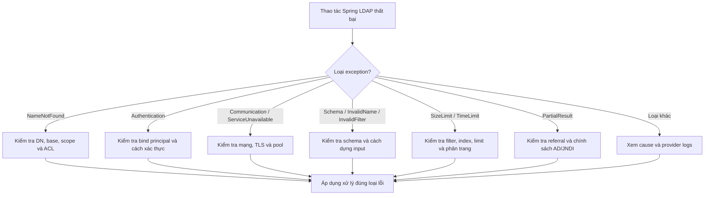

# Exception của JNDI và hệ thống exception của Spring LDAP

Trong ứng dụng Java truy cập LDAP, một thao tác tìm kiếm, đọc, thêm, sửa hoặc xác thực có thể thất bại vì nhiều nguyên nhân: DN không tồn tại, mật khẩu bind không đúng, không có quyền ghi, vi phạm schema, bộ lọc sai, kết nối bị ngắt hoặc server dừng tìm kiếm do vượt giới hạn. Nếu mọi lỗi đều được xử lý bằng một `catch (Exception e)` rồi trả về “không tìm thấy”, ứng dụng sẽ che giấu nguyên nhân thật và có thể đưa ra quyết định nghiệp vụ sai.

Bài thuộc chương **JNDI và Spring** của mô-đun **SPRING_LDAP**. Trọng tâm là mối quan hệ giữa **hệ exception checked của Java Naming and Directory Interface (JNDI)** và **hệ exception runtime của Spring LDAP**, đặc biệt trong `LdapTemplate`, `LdapClient` và các thao tác dựa trên `ContextSource`. Đây cũng là nền tảng để thiết kế xử lý lỗi cho cấu hình, xác thực, TLS, pooling và truy cập thư mục an toàn.

**Sau bài học, bạn có thể:**

- Giải thích vì sao JNDI sử dụng `javax.naming.NamingException` và Spring LDAP chuyển sang một hệ exception unchecked.
- Nhận biết các nhóm lỗi phổ biến và phân biệt lỗi “không tìm thấy”, lỗi xác thực, lỗi quyền, lỗi mạng, lỗi schema và lỗi giới hạn kết quả.
- Bắt đúng kiểu exception trong mã dùng `LdapTemplate` hoặc `LdapClient`; giữ lại nguyên nhân gốc khi chuyển sang lỗi của ứng dụng.
- Phân biệt `PartialResultException` do referral với `SizeLimitExceededException` và `TimeLimitExceededException` do giới hạn tìm kiếm.
- Thiết kế cách log, retry, báo lỗi API và kiểm thử theo mức độ rủi ro và tính hoàn chỉnh của kết quả.

## 1. Hai tầng API: từ JNDI đến Spring LDAP

**JNDI** là API thuộc Java SE để truy cập dịch vụ đặt tên và thư mục, trong đó có LDAP. JNDI cung cấp các interface như `Context`, `DirContext`, `LdapContext` và nhóm checked exception dưới `javax.naming`.

**Spring LDAP** xây trên JNDI, cung cấp `ContextSource` để lấy context và `LdapTemplate` để thực hiện thao tác, giải phóng tài nguyên, xử lý kết quả và **chuyển đổi exception**. `LdapClient` và các tiện ích khác trong hệ Spring LDAP giúp đơn giản hóa những thao tác tương tự ở tầng ứng dụng.

```text
Service / Repository Java
         |
         | gọi LdapTemplate.search(), lookup(), modifyAttributes()...
         v
Spring LDAP: ContextSource + LdapTemplate
         |
         | dùng DirContext / LdapContext (JNDI)
         v
JNDI LDAP provider  ────── TLS / network ──────> LDAP server
         ^
         | javax.naming.NamingException (checked)
         |
Spring LDAP chuyển đổi
         |
         v
org.springframework.ldap.NamingException và các subclass (runtime)
         |
         v
Service xử lý lỗi phù hợp với nghiệp vụ
```

**Cả hai lớp đều dùng tên `NamingException`, nhưng đó là hai kiểu Java khác nhau**:

| Đặc điểm | JNDI | Spring LDAP |
| --- | --- | --- |
| Kiểu gốc | `javax.naming.NamingException` | `org.springframework.ldap.NamingException` |
| Cơ chế Java | **Checked exception** | **Unchecked exception**; kế thừa `RuntimeException` qua hệ Spring |
| Nơi thường gặp | Gọi `DirContext`/`LdapContext` trực tiếp | Gọi `LdapTemplate`/API Spring LDAP |
| Cách bắt | `catch (javax.naming.NamingException ex)` | `catch (org.springframework.ldap.NamingException ex)` |
| Nguyên nhân gốc | JNDI/provider ném lỗi | Có thể chứa JNDI exception làm cause |
| Ai đóng context, enumeration? | Người gọi trực tiếp chịu trách nhiệm | `LdapTemplate` thường quản lý việc lấy/đóng tài nguyên |

**Lưu ý về namespace:** JNDI vẫn thuộc gói Java SE `javax.naming`. Việc ứng dụng sử dụng Spring phiên bản mới hoặc Jakarta API cho các thành phần khác không đồng nghĩa JNDI tự đổi sang `jakarta.naming`.

## 2. Vì sao JNDI dùng checked exception?

Java buộc mã sử dụng nhiều phương thức JNDI phải **bắt** `NamingException` hoặc **khai báo** `throws NamingException`.

Ví dụ đọc `cn` của một entry bằng JNDI trực tiếp:

```java
import java.util.Hashtable;
import javax.naming.Context;
import javax.naming.NameNotFoundException;
import javax.naming.NamingException;
import javax.naming.directory.Attributes;
import javax.naming.directory.DirContext;
import javax.naming.directory.InitialDirContext;

public class DirectJndiExample {

    public String readCommonName() throws NamingException {
        Hashtable<String, Object> env = new Hashtable<>();
        env.put(Context.INITIAL_CONTEXT_FACTORY,
                "com.sun.jndi.ldap.LdapCtxFactory");
        env.put(Context.PROVIDER_URL,
                "ldaps://ldap.example.org:636");

        // Ví dụ chỉ minh họa thao tác đọc: server phải cho phép
        // truy cập ẩn danh, hoặc ứng dụng cần cấu hình bind an toàn.
        DirContext ctx = new InitialDirContext(env);
        try {
            Attributes attrs = ctx.getAttributes(
                "uid=an,ou=People,dc=example,dc=org",
                new String[] {"cn"}
            );
            return (String) attrs.get("cn").get();
        } catch (NameNotFoundException ex) {
            return null; // Quyết định riêng của ví dụ khi DN không tồn tại.
        } finally {
            ctx.close();
        }
    }
}
```

Ở đây `new InitialDirContext(env)`, `ctx.getAttributes(...)` và `ctx.close()` đều có thể ném checked `javax.naming.NamingException`. Trong mã production, cần xử lý tình huống `close()` cũng thất bại mà không làm mất lỗi chính; `LdapTemplate` giúp giảm phần việc quản lý tài nguyên này.

**Có một số ngoại lệ cụ thể hơn `NamingException`**, chẳng hạn:

- `javax.naming.NameNotFoundException`: DN được yêu cầu không được tìm thấy theo cách server phản hồi.
- `javax.naming.AuthenticationException`: lỗi xác thực JNDI, thường liên quan bind/credentials.
- `javax.naming.CommunicationException`: lỗi giao tiếp với dịch vụ đặt tên/thư mục.
- `javax.naming.directory.SchemaViolationException`: thao tác vi phạm schema.

Khi sử dụng JNDI trực tiếp, nên bắt trường hợp chuyên biệt **trước** `NamingException` tổng quát. Nếu chỉ trả về `null` với mọi `NamingException`, lỗi mạng và lỗi mật khẩu cũng sẽ bị biến thành “không có người dùng”.

## 3. Spring LDAP chuyển exception như thế nào?

`LdapTemplate` bao bọc nhiều lệnh JNDI và chuyển `javax.naming.NamingException` thành exception runtime tương ứng trong `org.springframework.ldap`. Cơ chế chuyển đổi cốt lõi có thể được sử dụng trực tiếp qua:

```java
import org.springframework.ldap.support.LdapUtils;

// Giả sử jndiEx là javax.naming.NamingException đã bắt được:
org.springframework.ldap.NamingException springEx =
    LdapUtils.convertLdapException(jndiEx);
throw springEx;
```

**Thông thường bạn không phải gọi hàm này khi đã dùng `LdapTemplate`**: template tự xử lý việc chuyển đổi cho các lỗi JNDI trong những thao tác do nó quản lý. Cách gọi trực tiếp thích hợp khi bạn đang tích hợp mã JNDI tự viết vào một lớp có quy ước trả lỗi theo Spring LDAP.

### 3.1. Hệ exception của Spring LDAP

Hệ Spring LDAP có lớp cơ sở:

```text
org.springframework.ldap.NamingException (runtime)
├── AuthenticationException
├── CommunicationException
├── ServiceUnavailableException
├── NameNotFoundException
├── NameAlreadyBoundException
├── InvalidNameException
├── InvalidSearchFilterException
├── NoPermissionException
├── SchemaViolationException
├── PartialResultException
├── LimitExceededException
│   ├── SizeLimitExceededException
│   └── TimeLimitExceededException
└── UncategorizedLdapException
```

Sơ đồ là **tập con minh họa** của cây exception, không liệt kê toàn bộ class hay mọi quan hệ kế thừa phụ. Đa số exception trên mang tên giống class JNDI tương ứng nhưng sống trong gói `org.springframework.ldap`.

`UncategorizedLdapException` có thể được dùng khi một lỗi JNDI không khớp với nhóm chuyển đổi cụ thể. Nó không có nghĩa lỗi không quan trọng, chỉ cho biết nên kiểm tra **cause** và thông điệp từ provider/server để chẩn đoán.

### 3.2. Bảng ánh xạ các lỗi thường gặp

| Exception JNDI | Exception Spring LDAP | Ý nghĩa và tình huống phổ biến |
| --- | --- | --- |
| `javax.naming.AuthenticationException` | `AuthenticationException` | Bind không xác thực được |
| `javax.naming.AuthenticationNotSupportedException` | `AuthenticationNotSupportedException` | Phương thức xác thực không được hỗ trợ |
| `javax.naming.CommunicationException` | `CommunicationException` | Lỗi đường truyền, kết nối hoặc trao đổi dữ liệu |
| `javax.naming.ServiceUnavailableException` | `ServiceUnavailableException` | Dịch vụ không sẵn sàng |
| `javax.naming.NameNotFoundException` | `NameNotFoundException` | DN hoặc search base không tồn tại/không truy cập được theo kết quả server |
| `javax.naming.NameAlreadyBoundException` | `NameAlreadyBoundException` | Tạo entry tại DN đã bị chiếm |
| `javax.naming.InvalidNameException` | `InvalidNameException` | Cú pháp DN không hợp lệ |
| `javax.naming.NoPermissionException` | `NoPermissionException` | Không đủ quyền thực hiện thao tác |
| `javax.naming.directory.SchemaViolationException` | `SchemaViolationException` | Vi phạm objectClass, MUST/MAY, ràng buộc schema |
| `javax.naming.directory.InvalidSearchFilterException` | `InvalidSearchFilterException` | Cú pháp hoặc cấu trúc search filter sai |
| `javax.naming.SizeLimitExceededException` | `SizeLimitExceededException` | Vượt giới hạn số entry kết quả |
| `javax.naming.TimeLimitExceededException` | `TimeLimitExceededException` | Vượt giới hạn thời gian tìm kiếm |
| `javax.naming.PartialResultException` | `PartialResultException` | Không thể trả đầy đủ kết quả do cơ chế JNDI/referral hay xử lý liên quan |
| `javax.naming.NamingException` không có ánh xạ riêng | `UncategorizedLdapException` | Cần kiểm tra underlying cause |

**Tên class giống nhau không bảo đảm ứng dụng nào cũng thấy cùng exception cho mọi tình huống.** LDAP result code, cách triển khai server, JNDI provider, chính sách referral và quá trình gọi API ảnh hưởng loại lỗi thực tế. Bảng này mô tả **các cặp kiểu** phổ biến, không phải lời hứa mọi server sẽ ném đúng một class duy nhất trong mọi trường hợp.

### 3.3. Cause và stack trace không bị bỏ đi

Khi dùng Spring LDAP, thông tin hữu ích thường nằm ở chuỗi nguyên nhân:

```java
try {
    ldapTemplate.lookup("uid=an,ou=People");
} catch (org.springframework.ldap.NamingException ex) {
    Throwable cause = ex.getCause();
    // cause có thể là một javax.naming.NamingException cụ thể.
    // Ghi log đã loại bỏ thông tin nhạy cảm, rồi xử lý hoặc ném tiếp.
}
```

Không chỉ dựa vào `ex.getMessage()` để tự quyết định loại lỗi. Thông điệp có thể mang cú pháp do nhà cung cấp LDAP/Active Directory đưa ra, thay đổi theo phiên bản hoặc chứa DN/tên tài khoản. **Kiểu exception và nguyên nhân gốc** là cơ sở ổn định hơn để phân nhánh xử lý.

## 4. Đọc entry: phân biệt “không tìm thấy” và lỗi hệ thống

Giả sử `ContextSource` được cấu hình base DN:

```java
contextSource.setBase("dc=example,dc=org");
```

Với base đó, DN `uid=an,ou=People` truyền cho `LdapTemplate.lookup(...)` là **tương đối**. Spring LDAP sẽ làm việc trong vùng tên đã cấu hình.

Ví dụ repository đọc tên hiển thị từ đúng DN:

```java
import java.util.Optional;
import javax.naming.Name;
import javax.naming.directory.Attribute;
import org.springframework.ldap.NameNotFoundException;
import org.springframework.ldap.core.AttributesMapper;
import org.springframework.ldap.core.LdapTemplate;
import org.springframework.ldap.support.LdapNameBuilder;

public final class PersonDirectory {
    private final LdapTemplate ldapTemplate;

    public PersonDirectory(LdapTemplate ldapTemplate) {
        this.ldapTemplate = ldapTemplate;
    }

    public Optional<String> findCommonNameByUid(String uid) {
        Name relativeDn = LdapNameBuilder.newInstance()
            .add("ou", "People")
            .add("uid", uid)
            .build();

        try {
            String name = ldapTemplate.lookup(
                relativeDn,
                (AttributesMapper<String>) attrs -> {
                    Attribute cn = attrs.get("cn");
                    return cn == null ? null : (String) cn.get();
                }
            );
            return Optional.ofNullable(name);
        } catch (NameNotFoundException ex) {
            return Optional.empty();
        }
    }
}
```

Đoạn code chọn cách diễn giải **DN không tồn tại** là kết quả không có người dùng cho use case đọc hồ sơ. Các lỗi khác, như mất kết nối hoặc thiếu quyền, vẫn được ném tiếp đến tầng xử lý phù hợp.

**Đừng đánh đồng:**

- `lookup("uid=an,ou=People")` truy cập một entry cụ thể: không tồn tại thường dẫn đến `NameNotFoundException`.
- `search(...)` với search base **tồn tại** nhưng **không có entry khớp filter**: thông thường trả **danh sách rỗng**, không phải `NameNotFoundException`.
- `search(...)` với chính **search base không tồn tại**: có thể ném `NameNotFoundException`. Spring LDAP còn có cấu hình xử lý riêng cho trường hợp này.
- Entry hoặc attribute bị **ACL** che khuất: ứng dụng không thể kết luận đầy đủ về sự tồn tại chỉ từ một kết quả đọc.

Nếu muốn giới hạn không cho người dùng dò sự tồn tại tài khoản, giao diện công khai có thể dùng thông điệp chung. Nội bộ vẫn phải phân biệt lỗi hệ thống với tình huống không tìm thấy để giám sát và xử lý chính xác.

## 5. Xác thực: lỗi credentials khác lỗi kết nối

Khi bind vào LDAP thất bại, ứng dụng thường cần phân biệt ba nhóm:

| Nhóm | Exception gợi ý | Hướng xử lý |
| --- | --- | --- |
| Không xác thực được | `AuthenticationException` hoặc cách trả lỗi xác thực riêng của API | Không tiết lộ chi tiết user/password cho client |
| Cơ chế xác thực không hỗ trợ | `AuthenticationNotSupportedException` | Kiểm tra cấu hình bind, TLS, SASL và khả năng server |
| Kết nối/dịch vụ hỏng | `CommunicationException`, `ServiceUnavailableException` | Phân loại sự cố hạ tầng; có thể retry có kiểm soát |

**Không phải mọi API authentication của Spring LDAP đều có hợp đồng lỗi giống nhau.** Một số overload của `LdapTemplate.authenticate(...)` trả `boolean`, trong khi overload khác hoặc thành phần Spring Security LDAP có cách thể hiện lỗi xác thực khác. Cần đọc hợp đồng của **đúng API đang gọi**.

Spring LDAP và Spring Security cũng có các class cùng tên `AuthenticationException` nhưng thuộc **hệ exception khác nhau**. Ví dụ:

```text
org.springframework.ldap.AuthenticationException
org.springframework.security.core.AuthenticationException
javax.naming.AuthenticationException
```

Không import nhầm class nếu code xử lý cả LDAP bind và bảo mật web. Khi xử lý lỗi đăng nhập, ưu tiên chính sách chống lộ thông tin tài khoản, giới hạn lượt thử và thông điệp không tiết lộ chi tiết nhạy cảm.

### 5.1. TLS và pooling có thể làm thay đổi dấu hiệu lỗi

Trên kết nối LDAPS/StartTLS, một thất bại bắt tay TLS, chứng chỉ không hợp lệ, socket bị đóng hoặc read timeout có thể xuất hiện qua exception giao tiếp, đôi khi với `SSLException`, `SocketTimeoutException` hoặc `ConnectException` nằm trong chuỗi cause. **Không suy ra chắc chắn “mật khẩu sai” chỉ vì bind không thành công**.

Khi dùng pool kết nối LDAP, lỗi kết nối có thể xuất hiện khi mượn kết nối hoặc sử dụng một kết nối cũ. Cần theo dõi độ trễ, các lần tạo context thất bại và tình trạng pool, nhưng không tự động retry mọi thao tác ghi vì có nguy cơ thao tác đã thực hiện tại server trước khi client mất phản hồi.

## 6. Ghi entry: nhận biết lỗi schema, tên và quyền

Các thao tác `bind`, `modifyAttributes`, `rename` và `unbind` có thể thất bại ở nhiều tầng.

| Trường hợp | Exception thường cần xem | Điều nên kiểm tra |
| --- | --- | --- |
| Thêm entry tại DN đã tồn tại | `NameAlreadyBoundException` | Khóa/RDN có trùng? Có trường hợp race condition? |
| Đọc/sửa/xóa DN không tồn tại | `NameNotFoundException` | DN, parent DN, `ContextSource.base` và ACL |
| DN sai cú pháp | `InvalidNameException` | Escape RDN, thứ tự DN, dùng `LdapNameBuilder` |
| ObjectClass hoặc attribute không hợp schema | `SchemaViolationException`, `InvalidAttributesException`, `InvalidAttributeValueException` | `MUST`/`MAY`, syntax, SINGLE-VALUE, loại objectClass |
| Không đủ quyền sửa entry | `NoPermissionException` hoặc lỗi bảo mật do provider ánh xạ | Bind DN, ACL, quyền ghi đúng nhánh |
| Thao tác không được hỗ trợ | `OperationNotSupportedException` | Server/control/chính sách LDAP |
| Sửa/xóa attribute không có | `NoSuchAttributeException` | Tập attribute thực tế, phép sửa ADD/REPLACE/REMOVE |

### 6.1. Thí dụ thêm entry trùng DN

Giả sử ứng dụng thực hiện:

```java
try {
    ldapTemplate.bind(relativeDn, null, attributes);
} catch (org.springframework.ldap.NameAlreadyBoundException ex) {
    // Báo trùng khóa nghiệp vụ hoặc xử lý xung đột tạo entry.
    throw new IllegalStateException("Directory entry already exists", ex);
}
```

Ở đây `relativeDn` và `attributes` là các biến đã được chuẩn bị trước; `ldapTemplate.bind` không phải lời gọi idempotent. Không retry bằng cách gửi thêm cùng request liên tục khi nguyên nhân là DN trùng.

Nếu quy trình yêu cầu “tạo nếu chưa tồn tại”, phải thiết kế theo tính đồng thời. Bước “check tồn tại rồi bind” đơn giản vẫn có **race condition**: hai request có thể cùng xác nhận chưa có entry, rồi một request gặp `NameAlreadyBoundException`.

### 6.2. Phân biệt lỗi LDAP với lỗi dữ liệu Java

Không phải mọi lỗi xảy ra trong quá trình dùng Spring LDAP đều là `org.springframework.ldap.NamingException`. Ví dụ:

```java
(AttributesMapper<String>) attrs -> attrs.get("cn").get().toString()
```

Nếu `cn` không xuất hiện trong kết quả, `attrs.get("cn")` có thể trả `null` rồi gây `NullPointerException`. Đây là lỗi của logic ánh xạ/giả định dữ liệu, không tự động trở thành `NameNotFoundException` của LDAP.

Khi phân loại lỗi, cần xem **nguồn gốc**: thao tác LDAP thất bại, schema server từ chối, hay mapper Java xử lý dữ liệu chưa đúng.

## 7. Search: lỗi filter, giới hạn và kết quả không đầy đủ

Một LDAP search chịu tác động đồng thời từ **search base**, **scope**, **filter**, **danh sách thuộc tính yêu cầu**, **size limit** và **time limit**. Vì vậy, cần phân biệt lỗi filter với truy vấn hợp lệ nhưng bị giới hạn.

| Hiện tượng | Exception/hành vi | Ý nghĩa |
| --- | --- | --- |
| Filter không hợp lệ | `InvalidSearchFilterException` hoặc lỗi parse/filter liên quan | Cú pháp filter hoặc cách dựng filter sai |
| Không có entry khớp | Danh sách rỗng nếu search base tồn tại và thành công | Không phải mặc nhiên là exception |
| Vượt số kết quả cho phép | `SizeLimitExceededException` | Có thể đã nhận một phần entry |
| Vượt thời gian cho phép | `TimeLimitExceededException` | Có thể đã nhận một phần entry |
| Giới hạn hành chính khác | `LimitExceededException`/lỗi liên quan do provider | Cần xác nhận result code và chính sách server |
| Không truy cập được referral đầy đủ | `PartialResultException` | Thường liên quan referral và provider, không đồng nghĩa size limit |

### 7.1. Bắt lỗi vượt hạn mức đúng cách

Ví dụ query giới hạn kết quả, tìm user trong `ou=People`:

```java
import java.util.List;
import org.springframework.ldap.SizeLimitExceededException;
import org.springframework.ldap.TimeLimitExceededException;
import org.springframework.ldap.core.AttributesMapper;
import org.springframework.ldap.core.LdapTemplate;
import org.springframework.ldap.query.LdapQuery;
import org.springframework.ldap.query.SearchScope;

import static org.springframework.ldap.query.LdapQueryBuilder.query;

public List<String> searchPeople(
        LdapTemplate ldapTemplate, String departmentCode) {
    LdapQuery ldapQuery = query()
        .base("ou=People")
        .searchScope(SearchScope.SUBTREE)
        .countLimit(50)
        .timeLimit(5000)
        .attributes("uid")
        .where("objectClass").is("inetOrgPerson")
        .and("departmentNumber").is(departmentCode);

    try {
        return ldapTemplate.search(
            ldapQuery,
            (AttributesMapper<String>) attrs ->
                String.valueOf(attrs.get("uid").get())
        );
    } catch (SizeLimitExceededException | TimeLimitExceededException ex) {
        // Không được xem dữ liệu đã đọc trước lỗi là tập kết quả đầy đủ.
        throw new IllegalStateException(
            "Directory search did not complete", ex
        );
    }
}
```

Ví dụ này giả sử `ContextSource.base = dc=example,dc=org`. Các giới hạn `.countLimit(50)` và `.timeLimit(5000)` được truyền theo API truy vấn của Spring LDAP/JNDI; thời gian `5000` ở đây tính bằng **mili giây** theo `SearchControls` (tương đương 5 giây).

**Tại sao không bắt exception rồi trả `Collections.emptyList()`?** Vì kết quả rỗng có nghĩa **“đã tìm thành công và không có entry khớp”**, trong khi lỗi giới hạn có thể nghĩa **“chưa duyệt hết dữ liệu”**. Nếu là tác vụ đồng bộ, nhập nhằng này có thể khiến chương trình xóa hoặc vô hiệu hóa nhầm các đối tượng.

### 7.2. `PartialResultException` không đồng nghĩa size/time limit

Tên `PartialResultException` dễ gây nhầm với “kết quả không đầy đủ do vượt `sizeLimit`”. Trong JNDI và Spring LDAP, exception này thường phát sinh **do referral** hoặc cách JNDI provider xử lý tham chiếu đến phần khác của thư mục.

Ví dụ Active Directory có thể trả referral trong search. Một số cấu hình JNDI không xử lý được referral như kỳ vọng, dẫn đến `PartialResultException`.

`LdapTemplate` có một số cấu hình liên quan:

- `setIgnorePartialResultException(true)`: bỏ qua loại exception này trong search khi phù hợp, thường được xem xét với môi trường AD có vấn đề referral.
- `setIgnoreSizeLimitExceededException(true)`: có thể bỏ qua lỗi vượt size limit trong search.
- `setIgnoreNameNotFoundException(true)`: có thể bỏ qua lỗi search base không tồn tại trong search.

**Chỉ bật sau khi đã hiểu ảnh hưởng.** Bỏ qua lỗi có thể khiến caller tiếp tục với kết quả thiếu hoặc rỗng mà không biết truy vấn chưa đạt mục tiêu. Với đồng bộ toàn bộ thư mục, đối soát danh sách quyền hoặc tác vụ yêu cầu tính đầy đủ, cách làm này có thể không chấp nhận được.

Cũng cần phân biệt `ReferralException` và `PartialResultException`: một lỗi liên quan việc tham chiếu sang server khác không tự động trở thành vấn đề giới hạn kết quả.

## 8. Thiết kế xử lý exception theo nguyên nhân

Một lớp truy cập thư mục nên quy định **lỗi nào được xử lý tại chỗ, lỗi nào được chuyển thành lỗi nghiệp vụ, lỗi nào phải ném lên**. Không cần để controller phụ thuộc trực tiếp tất cả exception LDAP, nhưng cũng không nên mất thông tin lỗi gốc.

| Nhóm lỗi | Có nên retry? | Phản ứng phù hợp |
| --- | --- | --- |
| DN không tồn tại khi đọc tùy chọn | Không cần | Có thể trả `Optional.empty()` |
| Sai mật khẩu của người dùng | Không retry tự động | Thông điệp đăng nhập chung; áp chính sách rate limit |
| Bind service account thất bại | Không retry vô hạn | Báo cấu hình/credentials, cảnh báo vận hành |
| Không có quyền | Không retry cùng quyền | Kiểm tra ACL, principal và use case |
| DN/filter sai cú pháp | Không | Sửa cách dựng DN/filter, validate đầu vào |
| Vi phạm schema | Không | Sửa payload/logic mapping/schema |
| NameAlreadyBound khi tạo | Không thử lặp mù quáng | Xử lý conflict hoặc idempotency có kiểm soát |
| Communication/ServiceUnavailable | Có thể, trong một số trường hợp | Retry có giới hạn và backoff nếu thao tác an toàn để lặp |
| SizeLimitExceeded | Thường không retry y nguyên | Thu hẹp search, phân trang, điều chỉnh quota phù hợp |
| TimeLimitExceeded | Có thể retry nếu sự cố tạm thời | Tối ưu filter/index và giới hạn retry |
| PartialResult do referral | Tùy cấu hình | Kiểm tra referral policy và yêu cầu dữ liệu đầy đủ |

### 8.1. Xây dựng ranh giới lỗi ở tầng service

Ví dụ minh họa phân loại các lỗi phổ biến, giữ `cause` khi chuyển lên tầng ứng dụng:

```java
import java.util.List;
import org.springframework.ldap.CommunicationException;
import org.springframework.ldap.ServiceUnavailableException;
import org.springframework.ldap.SizeLimitExceededException;
import org.springframework.ldap.TimeLimitExceededException;
import org.springframework.ldap.NoPermissionException;
import org.springframework.ldap.core.AttributesMapper;
import org.springframework.ldap.core.LdapTemplate;

public class PeopleService {
    private final LdapTemplate ldapTemplate;

    public PeopleService(LdapTemplate ldapTemplate) {
        this.ldapTemplate = ldapTemplate;
    }

    public List<String> listNames() {
        try {
            return ldapTemplate.search(
                "ou=People",
                "(objectClass=inetOrgPerson)",
                (AttributesMapper<String>) attrs ->
                    (String) attrs.get("cn").get()
            );
        } catch (SizeLimitExceededException
                 | TimeLimitExceededException ex) {
            throw new DirectoryQueryIncompleteException(
                "LDAP search was incomplete", ex
            );
        } catch (CommunicationException
                 | ServiceUnavailableException ex) {
            throw new DirectoryUnavailableException(
                "LDAP service unavailable", ex
            );
        } catch (NoPermissionException ex) {
            throw new DirectoryAccessDeniedException(
                "LDAP access denied", ex
            );
        }
    }

    public static class DirectoryQueryIncompleteException
            extends RuntimeException {
        public DirectoryQueryIncompleteException(
                String message, Throwable cause) {
            super(message, cause);
        }
    }

    public static class DirectoryUnavailableException
            extends RuntimeException {
        public DirectoryUnavailableException(
                String message, Throwable cause) {
            super(message, cause);
        }
    }

    public static class DirectoryAccessDeniedException
            extends RuntimeException {
        public DirectoryAccessDeniedException(
                String message, Throwable cause) {
            super(message, cause);
        }
    }
}
```

Đoạn mã minh họa chủ yếu là **chính sách chuyển đổi lỗi**. Trong hệ thống thật nên đặt các exception nghiệp vụ ở những class riêng và có handler tập trung ở ranh giới API. Đồng thời, mapper phải xử lý attribute bị thiếu để không phát sinh `NullPointerException` ngoài ý muốn.

Nếu search không có result, phương thức trả danh sách rỗng. Nếu lỗi kết nối, ngoại lệ đi lên dưới dạng `DirectoryUnavailableException`. Nếu query bị cắt, ứng dụng nhận `DirectoryQueryIncompleteException` và tránh coi dữ liệu là đầy đủ.

### 8.2. Retry phải xét thao tác đọc/ghi

Đối với **search/lookup** có thể retry có giới hạn khi gặp lỗi mạng tạm thời, với backoff và deadline tổng. Không retry vô hạn hoặc tạo nhiều yêu cầu đồng thời làm LDAP server quá tải.

Đối với **bind/modify/rename/unbind**, nếu mạng mất ngay sau khi server đã thực hiện thao tác nhưng trước khi client nhận phản hồi, client có thể **không biết thao tác đã thành công hay chưa**. Gửi lại lệnh ghi mù quáng có thể gây xung đột hoặc tác dụng phụ. Phải xây dựng quy trình xác nhận trạng thái, khóa định danh/idempotency hoặc cơ chế bù trừ phù hợp trước khi retry.

### 8.3. Ánh xạ sang HTTP/API không tiết lộ chi tiết LDAP

Nếu có API web gọi LDAP, một phương án tham khảo:

| Tình huống phía service | Phản hồi tham khảo |
| --- | --- |
| Đọc hồ sơ tùy chọn không thấy entry | `404 Not Found` nếu việc xác nhận tồn tại được phép công bố |
| Tạo entry trùng khóa | `409 Conflict` nếu phù hợp nghiệp vụ |
| Payload vi phạm quy tắc của ứng dụng | `400 Bad Request` sau khi xác thực dữ liệu đầu vào |
| LDAP tạm thời không sẵn sàng | `503 Service Unavailable` |
| Search bị timeout từ dịch vụ phụ thuộc | `504 Gateway Timeout` hoặc mã lỗi ứng dụng phù hợp |
| Sai thông tin đăng nhập | Thông điệp chung, mã HTTP theo luồng authentication |
| ACL LDAP từ chối service account | Không mặc nhiên coi người dùng cuối thiếu quyền; phân loại lỗi cấu hình/ủy quyền nội bộ |

Đây là **gợi ý thiết kế**, không phải quy tắc ánh xạ 1:1 bắt buộc. Đặc biệt, lỗi LDAP `NoPermissionException` do bind account không đủ quyền chưa chắc có nghĩa client HTTP cần nhận `403`; đó có thể là sự cố cấu hình ứng dụng.

## 9. Chẩn đoán theo chuỗi nguyên nhân và ngữ cảnh

Khi production ghi nhận lỗi “LDAP unavailable”, kỹ sư cần biết **thao tác nào** thất bại mà vẫn tránh log dữ liệu nhạy cảm.

Thông tin nên ghi nhận:

| Thông tin | Giúp xác định |
| --- | --- |
| Thao tác `bind` / `search` / `lookup` / `modify` | Giai đoạn thất bại |
| Loại Spring LDAP exception | Nhóm lỗi ở tầng ứng dụng |
| Loại exception JNDI trong `getCause()` | Lỗi gốc hoặc lỗi provider |
| LDAP result code nếu có | Phân biệt size/time limit, auth, schema, permission |
| Search base, scope, loại filter đã làm sạch | Phạm vi/độ rộng truy vấn |
| Thời gian connect/bind/search | Chậm do kết nối, xác thực hay xử lý search |
| Tên hệ thống/endpoint LDAP (đã ẩn thông tin nhạy cảm) | Server nào gặp lỗi |
| Request/correlation ID | Liên kết log giữa các service |
| Số lần retry và trạng thái cuối | Đánh giá chính sách phục hồi |

**Không log mật khẩu, credentials, token, thông tin nhân sự toàn bộ hoặc filter chứa dữ liệu nhạy cảm một cách không kiểm soát.** Có thể log tên loại filter, mã lỗi và correlation ID thay cho giá trị tìm kiếm.

Đối với lỗi TLS, xem root cause có `SSLHandshakeException` hoặc `SSLException` hay không và kiểm tra truststore/chứng chỉ một cách đúng quy trình. **Không tắt kiểm tra chứng chỉ chỉ để truy vấn hoạt động**. Đối với lỗi network, phân biệt connect timeout với read timeout và điều kiện “server đã nhận thao tác chưa?”.

### 9.1. Trình tự chẩn đoán thực tế



Sơ đồ giúp định hướng chẩn đoán, nhưng phải kiểm tra **ngữ cảnh cụ thể**: cùng một lỗi mạng có thể xuất hiện ở bước lấy context, trong khi một mã không tìm thấy có thể bị ảnh hưởng bởi quyền đọc hoặc referral.

## 10. Kiểm thử exception trong Spring LDAP

Kiểm thử nên bao phủ **hành vi ứng dụng khi có lỗi**, ngoài việc kiểm tra tên exception. Các tình huống quan trọng:

| Kịch bản | Cách dựng tình huống trong môi trường test | Kỳ vọng |
| --- | --- | --- |
| Lookup DN không tồn tại | Tra entry chưa được tạo | Trả `Optional.empty()` theo thiết kế |
| Search filter đúng nhưng không khớp | Dùng nhánh tồn tại, filter không khớp entry nào | Danh sách rỗng, không nhầm lỗi |
| Search base sai | Tra nhánh không tồn tại | Xử lý `NameNotFoundException`/cấu hình ignore theo chính sách |
| Credentials sai | Bind tài khoản thử nghiệm với password sai | Đường xác thực thất bại, không lộ password |
| ACL từ chối sửa | Bind account chỉ có quyền đọc rồi thử modify | Giữ lỗi quyền và không retry vô hạn |
| Sai objectClass/attribute | Tạo entry không đáp ứng MUST/MAY | Báo lỗi schema, không coi là network outage |
| Tạo entry đã có | Bind lặp vào cùng DN | Xử lý conflict một cách rõ ràng |
| Search vượt size limit | Dữ liệu test nhiều entry, limit nhỏ | Không coi kết quả từng phần là đầy đủ |
| Search vượt time limit | Dùng giới hạn/test environment có khả năng tái hiện | Nhận diện lỗi timeout/giới hạn đúng |
| Referral trên AD hoặc server hỗ trợ | Query vùng có referral | Xác nhận chính sách theo referral |
| Mất kết nối/SSL handshake fail | Mô phỏng endpoint hoặc chứng chỉ không hợp lệ | Phân loại hạ tầng và bảo vệ thông tin nhạy cảm |

**Unit test** phù hợp để kiểm tra service xử lý loại exception đã được Spring LDAP trả ra (ví dụ mock `LdapOperations` hoặc bọc một adapter truy cập thư mục). **Integration test** mới xác nhận được hành vi JNDI/provider/server thật: result code, ACL, referral, time/size limit và TLS.

Một LDAP server nhúng dùng cho test có thể không tái hiện đầy đủ đặc tính của Active Directory hoặc hệ LDAP production. Vì vậy cần chọn fixture và môi trường test gần với các tình huống muốn bảo đảm.

### 10.1. Tư duy unit test có ý nghĩa

Với repository `findCommonNameByUid` ở mục 4, nên kiểm tra:

1. Khi `ldapTemplate.lookup(...)` trả tên, repository trả `Optional.of(name)`.
2. Khi `lookup` ném `org.springframework.ldap.NameNotFoundException`, repository trả `Optional.empty()`.
3. Khi `lookup` ném `org.springframework.ldap.CommunicationException`, repository **không** trả `Optional.empty()`; lỗi phải lan truyền hoặc được chuyển thành loại lỗi hệ thống.

Ba kiểm thử này xác minh **chính sách phân biệt “không có dữ liệu” và “LDAP không hoạt động”**, chứ không chỉ lặp lại cấu trúc code.

## 11. Những sai lầm thường gặp

| Sai lầm | Tác hại | Cách sửa |
| --- | --- | --- |
| Import `javax.naming.NamingException` trong `catch` bao quanh `LdapTemplate` | Bắt nhầm họ exception, không xử lý lỗi runtime dự kiến | Dùng `org.springframework.ldap.NamingException` hoặc subclass cụ thể |
| Xem mọi exception là `NameNotFoundException` | Biến sự cố kết nối/xác thực thành dữ liệu rỗng | Bắt theo nguyên nhân cụ thể |
| Chỉ bắt `Exception` rồi trả danh sách rỗng | Che lỗi search không hoàn tất | Phân biệt success, no match và incomplete/error |
| Bỏ qua `PartialResultException` vô điều kiện | Có thể mất dữ liệu do referral | Đánh giá referral policy và nhu cầu đầy đủ |
| Bỏ qua `SizeLimitExceededException` khi đồng bộ | Có thể tưởng tập kết quả đã đầy đủ | Phân trang và kiểm tra trạng thái cuối |
| Dùng `getMessage()` để parse mọi mã lỗi | Phụ thuộc server/locale/provider | Dựa vào class, cause, result code chuẩn khi có |
| Retry mọi lệnh ghi khi mất mạng | Nguy cơ thao tác đã thành công ở server | Kiểm tra trạng thái/idempotency |
| Vô hiệu hóa TLS validation khi gặp lỗi | Phá an toàn đường truyền | Sửa chứng chỉ/truststore đúng cách |
| Đưa nguyên LDAP exception lên UI | Lộ DN, cấu trúc thư mục, principal | Ánh xạ thông điệp an toàn, giữ chi tiết ở log nội bộ |
| Giả định lỗi mapper là lỗi LDAP | Bỏ qua bug Java hoặc attribute vắng mặt | Validate và map attribute có kiểm soát |

## 12. Thực hành tình huống

Giả sử hệ thống Spring LDAP dùng `ContextSource.base = dc=example,dc=org`. Tất cả tên class Spring LDAP dưới đây thuộc `org.springframework.ldap`, trừ khi được ghi khác.

**Bài 1.** Khi gọi `ldapTemplate.lookup("uid=an,ou=People")`, API ném `NameNotFoundException`. Với endpoint đọc hồ sơ tùy chọn, cách xử lý nào hợp lý? Tại sao không áp dụng cùng cách này cho `CommunicationException`?

**Bài 2.** Một phép `search` đã trả 50 entry nhưng ném `SizeLimitExceededException`. Tác vụ đồng bộ có được xem 50 entry này là toàn bộ thư mục không?

**Bài 3.** Đội vận hành thấy `PartialResultException` trên Active Directory khi search vùng có referral. Có thể kết luận nguyên nhân là `timeLimit` hết không? Nêu điều cần kiểm tra.

**Bài 4.** Trong code sử dụng `LdapTemplate`, tại sao `catch (javax.naming.NamingException ex)` thường không phù hợp để bắt lỗi LDAP được template chuyển đổi?

**Bài 5.** Ứng dụng gửi thêm entry với `sn` bắt buộc bị thiếu theo schema, server từ chối. Nên xem nhóm exception nào? Có nên retry y nguyên 3 lần?

**Bài 6.** Một request ghi entry trả `CommunicationException` sau khi client gửi lệnh modify. Có thể chắc chắn rằng server chưa sửa dữ liệu không? Hãy đề xuất hướng xử lý.

**Bài 7.** Nêu ba loại exception Spring LDAP mà bạn cần phân biệt khi thiết kế một API tìm kiếm người dùng, và mô tả hành động tương ứng.

### Đáp án gợi ý

1. Có thể chuyển `NameNotFoundException` thành `Optional.empty()` hoặc kết quả 404 theo chính sách endpoint. `CommunicationException` là lỗi hạ tầng; trả rỗng sẽ che sự cố và đánh lừa tầng nghiệp vụ.
2. **Không.** Query bị giới hạn, chưa có bằng chứng đã duyệt đủ kết quả. Cần phân trang/chia nhỏ truy vấn và xác nhận trạng thái hoàn tất.
3. **Không.** `PartialResultException` thường liên quan cách xử lý referral; kiểm tra referral policy của JNDI, cấu hình server, `ignorePartialResultException` và yêu cầu dữ liệu đầy đủ.
4. Vì Spring LDAP trả exception **runtime thuộc `org.springframework.ldap`**. `javax.naming.NamingException` là checked exception của JNDI, thường là **cause** của exception Spring đã được chuyển đổi.
5. Có thể gặp `SchemaViolationException` hoặc exception liên quan attribute tùy provider. Cần sửa payload/schema trước; retry y nguyên không giải quyết nguyên nhân.
6. **Không.** Server có thể đã thực hiện modify rồi phản hồi bị mất. Nên kiểm tra trạng thái thực tế trước khi retry và thiết kế thao tác idempotent khi có thể.
7. Ví dụ `NameNotFoundException` (không tồn tại), `CommunicationException` (sự cố hạ tầng) và `SizeLimitExceededException` (truy vấn chưa đầy đủ). Mỗi loại dẫn đến quyết định khác nhau.

## 13. Ghi nhớ

- **JNDI:** các lỗi truy cập LDAP xuất phát từ `javax.naming.NamingException` dạng **checked**.
- **Spring LDAP:** `LdapTemplate` chuyển nhiều lỗi JNDI thành subclass của `org.springframework.ldap.NamingException` dạng **runtime**. Có thể xem cause để truy nguồn, nhưng nên bắt class phù hợp với API đang dùng.
- **Không tìm thấy**, **sai thông tin xác thực**, **lỗi kết nối/TLS**, **thiếu quyền**, **vi phạm schema**, **lỗi filter** và **vượt giới hạn tìm kiếm** có cách xử lý khác nhau.
- **`PartialResultException` thường liên quan referral; `SizeLimitExceededException` và `TimeLimitExceededException` liên quan giới hạn tìm kiếm.** Không xem dữ liệu đã trả trước lỗi là tập kết quả hoàn chỉnh.
- **Retry, logging và phản hồi API phải giữ an toàn:** không lộ credential, không retry thao tác ghi mù quáng và không tự động đổi mọi lỗi thành dữ liệu rỗng.

### Tài liệu tham khảo

- [Spring LDAP — Exception package `org.springframework.ldap`](https://docs.spring.io/spring-ldap/docs/current/api/org/springframework/ldap/package-summary.html): danh sách exception runtime được Spring LDAP cung cấp.
- [Spring LDAP — `LdapUtils.convertLdapException`](https://docs.spring.io/spring-ldap/docs/current/api/org/springframework/ldap/support/LdapUtils.html): chuyển checked JNDI exception sang Spring LDAP runtime exception.
- [Spring LDAP — `LdapTemplate`](https://docs.spring.io/spring-ldap/docs/current/api/org/springframework/ldap/core/LdapTemplate.html): xử lý tài nguyên, ngoại lệ và các cấu hình ignore liên quan search/referral.
- [Spring LDAP Reference Documentation](https://docs.spring.io/spring-ldap/reference/): `ContextSource`, `LdapTemplate`, tìm kiếm, xác thực và thao tác entry.
- [Java SE — `javax.naming.NamingException`](https://docs.oracle.com/en/java/javase/21/docs/api/java.naming/javax/naming/NamingException.html): hệ checked exception của JNDI.
- [RFC 4511 — LDAP: The Protocol](https://www.rfc-editor.org/rfc/rfc4511.html): thao tác tìm kiếm, bind, result code và referral.
