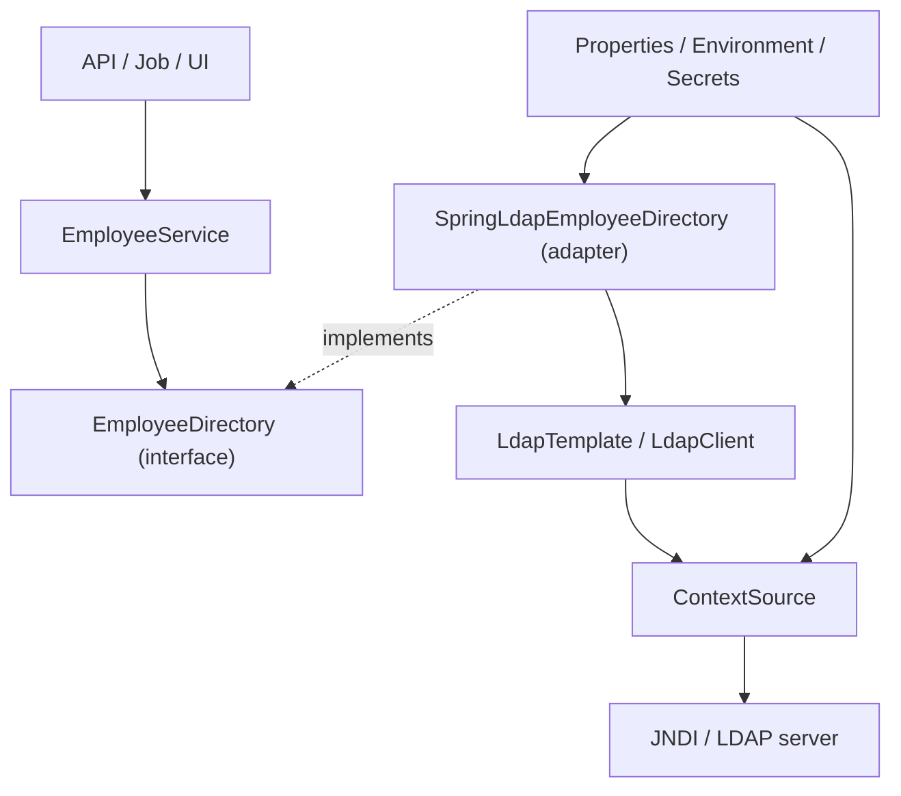

# Tách cấu hình directory khỏi logic nghiệp vụ trong Spring LDAP

Một ứng dụng dùng LDAP thường cần kết nối tới máy chủ thư mục, xác thực tài khoản dịch vụ, chọn base DN, tìm entry theo filter và chuyển dữ liệu thành đối tượng Java. Nếu tất cả công việc đó nằm trong một lớp nghiệp vụ, mỗi lần đổi LDAP server, cấu trúc OU, thông tin bind hoặc cơ chế TLS đều có nguy cơ kéo theo sửa logic và kiểm thử lại toàn bộ chức năng.

Trong chương **JNDI và Spring** của module **Spring LDAP**, mục tiêu là xây dựng ranh giới rõ ràng: **cấu hình directory nằm ở tầng hạ tầng, thao tác LDAP nằm trong adapter, còn nghiệp vụ chỉ phụ thuộc vào một giao diện mô tả dữ liệu mình cần**. Spring LDAP cung cấp `ContextSource`, `LdapTemplate`, `LdapClient` và cơ chế ánh xạ đối tượng (ODM) để thực hiện ranh giới này trên nền JNDI.

Sau bài học, bạn có thể:

- Phân biệt trách nhiệm của JNDI, `ContextSource`, `LdapTemplate` và service nghiệp vụ.
- Đưa địa chỉ LDAP, bind DN, mật khẩu, base DN và nhánh dữ liệu vào cấu hình ngoài code.
- Thiết kế một giao diện `EmployeeDirectory` để nghiệp vụ không phụ thuộc trực tiếp vào LDAP.
- Viết adapter dùng `LdapTemplate`, filter builder và mapping dữ liệu.
- Kiểm thử service bằng fake/mocking mà không cần LDAP server; kiểm thử adapter riêng trên một directory thử nghiệm.
- Quản lý thay đổi giữa các môi trường, TLS, quyền bind, lỗi kết nối và cấu trúc DN mà không làm rối nghiệp vụ.

## 1. Vì sao cần tách cấu hình directory?

Giả sử tính năng hiển thị hồ sơ nhân viên có yêu cầu đơn giản: “Tìm tài khoản theo `uid` và trả tên hiển thị cùng các địa chỉ email”. Trong thực tế, truy vấn còn phụ thuộc:

| Thông tin hạ tầng | Ví dụ | Tần suất/nguồn thay đổi |
| --- | --- | --- |
| LDAP endpoint | `ldaps://ldap.example.org:636` | Theo môi trường, chuyển server hoặc failover |
| Bind DN | `cn=app-reader,ou=service,dc=example,dc=org` | Theo tài khoản dịch vụ |
| Bind credential | Mật khẩu hoặc secret của service account | Xoay vòng bí mật, triển khai |
| ContextSource base | `dc=example,dc=org` | Theo cấu trúc directory |
| Nhánh tìm người dùng | `ou=people` | Theo cách tổ chức OU |
| Kết nối/TLS | LDAPS hoặc StartTLS, truststore, timeout | Theo chính sách vận hành |
| Quyền truy cập | Chỉ được đọc `uid`, `cn`, `displayName`, `mail` | ACL trên LDAP server |

Những thông tin đó **không phải quy tắc nghiệp vụ** “đọc hồ sơ nhân viên”. Đặt chúng rải rác trong lớp service gây ra các vấn đề:

1. Đổi môi trường làm phải biên dịch hoặc sửa code thay vì cập nhật cấu hình.
2. Một số lớp sử dụng base DN này, lớp khác dùng base DN khác; truy vấn cho kết quả thiếu hoặc sai nhánh.
3. Mật khẩu và URL nội bộ dễ bị đưa vào repository, log hoặc thông báo lỗi.
4. Service phải khởi tạo và đóng `DirContext`, bắt `NamingException`, xử lý escape filter; code nghiệp vụ khó đọc.
5. Bài unit test đơn giản cũng phải dựng LDAP server hoặc mock các API hạ tầng sâu.

**Mục tiêu tách lớp** là chuyển những việc này tới nơi có trách nhiệm phù hợp, đồng thời giữ yêu cầu nghiệp vụ có ý nghĩa rõ ràng, ví dụ `findByUid(uid)`.

## 2. Phân chia vai trò: JNDI, Spring LDAP và nghiệp vụ

**JNDI (Java Naming and Directory Interface)** là API Java cho dịch vụ tên/thư mục. Với LDAP, nó cung cấp các lớp như `DirContext`, `SearchControls`, `Attributes` và `NamingException`. Nếu dùng JNDI trực tiếp, ứng dụng phải quản lý kết nối/context, thông số môi trường và nhiều chi tiết truy vấn.

**Spring LDAP** xây thêm lớp trừu tượng trên JNDI:

| Thành phần | Trách nhiệm chính | Nên đặt ở đâu? |
| --- | --- | --- |
| `ContextSource` / `LdapContextSource` | Cấu hình, tạo LDAP context để thao tác; quản lý base, endpoint, bind và môi trường JNDI | Cấu hình hạ tầng |
| `LdapTemplate` | Thực thi lookup/search/bind/modify; quản lý vòng đời context và chuyển đổi lỗi theo Spring LDAP | LDAP adapter/repository |
| `LdapClient` | API client ở các phiên bản Spring LDAP hỗ trợ, dùng để diễn đạt thao tác directory | LDAP adapter |
| ODM | Ánh xạ entry và attribute sang đối tượng Java | LDAP adapter/model hạ tầng |
| `EmployeeDirectory` | Hợp đồng nghiệp vụ cần đọc dữ liệu gì | Giao diện của ứng dụng |
| `EmployeeService` | Quy tắc nghiệp vụ dựa trên hồ sơ nhân viên | Tầng service |

Một cách tổ chức dependency:



**Hướng phụ thuộc của code:** service biết `EmployeeDirectory`; adapter hiện thực giao diện đó và biết Spring LDAP. Nhờ vậy service không cần biết DN đầy đủ, port, mật khẩu, filter hay `DirContext`.

Điều này không đồng nghĩa che giấu hoàn toàn lỗi hạ tầng: ứng dụng vẫn cần biết truy vấn thất bại khi server không sẵn sàng. Tuy nhiên, việc **dịch lỗi và quyết định chính sách xử lý** có thể được bố trí ở ranh giới rõ ràng thay vì xen trong từng quy tắc nghiệp vụ.

## 3. Cấu hình LDAP bằng Spring Boot

Ví dụ sau giả định Spring Boot có hỗ trợ tự cấu hình Spring LDAP, và ứng dụng sử dụng bản Spring LDAP tương thích. Cần có dependency cung cấp Spring LDAP và phần auto-configuration tương ứng (chẳng hạn Spring Boot starter cho LDAP data). Với Spring Framework không dùng Boot, có thể tạo `LdapContextSource` và `LdapTemplate` bằng Java configuration.

Tệp `application.yml`:

```yaml
spring:
  ldap:
    urls: ${LDAP_URL:ldaps://ldap.example.org:636}
    base: ${LDAP_BASE:dc=example,dc=org}
    username: ${LDAP_BIND_DN}
    password: ${LDAP_BIND_PASSWORD}

directory:
  people-base: ${LDAP_PEOPLE_BASE:ou=people}
```

Ý nghĩa:

- `spring.ldap.urls` là endpoint của LDAP server. Ví dụ dùng LDAPS; thông tin thật do hạ tầng cung cấp.
- `spring.ldap.base` là **base context** của các thao tác LDAP trong ứng dụng.
- `spring.ldap.username` thường là **bind DN đầy đủ** dùng để xác thực service account; nó khác với DN tương đối dùng trong `LdapTemplate.search`.
- `spring.ldap.password` được lấy từ biến môi trường hoặc secret store do môi trường triển khai cung cấp.
- `directory.people-base` là cấu hình riêng của **ứng dụng**, biểu diễn nhánh người dùng **tương đối** với base context. Đây không phải thuộc tính cấu hình chuẩn của Spring LDAP; chúng ta sẽ tự bind nó vào một class.

Với ví dụ trên, đường dẫn thật mà adapter tìm kiếm là:

```text
ContextSource base: dc=example,dc=org
Search base:        ou=people
DN search base:     ou=people,dc=example,dc=org
```

Nếu cần chuyển người dùng sang `ou=staff,dc=example,dc=org` ở môi trường khác, ứng dụng có thể cập nhật `LDAP_PEOPLE_BASE=ou=staff` trong môi trường đó. Nhưng nếu cấu trúc entry, schema hoặc nhu cầu tìm kiếm đổi, code adapter và kiểm thử tích hợp vẫn có thể cần điều chỉnh. **Tách cấu hình không loại bỏ mọi thay đổi code.**

> Các giá trị `example.org` chỉ để minh họa. Trên hệ thống thật phải cấu hình chứng chỉ tin cậy và xác minh danh tính server cho TLS. Đừng chấp nhận mọi chứng chỉ hoặc chuyển sang LDAP không mã hóa để khắc phục lỗi kết nối.

## 4. Tổ chức code để nghiệp vụ không phụ thuộc LDAP

Ví dụ triển khai bằng Java 17 và Spring Boot 3+ dưới đây chia thành các file/lớp riêng. Mục đích là minh họa ranh giới các tầng. Giả định server có entry người dùng với `uid`, `displayName` và `mail`, và tài khoản bind có quyền đọc.

### 4.1. Định nghĩa dữ liệu và hợp đồng nghiệp vụ

Đầu tiên là đối tượng hồ sơ mà ứng dụng sử dụng:

```java
// DirectoryEmployee.java
package com.example.directory;

import java.util.List;

public record DirectoryEmployee(
    String uid,
    String displayName,
    List<String> emails
) {}
```

Sau đó định nghĩa một giao diện mô tả thao tác cần thiết:

```java
// EmployeeDirectory.java
package com.example.directory;

import java.util.Optional;

public interface EmployeeDirectory {
    Optional<DirectoryEmployee> findByUid(String uid);
}
```

Hợp đồng này **không** chứa `LdapTemplate`, `SearchControls`, `LdapName` hay `NamingException`. Nó nói lên điều nghiệp vụ cần: tìm hồ sơ theo mã đăng nhập. `Optional.empty()` biểu diễn trường hợp không tìm thấy; lỗi kết nối hoặc thiếu quyền **không nên âm thầm chuyển thành không tìm thấy**.

### 4.2. Bind cấu hình nhánh thư mục vào class riêng

Ta giữ cấu hình `directory.people-base` ở tầng tích hợp:

```java
// DirectorySettings.java
package com.example.directory;

import org.springframework.boot.context.properties.ConfigurationProperties;

@ConfigurationProperties(prefix = "directory")
public record DirectorySettings(String peopleBase) {}
```

Đăng ký class cấu hình:

```java
// DirectoryConfiguration.java
package com.example.directory;

import org.springframework.boot.context.properties.EnableConfigurationProperties;
import org.springframework.context.annotation.Configuration;

@Configuration
@EnableConfigurationProperties(DirectorySettings.class)
public class DirectoryConfiguration {}
```

Spring Boot bind `directory.people-base` vào `DirectorySettings.peopleBase()`. Với cấu hình khác nhau theo môi trường, giá trị này có thể thay đổi mà không phải sửa lớp service. Trong hệ thống lớn hơn, có thể thêm validation để từ chối cấu hình thiếu/rỗng hoặc nằm ngoài nhánh được phép trước khi ứng dụng nhận traffic.

### 4.3. Viết LDAP adapter bằng `LdapTemplate`

Adapter là nơi biết thuộc tính LDAP, DN tương đối, filter và cách ánh xạ giá trị:

```java
// SpringLdapEmployeeDirectory.java
package com.example.directory;

import java.util.Arrays;
import java.util.List;
import java.util.Optional;

import org.springframework.ldap.core.ContextMapper;
import org.springframework.ldap.core.DirContextOperations;
import org.springframework.ldap.core.LdapTemplate;
import org.springframework.stereotype.Repository;

import static org.springframework.ldap.query.LdapQueryBuilder.query;

@Repository
public class SpringLdapEmployeeDirectory implements EmployeeDirectory {
    private final LdapTemplate ldapTemplate;
    private final DirectorySettings settings;

    public SpringLdapEmployeeDirectory(
            LdapTemplate ldapTemplate,
            DirectorySettings settings) {
        this.ldapTemplate = ldapTemplate;
        this.settings = settings;
    }

    @Override
    public Optional<DirectoryEmployee> findByUid(String uid) {
        if (uid == null || uid.isBlank()) {
            throw new IllegalArgumentException("uid must not be blank");
        }

        List<DirectoryEmployee> found = ldapTemplate.search(
            query()
                .base(settings.peopleBase())
                .where("objectClass").is("inetOrgPerson")
                .and("uid").is(uid),
            (ContextMapper<DirectoryEmployee>) context -> {
                DirContextOperations entry = (DirContextOperations) context;
                String[] mailValues = entry.getStringAttributes("mail");
                List<String> emails = mailValues == null
                    ? List.of()
                    : Arrays.asList(mailValues);

                return new DirectoryEmployee(
                    entry.getStringAttribute("uid"),
                    entry.getStringAttribute("displayName"),
                    emails
                );
            }
        );

        if (found.size() > 1) {
            throw new IllegalStateException(
                "More than one directory entry matches the uid");
        }
        return found.stream().findFirst();
    }
}
```

Từng quyết định trong adapter có mục đích:

1. `settings.peopleBase()` chọn nhánh tìm theo cấu hình, không viết cứng `ou=people` trong service.
2. `where(...).is(...)` và `and(...).is(...)` tạo filter có giá trị được escape thông qua API query builder; không nối chuỗi từ `uid` bên ngoài.
3. `getStringAttributes("mail")` giữ **toàn bộ giá trị email** khi `mail` là thuộc tính nhiều giá trị; không suy ra “email chính” từ thứ tự trả về.
4. `displayName` là attribute LDAP riêng, có thể vắng mặt; adapter giữ `null` để tầng nghiệp vụ/giao diện quyết định fallback.
5. Trả `Optional.empty()` khi không có entry; nếu nhiều entry khớp cùng `uid` trong phạm vi tìm, phát tín hiệu lỗi thay vì âm thầm lấy phần tử đầu tiên. DN có tính duy nhất, nhưng `uid` **không tự động được bảo đảm duy nhất trên toàn subtree**.

Ví dụ này chủ ý đặt filter/ánh xạ trong adapter. Nếu LDAP server có nhánh người dùng khác hoặc dùng attribute thay thế cho `uid`, thay đổi cần tập trung tại tầng tích hợp và hợp đồng có thể giữ nguyên nếu ý nghĩa dữ liệu không đổi.

### 4.4. Nghiệp vụ chỉ gọi interface

Lớp service không biết server, bind account, DN hoặc cách filter được xây:

```java
// EmployeeProfileService.java
package com.example.directory;

import java.util.Optional;
import org.springframework.stereotype.Service;

@Service
public class EmployeeProfileService {
    private final EmployeeDirectory employeeDirectory;

    public EmployeeProfileService(EmployeeDirectory employeeDirectory) {
        this.employeeDirectory = employeeDirectory;
    }

    public Optional<DirectoryEmployee> getProfile(String uid) {
        return employeeDirectory.findByUid(uid);
    }

    public boolean hasContactEmail(String uid) {
        return employeeDirectory.findByUid(uid)
            .map(employee -> !employee.emails().isEmpty())
            .orElse(false);
    }
}
```

Logic ở đây chỉ quan tâm đến hồ sơ và yêu cầu có email liên hệ. Nếu chuyển sang một loại directory khác hoặc thay adapter bằng dữ liệu mô phỏng trong test, service vẫn làm việc với cùng `EmployeeDirectory`.

## 5. Điểm cần phân biệt: base context, search base, DN và bind DN

Đây là nguồn lỗi rất thường gặp khi tách cấu hình khỏi code. Bốn giá trị có mục đích khác nhau:

| Giá trị | Ví dụ | Ý nghĩa |
| --- | --- | --- |
| LDAP URL | `ldaps://ldap.example.org:636` | Máy chủ và giao thức kết nối |
| Bind DN | `cn=app-reader,ou=service,dc=example,dc=org` | Danh tính service account để xác thực |
| ContextSource base | `dc=example,dc=org` | Gốc tương đối cho các thao tác của client |
| Search base | `ou=people` | Nhánh tìm của một truy vấn, tương đối với ContextSource base |
| Entry DN tương đối | `uid=lan,ou=people` | Tên entry dùng khi lookup/bind/modify qua ContextSource đó |

Nếu `ContextSource.base` đã là `dc=example,dc=org`, truyền cả `uid=lan,ou=people,dc=example,dc=org` vào một thao tác của `LdapTemplate` thường khiến hậu tố base bị áp dụng lần nữa và trỏ sai entry. Ngược lại, khi cấu hình base rỗng thì DN của thao tác cần chứa đường dẫn thích hợp từ gốc của context đó.

**Search base không cùng nghĩa với search scope.** Search base xác định nơi bắt đầu, scope quyết định tìm chính base, con trực tiếp hay toàn cây con. Ví dụ adapter đang dùng query builder với base `ou=people`; nếu người dùng được tổ chức thành nhiều OU con, cần xác nhận phạm vi tìm kiếm của query thực sự bao phủ những OU đó. Đừng nhầm thay `people-base` với thay cách tìm kiếm sâu hay nông.

## 6. Khi nào nên cấu hình `ContextSource` bằng Java?

Nếu dùng Spring Boot và cấu hình LDAP đơn giản, thuộc tính `spring.ldap.*` thường đủ để Boot tạo các bean tương ứng trong điều kiện auto-configuration được kích hoạt. Khi cần kiểm soát JNDI environment, nhiều directory, chiến lược xác thực khác nhau hoặc điều khiển vòng đời riêng, ứng dụng có thể định nghĩa bean `LdapContextSource` thủ công.

Ví dụ minh họa độc lập với Boot auto-configuration:

```java
import org.springframework.context.annotation.Bean;
import org.springframework.context.annotation.Configuration;
import org.springframework.ldap.core.LdapTemplate;
import org.springframework.ldap.core.support.LdapContextSource;

@Configuration
public class ManualLdapConfiguration {
    @Bean
    LdapContextSource contextSource() {
        LdapContextSource source = new LdapContextSource();
        source.setUrl("ldaps://ldap.example.org:636");
        source.setBase("dc=example,dc=org");
        source.setUserDn("cn=app-reader,ou=service,dc=example,dc=org");
        source.setPassword("replace-through-external-configuration");
        return source;
    }

    @Bean
    LdapTemplate ldapTemplate(LdapContextSource contextSource) {
        return new LdapTemplate(contextSource);
    }
}
```

Đây là ví dụ để thấy **wiring** giữa hai bean; **không dùng literal mật khẩu** trong triển khai thực tế. Nếu áp dụng Java configuration, hãy inject giá trị đã được nạp từ môi trường/secret store vào bean; cấu hình TLS, truststore và timeout tương ứng. Đồng thời tránh vô tình tạo **hai bean `ContextSource` hoặc `LdapTemplate` cạnh tranh** khi vừa dùng Boot auto-configuration vừa cấu hình thủ công.

Điểm cốt lõi không nằm ở việc chọn YAML hay Java config: **chỉ lớp cấu hình tạo/chỉ định `ContextSource`**; service nghiệp vụ không cần tự tạo `InitialDirContext` hoặc truy xuất `Hashtable` môi trường JNDI.

## 7. Tách cấu hình để dễ triển khai giữa các môi trường

Một thiết kế thường gặp là giữ file cấu hình mặc định không chứa bí mật và dùng biến môi trường/config management cho giá trị từng môi trường:

| Thuộc tính | Development | Staging | Production |
| --- | --- | --- | --- |
| `LDAP_URL` | Server test/embedded LDAP | Server staging | Endpoint production |
| `LDAP_BASE` | Cây test riêng | Cây staging | Base DN production |
| `LDAP_BIND_DN` | Tài khoản test chỉ đọc | Tài khoản staging | Tài khoản dịch vụ production có quyền tối thiểu |
| `LDAP_BIND_PASSWORD` | Secret test | Secret staging | Secret từ hệ thống quản lý bí mật |
| `LDAP_PEOPLE_BASE` | OU demo | OU staging | OU chứa người dùng production |

**Các nguyên tắc vận hành:**

- Cấu hình được quản lý bên ngoài artefact ứng dụng; mật khẩu và khóa không đưa vào Git, thông báo lỗi hoặc trace.
- Dùng LDAPS hoặc StartTLS phù hợp và xác minh chứng chỉ máy chủ, hostname và CA tin cậy; tránh tắt kiểm tra chứng chỉ.
- Tài khoản bind chỉ được cấp quyền LDAP cần thiết; tài khoản chỉ đọc không nên có quyền sửa entry.
- Đặt timeout kết nối/đọc hợp lý ở tầng JNDI/LDAP client theo khả năng thư viện và yêu cầu hệ thống. Hai thuộc tính JNDI provider thường được dùng là `com.sun.jndi.ldap.connect.timeout` và `com.sun.jndi.ldap.read.timeout` (giá trị mili giây), nhưng cách cấu hình chúng tùy cách tạo `ContextSource`.
- Kiểm tra chính sách pooling theo phiên bản và cấu hình đang dùng. Reuse kết nối có thể ảnh hưởng vòng đời bind hoặc TLS; không mặc định bật một tùy chọn JNDI pooling mà chưa kiểm thử với LDAPS/StartTLS và thiết kế xác thực.
- Khi xoay vòng credential, bảo đảm ứng dụng có cách tải lại hoặc khởi động lại cấu hình thích hợp; thay secret phía hạ tầng không luôn tự cập nhật kết nối đang tồn tại.

Trong hệ thống nhiều LDAP tenant, có thể xây nhiều adapter với các `ContextSource` được cấu hình riêng. Tránh để tầng nghiệp vụ tự chọn URL hoặc bind credential từ dữ liệu request không được kiểm soát.

## 8. Phân biệt lỗi directory với trạng thái nghiệp vụ

Với giao diện `findByUid(uid)`, có ít nhất bốn tình huống:

| Tình huống | Cách hiểu | Hướng xử lý |
| --- | --- | --- |
| Có đúng một entry | Truy vấn thành công | Trả `Optional.of(profile)` |
| Không có entry khớp | Tìm kiếm hoàn tất nhưng không tìm thấy | Trả `Optional.empty()` |
| Có nhiều entry khớp | `uid` không duy nhất trong phạm vi hoặc filter chưa đủ chọn lọc | Báo lỗi dữ liệu/thiết kế truy vấn; không tự chọn phần tử đầu |
| Lỗi kết nối, TLS, quyền hoặc schema | Truy vấn không hoàn tất như dự kiến | Giữ trạng thái lỗi hạ tầng và xử lý phù hợp |

Spring LDAP chuyển nhiều lỗi JNDI thành các exception kiểu runtime trong họ lỗi LDAP của Spring. Adapter nên bắt **những loại lỗi cụ thể mà ứng dụng thực sự xử lý được** (chẳng hạn lỗi không tìm thấy với lookup hoặc lỗi thiếu quyền), để phần còn lại được xử lý bởi chính sách lỗi chung của ứng dụng. **Không** viết `catch (Exception ex) { return Optional.empty(); }`: điều đó biến LDAP outage thành “không có nhân viên”.

Việc đặt retry ở đâu cũng là một quyết định kiến trúc. Timeout tạm thời có thể cần retry với giới hạn và backoff; lỗi chứng chỉ, thiếu quyền hoặc schema sai thường không được sửa bằng retry. Nếu retry, phải chú ý số request đồng thời để tránh tăng tải LDAP server trong lúc sự cố.

Với các thao tác cập nhật entry, càng cần phân biệt lỗi dữ liệu/schema, thiếu quyền và lỗi mạng. Không chạy lại mù quáng lệnh ghi khi không biết server đã áp dụng thao tác hay chưa. Tầng tích hợp có trách nhiệm quản lý điều này và phơi bày trạng thái đủ rõ cho nghiệp vụ.

## 9. Kiểm thử độc lập từng tầng

Việc tách interface mang lại hai loại kiểm thử khác nhau:

### 9.1. Unit test service không cần LDAP server

Kiểm thử service bằng implementation giả của `EmployeeDirectory` hoặc mock. Ví dụ với JUnit 5, một fake đơn giản:

```java
import static org.junit.jupiter.api.Assertions.*;
import org.junit.jupiter.api.Test;

import java.util.List;
import java.util.Optional;

class EmployeeProfileServiceTest {
    @Test
    void hasContactEmailDependsOnDirectoryContract() {
        EmployeeDirectory fake = uid ->
            Optional.of(new DirectoryEmployee(
                uid, "Lan Nguyen", List.of("lan@example.org")
            ));

        EmployeeProfileService service = new EmployeeProfileService(fake);

        assertTrue(service.hasContactEmail("lan"));
    }

    @Test
    void missingEmployeeHasNoContactEmail() {
        EmployeeDirectory fake = uid -> Optional.empty();
        EmployeeProfileService service = new EmployeeProfileService(fake);

        assertFalse(service.hasContactEmail("unknown"));
    }
}
```

Hai test xác minh hành vi nghiệp vụ thông qua interface, không phụ thuộc endpoint, DN, TLS hay account bind.

### 9.2. Integration test adapter với LDAP thật/embedded LDAP

Để kiểm tra `SpringLdapEmployeeDirectory`, cần một directory test có schema và dữ liệu phù hợp. Các tình huống quan trọng:

1. **Cấu hình:** base DN và `people-base` kết hợp đúng; query không nhân đôi hậu tố.
2. **Kết quả:** tìm đúng `uid`, không tìm thấy trả rỗng; nhiều entry cùng `uid` được xử lý rõ ràng.
3. **Mapping:** `displayName` tùy chọn và `mail` nhiều giá trị được đọc đầy đủ; không dựa vào thứ tự các value.
4. **Escape:** `uid` chứa dấu `*`, `(`, `)` hoặc dấu gạch chéo ngược không làm đổi ý nghĩa filter.
5. **Đường đi và quyền:** account bind chỉ đọc có thể truy vấn nhưng không sửa entry; lỗi quyền được báo đúng.
6. **Kết nối:** cấu hình TLS/truststore sai dẫn đến lỗi xác thực kết nối; sửa chứng chỉ phải giúp kết nối thành công.
7. **Thay đổi môi trường:** cùng build ứng dụng chạy với base, URL và credential test khác khi thay cấu hình.

Khi kiểm thử LDAP, cần phân biệt **unit test của logic** với **integration test của adapter**. Chỉ mock `LdapTemplate` không chứng minh filter, mapping, schema hay DN hoạt động với directory server thật. Embedded LDAP có thể khác production về schema, ACL, index, paging hoặc pooling; các rủi ro đó cần kiểm thử trên môi trường đại diện nếu chúng ảnh hưởng chức năng.

## 10. Các lỗi thiết kế thường gặp

| Hiện tượng | Nguyên nhân | Cách khắc phục |
| --- | --- | --- |
| Mỗi service tự tạo `InitialDirContext` | Kết nối và bind bị trộn trong nghiệp vụ | Đưa thao tác directory vào adapter, dùng `ContextSource` và `LdapTemplate` |
| Code chứa hostname, DN và password | Cấu hình không được tách khỏi build | Dùng properties, environment và secret store |
| Query dùng DN đầy đủ dù đã cấu hình `spring.ldap.base` | Base bị lặp, tên không đúng | Dùng DN/search base tương đối với `ContextSource` |
| Giao diện nghiệp vụ trả thẳng `DirContextOperations` | Hạ tầng rò rỉ vào business API | Trả DTO/record theo nhu cầu ứng dụng |
| Gọi `search` bằng filter nối chuỗi | Có thể sai escaping và filter injection | Dùng `LdapQueryBuilder`/filter builder |
| Luôn lấy kết quả đầu tiên | `uid` không đảm bảo duy nhất ở mọi nhánh | Xác định tính duy nhất và xử lý nhiều kết quả |
| Mọi lỗi LDAP bị đổi thành “không tìm thấy” | Đánh mất tình trạng outage/ACL/schema | Phân biệt lỗi hạ tầng với `Optional.empty()` |
| Test service phải khởi động LDAP server | Business service phụ thuộc trực tiếp thư viện LDAP | Đưa dependency thành interface, test adapter riêng |
| Đổi nhánh `ou=people` làm sửa nhiều service | DN hardcode phân tán | Gom path ở cấu hình và adapter |
| Tắt xác minh TLS cho môi trường chạy thật | Chữa lỗi kết nối bằng cách hạ an toàn | Cấu hình chứng chỉ tin cậy và tên server đúng |

## 11. Tình huống thực tế: directory thay đổi cấu trúc OU

Ban đầu ứng dụng dùng:

```text
ContextSource base: dc=example,dc=org
People search base: ou=people
Entry: uid=lan,ou=people,dc=example,dc=org
```

Sau thay đổi tổ chức, nhân viên được chuyển xuống nhánh:

```text
ContextSource base: dc=example,dc=org
People search base: ou=employees
Entry: uid=lan,ou=employees,dc=example,dc=org
```

Nếu mọi thành phần nghiệp vụ chỉ gọi `employeeDirectory.findByUid("lan")`, thay đổi chính tập trung ở `LDAP_PEOPLE_BASE` và kiểm thử tầng adapter. Service như `EmployeeProfileService` không cần biết OU mới.

Tuy nhiên, nếu cấu trúc mới trở thành:

```text
uid=lan,ou=hanoi,ou=employees,dc=example,dc=org
uid=hoa,ou=hochiminh,ou=employees,dc=example,dc=org
```

thì phải xác nhận **search scope** bao phủ các OU con. Nếu từng request biết địa điểm, adapter có thể chọn nhánh cụ thể theo danh sách hợp lệ; nếu không biết địa điểm, có thể cần subtree search với filter chọn lọc và giới hạn phù hợp. Chỉ thay tên OU trong cấu hình chưa chắc đủ để đáp ứng yêu cầu nếu độ sâu hoặc mô hình dữ liệu đã đổi.

Nếu công ty chuyển hẳn sang một loại nguồn dữ liệu khác, implementation `EmployeeDirectory` có thể được thay thế. Điều này chỉ dễ dàng khi giao diện nghiệp vụ đã mô tả **ngữ nghĩa dữ liệu** mà không ràng buộc vào các lớp JNDI.

## 12. Bài thực hành tự kiểm tra

Cho ứng dụng có cấu hình:

```yaml
spring:
  ldap:
    urls: ldaps://ldap.test.example.org:636
    base: dc=example,dc=org
    username: cn=test-reader,ou=service,dc=example,dc=org
    password: ${LDAP_BIND_PASSWORD}
directory:
  people-base: ou=people
```

Các entry:

```ldif
dn: uid=lan,ou=people,dc=example,dc=org
objectClass: inetOrgPerson
uid: lan
cn: Lan Nguyen
sn: Nguyen
displayName: Lan Nguyen
mail: lan@example.org
mail: lan.work@example.org
```

**Câu hỏi:**

1. Trong cấu hình trên, giá trị nào là bind DN, giá trị nào là base context và giá trị nào là search base tương đối?
2. Với yêu cầu tìm `uid=lan`, tầng service có nên biết `ou=people` hoặc mật khẩu bind không? Vì sao?
3. Nếu dịch vụ LDAP chuyển sang endpoint khác nhưng schema giữ nguyên, nên sửa đâu?
4. Nếu `mail` có hai giá trị, adapter có nên dùng `getStringAttribute("mail")` để tạo `List<String>` không?
5. Nếu LDAP server mất kết nối, có nên trả `Optional.empty()` như trường hợp không tìm thấy user không?
6. Nếu `uid=lan` có thể tồn tại dưới hai OU, việc lấy phần tử đầu tiên từ `search` có an toàn không?
7. Một unit test của `EmployeeProfileService` cần kết nối LDAP server thật không? Kiểm thử nào mới xác nhận được DN và schema?

**Đáp án:**

1. Bind DN là `cn=test-reader,ou=service,dc=example,dc=org`; base context là `dc=example,dc=org`; search base tương đối là `ou=people`.
2. Không. Service chỉ nên gọi `EmployeeDirectory`, còn DN, thông tin bind và truy vấn ở adapter/cấu hình. Điều này giúp thay hạ tầng mà ít ảnh hưởng nghiệp vụ.
3. Cập nhật `spring.ldap.urls` hoặc biến môi trường tương ứng, cùng các chứng chỉ/tin cậy TLS nếu cần; kiểm tra lại kết nối.
4. Không. Với attribute nhiều giá trị, dùng `getStringAttributes("mail")` để lấy đầy đủ và xử lý trường hợp vắng mặt.
5. Không. Mất kết nối là lỗi hạ tầng, không chứng minh account không tồn tại.
6. Không. Cần quy định unique trong phạm vi hoặc xử lý tình huống nhiều entry khớp một cách tường minh.
7. Không cần cho unit test service; dùng fake/mock `EmployeeDirectory`. Integration test adapter với LDAP test mới giúp xác minh DN, search filter, schema và mapping.

## 13. Checklist áp dụng vào dự án

Trước khi đưa chức năng tích hợp LDAP vào môi trường thật, kiểm tra:

| Câu hỏi | Điều kiện mong đợi |
| --- | --- |
| Service có phụ thuộc `DirContext` hay `LdapTemplate` không? | Service chỉ biết interface/DTO của ứng dụng |
| Endpoint, bind DN, mật khẩu ở đâu? | Config bên ngoài code, secret được bảo vệ |
| Base context và search base đã phân biệt chưa? | Có quy ước DN tương đối thống nhất |
| Filter nhận input động có an toàn? | Dùng query/filter builder, kiểm soát tên attribute |
| Tài khoản bind có đủ và đúng quyền? | Theo nguyên tắc quyền tối thiểu, ACL do server thực thi |
| Có TLS và chứng chỉ đúng? | LDAPS/StartTLS, kiểm chứng server phù hợp |
| Lỗi “không tìm thấy” và lỗi hạ tầng có khác nhau? | Có trạng thái xử lý riêng, không nuốt exception |
| Có xử lý attribute tùy chọn/nhiều giá trị? | Mapping rõ ràng, không dựa vào thứ tự value |
| Có unit test và integration test? | Test business độc lập, test adapter trên LDAP đại diện |
| Có kiểm soát timeout, kết quả lớn và thay đổi môi trường? | Giới hạn/quan sát truy vấn, cấu hình và kế hoạch vận hành rõ |

## 14. Ghi nhớ và tài liệu tham khảo

**Tách cấu hình directory khỏi logic nghiệp vụ** là thiết kế quan trọng khi làm việc với Spring LDAP. `ContextSource` chịu trách nhiệm kết nối và ngữ cảnh; `LdapTemplate` hoặc `LdapClient` thực hiện các thao tác thư mục; adapter ánh xạ entry thành dữ liệu có ý nghĩa với ứng dụng; service chỉ gọi một interface nghiệp vụ. Cấu hình endpoint, bind, base context, nhánh tìm kiếm, TLS và quyền truy cập được quản lý ở tầng phù hợp.

Cách tổ chức này giúp đổi môi trường, kiểm thử và xử lý sự cố có ranh giới rõ ràng. Khi schema, cấu trúc OU hay yêu cầu nghiệp vụ thay đổi, vẫn cần đánh giá tác động trên adapter và hợp đồng dữ liệu, thay vì giả định đổi một biến cấu hình sẽ giải quyết mọi trường hợp.

Đọc thêm:

- [Spring LDAP Reference Documentation](https://docs.spring.io/spring-ldap/reference/): `ContextSource`, `LdapTemplate`, `LdapClient` và ODM.
- [Spring Boot LDAP integration](https://docs.spring.io/spring-boot/reference/data/nosql.html#data.nosql.ldap): cấu hình và auto-configuration cho LDAP trong Spring Boot.
- [RFC 4511 — LDAP: The Protocol](https://www.rfc-editor.org/rfc/rfc4511): bind, search, scope và kết quả LDAP.
- [RFC 4515 — String Representation of LDAP Search Filters](https://www.rfc-editor.org/rfc/rfc4515): biểu diễn và escaping filter.
- [JNDI API — DirContext](https://docs.oracle.com/en/java/javase/17/docs/api/java.naming/javax/naming/directory/DirContext.html): API thư mục của Java mà Spring LDAP xây dựng phía trên.
