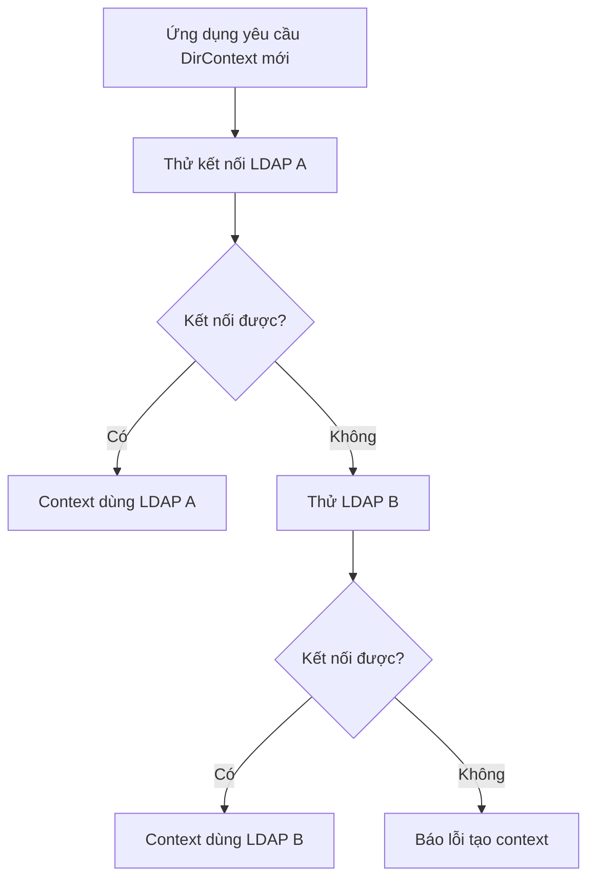

# Nhiều LDAP server và failover

Ứng dụng kết nối một LDAP server duy nhất có thể mất khả năng xác thực, tìm kiếm người dùng hoặc đọc nhóm quyền khi server đó bị ngắt kết nối. Vận hành nhiều LDAP server giúp tăng tính sẵn sàng, nhưng **chỉ cấu hình nhiều địa chỉ URL chưa bảo đảm failover hoàn chỉnh**: các server phải cung cấp dữ liệu phù hợp, có chính sách xác thực và quyền tương thích, hỗ trợ TLS đúng cách và có chiến lược xử lý khi kết nối hỏng giữa một thao tác.

Bài thuộc chương **Cấu hình ContextSource** của mô-đun **SPRING_LDAP**. Chúng ta tập trung vào `LdapContextSource`, cấu hình nhiều LDAP endpoint và ảnh hưởng tới `LdapTemplate`, `LdapClient`, ODM, xác thực, pooling và các thao tác an toàn.

**Mục tiêu bài học:**

- Phân biệt failover, load balancing, LDAP replication và referral.
- Cấu hình nhiều URL qua `LdapContextSource.setUrls(String[])` và `spring.ldap.urls`.
- Biết khi nào JNDI thử server dự phòng và khi nào thao tác đã chạy **không tự động được gửi lại**.
- Tính toán timeout, xác thực TLS và lựa chọn pooling.
- Xử lý khác biệt giữa node đọc và node ghi, độ trễ replication và các thao tác chưa rõ trạng thái.
- Thiết kế kiểm thử failover có khả năng phát hiện sai lệch về quyền, schema và dữ liệu.

## 1. Mô hình nhiều LDAP server

Giả sử tổ chức có directory chứa người dùng và nhóm dưới `dc=example,dc=org`:

```text
                   +------------------+
                   | Spring LDAP app  |
                   +--------+---------+
                            |
                    LdapContextSource
                            |
                    JNDI LDAP provider
                         /     \
                        v       v
           ldaps://ldap-a     ldaps://ldap-b
           .example.org:636   .example.org:636
                    \         /
                  Replication LDAP
```

Ứng dụng được phép gửi search tới cả A và B, nhưng điều đó chỉ hợp lý khi chúng là **hai endpoint có thể thay thế nhau cho cùng dịch vụ thư mục logic**.

| Khái niệm | Mục đích | Ai thực hiện? |
| --- | --- | --- |
| **Failover** | Chuyển sang endpoint khác khi endpoint được chọn không khả dụng | JNDI, client logic, proxy hoặc load balancer |
| **Load balancing** | Chia lượng kết nối/truy vấn trên nhiều node | LB/proxy hoặc chính sách client |
| **Replication** | Đồng bộ dữ liệu giữa các server | Hạ tầng LDAP/domain controller |
| **Referral** | Chuyển client tới nơi lưu naming context khác | LDAP server và cơ chế referral của client |
| **High availability** | Duy trì mức cung cấp dịch vụ cần thiết khi thành phần gặp lỗi | Tổng thể hạ tầng, dữ liệu và ứng dụng |

**Spring LDAP không thực hiện replication**, không tự biến hai server khác nhau thành một thư mục duy nhất và không tự giải quyết xung đột dữ liệu.

### 1.1. Điều kiện để hai server thay thế được nhau

Trước khi cấu hình, kiểm tra:

1. **Naming context:** cả hai cùng phục vụ suffix `dc=example,dc=org` và các nhánh `ou=People`, `ou=Groups` mà ứng dụng cần.
2. **Schema:** cả hai hiểu các `objectClass`, `attribute` và matching rule được ứng dụng sử dụng.
3. **Bind credentials:** service account tồn tại/được chấp nhận với phương thức xác thực và quyền thích hợp.
4. **ACL:** các thao tác đọc/ghi cần thiết được phép trên cả hai endpoint theo vai trò dự kiến.
5. **Replication:** có cơ chế đồng bộ dữ liệu được quản trị và theo dõi trạng thái/độ trễ.
6. **Vai trò ghi:** biết endpoint nào là writable, read-only replica hoặc domain controller có chính sách ghi đặc thù.
7. **Bảo mật:** mỗi hostname có chứng chỉ TLS hợp lệ, đúng chuỗi tin cậy và đúng tên.
8. **Độ trễ:** kết nối tới endpoint dự phòng đáp ứng deadline của API hay batch job.

Cùng base DN **chưa đủ để chứng minh** hai server chứa cùng dữ liệu. Chẳng hạn A vừa nhận cập nhật nhóm quyền, B vẫn có thể trả giá trị cũ trong khoảng thời gian replication.

## 2. Cấu hình `LdapContextSource` bằng nhiều URL

`LdapContextSource` kế thừa cấu hình từ `AbstractContextSource`. Với Java configuration, dùng phương thức:

```java
void setUrls(String[] urls);
```

Khác với `setUrl(String url)` dành cho một địa chỉ, `setUrls` nhận **danh sách endpoint thay thế**. Ví dụ:

```java
import java.util.Map;

import org.springframework.beans.factory.annotation.Value;
import org.springframework.context.annotation.Bean;
import org.springframework.context.annotation.Configuration;
import org.springframework.ldap.core.LdapTemplate;
import org.springframework.ldap.core.support.LdapContextSource;

@Configuration
public class DirectoryConfiguration {

    @Bean
    LdapContextSource ldapContextSource(
            @Value("${app.ldap.bind-dn}") String bindDn,
            @Value("${app.ldap.bind-password}") String bindPassword) {
        LdapContextSource source = new LdapContextSource();

        source.setUrls(new String[] {
            "ldaps://ldap-a.example.org:636",
            "ldaps://ldap-b.example.org:636"
        });
        source.setBase("dc=example,dc=org");

        // Bind DN của tài khoản ứng dụng là DN đầy đủ.
        source.setUserDn(bindDn);
        source.setPassword(bindPassword);

        // Cấu hình riêng của JDK JNDI LDAP provider, đơn vị ms.
        source.setBaseEnvironmentProperties(Map.of(
            "com.sun.jndi.ldap.connect.timeout", "3000",
            "com.sun.jndi.ldap.read.timeout", "5000"
        ));

        // Không bật native JNDI pooling khi dùng TLS.
        source.setPooled(false);
        return source;
    }

    @Bean
    LdapTemplate ldapTemplate(LdapContextSource ldapContextSource) {
        return new LdapTemplate(ldapContextSource);
    }
}
```

Cấu hình tương ứng cho credentials:

```yaml
app:
  ldap:
    bind-dn: ${LDAP_BIND_DN}
    bind-password: ${LDAP_BIND_PASSWORD}
```

Bản triển khai thực tế nên lấy mật khẩu từ secret manager hoặc biến môi trường đã được bảo vệ. Không ghi mật khẩu bind cố định trong mã nguồn, tài liệu hoặc log.

Khi Spring quản lý bean, nó gọi `afterPropertiesSet()` theo vòng đời khởi tạo. Nếu tạo `LdapContextSource` **ngoài** Spring container, bạn cần gọi `afterPropertiesSet()` sau khi cấu hình xong.

### 2.1. Ba loại DN cần phân biệt

| Loại | Ví dụ | Vai trò |
| --- | --- | --- |
| `ContextSource.base` | `dc=example,dc=org` | Gốc cho các thao tác Spring LDAP với DN tương đối |
| `ContextSource.userDn` | `cn=app-reader,ou=ServiceAccounts,dc=example,dc=org` | Principal bind; phải là DN đầy đủ nếu dùng DN |
| DN tương đối truyền cho `LdapTemplate` | `uid=an,ou=People` | Entry được tra dưới `dc=example,dc=org` |

Ví dụ `ldapTemplate.lookup("uid=an,ou=People")` làm việc với `uid=an,ou=People,dc=example,dc=org`. Khi chuyển từ A sang B, **ý nghĩa DN không thay đổi**; B phải có entry tương ứng hoặc ứng dụng sẽ thấy kết quả khác.

### 2.2. Khi dùng `LdapClient` hoặc ODM

`LdapTemplate`, `LdapClient` và các API ánh xạ entry vẫn sử dụng tầng `ContextSource`. Vì vậy, việc khai báo nhiều server **thuộc tầng kết nối**, không cần tự thêm danh sách URL vào từng filter hay thao tác entry.

Tuy nhiên, một `ContextSource` dùng nhiều URL **không có nghĩa mỗi lời gọi LDAP luôn được thử trên tất cả server**. Phải hiểu cơ chế bên dưới của JNDI và vòng đời connection.

## 3. Cấu hình bằng Spring Boot

Với ứng dụng có auto-configuration LDAP của Spring Boot, có thể dùng `application.yml`:

```yaml
spring:
  ldap:
    urls:
      - "ldaps://ldap-a.example.org:636"
      - "ldaps://ldap-b.example.org:636"
    base: "dc=example,dc=org"
    username: ${LDAP_BIND_DN}
    password: ${LDAP_BIND_PASSWORD}
```

Hoặc `application.properties`:

```properties
spring.ldap.urls[0]=ldaps://ldap-a.example.org:636
spring.ldap.urls[1]=ldaps://ldap-b.example.org:636
spring.ldap.base=dc=example,dc=org
spring.ldap.username=${LDAP_BIND_DN}
spring.ldap.password=${LDAP_BIND_PASSWORD}
```

Spring Boot có thể tự cấu hình `LdapContextSource` dựa trên các property này khi điều kiện auto-configuration thỏa mãn. Khi cần tùy biến pooling, timeout, security strategy hoặc bean selection, hãy xác định rõ đang dùng **bean tự cấu hình** hay **bean do ứng dụng tạo**.

Nếu tự thêm `@Bean LdapContextSource` bên cạnh auto-configuration, cần kiểm tra `@Primary`, `@Qualifier` và các điều kiện tạo bean để `LdapTemplate` không sử dụng nhầm nguồn kết nối.

**Đừng nhầm cú pháp tầng cấu hình:**

- Java API của Spring LDAP: `setUrls(new String[] {urlA, urlB})`.
- Spring Boot: `spring.ldap.urls` là danh sách.
- Một số cú pháp XML `<ldap:context-source>` chấp nhận danh sách URL cách nhau bằng dấu phẩy.
- JNDI LDAP provider thuần: `Context.PROVIDER_URL` có thể chứa nhiều LDAP URL **ngăn cách bằng dấu cách**.

Dùng đúng kiểu danh sách mà API hỗ trợ. Không giả định `source.setUrl("urlA,urlB")` trong Java tương đương với `setUrls(...)`.

## 4. JNDI thực hiện failover ở thời điểm nào?

JNDI LDAP provider là tầng dưới của các kết nối Spring LDAP thông dụng. Theo tài liệu Oracle JNDI, nếu `Context.PROVIDER_URL` chứa danh sách URL thì provider có thể **thử lần lượt các URL cho tới khi tạo kết nối thành công**.



**Điểm quan trọng:** cơ chế này chủ yếu liên quan **tạo kết nối/context mới**, không phải một lời hứa tự chạy lại mọi lệnh search, modify hoặc bind đang thực hiện trên kết nối hỏng.

### 4.1. Phân biệt ba tình huống

| Tình huống | Hành vi cần kỳ vọng hoặc kiểm chứng |
| --- | --- |
| A đã down trước khi tạo context mới | Provider có thể thử B nếu lỗi thuộc loại hỗ trợ thử URL kế tiếp |
| A rớt kết nối **sau** khi context được tạo | Thao tác hiện tại có thể ném `CommunicationException`; không bảo đảm tự gửi lại trên B |
| A phục hồi khi một số context đang dùng B | Context đang sống/pool không nhất thiết tự chuyển ngay về A |

Vì vậy, đặt nhiều URL **không bảo đảm failback tức thời** khi server ưu tiên hoạt động lại. Kết quả phụ thuộc provider, pooling, cache và việc tạo mới context.

### 4.2. Lỗi bind khác lỗi tạo TCP connection

Không nên tin rằng **bất kỳ lỗi LDAP nào** trên A cũng khiến provider chuyển sang B. Ví dụ:

- Không mở được kết nối TCP tới A: có thể kích hoạt thử URL thay thế.
- Bind credentials không đúng: có thể trả lỗi xác thực; không nên dùng cơ chế retry/failover để che lỗi tài khoản.
- Server trả `NoPermissionException`: có thể do ACL, không phải hỏng kết nối.
- Bắt tay TLS thất bại: phải xử lý lỗi chứng chỉ/hostname đúng cách; không tự tắt xác minh TLS.
- `SizeLimitExceededException` hoặc `TimeLimitExceededException`: có thể do truy vấn quá rộng, chưa chắc vì server cần failover.

Hành vi chính xác của provider cho từng loại lỗi phải được **kiểm thử với JDK và LDAP server** đang dùng.

### 4.3. Failover không đồng nghĩa cân bằng tải

Nếu provider ưu tiên URL đầu tiên khi tạo context, LDAP A có thể nhận phần lớn kết nối trong điều kiện bình thường. Cấu hình hai URL không cam kết phân tải 50/50.

Nếu cần cân bằng tải thực sự, xem xét load balancer, LDAP proxy, DNS/service discovery hoặc chiến lược chọn `ContextSource` phù hợp. Các lớp đó có chính sách health check, cache và phiên kết nối riêng cần được kiểm tra.

## 5. Timeout và thời gian failover

Một lỗi phổ biến là thêm nhiều server dự phòng nhưng **không đặt connect timeout**. Khi endpoint đầu tiên không phản hồi, ứng dụng có thể chờ rất lâu trước khi thử endpoint thứ hai.

JDK JNDI LDAP provider hỗ trợ các property:

| Property | Đơn vị | Tác dụng |
| --- | --- | --- |
| `com.sun.jndi.ldap.connect.timeout` | Mili giây | Giới hạn thời gian tạo connection tới một endpoint |
| `com.sun.jndi.ldap.read.timeout` | Mili giây | Giới hạn chờ phản hồi LDAP từ connection |
| `SearchControls.setTimeLimit(...)` | Mili giây ở JNDI API | Giới hạn xử lý LDAP search |
| `timeLimit` ở LDAP SearchRequest | Giây | Giới hạn search theo giao thức LDAP |

### 5.1. Connect timeout áp dụng theo từng URL

Giả sử có hai URL và:

```text
connect.timeout = 3000 ms
LDAP A không phản hồi: chờ gần 3 giây
LDAP B không phản hồi: chờ gần 3 giây
```

Tổng thời gian có thể tiến gần **6 giây**, chưa tính DNS, TLS, bind và các chi phí khác. Tài liệu Oracle về JNDI connection creation nêu rõ connect timeout áp dụng **cho từng URL** của danh sách.

Vì vậy, với ba URL và timeout lớn, tổng thời gian thất bại có thể vượt deadline của HTTP API dù mỗi endpoint chỉ được phép chờ một khoảng hữu hạn.

### 5.2. Read timeout và deadline tổng khác nhau

`read.timeout` không phải thời hạn tuyệt đối cho toàn bộ luồng người dùng. Một request HTTP có thể bao gồm:

```text
Chờ pool -> DNS -> TCP -> TLS -> LDAP bind -> search -> map result -> HTTP
```

Cần có **deadline tổng** cho request hoặc job ở tầng ứng dụng. Time limit của LDAP search, connect timeout, read timeout và deadline tổng phải được phối hợp.

**Không** chỉ tăng timeout khi search chậm do filter kém chọn lọc hoặc DIT quá rộng: cần kiểm tra search base, scope, index, size limit và kế hoạch phân trang.

## 6. TLS phải đúng trên mọi endpoint

Nếu cấu hình:

```text
ldaps://ldap-a.example.org:636
ldaps://ldap-b.example.org:636
```

mỗi server cần trình chứng chỉ hợp lệ cho hostname mà ứng dụng truy cập. Ứng dụng phải tin cậy CA/chain tương ứng và thực hiện xác minh hostname.

### 6.1. Những vấn đề dễ gặp

- LDAP A dùng CA tin cậy, nhưng LDAP B dùng CA chưa được truststore của JVM tin cậy.
- Chứng chỉ của B chỉ có tên `ldap-a.example.org`, trong khi client kết nối `ldap-b.example.org`.
- Một node có chứng chỉ hết hạn.
- Load balancer kết thúc TLS nhưng đoạn nối từ proxy tới LDAP không được bảo vệ theo yêu cầu.
- Cấu hình chuyển từ LDAPS sang `ldap://` mà không thực hiện StartTLS.

**Không tắt hostname verification hoặc dùng trust manager chấp nhận mọi chứng chỉ** để cho failover hoạt động. Phải cấu hình đúng DNS, chứng chỉ, SAN và truststore.

### 6.2. LDAPS so với StartTLS

- **LDAPS** thiết lập kênh TLS ngay từ đầu khi truy cập `ldaps://...`, thường là cổng 636.
- **StartTLS** bắt đầu trên kết nối LDAP thường rồi nâng cấp sang TLS qua LDAP extended operation. Phải xác nhận nâng cấp thành công **trước khi gửi credentials**.

Spring LDAP hỗ trợ các chiến lược xác thực qua TLS. Khi dùng StartTLS, cần xem thêm cơ chế đóng TLS và pooling. Không được đánh đồng một URL `ldap://` với một kết nối đã mã hóa.

### 6.3. Bind principal cần hợp lệ trên toàn bộ node

Một bind DN như:

```text
cn=app-reader,ou=ServiceAccounts,dc=example,dc=org
```

phải được cấu hình/đồng bộ và có quyền thích hợp trên từng endpoint. Nếu B dùng schema/ACL khác, có thể bind thành công nhưng không tìm thấy entry hoặc không đọc được thuộc tính mà ứng dụng cần.

## 7. Replication và tính nhất quán

Spring LDAP không cung cấp cơ chế sao chép dữ liệu. Replication do LDAP server, domain controller hoặc hạ tầng directory chịu trách nhiệm.

Xét trình tự:

```text
09:00:00  Ứng dụng ghi member mới vào nhóm Engineering trên LDAP A
09:00:01  LDAP A mất kết nối
09:00:02  Context mới chọn LDAP B
09:00:02  LDAP B chưa nhận thay đổi
09:00:05  LDAP B nhận thay đổi qua replication
```

Trong khoảng này, một filter truy vấn nhóm trên B có thể trả **trạng thái cũ**. Trường hợp này đặc biệt nhạy cảm khi dữ liệu LDAP quyết định quyền truy cập.

### 7.1. Phân biệt các vai trò server

| Mô hình | Điều cần lưu ý |
| --- | --- |
| Một node ghi, nhiều replica đọc | Search có thể failover sang replica; modify trên replica thường không được phép |
| Nhiều node ghi (multi-master) | Có khả năng xung đột; chính sách replication/server quyết định cách xử lý |
| Active Directory nhiều domain controller | Cần hiểu domain, Global Catalog, replication, scope và quyền truy cập |
| Hai LDAP server độc lập | Không được coi tự động là hai bản sao thay thế nhau |

Nếu ứng dụng cần ghi dữ liệu, hãy xác định **điểm ghi hợp lệ**. Không nên cấu hình endpoint read-only trong cùng nhóm failover ghi rồi kỳ vọng `LdapTemplate.modifyAttributes(...)` luôn hoạt động.

### 7.2. Khi cần tách đường đọc và ghi

Một mô hình thường dễ vận hành là:

```text
ReadDirectoryService  -> readLdapTemplate  -> read replica endpoints
WriteDirectoryService -> writeLdapTemplate -> writable endpoints
```

Có thể khai báo hai bean `ContextSource`/`LdapTemplate` với `@Qualifier` để tiêm vào các service khác nhau. Điều đó cho phép chính sách retry, timeout và ACL phù hợp từng loại thao tác.

Đây là **lựa chọn kiến trúc**, không phải yêu cầu bắt buộc khi mọi endpoint đều có quyền ghi và bảo đảm nhất quán đáp ứng được nhu cầu.

## 8. Pooling tác động tới failover như thế nào?

Pooling giúp tái sử dụng kết nối, giảm chi phí TCP/TLS/bind. Nhưng khi một server hỏng, pool có thể vẫn giữ context đã mở tới server đó.

| Cách dùng connection | Tác động đến failover |
| --- | --- |
| Không pooling | Mỗi lần tạo context mới có cơ hội áp dụng lại danh sách URL; tăng chi phí kết nối |
| Native JNDI pooling | Tái sử dụng kết nối theo chính sách provider; thiếu khả năng validation phong phú và có hạn chế với TLS |
| Spring LDAP `PoolingContextSource` | Có thể cấu hình validation khi borrow/idle, loại context hỏng và tạo lại nếu phù hợp |

Tài liệu Spring LDAP cảnh báo native pooling có nhiều hạn chế, đặc biệt liên quan TLS, và khuyến nghị cân nhắc `PoolingContextSource` khi cần pooling.

### 8.1. Connection validation

Với một pool có `testOnBorrow` hoặc `testWhileIdle`, ứng dụng có thể phát hiện context không còn hoạt động trước hoặc trong khi sử dụng. Nhưng validation không thay thế:

- Replication và tính nhất quán dữ liệu.
- Health check riêng cho từng endpoint.
- Phân biệt đọc/ghi và chính sách ACL.
- Deadline của API/job.
- Xác định thao tác ghi đã thành công chưa khi kết nối mất giữa chừng.

### 8.2. Cẩn thận với xác thực theo người dùng

Một `PoolingContextSource` dùng chung không nên trộn các context xác thực bằng người dùng khác nhau nếu pool không được thiết kế cho cơ chế principal thay đổi. Tài liệu Spring LDAP cảnh báo khi `AuthenticationSource` trả principal/credentials khác nhau theo request, pool có thể tái sử dụng context của phiên trước theo cách không mong đợi.

Hãy bảo đảm danh tính bind và pool phù hợp với mô hình bảo mật; tuyệt đối không dùng kết nối đã xác thực của người này để phục vụ yêu cầu của người khác.

## 9. Các phương án triển khai ngoài danh sách URL

### 9.1. LDAP load balancer / proxy

```text
Spring app -> ldaps://ldap.example.org:636
                      |
                 LB / Proxy
                    /   \
                 LDAP A LDAP B
```

Ưu điểm: ứng dụng giữ một URL logic, có thể tập trung health check và routing. Nhưng load balancer phải được cấu hình đúng cho TLS, bind session, connection dài hạn và khả năng đọc/ghi. **TCP health check thành công chưa chứng minh LDAP bind và search thành công.**

Nếu LB kết thúc TLS, cần có thiết kế bảo vệ kênh từ LB đến LDAP server và chính sách chứng chỉ rõ ràng.

### 9.2. DNS/service discovery

Một hostname có thể được ánh xạ đến nhiều server qua DNS hoặc service discovery. Cách này giúp thay đổi hạ tầng mà ít sửa cấu hình ứng dụng.

Nhưng việc đổi DNS không nhất thiết làm các kết nối đã mở đổi endpoint ngay. DNS cache, JVM, TTL, connection pool và cách client xử lý nhiều địa chỉ có thể ảnh hưởng thời gian chuyển đổi. DNS round-robin cũng không tự bảo đảm sức khỏe các node.

### 9.3. Khi nào chọn cách nào?

| Nhu cầu | Hướng xem xét |
| --- | --- |
| Dự phòng kết nối đơn giản trên một nhóm replica | Danh sách `setUrls` với timeout, TLS, quyền và replication được kiểm thử |
| Nhiều ứng dụng dùng chung cụm LDAP | Load balancer/proxy được quản trị tập trung |
| Phân tải truy vấn đọc chủ động | LB hoặc chiến lược read routing có health check |
| Phân biệt node đọc và node ghi | `ContextSource`/`LdapTemplate` tách theo vai trò |
| Có nhiều naming context/domain | Thiết kế truy vấn/referral riêng, không gộp mọi server thành một nhóm URL thay thế |

## 10. Retry và lỗi khi chuyển server

**Failover trong JNDI** thường là khả năng thử URL khác khi tạo kết nối mới. **Retry nghiệp vụ** là quyết định chủ động gửi lại thao tác sau khi ứng dụng đã nhận lỗi.

### 10.1. Search/lookup

Các thao tác đọc thường dễ retry hơn thao tác ghi, nhưng cần điều kiện:

1. Chỉ retry lỗi tạm thời có thể phục hồi, ví dụ một số trường hợp `CommunicationException`.
2. Đảm bảo context hỏng không được tiếp tục tái sử dụng.
3. Giới hạn số lần retry và có backoff.
4. Tôn trọng deadline tổng.
5. Không trả danh sách rỗng như thể search thành công khi còn lỗi.
6. Kiểm tra yêu cầu nhất quán: B có thể chưa có cập nhật gần nhất từ A.

Nếu dùng LDAP Simple Paged Results, **không mặc định cookie của trang ở A dùng được trên B**. Cookie là opaque và có thể gắn với trạng thái phía server; sau failover có thể phải bắt đầu lại từ một checkpoint được thiết kế riêng.

### 10.2. Modify/bind/rename/delete

Một thao tác ghi có thể đã được server áp dụng trước khi client mất phản hồi:

```text
Client -> LDAP A: modify employeeNumber
LDAP A: thực hiện thay đổi
Mạng ngắt trước response
Client nhận CommunicationException
```

Không thể chắc chắn “server chưa ghi” chỉ từ exception giao tiếp. Retry mù quáng sang B có thể tạo xung đột, ghi chồng hoặc gặp dữ liệu chưa đồng bộ.

Cần đọc/đối chiếu trạng thái thực tế qua một đường truy cập có bảo đảm nhất quán phù hợp; thiết kế idempotency, version check hoặc quy trình reconciliation nếu nghiệp vụ quan trọng.

Ví dụ, retry lệnh thêm entry có thể gặp `NameAlreadyBoundException` nếu lần đầu đã thành công. Không tự động coi mọi lỗi trùng DN là thành công khi chưa kiểm tra dữ liệu.

### 10.3. Referral không phải failover

LDAP referral hướng client tới một vùng thư mục hoặc server khác, ví dụ một naming context thuộc domain khác. Nó khác với thử endpoint dự phòng khi kết nối thất bại.

JNDI/Spring LDAP có các chính sách referral như `ignore`, `follow`, `throw`; tùy provider có thể phát sinh `ReferralException` hoặc `PartialResultException`. Không dùng referral policy thay thế cho kiểm tra sự sống của danh sách URL.

## 11. Kiểm chứng bằng công cụ dòng lệnh

Trước khi tin tưởng cấu hình failover, kiểm tra từng server bằng cùng principal và thao tác mà ứng dụng cần. Ví dụ với OpenLDAP client:

```bash
ldapwhoami -x -H "ldaps://ldap-a.example.org:636" \
  -D "cn=app-reader,ou=ServiceAccounts,dc=example,dc=org" -W

ldapwhoami -x -H "ldaps://ldap-b.example.org:636" \
  -D "cn=app-reader,ou=ServiceAccounts,dc=example,dc=org" -W
```

`-W` yêu cầu nhập password qua prompt; tránh hiển thị mật khẩu trong dòng lệnh. Các kết nối phải kiểm tra chứng chỉ TLS theo cấu hình phù hợp.

Bind thành công chưa đủ: tiếp tục xác minh base DN:

```bash
ldapsearch -LLL -x -H "ldaps://ldap-a.example.org:636" \
  -D "cn=app-reader,ou=ServiceAccounts,dc=example,dc=org" -W \
  -b "dc=example,dc=org" -s base "(objectClass=*)" dc

ldapsearch -LLL -x -H "ldaps://ldap-b.example.org:636" \
  -D "cn=app-reader,ou=ServiceAccounts,dc=example,dc=org" -W \
  -b "dc=example,dc=org" -s base "(objectClass=*)" dc
```

Sau đó dùng filter giống ứng dụng để đọc entry thử nghiệm. Nếu ứng dụng phải ghi, cần phép thử riêng trên môi trường **được phép ghi** rồi đối chiếu kết quả replication.

### 11.1. Probe bằng Spring LDAP

Với `ContextSource.base = dc=example,dc=org`:

```java
import java.util.List;
import org.springframework.ldap.core.AttributesMapper;
import org.springframework.ldap.core.LdapTemplate;
import org.springframework.ldap.query.SearchScope;

import static org.springframework.ldap.query.LdapQueryBuilder.query;

public final class DirectoryProbe {
    private final LdapTemplate ldapTemplate;

    public DirectoryProbe(LdapTemplate ldapTemplate) {
        this.ldapTemplate = ldapTemplate;
    }

    public boolean canReadSampleUser() {
        List<String> ids = ldapTemplate.search(
            query()
                .base("ou=People")
                .searchScope(SearchScope.SUBTREE)
                .countLimit(2)
                .attributes("uid")
                .where("uid").is("health-check-user"),
            (AttributesMapper<String>) attrs ->
                (String) attrs.get("uid").get()
        );
        return !ids.isEmpty();
    }
}
```

Phép thử trên chỉ có ý nghĩa nếu entry `health-check-user` tồn tại và account bind có quyền đọc. Nếu filter không khớp, không thể kết luận LDAP chết. Và **một probe qua ContextSource nhiều URL chỉ chứng minh endpoint được chọn cho probe đã hoạt động**; kiểm tra sức khỏe từng node cần công cụ hoặc `ContextSource` trỏ rõ vào từng endpoint.

Không chạy probe nặng liên tục trên toàn DIT.

## 12. Kịch bản kiểm thử failover

| Tình huống | Thiết lập trong test/staging | Kỳ vọng cần kiểm chứng |
| --- | --- | --- |
| A, B đều khỏe | Đọc entry bằng principal thật của ứng dụng | Kết quả đúng schema/ACL |
| A bị từ chối TCP | Mô phỏng server A ngừng nghe cổng | Context mới có thử B không, mất bao lâu? |
| A không phản hồi | Mô phỏng timeout tại A | Tổng thời gian có nằm trong deadline không? |
| B có lỗi chứng chỉ | Dùng môi trường test với chứng chỉ không hợp lệ | Fail closed; không tắt TLS verification |
| B chỉ đọc | Thử thao tác ghi trên B bằng dữ liệu test | Báo lỗi phù hợp, không ghi trái chính sách |
| A hỏng giữa search | Ngắt kết nối đang chạy | Exception đúng, không coi kết quả chưa đầy đủ là thành công |
| A hỏng sau modify | Giả lập mất response | Có quy trình xác định trạng thái trước retry |
| A phục hồi | Cho A hoạt động lại | Quan sát failback và lifecycle của pool/context |
| B chậm replication | Ghi ở A, đọc ngay ở B | Đo độ trễ, phân tích read-after-write |
| Pool giữ connection cũ | Cho connection idle rồi hỏng backend | Validation phát hiện và tạo context mới |
| Referral xuất hiện | Truy vấn vùng referral trên server test | Phân biệt với failover URL |

Các thao tác cố ý ngắt endpoint hoặc chặn mạng chỉ nên thực hiện trong môi trường kiểm thử được phép. Trên production, dùng quy trình diễn tập đã được thống nhất.

## 13. Vận hành và quan sát

Những chỉ số hữu ích:

| Chỉ số | Mục đích |
| --- | --- |
| Tỷ lệ thành công khi tạo context/bind | Phát hiện endpoint hoặc account có vấn đề |
| Thời gian DNS, connect, TLS, bind | Xác định phần gây trễ failover |
| Lỗi giao tiếp và read timeout | Phát hiện mất kết nối hoặc server chậm |
| Endpoint thực tế được chọn | Biết ứng dụng đang dùng A hay B nếu provider/monitoring hỗ trợ |
| Số connection bị loại khỏi pool | Phát hiện context stale |
| Replication lag | Đánh giá độ mới dữ liệu và thay đổi nhóm quyền |
| Tỷ lệ lỗi/độ trễ ghi | Phát hiện role writable không phù hợp |
| Hạn chứng chỉ từng endpoint | Tránh hỏng failover vì TLS |

JNDI provider có thể cập nhật `Context.PROVIDER_URL` theo endpoint đã kết nối, nhưng cách quan sát thực tế phụ thuộc context và provider. **Không dựa chỉ vào một log để khẳng định toàn bộ yêu cầu đã chuyển sang B thành công.** Cần metric của từng server và kiểm thử từ phía ứng dụng.

## 14. Các sai lầm thường gặp

| Sai lầm | Hệ quả |
| --- | --- |
| Có hai URL nên nghĩ đã HA hoàn chỉnh | B có thể thiếu dữ liệu, sai ACL hoặc không nhận ghi |
| Tưởng `setUrls` tự động retry mọi thao tác | Search/modify đang chạy có thể thất bại |
| Tưởng nhiều URL tự cân bằng tải | A có thể luôn được ưu tiên nếu khỏe |
| Truyền bind DN tương đối với `setBase` | Bind thất bại vì principal không đúng |
| Không đặt connect timeout | Failover chậm khi endpoint đầu tiên bị treo |
| Tưởng timeout mỗi URL là timeout tổng | Tổng chờ có thể cộng dồn |
| Tắt xác minh TLS của B | Mất bảo đảm bảo mật kết nối |
| Giả định replica mới luôn có dữ liệu mới nhất | Phân quyền hoặc xác thực có thể dùng trạng thái cũ |
| Retry ghi ngay sau `CommunicationException` | Có thể lặp thao tác đã được server thực hiện |
| Bật native pooling tùy tiện với TLS | Rủi ro giới hạn/không tương thích và context stale |
| Tin một lần `ldapwhoami` là đủ | Chưa kiểm chứng schema, ACL, search và write role |
| Nhầm referral với failover | Có thể truy vấn nhánh/domain khác ngoài dự kiến |

## 15. Bài tập thực hành

Cho cấu hình:

```yaml
spring:
  ldap:
    urls:
      - "ldaps://ldap-a.example.org:636"
      - "ldaps://ldap-b.example.org:636"
    base: "dc=example,dc=org"
    username: ${LDAP_BIND_DN}
    password: ${LDAP_BIND_PASSWORD}
```

Biết A nhận ghi, B là replica chỉ đọc, replication có thể chậm vài giây.

**Bài 1.** A đã down trước khi ứng dụng tạo context mới. Vai trò của `setUrls`/JNDI là gì? Điều gì vẫn có thể khiến truy vấn trên B thất bại?

**Bài 2.** Với `ContextSource.base = dc=example,dc=org`, muốn lookup `uid=an` dưới `ou=People`, truyền DN gì cho `LdapTemplate.lookup`? Service bind DN phải viết thế nào?

**Bài 3.** A hỏng giữa lệnh modify. Có thể kết luận entry chưa được sửa không? Vì sao không nên gửi lại y nguyên lên B?

**Bài 4.** Có ba LDAP URL và connect timeout mỗi endpoint là 2 giây. Nếu tất cả đều treo, thời gian chỉ chờ kết nối có thể gần bao nhiêu?

**Bài 5.** B trả chứng chỉ TLS có SAN không chứa `ldap-b.example.org`. Cách giải quyết đúng là gì?

**Bài 6.** B vừa nhận bind nhưng chưa đồng bộ thay đổi nhóm quyền mới ở A. Tác động có thể có với phân quyền là gì?

**Bài 7.** Có nhiều search đồng thời; muốn phân tải 50/50 giữa A và B. Có chắc `setUrls(A,B)` đáp ứng không? Đề xuất phương án khác.

**Bài 8.** Vì sao probe chạy một lần qua `LdapContextSource` nhiều URL không thể chứng minh cả A và B đều khỏe?

### Đáp án gợi ý

1. JNDI có thể thử endpoint B khi tạo context mới. Truy vấn trên B vẫn có thể thất bại nếu bind credentials không hợp lệ, ACL khác, base/schema thiếu hoặc chứng chỉ TLS sai.
2. Dùng `uid=an,ou=People` (DN tương đối). Nếu bind principal là DN, truyền đầy đủ ví dụ `cn=app-reader,ou=ServiceAccounts,dc=example,dc=org`.
3. Không thể chắc chắn: A có thể đã xử lý rồi mất response. B chỉ đọc và có thể chưa nhận replication. Phải xác nhận trạng thái và có chính sách idempotency.
4. Có thể gần **6 giây**, chưa tính DNS, TLS, bind và các chi phí khác.
5. Sửa chứng chỉ, hostname, truststore hoặc cấu hình endpoint cho đúng. Không tắt hostname verification.
6. Người dùng có thể thấy quyền cũ trong khoảng trễ; cần thiết kế chính sách nhất quán và xử lý thay đổi quyền phù hợp.
7. Không có cam kết chia tải đều. Cân nhắc LB/proxy có health check hoặc routing chủ động.
8. Probe chỉ chạy trên endpoint được chọn; phải kiểm tra từng node độc lập và cả bind/search/ACL cần thiết.

## 16. Ghi nhớ

- **`LdapContextSource.setUrls(String[])`** và **`spring.ldap.urls`** cho phép khai báo nhiều LDAP endpoint.
- **JNDI có thể thử URL khác khi tạo kết nối**; không mặc định retry thao tác đang chạy trên một kết nối hỏng.
- **Failover khác load balancing và replication**. Node dự phòng phải tương thích về data, schema, base, bind, ACL và role đọc/ghi.
- **Connect timeout có thể cộng dồn theo từng URL**. TLS phải được xác minh trên mọi endpoint; pooling cần validation và chiến lược lifecycle hợp lý.
- Với **lệnh ghi gặp lỗi mạng**, trạng thái hoàn thành có thể chưa biết. Không retry mù quáng; với dữ liệu quyền, cần xét độ trễ replication và tính nhất quán.
- Kiểm thử thực tế trên môi trường được phép, theo dõi từng endpoint, độ trễ chuyển đổi, replication và sự cố giữa thao tác.

### Tài liệu tham khảo

- [Spring LDAP — Configuration](https://docs.spring.io/spring-ldap/reference/configuration.html): URL, base, xác thực, TLS và referral.
- [Spring LDAP — AbstractContextSource API](https://docs.spring.io/spring-ldap/docs/current/api/org/springframework/ldap/core/support/AbstractContextSource.html): `setUrls`, `setUrl`, `setPooled` và environment properties.
- [Spring LDAP — Pooling Support](https://docs.spring.io/spring-ldap/reference/pooling.html): `PoolingContextSource` và connection validation.
- [Spring Boot — LDAP auto-configuration](https://docs.spring.io/spring-boot/reference/data/nosql.html): `spring.ldap.urls`, credentials và base.
- [Oracle JNDI — LDAP & LDAPS URLs](https://docs.oracle.com/javase/jndi/tutorial/ldap/misc/url.html): danh sách provider URL và việc thử endpoint.
- [Oracle JNDI — Connection Creation](https://docs.oracle.com/javase/jndi/tutorial/ldap/connect/create.html): connect timeout và nhiều URL.
- [Java SE — LDAP provider properties](https://docs.oracle.com/en/java/javase/26/docs/api/java.naming/module-summary.html): `connect.timeout` và `read.timeout`.
- [RFC 4511 — LDAP: The Protocol](https://www.rfc-editor.org/rfc/rfc4511.html): thao tác LDAP, referral và result code.
- [RFC 2696 — Simple Paged Results](https://www.rfc-editor.org/rfc/rfc2696.html): cookie và phân trang.
