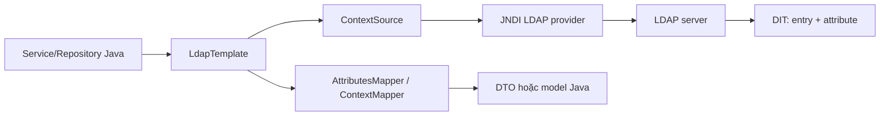

# Search entry bằng query hoặc filter

## Mục tiêu bài học

Trong module **SPRING_LDAP**, `LdapTemplate` là API trung tâm giúp ứng dụng Java/Spring làm việc với dịch vụ thư mục LDAP mà không phải lặp lại toàn bộ thao tác tạo context, gửi yêu cầu JNDI, duyệt kết quả và đóng tài nguyên. Một công việc quan trọng là **tìm kiếm entry** theo thuộc tính và phạm vi trong cây thư mục.

Bài này thuộc chương **LdapTemplate**. Bạn sẽ học **hai cách viết search**:

- Dùng **`LdapQuery`** từ `LdapQueryBuilder`: định nghĩa base DN, scope, filter, danh sách thuộc tính và giới hạn bằng API có cấu trúc.
- Dùng **chuỗi LDAP filter** cùng base DN và `SearchControls`: phù hợp khi tích hợp truy vấn được cấu hình sẵn hoặc cần điều khiển trực tiếp các tham số tìm kiếm của JNDI.

Sau bài học, bạn có thể:

1. Phân biệt **DN dùng để định vị entry**, **LDAP filter dùng để chọn entry** và **attribute projection dùng để chọn dữ liệu trả về**.
2. Viết `ldapTemplate.search(query, mapper)` để tìm một hoặc nhiều entry theo điều kiện.
3. Viết `ldapTemplate.search(base, filter, controls, mapper)` và nhận ra khi nào cần `SearchControls`.
4. Dùng `LdapQueryBuilder` hoặc các lớp `EqualsFilter`, `AndFilter` để tránh ghép input trực tiếp vào filter.
5. Map kết quả `Attributes` sang DTO, xử lý trường thiếu/đa trị, phân biệt kết quả rỗng với lỗi truy cập.
6. Kết hợp search với cấu hình `ContextSource`, TLS, quyền tối thiểu, giới hạn truy vấn, pooling và kiểm thử an toàn.

## 1. Bài toán mẫu: tìm người dùng và hiển thị danh bạ

Giả sử directory server thử nghiệm có cây:

```text
dc=example,dc=org
├── ou=People
│   ├── uid=lan
│   ├── uid=mai
│   └── uid=minh
└── ou=Groups
    └── cn=Developers
```

Ba entry người dùng có các thuộc tính:

```ldif
dn: uid=lan,ou=People,dc=example,dc=org
objectClass: inetOrgPerson
uid: lan
cn: Lan Nguyen
sn: Nguyen
mail: lan@example.org
departmentNumber: 42

dn: uid=mai,ou=People,dc=example,dc=org
objectClass: inetOrgPerson
uid: mai
cn: Mai Tran
sn: Tran
mail: mai@example.org
departmentNumber: 42

dn: uid=minh,ou=People,dc=example,dc=org
objectClass: inetOrgPerson
uid: minh
cn: Minh Le
sn: Le
mail: minh@example.org
departmentNumber: 17
```

Các entry cha `dc=example,dc=org` và `ou=People` được giả định đã tồn tại. Dữ liệu trên là fixture để học; schema thực tế và thuộc tính phòng ban có thể khác theo directory server.

Yêu cầu nghiệp vụ gồm:

- Tìm người dùng có `uid = "lan"` và hiển thị `cn`, `mail`.
- Liệt kê người thuộc `departmentNumber = "42"`.
- Khi không có entry khớp, trả danh sách rỗng một cách có chủ đích.
- Không lấy tất cả thuộc tính nếu trang chỉ cần vài trường.

Một phép tìm kiếm được xác định bởi nhiều phần:

| Thành phần | Ví dụ | Vai trò |
| --- | --- | --- |
| **Base DN** | `ou=People,dc=example,dc=org` | Bắt đầu tìm ở đâu |
| **Scope** | `SUBTREE` | Xét base và các entry con ở độ sâu nào |
| **Filter** | `(&(objectClass=inetOrgPerson)(uid=lan))` | Chọn entry nào |
| **Attributes** | `uid`, `cn`, `mail` | Chọn những trường nào trả về |
| **Limits** | 50 entry, 3 giây | Kiểm soát quy mô và thời gian |
| **Mapper** | `Attributes -> UserSummary` | Chuyển kết quả LDAP thành dữ liệu Java |

**Filter là điều kiện gửi cho máy chủ LDAP.** Nó không phải `Stream.filter()` trên danh sách đã nhận. Tìm kiếm trên server thường giúp hạn chế entry cần truyền; Java post-filter vẫn hữu ích cho những điều kiện phụ thuộc dữ liệu ứng dụng.

## 2. LdapTemplate nằm ở đâu trong kiến trúc Spring LDAP?



`ContextSource` cung cấp LDAP context theo cấu hình kết nối; `LdapTemplate` điều phối thao tác và mapping kết quả. Dù dùng template, ứng dụng vẫn phải xử lý đúng schema, DN, quyền truy cập, filter và ngoại lệ từ server.

Ví dụ cấu hình Spring Boot (cần thư viện Spring LDAP và cấu hình TLS đáng tin cậy):

```properties
spring.ldap.urls=ldaps://ldap.example.org:636
spring.ldap.base=dc=example,dc=org
spring.ldap.username=cn=svc-reader,ou=Services,dc=example,dc=org
spring.ldap.password=${LDAP_BIND_PASSWORD}
```

Các giá trị chỉ minh họa. `LDAP_BIND_PASSWORD` được cấp qua biến môi trường hoặc secret manager trong môi trường thử nghiệm. Account dịch vụ nên có quyền **chỉ đọc** nhánh cần dùng; không ghi mật khẩu vào mã nguồn hay log.

Nếu dự án tự khai báo bean thay vì dùng auto-configuration tương ứng với phiên bản Spring Boot:

```java
import org.springframework.context.annotation.Bean;
import org.springframework.context.annotation.Configuration;
import org.springframework.ldap.core.ContextSource;
import org.springframework.ldap.core.LdapTemplate;
import org.springframework.ldap.core.support.LdapContextSource;

@Configuration
class DirectoryConfig {
    @Bean
    LdapContextSource contextSource() {
        String password = System.getenv("LDAP_BIND_PASSWORD");
        if (password == null || password.isEmpty()) {
            throw new IllegalStateException("LDAP bind credential is missing");
        }

        LdapContextSource source = new LdapContextSource();
        source.setUrl("ldaps://ldap.example.org:636");
        source.setBase("dc=example,dc=org");
        source.setUserDn(
            "cn=svc-reader,ou=Services,dc=example,dc=org");
        source.setPassword(password);
        return source;
    }

    @Bean
    LdapTemplate ldapTemplate(ContextSource contextSource) {
        return new LdapTemplate(contextSource);
    }
}
```

Chỉ chọn một cách cấu hình thích hợp để tránh tạo nhiều bean không có chủ đích. Khi Spring quản lý `LdapContextSource`, vòng đời khởi tạo bean được xử lý bởi container. Ứng dụng còn phải cấu hình và kiểm thử timeout, chứng chỉ TLS, truststore, quyền và các cơ chế khác phù hợp hạ tầng.

### 2.1. DN tương đối với base của ContextSource

Ví dụ `ContextSource` đã đặt `dc=example,dc=org`, thì khi gọi:

```java
query().base("ou=People")
```

base của search là **tương đối** với base được đặt trong context. DN hiệu dụng:

```text
ou=People,dc=example,dc=org
```

Nếu vô tình cung cấp `ou=People,dc=example,dc=org` như DN tương đối, ứng dụng có thể tính trùng hậu tố base và thất bại. Cần thống nhất rõ tham số nào được diễn giải tương đối và tham số nào là DN đầy đủ.

## 3. Cách 1: tìm entry bằng LdapQueryBuilder

`LdapQueryBuilder` hỗ trợ tạo `LdapQuery` với những phần của một SearchRequest. Đây thường là lựa chọn dễ đọc khi điều kiện được xây dựng từ dữ liệu nghiệp vụ.

Ví dụ một repository trả về danh bạ rút gọn:

```java
import static org.springframework.ldap.query.LdapQueryBuilder.query;

import java.util.List;
import javax.naming.NamingException;
import javax.naming.directory.Attribute;
import javax.naming.directory.Attributes;
import org.springframework.ldap.core.LdapTemplate;
import org.springframework.ldap.query.LdapQuery;
import org.springframework.ldap.query.SearchScope;

record UserSummary(String uid, String displayName, String email) {}

class UserDirectoryRepository {
    private final LdapTemplate ldapTemplate;

    UserDirectoryRepository(LdapTemplate ldapTemplate) {
        this.ldapTemplate = ldapTemplate;
    }

    List<UserSummary> findByUid(String uid) {
        LdapQuery request = query()
                .base("ou=People")
                .searchScope(SearchScope.SUBTREE)
                .attributes("uid", "cn", "mail")
                .where("objectClass").is("inetOrgPerson")
                .and("uid").is(uid);

        return ldapTemplate.search(request, (Attributes attrs) ->
                new UserSummary(
                        firstString(attrs, "uid"),
                        firstString(attrs, "cn"),
                        firstString(attrs, "mail")
                ));
    }

    static String firstString(Attributes attrs, String id)
            throws NamingException {
        Attribute attr = attrs.get(id);
        if (attr == null || attr.size() == 0) {
            return null;
        }
        Object value = attr.get();
        return value instanceof String ? (String) value : null;
    }
}
```

Lần lượt:

1. `base("ou=People")` chọn nhánh tìm kiếm.
2. `searchScope(SearchScope.SUBTREE)` xét base và mọi nhánh con.
3. `attributes("uid", "cn", "mail")` yêu cầu chỉ những thuộc tính này.
4. `where("objectClass").is("inetOrgPerson").and("uid").is(uid)` xây dựng filter có cấu trúc. Các giá trị đưa vào `is(...)` được xử lý theo API filter builder thay vì nối chuỗi thô.
5. `ldapTemplate.search(request, mapper)` thực hiện search trên server và trả `List<UserSummary>`.

Với fixture đã cho, `findByUid("lan")` trả một phần tử; `findByUid("unknown")` trả danh sách rỗng **nếu search hoàn thành thành công**. Không suy “không có kết quả” từ lỗi kết nối, quyền hoặc TLS.

Mapper có thể gặp entry không có `mail`, hoặc attribute bị ACL che khuất. Ở ví dụ trên, nó trả `null` cho giá trị thiếu. Trong ứng dụng thật, hãy quy định rõ field bắt buộc và tùy chọn: có thể trả `Optional`, trạng thái không đầy đủ hoặc báo lỗi dữ liệu theo hợp đồng nghiệp vụ.

### 3.1. Tìm nhiều entry theo phòng ban

Ví dụ chỉ thay filter, giữ base/scope/projection:

```java
LdapQuery q = query()
        .base("ou=People")
        .searchScope(SearchScope.ONELEVEL)
        .attributes("uid", "cn", "mail")
        .where("objectClass").is("inetOrgPerson")
        .and("departmentNumber").is("42");

List<UserSummary> people = ldapTemplate.search(
        q,
        (Attributes attrs) -> new UserSummary(
                firstString(attrs, "uid"),
                firstString(attrs, "cn"),
                firstString(attrs, "mail")
        ));
```

Với dữ liệu mẫu, `people` gồm Lan và Mai. `ONELEVEL` được chọn vì các entry ví dụ nằm trực tiếp dưới `ou=People`. Nếu người dùng còn nằm ở các OU con như `ou=Hanoi,ou=People`, cần `SUBTREE` để xét sâu hơn. **Scope phù hợp giúp không tìm rộng hơn yêu cầu.**

### 3.2. Chọn attribute khác với điều kiện filter

Filter có thể yêu cầu `departmentNumber=42` mà response **không cần trả** `departmentNumber` nếu DTO chỉ sử dụng tên và email. Các attribute trong filter và danh sách attribute trả về là hai phần độc lập của SearchRequest.

Nếu Java cần dùng `departmentNumber` sau khi search, phải yêu cầu tường minh. Bản thân việc nhắc đến attribute trong filter không làm attribute xuất hiện trong kết quả mapper.

## 4. Cách 2: tìm entry bằng chuỗi filter và SearchControls

`LdapTemplate` có các overload nhận **base DN**, **LDAP filter dạng chuỗi**, `SearchControls` và mapper. Cách này hữu ích khi cần làm việc với filter đã được xây dựng từ một nguồn đáng tin cậy hoặc muốn đặt tham số tìm kiếm theo API JNDI.

```java
import java.util.List;
import javax.naming.directory.Attributes;
import javax.naming.directory.SearchControls;

SearchControls controls = new SearchControls();
controls.setSearchScope(SearchControls.SUBTREE_SCOPE);
controls.setReturningAttributes(new String[] {"uid", "cn", "mail"});
controls.setCountLimit(50);
controls.setTimeLimit(3000); // ms

String filter =
        "(&(objectClass=inetOrgPerson)(departmentNumber=42))";

List<UserSummary> people = ldapTemplate.search(
        "ou=People",
        filter,
        controls,
        (Attributes attrs) -> new UserSummary(
                firstString(attrs, "uid"),
                firstString(attrs, "cn"),
                firstString(attrs, "mail")
        ));
```

Trong ví dụ:

- `"ou=People"` là base tương đối so với `ContextSource`.
- `filter` là cú pháp filter LDAP (RFC 4515), **không phải điều kiện Java**.
- `setSearchScope` quyết định độ sâu.
- `setReturningAttributes` yêu cầu đúng những thuộc tính cần cho mapper.
- `setCountLimit` giới hạn số entry; `setTimeLimit` đặt giới hạn thời gian của search tính bằng mili giây. Chúng không thay thế hoàn toàn connect/read timeout.

Đoạn mã dùng **filter cố định** nên không có nguy cơ nối input động. Với input từ HTTP, không thay số `42` bằng phép nối chuỗi.

### 4.1. Dựng filter động bằng các lớp Filter của Spring LDAP

Khi cần gọi overload nhận filter dạng chuỗi với dữ liệu động, hãy dựng cú pháp bằng `EqualsFilter`, `AndFilter` hoặc filter builder khác tương thích phiên bản.

```java
import org.springframework.ldap.filter.AndFilter;
import org.springframework.ldap.filter.EqualsFilter;

String inputUid = uidFromRequest;

AndFilter filter = new AndFilter();
filter.and(new EqualsFilter("objectClass", "inetOrgPerson"));
filter.and(new EqualsFilter("uid", inputUid));

String encodedFilter = filter.encode();

List<UserSummary> result = ldapTemplate.search(
        "ou=People",
        encodedFilter,
        controls,
        (Attributes attrs) -> new UserSummary(
                firstString(attrs, "uid"),
                firstString(attrs, "cn"),
                firstString(attrs, "mail")
        ));
```

`EqualsFilter` biểu diễn **giá trị cần so sánh** thay vì coi giá trị đó là một phần cú pháp LDAP. `AndFilter` tạo biểu thức kết hợp AND; `encode()` trả chuỗi filter đã được xây dựng đúng cấu trúc.

Ví dụ input `uidFromRequest = "lan*"` phải được hiểu là **giá trị uid có dấu sao thật**, không tự biến thành truy vấn wildcard `(uid=lan*)`. Khi dùng query/filter builder cho equality, các ký tự đặc biệt được xử lý theo ngữ cảnh của LDAP filter.

**Lưu ý:** Nếu muốn một **substring filter có wildcard** theo chủ đích, hãy chọn API và validation cho thao tác đó. Đừng cho phép dữ liệu người dùng vô tình trở thành một biểu thức tìm kiếm rộng hơn.

### 4.2. Không dựng filter bằng nối chuỗi thủ công

```java
// KHÔNG NÊN: uidFromRequest có thể làm thay đổi cấu trúc filter.
String filter = "(&(objectClass=inetOrgPerson)(uid="
        + uidFromRequest + "))";
```

Cú pháp filter LDAP dùng các ký tự đặc biệt `*`, `(`, `)`, dấu gạch chéo ngược và NUL. Nếu không escape đúng RFC 4515, dữ liệu từ request có thể được diễn giải thành wildcard/toán tử khác. Dùng query builder hoặc lớp `Filter` là cách dễ duy trì hơn.

**Đừng nhầm DN escaping với filter escaping.** `LdapNameBuilder` dùng để dựng DN/RDN (RFC 4514); `LdapQueryBuilder` và các `Filter` hỗ trợ xây dựng điều kiện search (RFC 4515). Hai loại cú pháp có quy tắc escape khác nhau.

## 5. So sánh nhanh hai kiểu search

| Tiêu chí | `search(LdapQuery, mapper)` | `search(base, filter, controls, mapper)` |
| --- | --- | --- |
| Khai báo điều kiện | Fluent API của `LdapQueryBuilder` | Chuỗi filter chuẩn LDAP |
| Base DN | `query().base(...)` | Tham số `base` |
| Scope | `searchScope(...)` | `SearchControls.setSearchScope(...)` |
| Thuộc tính trả về | `attributes(...)` | `setReturningAttributes(...)` |
| Filter có input động | `where(...).is(value)` giúp tách dữ liệu khỏi cú pháp | Phải dùng `Filter`/escape đúng hoặc filter tham số hóa ở tầng hỗ trợ |
| Giới hạn kết quả/thời gian | Tùy API query trong phiên bản đang dùng; có thể chọn overload thích hợp | `setCountLimit(...)`, `setTimeLimit(...)` rõ ràng |
| Mapping | `AttributesMapper` / `ContextMapper` | Cùng các loại mapper phù hợp overload |
| Khả năng dùng lại | Query linh hoạt và dễ xem các điều kiện | Thích hợp khi có filter tĩnh hoặc cần kiểm soát JNDI |

Hai cách đều gửi yêu cầu tìm kiếm LDAP đến **cùng directory server** và chịu cùng schema, matching rule, ACL, hạn mức máy chủ. Không có lý do để tự giả định một overload luôn nhanh hơn overload khác: chất lượng filter, base DN, scope, index, tập attribute, kết nối và số kết quả mới thường quyết định phần lớn chi phí.

**Khuyến nghị trong đa số code nghiệp vụ:** ưu tiên `LdapQueryBuilder` khi điều kiện được tạo từ tham số ứng dụng; dùng `SearchControls` khi API cần tùy chọn tường minh hoặc khi có filter hợp lệ đã được xây dựng. Tránh thêm một tầng DSL riêng nếu nhu cầu có thể diễn đạt rõ bằng các API sẵn có.

## 6. Tìm một entry không giống lookup theo DN

`search` và `lookup` thường xuất hiện gần nhau trong `LdapTemplate`, nhưng có ý nghĩa khác:

| Thao tác | Dữ liệu bạn đã biết | Kết quả |
| --- | --- | --- |
| `lookup(dn, mapper)` | **DN chính xác** của entry | Đọc entry tại tên đó |
| `search(query, mapper)` | Một **base, scope và điều kiện filter** | Danh sách các entry phù hợp |

Ví dụ, nếu hệ thống bảo đảm người dùng luôn nằm trực tiếp dưới `ou=People` với `uid` là RDN, có thể dựng DN:

```java
import javax.naming.Name;
import org.springframework.ldap.support.LdapNameBuilder;

Name userDn = LdapNameBuilder.newInstance()
        .add("ou", "People")
        .add("uid", "lan")
        .build();

// userDn = uid=lan,ou=People (tương đối với ContextSource base)
```

Sau đó `ldapTemplate.lookup(userDn, mapper)` đọc đúng tên ấy. Nhưng nếu chỉ biết một tài khoản `uid` và **không biết entry nằm trong OU nào**, tự dựng một DN cố định có thể sai. Khi đó nên `search` theo filter trong phạm vi thích hợp rồi lấy DN thật của entry nếu cần các thao tác sau.

### 6.1. Nếu cần DN của kết quả, dùng ContextMapper

`AttributesMapper` chỉ nhận `Attributes`, rất tiện cho những trường dữ liệu mà DTO cần. **DN của entry** là tên trong kết quả LDAP, không nên giả định nó tồn tại như một attribute phổ quát có tên `dn`.

Spring LDAP hỗ trợ `ContextMapper` để truy cập context của entry, thường dưới dạng `DirContextOperations`:

```java
import java.util.List;
import javax.naming.Name;
import org.springframework.ldap.core.ContextMapper;
import org.springframework.ldap.core.DirContextOperations;
import static org.springframework.ldap.query.LdapQueryBuilder.query;

List<Name> names = ldapTemplate.search(
        query().base("ou=People")
               .where("uid").is("lan"),
        (ContextMapper<Name>) ctx ->
                ((DirContextOperations) ctx).getDn()
);
```

Đối tượng `Name` nhận được cần được hiểu theo **base của `ContextSource`** và hợp đồng API phiên bản đang dùng. Khi ghép hoặc lưu DN, phải nhất quán giữa tên tương đối và tên đầy đủ; không nối chuỗi với base DN một cách tùy tiện.

Nếu kết quả có thể chứa nhiều entry cùng `uid` ở các nhánh khác nhau, phương thức search trả về **danh sách**. Không âm thầm lấy phần tử đầu làm người dùng duy nhất. Tùy nghiệp vụ, nên báo trường hợp trùng, thu hẹp search base hoặc có thuộc tính định danh ổn định hơn.

## 7. Search scope, base DN và lựa chọn attribute

Ba scope cơ bản:

| Scope | Phần cây được xét | Tình huống |
| --- | --- | --- |
| **BASE** | Chỉ entry tại base DN | Kiểm tra một entry/Root DSE theo hợp đồng API phù hợp |
| **ONELEVEL** | Các entry con trực tiếp, không gồm base | Người dùng nằm trực tiếp dưới `ou=People` |
| **SUBTREE** | Base và mọi hậu duệ | Có nhiều nhánh phòng ban dưới `ou=People` |

Filter đúng nhưng base/scope sai vẫn không tìm thấy entry. Vì vậy, khi kết quả rỗng, cần kiểm tra cả **cấu trúc DIT, base và scope**, không chỉ sửa filter.

### 7.1. Chỉ lấy thuộc tính cần thiết

Với trang danh sách, yêu cầu:

```text
uid cn mail
```

thay vì mọi thuộc tính có thể giảm dữ liệu truyền qua mạng và xử lý trong JVM. Trong LDAP:

- `*` thường yêu cầu **mọi user attributes** mà account được phép đọc.
- `+` yêu cầu **operational attributes** nếu server hỗ trợ cú pháp này và quyền cho phép.
- `1.1` dùng một mình để yêu cầu **không trả attribute nào**.

DN thường có trong tên của kết quả tìm kiếm dù danh sách attribute rỗng. **Danh sách attribute không làm thay đổi tập entry khớp filter**; nó chỉ điều khiển dữ liệu trả về trên mỗi entry.

Không mặc định `attrs.get("mail")` tồn tại. Attribute có thể bị thiếu trong entry, bị ACL giới hạn hoặc không được yêu cầu trong SearchRequest.

### 7.2. Thuộc tính đa trị

LDAP attribute có thể chứa **nhiều giá trị**. Ví dụ nhóm `groupOfNames` thường dùng `member` với nhiều DN:

```ldif
dn: cn=Developers,ou=Groups,dc=example,dc=org
objectClass: groupOfNames
cn: Developers
member: uid=lan,ou=People,dc=example,dc=org
member: uid=mai,ou=People,dc=example,dc=org
```

Nếu cần liệt kê toàn bộ thành viên, `attrs.get("member").get()` là **không đủ**: `get()` chỉ lấy một giá trị. Hãy duyệt `NamingEnumeration` hoặc sử dụng mapper/API thích hợp để lấy đầy đủ tập giá trị theo quy tắc server (với directory lớn, một số sản phẩm còn có giới hạn/range retrieval riêng cho attribute nhiều giá trị).

Ví dụ mapper cho một attribute đa trị dạng chuỗi:

```java
import java.util.ArrayList;
import java.util.List;
import javax.naming.NamingEnumeration;
import javax.naming.NamingException;
import javax.naming.directory.Attribute;
import javax.naming.directory.Attributes;

static List<String> allStrings(Attributes attrs, String key)
        throws NamingException {
    Attribute attr = attrs.get(key);
    if (attr == null) {
        return List.of();
    }
    List<String> values = new ArrayList<>();
    NamingEnumeration<?> items = attr.getAll();
    try {
        while (items.hasMore()) {
            Object value = items.next();
            if (value instanceof String) {
                values.add((String) value);
            }
        }
    } finally {
        items.close();
    }
    return values;
}
```

Đây là ví dụ cho attribute chứa chuỗi. Đừng ép tất cả LDAP attribute thành `String`: schema có thể quy định giá trị nhị phân hoặc loại dữ liệu khác. Dữ liệu trả về còn phụ thuộc quyền và các giới hạn riêng của directory server.

## 8. Giới hạn tìm kiếm, phân trang và hiệu năng

Search trả `List` có thể tiện trong ứng dụng, nhưng không nên kéo nguyên một nhánh lớn về JVM chỉ để lọc rồi bỏ phần lớn kết quả.

### 8.1. Count limit và time limit

Trong `SearchControls`:

```java
SearchControls controls = new SearchControls();
controls.setSearchScope(SearchControls.SUBTREE_SCOPE);
controls.setReturningAttributes(new String[] {"uid", "cn", "mail"});
controls.setCountLimit(100);
controls.setTimeLimit(3000); // thời gian tìm kiếm, tính bằng mili giây
```

Count limit giới hạn **số entry**, không phải byte; time limit dành cho thao tác tìm kiếm, không thay thế kết nối và read timeout. LDAP server có thể áp giới hạn riêng chặt hơn; nếu vượt giới hạn, một search không nhất thiết đã trả toàn bộ dữ liệu.

Không giả định mặc định `search()` luôn trả hết mọi entry. Cần xử lý trường hợp `sizeLimitExceeded`, `timeLimitExceeded`, timeout hoặc kết quả từng phần theo API/phiên bản sử dụng.

### 8.2. Phân trang không chỉ là Java subList

Nếu directory có hàng nghìn entry, có thể cần cơ chế **LDAP paged results** được server/client hỗ trợ. Phân trang ở tầng LDAP khác với:

```java
// Chỉ cắt trên dữ liệu đã tải vào JVM.
List<UserSummary> page = allPeople.subList(0, 20);
```

`subList` không giảm số entry đã truyền. Với paged results đúng nghĩa, client tiếp tục lấy các trang thông qua control/cookie theo giao thức; phải dừng đúng lúc, tránh lặp cookie sai và xử lý giới hạn máy chủ.

Nếu ứng dụng áp thêm `Stream.filter` sau khi nhận một trang LDAP, 20 entry đầu tiên có thể chỉ còn 5 kết quả cuối. Cần thiết kế phân trang theo **tập đã lọc cuối cùng** hoặc đẩy điều kiện có thể biểu diễn lên LDAP filter trước khi phân trang.

### 8.3. Những yếu tố quyết định độ trễ

| Yếu tố | Điều cần làm |
| --- | --- |
| Base DN/scope quá rộng | Thu hẹp nhánh theo dữ liệu cần tìm |
| Filter thiếu điều kiện | Đưa điều kiện thích hợp vào LDAP filter |
| Thuộc tính chưa được index | Kiểm tra cấu hình index trên server cho filter quan trọng |
| Quá nhiều attribute trả về | Chỉ chọn những trường cần hiển thị/xử lý |
| Quá nhiều entry | Dùng giới hạn và phân trang phù hợp |
| Chậm kết nối/TLS | Đo riêng chi phí kết nối, cấu hình timeout |
| Context/connection pooling | Chỉ bật khi phù hợp với TLS, danh tính bind và workload |

`LdapQueryBuilder` và overload filter chuỗi không có ưu thế hiệu năng mặc định. Hãy đo **cùng filter hiệu dụng**, base, scope, projection, quyền và số entry trước khi kết luận cách nào nhanh hơn.

## 9. Lỗi tìm kiếm và nguyên tắc xử lý

Một search có thể thất bại ngay khi tạo context, trong lúc server xử lý yêu cầu hoặc khi client duyệt/mapping kết quả. Spring LDAP có hệ ngoại lệ của Spring để chuyển các ngoại lệ JNDI và LDAP, nhưng hành vi cụ thể còn phụ thuộc phiên bản thư viện và directory server.

| Trường hợp | Ý nghĩa | Hướng xử lý |
| --- | --- | --- |
| Search thành công, không entry nào khớp | Tập kết quả rỗng hợp lệ | Trả `List.of()` hoặc trạng thái nghiệp vụ thích hợp |
| Base DN/entry không tồn tại | Tên được chỉ định không tồn tại | Xem cấu trúc DIT, base và cách API xử lý `NameNotFound` |
| Thiếu quyền đọc | Account bind không được search hoặc đọc attribute | Kiểm tra ACL/danh tính; không tự nâng quyền |
| Credential sai | Bind của kết nối không thành công | Báo lỗi xác thực/cấu hình |
| Filter sai | Cú pháp không hợp lệ hoặc attribute/matching rule không phù hợp | Sửa builder/filter và schema |
| Giới hạn kích thước/thời gian | Kết quả không đầy đủ hoặc bị từ chối | Giới hạn truy vấn, phân trang và phản hồi chính xác |
| TLS/timeout/mạng | Không thể tin cậy kết quả search | Báo lỗi hạ tầng, quan sát, retry có kiểm soát cho thao tác đọc |

**Tránh**:

```java
// SAI: biến mọi lỗi của directory thành "không tìm thấy".
try {
    return repository.findByUid(uid);
} catch (Exception ignored) {
    return List.of();
}
```

Vì cách này đánh đồng **entry không tồn tại** với **server không thể truy cập**, khiến người dùng và hệ thống giám sát nhận tín hiệu sai. Hãy phân loại exception theo chính sách ứng dụng, chỉ retry lỗi tạm thời với giới hạn phù hợp.

### 9.1. Search không phải xác thực

Tìm được `uid=lan` chỉ chứng minh server có entry phù hợp và danh tính hiện tại được phép thấy kết quả. Nó **không chứng minh** người đang đăng nhập biết mật khẩu của Lan.

Nếu muốn xác thực, cần luồng authentication riêng (ví dụ LDAP bind với DN và credential của người dùng, hoặc tích hợp SSO). Khi dùng simple bind, **từ chối mật khẩu rỗng** để tránh nhầm một unauthenticated simple bind thành đăng nhập thành công. Quyền của LDAP account và quyền của người dùng trong ứng dụng cũng là hai quyết định khác nhau.

### 9.2. TLS, quyền tối thiểu và pooling

- Dùng **LDAPS** hoặc **StartTLS** có xác minh chứng chỉ và tên máy chủ; với StartTLS, nâng cấp thành công trước khi gửi credential nhạy cảm.
- Cấp **quyền tối thiểu** cho account search; chỉ cấp những nhánh và attribute cần thiết.
- Không log mật khẩu hay toàn bộ `Attributes` khi có nguy cơ chứa dữ liệu nhạy cảm.
- Không mặc định pooling luôn có lợi hoặc luôn tương thích StartTLS; kiểm tra cách tái sử dụng context theo danh tính bind và tình trạng kết nối.
- Bổ sung connect/read timeout và theo dõi loại lỗi, thời gian search, số kết quả; các thiết lập này tách biệt với cú pháp filter.

## 10. Kiểm thử trên dữ liệu thử nghiệm

Unit test mapper xác minh logic chuyển attribute; **integration test** với directory server mới chứng minh filter, schema, ACL và kết nối thực sự hoạt động.

### 10.1. Một unit test cho mapper có trường thiếu

```java
import static org.junit.jupiter.api.Assertions.assertEquals;
import static org.junit.jupiter.api.Assertions.assertNull;

import javax.naming.directory.BasicAttributes;
import org.junit.jupiter.api.Test;

class DirectoryMappingTest {
    @Test
    void missingMailProducesNullWithoutFailure() throws Exception {
        BasicAttributes attrs = new BasicAttributes(true);
        attrs.put("uid", "lan");
        attrs.put("cn", "Lan Nguyen");

        assertEquals("Lan Nguyen",
                UserDirectoryRepository.firstString(attrs, "cn"));
        assertNull(UserDirectoryRepository.firstString(attrs, "mail"));
    }
}
```

Để đoạn test này biên dịch, đặt test trong **cùng package** với `UserDirectoryRepository`, vì helper `firstString` ở mục 3 có phạm vi truy cập package-private. Nếu thiết kế thực tế ưu tiên đóng gói chặt hơn, có thể kiểm tra qua phương thức public hoặc trích mapper sang một class riêng dễ kiểm thử. Unit test chỉ kiểm tra xử lý trường thiếu, **không chứng minh** query thực sự chỉ yêu cầu ba attribute.

### 10.2. Ma trận kiểm thử tích hợp

| Tình huống | Kết quả mong đợi |
| --- | --- |
| Query `uid=lan` | Một `UserSummary` đúng từ fixture |
| Query `uid=unknown` | Danh sách rỗng nếu search thành công |
| Phòng 42, `ONELEVEL` | Lan và Mai, nếu entry đặt trực tiếp dưới People |
| Phòng 42, `SUBTREE` với OU con | Bao gồm các entry khớp ở nhánh con |
| Filter có input `lan*` được yêu cầu equality | Không trở thành truy vấn wildcard |
| Input chứa `(`, `)` hoặc dấu gạch chéo ngược | Không làm thay đổi cấu trúc filter |
| Chỉ yêu cầu `uid`, `cn`, `mail` | Không nhận các attribute ngoài projection nếu server tuân thủ và quyền phù hợp |
| Entry thiếu `mail` | Mapper xử lý đúng theo hợp đồng |
| Attribute đa trị `member` | Không bỏ mất các giá trị khi nghiệp vụ cần toàn bộ |
| Account chỉ đọc cố cập nhật entry | Directory server từ chối theo ACL |
| TLS certificate không được tin cậy | Kết nối bị từ chối, không hạ cấp âm thầm |
| Server mất kết nối hoặc vượt giới hạn | Có lỗi rõ ràng, không báo giả “không có người dùng” |

Giữ **cùng fixture, base, scope và quyền** khi so sánh hai overload; xác minh chúng đưa ra cùng tập kết quả khi filter hiệu dụng giống nhau. Dùng công cụ như `ldapsearch` để đối chiếu truy vấn độc lập nếu cần.

### 10.3. Thử truy vấn tương đương bằng ldapsearch

Giả sử server thử nghiệm có TLS và account dịch vụ đọc được:

```bash
ldapsearch -LLL -x \
  -H ldaps://ldap.example.org:636 \
  -D "cn=svc-reader,ou=Services,dc=example,dc=org" -W \
  -b "ou=People,dc=example,dc=org" -s sub \
  "(&(objectClass=inetOrgPerson)(uid=lan))" \
  uid cn mail
```

Đây là kiểm chứng search **độc lập với Java**. Mật khẩu nhập qua prompt bằng `-W`, không ghi vào câu lệnh. Kết quả còn phụ thuộc server, schema, ACL và dữ liệu thực tế.

## 11. Các lỗi phổ biến khi dùng LdapTemplate.search

| Triệu chứng | Nguyên nhân thường gặp | Cách khắc phục |
| --- | --- | --- |
| Không tìm thấy entry dù biết UID tồn tại | Base DN/scope sai, DN bị lặp base, filter không khớp schema | Đọc DIT, xác minh base hiệu dụng, chạy thử `ldapsearch` |
| Một UID trả nhiều entry | Cùng thuộc tính `uid` tồn tại ở nhiều nhánh; scope quá rộng | Xác định yêu cầu duy nhất, thu hẹp phạm vi hoặc dùng định danh ổn định |
| Filter thay đổi khi UID có dấu sao | Nối input vào chuỗi filter | Dùng `LdapQueryBuilder` / `EqualsFilter` |
| `attrs.get("mail")` là `null` | Attribute thiếu, chưa yêu cầu, hoặc ACL ẩn | Kiểm tra projection, dữ liệu entry và quyền |
| Đọc nhóm nhưng chỉ thấy một thành viên | Dùng `Attribute.get()` với thuộc tính đa trị | Duyệt mọi giá trị và kiểm tra giới hạn server |
| Mapper cần DN nhưng chỉ có `Attributes` | DN là tên entry, không phải attribute phổ quát | Dùng `ContextMapper` / `DirContextOperations` |
| Search trả nhiều dữ liệu và chậm | Scope rộng, filter thiếu điều kiện hoặc projection quá lớn | Thu hẹp base/filter/attributes, kiểm tra index và paging |
| Search lúc được lúc không | Timeout, kết nối chết, TLS/ACL không đồng nhất | Theo dõi và phân loại lỗi; kiểm tra kết nối/pool, cấu hình TLS |
| Lỗi LDAP bị hiểu thành không tìm thấy | Bắt `Exception` và trả danh sách rỗng | Giữ sự khác nhau giữa kết quả rỗng và thất bại kỹ thuật |
| Code chạy ở test nhưng lỗi trên server khác | Schema, matching rule, ACL hoặc hỗ trợ paging khác | Integration test với chính directory server đích |

## 12. Bài tập tổng hợp: API tra cứu nhân viên

**Bối cảnh:** Ứng dụng Spring LDAP dùng base `dc=example,dc=org`, entry người dùng ở `ou=People` và một account dịch vụ quyền chỉ đọc. Màn hình có hai chức năng: tìm theo UID và liệt kê nhân viên thuộc phòng ban.

**Yêu cầu thực hành:**

1. Cấu hình `ContextSource` kết nối qua LDAPS với chứng chỉ được xác minh và secret từ môi trường. Nêu rõ base DN và DN tương đối được dùng trong repository.
2. Viết `findByUid(String uid)` bằng `LdapQueryBuilder`, chỉ trả `uid`, `cn`, `mail` và map sang `UserSummary`.
3. Viết `findByDepartment(String department)` bằng `LdapTemplate.search(base, filter, SearchControls, mapper)`; dùng `AndFilter` và `EqualsFilter` cho điều kiện động.
4. Đặt giới hạn 50 entry cho danh sách thử nghiệm; phân biệt giới hạn tìm kiếm, timeout mạng và cơ chế phân trang.
5. Thử cùng một truy vấn bằng hai cách và so sánh **tập UID được trả**, danh sách attribute và lỗi.
6. Thêm trường hợp input UID chứa `*`, dấu ngoặc và dấu gạch chéo ngược; xác minh dữ liệu đầu vào không thể đổi filter thành wildcard hoặc điều kiện OR.
7. Kiểm thử UID không tồn tại, entry thiếu email, thiếu quyền, TLS thất bại và server ngắt kết nối.
8. Ghi lại kết quả và giải thích khác biệt giữa việc `search` theo filter với `lookup` khi đã biết DN.

**Tiêu chí đạt:** Repository tìm đúng entry trong fixture, không ghép filter thô từ input, không bị lỗi null với attribute tùy chọn, có giới hạn truy vấn hợp lý, phân biệt lỗi truy cập với kết quả rỗng và kiểm tra được cả hai overload trên cùng directory test.

### Câu hỏi tự kiểm tra

**1. `LdapTemplate.search` khác `LdapTemplate.lookup` như thế nào?**

`search` chọn entry dựa trên base/scope/filter và trả danh sách kết quả. `lookup` đọc entry ở một DN cụ thể đã biết.

**2. Nếu filter chứa `(uid=lan)`, server có tự trả attribute `uid` khi chỉ yêu cầu `cn mail` không?**

Không. Attribute dùng để lọc không mặc định thuộc danh sách thuộc tính trả về.

**3. Có nên ghép `uidFromRequest` vào `"(&(objectClass=inetOrgPerson)(uid=" + uid + "))"` không?**

Không. Input có thể chứa ký tự đặc biệt của LDAP filter. Dùng `LdapQueryBuilder` hoặc các lớp `Filter` để tách giá trị khỏi cú pháp và encode đúng.

**4. Vì sao `findByUid()` trả `List<UserSummary>` thay vì luôn trả một object?**

LDAP search có thể tìm thấy không, một hoặc nhiều entry, tùy phạm vi và dữ liệu. Ứng dụng phải định nghĩa điều kiện duy nhất nếu nghiệp vụ cần một tài khoản chính xác.

**5. Vì sao `attrs.get("mail") == null` không chắc nghĩa là entry không có email?**

Vì attribute có thể không được yêu cầu hoặc bị quyền đọc hạn chế. Cần kiểm tra schema, projection, dữ liệu và ACL.

**6. `setCountLimit(50)` có bảo đảm chỉ 50 byte dữ liệu LDAP được truyền không?**

Không. Nó giới hạn số entry, không giới hạn kích thước byte. Một entry vẫn có thể chứa attribute đa trị hoặc dữ liệu lớn.

**7. Vì sao phải chạy integration test trên LDAP server thay vì chỉ mock `LdapTemplate`?**

Mock không chứng minh server hiểu filter/matching rule theo kỳ vọng, áp ACL đúng, xử lý TLS và giới hạn truy vấn phù hợp. Integration test cần kiểm chứng hành vi thật.

## Tổng kết

**`LdapTemplate.search`** giúp ứng dụng Spring tìm entry LDAP theo base DN, scope và filter, đồng thời ánh xạ kết quả thành object Java. **`LdapQueryBuilder`** phù hợp với điều kiện động cần diễn đạt an toàn và rõ ràng; overload **base + filter + `SearchControls`** hữu ích khi muốn điều khiển tường minh scope, thuộc tính trả về và giới hạn tìm kiếm.

Hai cách đều dựa trên cùng LDAP server, schema và ACL. Dùng đúng API chỉ là một phần của giải pháp: hãy kiểm soát **DN tương đối**, escaping filter, projection, dữ liệu thiếu/đa trị, giới hạn kết quả, phân trang, TLS, quyền tối thiểu, pooling và cách phân loại lỗi.

### Tài liệu tham khảo

- **Spring LDAP Reference Documentation** — `LdapTemplate`, `LdapQueryBuilder`, `LdapClient`, `AttributesMapper`, `ContextMapper`, LDAP ODM.
- **Spring LDAP API Documentation** — `org.springframework.ldap.core.LdapTemplate`, `org.springframework.ldap.filter` và `org.springframework.ldap.query` theo phiên bản thư viện.
- **Java SE JNDI API** — `javax.naming.directory.Attributes`, `Attribute`, `SearchControls`.
- **RFC 4511 — Lightweight Directory Access Protocol (LDAP): The Protocol** — SearchRequest, SearchResult, kết quả và giới hạn.
- **RFC 4512 — LDAP: Directory Information Models** — entry, attribute, object class và matching rule.
- **RFC 4514 — String Representation of Distinguished Names** — DN/RDN và escaping.
- **RFC 4515 — String Representation of Search Filters** — filter và encoding ký tự đặc biệt.
