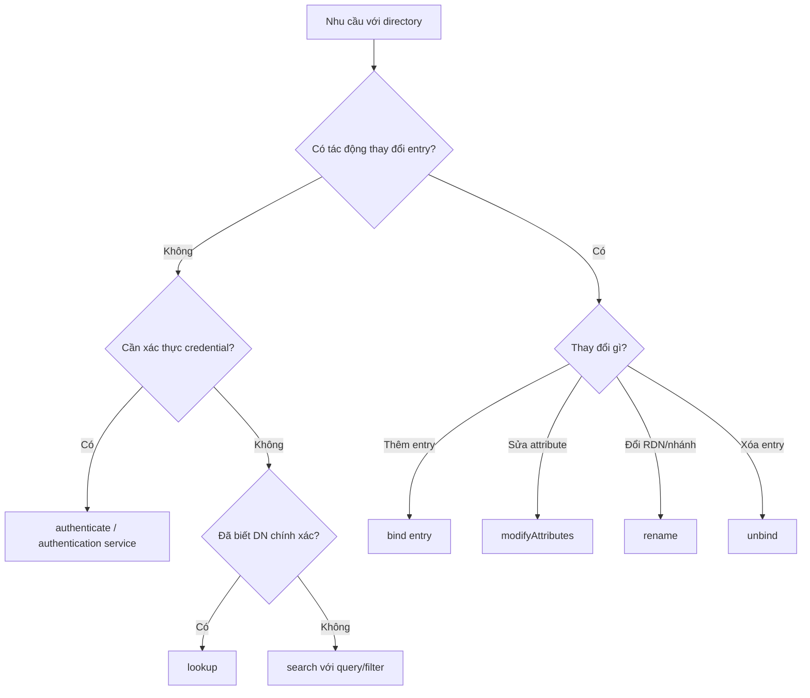
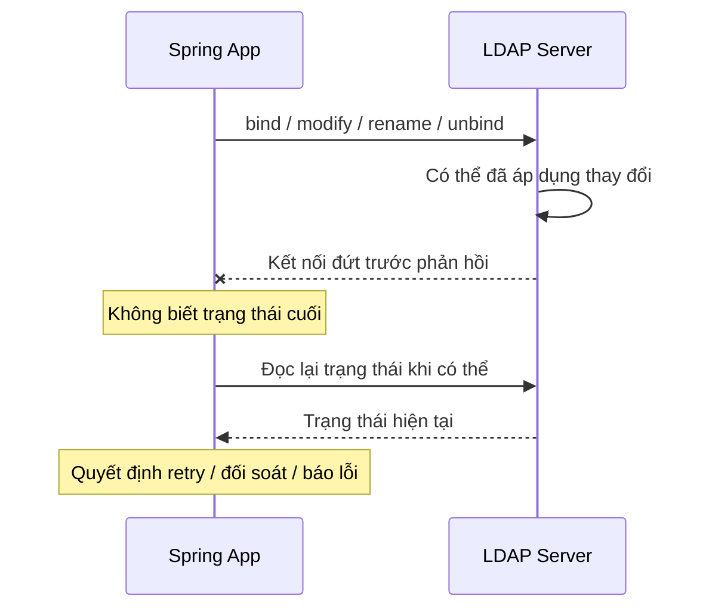

# Chọn operation phù hợp với hợp đồng nghiệp vụ

## Mục tiêu bài học

Khi sử dụng **SPRING_LDAP**, một lỗi thiết kế phổ biến là chọn API theo tên phương thức dễ nhớ, thay vì hỏi **nghiệp vụ cần cam kết điều gì**. Ví dụ: “tìm một người theo `uid`” khác với “đọc chính xác entry tại DN”, “kiểm tra mật khẩu” khác với “kiểm tra entry tồn tại”, còn “cập nhật email” khác với “đổi DN”.

**`LdapTemplate`** cung cấp những thao tác như `search`, `lookup`, `authenticate`, `bind`, `modifyAttributes`, `rename` và `unbind`. Bài học thuộc chương **LdapTemplate**, hướng dẫn chọn operation theo **hợp đồng nghiệp vụ** (*business contract*): đầu vào, kết quả mong đợi, tác động, quyền cần có, tình huống lỗi và khả năng thử lại.

Sau bài này, bạn có thể:

1. Chọn `lookup` hay `search` tùy việc đã biết DN hay chỉ biết điều kiện.
2. Phân biệt `authenticate` để xác minh credential với `search` để tra cứu người dùng.
3. Chọn `bind` để **thêm entry**, `modifyAttributes` để **sửa attribute**, `rename` để **đổi DN**, và `unbind` để **xóa entry**.
4. Thiết kế kết quả của service khi không tìm thấy, tìm thấy nhiều entry, vi phạm schema, thiếu quyền hoặc không rõ trạng thái một lệnh ghi.
5. Biết cách áp dụng DN builder, filter builder, `ContextSource`, TLS và kiểm thử để operation giữ đúng hợp đồng.

## 1. Hợp đồng nghiệp vụ quan trọng hơn tên API

Một hợp đồng nghiệp vụ cần xác định rõ:

| Thành phần hợp đồng | Câu hỏi cần trả lời |
| --- | --- |
| **Đối tượng và định danh** | Entry được xác định bằng DN hay bằng thuộc tính như `uid`? |
| **Đầu vào** | Chuỗi tìm kiếm, DN, password, dữ liệu entry hay các thay đổi attribute? |
| **Tiền điều kiện** | Entry cha phải tồn tại? Entry đích phải tồn tại hay phải chưa tồn tại? |
| **Tác động** | Chỉ đọc, xác thực, tạo, cập nhật, đổi tên hay xóa? |
| **Quyền** | Danh tính LDAP nào được phép thực hiện? Quyền của caller trong ứng dụng là gì? |
| **Kết quả** | Danh sách, một entry, boolean xác thực, hay trạng thái ghi thành công? |
| **Thất bại** | Không tồn tại, trùng, thiếu quyền, schema sai, mất kết nối được biểu diễn ra sao? |
| **Thử lại** | Lặp thao tác có thể gây side effect hoặc lỗi do đã thực hiện trước đó không? |

**Ví dụ:** API HTTP `GET /people/lan` có thể phải tìm người dùng bằng `uid` nếu vị trí trong DIT thay đổi theo phòng ban. Khi đó `lookup("uid=lan,ou=People")` không đáng tin cậy; `search` với filter `(uid=lan)` trên phạm vi được cấp quyền hợp lý hơn.

Ngược lại, với một DN cụ thể đã được xác định từ kết quả truy vấn, `lookup` là cách đọc đúng entry mà không cần tạo thêm search filter.

## 2. Bản đồ chọn operation của LdapTemplate

| Hợp đồng nghiệp vụ | Operation thường phù hợp | Điểm cần kiểm soát |
| --- | --- | --- |
| Đọc một entry khi **đã biết DN** | `lookup(name, mapper)` | DN tương đối với `ContextSource`, entry có tồn tại không |
| Tìm entry bằng điều kiện | `search(query, mapper)` | Base/scope, filter, số kết quả, attribute projection |
| Kiểm tra người dùng **biết mật khẩu** hay không | `authenticate(query, password)` hoặc cơ chế auth phù hợp | Mật khẩu rỗng, quyền search/bind, thông tin lỗi, chính sách account |
| Thêm entry mới | `bind(dn, null, attributes)` | DN chưa tồn tại, entry cha có sẵn, schema, quyền thêm |
| Chỉnh sửa thuộc tính của entry | `modifyAttributes(dn, changes)` | Thay đúng attribute, không ghi đè ngoài ý muốn |
| Thay RDN hoặc chuyển nhánh | `rename(oldDn, newDn)` | DN nguồn/đích, quyền, tham chiếu DN ở entry khác |
| Xóa entry | `unbind(dn)` | Chỉ xóa đúng entry được phép, xử lý entry con và tham chiếu |
| Liệt kê tên một nhánh | `list` hoặc `search` tùy nhu cầu | Liệt kê tên khác với trả về tập attribute đã lọc |

Một số API hỗ trợ thêm overload, context mapper và `LdapClient` fluent. Bảng tập trung vào **ngữ nghĩa**, không khẳng định chỉ có một cú pháp duy nhất trong mọi phiên bản Spring LDAP.



**Chú ý:** `bind` khi gọi API thêm entry và thao tác **LDAP Bind** để xác thực kết nối là hai ý nghĩa khác nhau. Không chọn `ldapTemplate.bind(...)` để kiểm tra mật khẩu.

## 3. Dữ liệu mẫu và cấu hình dùng trong bài

Giả sử directory thử nghiệm có:

```text
dc=example,dc=org
├── ou=People
│   ├── uid=lan
│   ├── uid=mai
│   └── ou=Contractors
│       └── uid=nam
└── ou=Groups
    └── cn=Developers
```

Một entry mẫu:

```ldif
dn: uid=lan,ou=People,dc=example,dc=org
objectClass: inetOrgPerson
uid: lan
cn: Lan Nguyen
sn: Nguyen
mail: lan@example.org
```

Nhánh `ou=Contractors` trong ví dụ cho thấy **không thể suy ra DN chỉ từ UID** nếu người dùng có thể ở nhiều OU. Việc tạo/sửa/xóa bên dưới chỉ thực hiện với **entry thử nghiệm**, không dùng trên directory đang phục vụ người thật.

Với Spring Boot có Spring LDAP dependency và cấu hình tương ứng:

```properties
spring.ldap.urls=ldaps://ldap.example.org:636
spring.ldap.base=dc=example,dc=org
spring.ldap.username=cn=svc-reader,ou=Services,dc=example,dc=org
spring.ldap.password=${LDAP_BIND_PASSWORD}
```

`spring.ldap.base` thiết lập base của `ContextSource`. Các DN truyền cho nhiều thao tác `LdapTemplate` thường là **tương đối** so với base này:

```text
DN được truyền: uid=lan,ou=People
ContextSource base: dc=example,dc=org
DN hiệu dụng: uid=lan,ou=People,dc=example,dc=org
```

Không tự ghép lại hậu tố `dc=example,dc=org` nếu context đã áp base. Mọi ví dụ `Name` tiếp theo được tạo **tương đối với base**. Giá trị `LDAPS URL`, bind DN và branch DIT chỉ là minh họa; để chạy cần server, schema, ACL và truststore hợp lệ.

### Tạo DN an toàn bằng builder

```java
import javax.naming.Name;
import org.springframework.ldap.support.LdapNameBuilder;

final class DirectoryNames {
    private DirectoryNames() {}

    static Name person(String uid) {
        if (uid == null || uid.isBlank()) {
            throw new IllegalArgumentException("uid is required");
        }
        return LdapNameBuilder.newInstance()
                .add("ou", "People")
                .add("uid", uid)
                .build();
    }
}
```

`LdapNameBuilder` nhận **giá trị RDN thô**, giúp biểu diễn ký tự đặc biệt đúng cú pháp DN. Không nối `"uid=" + uid` nếu UID có thể chứa dấu phẩy, dấu cộng hoặc dấu gạch chéo ngược.

## 4. Chọn lookup khi hợp đồng đã biết DN

Nghiệp vụ **“đọc thông tin tại DN X”** thích hợp với `lookup`. Không cần search rộng chỉ để đọc một entry mà DN đã xác định chính xác.

```java
import javax.naming.Name;
import javax.naming.directory.Attributes;
import org.springframework.ldap.core.LdapTemplate;

record PersonPreview(String displayName, String email) {}

class PersonLookupService {
    private final LdapTemplate ldap;

    PersonLookupService(LdapTemplate ldap) {
        this.ldap = ldap;
    }

    PersonPreview byDn(Name dn) {
        return ldap.lookup(dn, (Attributes attrs) ->
                new PersonPreview(
                        (String) attrs.get("cn").get(),
                        attrs.get("mail") == null ? null
                                : (String) attrs.get("mail").get()
                ));
    }
}
```

Đây là ví dụ ngắn cho schema và fixture đã biết. Với code production, cần kiểm tra `cn` có tồn tại/được đọc, giá trị đa trị hoặc binary, thay vì mặc định `attrs.get("cn").get()` luôn hợp lệ.

Khi `lookup` không thấy DN, operation có thể phát sinh lỗi liên quan tên không tồn tại (tùy overload và cách Spring LDAP chuyển ngoại lệ JNDI). Service phải quyết định chuyển tình huống này thành **not found** hay một kết quả tùy chọn theo hợp đồng, đồng thời không che lỗi mạng, TLS hoặc thiếu quyền.

### Khi nào không nên lookup từ UID?

Nếu chỉ có `uid="nam"` nhưng entry nằm dưới `ou=Contractors,ou=People`, thì tự dựng `uid=nam,ou=People` sẽ truy cập sai tên. Hãy dùng `search` theo thuộc tính để **phát hiện DN thật**, rồi sử dụng DN đó cho thao tác cần tên chính xác.

## 5. Chọn search khi chỉ biết điều kiện

Nghiệp vụ **“tìm người có UID này”**, **“liệt kê người thuộc phòng A”**, **“tìm nhóm có member B”** là bài toán search: kết quả có thể là 0, 1 hoặc nhiều entry.

```java
import static org.springframework.ldap.query.LdapQueryBuilder.query;

import java.util.List;
import javax.naming.NamingException;
import javax.naming.directory.Attribute;
import javax.naming.directory.Attributes;
import org.springframework.ldap.core.LdapTemplate;
import org.springframework.ldap.query.LdapQuery;
import org.springframework.ldap.query.SearchScope;

record PersonRow(String uid, String fullName, String email) {}

class PersonSearchService {
    private final LdapTemplate ldap;

    PersonSearchService(LdapTemplate ldap) {
        this.ldap = ldap;
    }

    List<PersonRow> findByUid(String uid) {
        LdapQuery q = query()
                .base("ou=People")
                .searchScope(SearchScope.SUBTREE)
                .attributes("uid", "cn", "mail")
                .where("objectClass").is("inetOrgPerson")
                .and("uid").is(uid);

        return ldap.search(q, (Attributes attrs) ->
                new PersonRow(
                        firstString(attrs, "uid"),
                        firstString(attrs, "cn"),
                        firstString(attrs, "mail")
                ));
    }

    static String firstString(Attributes attrs, String key)
            throws NamingException {
        Attribute value = attrs.get(key);
        if (value == null || value.size() == 0) {
            return null;
        }
        Object first = value.get();
        return first instanceof String ? (String) first : null;
    }
}
```

`LdapQueryBuilder` tạo filter có cấu trúc để input như `uid="lan*"` được xem là một **giá trị cần so sánh**, không tự biến thành wildcard. `attributes(...)` chỉ định tập dữ liệu trả về; thuộc tính dùng trong filter không mặc nhiên được thêm vào kết quả.

### Hợp đồng trả về khi tìm một tài khoản

Nếu business contract yêu cầu **duy nhất một người** theo UID, service phải định nghĩa rõ:

| Số entry tìm được | Cách xử lý ví dụ |
| --- | --- |
| **0** | Trả `Optional.empty()` hoặc business not-found phù hợp |
| **1** | Trả entry đã ánh xạ |
| **Nhiều hơn 1** | Báo xung đột/không duy nhất, thay vì lấy phần tử đầu tùy tiện |
| **Search thất bại** | Báo lỗi directory riêng; không trả rỗng giả |

Ví dụ:

```java
import java.util.List;
import java.util.Optional;

Optional<PersonRow> findUniqueByUid(PersonSearchService service, String uid) {
    List<PersonRow> rows = service.findByUid(uid);
    if (rows.isEmpty()) {
        return Optional.empty();
    }
    if (rows.size() != 1) {
        throw new IllegalStateException("UID is not unique in search scope");
    }
    return Optional.of(rows.get(0));
}
```

Không có ràng buộc LDAP phổ quát rằng mọi entry dưới các OU khác nhau đều phải có `uid` duy nhất. Nếu ứng dụng yêu cầu uniqueness, cần thiết kế namespace/schema/index hoặc chiến lược kiểm soát riêng.

### Khi cần DN của entry, không chỉ Attributes

`AttributesMapper` nhận tập attribute trả về. **DN không phải một attribute phổ quát tên `dn`**. Nếu cần lưu tên thật để sửa/xóa/rename, hãy dùng `ContextMapper` và `DirContextOperations` theo API Spring LDAP:

```java
import javax.naming.Name;
import org.springframework.ldap.core.ContextMapper;
import org.springframework.ldap.core.DirContextOperations;

List<Name> dns = ldap.search(
        query().base("ou=People").where("uid").is("nam"),
        (ContextMapper<Name>) ctx ->
                ((DirContextOperations) ctx).getDn()
);
```

Khi dùng `Name` nhận về, hãy nhất quán về DN tương đối so với `ContextSource` và cách API sử dụng base. Không nối chuỗi để tạo tên đầy đủ mà chưa xác định ngữ nghĩa tên hiện tại.

## 6. Chọn authenticate khi nghiệp vụ phải xác minh credential

Một chức năng đăng nhập có hợp đồng **“người dùng chứng minh quyền sử dụng danh tính bằng thông tin xác thực hợp lệ”**. Search một tài khoản rồi xem nó có tồn tại **không đáp ứng** hợp đồng này.

Trong những mô hình LDAP dùng username/password, `LdapTemplate` có API `authenticate`, thực hiện quá trình tìm DN phù hợp rồi xác minh credential theo hành vi của thư viện và directory server.

Ví dụ ở một service chuyên trách xác thực:

```java
import static org.springframework.ldap.query.LdapQueryBuilder.query;

import org.springframework.ldap.core.LdapTemplate;
import org.springframework.ldap.query.LdapQuery;

class DirectoryAuthenticationService {
    private final LdapTemplate ldap;

    DirectoryAuthenticationService(LdapTemplate ldap) {
        this.ldap = ldap;
    }

    boolean verify(String username, String password) {
        if (username == null || username.isBlank()
                || password == null || password.isEmpty()) {
            return false;
        }

        LdapQuery query = query()
                .base("ou=People")
                .where("objectClass").is("inetOrgPerson")
                .and("uid").is(username);

        return ldap.authenticate(query, password);
    }
}
```

**Điểm then chốt:** Bind với DN người dùng **và mật khẩu rỗng** có thể bị một số server xử lý như *unauthenticated simple bind*, thành công ở mức giao thức nhưng vẫn trong trạng thái quyền ẩn danh. Luồng đăng nhập phải **chặn mật khẩu rỗng trước khi bind**, không diễn giải một kết quả search thành xác thực thành công.

Trong triển khai thật, phải đối chiếu chính sách directory: search bằng service account có thể tìm được DN người dùng không; tài khoản có thể bị khóa/hết hạn không; có yêu cầu MFA/SSO không; và phản hồi nào được phép hiển thị cho người cuối. `authenticate` không tự thay thế tất cả yêu cầu xác thực doanh nghiệp.

| Tình huống | Phản ứng |
| --- | --- |
| Username/password hợp lệ theo chính sách | Xác thực thành công; tiếp tục xác định quyền ứng dụng |
| Mật khẩu rỗng | Từ chối trước LDAP Bind |
| Credential sai | Xác thực thất bại, tránh tiết lộ có/không có username |
| Không tìm được user DN | Thất bại theo chính sách login, không mặc định tạo account |
| Directory server không kết nối được | Lỗi hạ tầng/khả năng xác thực, không giả là “mật khẩu sai” |
| Search có nhiều DN cùng username | Không chọn tùy tiện một DN để xác thực |

**Tách authentication và authorization:** Thành công khi bind chỉ xác minh credential theo cơ chế đã chọn. Việc người dùng được sửa email, duyệt nhóm hay gọi API quản trị phải được quyết định bởi chính sách ứng dụng và quyền LDAP phù hợp.

## 7. Chọn bind để tạo entry mới

Khi hợp đồng nghiệp vụ là **“tạo một người dùng chưa tồn tại dưới nhánh được chỉ định”**, operation tương ứng trong `LdapTemplate` là **`bind` để thêm entry**.

Đừng nhầm với LDAP Bind của luồng xác thực: ở đây `bind(dn, null, attributes)` yêu cầu server tạo một entry.

Ví dụ chỉ dành cho môi trường thử nghiệm, giả định `ou=People` đã tồn tại và directory hỗ trợ các object class:

```java
import javax.naming.Name;
import javax.naming.directory.BasicAttribute;
import javax.naming.directory.BasicAttributes;
import org.springframework.ldap.core.LdapTemplate;

class PersonCreateService {
    private final LdapTemplate writerLdap;

    PersonCreateService(LdapTemplate writerLdap) {
        this.writerLdap = writerLdap;
    }

    void createTestPerson(String uid, String cn, String sn) {
        Name dn = DirectoryNames.person(uid);

        BasicAttributes attrs = new BasicAttributes(true);
        BasicAttribute classes = new BasicAttribute("objectClass");
        classes.add("top");
        classes.add("person");
        classes.add("organizationalPerson");
        classes.add("inetOrgPerson");
        attrs.put(classes);
        attrs.put("uid", uid);
        attrs.put("cn", cn);
        attrs.put("sn", sn);

        writerLdap.bind(dn, null, attrs);
    }
}
```

**Tiền điều kiện và kết quả cần cam kết:**

- DN cha tồn tại và nằm trong nhánh được phép thêm entry.
- DN mới chưa tồn tại; nếu đã có, xử lý **trùng entry** thay vì ghi đè.
- Attributes đáp ứng schema: các `objectClass` phù hợp, `cn`, `sn` và những thuộc tính server yêu cầu.
- Danh tính bind dành cho ghi có đúng quyền tạo entry; tài khoản chỉ đọc không được dùng cho thao tác này.
- Sau thành công, có thể `lookup` lại entry trên server thử nghiệm để xác minh trạng thái.

**Chú ý idempotency:** Gọi `bind` hai lần trên cùng DN không giống “tạo nếu chưa có” một cách tự động. Lần hai có thể bị từ chối vì entry đã tồn tại; không nên dùng `catch all` để coi mọi lỗi lần hai là thành công.

Đối với tính duy nhất và concurrency, kiểm tra “chưa tồn tại” ở Java rồi mới bind **không loại bỏ race condition**: một client khác có thể thêm cùng DN giữa hai bước. Phải xử lý lỗi tạo trùng trả về từ server.

## 8. Chọn modifyAttributes để sửa thuộc tính

Hợp đồng **“chỉ đổi email của entry X, giữ nguyên những thuộc tính khác”** nên dùng `modifyAttributes`, không xóa rồi tạo lại entry.

Ví dụ thay `mail`:

```java
import javax.naming.Name;
import javax.naming.directory.BasicAttribute;
import javax.naming.directory.DirContext;
import javax.naming.directory.ModificationItem;
import org.springframework.ldap.core.LdapTemplate;

class PersonUpdateService {
    private final LdapTemplate writerLdap;

    PersonUpdateService(LdapTemplate writerLdap) {
        this.writerLdap = writerLdap;
    }

    void replaceMail(Name dn, String newMail) {
        if (newMail == null || newMail.isBlank()) {
            throw new IllegalArgumentException("mail is required");
        }
        ModificationItem[] changes = {
            new ModificationItem(
                DirContext.REPLACE_ATTRIBUTE,
                new BasicAttribute("mail", newMail)
            )
        };
        writerLdap.modifyAttributes(dn, changes);
    }
}
```

Các kiểu thay đổi JNDI:

| Thao tác | Ý nghĩa | Khi dùng |
| --- | --- | --- |
| `DirContext.ADD_ATTRIBUTE` | Thêm attribute hoặc giá trị cho attribute đa trị theo ràng buộc server | Thêm một giá trị `member` vào nhóm |
| `DirContext.REPLACE_ATTRIBUTE` | Thay tập giá trị của attribute bằng tập mới | Đổi email khi hợp đồng muốn thay toàn bộ giá trị |
| `DirContext.REMOVE_ATTRIBUTE` | Bỏ attribute hoặc giá trị được chỉ định | Xóa email phụ hoặc một giá trị thành viên theo quy tắc server |

**Không dùng REPLACE để “thêm một giá trị”** nếu attribute là đa trị và nghiệp vụ cần giữ các giá trị hiện có. Thí dụ nhóm có 50 thành viên: thay `member` chỉ bằng một DN sẽ làm mất 49 thành viên khác nếu server chấp nhận thay thế đó.

Với LDAP Modify, một yêu cầu có nhiều modification trên **cùng entry** được xử lý với ngữ nghĩa nguyên tử của thao tác Modify theo giao thức. Nhưng điều đó **không có nghĩa** các lệnh cập nhật nhiều entry liên quan (ví dụ sửa người dùng và sửa nhóm) mặc nhiên cùng một transaction phân tán.

### Hợp đồng cập nhật và lost update

Giả sử hai ứng dụng cùng đọc email cũ, rồi mỗi bên thay bằng một giá trị khác. Bên ghi sau có thể ghi đè thay đổi bên trước.

Nếu hợp đồng yêu cầu **chỉ cập nhật khi entry chưa đổi**, cần nghiên cứu cơ chế kiểm soát cạnh tranh do directory hỗ trợ, ví dụ assertion control hoặc phiên bản hóa/attribute kiểm tra phù hợp với sản phẩm. Không mặc định `modifyAttributes` tự làm optimistic locking giống JPA.

## 9. Chọn rename để đổi RDN hoặc chuyển nhánh

Hợp đồng **“đổi mã định danh trong RDN”** hoặc **“chuyển entry từ một OU sang OU khác”** là thay đổi **DN**, không chỉ đơn thuần sửa một attribute.

Ví dụ đổi `uid=trainee01` thành `uid=trainee02`:

```java
import javax.naming.Name;
import org.springframework.ldap.support.LdapNameBuilder;

Name oldDn = LdapNameBuilder.newInstance()
        .add("ou", "People")
        .add("uid", "trainee01")
        .build();

Name newDn = LdapNameBuilder.newInstance()
        .add("ou", "People")
        .add("uid", "trainee02")
        .build();

writerLdap.rename(oldDn, newDn);
```

Với move sang nhánh khác, DN mới phải biểu diễn đúng cha đích và được directory server cho phép. Không đồng nhất **rename entry** với **thay thuộc tính hiển thị `cn`**: nếu `cn` không nằm trong RDN thì sửa `cn` thường là `modifyAttributes`, không phải `rename`.

**Rủi ro quan trọng:** Một nhóm có `member=uid=trainee01,ou=People,...` có thể vẫn tham chiếu DN cũ sau khi rename. Không giả định mọi server tự động cập nhật `member`, `uniqueMember` hoặc các thuộc tính tham chiếu khác. Nếu hợp đồng cần giữ quan hệ thành viên, phải xác minh và cập nhật liên kết theo cách mà directory đích hỗ trợ.

Khi server/ACL hạn chế chuyển entry giữa các nhánh hoặc RDN mới xung đột, ứng dụng phải xử lý lỗi thay vì cố xóa–tạo lại một cách mù quáng.

## 10. Chọn unbind để xóa entry

Hợp đồng **“xóa entry xác định tại DN X”** ứng với `LdapTemplate.unbind`:

```java
import javax.naming.Name;

Name testDn = DirectoryNames.person("trainee02");
writerLdap.unbind(testDn);
```

Tên `unbind` có thể khiến người học tưởng là “đăng xuất LDAP”, nhưng ở API quản lý entry này, nó mang nghĩa **xóa entry tại tên được cung cấp**. Không dùng operation đó để hủy phiên đăng nhập người dùng. Chỉ chạy ví dụ trên môi trường thử nghiệm cho phép xóa.

Các câu hỏi trước khi xóa:

- DN có được định danh chính xác hay chỉ được đoán từ username?
- Entry có con không? Một số directory server không cho xóa entry không rỗng bằng thao tác xóa đơn giản.
- Có nhóm, ACL hoặc hệ thống khác còn tham chiếu DN này không?
- Có cần soft-delete, vô hiệu hóa tài khoản hoặc lưu audit thay vì xóa vật lý?
- Danh tính thực hiện có quyền xóa **đúng nhánh** không?
- Nếu kết nối đứt ngay sau khi gửi yêu cầu, ứng dụng biết chắc thao tác đã thực hiện hay chưa?

**Xóa vật lý** có thể không phải operation phù hợp nhất cho hợp đồng “ngừng cho phép người dùng đăng nhập”. Tùy sản phẩm, **disable account** thông qua một thuộc tính trạng thái/chính sách định danh có thể giữ lịch sử và tham chiếu tốt hơn. Không giả định cùng một attribute disable được hỗ trợ ở mọi LDAP server.

## 11. Thiết kế hợp đồng xử lý lỗi theo từng operation

Nếu tầng service bắt mọi ngoại lệ rồi trả `false` hoặc `List.of()`, caller không phân biệt được nghiệp vụ không thành công với sự cố LDAP. Hãy định nghĩa kết quả rõ ràng:

| Operation | Thành công | Tình huống nghiệp vụ riêng | Lỗi kỹ thuật cần giữ riêng |
| --- | --- | --- | --- |
| `lookup` | Trả đúng entry | DN không tồn tại | TLS, timeout, quyền đọc, mapping lỗi |
| `search` | Trả danh sách entry | 0 entry khớp; nhiều entry nhưng cần duy nhất | Filter/base sai, vượt size limit, lỗi kết nối |
| `authenticate` | Credential được xác thực | Credential sai, username không tồn tại | Directory unavailable, TLS, search/bind bị chặn |
| `bind` thêm entry | Entry mới được tạo | Entry đã tồn tại | Vi phạm schema/ACL, mất kết nối |
| `modifyAttributes` | Attribute được sửa | Entry không tồn tại, trạng thái không cho phép sửa | Schema, quyền ghi, timeout |
| `rename` | DN thay đổi | DN nguồn không tồn tại, DN đích trùng | Quyền, ràng buộc server, mạng |
| `unbind` | Entry được xóa | Entry không tồn tại, không cho xóa vì còn con | ACL, lỗi mạng, trạng thái không chắc chắn |

Đây là **hợp đồng ở tầng ứng dụng**, không phải danh sách ngoại lệ chính xác của tất cả phiên bản `LdapTemplate`. Spring LDAP có lớp ngoại lệ runtime để chuyển nhiều `NamingException` của JNDI; tên và mapping cụ thể có thể thay đổi theo nhà cung cấp directory và phiên bản thư viện.

### Một thao tác đọc trả rỗng khác với không đọc được

```java
// KHÔNG NÊN: che mọi lỗi directory thành không có kết quả.
try {
    return personSearchService.findByUid(uid);
} catch (Exception ignored) {
    return List.of();
}
```

Nếu account không đủ quyền, server bị ngắt hoặc certificate TLS không tin cậy, service phải báo **không thể xác định dữ liệu** thay vì “người dùng không tồn tại”.

Đối với giao diện đăng nhập, cũng cần tránh trả thông điệp giúp kẻ tấn công dò danh tính (“UID có tồn tại nhưng password sai”). Có thể chuẩn hóa thông báo cho người dùng cuối, trong khi log nội bộ giữ **loại lỗi an toàn**, thời điểm và correlation ID để xử lý sự cố.

## 12. Idempotency, retry và trạng thái chưa chắc chắn

Một hợp đồng nghiêm túc phải trả lời: **nếu ứng dụng gửi operation nhưng không nhận được phản hồi, lần thử tiếp theo sẽ làm gì?**

### 12.1. Đọc và tìm kiếm

`lookup` và `search` thường là thao tác đọc; khi gặp lỗi mạng tạm thời, ứng dụng có thể thử lại **có giới hạn**, với timeout và chính sách kiểm soát tải. Tuy vậy, retry không bảo đảm cùng kết quả nếu directory thay đổi dữ liệu hoặc có replication delay.

### 12.2. Thêm, sửa, đổi tên, xóa

Với lệnh ghi, **mất phản hồi không chứng minh server chưa thực hiện**.



| Operation | Rủi ro nếu retry mù quáng |
| --- | --- |
| `bind` | Lần đầu đã tạo thành công → lần hai có thể lỗi entry đã tồn tại |
| `modifyAttributes` | `ADD_ATTRIBUTE` có thể thêm trùng/vi phạm ràng buộc; `REPLACE_ATTRIBUTE` có thể ghi đè cập nhật mới hơn |
| `rename` | Lần đầu đã đổi DN → DN cũ không còn, DN mới đã tồn tại |
| `unbind` | Lần đầu đã xóa → lần hai gặp tên không tồn tại; không thể tự coi mọi lỗi là thành công |

Nếu hợp đồng đặt mục tiêu trạng thái cuối như “email phải bằng X”, nên đọc lại trạng thái bằng account có quyền, đối chiếu dữ liệu và kiểm soát cạnh tranh trước khi quyết định retry. Không biến mọi lỗi “entry đã tồn tại” thành thành công nếu entry đó có thể thuộc về một người khác.

### 12.3. Nhiều operation không tạo thành một transaction tổng quát

Ví dụ quy trình “chuyển nhân viên sang OU khác và cập nhật tất cả nhóm tham chiếu DN” bao gồm **rename trên entry người dùng** và **modify trên các entry nhóm**. Spring LDAP không mặc nhiên bảo đảm toàn bộ chuỗi đó là một transaction nguyên tử như cơ sở dữ liệu quan hệ.

Cần thiết kế theo đặc tính directory đích: kiểm tra công cụ server hỗ trợ transaction/control nào, giới hạn của chúng, cơ chế bù trừ, đối soát và phát hiện cập nhật từng phần. Không hứa “rollback tất cả” nếu chưa kiểm chứng sự hỗ trợ thật.

## 13. Authorization và bảo mật phải gắn với operation

**“Cho phép xem danh bạ” không đồng nghĩa “cho phép sửa directory”.** Những thao tác trên `LdapTemplate` thường dùng LDAP context được cấp bởi `ContextSource`. Danh tính bind của context xác định những gì LDAP server cho phép, còn quyền ứng dụng xác định caller được gọi chức năng nào.

Một mô hình tách quyền:

```text
DirectoryQueryService
    -> readerLdapTemplate
    -> readOnly ContextSource, bind bằng svc-reader
    -> chỉ search/lookup nhánh được phép

DirectoryAdministrationService
    -> writerLdapTemplate
    -> ContextSource với danh tính ghi được giới hạn
    -> bind entry/modifyAttributes/rename/unbind khi đã được phép

AuthenticationService
    -> cơ chế kiểm tra credential chuyên trách
    -> không dùng kết quả search thay cho xác thực
```

Đây là kiến trúc minh họa; không bắt buộc có ba `ContextSource` trong mọi ứng dụng. Điều quan trọng là **không cấp quyền ghi rộng cho mọi chức năng chỉ vì một số nghiệp vụ cần CRUD**.

Trước mỗi operation:

1. **Xác định caller và quyền ứng dụng**; tài khoản LDAP quản trị không được thay thế kiểm tra authorization của API.
2. **Giới hạn DN/base/scope**: chỉ đọc/sửa/xóa trong nhánh được nghiệp vụ cấp quyền.
3. **Dựng DN và filter đúng ngữ cảnh**: `LdapNameBuilder` cho DN, `LdapQueryBuilder` hoặc Filter builder cho LDAP filter.
4. **Chọn attribute cần đọc**: tránh lấy toàn bộ hồ sơ chỉ để hiển thị tên/email.
5. **Dùng TLS**: LDAPS hoặc StartTLS với kiểm tra chứng chỉ/hostname; không gửi simple-bind credential qua kết nối chưa được bảo vệ.
6. **Thiết lập timeout và giới hạn**: `SearchControls`, connect/read timeout, số entry, cơ chế paging phù hợp.
7. **Cân nhắc pooling**: bảo đảm không dùng nhầm context đã bind với danh tính khác, nhất là khi dùng StartTLS hoặc xác thực per-user.
8. **Không log secret và dữ liệu không cần thiết**: ưu tiên operation type, lỗi, thời gian và ID tương quan.

### Query và filter cần escaping khác DN

Ví dụ code nguy hiểm:

```java
// Không đưa input thẳng vào cú pháp filter hoặc DN.
String filter = "(uid=" + requestedUid + ")";
String dn = "uid=" + requestedUid + ",ou=People";
```

Hai chuỗi này đều có thể sai khi `requestedUid` chứa dấu phân cách hoặc ký tự đặc biệt. Viết:

```java
var request = query()
        .base("ou=People")
        .where("uid").is(requestedUid);

Name dn = LdapNameBuilder.newInstance()
        .add("ou", "People")
        .add("uid", requestedUid)
        .build();
```

**Builder giúp tạo cú pháp đúng, không cấp quyền.** Ngay cả DN/filter hợp lệ cũng cần được kiểm tra phạm vi nghiệp vụ và ACL trên LDAP server.

## 14. Bảng kiểm thử theo hợp đồng

Để kiểm thử, dùng một directory server dành riêng cho học tập, fixture LDIF và danh tính LDAP giới hạn quyền. Không thực hiện ca thêm/sửa/xóa trên dữ liệu đang phục vụ người thật.

| Mã test | Operation | Input / tình huống | Kết quả cần xác minh |
| --- | --- | --- | --- |
| **OP-01** | `lookup` | DN của Lan tồn tại | Đọc đúng entry, đúng thuộc tính cần thiết |
| **OP-02** | `lookup` | DN không tồn tại | Xử lý not-found, không chuyển mọi lỗi thành not-found |
| **OP-03** | `search` | `uid=lan` trong People | Kết quả Lan |
| **OP-04** | `search` | `uid=nam` ở nhánh Contractors | Tìm được với `SUBTREE`, kiểm tra `ONELEVEL` |
| **OP-05** | `search` | UID không tồn tại | Danh sách rỗng hợp lệ |
| **OP-06** | `search` | Hai entry có UID trùng ở nhánh khác nhau | Hợp đồng unique phát hiện nhiều kết quả |
| **OP-07** | `search` | UID có dấu `*`, dấu phẩy hoặc dấu ngoặc | Không tạo filter mở rộng hoặc DN sai cấu trúc |
| **OP-08** | `authenticate` | Đúng/sai password; password rỗng | Đúng được xác thực; sai/rỗng bị từ chối |
| **OP-09** | `bind` | Entry thử nghiệm mới, đúng schema | Thêm được và đọc lại đúng |
| **OP-10** | `bind` | Thêm trùng DN | Lỗi xung đột, không ghi đè |
| **OP-11** | `modifyAttributes` | Chỉ thay `mail` | Thuộc tính khác giữ nguyên |
| **OP-12** | `modifyAttributes` | Nhóm có nhiều `member` | Thêm giá trị không vô tình làm mất thành viên cũ |
| **OP-13** | `rename` | Đổi UID của entry thử nghiệm | DN cũ không còn; DN mới tồn tại; kiểm tra tham chiếu |
| **OP-14** | `unbind` | Xóa đúng entry thử nghiệm | Entry bị xóa, không đụng entry khác |
| **OP-15** | Ghi bất kỳ | Dùng service account chỉ đọc | Server từ chối theo ACL |
| **OP-16** | Đọc hoặc ghi | TLS certificate không được tin cậy | Kết nối thất bại, không hạ cấp |
| **OP-17** | Ghi | Ngắt kết nối sau gửi yêu cầu | Không retry mù; đối soát trạng thái cuối |
| **OP-18** | Search nhiều entry | Size/time limit hoặc paging | Không âm thầm coi kết quả chưa đủ là đầy đủ |

### Unit test: hợp đồng unique

Một helper dùng được để test riêng việc diễn giải số kết quả, không cần server:

```java
import java.util.List;
import java.util.Optional;

final class UniqueResult {
    private UniqueResult() {}

    static <T> Optional<T> oneOrNone(List<T> items) {
        if (items.isEmpty()) {
            return Optional.empty();
        }
        if (items.size() != 1) {
            throw new IllegalStateException("Expected at most one entry");
        }
        return Optional.of(items.get(0));
    }
}
```

```java
import static org.junit.jupiter.api.Assertions.*;
import java.util.List;
import org.junit.jupiter.api.Test;

class UniqueResultTest {
    @Test
    void distinguishesZeroOneAndMany() {
        assertTrue(UniqueResult.oneOrNone(List.of()).isEmpty());
        assertEquals("lan",
                UniqueResult.oneOrNone(List.of("lan")).orElseThrow());
        assertThrows(IllegalStateException.class,
                () -> UniqueResult.oneOrNone(List.of("lan", "lan2")));
    }
}
```

Unit test này chứng minh cách service diễn giải danh sách; nó **không chứng minh LDAP search đã gửi filter, scope và projection đúng**. Cần integration test với server để kiểm tra schema, matching rule, ACL, TLS và thao tác ghi.

### Kiểm thử thực nghiệm có kiểm soát

Trên directory test, hãy thực hiện tuần tự:

1. Search người dùng có UID xác định; ghi lại DN và tập attribute trả về.
2. Lookup theo DN ấy, so sánh dữ liệu với search.
3. Tạo `uid=trainee01` trong OU thử nghiệm bằng account được cấp quyền ghi.
4. Modify `mail` và xác minh các attribute khác không đổi.
5. Rename thành `uid=trainee02`, đọc bằng DN cũ và mới.
6. Unbind entry thử nghiệm và xác nhận không còn.
7. Chạy lại bằng tài khoản chỉ đọc: các lệnh ghi phải bị từ chối.
8. Thử kết nối hỏng, chứng chỉ sai và trường hợp request không nhận phản hồi; ghi nhận sự khác nhau giữa lỗi hạ tầng và không tìm thấy.

Mỗi bước cần có **đầu vào, kết quả mong đợi, kết quả thực tế, dữ liệu trước/sau** và cách khôi phục fixture. Không ghi password hoặc thông tin nhạy cảm trong ảnh chụp/log báo cáo.

## 15. Bài tập tổng hợp: xây một Directory Service có hợp đồng rõ

**Bối cảnh:** Một ứng dụng nhân sự dùng Spring LDAP cần tra cứu hồ sơ, xác thực người dùng và quản trị entry thử nghiệm. LDAP server có base `dc=example,dc=org`, người dùng nằm ở nhiều nhánh trong `ou=People`.

**Yêu cầu:**

1. Tạo `findByUid(String uid)` bằng `search` với filter builder, trả danh sách hoặc `Optional` tùy hợp đồng.
2. Tạo `getByDn(Name dn)` bằng `lookup`, có quy tắc not-found riêng.
3. Tạo `verifyPassword(String uid, String password)` bằng API authentication phù hợp và chặn password rỗng.
4. Tạo `createTestPerson` bằng `bind`, tự xác minh entry sau ghi trên môi trường thử nghiệm.
5. Tạo `replaceMail` bằng `modifyAttributes`, bảo toàn dữ liệu ngoài ý định thay đổi.
6. Tạo `renameTestPerson` và `deleteTestPerson` cho entry thử nghiệm, xử lý tham chiếu và các ràng buộc của server.
7. Tách quyền read-only và write theo chính sách LDAP và authorization của ứng dụng.
8. Đặt TLS, timeout, giới hạn search; giải thích khi nào có thể dùng paging/pooling.
9. Viết test cho 0/1/nhiều kết quả, DN không tồn tại, schema sai, xung đột tạo entry, thiếu quyền và mất phản hồi sau ghi.

**Tiêu chí nghiệm thu:** Người đánh giá nhìn vào từng method phải chỉ ra được **nghiệp vụ**, **operation LDAP**, **tác động**, **tiền điều kiện**, **quyền**, **đường thành công**, **đường lỗi** và **chính sách retry**. Không chấp nhận giải pháp “mọi exception thành false” hoặc “không có kết quả nghĩa là sai mật khẩu”.

### Câu hỏi tự kiểm tra

**1.** Biết chính xác DN của entry, cần đọc thuộc tính của entry đó: `lookup` hay `search`?

**Trả lời:** `lookup` thường phù hợp vì đã biết tên chính xác. Dùng `search` nếu cần đánh giá điều kiện trên nhiều entry hoặc chưa biết DN.

**2.** Một `search` trả về entry của Lan có chứng minh người gọi biết mật khẩu Lan không?

**Trả lời:** Không. Search chỉ tra cứu dữ liệu theo quyền của context. Xác thực credential là hợp đồng khác.

**3.** `LdapTemplate.bind(dn, null, attrs)` dùng để xác thực người dùng hay thêm entry?

**Trả lời:** Thêm entry ở DN đã chỉ định. LDAP Bind để xác thực kết nối là thao tác giao thức với ngữ cảnh khác.

**4.** Chỉ muốn thay email, có nên gọi `rename`?

**Trả lời:** Không, nếu email không phải một phần DN cần thay. Dùng `modifyAttributes` và thay đúng attribute.

**5.** `REPLACE_ATTRIBUTE` với `member` chứa một DN có an toàn để thêm thành viên mới không?

**Trả lời:** Không. REPLACE thay toàn bộ tập giá trị attribute; cần operation phù hợp để thêm giá trị mà không làm mất thành viên cũ.

**6.** Nếu `rename` thành công, mọi giá trị `member` ở các nhóm có tự cập nhật không?

**Trả lời:** Không có bảo đảm phổ quát. Cần xem khả năng cập nhật tham chiếu của directory server và kiểm thử.

**7.** Một lệnh `unbind` gặp timeout sau khi gửi, có thể retry ngay không?

**Trả lời:** Không nên retry mù. Phải xác định trạng thái hiện tại và phân biệt lỗi “đã xóa” với những lỗi khác trước khi quyết định.

**8.** Vì sao phải kiểm thử với account chỉ đọc nếu code đã không gọi method ghi ở các service đọc?

**Trả lời:** Vì ACL phía server là ranh giới bảo vệ cuối. Một nhầm lẫn service/bean, một đường code khác hoặc một request không được kiểm tra cũng không được phép thay đổi dữ liệu.

## Tổng kết

Chọn operation của **`LdapTemplate`** bắt đầu từ **hợp đồng nghiệp vụ**, không phải từ độ ngắn của lời gọi API:

- **`lookup`**: đã biết DN, muốn đọc đúng entry.
- **`search`**: biết điều kiện, muốn tìm trong một phạm vi.
- **`authenticate`**: muốn xác minh credential, không chỉ sự tồn tại của entry.
- **`bind`**: tạo entry mới.
- **`modifyAttributes`**: thay đổi giá trị thuộc tính.
- **`rename`**: thay RDN/đường dẫn của entry.
- **`unbind`**: xóa entry.

Mỗi operation phải đi kèm quy tắc về **DN, schema, filter, kết quả, lỗi, concurrency, idempotency, ACL và TLS**. `ContextSource` và Spring LDAP giảm mã hạ tầng; chúng không thay thế thiết kế nghiệp vụ và kiểm thử với directory server thực tế. `LdapClient` hoặc LDAP ODM có thể cung cấp API khác thuận tiện hơn cho cùng loại thao tác, nhưng **ngữ nghĩa và ràng buộc của LDAP không thay đổi**.

### Tài liệu tham khảo

- **Spring LDAP Reference Documentation** — `LdapTemplate`, `LdapClient`, ODM, `ContextSource`, truy vấn và xử lý ngoại lệ.
- **Spring LDAP API Documentation** — `org.springframework.ldap.core.LdapTemplate`, các overload `lookup`, `search`, `authenticate`, `bind`, `modifyAttributes`, `rename`, `unbind` theo phiên bản đang dùng.
- **Java SE JNDI API** — `javax.naming.Name`, `javax.naming.directory.Attributes`, `DirContext` và `ModificationItem`.
- **RFC 4511** — Lightweight Directory Access Protocol (LDAP): The Protocol (Bind, Search, Add, Modify, Modify DN, Delete và mã kết quả).
- **RFC 4512** — LDAP: Directory Information Models (schema, entry, attribute).
- **RFC 4513** — LDAP: Authentication Methods and Security Mechanisms.
- **RFC 4514** — String Representation of Distinguished Names.
- **RFC 4515** — String Representation of Search Filters.
