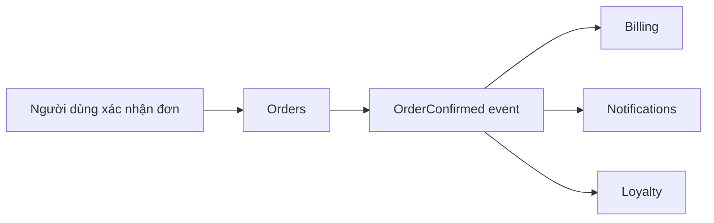
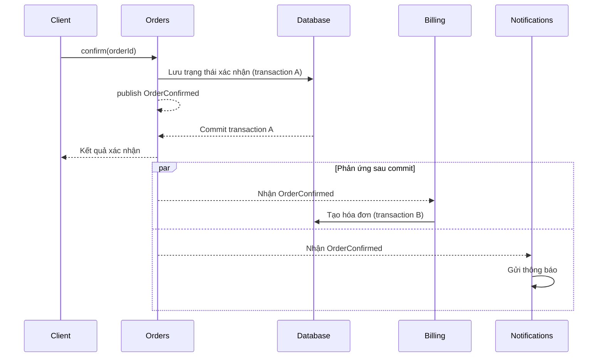
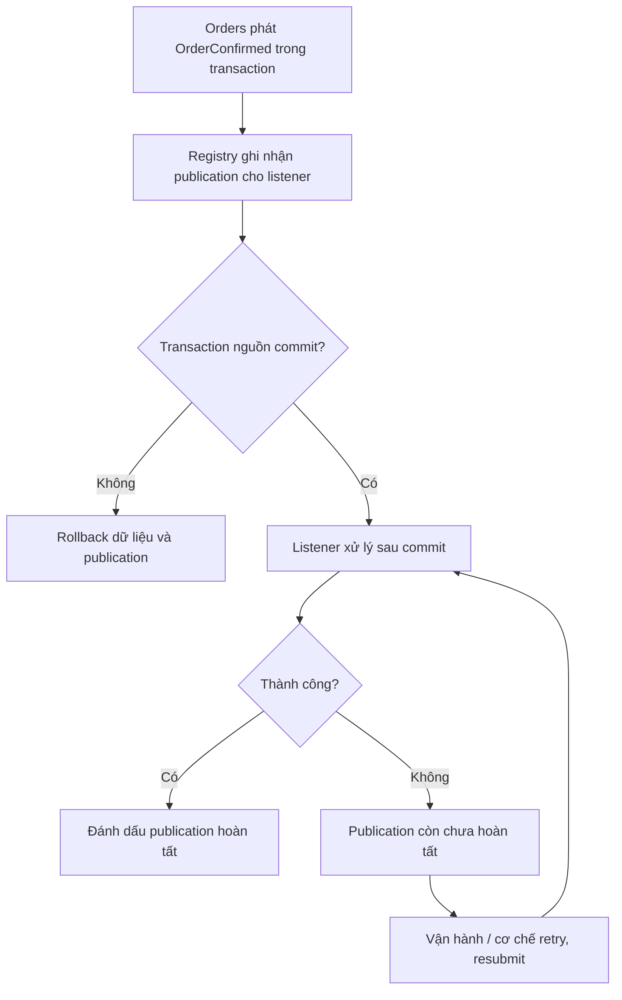

# Application Event là gì?

> **Chương:** Tổng quan ứng dụng sự kiện  
> **Phạm vi:** `SPRING_MODULITH_APPLICATION_EVENTS` — giao tiếp giữa các module Spring Modulith bằng application events, giảm phụ thuộc trực tiếp và giữ ranh giới nghiệp vụ.

## 1. Đặt vấn đề: một nghiệp vụ, nhiều module cùng quan tâm

Giả sử hệ thống bán hàng được chia thành ba module:

- **Orders** quản lý vòng đời đơn hàng.
- **Billing** tạo hóa đơn sau khi đơn được xác nhận.
- **Notifications** gửi thông báo xác nhận cho khách hàng.

Khi người dùng xác nhận một đơn hàng, cách triển khai trực tiếp thường là:

```java
@Transactional
public void confirmOrder(UUID orderId) {
    orderRepository.confirm(orderId);
    billingService.createInvoice(orderId);
    notificationService.sendConfirmation(orderId);
}
```

Vấn đề là module `Orders` phải biết và gọi hai module còn lại. Khi bổ sung `Loyalty` để cộng điểm, `Orders` lại phải thay đổi. Nếu gửi email lỗi, luồng xác nhận đơn có thể bị ảnh hưởng dù email là tác vụ phụ. Quan hệ gọi trực tiếp như vậy khiến ranh giới module mờ đi.

**Application Event (sự kiện ứng dụng)** cho phép `Orders` chỉ thông báo một sự thật đã xảy ra hoặc một thay đổi trạng thái có ý nghĩa: *đơn hàng đã được xác nhận*. Những module quan tâm tự đăng ký xử lý thông tin đó.



Sự kiện không yêu cầu `Orders` biết có bao nhiêu nơi lắng nghe. Đây là một cơ chế quan trọng để **tổ chức giao tiếp giữa các module Spring Modulith, giảm phụ thuộc và bảo vệ ranh giới nghiệp vụ**.

## 2. Application Event là gì?

Trong Spring, **application event là một đối tượng Java đại diện cho một điều có ý nghĩa đối với ứng dụng, được phát qua `ApplicationEventPublisher` và được các listener thích hợp tiếp nhận**.

Ba thành phần cơ bản:

| Thành phần | Vai trò | Ví dụ |
|---|---|---|
| **Event** | Mô tả điều đã xảy ra hoặc tín hiệu ứng dụng cần thông báo | `OrderConfirmed` |
| **Publisher** | Phát sự kiện, thường tại nơi xử lý nghiệp vụ gốc | `ApplicationEventPublisher.publishEvent(...)` |
| **Listener** | Đăng ký nhận một loại sự kiện và thực hiện phản ứng tương ứng | Tạo hóa đơn, gửi email, cộng điểm |

Spring hỗ trợ phát một đối tượng Java thông thường, kể cả `record`; không cần kế thừa `ApplicationEvent`. Ví dụ:

```java
public record OrderConfirmed(
        UUID eventId,
        UUID orderId,
        Instant occurredAt
) {}
```

Tên `OrderConfirmed` diễn tả **sự việc đã xảy ra**. `eventId` giúp nhận diện một lần phát sinh sự kiện, `orderId` xác định thực thể nghiệp vụ liên quan và `occurredAt` ghi lại thời điểm phát sinh. Các trường này tạo nên dữ liệu mà listener cần, không buộc listener phải nhận một entity JPA của module khác.

**Điểm cần phân biệt:** `ApplicationEventPublisher` mặc định là cơ chế phát sự kiện **bên trong cùng một tiến trình Spring**. Nó không tự biến sự kiện thành thông điệp trên Kafka, RabbitMQ hay một dịch vụ độc lập. Spring Modulith xây dựng thêm các khả năng quản lý và theo dõi việc xử lý sự kiện giữa các module trong một ứng dụng modular monolith.

### 2.1. Event, command và integration event

| Khái niệm | Ý nghĩa | Ví dụ | Đặc điểm |
|---|---|---|---|
| **Command** | Yêu cầu một thành phần thực hiện công việc | `ConfirmOrder` | Mang ý định; nơi nhận có trách nhiệm xử lý hoặc từ chối |
| **Application/domain event** | Thông báo một sự việc có ý nghĩa đã phát sinh | `OrderConfirmed` | Một hoặc nhiều listener có thể quan tâm |
| **Integration event** | Thông điệp trao đổi qua ranh giới tiến trình/hệ thống | `OrderConfirmedV1` gửi đến broker | Cần hợp đồng dữ liệu, phiên bản, truyền tải và vận hành độc lập |

Sự kiện ứng dụng và domain event thường giao nhau về cách biểu diễn. Trong thiết kế miền, **domain event** nhấn mạnh ý nghĩa nghiệp vụ; **application event** nhấn mạnh cơ chế phân phối trong Spring. Một đối tượng như `OrderConfirmed` có thể vừa là domain event vừa được phát bằng application event.

Một listener nhận `OrderConfirmed` không nên hiểu rằng mình được ra lệnh phải thực hiện một tác vụ duy nhất. Module nào quan tâm thì phản ứng theo trách nhiệm của module đó.

## 3. Cơ chế hoạt động trong Spring

Luồng cơ bản:

1. Một service hoàn thành hoặc tiến hành thay đổi nghiệp vụ.
2. Service gọi `ApplicationEventPublisher.publishEvent(event)`.
3. Spring tìm các listener phù hợp với kiểu sự kiện.
4. Listener xử lý theo cơ chế đăng ký: đồng bộ, theo pha giao dịch hoặc bất đồng bộ tùy annotation và cấu hình.

Ví dụ publisher trong `Orders`:

```java
@Service
public class OrderService {

    private final OrderRepository orders;
    private final ApplicationEventPublisher events;

    public OrderService(
            OrderRepository orders,
            ApplicationEventPublisher events
    ) {
        this.orders = orders;
        this.events = events;
    }

    @Transactional
    public void confirm(UUID orderId) {
        Order order = orders.findById(orderId).orElseThrow();
        order.confirm(); // Kiểm tra quy tắc và đổi trạng thái nghiệp vụ

        events.publishEvent(new OrderConfirmed(
                UUID.randomUUID(),
                order.getId(),
                Instant.now()
        ));
    }
}
```

Trong ví dụ dùng JPA, `order` đang được quản lý trong transaction nên thay đổi sẽ được đồng bộ xuống cơ sở dữ liệu khi transaction hoàn tất. Repository và entity là ví dụ minh họa; điều cốt lõi là **việc phát event được đặt trong cùng luồng nghiệp vụ xác nhận đơn**.

Một listener Spring thuần:

```java
@Component
public class OrderAuditListener {

    @EventListener
    public void on(OrderConfirmed event) {
        // Ghi nhận sự kiện theo nhu cầu của module này.
        System.out.println("Confirmed order: " + event.orderId());
    }
}
```

Với cấu hình mặc định, `@EventListener` xử lý **đồng bộ ngay tại thời điểm publish**. Nếu publisher đang ở trong transaction thì listener thường chạy **trước khi commit**. Exception từ listener đồng bộ có thể truyền về publisher, khiến thao tác gọi thất bại và transaction bị rollback.

Vì vậy, phát sự kiện **không tự động đồng nghĩa với** xử lý bất đồng bộ, xử lý sau commit hay phân phối bền vững.

## 4. Ba lựa chọn listener thường gặp

| Cách lắng nghe | Thời điểm và cách thực thi | Phù hợp |
|---|---|---|
| `@EventListener` | Mặc định gọi đồng bộ trong lần `publishEvent` | Phản ứng nhanh, cùng ngữ cảnh, có chủ đích tham gia luồng hiện tại |
| `@TransactionalEventListener` | Gắn với một pha transaction, mặc định `AFTER_COMMIT` | Chỉ thực hiện phản ứng sau khi dữ liệu nguồn commit thành công |
| `@ApplicationModuleListener` | Annotation tiện ích của Spring Modulith: transactional event listener, bất đồng bộ, transaction mới cho phần xử lý | Phản ứng liên module, tách thời gian xử lý và giao dịch |

### 4.1. `@TransactionalEventListener` và thời điểm commit

Nếu gửi email ngay trong `@EventListener` rồi transaction xác nhận đơn rollback, khách có thể nhận thông báo cho một đơn chưa được xác nhận. Để tránh tình huống đó, dùng listener sau commit:

```java
@Component
public class ConfirmationNotificationListener {

    private final NotificationGateway notifications;

    public ConfirmationNotificationListener(NotificationGateway notifications) {
        this.notifications = notifications;
    }

    @TransactionalEventListener(phase = TransactionPhase.AFTER_COMMIT)
    public void on(OrderConfirmed event) {
        notifications.sendOrderConfirmation(event.orderId());
    }
}
```

Các pha thường dùng:

| Transaction phase | Ý nghĩa |
|---|---|
| `BEFORE_COMMIT` | Chạy trước khi transaction chuẩn bị commit |
| `AFTER_COMMIT` | Chạy sau khi transaction commit thành công; là mặc định |
| `AFTER_ROLLBACK` | Chạy khi transaction rollback |
| `AFTER_COMPLETION` | Chạy sau khi transaction kết thúc, bất kể commit hay rollback |

Lưu ý quan trọng:

- `@TransactionalEventListener` thông thường **không được gọi nếu lúc publish không có transaction**, trừ khi chủ động đặt `fallbackExecution = true`. Hãy bảo đảm publisher thực sự chạy trong transaction nếu nghiệp vụ yêu cầu xử lý sau commit.
- `AFTER_COMMIT` nghĩa là dữ liệu gốc đã commit; lỗi xử lý listener không thể quay ngược commit đó.
- Tại callback sau commit, một số tài nguyên transaction có thể còn gắn với thread. Nếu listener cần **ghi dữ liệu mới một cách chắc chắn**, hãy mở một transaction mới, chẳng hạn qua `@Transactional(propagation = Propagation.REQUIRES_NEW)` ở một service được gọi qua Spring proxy.
- `@TransactionalEventListener` tự nó không bảo đảm bất đồng bộ. Nó vẫn có thể chạy trên thread phát sự kiện khi không cấu hình cơ chế async.

### 4.2. `@ApplicationModuleListener` trong Spring Modulith

Spring Modulith cung cấp `@ApplicationModuleListener` cho trường hợp module này cần phản ứng với event từ module khác. Annotation này kết hợp semantics của transactional listener sau commit, `@Async` và transaction mới (`REQUIRES_NEW`).

Ví dụ module `Billing` tự nhận sự kiện mà `Orders` công bố:

```java
@Component
public class InvoiceCreationListener {

    private final InvoiceService invoices;

    public InvoiceCreationListener(InvoiceService invoices) {
        this.invoices = invoices;
    }

    @ApplicationModuleListener
    public void on(OrderConfirmed event) {
        invoices.createInvoiceIfAbsent(event.orderId());
    }
}
```

Vì listener dùng cơ chế `@Async`, ứng dụng cần kích hoạt và cấu hình asynchronous execution phù hợp, chẳng hạn `@EnableAsync` cùng một executor có giới hạn tài nguyên. Việc xử lý có thể bắt đầu sau commit, trên thread khác, với transaction riêng. Không được giả định listener hoàn thành trước khi HTTP request của publisher kết thúc.



Sơ đồ biểu diễn thứ tự logic; thời điểm trả response và lịch thực thi async phụ thuộc cấu hình thực tế. Không có bảo đảm rằng hai listener sẽ hoàn tất theo một thứ tự xác định.

## 5. Vì sao Application Events hữu ích trong Spring Modulith?

**Spring Modulith** tổ chức một ứng dụng Spring Boot thành các application module có ranh giới rõ. Mỗi module sở hữu nghiệp vụ, dữ liệu và API được phép công khai; các module khác tương tác qua các hợp đồng đó.

Giao tiếp bằng event giúp:

1. **Giảm phụ thuộc trực tiếp:** `Orders` công bố `OrderConfirmed` mà không inject `InvoiceService` hay `NotificationService`.
2. **Giữ quyền sở hữu nghiệp vụ:** `Orders` quyết định khi nào đơn được xác nhận; `Billing` quyết định tạo hóa đơn như thế nào.
3. **Dễ mở rộng phản ứng:** Thêm module `Loyalty` có thể bổ sung listener mà không cần sửa luồng xác nhận đơn.
4. **Cô lập lỗi theo thời điểm:** Với listener sau commit, lỗi tác vụ phụ không đảo ngược một giao dịch nguồn đã commit.
5. **Tạo điểm quan sát rõ ràng:** Từng loại sự kiện, listener, lần phát và kết quả xử lý có thể được theo dõi.

Tuy nhiên, **ít gọi trực tiếp không có nghĩa là hết phụ thuộc**. Listener vẫn phụ thuộc vào **hợp đồng sự kiện**: tên, kiểu, ý nghĩa và dữ liệu payload. Đặt event ở phần API được phép dùng của module phát, ví dụ một package API hoặc named interface được khai báo phù hợp với quy tắc Spring Modulith. Tránh để module nhận import entity/repository nội bộ của module phát.

Mỗi module cần giữ bất biến nghiệp vụ của riêng mình. Nếu một bước phải thành công nguyên tử với việc xác nhận đơn, nên xem xét xử lý cùng transaction thay vì tùy tiện đẩy sang phản ứng eventual consistency.

## 6. Ranh giới giao dịch và tính nhất quán

Giả sử `Orders` ghi trạng thái `CONFIRMED`, còn `Billing` tạo hóa đơn sau commit. Đây là hai transaction khác nhau:

- **Transaction A:** xác nhận đơn, phát event, commit dữ liệu đơn.
- **Transaction B:** listener của `Billing` mở transaction riêng, tạo hóa đơn.

Trong khoảng giữa A và B, hệ thống có thể có đơn đã xác nhận nhưng chưa có hóa đơn. Đó là **eventual consistency (nhất quán cuối cùng)**. Ứng dụng cần chấp nhận và thể hiện trạng thái trung gian này, ví dụ `invoiceStatus = PENDING`.

| Tình huống | Kết quả có thể xảy ra | Cách thiết kế |
|---|---|---|
| Transaction A rollback | Listener `AFTER_COMMIT` không chạy | Chỉ gửi phản ứng khi nguồn commit |
| A commit, B chưa chạy | Đơn đã xác nhận, hóa đơn chưa có | Trạng thái chờ, quan sát độ trễ |
| A commit, B xử lý thất bại | Đơn vẫn xác nhận, hóa đơn chưa được tạo | Theo dõi thất bại và retry |
| B chạy lại cùng event | Có nguy cơ tạo hai hóa đơn | Listener idempotent, ràng buộc unique |
| Có nhiều listener | Tốc độ/thứ tự hoàn tất khác nhau | Không dựa vào thứ tự xử lý ngầm định |

**Câu hỏi thiết kế:** “Xác nhận đơn có được coi là thành công khi chưa gửi email hoặc chưa tạo hóa đơn không?” Nếu câu trả lời là “có”, sau commit thường là lựa chọn hợp lý. Nếu câu trả lời là “không”, cần đánh giá lại ranh giới transaction hoặc quy trình nghiệp vụ trước khi dùng event.

## 7. Event Publication Registry: ghi nhận sự kiện chưa xử lý xong

Spring cung cấp cơ chế sự kiện trong bộ nhớ, nhưng chỉ gọi `publishEvent` không đủ để bảo đảm phản ứng hậu giao dịch sẽ được hoàn tất khi ứng dụng dừng đột ngột hoặc listener gặp lỗi.

**Event Publication Registry** của Spring Modulith bổ sung khả năng theo dõi những **lần công bố sự kiện dành cho các transactional event listener**: bản ghi publication được lưu trong kho dữ liệu được cấu hình, đánh dấu hoàn tất khi listener xử lý thành công, và có thể dùng để xác định các publication chưa hoàn thành.

Luồng tư duy:



Để có độ bền thật sự, cần **cấu hình kho lưu publication phù hợp** (ví dụ JDBC/JPA hoặc tùy lựa chọn lưu trữ mà phiên bản Spring Modulith hỗ trợ), schema, transaction và cơ chế xử lý lại. Chỉ thêm annotation vào listener **không tự tạo ra cam kết giao nhận bền vững từ đầu đến cuối**.

Một số điểm phải nắm:

- Registry giúp nhận diện publication chưa hoàn tất sau lỗi listener hoặc sự cố tiến trình, nhưng **không hứa exactly-once processing**.
- Chính sách tự động xử lý lại, thời điểm resubmit và cách vận hành có thể khác theo phiên bản/cấu hình; cần cấu hình và kiểm thử bằng phiên bản thực tế của dự án.
- Nếu event được phát ngoài transaction hoặc một tích hợp bỏ qua cơ chế publication của registry, không được suy ra rằng event đó đã được ghi bền vững.
- Registry quản lý phản ứng trong ứng dụng. Việc giao sự kiện đến Kafka/RabbitMQ hay hệ thống bên ngoài vẫn cần một thiết kế tích hợp và bảo đảm riêng.

### 7.1. Vì sao retry phải đi cùng idempotency?

Giả sử `Billing` đã tạo hóa đơn và commit transaction B, nhưng tiến trình dừng trước lúc registry ghi nhận publication hoàn tất. Sau khi ứng dụng khởi động, publication chưa hoàn tất có thể được gửi xử lý lại. Nếu không chặn trùng, hệ thống tạo hóa đơn thứ hai.

Một cách tổ chức nghiệp vụ:

```java
@Service
public class InvoiceService {

    private final InvoiceRepository invoices;

    public InvoiceService(InvoiceRepository invoices) {
        this.invoices = invoices;
    }

    @Transactional
    public void createInvoiceIfAbsent(UUID orderId) {
        if (invoices.existsByOrderId(orderId)) {
            return;
        }

        invoices.save(Invoice.forOrder(orderId));
    }
}
```

**Cần thêm unique constraint ở cơ sở dữ liệu trên `invoice.order_id`** (hoặc cơ chế tương đương) vì hai lần xử lý song song vẫn có thể cùng vượt qua kiểm tra `existsByOrderId`. Với tác vụ có side effect ngoài hệ thống như gửi email hay gọi API thanh toán, dùng khóa idempotency, bảng ghi nhận event đã xử lý hoặc API hỗ trợ chống trùng. `eventId` hoặc cặp `(listenerId, eventId)` có thể làm khóa nhận diện phù hợp.

Retry cũng phải có giới hạn, lịch backoff, phân loại lỗi có thể thử lại và cảnh báo khi tồn đọng. “Thử lại” không đồng nghĩa “chắc chắn thành công” nếu dữ liệu hoặc hợp đồng nghiệp vụ sai.

## 8. Thiết kế một event tốt

Một hợp đồng sự kiện liên module nên đáp ứng:

- **Tên thể hiện điều đã xảy ra:** `OrderConfirmed`, `PaymentCaptured`, `StockReserved`. Tránh tên mơ hồ như `OrderChanged` nếu listener cần phân biệt các chuyển trạng thái.
- **Payload nhỏ, bất biến:** dùng `record` hoặc immutable value object; ưu tiên ID và dữ liệu cần thiết, hạn chế entity JPA, lazy proxy hoặc object graph phức tạp.
- **Đủ ngữ cảnh để xử lý:** khi cần, có `eventId`, ID nghiệp vụ, thời điểm, phiên bản, correlation ID. Phân biệt `occurredAt` với thời gian listener nhận.
- **Không rò rỉ nội bộ module:** event thuộc bề mặt API công khai phù hợp, không expose toàn bộ mô hình dữ liệu của `Orders`.
- **Ổn định về ngữ nghĩa:** thay đổi tên field, kiểu dữ liệu hoặc ý nghĩa event có thể ảnh hưởng nhiều listener. Cân nhắc versioning khi payload được lưu bền vững hoặc chuyển ra ngoài tiến trình.
- **Không chứa bí mật không cần thiết:** tránh password, token, dữ liệu cá nhân dư thừa vì event có thể được ghi log hoặc lưu trong registry.

**Event không phải cơ chế truy vấn.** Khi một module cần kết quả tức thì từ module khác để ra quyết định, lời gọi qua API công khai có thể rõ ràng và dễ kiểm soát hơn. Application events đặc biệt hợp với dạng *“khi X đã xảy ra, các module quan tâm có thể phản ứng”*.

## 9. Kiểm thử publisher và listener

Nên kiểm thử ở nhiều lớp, mỗi lớp xác minh một bảo đảm riêng.

### 9.1. Kiểm thử phát đúng event

Spring Modulith cung cấp `@ApplicationModuleTest` để chạy kiểm thử theo ranh giới module và `PublishedEvents` để xác minh những sự kiện đã được công bố. Ví dụ khung:

```java
@ApplicationModuleTest
class OrderEventTests {

    @Autowired
    OrderService orderService;

    @Test
    void publishesConfirmationEvent(PublishedEvents publishedEvents) {
        UUID orderId = prepareOrderReadyToConfirm();

        orderService.confirm(orderId);

        assertThat(publishedEvents.ofType(OrderConfirmed.class)
                .matching(OrderConfirmed::orderId, orderId))
                .hasSize(1);
    }

    private UUID prepareOrderReadyToConfirm() {
        // Chuẩn bị dữ liệu phù hợp với domain của ứng dụng.
        throw new UnsupportedOperationException("Implement for the project");
    }
}
```

Đây là **mẫu định hướng**, cần thay hàm chuẩn bị dữ liệu bằng fixture thật. Điều được xác minh là event được phát đúng loại, đúng `orderId`, không phụ thuộc listener có gửi email thành công hay chưa.

### 9.2. Kiểm thử phản ứng sau commit

Với `@TransactionalEventListener` hay `@ApplicationModuleListener`, cần kiểm thử **commit thực sự**. Nếu test mặc định luôn rollback transaction của chính test, listener `AFTER_COMMIT` có thể không được kích hoạt, dẫn tới kết luận sai.

Spring Modulith có hỗ trợ `Scenario` cho những bài kiểm thử kiểu *kích hoạt tác vụ → chờ event hoặc thay đổi trạng thái → xác minh*. Với listener async, nên chờ theo điều kiện hoặc API thử nghiệm phù hợp thay vì dùng `Thread.sleep(...)` cố định.

Những tình huống nên có integration test:

1. Xác nhận đơn thành công và commit → có hóa đơn, có phản ứng tương ứng.
2. Transaction xác nhận đơn rollback → listener sau commit không tạo hóa đơn.
3. Listener ném exception → nguồn đã commit vẫn giữ trạng thái đúng; publication thất bại được ghi nhận khi registry cấu hình.
4. Xử lý lại cùng `eventId` hoặc cùng `orderId` → không tạo dữ liệu trùng.
5. Khởi động lại ứng dụng với publication chưa hoàn tất → quy trình khôi phục vận hành theo chính sách đã cấu hình.

Đối với phát sự kiện, thử nghiệm unit thường đủ để kiểm tra payload và điều kiện phát. Đối với registry và phục hồi sau lỗi, integration test phải sử dụng kho lưu thực tế cùng đường đi commit/rollback thật.

## 10. Quan sát và vận hành sự kiện đáng tin cậy

Khi các listener chạy sau commit hoặc bất đồng bộ, một request HTTP thành công **không chứng minh mọi phản ứng liên module đã hoàn thành**. Vì vậy, cần quan sát cả luồng xử lý phía sau:

| Cần quan sát | Ví dụ dữ liệu hữu ích | Mục đích |
|---|---|---|
| Phát sự kiện | `eventType`, `eventId`, `orderId`, `occurredAt` | Truy vết nguồn phát và đối tượng nghiệp vụ |
| Xử lý listener | `listenerId`, trạng thái, thời lượng, số lần thử | Xác định module nào đang lỗi hoặc chậm |
| Publication registry | Số publication chưa hoàn tất, tuổi publication lâu nhất | Phát hiện tồn đọng và nguy cơ dữ liệu phụ chưa đồng bộ |
| Retry | Số lần retry, nguyên nhân lỗi, lần thử tiếp theo | Chẩn đoán lỗi tạm thời và lỗi lặp lại |
| Tương quan yêu cầu | `traceId`/`correlationId` khi có | Theo dõi xuyên request, publisher và listener |

Có thể dùng logging có cấu trúc, Micrometer metrics, tracing và dashboard tùy stack. Với async, cần chủ động truyền hoặc khôi phục ngữ cảnh quan sát nếu executor và hệ thống tracing không tự thực hiện điều đó. Cần tránh ghi payload nhạy cảm trong log.

Một cảnh báo thực tế nên theo dõi: **publication chưa hoàn tất tăng liên tục hoặc thời gian tồn đọng vượt ngưỡng nghiệp vụ**. Nếu chỉ nhìn HTTP 200 từ `Orders`, sự cố bên `Billing` có thể bị bỏ sót.

## 11. Những hiểu lầm và lỗi thiết kế thường gặp

| Hiểu lầm | Thực tế / cách sửa |
|---|---|
| Gọi `publishEvent` là đã xử lý bất đồng bộ | `@EventListener` mặc định đồng bộ; cần cơ chế async phù hợp |
| Event phát ra trong transaction tức là listener nhìn thấy dữ liệu đã commit | Listener thường có thể chạy trước commit; dùng `AFTER_COMMIT` khi cần |
| `AFTER_COMMIT` cho phép tự do ghi DB trong cùng transaction | Muốn commit thay đổi mới, mở transaction mới và kiểm thử |
| `@TransactionalEventListener` luôn được gọi | Nếu không có transaction, mặc định listener không chạy |
| Transaction nguồn rollback thì vẫn gửi email là bình thường | Gửi email sau commit nếu email phản ánh kết quả đã xác nhận |
| Có registry thì xử lý đúng một lần | Vẫn có thể giao lại; listener phải idempotent |
| Dùng event là hoàn toàn không có coupling | Coupling chuyển sang hợp đồng và ý nghĩa event; phải quản trị API và phiên bản |
| Listener lỗi có thể rollback transaction nguồn đã commit | Không thể quay lại commit đã hoàn tất; cần retry/bù trừ nếu nghiệp vụ yêu cầu |
| Registry là message broker phân tán | Registry theo dõi publication trong ứng dụng; tích hợp ngoài tiến trình cần thiết kế riêng |
| Listener async chắc chắn chạy theo thứ tự phát | Thứ tự xử lý và hoàn tất có thể khác; không dựa vào thứ tự ngầm định |

## 12. Bài thực hành: xác nhận đơn hàng theo event

**Bối cảnh:** ứng dụng Spring Boot dùng Spring Modulith, tách `Orders`, `Billing`, `Notifications`. Yêu cầu là sau khi xác nhận đơn thành công, tạo hóa đơn và gửi thông báo, trong khi `Orders` không gọi trực tiếp service của hai module còn lại.

**Các bước gợi ý:**

1. Tạo immutable event `OrderConfirmed(eventId, orderId, occurredAt)` ở API được phép truy cập của `Orders`.
2. Trong service `Orders`, xác nhận đơn dưới `@Transactional` và gọi `publishEvent` đúng một lần theo chuyển trạng thái nghiệp vụ.
3. Trong `Billing`, viết `@ApplicationModuleListener` để tạo hóa đơn idempotent; thêm unique constraint theo `orderId`.
4. Trong `Notifications`, tạo listener sau commit. Nếu thực hiện async, cấu hình executor và xác định cách ghi nhận lỗi gửi.
5. Cấu hình event publication registry với persistence thực tế được Spring Modulith hỗ trợ cho phiên bản đang dùng; kiểm tra publication hoàn tất và chưa hoàn tất.
6. Viết test cho commit, rollback, lỗi listener, xử lý trùng, phục hồi publication và độ trễ async.
7. Thêm log với `eventId`, metric publication còn tồn và cảnh báo khi retry liên tục.

**Tiêu chí hoàn thành:** trạng thái đơn commit một lần; thêm listener mới không cần sửa `OrderService`; rollback không tạo hóa đơn; thử lại event không nhân đôi hóa đơn; publication lỗi có thể phát hiện và xử lý; người vận hành truy ra sự kiện nào, listener nào và lỗi gì.

### Câu hỏi tự kiểm tra

1. Vì sao `@EventListener` mặc định có thể quan sát sự kiện trước khi transaction commit?
2. `@TransactionalEventListener(AFTER_COMMIT)` khác gì `@ApplicationModuleListener`?
3. Khi publication được retry sau sự cố, vì sao `eventId` và ràng buộc unique hữu ích?
4. Application events giúp giảm coupling giữa các module như thế nào, và coupling nào vẫn tồn tại?
5. Điều gì cần bổ sung nếu phải chuyển sự kiện từ Spring Modulith sang một dịch vụ chạy trên tiến trình khác?

## 13. Ghi nhớ

**Application Event** là cơ chế publish/subscribe trong Spring để thông báo một sự kiện có ý nghĩa cho nhiều listener trong ứng dụng. Trong **Spring Modulith**, nó là công cụ tự nhiên để các module phản ứng với thay đổi nghiệp vụ mà không cần gọi trực tiếp service nội bộ của nhau.

Điểm quyết định sự tin cậy không chỉ là phát được event, mà là chọn đúng **thời điểm xử lý so với transaction**, hiểu **ranh giới nhất quán**, dùng **publication registry** khi cần khôi phục, thiết kế **listener idempotent**, kiểm thử lỗi và có **quan sát vận hành**. Các cơ chế này cùng nhau tạo nên nền tảng giao sự kiện liên module đáng tin cậy.
