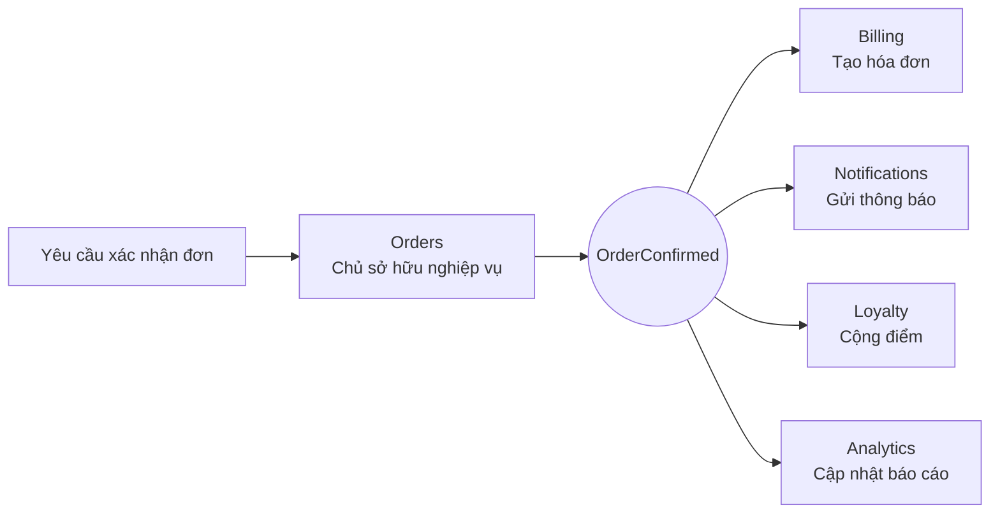
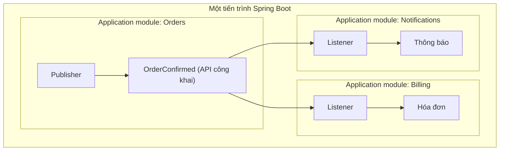
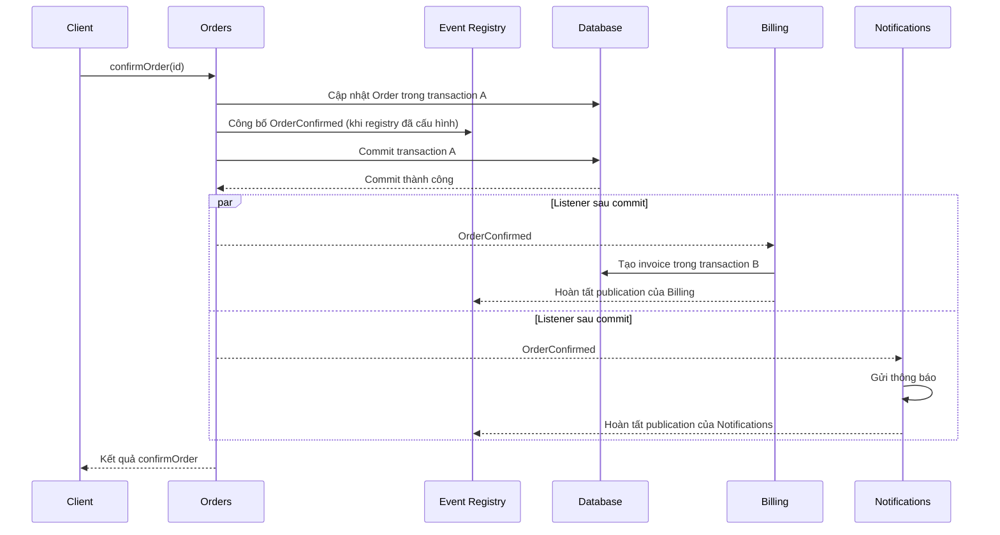
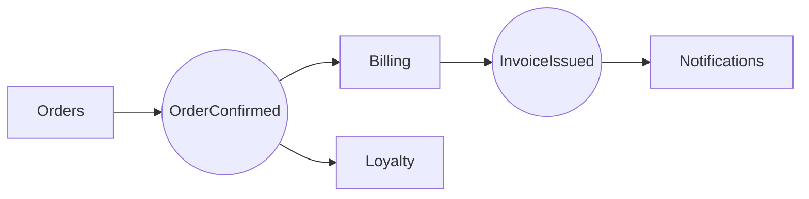
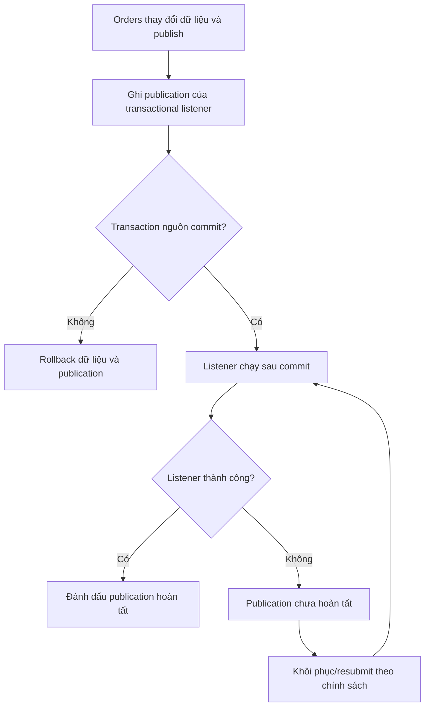

# Event-driven trong ứng dụng

> **Chương:** Tổng quan ứng dụng sự kiện  
> **Phạm vi module:** `SPRING_MODULITH_APPLICATION_EVENTS` — tổ chức giao tiếp giữa các module Spring Modulith bằng application events, giảm phụ thuộc trực tiếp và bảo vệ ranh giới nghiệp vụ. Bài này tập trung vào **cách tư duy, thiết kế và vận hành luồng xử lý dựa trên sự kiện trong một ứng dụng**, làm nền cho thực hành publisher, listener, xử lý sau commit, event publication registry, retry, kiểm thử và quan sát.

## 1. Event-driven là cách tổ chức hành vi, không chỉ là một API

Trong một ứng dụng quản lý đơn hàng, việc **xác nhận đơn** có thể kéo theo nhiều hành vi:

- Module **Orders** ghi nhận đơn đã được xác nhận.
- Module **Billing** phát hành hóa đơn.
- Module **Notifications** gửi email hoặc thông báo.
- Module **Loyalty** tính điểm tích lũy.
- Module **Analytics** cập nhật số liệu.

Với lối thiết kế gọi trực tiếp, service xác nhận đơn phải biết tất cả công việc cần thực hiện và các service phụ thuộc:

```java
@Transactional
public void confirmOrder(UUID orderId) {
    orders.confirm(orderId);
    billing.createInvoice(orderId);
    notifications.sendConfirmation(orderId);
    loyalty.addPoints(orderId);
}
```

Đây là một ví dụ minh họa vấn đề thiết kế, không phải cách nên triển khai gửi email trong transaction. Khi thêm hoặc bỏ một phản ứng, code của module Orders cũng phải đổi. Lỗi ở tác vụ phụ có thể kéo theo lỗi của tác vụ chính, và khó phân biệt đâu là trách nhiệm của từng module.

Trong thiết kế **event-driven**, module Orders phát ra một sự kiện có ý nghĩa nghiệp vụ, chẳng hạn `OrderConfirmed`; mỗi module quan tâm tự phản ứng:



**Event-driven architecture (EDA)** là cách thiết kế trong đó những thay đổi hoặc sự việc đáng chú ý được biểu diễn thành sự kiện; các thành phần quan tâm đăng ký phản ứng với chúng. **Event-driven trong ứng dụng** là áp dụng tư duy này cho các thành phần của cùng một ứng dụng, chẳng hạn các application module của Spring Modulith.

Một event-driven application thường có ba loại trách nhiệm tách biệt:

1. **Nguồn phát (publisher):** sở hữu quyết định nghiệp vụ và công bố sự kiện.
2. **Hợp đồng sự kiện (event contract):** mô tả điều đã xảy ra và dữ liệu được phép chia sẻ.
3. **Bên xử lý (subscriber/listener):** sở hữu phản ứng trong module của mình.

Điểm quan trọng: **phát sự kiện không tự làm xử lý bất đồng bộ, không tự bảo đảm delivery bền vững và không tự loại bỏ mọi loại phụ thuộc**. Những tính chất đó phụ thuộc vào lựa chọn listener, transaction, kho lưu publication và thiết kế hệ thống.

## 2. Đổi từ “gọi ai?” sang “điều gì đã xảy ra?”

Hãy so sánh hai kiểu câu hỏi:

- **Điều phối trực tiếp:** “Sau khi xác nhận đơn, Orders phải gọi Billing, rồi gọi Notifications, rồi gọi Loyalty.”
- **Tư duy sự kiện:** “Đơn hàng đã được xác nhận. Những module nào có trách nhiệm phản ứng với sự thật đó?”

Sự thay đổi này giúp Orders không phải biết ai đang lắng nghe. Mỗi module vẫn có logic và ràng buộc riêng, nhưng giao tiếp với nhau thông qua một hợp đồng rõ ràng.

| Khía cạnh | Gọi trực tiếp giữa module | Event-driven giữa module |
|---|---|---|
| Module nguồn biết gì? | Biết API và thời điểm gọi module đích | Biết loại sự kiện cần công bố |
| Thêm một phản ứng | Thường sửa luồng gọi của module nguồn | Thêm listener phù hợp |
| Quan hệ phụ thuộc | Phụ thuộc trực tiếp vào service đích | Phụ thuộc vào hợp đồng sự kiện |
| Nhận kết quả ngay | Tự nhiên khi lời gọi đồng bộ | Không phù hợp với sự kiện dạng thông báo |
| Điều khiển thứ tự | Rõ ràng theo code gọi | Cần thiết kế rõ nếu có thứ tự nghiệp vụ |
| Xử lý lỗi | Có thể lan về lời gọi ban đầu | Phụ thuộc listener đồng bộ, sau commit, async và retry |
| Nhất quán dữ liệu | Có thể cùng transaction nếu kiến trúc cho phép | Thường có trạng thái trung gian khi xử lý sau commit |

Không có nghĩa mọi lời gọi trực tiếp đều xấu. Khi Orders cần xác minh một điều kiện **trước khi chấp nhận đơn** và phải nhận câu trả lời ngay, API công khai giữa module có thể rõ hơn event. Event phù hợp nhất khi mục đích là **thông báo một việc đã xảy ra** để module khác phản ứng theo quyền sở hữu của mình.

### 2.1. Event khác command và query

| Thông điệp | Ý định | Ví dụ | Kỳ vọng |
|---|---|---|---|
| **Command** | Yêu cầu thực hiện một hành động | `ConfirmOrder` | Có bên chịu trách nhiệm thực thi hoặc từ chối |
| **Query** | Yêu cầu đọc thông tin | `GetOrderStatus` | Có kết quả trực tiếp |
| **Event** | Công bố điều đã xảy ra | `OrderConfirmed` | Không yêu cầu một listener cụ thể trả lời |

Đặt tên `SendEmailRequested` có thể là một yêu cầu xử lý công việc, không phải sự kiện nghiệp vụ thuần túy. Ngược lại, `OrderConfirmed` thể hiện một sự thật mà nhiều module có thể quan tâm. Cách đặt tên nên giúp người đọc phân biệt **quyết định** với **hậu quả của quyết định**.

## 3. Event-driven trong modular monolith và hệ thống phân tán

Spring Modulith hỗ trợ xây dựng **modular monolith**: nhiều module nghiệp vụ độc lập về ranh giới code và trách nhiệm nhưng cùng chạy trong một ứng dụng Spring Boot.



Trong Spring, `ApplicationEventPublisher` có thể phát đối tượng Java tới listener trong **cùng ApplicationContext**. Với Spring Modulith, sự kiện này là phương thức giao tiếp thuận tiện giữa các application module.

Cần phân biệt:

- **Event nội bộ ứng dụng:** phân phối qua cơ chế sự kiện Spring trong cùng tiến trình; không cần message broker để bắt đầu.
- **Event liên dịch vụ:** truyền tới ứng dụng/tiến trình khác qua broker, HTTP hoặc hạ tầng tích hợp; cần giải quyết hợp đồng xuyên hệ thống, authentication, serialization, versioning và delivery riêng.
- **Event publication registry:** theo dõi các publication dành cho transactional event listener trong Spring Modulith khi được cấu hình. Registry không đồng nghĩa một message broker tổng quát.

Một ứng dụng có thể vừa dùng application events nội bộ vừa phát integration events ra Kafka/RabbitMQ. Không nên mặc định rằng chỉ gọi `publishEvent` đã gửi thông điệp tới broker.

## 4. Chọn đúng ranh giới sự kiện

Trong Spring Modulith, mỗi module cần sở hữu nghiệp vụ và dữ liệu của nó. Tác giả một sự kiện nên là module **có thẩm quyền kết luận rằng sự việc đã xảy ra**.

Ví dụ:

| Event | Module sở hữu | Điều kiện được phát | Module có thể quan tâm |
|---|---|---|---|
| `OrderConfirmed` | Orders | Đơn chuyển hợp lệ sang `CONFIRMED` | Billing, Notifications, Loyalty |
| `PaymentCaptured` | Payments | Việc thu tiền được xác nhận | Orders, Accounting |
| `InvoiceIssued` | Billing | Hóa đơn phát hành thành công | Notifications, Reporting |
| `StockReserved` | Inventory | Đã giữ hàng cho yêu cầu đặt hàng | Orders, Shipping |

Không cho một module phát sự kiện thay module khác nếu module đó không sở hữu sự việc. Chẳng hạn Notifications không thể tự quyết định `OrderConfirmed` vì gửi email thành công không chứng minh trạng thái đơn hàng đã thay đổi.

### 4.1. Công khai hợp đồng, giữ kín implementation

Hợp đồng event nên được đặt trong phần API công khai của module phát, theo quy ước package hoặc named interface được khai báo phù hợp với Spring Modulith:

```text
com.example.shop
├── orders
│   ├── OrderService.java
│   ├── OrderRepository.java
│   └── api
│       └── OrderConfirmed.java   <-- hợp đồng công khai
├── billing
│   ├── InvoiceService.java
│   └── OrderConfirmedListener.java
└── notifications
    └── ConfirmationListener.java
```

Đây là cấu trúc ví dụ; dự án có thể chọn cách khai báo API module khác. Ý chính là Billing chỉ phụ thuộc hợp đồng `OrderConfirmed` được phép truy cập, không phụ thuộc repository hay entity nội bộ của Orders.

Hợp đồng mẫu:

```java
package com.example.shop.orders.api;

import java.time.Instant;
import java.util.UUID;

public record OrderConfirmed(
        UUID eventId,
        UUID orderId,
        Instant occurredAt
) {}
```

`eventId` xác định lần phát sinh sự kiện; `orderId` là định danh nghiệp vụ; `occurredAt` là thời điểm sự việc phát sinh. Payload bất biến giúp listener tránh vô tình sửa dữ liệu dùng chung. Tránh đưa entity JPA/lazy proxy, object graph lớn hoặc dữ liệu nhạy cảm không cần thiết vào event.

### 4.2. Một sự kiện là một sự thật, không phải toàn bộ entity

Ví dụ một sự kiện `OrderConfirmed` không cần chứa toàn bộ `Customer`, `OrderLine` và `PaymentMethod`. Chỉ đưa các trường cần cho hợp đồng liên module. Nếu listener bắt buộc phải có dữ liệu tại đúng thời điểm sự kiện xảy ra, có thể bổ sung **snapshot nhỏ, ổn định về ngữ nghĩa** vào payload; nếu chỉ cần trạng thái mới nhất, có thể truy vấn qua API được phép của module nguồn.

Hai cách đó có đánh đổi:

- **Payload chỉ chứa ID:** gọn, ít rò rỉ và dễ bảo trì; listener có thể phải đọc thêm dữ liệu và nhận được trạng thái mới hơn thời điểm phát.
- **Payload chứa dữ liệu nghiệp vụ cần thiết:** listener có thể xử lý độc lập theo thời điểm sự kiện, nhưng hợp đồng lớn hơn, dễ phát sinh yêu cầu versioning.

Không có cấu trúc payload tối ưu cho mọi use case; quyết định dựa trên nhu cầu dữ liệu và ranh giới module.

## 5. Luồng triển khai mẫu: Orders phát, Billing phản ứng

### 5.1. Publisher chịu trách nhiệm nghiệp vụ gốc

```java
package com.example.shop.orders;

import com.example.shop.orders.api.OrderConfirmed;
import java.time.Clock;
import java.time.Instant;
import java.util.UUID;
import org.springframework.context.ApplicationEventPublisher;
import org.springframework.stereotype.Service;
import org.springframework.transaction.annotation.Transactional;

@Service
public class OrderService {

    private final OrderRepository orders;
    private final ApplicationEventPublisher publisher;
    private final Clock clock;

    public OrderService(
            OrderRepository orders,
            ApplicationEventPublisher publisher,
            Clock clock
    ) {
        this.orders = orders;
        this.publisher = publisher;
        this.clock = clock;
    }

    @Transactional
    public void confirmOrder(UUID orderId) {
        Order order = orders.findById(orderId).orElseThrow();
        order.confirm(); // Validate chuyển trạng thái, không xác nhận hai lần.

        publisher.publishEvent(new OrderConfirmed(
                UUID.randomUUID(),
                order.getId(),
                Instant.now(clock)
        ));
    }
}
```

Giả sử `Order` là entity đang được JPA quản lý và phương thức `confirm()` kiểm tra chuyển trạng thái hợp lệ. Cần bảo đảm event chỉ được phát khi **có chuyển trạng thái thực sự**. Nếu yêu cầu xác nhận lặp lại nhưng trạng thái không đổi, tùy hợp đồng nghiệp vụ, service nên trả kết quả idempotent mà không phát thêm một event mới.

Publisher không inject `InvoiceService` của Billing. Orders không cần biết Billing có đang chạy logic tạo hóa đơn hay không.

### 5.2. Listener phản ứng sau commit

```java
package com.example.shop.billing;

import com.example.shop.orders.api.OrderConfirmed;
import org.springframework.modulith.events.ApplicationModuleListener;
import org.springframework.stereotype.Component;

@Component
public class OrderConfirmedListener {

    private final InvoiceService invoices;

    public OrderConfirmedListener(InvoiceService invoices) {
        this.invoices = invoices;
    }

    @ApplicationModuleListener
    public void on(OrderConfirmed event) {
        invoices.issueIfAbsent(event.orderId(), event.eventId());
    }
}
```

`@ApplicationModuleListener` của Spring Modulith kết hợp nghe sự kiện theo transaction, thực thi bất đồng bộ và xử lý trong transaction mới. Cần cấu hình async execution phù hợp (ví dụ `@EnableAsync` cùng executor có giới hạn tài nguyên). Tác vụ của Billing chỉ bắt đầu theo cơ chế xử lý sau khi transaction nguồn commit; không nên kỳ vọng nó đã hoàn thành khi `confirmOrder` trả về.

Một lựa chọn khác là `@TransactionalEventListener(phase = TransactionPhase.AFTER_COMMIT)` nếu cần xử lý ở pha sau commit nhưng không muốn mặc định kết hợp async như `@ApplicationModuleListener`. Trong cả hai trường hợp, phải kiểm thử với **transaction thật**.

### 5.3. Hai đường thời gian: giao dịch nguồn và giao dịch phản ứng



Sơ đồ minh họa quan hệ nhân quả; các mũi tên sau commit không ngụ ý thứ tự hoặc thời gian hoàn thành cố định. Việc đánh dấu publication hoàn tất chỉ có khi **registry được bật và listener thuộc loại được theo dõi**. Registry cũng cần một event publication store bền vững để hỗ trợ phục hồi sau sự cố.

## 6. Tách ba quyết định: phụ thuộc, thời điểm và độ bền

Khi bàn về event-driven, ba vấn đề thường bị gộp nhầm:

| Quyết định | Câu hỏi thiết kế | Lựa chọn thường gặp |
|---|---|---|
| **Liên kết (coupling)** | Publisher cần biết consumer không? | Gọi trực tiếp hoặc công bố event |
| **Thời điểm xử lý** | Listener chạy trước hay sau commit, cùng hay khác thread? | `@EventListener`, `@TransactionalEventListener`, `@ApplicationModuleListener` |
| **Độ tin cậy** | Nếu listener lỗi hoặc process chết, event còn được theo dõi để thử lại không? | In-memory dispatch, event publication registry, cơ chế retry |

Phát qua event giúp giảm coupling về **người nhận**, nhưng không tự chọn cách chạy hoặc độ bền.

### 6.1. Listener đồng bộ có thể tham gia transaction nguồn

Với `@EventListener` mặc định, listener chạy đồng bộ ngay khi `publishEvent` được gọi. Nếu publish xảy ra trong transaction, listener có thể chạy trước khi commit. Exception từ listener đồng bộ có thể lan trở lại publisher và làm rollback transaction, tùy cách xử lý lỗi.

Điều này phù hợp nếu phản ứng thực sự là một phần của nghiệp vụ đang xử lý, nhưng không phù hợp nếu ta muốn email chỉ được gửi **sau khi xác nhận đơn thành công**.

### 6.2. Listener sau commit chấp nhận trạng thái trung gian

Với `@TransactionalEventListener(AFTER_COMMIT)` hoặc `@ApplicationModuleListener`, transaction nguồn hoàn tất trước khi listener thực hiện công việc. Chẳng hạn:

1. Orders commit trạng thái `CONFIRMED`.
2. Billing chưa kịp tạo invoice.
3. Billing tạo invoice, commit transaction riêng.

Trong khoảng 1–3, trạng thái “đơn xác nhận nhưng chưa có hóa đơn” là hợp lệ nếu nghiệp vụ chấp nhận **eventual consistency**.

Mô hình này yêu cầu UI và API thể hiện trạng thái phù hợp, ví dụ `invoiceStatus = PENDING`, `ISSUED` hoặc `FAILED_RETRYING`. Không nên hứa với người dùng rằng mọi tác vụ hậu xử lý đã hoàn thành khi request xác nhận đơn chỉ mới commit nghiệp vụ nguồn.

### 6.3. Listener sau commit không thể rollback dữ liệu nguồn

Nếu việc phát hành hóa đơn thất bại ở bước 3, transaction Orders đã commit. Không thể dùng exception của Billing để tự động quay ngược transaction A. Cách xử lý phụ thuộc nghiệp vụ: retry việc phát hành hóa đơn, báo trạng thái lỗi, hoặc chạy quy trình bù trừ nếu thật sự cần đảo trạng thái kinh doanh.

Ngoài ra, callback ở `AFTER_COMMIT` có thể vẫn gắn với tài nguyên transaction cũ. Để **ghi dữ liệu mới và commit**, cần transaction mới, chẳng hạn qua service `@Transactional(propagation = REQUIRES_NEW)` được Spring quản lý, hoặc dùng `@ApplicationModuleListener` theo đúng semantics của nó.

## 7. Một event có nhiều listener: tự do mở rộng và những giới hạn

Phát một event cho nhiều listener là **fan-out**. Đây là lợi thế rõ của event-driven, nhưng cũng tạo một số vấn đề cần thiết kế:

- **Không mặc định có thứ tự:** Billing và Loyalty có thể hoàn thành trước hoặc sau Notifications. Nếu Loyalty buộc phải chờ Billing, cần thể hiện sự phụ thuộc một cách tường minh.
- **Không có atomicity xuyên listener sau commit:** Billing có thể thành công trong khi Notifications lỗi.
- **Mức độ quan trọng khác nhau:** tạo hóa đơn có thể yêu cầu retry bền vững; cập nhật số liệu tức thời có thể chấp nhận xử lý trễ.
- **Mỗi listener là một đơn vị xử lý:** theo dõi hoàn tất/thất bại và idempotency riêng cho từng listener.

Đừng viết listener Billing mà ngầm dựa vào việc listener Notifications đã chạy. Nếu cần dữ liệu do Billing sản sinh, dùng event tiếp theo như `InvoiceIssued` hoặc quy trình điều phối rõ ràng.

## 8. Choreography hay orchestration?

**Choreography** là cách nhiều module cùng phản ứng với event mà không có một đối tượng trung tâm điều khiển mọi bước:



Ở ví dụ này, Notifications chỉ gửi thông báo hóa đơn khi nghe `InvoiceIssued`, tránh giả định rằng có hóa đơn ngay sau `OrderConfirmed`.

**Orchestration** đặt quy trình nhiều bước tại một coordinator/process manager. Thành phần đó chủ động quyết định bước tiếp theo, timeout, retry hoặc bù trừ. Nó hữu ích khi các bước phụ thuộc chặt vào thứ tự hoặc có nhiều nhánh thất bại.

| Tình huống | Gợi ý |
|---|---|
| Nhiều module độc lập phản ứng với cùng sự kiện | Choreography |
| Bổ sung module phân tích hoặc gửi thông báo | Choreography |
| Quy trình có nhiều bước và quy tắc thứ tự/timeout rõ | Cân nhắc orchestration |
| Thanh toán, giữ hàng, giao hàng với bù trừ phức tạp | Process manager/orchestration thường dễ theo dõi |
| Muốn phản ứng sau một hành động duy nhất | Event-driven với listener sau commit |

**Rủi ro của choreography quá sâu:** sự kiện A kích hoạt B, B kích hoạt C, C lại kích hoạt A. Hệ thống có thể xuất hiện vòng lặp, khó truy vết hoặc điều kiện chạy ngầm. Cần mô tả hành trình nghiệp vụ, phân quyền sở hữu event và hạn chế chuỗi phản ứng không được kiểm soát.

## 9. Event-driven khác event sourcing và CQRS

Ba khái niệm hay xuất hiện cùng nhau nhưng không đồng nghĩa:

| Khái niệm | Mục đích chính | Có bắt buộc với Spring Modulith events không? |
|---|---|---|
| **Event-driven** | Các thành phần phản ứng khi sự kiện xuất hiện | Là mô hình đang nghiên cứu |
| **Event sourcing** | Lưu chuỗi event làm nguồn sự thật để tái dựng trạng thái | Không |
| **CQRS** | Tách mô hình xử lý command và mô hình query | Không |

Một ứng dụng Spring Modulith có thể lưu trạng thái `Order` trong bảng quan hệ thông thường, phát `OrderConfirmed` để module khác phản ứng và **không sử dụng event sourcing**. Tương tự, việc Analytics cập nhật một read model từ event là một dạng ứng dụng event-driven; không bắt buộc toàn bộ hệ thống dùng CQRS.

Đừng nhầm **event publication registry** với event store của event sourcing. Registry phục vụ theo dõi việc xử lý publication; nó không tự biến toàn bộ lịch sử nghiệp vụ thành nguồn sự thật lâu dài.

## 10. Độ tin cậy: mất event, retry và xử lý trùng

Một thiết kế event-driven thực tế cần trả lời ba câu hỏi:

1. Nếu tiến trình dừng đột ngột sau khi dữ liệu nguồn commit, làm sao biết listener chưa xử lý?
2. Nếu listener lỗi tạm thời, bằng cách nào xử lý lại?
3. Nếu event được xử lý lại, làm sao không tạo kết quả trùng?

### 10.1. Vùng rủi ro của in-memory event

Event nội bộ Spring không phải hàng đợi bền vững mặc định. Nếu dùng listener sau commit mà ứng dụng gặp sự cố trước lúc listener chạy hoặc trong lúc xử lý, chỉ dựa vào bộ nhớ có thể không còn đủ thông tin để khôi phục.

### 10.2. Event Publication Registry của Spring Modulith

Khi cấu hình event publication registry với kho lưu phù hợp, Spring Modulith có thể theo dõi **publication ứng với từng transactional listener**. Ý tưởng là cùng transaction với thay đổi nghiệp vụ nguồn ghi nhận publication cần xử lý; sau commit các listener xử lý và publication tương ứng được đánh dấu hoàn tất khi thành công.



Khả năng ghi và phục hồi phụ thuộc phiên bản Spring Modulith, loại event publication store, cấu hình ứng dụng, transaction và cơ chế resubmit thực tế. **Chỉ thêm annotation listener không thay thế việc cấu hình persistence và chiến lược retry.**

### 10.3. “At-least-once” đòi hỏi idempotency

Khi cho phép retry các publication chưa hoàn tất, một event **có thể được xử lý hơn một lần**. Ví dụ:

1. Billing nhận event và ghi hóa đơn thành công.
2. Ứng dụng dừng trước khi publication được đánh dấu hoàn tất.
3. Cơ chế recovery chạy lại listener.
4. Nếu Billing không chống trùng, sẽ xuất hiện hóa đơn thứ hai.

Do đó, hãy thiết kế listener sao cho **xử lý lại cùng event không làm sai kết quả nghiệp vụ**.

Mẫu đơn giản cho Billing:

```java
@Service
public class InvoiceService {

    private final InvoiceRepository invoices;

    public InvoiceService(InvoiceRepository invoices) {
        this.invoices = invoices;
    }

    @Transactional
    public void issueIfAbsent(UUID orderId, UUID eventId) {
        if (invoices.existsByOrderId(orderId)) {
            return;
        }

        invoices.save(Invoice.issueFor(orderId, eventId));
    }
}
```

Việc kiểm tra `existsByOrderId` **chưa đủ khi xử lý song song**. Bảng invoice cần có unique constraint theo `orderId` (nếu nghiệp vụ là mỗi đơn chỉ có một hóa đơn), cùng cách xử lý xung đột ghi nhất quán. Nếu nghiệp vụ cho phép nhiều hóa đơn trên một đơn thì khóa chống trùng phải dùng khóa nghiệp vụ khác, có thể là `(listenerId, eventId)`.

Với tác vụ ngoài database như gửi email hoặc gọi API thanh toán, retry cũng có thể khiến tác dụng phụ lặp lại. Cần idempotency key được phía nhận hỗ trợ, hoặc một cơ chế chống trùng phù hợp; tránh tuyên bố rằng transaction database của listener bao trùm cả API bên ngoài.

### 10.4. Chính sách retry cần được thiết kế

Một chính sách thực tế xác định:

- **Lỗi có thể thử lại:** timeout, tạm mất kết nối, dịch vụ phụ tải cao.
- **Lỗi không nên thử lại vô hạn:** dữ liệu đầu vào vô hiệu, hợp đồng event không tương thích, bất biến nghiệp vụ bị vi phạm.
- **Khoảng thời gian retry:** backoff, giới hạn số lần, xử lý tồn đọng sau khởi động lại.
- **Nơi cảnh báo:** publication lỗi kéo dài, tỷ lệ thất bại cao, tuổi publication lớn.
- **Hành động thủ công:** sửa dữ liệu hoặc cấu hình rồi resubmit có kiểm soát.

Spring Modulith cung cấp cơ sở để theo dõi publication, nhưng chi tiết tự động resubmit và lịch chạy cần được kiểm tra theo phiên bản/cấu hình đang sử dụng.

## 11. Quy tắc thực hành để bảo vệ ranh giới module

Trong một ứng dụng event-driven, độ “độc lập” không chỉ đo bằng số lời gọi service bị xóa. Cần giữ các nguyên tắc sau:

**Một module, một quyền sở hữu dữ liệu.** Billing không cập nhật trực tiếp bảng Orders; Billing cập nhật dữ liệu của mình theo event được phép tiếp nhận.

**Event đặt tại API được công khai.** Consumer có thể phụ thuộc kiểu `OrderConfirmed`, nhưng không import lớp nội bộ như `OrderRepository` hay `OrderEntity`. Spring Modulith có khả năng kiểm tra ranh giới module; bài kiểm thử kiến trúc nên phát hiện phụ thuộc trái phép.

**Event bất biến và có ngữ nghĩa rõ.** Đừng phát `OrderUpdated` chung chung nếu bên nhận cần phân biệt “được xác nhận”, “bị hủy”, “đã giao”.

**Không để listener quyết định lại sự thật nguồn.** Orders chịu trách nhiệm xác định `OrderConfirmed`; Billing chỉ xử lý hậu quả trong phạm vi Billing.

**Không phát event trùng khi không có chuyển trạng thái.** Một HTTP retry không nên vô tình biến một lần xác nhận thành nhiều sự kiện nghiệp vụ khác nhau.

**Quản trị phiên bản hợp đồng.** Khi event được lưu bền vững, bản ghi cũ có thể được xử lý sau khi code đã cập nhật. Thay đổi cấu trúc payload cần cân nhắc tương thích, chuyển đổi dữ liệu, serialization và chính sách triển khai.

**Giảm sự phụ thuộc ẩn do event chain.** Nếu workflow có điều kiện và thứ tự phức tạp, hãy mô hình hóa process manager rõ thay vì rải logic điều phối trên nhiều listener không có người sở hữu.

## 12. Khi nào nên và không nên chọn event-driven?

| Trường hợp | Đánh giá | Lý do |
|---|---|---|
| Gửi email sau khi đơn được xác nhận | **Rất phù hợp** | Phản ứng độc lập, không cần trả kết quả ngay |
| Cập nhật loyalty/analytics từ sự kiện nghiệp vụ | **Phù hợp** | Có thể thêm bớt listener mà ít sửa nguồn |
| Tạo hóa đơn sau commit khi cho phép xử lý trễ | **Phù hợp nếu có retry và idempotency** | Cần chịu được sự nhất quán cuối cùng |
| Kiểm tra tồn kho trước khi chấp nhận đơn | **Cân nhắc lời gọi trực tiếp/API xác thực** | Bước xác nhận cần biết kết quả ngay |
| Ghi hai dữ liệu bắt buộc nguyên tử trong một bất biến | **Cần đánh giá lại ranh giới transaction** | Event sau commit không cung cấp atomicity |
| Quy trình đặt hàng với nhiều bước bù trừ | **Cân nhắc orchestration/process manager** | Nhiều nhánh lỗi, thứ tự và timeout |
| Tra cứu chi tiết đơn hàng theo yêu cầu người dùng | **Không dùng event thay query** | Query cần trả dữ liệu trực tiếp |

Tóm lại, một thiết kế event-driven tốt bắt đầu từ **bất biến nghiệp vụ và cam kết với người dùng**, sau đó mới chọn annotation hay hạ tầng. Không nên chuyển mọi tương tác sang event chỉ để đạt hình thức “loosely coupled”.

## 13. Kiểm thử hệ thống event-driven theo các bảo đảm

Kiểm thử nên phân biệt ba mức:

### 13.1. Publisher phát event đúng thời điểm

Với Spring Modulith, `@ApplicationModuleTest` kết hợp `PublishedEvents` có thể dùng để kiểm tra sự kiện đã được công bố mà không cần gọi service của module đích. Ví dụ minh họa:

```java
@ApplicationModuleTest
class OrderPublishingTests {

    @Autowired
    OrderService orderService;

    @Test
    void publishesOrderConfirmed(PublishedEvents events) {
        UUID orderId = createConfirmableOrder();

        orderService.confirmOrder(orderId);

        assertThat(events.ofType(OrderConfirmed.class)
                .matching(OrderConfirmed::orderId, orderId))
                .hasSize(1);
    }

    private UUID createConfirmableOrder() {
        // Thay bằng fixture thực tế của domain Orders.
        throw new UnsupportedOperationException("Provide test fixture");
    }
}
```

Đây là khung hướng dẫn, cần triển khai fixture và import thật theo dự án. Kiểm thử nên bao gồm trường hợp chuyển trạng thái sai và gọi xác nhận lặp lại để đảm bảo publisher không phát event không hợp lệ.

### 13.2. Listener chạy sau commit và giữ được trạng thái

Kiểm thử integration phải tạo **commit thực sự** khi xác minh `AFTER_COMMIT`. Nếu chính phương thức test nằm trong một transaction mặc định rollback, listener sau commit có thể không chạy như kỳ vọng.

Với listener bất đồng bộ, kiểm thử nên chờ theo điều kiện nghiệp vụ hoặc API `Scenario` của Spring Modulith thay vì cố định `Thread.sleep(...)`; kiểm tra kết quả trong database hoặc đối tượng nhận với thời hạn phù hợp.

### 13.3. Kiểm thử lỗi và khôi phục

| Kịch bản | Bảo đảm cần xác minh |
|---|---|
| Orders rollback sau thay đổi | Billing không tạo hóa đơn |
| Orders commit, Billing xử lý bình thường | Hóa đơn được tạo đúng một lần |
| Billing ném exception | Orders vẫn giữ trạng thái đã commit |
| Listener được chạy lại với cùng event | Không tạo hóa đơn trùng |
| Có publication chưa hoàn tất và ứng dụng restart | Phát hiện được publication và cơ chế resubmit hoạt động như cấu hình |
| Có nhiều listener | Lỗi Notifications không tự hủy dữ liệu đã commit của Billing |
| Event có dữ liệu không tương thích | Có log/metric và chính sách xử lý lỗi phù hợp |

Kiểm thử registry phải dùng kho lưu event publication và transaction thực tế; unit test chỉ mock publisher không chứng minh khả năng phục hồi sau sự cố.

## 14. Quan sát một hệ thống mà phản ứng có thể đến trễ

Với synchronous flow, người gọi thường nhìn thấy kết quả hoặc lỗi ngay trong cùng request. Với event-driven sau commit, nhiều phản ứng diễn ra ngoài thời gian sống của request. Vì vậy, log “HTTP 200” không đủ để kết luận rằng mọi module đã cập nhật thành công.

Cần quan sát:

| Dữ liệu | Ví dụ | Phục vụ |
|---|---|---|
| **Event identity** | `eventId`, `eventType`, `occurredAt` | Xác định nguồn và sự việc |
| **Business identity** | `orderId`, `invoiceId` khi có | Truy theo nghiệp vụ |
| **Listener identity** | `BillingOrderConfirmedListener` | Biết nơi xử lý |
| **Processing status** | `PENDING`, `COMPLETED`, `FAILED` | Phát hiện thành công/thất bại |
| **Latency** | Thời gian từ publish tới xử lý xong | Đo độ trễ của nhất quán cuối cùng |
| **Backlog** | Số publication chưa hoàn tất, tuổi lâu nhất | Cảnh báo tồn đọng |
| **Retry information** | Số lần thử, lỗi cuối, lịch chạy lại | Điều tra lỗi lặp |
| **Correlation** | `traceId`, `correlationId` | Kết nối request nguồn và phản ứng |

Khi dùng `@Async`, ngữ cảnh logging/tracing có thể cần truyền sang thread khác; không mặc định mọi MDC hoặc trace context đều tự được chuyển. Tránh log event payload chứa thông tin nhạy cảm không cần thiết.

Một bộ cảnh báo có ý nghĩa là: “publication của Billing chưa hoàn tất lâu hơn mức SLA”, “số lần retry tăng bất thường”, hoặc “tuổi sự kiện chưa xử lý lớn nhất tăng liên tục”.

## 15. Bài thực hành: tách luồng xác nhận đơn thành event-driven

**Bài toán:** một ứng dụng Spring Boot theo Spring Modulith có các module Orders, Billing, Notifications và Loyalty. Yêu cầu:

- Orders chỉ chịu trách nhiệm xác nhận đơn và công bố `OrderConfirmed`.
- Billing tạo hóa đơn khi transaction xác nhận đơn commit thành công.
- Notifications gửi xác nhận sau commit và có cách xử lý lỗi gửi.
- Loyalty có thể thêm vào bằng listener mà không sửa `OrderService`.
- Retry không tạo hóa đơn hoặc điểm thưởng trùng.

**Các bước triển khai:**

1. Vẽ ranh giới module, xác định ai sở hữu dữ liệu và sự kiện nào là sự thật nghiệp vụ.
2. Định nghĩa hợp đồng `OrderConfirmed` bất biến ở phần API được phép dùng của Orders.
3. Phát sự kiện từ một phương thức `@Transactional` sau khi hoàn tất kiểm tra và chuyển trạng thái.
4. Viết listener của Billing bằng `@ApplicationModuleListener`; cấu hình executor và transaction phù hợp.
5. Bổ sung chống trùng bằng unique constraint hoặc khóa idempotency dựa trên nghiệp vụ.
6. Cấu hình persistent event publication store cho registry; thiết lập chiến lược resubmit publication chưa hoàn tất theo phiên bản Spring Modulith.
7. Viết kiểm thử xác nhận, rollback, duplicate event, lỗi listener, restart/recovery.
8. Bổ sung log/metric theo `eventId`, listener, số lần retry và publication tồn đọng.

**Tiêu chí nghiệm thu:**

| Tiêu chí | Cách xác minh |
|---|---|
| Orders không phụ thuộc service nội bộ Billing/Notifications/Loyalty | Kiểm thử ranh giới module, rà soát package imports |
| Chỉ đơn được xác nhận hợp lệ mới phát event | Unit/module test publisher |
| Rollback Orders không tạo dữ liệu hậu xử lý | Integration test transaction |
| Xác nhận thành công có thể dẫn tới hóa đơn sau commit | Integration test listener, chờ điều kiện |
| Event chạy lại không nhân đôi hóa đơn | Test retry và unique constraint |
| Publication chưa hoàn tất có thể phát hiện và khôi phục | Test registry persistence và recovery |
| Vận hành truy ra event bị lỗi | Log có ID tương quan, metric và cảnh báo |

### Câu hỏi tự kiểm tra

1. Vì sao chuyển từ gọi trực tiếp sang event giúp giảm phụ thuộc module nhưng vẫn tồn tại coupling thông qua hợp đồng sự kiện?
2. Tại sao Orders commit thành công còn Billing chưa có hóa đơn có thể là trạng thái đúng của thiết kế?
3. Khác biệt giữa `@EventListener`, `@TransactionalEventListener` và `@ApplicationModuleListener` là gì về thời điểm và cách xử lý?
4. Event Publication Registry giải quyết khoảng trống nào trong luồng sau commit? Vì sao vẫn cần idempotency?
5. Khi nào một workflow nên dùng process manager thay vì chuỗi listener kích hoạt nhau?
6. Vì sao event sourcing và CQRS không phải điều kiện bắt buộc để dùng event-driven trong Spring Modulith?
7. Những metric nào giúp biết một module đang tụt lại phía sau dù HTTP request vẫn thành công?

## 16. Tổng kết kiến thức

**Event-driven trong ứng dụng** là cách để một module phát biểu “một điều có ý nghĩa đã xảy ra”, còn những module liên quan tự sở hữu phản ứng của mình. Trong Spring Modulith, cơ chế này giúp **giảm gọi trực tiếp, làm rõ trách nhiệm và bảo vệ ranh giới module**.

Để triển khai đúng, cần phân biệt **event** với command/query; phân biệt event nội bộ với message liên hệ thống; thiết kế event contract ổn định; chọn thời điểm listener theo transaction; chấp nhận và mô hình hóa eventual consistency; bổ sung event publication registry, retry và idempotency khi cần độ tin cậy; đồng thời kiểm thử và quan sát từng phản ứng.

Một hệ thống có nhiều listener không tự động trở thành hệ thống giao sự kiện đáng tin cậy. Tính đúng đắn đến từ **quy tắc nghiệp vụ, ranh giới giao dịch, cơ chế phục hồi và khả năng quan sát kết quả thực tế**.
