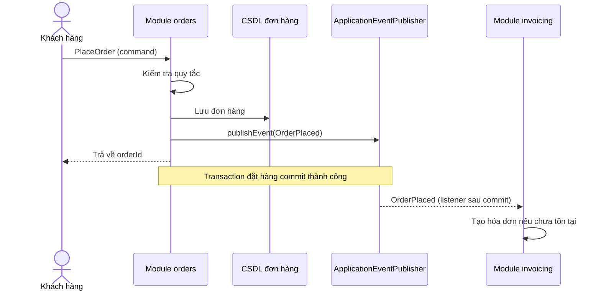

# Event và Command trong Spring Modulith

Trong một ứng dụng được chia thành nhiều module, câu hỏi quan trọng không chỉ là **module nào gọi module nào**, mà còn là **module đang yêu cầu một hành động hay đang thông báo một sự thật đã xảy ra**. Hai ý nghĩa này tương ứng với **command** (mệnh lệnh/yêu cầu thực hiện) và **event** (sự kiện). Phân biệt đúng giúp thiết kế ranh giới nghiệp vụ rõ ràng, giảm phụ thuộc giữa các module và chọn chính xác thời điểm xử lý giao dịch.

Bài này sử dụng ví dụ cửa hàng trực tuyến có các module `orders` (đặt hàng), `inventory` (tồn kho), `invoicing` (hóa đơn) và `notifications` (thông báo). Các ví dụ Java dựa trên Spring Framework và cách Spring Modulith tích hợp các module bằng application events.

## 1. Command là yêu cầu, Event là sự thật

### Command: “Hãy thực hiện việc này”

**Command** thể hiện **ý định làm thay đổi hệ thống**. Nó được gửi đến một thành phần có trách nhiệm xử lý nghiệp vụ, kiểm tra điều kiện và quyết định chấp nhận hay từ chối yêu cầu.

Ví dụ:

- `PlaceOrder`: hãy tạo một đơn hàng.
- `ReserveStock`: hãy giữ một lượng hàng trong kho.
- `CancelOrder`: hãy hủy đơn hàng này nếu còn được phép.
- `IssueInvoice`: hãy phát hành hóa đơn cho đơn hàng.

Command thường được đặt tên theo động từ ở dạng yêu cầu. **Command được gửi đi không có nghĩa là thao tác đã thành công**: `ReserveStock` có thể bị từ chối khi hết hàng; `CancelOrder` có thể thất bại nếu đơn đã giao.

Một command thường có **đích chịu trách nhiệm rõ ràng**, có thể cần kết quả trả về, lỗi hoặc xác nhận. Trong Spring Modulith, command không bắt buộc phải đi qua một “command bus”; một lời gọi phương thức công khai của application service cũng là cách truyền đạt command.

### Event: “Việc này đã xảy ra”

**Event** ghi nhận **một sự thật nghiệp vụ đã phát sinh** sau khi thành phần sở hữu nghiệp vụ thực hiện chuyển trạng thái.

Ví dụ:

- `OrderPlaced`: đơn hàng đã được đặt.
- `StockReserved`: hàng đã được giữ thành công.
- `OrderCancelled`: đơn hàng đã bị hủy.
- `InvoiceIssued`: hóa đơn đã được phát hành.

Event thường được đặt tên ở dạng **quá khứ**. Một module phát event **không chỉ định** module nào phải nghe và cũng không yêu cầu các listener trả về kết quả để xác nhận hành động ban đầu. Có thể không có listener, hoặc có nhiều listener độc lập.

Chẳng hạn, sau khi `orders` hoàn tất việc đặt hàng và phát `OrderPlaced`, cả `invoicing` và `notifications` đều có thể quan tâm đến sự kiện đó. Khi thêm một listener mới, mã của `orders` không nhất thiết phải thay đổi.

> **Quy tắc đọc tên:** “Hãy đặt hàng” là command `PlaceOrder`; “Đơn hàng đã được đặt” là event `OrderPlaced`. Tên gọi phải phản ánh đúng thời điểm và ý nghĩa nghiệp vụ thực tế.

## 2. So sánh Event và Command

| Tiêu chí | Command | Event |
| --- | --- | --- |
| Ý nghĩa | Ý định hoặc yêu cầu thực hiện | Sự thật đã xảy ra |
| Cách đặt tên | Động từ yêu cầu: `PlaceOrder`, `ReserveStock` | Quá khứ: `OrderPlaced`, `StockReserved` |
| Ai chịu trách nhiệm? | Thường một handler hoặc application service cụ thể | Module phát sở hữu sự thật; không áp đặt người nhận |
| Kết quả mong đợi | Có thể có kết quả, xác nhận hoặc lỗi | Publisher không chờ kết quả nghiệp vụ từ tất cả subscriber |
| Số người nhận | Thường một nơi thực thi chính | 0, 1 hoặc nhiều listener |
| Khi nào tạo? | Trước hành động, để đề nghị thực hiện | Sau khi nghiệp vụ tạo ra sự kiện |
| Nếu xử lý thất bại | Yêu cầu có thể bị từ chối, caller cần biết | Listener có thể thất bại sau khi sự kiện đã phát sinh |
| Mức độ kết nối | Caller biết API của nơi thực thi | Publisher chỉ biết kiểu event mà mình công bố |

Hai khái niệm **không tự quyết định đồng bộ hay bất đồng bộ**. Command có thể được đưa vào hàng đợi, còn event trong Spring mặc định có thể được phân phối đồng bộ. Muốn biết khi nào và trong transaction nào xử lý, cần xem cơ chế dispatch và loại listener.

### Ví dụ quyết định nhanh

| Tình huống | Nên dùng | Lý do |
| --- | --- | --- |
| Người dùng nhấn “Đặt hàng” | `PlaceOrder` (command) | Hệ thống phải xác thực, tạo đơn và trả kết quả |
| Đơn đã được lưu hợp lệ | `OrderPlaced` (event) | Các module khác có thể thực hiện tác vụ tiếp theo |
| Phải giữ hàng **trước khi** xác nhận đơn thành công | `ReserveStock` (command) | Luồng chính cần biết giữ hàng có thành công không |
| Gửi thư cảm ơn sau khi đơn được đặt | Nghe `OrderPlaced` (event) | Thất bại gửi thư không nên làm đảo ngược đơn đã đặt |
| Người dùng yêu cầu hủy đơn | `CancelOrder` (command) | Có điều kiện nghiệp vụ và có thể bị từ chối |
| Đơn đã hủy thành công | `OrderCancelled` (event) | Kho, kế toán, thông báo có thể phản ứng độc lập |

## 3. Luồng nghiệp vụ: Command tạo thay đổi, Event thông báo thay đổi

Xét nghiệp vụ đặt hàng:

1. API nhận yêu cầu HTTP và chuyển dữ liệu thành `PlaceOrder`.
2. `orders` kiểm tra đầu vào, thực thi quy tắc nghiệp vụ và lưu đơn.
3. `orders` phát `OrderPlaced` khi đã xác lập trạng thái “đã đặt” trong luồng nghiệp vụ.
4. Sau khi transaction đặt hàng commit thành công, listener của `invoicing` có thể tạo hóa đơn, listener của `notifications` có thể gửi thông báo.



Sơ đồ trên minh họa listener xử lý **sau commit**; hành vi này cần cấu hình listener phù hợp, ví dụ `@ApplicationModuleListener`. Với `@EventListener` đồng bộ thông thường, listener được gọi ngay khi publish, trước khi transaction của publisher kết thúc.

**Điểm cần hiểu:** “Event đã được publish” trong mã nguồn **không đồng nghĩa** rằng transaction đã commit. Một event được phát trong transaction vẫn có thể nằm trong một transaction cuối cùng bị rollback. Listener chỉ nên khẳng định nghiệp vụ đã commit khi dùng cơ chế xử lý sau commit phù hợp.

## 4. Ví dụ Java: Command để đặt hàng

### 4.1. Biểu diễn command bằng `record`

```java
// com.example.shop.orders.PlaceOrder.java
package com.example.shop.orders;

import java.util.UUID;

public record PlaceOrder(UUID customerId, String sku, int quantity) {
    public PlaceOrder {
        if (customerId == null) {
            throw new IllegalArgumentException("customerId is required");
        }
        if (sku == null || sku.isBlank()) {
            throw new IllegalArgumentException("sku is required");
        }
        if (quantity <= 0) {
            throw new IllegalArgumentException("quantity must be positive");
        }
    }
}
```

`PlaceOrder` mang dữ liệu để thực hiện một hành động, không hứa rằng đơn hàng đã được tạo. Dùng `record` giúp cấu trúc dữ liệu đơn giản, các field của record không thể bị gán lại sau khi khởi tạo.

### 4.2. Application service tiếp nhận command và phát event

```java
// com.example.shop.orders.OrderApplicationService.java
package com.example.shop.orders;

import java.time.Instant;
import java.util.UUID;

import org.springframework.context.ApplicationEventPublisher;
import org.springframework.stereotype.Service;
import org.springframework.transaction.annotation.Transactional;

@Service
public class OrderApplicationService {

    private final OrderRepository orders;
    private final ApplicationEventPublisher events;

    public OrderApplicationService(
            OrderRepository orders,
            ApplicationEventPublisher events) {
        this.orders = orders;
        this.events = events;
    }

    @Transactional
    public UUID handle(PlaceOrder command) {
        // Order và OrderRepository thuộc phần domain/persistence của module.
        Order order = Order.place(
                command.customerId(),
                command.sku(),
                command.quantity()
        );

        orders.save(order);

        events.publishEvent(new OrderPlaced(
                UUID.randomUUID(),
                order.id(),
                Instant.now()
        ));

        return order.id();
    }
}
```

Trong ví dụ này, `Order` và `OrderRepository` là các thành phần nghiệp vụ/lưu trữ cần được cài đặt riêng; mã tập trung thể hiện ranh giới command → xử lý → event.

- `handle(PlaceOrder)` là điểm thực hiện **command**.
- `@Transactional` đặt việc lưu đơn và phát event trong ngữ cảnh transaction của nghiệp vụ.
- `publishEvent(...)` công bố **event** cho hệ thống application event của Spring.
- `OrderApplicationService` không phải inject `InvoiceService` hay `NotificationService` chỉ để gọi các tác vụ theo sau.

### 4.3. Event là thông điệp ổn định, tối thiểu

```java
// com.example.shop.orders.OrderPlaced.java
package com.example.shop.orders;

import java.time.Instant;
import java.util.UUID;

public record OrderPlaced(
        UUID eventId,
        UUID orderId,
        Instant occurredAt
) {}
```

Event chứa ID sự kiện để phục vụ theo dõi và chống xử lý lặp, ID đơn hàng để listener tra cứu dữ liệu theo quyền của mình, cùng thời điểm sự kiện phát sinh. Trong hệ thống thực, có thể thêm phiên bản schema hoặc dữ liệu cần thiết khác theo hợp đồng công khai của module.

Ưu tiên event **bất biến**; tránh đưa nguyên một JPA entity mutable/lazy-loaded sang module khác. Để `invoicing` nghe được `OrderPlaced`, kiểu event cần được đặt trong API công khai của module `orders` (chẳng hạn package gốc được export), tránh để listener truy cập class nội bộ của module phát.

## 5. Listener tiếp nhận Event trong Spring Modulith

Một listener ở module `invoicing` có thể xử lý `OrderPlaced` mà `orders` không biết đến `invoicing`:

```java
// com.example.shop.invoicing.InvoiceOnOrderPlaced.java
package com.example.shop.invoicing;

import com.example.shop.orders.OrderPlaced;
import org.springframework.modulith.events.ApplicationModuleListener;
import org.springframework.stereotype.Component;

@Component
class InvoiceOnOrderPlaced {

    private final InvoiceService invoices;

    InvoiceOnOrderPlaced(InvoiceService invoices) {
        this.invoices = invoices;
    }

    @ApplicationModuleListener
    void on(OrderPlaced event) {
        invoices.createIfAbsent(event.orderId());
    }
}
```

`InvoiceService.createIfAbsent(...)` là thao tác minh họa của module hóa đơn: cùng một `orderId` được xử lý nhiều lần vẫn chỉ có một hóa đơn. Cần thực thi tính duy nhất ở dữ liệu, ví dụ unique constraint trên `order_id`, vì kiểm tra “đã có chưa?” đơn thuần có thể bị race condition.

`@ApplicationModuleListener` của Spring Modulith kết hợp ý tưởng:

- `@TransactionalEventListener`: xử lý khi transaction phát event commit thành công (mặc định phase `AFTER_COMMIT`).
- `@Async`: thực hiện listener bất đồng bộ, tách khỏi lời gọi nghiệp vụ chính.
- `@Transactional(propagation = REQUIRES_NEW)`: thực thi listener trong transaction riêng.

Vì thế, lỗi lập hóa đơn xảy ra **sau commit** không làm tự động rollback đơn hàng đã lưu. Đây là lựa chọn phù hợp cho các tác vụ có thể hoàn tất sau và chấp nhận **nhất quán cuối cùng** (eventual consistency).

### Lưu ý về các annotation

| Kiểu listener | Thời điểm điển hình | Tác động tới transaction nguồn |
| --- | --- | --- |
| `@EventListener` (mặc định) | Chạy ngay khi `publishEvent` gọi, thường cùng thread | Exception có thể truyền ngược về publisher và gây rollback |
| `@TransactionalEventListener` | Mặc định sau commit thành công; không tự bất đồng bộ | Source transaction đã commit; cần quản lý transaction khi ghi dữ liệu mới |
| `@ApplicationModuleListener` | Sau commit, bất đồng bộ và dùng transaction mới | Thích hợp để tách xử lý giữa các module |

`@TransactionalEventListener` mặc định cần một transaction đang hoạt động để nhận event; event phát ngoài transaction thường không được xử lý, trừ khi cấu hình rõ `fallbackExecution`. Ngược lại, `@EventListener` thông thường không yêu cầu transaction.

**Không dùng event để né trách nhiệm trả kết quả:** nếu yêu cầu đặt hàng bắt buộc phải giữ được tồn kho trước khi báo thành công, luồng `orders` cần thực hiện command đồng bộ tới API `inventory`, hoặc tổ chức một quy trình điều phối nghiệp vụ có trạng thái. Để listener bất đồng bộ giữ hàng rồi trả “đặt hàng thành công ngay” sẽ làm sai hợp đồng nếu hệ thống hứa hàng đã được giữ chắc chắn.

## 6. Khi nào nên gọi API Command của module khác?

Giả sử module `inventory` cung cấp hợp đồng:

```java
// com.example.shop.inventory.ReserveStock.java
package com.example.shop.inventory;

import java.util.UUID;

public record ReserveStock(UUID orderId, String sku, int quantity) {}

// com.example.shop.inventory.InventoryOperations.java
package com.example.shop.inventory;

public interface InventoryOperations {
    ReservationResult reserve(ReserveStock command);
}
```

`ReservationResult` là kết quả nghiệp vụ cần được định nghĩa trong API của `inventory` (chẳng hạn: đã giữ hàng thành công hay bị từ chối do hết tồn kho).

Nếu `orders` phải **biết ngay kết quả** để quyết định tạo đơn hay từ chối, lời gọi `inventoryOperations.reserve(command)` là hợp lý. Đây là phụ thuộc có chủ đích vào **API công khai** của một module. Nếu phụ thuộc này dẫn đến vòng phụ thuộc, cần xem lại hướng gọi hoặc tạo module điều phối.

Ngược lại, nếu `orders` chỉ muốn báo “đơn đã đặt” để các module tự thực hiện những việc phụ trợ, sự kiện `OrderPlaced` thích hợp hơn.

Cùng một nghiệp vụ có thể dùng cả hai:

```text
HTTP request
   -> PlaceOrder (command tới orders)
       -> ReserveStock (command tới inventory, cần kết quả)
       -> Lưu Order thành công
       -> OrderPlaced (event)
           -> invoicing tạo hóa đơn
           -> notifications gửi thông báo
```

**Command và event không đối lập.** Command khởi tạo và điều khiển hành động có người chịu trách nhiệm; event diễn tả kết quả đã phát sinh và cho phép nhiều module phản ứng theo nhu cầu riêng.

## 7. Transaction, lỗi và độ tin cậy

Event và command mô tả **ngữ nghĩa**; cách phát và nhận quyết định đặc tính kỹ thuật của thông điệp.

### 7.1. Event đồng bộ không mặc nhiên làm giảm phụ thuộc lúc chạy

Khi dùng `@EventListener` đồng bộ, publisher không import listener nhưng vẫn có thể **chịu lỗi và thời gian chạy** của listener. Nếu listener ném exception trong cùng transaction, thao tác nghiệp vụ gốc có thể rollback. Do đó, “đã dùng event” không tự động có nghĩa là giao tiếp độc lập về transaction.

### 7.2. Listener sau commit tạo ranh giới thất bại riêng

Với `@ApplicationModuleListener`, một đơn hàng có thể đã commit trong khi việc phát hành hóa đơn vẫn chờ xử lý hoặc đang lỗi. API và giao diện người dùng nên phản ánh trạng thái thực tế: “đơn đã được đặt” không mặc nhiên là “hóa đơn đã được phát hành”.

Nếu tiến trình bị tắt ngay sau commit, event bất đồng bộ **có nguy cơ chưa tới listener** khi chỉ dùng callback trong bộ nhớ.

### 7.3. Event Publication Registry và cơ chế retry

Spring Modulith cung cấp **Event Publication Registry** để lưu thông tin event cần giao đến từng transactional listener khi dùng starter lưu trữ phù hợp (JDBC, JPA hoặc MongoDB). Khi listener hoàn thành thành công, publication được đánh dấu hoàn thành theo cấu hình. Nếu lỗi, publication được giữ/tracking để có thể resubmit theo chính sách ứng dụng. Cần cấu hình nền tảng lưu trữ, theo dõi và recovery phù hợp; chỉ gắn `@ApplicationModuleListener` không có nghĩa là đã bật cơ chế lưu bền vững.

Ý nghĩa thực tế:

- Nếu listener lỗi hoặc ứng dụng gặp sự cố, có thể cần **phát lại** publication chưa hoàn thành hoặc thất bại.
- Listener phải **idempotent** vì cùng event có thể được xử lý nhiều lần qua retry, crash recovery hoặc cạnh tranh.
- Registry hỗ trợ theo dõi và phục hồi việc giao event trong ứng dụng; nó **không tự biến event nội bộ thành message trên Kafka/RabbitMQ**. Gửi sự kiện ra broker là bài toán externalization riêng.
- Không giả định event giữa nhiều listener được xử lý theo một thứ tự toàn cục, cũng không giả định khả năng giao chính xác một lần (exactly once).

Ví dụ: `InvoiceOnOrderPlaced` nên tạo hóa đơn bằng khóa nghiệp vụ `orderId` với ràng buộc duy nhất, thay vì “mỗi lần nghe event thì luôn insert một hóa đơn mới”.

## 8. Thiết kế hợp đồng tốt giữa các module

### 8.1. Ai sở hữu event?

Module tạo ra sự thật nghiệp vụ nên sở hữu kiểu event của nó. `orders` phát `OrderPlaced` vì `orders` có quyền xác nhận đơn đã đặt; `invoicing` không được tự phát `OrderPlaced` chỉ vì đã tạo hóa đơn.

Event công khai nên ổn định, chứa thông tin tối thiểu đủ hữu ích, và có tên rõ nghĩa. Khi hợp đồng thay đổi, đánh giá ảnh hưởng tới tất cả subscriber; giảm phụ thuộc lúc compile không có nghĩa là event schema không cần quản trị.

### 8.2. Phân biệt sự thật nghiệp vụ với ý định kỹ thuật

Cân nhắc hai câu:

- “Đơn hàng đã được thanh toán” → `OrderPaid` là **event**, hữu ích cho kế toán, vận chuyển, chăm sóc khách hàng.
- “Gửi email thanh toán cho khách” → `SendPaymentEmail` là **command**, hướng tới một công việc cụ thể do dịch vụ thông báo chịu trách nhiệm.

Đặt tên event `SendPaymentEmailEvent` chỉ để kích hoạt một handler thường che giấu một command bên trong event. Tuy vậy, một sự kiện `PaymentEmailRequested` cũng có thể hợp lệ nếu “yêu cầu email đã được ghi nhận” thực sự là **sự thật của miền nghiệp vụ**. Xác định theo ý nghĩa, không chỉ theo hậu tố `Event`.

### 8.3. Tránh công bố event quá sớm

Sai ngữ nghĩa:

```java
// Không nên gọi sự kiện OrderPlaced trước khi xác nhận đặt hàng thành công.
events.publishEvent(new OrderPlaced(eventId, orderId, occurredAt));
validatePaymentAndPlaceOrder();
```

Hợp lý hơn là kiểm tra điều kiện, tạo trạng thái nghiệp vụ thành công, lưu dữ liệu rồi phát event trong cùng transaction; listener sau commit chỉ chạy khi transaction commit thành công. Nếu nghiệp vụ thực sự cần thông báo rằng *đã nhận yêu cầu*, hãy tạo event đúng nghĩa như `OrderPlacementRequested` với hợp đồng trạng thái riêng.

### 8.4. Không chia sẻ đối tượng domain nội bộ

Không nên đưa toàn bộ entity `Order` có quan hệ JPA và logic nội bộ sang event để mọi subscriber truy cập trực tiếp. Module nhận sẽ phụ thuộc cấu trúc bên trong `orders`, dễ gặp lỗi lazy loading sau commit và khó nâng cấp schema.

Nên phát dữ liệu nhỏ, bất biến (ID, thời điểm, các giá trị quan trọng theo hợp đồng) và chỉ mở API công khai khi cần tra cứu thêm.

## 9. Những lỗi thiết kế thường gặp

| Sai lầm | Hệ quả | Hướng xử lý |
| --- | --- | --- |
| Dùng event `ReserveStockRequested` để mô phỏng lệnh cần kết quả ngay | Caller báo thành công trước khi biết hàng còn hay hết | Dùng command qua API rõ ràng hoặc thiết kế workflow có trạng thái |
| Dùng `@EventListener` đồng bộ cho tác vụ phụ lâu | Kéo dài transaction, lỗi phụ làm hỏng nghiệp vụ chính | Cân nhắc listener sau commit, bất đồng bộ |
| Dùng `@ApplicationModuleListener` nhưng tin rằng mọi event luôn được phục hồi | Mất tác vụ khi crash nếu chưa có registry bền vững và recovery | Cấu hình Event Publication Registry và chính sách resubmit |
| Listener cứ nhận lại event là tạo thêm hóa đơn | Trùng dữ liệu khi retry | Dùng khóa idempotency và unique constraint |
| Publish event trước khi xác nhận trạng thái | Subscriber nhìn thấy “đã xảy ra” khi sự thật chưa đúng | Phát event tại điểm chuyển trạng thái hợp lệ |
| Event chứa JPA entity hoặc private model | Rò rỉ ranh giới module, coupling tới persistence | Tạo event DTO/record công khai, bất biến |
| Event `DoSomethingEvent` mơ hồ | Khó hiểu hợp đồng và ai chịu trách nhiệm | Đặt theo sự thật có ý nghĩa nghiệp vụ |
| Cho rằng application events đồng nghĩa message broker | Thiết kế nhầm về hạ tầng và độ bền | Phân biệt in-process application events với broker externalization |

## 10. Luyện tập phân biệt

Phân loại các phát biểu sau là command hay event trước khi xem đáp án:

1. “Hãy hủy đơn số 42 nếu khách vẫn có quyền hủy.”
2. “Đơn số 42 đã được hủy.”
3. “Hãy hoàn tiền cho giao dịch số 7.”
4. “Kho đã ghi nhận 3 sản phẩm được giữ.”
5. “Hãy xuất hóa đơn PDF cho đơn 42.”
6. “Hóa đơn số 99 đã được xuất.”

<details>
<summary>Đáp án và lý do</summary>

1. **Command** `CancelOrder`: yêu cầu có thể thất bại theo điều kiện nghiệp vụ.
2. **Event** `OrderCancelled`: sự thật đã phát sinh.
3. **Command** `RefundPayment`: yêu cầu hệ thống thanh toán thực thi và phản hồi kết quả.
4. **Event** `StockReserved`: kết quả giữ kho đã xảy ra.
5. **Command** `GenerateInvoicePdf`: yêu cầu một công việc cụ thể.
6. **Event** `InvoiceIssued`: thông báo kết quả đã hoàn thành.

</details>

**Bài tập triển khai:** Trong ứng dụng Spring Modulith có `orders`, `invoicing` và `notifications`, hãy tạo `PlaceOrder` và `OrderPlaced`; publish event sau khi lưu đơn thành công; viết hai listener riêng nhận `OrderPlaced`. Tự kiểm tra ba tình huống: đơn rollback thì listener sau commit không chạy; gửi email lỗi thì đơn vẫn tồn tại; phát lại cùng event thì không tạo hóa đơn trùng. Đây là các tiêu chí tốt để kiểm tra quyết định chọn command/event và lựa chọn ranh giới transaction.

## Ghi nhớ

- **Command** yêu cầu một hành động: “Hãy làm X”, có trách nhiệm xử lý và có thể trả về lỗi/kết quả.
- **Event** nêu một sự thật: “X đã xảy ra”, có thể được nhiều module quan sát độc lập.
- Trong Spring Modulith, `ApplicationEventPublisher` phát event; `@ApplicationModuleListener` hỗ trợ xử lý sau commit, bất đồng bộ, transaction riêng.
- Khi sự kiện cần giao đáng tin cậy, phải xét Event Publication Registry, chính sách retry và tính idempotent của listener.
- Chọn command nếu luồng chính **cần kết quả để quyết định có thành công hay không**; chọn event để thông báo trạng thái nghiệp vụ cho các bên quan tâm.

**Tài liệu tham khảo chính thức:**

- [Spring Modulith – Working with Application Events](https://docs.spring.io/spring-modulith/reference/events.html)
- [Spring Modulith – ApplicationModuleListener API](https://docs.spring.io/spring-modulith/docs/current/api/org/springframework/modulith/events/ApplicationModuleListener.html)
