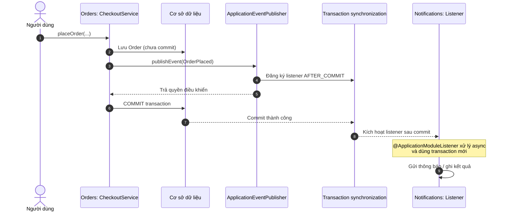

# Luồng xử lý cơ bản của application events trong Spring Modulith

## 1. Mục tiêu và bối cảnh

Trong ứng dụng dùng **Spring Modulith**, mỗi application module phụ trách một phần nghiệp vụ và cần giữ ranh giới phụ thuộc rõ ràng. **Application events** cho phép module phát thông báo về một sự kiện đã xảy ra; những module quan tâm tự đăng ký xử lý, thay vì module phát sự kiện phải gọi trực tiếp từng module còn lại.

Ví dụ: module `orders` tiếp nhận đơn hàng; module `notifications` gửi thông báo xác nhận. Khi đơn hàng được tạo, `orders` chỉ phát `OrderPlaced`. `notifications` tự quyết định phải làm gì khi nhận sự kiện đó. Cách phối hợp này giảm phụ thuộc trực tiếp và giúp mở rộng thêm các phản ứng nghiệp vụ mà không phải sửa luồng tạo đơn hàng.

Sau bài này, người học có thể:

- Nhận diện các thành phần **publisher → event → event infrastructure → listener** và trách nhiệm của từng thành phần.
- Theo dõi thời điểm phát sự kiện, commit transaction và thời điểm listener được thực thi.
- Viết một luồng cơ bản sử dụng `ApplicationEventPublisher` và `@ApplicationModuleListener`.
- Chọn cách lắng nghe phù hợp với yêu cầu nhất quán dữ liệu và biết các điểm có thể xảy ra lỗi.

## 2. Bốn thành phần trong luồng

| Thành phần | Vai trò | Ví dụ |
|---|---|---|
| **Publisher** | Thực hiện nghiệp vụ chính rồi công bố sự kiện | `CheckoutService` trong `orders` |
| **Event** | Dữ liệu bất biến mô tả việc **đã xảy ra**, được công bố như hợp đồng giữa các module | `OrderPlaced(orderId, occurredAt)` |
| **Event infrastructure** | Cơ chế sự kiện của Spring nhận và phân phối sự kiện đến các listener đã đăng ký; cơ chế giao dịch có thể hoãn việc gọi listener | `ApplicationEventPublisher`, event multicaster, transaction synchronization |
| **Listener** | Phản ứng với event theo trách nhiệm của module nhận | `OrderNotificationListener` trong `notifications` |

Thông điệp `OrderPlaced` nên nói về **sự kiện trong quá khứ**, không chứa mệnh lệnh như “hãy gửi email ngay”. Module phát không cần biết có bao nhiêu listener và chúng triển khai nghiệp vụ gì.

Cần phân biệt: `ApplicationEventPublisher` mặc định là **cơ chế sự kiện bên trong một ứng dụng Spring**, không tự đưa thông điệp lên Kafka/RabbitMQ và không tự bảo đảm lưu bền vững. Spring Modulith bổ sung cách tổ chức listener và cơ chế theo dõi việc công bố sự kiện khi được cấu hình phù hợp.

## 3. Minh họa luồng từ yêu cầu đến listener

Giả sử người dùng đặt hàng. Luồng mong muốn là: lưu đơn hàng thành công, sau đó module thông báo xử lý sự kiện.



Sơ đồ mô tả cấu hình với `@ApplicationModuleListener`. Khi sử dụng `@EventListener` thông thường, listener thường được gọi **ngay trong lúc `publishEvent(...)` đang chạy** (theo cấu hình mặc định đồng bộ), trước khi transaction tạo đơn hàng commit. Vì vậy không thể xem mọi loại listener là tương đương.

Nếu transaction lưu đơn hàng **rollback**, listener `@ApplicationModuleListener` được đăng ký theo pha `AFTER_COMMIT` sẽ không thực hiện nghiệp vụ sau commit. Điều này tránh gửi thông báo về một đơn hàng chưa được lưu thành công.

## 4. Triển khai ví dụ tối giản

Đặt `orders` và `notifications` thành hai package module dưới package gốc của ứng dụng Spring Boot:

```text
com.example.shop
├── ShopApplication.java
├── orders
│   ├── OrderPlaced.java
│   └── CheckoutService.java
└── notifications
    └── OrderNotificationListener.java
```

Theo mô hình phát hiện module mặc định của Spring Modulith, các package con trực tiếp của package ứng dụng có thể đóng vai trò application module. Event `public` được đặt tại package gốc `orders` để các module khác có thể tham chiếu như phần API được công khai; các chi tiết lưu trữ nội bộ của `orders` không cần bị lộ ra ngoài.

### Bước 1 — Khai báo event bất biến

```java
package com.example.shop.orders;

import java.time.Instant;
import java.util.UUID;

public record OrderPlaced(UUID orderId, Instant occurredAt) {
}
```

`record` là lựa chọn gọn trong Java hiện đại: có constructor và accessor, đồng thời giữ dữ liệu event bất biến ở cấp tham chiếu. Chỉ đưa vào event những thông tin module nhận thật sự cần; tránh truyền trực tiếp entity JPA vì entity có trạng thái quản lý persistence và có thể chứa quan hệ lazy.

### Bước 2 — Publisher lưu dữ liệu và phát sự kiện

```java
package com.example.shop.orders;

import java.time.Instant;
import java.util.UUID;

import org.springframework.context.ApplicationEventPublisher;
import org.springframework.stereotype.Service;
import org.springframework.transaction.annotation.Transactional;

@Service
public class CheckoutService {

    private final OrderRepository orderRepository;
    private final ApplicationEventPublisher eventPublisher;

    public CheckoutService(
            OrderRepository orderRepository,
            ApplicationEventPublisher eventPublisher) {
        this.orderRepository = orderRepository;
        this.eventPublisher = eventPublisher;
    }

    @Transactional
    public UUID placeOrder(CreateOrderCommand command) {
        Order order = orderRepository.save(Order.from(command));

        eventPublisher.publishEvent(
                new OrderPlaced(order.getId(), Instant.now()));

        return order.getId();
    }
}
```

`OrderRepository`, `Order` và `CreateOrderCommand` ở đây đại diện cho các kiểu nghiệp vụ của module `orders`; triển khai entity và repository được lược bớt để tập trung vào luồng sự kiện.

Trong method này:

1. `@Transactional` mở phạm vi transaction cho thao tác tạo đơn.
2. `orderRepository.save(...)` ghi dữ liệu trong transaction đang diễn ra.
3. `publishEvent(...)` công bố `OrderPlaced` cho cơ chế sự kiện của Spring. **Lệnh này tự nó không có nghĩa transaction đã commit**.
4. Khi method kết thúc bình thường, transaction manager mới tiến hành commit. Listener sau commit chỉ được kích hoạt khi pha commit thành công.

Một publisher có thể công bố nhiều loại event. Không cần biết tên, số lượng hoặc thứ tự nghiệp vụ của các module listener.

### Bước 3 — Module khác tiếp nhận qua `@ApplicationModuleListener`

```java
package com.example.shop.notifications;

import com.example.shop.orders.OrderPlaced;
import org.springframework.modulith.events.ApplicationModuleListener;
import org.springframework.stereotype.Component;

@Component
class OrderNotificationListener {

    private final NotificationService notificationService;

    OrderNotificationListener(NotificationService notificationService) {
        this.notificationService = notificationService;
    }

    @ApplicationModuleListener
    void on(OrderPlaced event) {
        notificationService.sendOrderConfirmation(event.orderId());
    }
}
```

`NotificationService` là dịch vụ nội bộ của module `notifications`; ví dụ giả định dịch vụ này biết cách tra cứu thông tin cần thiết thông qua API công khai thích hợp và gửi thông báo. `notifications` không cần gọi trực tiếp `CheckoutService` để yêu cầu phát sự kiện, và `orders` không phụ thuộc vào `NotificationService`.

Trong Spring Modulith, `@ApplicationModuleListener` là annotation tiện ích dành cho listener của module: nó tích hợp cơ chế **transactional event listener sau commit**, **thực thi bất đồng bộ** và **một transaction mới cho xử lý listener**. Listener vì thế phù hợp với tác vụ phụ có thể xử lý riêng sau khi nghiệp vụ chính đã được xác nhận. Để sử dụng annotation này, dự án cần có dependency Spring Modulith tương ứng cùng hạ tầng Spring cần thiết.

### Bước 4 — Kiểm tra luồng thực thi

Với một lệnh tạo đơn thành công, kết quả mong đợi là:

- Một `Order` được commit vào cơ sở dữ liệu.
- Một `OrderPlaced` được phát với `orderId` tương ứng.
- Listener của `notifications` nhận event **sau commit** rồi thực hiện gửi thông báo.
- Phía gọi `placeOrder(...)` không phải chờ nghiệp vụ gửi thông báo hoàn tất khi listener chạy bất đồng bộ.

Nếu `placeOrder(...)` ném exception khiến transaction rollback, xử lý sau commit của listener không được kích hoạt. Nếu việc gửi thông báo thất bại **sau khi đơn đã commit**, bản ghi đơn hàng không bị rollback ngược; cần xử lý lỗi của listener riêng.

## 5. Phân biệt ba kiểu lắng nghe thường gặp

| Cách đăng ký | Thời điểm thực thi thông thường | Quan hệ với transaction tạo event | Tình huống phù hợp |
|---|---|---|---|
| `@EventListener` | Ngay khi Spring phân phối event; mặc định đồng bộ | Nếu listener chạy cùng thread thì nằm trong transaction hiện có | Logic tức thời cần cùng phạm vi xử lý, phép kiểm tra nội bộ |
| `@TransactionalEventListener(phase = AFTER_COMMIT)` | Sau khi transaction publisher commit thành công | Không tự mở transaction mới; nếu cần ghi DB sau commit, phải cấu hình transaction riêng | Phản ứng chỉ khi dữ liệu chính được commit |
| `@ApplicationModuleListener` | Sau commit, bất đồng bộ theo cơ chế Spring Modulith | Thực thi bằng transaction mới | Giao tiếp giữa module cho công việc phụ độc lập, có thể xử lý sau |

Ví dụ Spring Framework thuần với `AFTER_COMMIT`:

```java
@Component
class AuditListener {

    @TransactionalEventListener(phase = TransactionPhase.AFTER_COMMIT)
    void on(OrderPlaced event) {
        // Ghi nhận phản ứng sau khi đơn hàng đã commit.
        // Nếu ghi dữ liệu qua DB, cần mở transaction riêng.
    }
}
```

Các import tương ứng gồm `org.springframework.transaction.event.TransactionalEventListener` và `org.springframework.transaction.event.TransactionPhase`. Mặc định, `@TransactionalEventListener` chỉ tham gia khi event được phát trong một transaction đang hoạt động; trường hợp không có transaction, listener không được gọi trừ khi bật `fallbackExecution`.

**Lưu ý về tên annotation:** `@ApplicationModuleListener` tạo trải nghiệm thuận tiện, nhưng không làm cho toàn bộ listener trong ứng dụng tự động trở thành listener bất đồng bộ hoặc bảo đảm mỗi event chỉ được xử lý đúng một lần.

## 6. Những tình huống lỗi và kết quả thực tế

| Tình huống | Điều xảy ra | Hướng xử lý |
|---|---|---|
| Publisher lỗi trước commit | Transaction chính rollback; listener sau commit không được kích hoạt | Xử lý lỗi nghiệp vụ/transaction tại module publisher |
| `@EventListener` đồng bộ ném exception ngay khi `publishEvent` | Exception có thể lan về publisher và làm transaction chính rollback nếu không được xử lý | Chỉ dùng đồng bộ khi thực sự muốn gắn số phận hai bước |
| Listener sau commit gửi email thất bại | Transaction tạo đơn đã commit; lỗi listener không thể hoàn tác commit đã thành công | Ghi log, thiết kế retry và xử lý trùng lặp |
| Service dừng sau commit nhưng trước khi listener xử lý xong | Công việc sau commit có nguy cơ bị bỏ lỡ nếu không có cơ chế theo dõi và khôi phục | Cấu hình **Event Publication Registry** với kho lưu trữ hỗ trợ, kiểm tra publication chưa hoàn tất |
| Listener được thực hiện lại | Hiệu ứng phụ có thể bị lặp như gửi hai email hay cộng điểm hai lần | Dùng khóa nghiệp vụ/ID event để bảo đảm tính **idempotent** |

### Event Publication Registry nằm ở đâu trong luồng?

Spring Modulith hỗ trợ **Event Publication Registry** để theo dõi việc công bố event đến các transactional listener. Khi sử dụng phần tích hợp lưu trữ thích hợp (chẳng hạn JDBC hoặc JPA theo phiên bản đang dùng), ứng dụng có thể lưu trạng thái publication và phát hiện những lần xử lý chưa hoàn tất để kích hoạt xử lý lại.

Cần phân biệt hai bước: **phát event** chỉ khởi tạo việc phân phối; **hoàn thành xử lý listener** là trạng thái khác. Registry hữu ích để khôi phục công việc giữa hai bước này nhưng không loại bỏ khả năng xử lý trùng lặp, cũng không tự thay thế cơ chế nhắn tin liên tiến trình. Cấu hình kho lưu trữ, chính sách retry và cách quan sát publication sẽ được học riêng trong các bài nâng cao.

## 7. Nguyên tắc giữ ranh giới module

**Sự kiện là hợp đồng giữa các module.** Thiết kế event nên ổn định, có ý nghĩa nghiệp vụ và hạn chế phụ thuộc vào chi tiết triển khai:

- Đặt event dùng chung trong API công khai của module phát; cho module nhận phụ thuộc vào kiểu event, tránh truy cập trực tiếp repository hay service nội bộ của module phát.
- Đặt tên theo **sự việc đã xảy ra**, ví dụ `OrderPlaced`, `PaymentCompleted`, thay vì mệnh lệnh `SendConfirmationEmail`.
- Ưu tiên payload nhỏ, bất biến, có định danh nghiệp vụ. Khi cần truy vấn chi tiết, dùng API công khai phù hợp và cân nhắc dữ liệu có thể thay đổi giữa lúc phát với lúc xử lý.
- Với listener chạy sau commit và bất đồng bộ, không giả định thứ tự hoàn tất hoặc thời gian phản hồi; cân nhắc idempotency, retry và quan sát lỗi.
- Nếu nhiều bước bắt buộc thành công hoặc thất bại **cùng một transaction**, cần đánh giá có nên sử dụng cơ chế đồng bộ/thao tác nội bộ khác thay vì chuyển toàn bộ sang listener bất đồng bộ.

## 8. Cách kiểm thử và quan sát

Tách kiểm tra thành ba câu hỏi để dễ phát hiện lỗi:

1. **Publisher có phát event đúng không?** Trong kiểm thử module `orders`, tạo đơn hàng và xác nhận một `OrderPlaced` có `orderId` chính xác. Spring Modulith cung cấp hỗ trợ kiểm thử module như `@ApplicationModuleTest` và khả năng thu thập event đã phát.
2. **Listener có xử lý đúng không?** Trong kiểm thử `notifications`, gọi listener với một `OrderPlaced` mẫu và xác nhận dịch vụ thông báo được gọi đúng tham số. Kiểm thử thêm khi dịch vụ thông báo thất bại hoặc event bị nhận lại.
3. **Luồng transaction có đúng không?** Kiểm thử tích hợp rằng transaction rollback không kích hoạt tác vụ `AFTER_COMMIT`, và việc listener lỗi sau commit không đảo ngược đơn hàng đã lưu.

Trong môi trường vận hành, đặt log có `eventType` và `orderId` tại chỗ phát và chỗ nhận để đối chiếu; nếu bật registry, theo dõi số publication chưa hoàn tất và nguyên nhân xử lý thất bại. Không ghi toàn bộ payload chứa dữ liệu nhạy cảm vào log.

## 9. Tổng kết luồng xử lý

Luồng cơ bản của Spring Modulith application events có thể ghi nhớ theo chuỗi:

**Nghiệp vụ thay đổi trạng thái → publisher tạo event bất biến → Spring phân phối/đăng ký listener → transaction commit → listener sau commit xử lý theo trách nhiệm module nhận.**

Trong ví dụ đặt hàng, `orders` quyết định **khi nào** `OrderPlaced` xảy ra; `notifications` quyết định **phản ứng gì** với sự kiện đó. Chọn `@EventListener`, `@TransactionalEventListener` hoặc `@ApplicationModuleListener` theo thời điểm xử lý và ràng buộc transaction. Khi xử lý sau commit có tác động quan trọng, bổ sung lưu vết publication, retry và idempotency để tăng độ tin cậy của luồng sự kiện.
