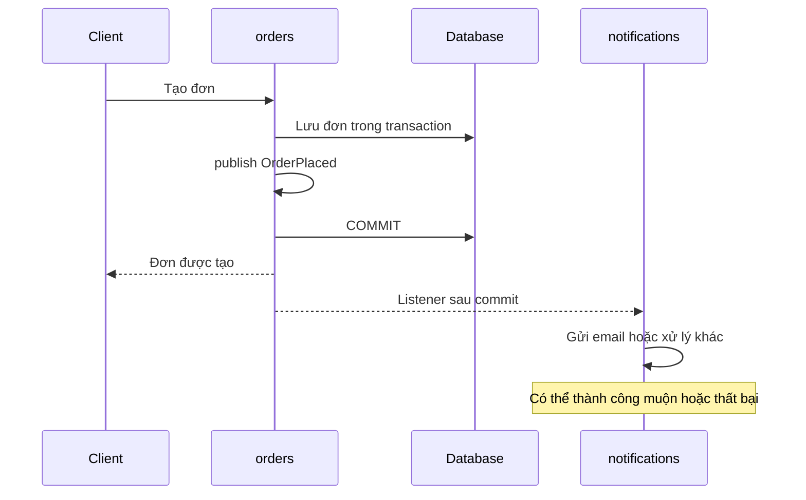

# Giới hạn của event trong Spring Modulith

## 1. Event giúp giảm phụ thuộc, nhưng không tự bảo đảm quy trình nghiệp vụ

Trong một ứng dụng Spring Modulith, module `orders` có thể phát sự kiện `OrderPlaced` để các module `notifications`, `reporting` hoặc `search` tự phản ứng. `orders` không cần gọi trực tiếp từng service ở các module kia. Nhờ đó, **phụ thuộc ở mức mã nguồn giảm đi** và mỗi module có thể phát triển chức năng của mình tương đối độc lập.

Tuy nhiên, event **không đồng nghĩa với xử lý bất đồng bộ, giao nhận bền vững hay nhất quán tức thời**. Spring application events trước hết là một cơ chế phát thông báo **bên trong tiến trình ứng dụng**. Việc listener chạy ở thread nào, khi nào, có transaction hay không và có được thử lại khi lỗi hay không phụ thuộc vào loại listener cùng cấu hình đang dùng.

Ví dụ, khi đơn hàng được tạo:

- Việc ghi nhận đơn hàng và kiểm tra hạn mức tín dụng có thể là **điều kiện bắt buộc trước khi trả kết quả**.
- Việc gửi email xác nhận hoặc cập nhật chỉ mục tìm kiếm có thể thực hiện **sau khi đơn hàng đã commit**.
- Việc gọi hệ thống vận chuyển nằm ngoài tiến trình có thể cần **cơ chế giao nhận bền vững và đối soát**.

Ba nhu cầu này không nhất thiết dùng cùng một cách giao tiếp. Mục tiêu của bài là nhận ra **ranh giới hiệu lực** của application events trong Spring Modulith, từ đó quyết định khi nào dùng event, khi nào gọi trực tiếp và khi nào cần bổ sung cơ chế tin cậy.

## 2. Giới hạn về thời điểm thực thi và transaction

### 2.1. `@EventListener` mặc định chạy đồng bộ

Giả sử module `orders` công bố một sự kiện bất biến:

```java
// API công khai do module orders sở hữu
public record OrderPlaced(
        UUID eventId,
        UUID orderId,
        Instant occurredAt
) {}
```

Một service phát sự kiện trong lúc tạo đơn hàng:

```java
@Service
public class OrderService {
    private final OrderRepository orders;
    private final ApplicationEventPublisher events;

    public OrderService(OrderRepository orders, ApplicationEventPublisher events) {
        this.orders = orders;
        this.events = events;
    }

    @Transactional
    public void place(Order order) {
        orders.save(order);
        events.publishEvent(new OrderPlaced(
                UUID.randomUUID(), order.getId(), Instant.now()));
    }
}
```

Một listener thông thường:

```java
@Component
class AuditListener {
    @EventListener
    void on(OrderPlaced event) {
        // Nếu ném RuntimeException ra ngoài, lời gọi publishEvent có thể thất bại.
        auditService.record(event.orderId());
    }
}
```

Trong cấu hình mặc định, `@EventListener` chạy ngay trong thread gọi `publishEvent(...)`; lời gọi publish đợi listener hoàn tất. Nếu listener ném lỗi không được xử lý, lỗi có thể truyền ngược về service phát sự kiện. Khi cùng tham gia transaction đang mở, lỗi đó có thể làm transaction tạo đơn hàng bị rollback.

Hệ quả là **tách phụ thuộc giữa module không tự động tách thời gian phản hồi hoặc ranh giới lỗi**. Một listener chậm có thể kéo dài request; một listener lỗi có thể ảnh hưởng nghiệp vụ phát event.

> Lưu ý: Kết luận trên mô tả cơ chế mặc định. `ApplicationEventMulticaster` có thể được cấu hình executor hoặc error handler riêng, vì vậy cần kiểm tra cấu hình thực tế trước khi giả định mọi listener luôn cùng thread hoặc mọi lỗi đều truyền ngược.

### 2.2. `@Async` không tự giải quyết vấn đề commit

Nếu chỉ đưa listener sang thread khác bằng `@Async`, listener có thể bắt đầu **trước khi transaction của publisher commit**. Nó có thể không nhìn thấy dữ liệu mới, đọc trạng thái cũ hoặc tạo tác dụng phụ đối với một đơn hàng sau đó bị rollback.

Ngược lại, `@TransactionalEventListener(phase = TransactionPhase.AFTER_COMMIT)` đăng ký listener chạy sau khi transaction đã commit thành công:

```java
@Component
class OrderNotificationListener {
    @TransactionalEventListener(phase = TransactionPhase.AFTER_COMMIT)
    void on(OrderPlaced event) {
        notificationService.prepare(event.orderId());
    }
}
```

Điểm cần phân biệt:

| Cơ chế | Khi listener được gọi | Giới hạn chính |
| --- | --- | --- |
| `@EventListener` mặc định | Ngay khi publish, thường trong cùng thread/transaction | Listener có thể làm chậm hoặc làm lỗi publisher |
| `@Async` đơn lẻ | Trong thread khác, thời điểm không chắc sau commit | Có thể chạy trước commit; lỗi không tự rollback publisher |
| `@TransactionalEventListener(AFTER_COMMIT)` | Khi transaction của publisher commit thành công | Không tự động bất đồng bộ, retry hoặc giao nhận bền vững |
| `@ApplicationModuleListener` của Spring Modulith | Listener bất đồng bộ, kích hoạt sau commit và có transaction xử lý riêng | Xử lý trễ, có thể lỗi; cần idempotency và cơ chế phục hồi phù hợp |

Mặc định, `@TransactionalEventListener` **không xử lý sự kiện được phát ngoài một transaction** nếu không cấu hình `fallbackExecution = true`. Trái lại, việc bật fallback chỉ thay đổi điều kiện gọi listener; nó không tạo ra một transaction đã commit.

Ngoài ra, tại pha `AFTER_COMMIT` của một listener đồng bộ, tài nguyên transaction vừa commit có thể còn gắn với thread cho đến khi cleanup. Nếu listener cần **ghi dữ liệu mới**, nên mở transaction riêng, chẳng hạn `@Transactional(propagation = Propagation.REQUIRES_NEW)`, thay vì cho rằng thao tác ghi sẽ được commit trong transaction đã kết thúc.

## 3. Event không bảo đảm một giao dịch chung giữa các module

Hãy xem quy trình tạo đơn hàng:



Sau commit, đơn hàng đã tồn tại dù email gửi thất bại. Không thể yêu cầu rollback transaction tạo đơn chỉ vì listener sau commit gặp lỗi. Ngược lại, nếu gửi email ngay trong transaction trước commit thì email đã gửi **không thể bị rollback** khi transaction database thất bại.

Đây là giới hạn căn bản: **transaction của database không bao trùm các tác dụng phụ bên ngoài** như email, HTTP API, message broker hay dịch vụ thanh toán chỉ bằng cách phát một application event.

Đối với nghiệp vụ cần kết quả tức thời và một bất biến nhất quán, chẳng hạn “không chấp nhận đơn nếu không thể giữ tồn kho”, nên cân nhắc một lời gọi đồng bộ hoặc một cơ chế điều phối phù hợp trong cùng ranh giới giao dịch. Với công việc được phép nhất quán dần, event sau commit là lựa chọn hợp lý.

Nếu cả quy trình trải qua nhiều hệ thống với các transaction độc lập, cần thiết kế trạng thái, bù trừ và đối soát (ví dụ Saga); application event đơn thuần không biến chúng thành một transaction phân tán.

## 4. Event không tự cung cấp độ bền hoặc giao nhận đúng một lần

### 4.1. Vấn đề mất sự kiện và xử lý thiếu

Một `publishEvent(...)` thành công chỉ xác nhận rằng publisher đã gọi cơ chế phát sự kiện trong ứng dụng. Nếu listener chạy sau commit hoặc bất đồng bộ, ứng dụng có thể dừng ở khoảng thời gian **database đã commit nhưng listener chưa xử lý xong**.

Spring Modulith cung cấp **Event Publication Registry** để theo dõi các lần phát sự kiện tới listener giao dịch phù hợp, khi đã tích hợp và cấu hình kho lưu trữ publication tương ứng. Các bản ghi chưa hoàn tất có thể được dùng để xử lý lại theo cơ chế phục hồi được cấu hình/vận hành. Tuy nhiên:

- Registry **không mặc nhiên bảo vệ mọi `@EventListener` tùy ý**; cần xác định loại listener có được theo dõi hay không.
- Độ bền phụ thuộc vào **kho lưu trữ publication, transaction và cấu hình** thực tế. Không thể suy ra có khả năng phục hồi chỉ vì đã thêm thư viện Spring Modulith.
- Việc xuất bản lại bản ghi chưa hoàn tất cần **chính sách, lịch chạy hoặc cấu hình kích hoạt** phù hợp với phiên bản đang dùng; không nên mặc định hệ thống sẽ tự thử vô hạn.
- Registry theo dõi **trạng thái xử lý publication**, không chứng minh rằng tác dụng phụ ở hệ thống bên ngoài đã xảy ra đúng một lần.

Ví dụ, listener đã gọi API gửi email thành công nhưng ứng dụng dừng **trước khi ghi nhận publication hoàn tất**. Khi chạy lại, cùng email có thể được gửi thêm lần nữa.

### 4.2. Cần thiết kế listener idempotent

**Idempotency** nghĩa là xử lý nhiều lần cùng một sự kiện vẫn tạo ra cùng kết quả nghiệp vụ như xử lý một lần. Event nên có định danh ổn định, ví dụ `eventId`, và listener không nên thay định danh đó khi retry.

Một cập nhật kiểu “đặt trạng thái đơn thành `CONFIRMED`” có thể idempotent hơn “tăng bộ đếm xác nhận thêm 1”. Với ghi nhận vào database, có thể dùng khóa duy nhất theo `event_id` hoặc kết hợp khóa nghiệp vụ với phép ghi dạng upsert/insert-if-absent.

```sql
-- Ví dụ PostgreSQL: mỗi sự kiện chỉ được ghi nhận một lần tại đây.
CREATE TABLE processed_order_event (
    event_id UUID PRIMARY KEY,
    processed_at TIMESTAMPTZ NOT NULL DEFAULT CURRENT_TIMESTAMP
);

INSERT INTO processed_order_event(event_id)
VALUES (:event_id)
ON CONFLICT (event_id) DO NOTHING;
```

Mẫu SQL chỉ giải quyết việc ghi nhận trùng **trong database đó**, và phải được phối hợp đúng transaction với thay đổi nghiệp vụ. Nếu listener còn gửi email, thu tiền hoặc gọi HTTP API, cần thêm **idempotency key được phía nhận hỗ trợ**, trạng thái tác vụ, hoặc quy trình đối soát. Không thể đạt “exactly once” cho mọi tác dụng phụ chỉ bằng một bảng đánh dấu đã xử lý.

Nên thiết kế theo giả định **có thể giao lại sự kiện** thay vì kỳ vọng mỗi event chỉ chạy duy nhất một lần.

## 5. Event không bảo đảm thứ tự, thời gian hay tiến độ xử lý

Trong một luồng đồng bộ, thứ tự gọi các listener đôi khi có thể điều chỉnh bằng `@Order`. Nhưng điều đó không phải là cam kết thứ tự xử lý giữa các listener bất đồng bộ, nhiều transaction, nhiều instance hoặc các lần retry.

Ví dụ hai sự kiện cùng một đơn hàng:

1. `OrderPlaced(orderId)`.
2. `OrderCancelled(orderId)`.

Nếu listener cập nhật search index chạy song song, sự kiện hủy có thể được xử lý trước sự kiện tạo; một lần retry muộn của `OrderPlaced` có thể làm chỉ mục quay về trạng thái cũ.

Các biện pháp thường dùng:

- Gắn **phiên bản tăng dần theo aggregate** hoặc trạng thái mới nhất vào sự kiện; chỉ áp dụng sự kiện mới hơn trạng thái đã xử lý.
- Khi xử lý, **đọc lại trạng thái hiện hành từ nguồn chuẩn** nếu dữ liệu nguồn cho phép.
- Với chuỗi hành động đòi hỏi thứ tự chặt, dùng **một bộ điều phối hoặc hàng đợi có kiểm soát thứ tự theo khóa nghiệp vụ**.

Event bất đồng bộ cũng không có thời hạn hoàn thành cố định. Executor có thể đầy, thread bị chặn, database bị khóa hoặc một listener phụ thuộc vào hệ thống bên ngoài đang chậm. Do đó cần giới hạn tài nguyên, thời gian chờ, chính sách retry/backoff và cảnh báo tồn đọng. **`@Async` chỉ chuyển công việc sang cơ chế thực thi khác; nó không tạo ra năng lực xử lý vô hạn.**

## 6. Event vẫn là một hợp đồng phụ thuộc giữa các module

Publisher không biết các listener cụ thể, nhưng **tất cả listener vẫn phụ thuộc vào ý nghĩa và cấu trúc của event**. Sửa tên field, bỏ field hoặc thay đổi nghĩa của `OrderPlaced` có thể phá vỡ nhiều module cùng lúc. Mức độ độc lập đạt được là giảm phụ thuộc trực tiếp vào implementation, không phải xóa bỏ hoàn toàn sự phụ thuộc.

Nên xem event là **hợp đồng tích hợp công khai**:

- Đặt tên theo **sự thật nghiệp vụ đã xảy ra**, ví dụ `OrderPlaced` hoặc `PaymentCaptured`; tránh tên ra lệnh như `SendEmailNow` nếu mục đích là thông báo sự kiện.
- Truyền dữ liệu bất biến, nhỏ gọn như `eventId`, `orderId`, thời điểm phát và field nghiệp vụ cần thiết. Tránh truyền thẳng JPA entity, đối tượng đang quản lý transaction hoặc reference có lazy loading.
- Quy định rõ **event phát tại điểm nào**, chính xác “placed” nghĩa là gì, khi nào được xem là committed, liệu event có thể phát lặp và có thể xử lý trễ bao lâu.
- Khi cần lưu và replay event, cân nhắc **tương thích phiên bản payload**, serializer và dữ liệu cũ còn nằm trong registry.
- Giới hạn thông tin nhạy cảm trong payload và log; event có thể được lưu hoặc xuất ra hệ thống khác về sau.

Ví dụ một module `notifications` chỉ cần `orderId` thường không nên phụ thuộc vào toàn bộ đối tượng `Order` nội bộ của module `orders`. Nếu dữ liệu bổ sung thật sự cần thiết, nên chọn giữa một event mang snapshot vừa đủ và truy vấn qua một API công khai có chủ đích.

## 7. Nhiều listener không tạo thành một quy trình nguyên tử

Giả sử có ba listener độc lập cho `OrderPlaced`:

| Listener | Kết quả có thể xảy ra |
| --- | --- |
| `notifications` | Gửi email thành công |
| `search` | Cập nhật chỉ mục thất bại |
| `analytics` | Ghi nhận báo cáo thành công nhưng chậm |

Đây là trạng thái hợp lệ của một hệ thống xử lý sau commit: **một số tác dụng phụ hoàn thành, số khác đang chờ hoặc thất bại**. Sự kiện không buộc tất cả listener cùng thành công hay cùng rollback.

Khi một bước phụ thuộc vào kết quả bước trước, ví dụ chỉ lập vận đơn **sau khi** thanh toán thành công, không nên kỳ vọng hai listener cùng nhận một event sẽ tự tạo ra thứ tự này. Cần model hóa các sự kiện trung gian như `PaymentCaptured`, hoặc đưa quy trình vào một orchestrator/state machine có trạng thái và xử lý lỗi rõ ràng.

Spring Modulith giúp giữ ranh giới module tốt, nhưng tính nhất quán của quy trình vẫn là trách nhiệm thiết kế nghiệp vụ.

## 8. Quyết định dùng cách giao tiếp nào

| Yêu cầu | Cách tiếp cận thường phù hợp | Điều cần kiểm soát |
| --- | --- | --- |
| Cần kết quả ngay để chấp nhận/từ chối giao dịch | Gọi đồng bộ qua API module rõ ràng | Transaction và phụ thuộc thời gian chạy |
| Thông báo trong cùng tiến trình, có thể chạy trong transaction | `@EventListener` mặc định | Listener chậm hoặc lỗi ảnh hưởng publisher |
| Công việc phụ sau commit trong một ứng dụng Modulith | `@ApplicationModuleListener` hoặc transactional listener phù hợp | Event Publication Registry, idempotency, retry, giám sát |
| Giao tiếp giữa các ứng dụng/instance cần độ bền, mở rộng độc lập | Message broker và/hoặc transactional outbox với consumer riêng | Delivery semantics, trùng lặp, schema, thứ tự, vận hành |
| Quy trình dài qua nhiều transaction/hệ thống | Orchestration/Saga với trạng thái và bù trừ | Tiến độ, timeouts, retry, lỗi một phần |

Lưu ý: một event phát trong một instance không tự xuất hiện ở tất cả instance khác. Nếu nhiều instance cần cùng nhận và xử lý công việc, phải thiết kế cơ chế phân phối, ownership và cạnh tranh xử lý thích hợp. Application Event Publisher **không phải message broker liên tiến trình**.

## 9. Ví dụ dùng `@ApplicationModuleListener` có kiểm soát

Đối với cập nhật chỉ mục tìm kiếm sau khi đặt hàng, module `search` có thể nhận `OrderPlaced` bằng listener riêng:

```java
@Component
class OrderSearchListener {
    private final OrderSearchIndex index;

    OrderSearchListener(OrderSearchIndex index) {
        this.index = index;
    }

    @ApplicationModuleListener
    void on(OrderPlaced event) {
        // upsert theo orderId: cùng sự kiện chạy lại không tạo bản ghi trùng.
        index.upsert(event.orderId());
    }
}
```

`@ApplicationModuleListener` là tiện ích của Spring Modulith kết hợp xử lý listener sau commit, bất đồng bộ và transaction riêng cho listener. Đoạn code minh họa giả định `index.upsert(...)` đã được thiết kế idempotent; còn loại lưu trữ publication, cấu hình thử lại và phục hồi phụ thuộc hệ thống thực tế.

Cần trả lời được các câu hỏi vận hành trước khi đưa listener vào production:

1. **Nếu publisher rollback:** listener có được bỏ qua không?
2. **Nếu listener lỗi sau commit:** ai phát hiện publication chưa hoàn tất, ai và khi nào kích hoạt xử lý lại?
3. **Nếu xử lý trùng:** dữ liệu và hệ thống bên ngoài có giữ đúng trạng thái không?
4. **Nếu nhiều sự kiện đến sai thứ tự:** có version/state check để tránh ghi đè dữ liệu mới bằng dữ liệu cũ không?
5. **Nếu hàng chờ tăng:** có chỉ số tồn đọng, giới hạn executor, timeout và cảnh báo không?
6. **Nếu ứng dụng restart:** cơ chế khôi phục có được bật và đã kiểm chứng với kho lưu trữ thực không?

## 10. Những kiểm thử có giá trị

Một test chỉ xác nhận `publishEvent(...)` được gọi **chưa chứng minh** đường đi sự kiện đáng tin cậy. Trong bài thực hành Spring Modulith, nên ưu tiên một số kịch bản tích hợp:

| Kịch bản | Điều cần xác nhận |
| --- | --- |
| Transaction tạo đơn rollback | Listener `AFTER_COMMIT` không làm tác dụng phụ |
| Tạo đơn commit, listener sau commit lỗi | Đơn vẫn được lưu; lỗi được quan sát/ghi nhận để xử lý |
| Giao cùng event hai lần | Không tạo hai kết quả nghiệp vụ ngoài ý muốn |
| Listener xử lý chậm, hoặc executor quá tải | Không làm hệ thống cạn tài nguyên; độ trễ/tồn đọng đo được |
| Restart khi publication chưa hoàn tất | Có thể phát hiện và phục hồi theo cấu hình thực tế |
| `OrderCancelled` được xử lý trước `OrderPlaced` | Trạng thái cuối không bị ghi đè sai |
| Publisher phát ngoài transaction | Hành vi transactional listener đúng với thiết kế, không bị bỏ qua âm thầm |

Có thể dùng kiểm thử module của Spring Modulith kết hợp integration test với database thật hoặc môi trường tương đương production để kiểm tra transaction và registry. Nên theo dõi số publication chưa hoàn tất, số lần retry, tuổi của sự kiện cũ nhất, độ trễ listener và lỗi theo `eventId`/`orderId`; log đơn lẻ không thay thế được việc giám sát tồn đọng.

## 11. Tình huống vận dụng

Một hệ thống thương mại điện tử muốn làm ba việc khi khách đặt hàng: **giữ tồn kho**, **gửi email**, **đồng bộ dữ liệu tìm kiếm**.

- Nếu “giữ tồn kho thành công” là điều kiện để đơn được chấp nhận, xử lý yêu cầu đó bằng một contract đồng bộ hoặc một quy trình đặt chỗ có trạng thái rõ ràng. Không nên chỉ phát `OrderPlaced` rồi trả thành công trước khi biết kết quả giữ hàng.
- Sau khi đơn đã commit, phát `OrderPlaced` để `notifications` và `search` tự xử lý. Hai listener có thể dùng `@ApplicationModuleListener` và một Event Publication Registry được cấu hình phù hợp.
- Cả hai listener phải chấp nhận khả năng **xử lý lặp, chậm, sai thứ tự hoặc thất bại**. Riêng email/API bên ngoài cần idempotency hay đối soát theo khả năng hệ thống nhận.
- Nếu cập nhật search index trễ vài giây là chấp nhận được, đây là **eventual consistency** có chủ đích. UI/API cần thể hiện trạng thái phù hợp thay vì ngầm cho rằng mọi projection đã đồng bộ ngay khi trả HTTP 200.

Điểm cần ghi nhớ là **event giải quyết sự phụ thuộc trong giao tiếp module, còn độ tin cậy của quá trình xử lý phải được thiết kế và kiểm chứng riêng**. Chọn đúng ranh giới transaction, listener, cơ chế phục hồi và yêu cầu nhất quán sẽ giúp tận dụng Spring Modulith mà không tạo ra lỗi khó phát hiện khi hệ thống hoạt động thực tế.
