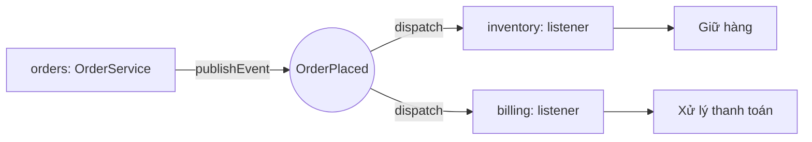
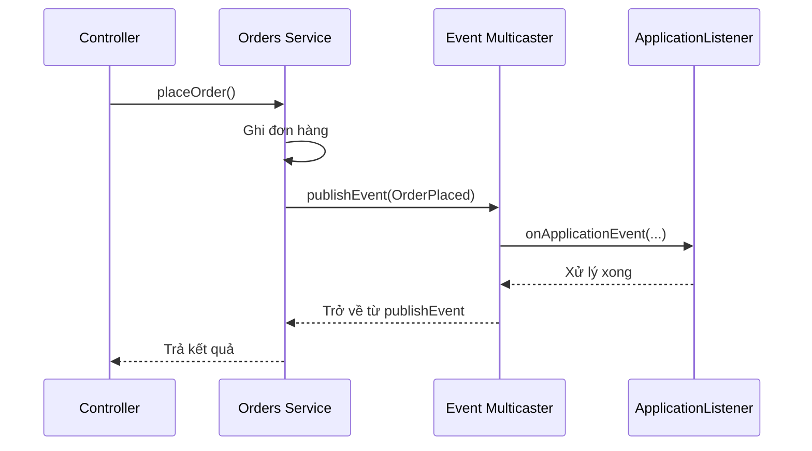
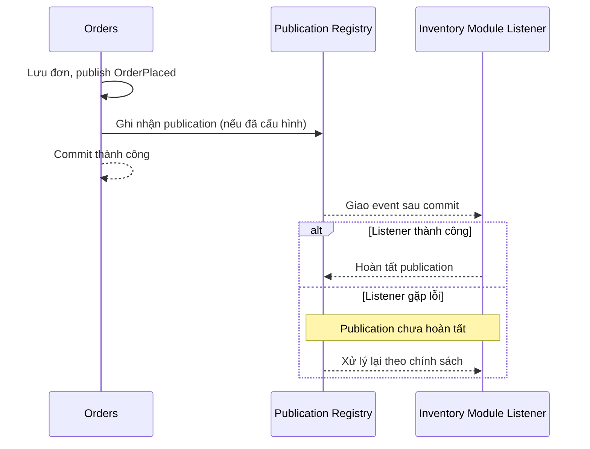

# ApplicationListener trong Spring Modulith

## 1. ApplicationListener là gì?

`ApplicationListener` là **interface của Spring Framework** để một thành phần đăng ký nhận sự kiện được công bố trong `ApplicationContext`. Khi một publisher gửi event qua `ApplicationEventPublisher`, cơ chế phát sự kiện của Spring tìm những listener phù hợp và chuyển event cho chúng xử lý.

Trong kiến trúc **Spring Modulith**, listener giúp module nghiệp vụ phản ứng với thay đổi ở module khác mà không đòi hỏi module phát phải gọi trực tiếp service nội bộ của bên nhận. Chẳng hạn `orders` phát sự kiện đơn hàng đã được tạo; `inventory` nhận sự kiện để giữ hàng và `billing` nhận sự kiện để khởi tạo quy trình thanh toán. Module `orders` chỉ biết hợp đồng event của mình, không cần import `InventoryService` hay `PaymentService`.



Trong module học `SPRING_MODULITH_APPLICATION_EVENTS`, cần phân biệt ba trách nhiệm:

1. **Bắt sự kiện:** `ApplicationListener` hoặc `@EventListener` định nghĩa code sẽ nhận và phản ứng với loại event nào.
2. **Thời điểm và transaction:** event được phân phối ngay khi publish, sau commit, hay bất đồng bộ phụ thuộc kiểu listener và cấu hình.
3. **Độ tin cậy:** Event Publication Registry, retry, idempotency, kiểm thử và quan sát hỗ trợ phát hiện/khôi phục các publication dở dang.

`ApplicationListener` là khái niệm của Spring Framework, không phải giao diện consumer Kafka hoặc RabbitMQ. Nó nhận những event được phân phối trong Spring application context; muốn giao event ra hệ thống ngoài phải thiết kế thêm integration event và cơ chế truyền tin tương ứng.

## 2. Hợp đồng của interface ApplicationListener

Hình dạng cốt lõi của interface:

```java
public interface ApplicationListener<E extends ApplicationEvent>
        extends java.util.EventListener {

    void onApplicationEvent(E event);
}
```

Hai điều quan trọng:

- Generic `E` **phải kế thừa `org.springframework.context.ApplicationEvent`**.
- Khi được đăng ký trong Spring container, phương thức `onApplicationEvent(E event)` được gọi cho event tương thích mà Spring phân phối.

Một lớp triển khai được đăng ký phổ biến bằng `@Component` hoặc một phương thức `@Bean` trả về listener. Tự gọi `new SomeListener()` ngoài Spring container không khiến ứng dụng tự động đăng ký đối tượng đó làm listener.

**Điểm thường gây nhầm lẫn:** `@EventListener` có thể nhận trực tiếp record/POJO, nhưng `ApplicationListener<OrderPlaced>` không biên dịch nếu `OrderPlaced` chỉ là record thông thường. Để triển khai interface với POJO, có thể nhận `PayloadApplicationEvent<OrderPlaced>`, như mục 4.

## 3. Cách 1: ApplicationListener với ApplicationEvent

Đầu tiên định nghĩa một event kế thừa `ApplicationEvent`:

```java
// orders/OrderPlacedEvent.java
package com.example.shop.orders;

import java.util.Objects;
import java.util.UUID;
import org.springframework.context.ApplicationEvent;

public final class OrderPlacedEvent extends ApplicationEvent {

    private final UUID orderId;

    public OrderPlacedEvent(UUID orderId) {
        super(Objects.requireNonNull(orderId, "orderId"));
        this.orderId = orderId;
    }

    public UUID getOrderId() {
        return orderId;
    }
}
```

Lớp cha `ApplicationEvent` yêu cầu một `source` không null. Ở đây ta dùng ID bất biến làm `source` để tránh giữ tham chiếu tới `OrderEntity` hoặc service nội bộ. Đây là quyết định của ví dụ, không phải Spring bắt buộc `source` phải là ID nghiệp vụ. Nếu muốn ghi nhận thời điểm nghiệp vụ, có thể thêm trường `occurredAt`; timestamp kế thừa từ `ApplicationEvent` không nên mặc nhiên coi là thời điểm giao dịch commit.

Publisher:

```java
// orders/internal/OrderService.java
package com.example.shop.orders.internal;

import com.example.shop.orders.OrderPlacedEvent;
import java.util.UUID;
import org.springframework.context.ApplicationEventPublisher;
import org.springframework.stereotype.Service;
import org.springframework.transaction.annotation.Transactional;

@Service
class OrderService {

    private final ApplicationEventPublisher publisher;

    OrderService(ApplicationEventPublisher publisher) {
        this.publisher = publisher;
    }

    @Transactional
    public void placeOrder(UUID orderId) {
        // Giả định repository đã lưu đơn hàng trong transaction này.
        publisher.publishEvent(new OrderPlacedEvent(orderId));
    }
}
```

Listener ở module kho:

```java
// inventory/internal/OrderPlacedListener.java
package com.example.shop.inventory.internal;

import com.example.shop.orders.OrderPlacedEvent;
import org.springframework.context.ApplicationListener;
import org.springframework.stereotype.Component;

@Component
class OrderPlacedListener
        implements ApplicationListener<OrderPlacedEvent> {

    private final InventoryService inventory;

    OrderPlacedListener(InventoryService inventory) {
        this.inventory = inventory;
    }

    @Override
    public void onApplicationEvent(OrderPlacedEvent event) {
        inventory.reserveForOrder(event.getOrderId());
    }
}
```

`InventoryService` là bean nghiệp vụ nội bộ giả định của `inventory`. Listener chỉ nhận hợp đồng `OrderPlacedEvent` đã công bố và xử lý theo trách nhiệm module kho, không import repository hay entity của module `orders`.

**Hạn chế mặc định:** một `ApplicationListener` thông thường không đợi transaction publisher commit. Trong cấu hình multicaster đồng bộ thông dụng, listener được gọi ngay trong lời gọi `publishEvent(...)`, có thể vẫn đang ở trong transaction của publisher. Vì vậy không được tự coi ví dụ này là xử lý sau commit.

## 4. Cách 2: ApplicationListener với record/POJO event

Một hợp đồng event hiện đại có thể là record Java bất biến, không kế thừa class framework:

```java
// orders/events/OrderPlaced.java
package com.example.shop.orders.events;

import java.time.Instant;
import java.util.Objects;
import java.util.UUID;

public record OrderPlaced(
        UUID eventId,
        UUID orderId,
        Instant occurredAt) {

    public OrderPlaced {
        Objects.requireNonNull(eventId, "eventId");
        Objects.requireNonNull(orderId, "orderId");
        Objects.requireNonNull(occurredAt, "occurredAt");
    }
}
```

Publisher có thể phát trực tiếp record:

```java
publisher.publishEvent(
    new OrderPlaced(
        java.util.UUID.randomUUID(),
        orderId,
        java.time.Instant.now()
    )
);
```

Với một object **không phải** `ApplicationEvent`, Spring bọc payload bằng `PayloadApplicationEvent<T>`. Nếu vẫn muốn triển khai interface `ApplicationListener`, tham số generic phải dùng wrapper đó:

```java
// inventory/internal/OrderPlacedPayloadListener.java
package com.example.shop.inventory.internal;

import com.example.shop.orders.events.OrderPlaced;
import org.springframework.context.ApplicationListener;
import org.springframework.context.PayloadApplicationEvent;
import org.springframework.stereotype.Component;

@Component
class OrderPlacedPayloadListener
        implements ApplicationListener<PayloadApplicationEvent<OrderPlaced>> {

    private final InventoryService inventory;

    OrderPlacedPayloadListener(InventoryService inventory) {
        this.inventory = inventory;
    }

    @Override
    public void onApplicationEvent(
            PayloadApplicationEvent<OrderPlaced> springEvent) {
        OrderPlaced event = springEvent.getPayload();
        inventory.reserveForOrder(event.orderId());
    }
}
```

Ở đây Spring dispatch `PayloadApplicationEvent<OrderPlaced>` cho listener, rồi listener lấy record qua `getPayload()`. Mẫu `ApplicationListener<OrderPlaced>` **không hợp lệ** vì record `OrderPlaced` không kế thừa `ApplicationEvent`.

| Publisher phát | Kiểu listener interface hợp lệ | Cách đọc ID đơn |
| --- | --- | --- |
| `OrderPlacedEvent extends ApplicationEvent` | `ApplicationListener<OrderPlacedEvent>` | `event.getOrderId()` |
| `OrderPlaced` là record | `ApplicationListener<PayloadApplicationEvent<OrderPlaced>>` | `springEvent.getPayload().orderId()` |
| `OrderPlaced` là record, dùng annotation listener | `@EventListener` trên method nhận `OrderPlaced` | `event.orderId()` |

Một lợi ích của record là hợp đồng nhỏ, rõ giá trị và dễ kiểm thử. Cần tránh mang entity JPA hoặc collection mutable qua ranh giới, vì record chỉ bảo đảm bất biến nông khi thành phần chứa đối tượng có thể sửa.

## 5. So sánh với @EventListener

`@EventListener` là cách khai báo trực tiếp method nhận sự kiện trong Spring bean. Phương thức nhận record mà không cần xử lý wrapper:

```java
package com.example.shop.inventory.internal;

import com.example.shop.orders.events.OrderPlaced;
import org.springframework.context.event.EventListener;
import org.springframework.stereotype.Component;

@Component
class InventoryEventHandlers {

    private final InventoryService inventory;

    InventoryEventHandlers(InventoryService inventory) {
        this.inventory = inventory;
    }

    @EventListener
    void on(OrderPlaced event) {
        inventory.reserveForOrder(event.orderId());
    }
}
```

Với Spring, các phương thức gắn `@EventListener` được đăng ký thành listener thông qua hạ tầng xử lý sự kiện. Điều này không thay đổi bản chất của event: publisher vẫn gọi `ApplicationEventPublisher.publishEvent(...)` và dispatcher vẫn tìm consumer phù hợp.

| Khía cạnh | `ApplicationListener` | `@EventListener` |
| --- | --- | --- |
| Khai báo | Class triển khai interface, override `onApplicationEvent` | Method trong bean có annotation |
| `ApplicationEvent` subclass | Nhận trực tiếp | Nhận trực tiếp |
| Record/POJO thông thường | Nhận qua `PayloadApplicationEvent<T>` | Nhận trực tiếp `T` |
| Tổ chức nhiều handler | Có thể dùng nhiều bean/kiểu interface phù hợp | Có thể đặt nhiều method trong một bean |
| Dispatch mặc định | Thường đồng bộ | Thường đồng bộ |
| Transaction sau commit | Không tự có | Không tự có |

Ví dụ interface listener và ví dụ `@EventListener` là **các phương án thay thế**, không phải đoạn mã nên đăng ký đồng thời để xử lý cùng một tác dụng phụ. Nếu có hai bean lắng nghe cùng `OrderPlaced` và đều giữ hàng, đơn có thể bị giữ hàng hai lần ngay trong lần publish đầu tiên.

## 6. Dispatch mặc định: đồng bộ và có thể nằm trong transaction publisher

Theo cấu hình thông dụng, Spring dùng `SimpleApplicationEventMulticaster` để phân phối event. Khi không cấu hình executor bất đồng bộ, listener thường được gọi trên **cùng thread đang gọi `publishEvent(...)`**.



Các hệ quả:

- **Không tự đợi commit.** Nếu publisher đang trong `@Transactional`, listener đồng bộ có thể chạy ngay trong transaction đó trước khi biết transaction sẽ commit hay rollback.
- **Lỗi có thể lan tới publisher.** Exception không được xử lý trong listener đồng bộ thường nổi lên lời gọi `publishEvent(...)` và có thể ảnh hưởng transaction.
- **Listener chậm làm chậm publisher.** Tác vụ mạng hoặc xử lý nhiều dữ liệu bên trong listener có thể tăng độ trễ request.
- **Không nên giả định thứ tự cố định.** Khi có nhiều listener, có thể kiểm soát thứ tự qua cơ chế ordering nếu cần, nhưng không được dựa vào thứ tự đó cho quy trình bất đồng bộ hay qua các transaction độc lập.

Nếu ứng dụng cấu hình một event multicaster có executor, một số listener có thể được phân phối bất đồng bộ tùy loại listener và cấu hình. Không suy ra rằng tên `publishEvent` luôn nghĩa là gửi vào queue rồi trả về ngay, hoặc luôn chờ tất cả listener chạy xong.

Đối với các bước nghiệp vụ **phải hoàn tất trước khi chấp nhận request**, xử lý đồng bộ qua API module có thể rõ nghĩa hơn event. Event thích hợp khi công bố sự thật đã xảy ra để các module tự phản ứng độc lập theo quy trình được thiết kế.

## 7. @TransactionalEventListener và @ApplicationModuleListener

Giả sử `orders` công bố `OrderPlaced` khi tạo đơn hàng. Module kho chỉ được giữ hàng **sau khi giao dịch đơn hàng commit thành công**; nếu transaction rollback, kho không nên phản ứng với đơn chưa tồn tại. `ApplicationListener` thông thường không cung cấp điều kiện này.

Spring Framework có `@TransactionalEventListener`:

```java
package com.example.shop.inventory.internal;

import com.example.shop.orders.events.OrderPlaced;
import org.springframework.stereotype.Component;
import org.springframework.transaction.event.TransactionPhase;
import org.springframework.transaction.event.TransactionalEventListener;

@Component
class TransactionalInventoryEvents {

    private final InventoryService inventory;

    TransactionalInventoryEvents(InventoryService inventory) {
        this.inventory = inventory;
    }

    @TransactionalEventListener(phase = TransactionPhase.AFTER_COMMIT)
    void on(OrderPlaced event) {
        inventory.reserveForOrder(event.orderId());
    }
}
```

`AFTER_COMMIT` là phase mặc định của annotation này, được viết rõ để nhấn mạnh hành vi. Khi event được phát trong một transaction đang hoạt động, listener kiểu này được kích hoạt ở phase sau khi commit thành công; nếu transaction rollback, handler `AFTER_COMMIT` không chạy.

**Hai lưu ý quan trọng:**

1. Nếu không có transaction đang hoạt động tại lúc publish, `@TransactionalEventListener` **mặc định không gọi listener**, trừ khi ứng dụng bật `fallbackExecution = true`.
2. Sau commit, tài nguyên của transaction ban đầu có thể vẫn gắn với thread trong chốc lát. Nếu handler cần ghi dữ liệu bền vững, phải thiết kế một **transaction mới thực sự** cho thao tác ghi, ví dụ `@Transactional(propagation = REQUIRES_NEW)` ở boundary được Spring quản lý. Annotation listener sau commit không tự bảo đảm mọi write ở đó có transaction độc lập.

Spring Modulith cung cấp `@ApplicationModuleListener` để hỗ trợ mẫu xử lý sự kiện giữa module:

```java
package com.example.shop.inventory.internal;

import com.example.shop.orders.events.OrderPlaced;
import org.springframework.modulith.events.ApplicationModuleListener;
import org.springframework.stereotype.Component;

@Component
class InventoryModuleEvents {

    private final InventoryService inventory;

    InventoryModuleEvents(InventoryService inventory) {
        this.inventory = inventory;
    }

    @ApplicationModuleListener
    void on(OrderPlaced event) {
        inventory.reserveForOrder(event.orderId());
    }
}
```

`@ApplicationModuleListener` kết hợp các cơ chế lắng nghe gắn với transaction, xử lý **sau commit**, **bất đồng bộ** và dùng **transaction riêng** cho listener trong môi trường phù hợp. Cần kiểm tra transaction manager và hạ tầng async khi triển khai thực tế.

| Cách lắng nghe | Khi nào nhận trong cấu hình thường gặp | Bất đồng bộ mặc định? | Transaction ghi riêng |
| --- | --- | --- | --- |
| `ApplicationListener<E>` | Khi event được multicaster phân phối | Không, với cấu hình mặc định | Không tự tạo |
| `@EventListener` | Khi publish và dispatch event | Không, với cấu hình mặc định | Không tự tạo |
| `@TransactionalEventListener` | Sau commit nếu có transaction | Không tự bật | Cần tự thiết kế |
| `@ApplicationModuleListener` | Sau commit nếu có transaction | Có, theo hỗ trợ của annotation | Có, theo cơ chế của annotation |

Các ví dụ trên là **lựa chọn khác nhau**. Không đăng ký nhiều listener cùng xử lý một tác dụng phụ mà không có chủ đích và bảo đảm chống trùng.

## 8. Bảo vệ ranh giới module khi nhận event

Một listener trong `inventory` có thể import hợp đồng event của `orders` nhưng không nên tham chiếu `orders.internal.OrderRepository` hay `orders.internal.OrderEntity`. Nếu event nằm trong subpackage `orders.events`, có thể công bố bằng named interface:

```java
// orders/events/package-info.java
@org.springframework.modulith.NamedInterface("events")
package com.example.shop.orders.events;
```

Giới hạn phụ thuộc tại module tiêu thụ:

```java
// inventory/package-info.java
@org.springframework.modulith.ApplicationModule(
    allowedDependencies = "orders::events"
)
package com.example.shop.inventory;
```

Khi đó `inventory` được phép phụ thuộc `orders::events` theo hợp đồng công khai, không cần biết chi tiết cách `orders` lưu entity hoặc xây dựng service. Có thể kiểm tra kiến trúc:

```java
import org.junit.jupiter.api.Test;
import org.springframework.modulith.core.ApplicationModules;

class ModularityTests {
    @Test
    void verify() {
        ApplicationModules.of(ShopApplication.class).verify();
    }
}
```

Một event record có dữ liệu bất biến như `eventId`, `orderId` và `occurredAt` giúp listener đọc cùng sự thật nghiệp vụ, kể cả khi chạy sau commit hoặc được phát lại. Tránh đưa entity JPA mutable hoặc lazy proxy sang module khác.

## 9. Lỗi listener, registry và retry

`ApplicationListener` thông thường không phải hàng đợi bền vững. Với listener đồng bộ, lỗi thường truyền về publisher; với listener chạy sau commit, lỗi xảy ra khi giao dịch đơn hàng đã hoàn tất và không thể dùng lỗi đó để rollback giao dịch đã commit.

Spring Modulith có **Event Publication Registry** hỗ trợ theo dõi những publication tới các transactional event listener phù hợp **khi tích hợp và cấu hình kho lưu trữ publication**. Registry có thể ghi nhận publication chưa hoàn tất, làm cơ sở cho xử lý lại theo cấu hình và chính sách ứng dụng.

Không nên hiểu registry tự ghi nhận **mọi** `ApplicationListener` đồng bộ, hoặc rằng chỉ thêm `@ApplicationModuleListener` là lập tức có retry bền vững trong mọi phiên bản/hạ tầng. Kiểu listener, storage, transaction, cơ chế tái công bố và quan sát cần được kiểm chứng cùng nhau.



Để giao sự kiện đáng tin cậy cần kết hợp:

- **ID ổn định:** `eventId` chỉ thay đổi khi có một sự kiện nghiệp vụ mới, không đổi khi retry cùng publication.
- **Idempotency:** một listener xử lý lại `OrderPlaced` không giữ hàng hai lần. Có thể sử dụng `orderId` làm khóa giữ hàng hoặc `(consumerName, eventId)` cho từng loại tác dụng phụ theo yêu cầu nghiệp vụ.
- **Chính sách retry:** phân biệt lỗi tạm thời với lỗi dữ liệu, xác định giới hạn, lịch thử lại và quy trình xử lý publication tồn đọng.
- **Quan sát:** ghi log có `eventId`/`orderId`, số publication chưa hoàn tất, độ trễ sau commit và số lần thử lại.

Không nên cam kết `exactly once` đầu cuối chỉ nhờ listener hoặc registry. Bên tiêu thụ phải chịu được việc nhận lại event khi có lỗi hoặc cơ chế khôi phục.

## 10. Kiểm thử ApplicationListener đúng cấp độ

### 10.1. Unit test cách nhận và đọc payload

Một listener triển khai interface có thể được kiểm thử trực tiếp bằng cách gọi `onApplicationEvent(...)`. Ví dụ sau xác minh listener đọc chính xác `orderId` từ record được Spring bọc trong `PayloadApplicationEvent`:

```java
import static org.junit.jupiter.api.Assertions.assertEquals;

import com.example.shop.orders.events.OrderPlaced;
import java.time.Instant;
import java.util.ArrayList;
import java.util.List;
import java.util.UUID;
import org.junit.jupiter.api.Test;
import org.springframework.context.ApplicationListener;
import org.springframework.context.PayloadApplicationEvent;

class OrderPlacedListenerTest {

    @Test
    void readsOrderIdFromPayloadApplicationEvent() {
        List<UUID> reservedOrders = new ArrayList<>();

        ApplicationListener<PayloadApplicationEvent<OrderPlaced>> listener =
            event -> reservedOrders.add(event.getPayload().orderId());

        UUID orderId = UUID.randomUUID();
        OrderPlaced payload = new OrderPlaced(
            UUID.randomUUID(),
            orderId,
            Instant.parse("2026-01-01T00:00:00Z")
        );

        listener.onApplicationEvent(
            new PayloadApplicationEvent<>("test-source", payload)
        );

        assertEquals(List.of(orderId), reservedOrders);
    }
}
```

Ví dụ kiểm thử **hợp đồng đọc payload**. Nó không chứng minh Spring đã đăng ký bean, đã phân phối đúng loại event hoặc đã commit transaction. Để kiểm thử những điều đó, phải có Spring context thực và cấu hình transaction tương ứng.

### 10.2. Integration test phân phối sự kiện

Với ứng dụng thật, cần xác minh rằng listener được đăng ký trong `ApplicationContext`, rằng phát `OrderPlaced` làm đúng listener nhận sự kiện và rằng một sự kiện không liên quan không vô tình kích hoạt xử lý kho.

Với cơ chế sau commit, nên kiểm thử hai trường hợp riêng:

1. **Commit thành công:** publisher tạo event trong transaction; sau khi transaction commit, listener phù hợp xử lý và dữ liệu kho được cập nhật.
2. **Rollback:** publisher công bố event nhưng transaction rollback; listener `AFTER_COMMIT` không thực hiện nghiệp vụ.

Spring Modulith cung cấp `@ApplicationModuleTest` và các tiện ích kiểm thử sự kiện theo module. Nếu listener bất đồng bộ, cần sử dụng cơ chế chờ có điều kiện hoặc tiện ích test phù hợp thay vì giả định lệnh `publishEvent` đồng nghĩa listener đã hoàn tất.

| Loại kiểm thử | Điều cần xác minh |
| --- | --- |
| Unit test listener | Listener dùng đúng dữ liệu và gọi đúng service của module nhận |
| Dispatch test | Spring thực sự nhận diện bean `ApplicationListener` hoặc method `@EventListener` |
| Type filtering test | Chỉ event phù hợp được chuyển tới handler |
| Commit/rollback test | Listener transactional chỉ chạy tại phase đã chọn |
| Async test | Có cách chờ kết quả ổn định, không phụ thuộc thứ tự luồng ngẫu nhiên |
| Failure/retry test | Lỗi được theo dõi theo cấu hình registry và xử lý lại không nhân đôi tác dụng phụ |
| Architecture test | `ApplicationModules.verify()` kiểm tra việc sử dụng API giữa module hợp lệ |

**Bẫy thường gặp:** Một bài test gắn `@Transactional` rồi mặc định rollback khi kết thúc sẽ không kích hoạt listener chỉ chạy `AFTER_COMMIT`. Khi cần kiểm tra hành vi sau commit, hãy điều khiển transaction để có commit thật trong kịch bản kiểm thử.

### 10.3. Quan sát luồng listener khi vận hành

Một event có thể được nhận bởi nhiều listener, mỗi listener có thời gian thực thi và trạng thái lỗi khác nhau. Log, trace và metric nên chỉ rõ:

- Loại sự kiện, `eventId` và business ID như `orderId`.
- Module phát, module nhận và tên consumer khi cần đối chiếu.
- Thời điểm publisher tạo event, thời điểm listener xử lý và độ trễ giữa các mốc.
- Số publication chưa hoàn tất, số lần thử lại và lỗi cần xử lý thủ công.

Không ghi toàn bộ entity hoặc payload nhạy cảm vào log chỉ để chẩn đoán. Các thông tin quan sát nên giúp đối chiếu công việc mà vẫn tôn trọng ranh giới và quyền sở hữu dữ liệu.

## 11. Những nhầm lẫn thường gặp

| Nhận định | Cách hiểu đúng |
| --- | --- |
| “`ApplicationListener<OrderPlaced>` nhận trực tiếp record.” | Generic `E` bị ràng buộc bởi `ApplicationEvent`; dùng `PayloadApplicationEvent<OrderPlaced>` hoặc `@EventListener` |
| “Chỉ cần implement interface, Spring tự tìm đối tượng ở mọi nơi.” | Listener phải được đăng ký trong Spring context hoặc qua cơ chế đăng ký listener phù hợp |
| “Gọi `publishEvent` nghĩa là mọi listener chạy sau commit.” | Listener thông thường thường nhận ngay khi dispatch, kể cả trước commit |
| “Mọi listener chạy bất đồng bộ.” | Cấu hình mặc định thường đồng bộ; việc async cần cấu hình/annotation thích hợp |
| “Exception sau commit rollback được transaction đã commit.” | Transaction đã hoàn tất; cần theo dõi lỗi và xử lý lại bằng cơ chế khác |
| “`@ApplicationModuleListener` tự bảo đảm exactly-once.” | Cần registry/persistence, chính sách xử lý lại và idempotency của consumer |
| “Một event chỉ có thể có một listener.” | Nhiều bean có thể lắng nghe cùng event; mỗi consumer quản lý tác dụng phụ của mình |
| “Listener có thể dùng repository nội bộ vì cùng JVM.” | Ranh giới Spring Modulith vẫn yêu cầu chỉ sử dụng API module công khai |
| “`ApplicationListener` chính là consumer broker.” | Application event trong Spring context và integration event qua broker là hai cơ chế khác nhau |

## 12. Chọn loại listener và bài tập thực hành

| Nhu cầu | Cách tiếp cận |
| --- | --- |
| Muốn một class nhận event kế thừa `ApplicationEvent` | `ApplicationListener<MyApplicationEvent>` |
| Muốn nhận record/POJO nhưng vẫn triển khai interface | `ApplicationListener<PayloadApplicationEvent<MyRecord>>` |
| Muốn method handler gọn cho record/POJO | `@EventListener` |
| Muốn chạy sau commit và tự kiểm soát transaction của listener | `@TransactionalEventListener(AFTER_COMMIT)` kết hợp transaction ghi phù hợp |
| Muốn xử lý event liên module sau commit, bất đồng bộ, transaction riêng | `@ApplicationModuleListener` |
| Muốn gửi sự kiện sang ứng dụng khác | Integration event/adapter hoặc cơ chế externalization phù hợp, có schema và độ tin cậy được thiết kế |

**Bài tập:** Module `orders` phát record `OrderPlaced(UUID eventId, UUID orderId, Instant occurredAt)`. Hãy triển khai ba biến thể consumer của module `inventory`:

1. `ApplicationListener` nhận record qua đúng lớp wrapper và đọc `orderId`; giải thích vì sao `ApplicationListener<OrderPlaced>` không biên dịch.
2. Một phương thức gắn `@EventListener`, sau đó thay bằng `@ApplicationModuleListener`. Chỉ ra khi nào mỗi listener chạy và tác động khi transaction đặt hàng rollback.
3. Mô phỏng lỗi tạm thời khi listener kho xử lý sự kiện, rồi giao lại cùng event. Thiết kế khóa idempotency sao cho cùng một đơn hàng không bị giữ hàng hai lần và nêu điều kiện để publication có thể được ghi nhận, theo dõi và retry.

**Ghi nhớ:** `ApplicationListener` là giao diện nền tảng để xử lý application events trong Spring. Với record/POJO, Spring dùng `PayloadApplicationEvent` khi cần giao diện listener, còn `@EventListener` cho phép nhận payload trực tiếp. Trong Spring Modulith, bảo vệ ranh giới module và lựa chọn thời điểm xử lý quan trọng không kém việc viết handler: xử lý sau commit, transaction riêng, Event Publication Registry, retry, kiểm thử và quan sát cần được thiết kế rõ ràng để các module phối hợp đáng tin cậy.
