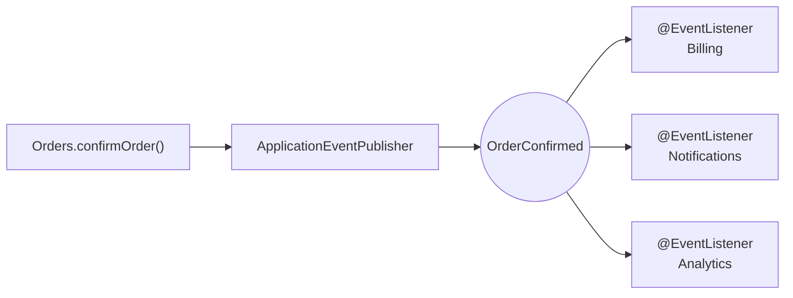
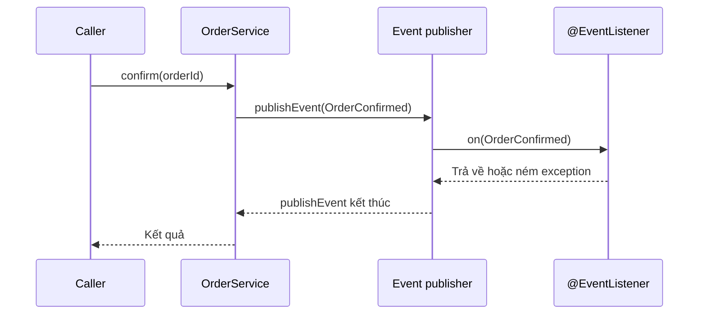
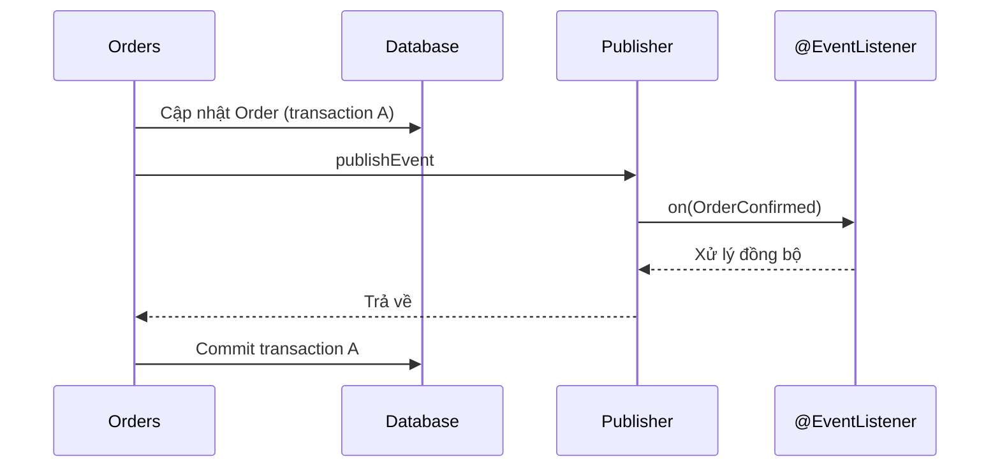
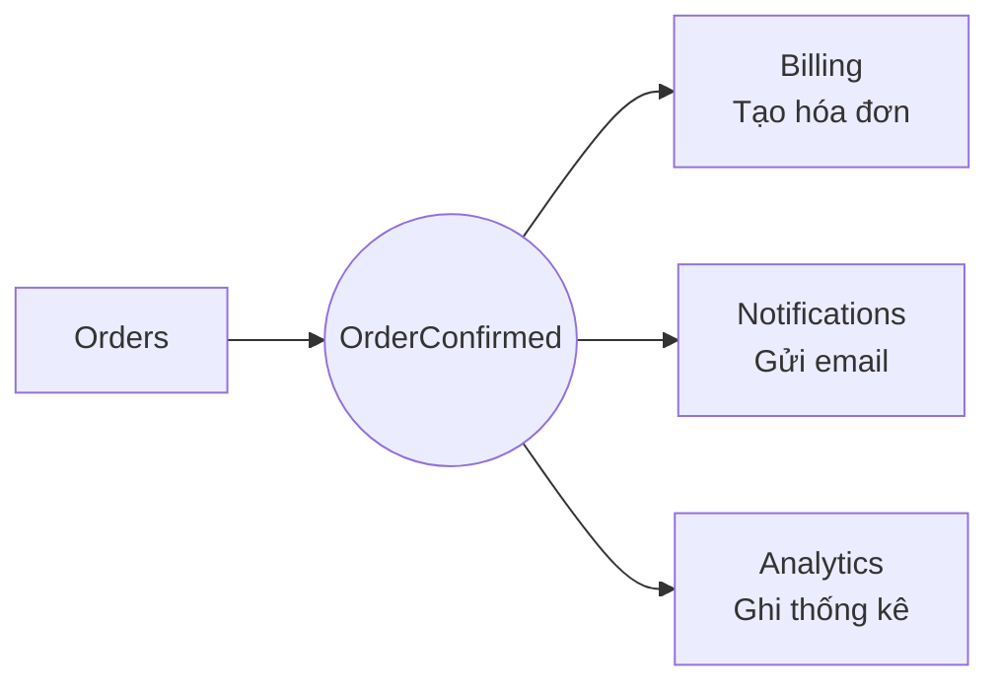
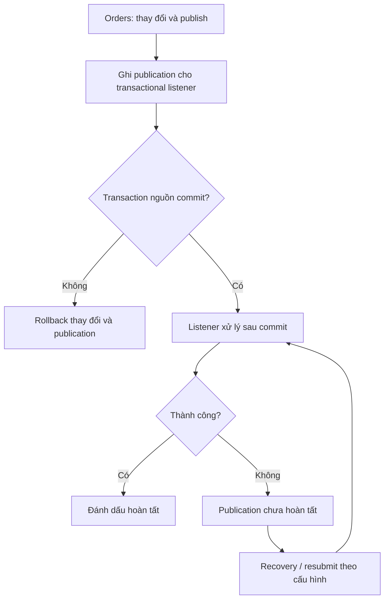

# @EventListener

> **Chương:** Listener và subscriber  
> **Phạm vi:** `SPRING_MODULITH_APPLICATION_EVENTS` — giao tiếp giữa các module Spring Modulith qua application events để giảm phụ thuộc và bảo vệ ranh giới nghiệp vụ. Bài tập trung vào cơ chế `@EventListener` của Spring, sau đó làm rõ khi nào cần `@TransactionalEventListener`, `@ApplicationModuleListener`, Event Publication Registry, retry, kiểm thử và quan sát luồng xử lý đáng tin cậy.

## 1. Mục tiêu: phản ứng với sự kiện mà không gọi trực tiếp module khác

Trong ứng dụng bán hàng, module **Orders** xác nhận đơn hàng. Module **Billing** muốn tạo hóa đơn; **Notifications** muốn gửi thông báo; **Analytics** muốn ghi nhận thống kê. Nếu Orders gọi trực tiếp từng service, việc thêm một phản ứng mới thường buộc sửa code của Orders.

Spring hỗ trợ mô hình publish/subscribe nội bộ bằng hai thành phần:

- `ApplicationEventPublisher` công bố một đối tượng sự kiện.
- `@EventListener` khai báo phương thức sẽ được Spring gọi khi nhận loại sự kiện phù hợp.



Publisher chỉ cần biết `OrderConfirmed`; nó không cần inject từng consumer. Các listener sở hữu hành vi phản ứng của mình, giúp phân chia trách nhiệm giữa module.

**Điều rất quan trọng:** `@EventListener` mặc định là **listener đồng bộ**, thường chạy **ngay trong lời gọi `publishEvent(...)`**. Annotation này **không tự chuyển xử lý sang thread khác**, **không tự đợi transaction commit** và **không tự ghi sự kiện bền vững để retry**. Những đặc tính đó đòi hỏi lựa chọn annotation/cấu hình bổ sung.

## 2. `@EventListener` hoạt động như thế nào?

`@EventListener` là annotation của Spring Framework, dùng để đăng ký một phương thức bean làm listener cho một hoặc nhiều loại application event. Trong quá trình khởi tạo application context, Spring phát hiện các phương thức được annotation và đăng ký adapter xử lý event phù hợp.

Luồng cơ bản:

1. Một bean gọi `ApplicationEventPublisher.publishEvent(event)`.
2. Hệ thống phân phối event của Spring (application event multicaster) tìm các listener phù hợp.
3. Phương thức có `@EventListener` nhận event và thực thi.
4. Theo cấu hình mặc định, lời gọi listener hoàn thành hoặc ném lỗi trước khi `publishEvent(...)` trở về.



Spring có thể được cấu hình dùng multicaster bất đồng bộ, và một listener có thể dùng `@Async`. Vì vậy, **đồng bộ là hành vi mặc định**, không phải bảo đảm bất biến của mọi cấu hình.

### 2.1. Event có cần kế thừa `ApplicationEvent` không?

Không. Spring cho phép công bố cả đối tượng Java thông thường (POJO) hay `record`:

```java
import java.time.Instant;
import java.util.UUID;

public record OrderConfirmed(
        UUID eventId,
        UUID orderId,
        Instant occurredAt
) {}
```

Khi công bố POJO, Spring có cơ chế bao gói phù hợp để phân phối theo kiểu đối tượng sự kiện. Listener vẫn có thể khai báo tham số `OrderConfirmed` trực tiếp.

Đối với Spring Modulith, kiểu event này nên nằm trong **API được phép truy cập** của module Orders nếu Billing/Notifications cần dùng nó. Không đặt entity JPA hoặc repository nội bộ vào event contract.

## 3. Ví dụ tối thiểu: phát và nhận `OrderConfirmed`

### 3.1. Publisher thuộc Orders

```java
package com.acme.shop.orders.internal;

import com.acme.shop.orders.events.OrderConfirmed;
import java.time.Clock;
import java.time.Instant;
import java.util.UUID;
import org.springframework.context.ApplicationEventPublisher;
import org.springframework.stereotype.Service;
import org.springframework.transaction.annotation.Transactional;

@Service
public class OrderService {

    private final OrderRepository orders;
    private final ApplicationEventPublisher events;
    private final Clock clock;

    public OrderService(
            OrderRepository orders,
            ApplicationEventPublisher events,
            Clock clock
    ) {
        this.orders = orders;
        this.events = events;
        this.clock = clock;
    }

    @Transactional
    public void confirm(UUID orderId) {
        Order order = orders.findById(orderId).orElseThrow();

        // true khi vừa có chuyển trạng thái hợp lệ sang CONFIRMED.
        if (!order.confirmIfAllowed()) {
            return;
        }

        events.publishEvent(new OrderConfirmed(
                UUID.randomUUID(),
                order.getId(),
                Instant.now(clock)
        ));
    }
}
```

Ví dụ giả định `Order` là entity đang được quản lý trong transaction; `confirmIfAllowed()` là API nghiệp vụ do dự án định nghĩa. Cần bảo đảm request lặp hoặc hai request đồng thời không tạo nhiều `OrderConfirmed` cho cùng một chuyển trạng thái. Có thể dùng optimistic locking, khóa database hoặc cơ chế concurrency phù hợp.

### 3.2. Listener thuộc một bean của Spring

```java
package com.acme.shop.analytics.internal;

import com.acme.shop.orders.events.OrderConfirmed;
import org.slf4j.Logger;
import org.slf4j.LoggerFactory;
import org.springframework.context.event.EventListener;
import org.springframework.stereotype.Component;

@Component
class OrderAuditListener {

    private static final Logger log =
            LoggerFactory.getLogger(OrderAuditListener.class);

    @EventListener
    public void on(OrderConfirmed event) {
        log.info("Order confirmed: eventId={}, orderId={}",
                event.eventId(), event.orderId());
    }
}
```

Spring quản lý `OrderAuditListener` nhờ `@Component`; sau khi app context khởi tạo, phương thức `on(...)` trở thành event listener. Khi Orders publish `OrderConfirmed`, Spring sẽ gọi phương thức nếu bean và listener đã được đăng ký.

Nếu viết cùng phương thức trong một đối tượng tự khởi tạo bằng `new`, hoặc class không được Spring scan/import, **listener sẽ không tự đăng ký**.

Ở ví dụ này, việc audit chỉ log nên dễ quan sát cơ chế. Với những side effect như email hoặc transaction DB khác, cần cân nhắc thời điểm xử lý và độ tin cậy, không nên chỉ thêm `@EventListener` rồi mặc định an toàn.

## 4. Chữ ký phương thức và cách Spring chọn listener

### 4.1. Một tham số event

Cách thường dùng nhất:

```java
@EventListener
public void on(OrderConfirmed event) {
    // Nhận event thuộc loại OrderConfirmed.
}
```

Spring suy ra loại event từ kiểu tham số. Mỗi event listener method ở dạng thông thường nên có **một tham số event**; nếu cần thêm service/repository, hãy inject qua constructor của bean thay vì thêm chúng thành tham số phương thức.

### 4.2. Khai báo loại event qua `classes`

Có thể khai báo event type tường minh:

```java
@EventListener(classes = OrderConfirmed.class)
public void onConfirmation(OrderConfirmed event) {
    // Tương đương cách suy luận từ tham số trong ví dụ này.
}
```

Khi muốn nhận nhiều loại event và không cần payload trực tiếp, có thể khai báo:

```java
@EventListener(classes = {
        OrderConfirmed.class,
        OrderCancelled.class
})
public void onOrderLifecycleChange() {
    // Một hook chung khi xảy ra một trong hai loại.
}
```

`OrderCancelled` là event giả định khác do Orders công bố. Khi listener cần dữ liệu riêng từng loại, thường rõ ràng hơn nếu dùng hai phương thức có kiểu tham số cụ thể. Việc sử dụng class cha/interface làm kiểu tham số cũng có thể cho phép nhận các subtype phù hợp; cần kiểm tra hợp đồng nếu hệ thống dựa trên generic event type phức tạp.

### 4.3. Chỉ nhận event thỏa điều kiện bằng SpEL

`@EventListener` hỗ trợ thuộc tính `condition` dùng Spring Expression Language (SpEL) để lọc trước khi thực thi:

```java
public record OrderAlert(UUID orderId, boolean urgent) {}

@EventListener(condition = "#root.args[0].urgent()")
public void onUrgentAlert(OrderAlert event) {
    // Chỉ được gọi nếu urgent == true.
}
```

`#root.args[0]` tham chiếu argument đầu tiên của listener. Có thể dùng tên tham số khi có metadata tên tham số phù hợp, nhưng biểu thức dùng `#root.args[0]` rõ ràng khi ví dụ không phụ thuộc cờ biên dịch `-parameters`.

Chỉ dùng `condition` cho điều kiện lọc nhẹ. Quy tắc nghiệp vụ phức tạp, truy vấn DB hoặc điều kiện thay đổi liên tục nên được kiểm tra rõ trong consumer service để dễ test và quan sát.

### 4.4. Listener có thể trả về một event khác

Spring Framework cho phép phương thức `@EventListener` trả về một đối tượng; giá trị trả về không rỗng được công bố như event khác. Với array/collection, các phần tử có thể được công bố như các event riêng:

```java
@EventListener
public InvoiceRequested requestInvoice(OrderConfirmed event) {
    return new InvoiceRequested(event.orderId());
}
```

Đây là ví dụ về **chuỗi phát sự kiện**. Nó có thể hữu ích trong luồng đơn giản nhưng dễ tạo phụ thuộc ngầm, vòng lặp event hoặc thứ tự xử lý khó kiểm soát. Với `@Async`, không nên dựa vào return value của listener để công bố event tiếp theo; khi cần công bố từ xử lý bất đồng bộ, hãy inject `ApplicationEventPublisher` và phát tường minh sau khi xử lý phù hợp.

## 5. Thời điểm thực thi: đồng bộ mặc định

Giả sử `OrderService.confirm()` đang nằm trong transaction:

```java
@Transactional
public void confirm(UUID id) {
    Order order = orders.findById(id).orElseThrow();
    order.confirm();
    publisher.publishEvent(new OrderConfirmed(
            UUID.randomUUID(), id, Instant.now()
    ));
}
```

Khi dùng `@EventListener` thông thường và multicaster mặc định:

1. Listener được gọi **trong lúc `publishEvent(...)` đang chạy**.
2. Transaction của Orders thường **chưa commit**.
3. Listener đồng bộ có thể nhìn thấy trạng thái đang nằm trong persistence context; hệ thống ngoài không nhất thiết nhìn thấy trạng thái đã commit.
4. Lỗi unchecked từ listener có thể truyền về publisher.
5. Nếu exception tiếp tục thoát ra khỏi service `@Transactional`, transaction thường bị rollback theo quy tắc Spring.



Đây là khác biệt quan trọng giữa **thông báo trong cùng lời gọi** và **phản ứng sau khi sự việc đã được commit**. Việc event có tên ở thì quá khứ **không đủ** để bảo đảm database đã commit tại thời điểm listener nhận.

### 5.1. Exception ở listener ảnh hưởng publisher thế nào?

```java
@EventListener
public void on(OrderConfirmed event) {
    throw new IllegalStateException("Cannot update local projection");
}
```

Với listener đồng bộ mặc định, exception này được truyền đến lời gọi `publishEvent`. Nếu không bị bắt và thuộc loại khiến Spring rollback, transaction của Orders có thể rollback. Nếu publisher hoặc tầng khác **bắt lỗi và tiếp tục**, kết quả có thể khác; không nên giả định mọi lỗi listener đều chắc chắn rollback.

Đối với **side effect không thể rollback** như gửi email, gọi HTTP API, ghi hệ thống ngoài, việc chạy trước commit rất rủi ro: email có thể đã gửi nhưng transaction Orders lại rollback. Những phản ứng đó thường nên xử lý **sau commit**.

### 5.2. `@Order` có giải quyết thứ tự listener không?

Có thể đặt `@Order` để định thứ tự gọi trong cơ chế listener đồng bộ của Spring:

```java
@Order(10)
@EventListener
public void first(OrderConfirmed event) {
    // Thường được gọi trước listener có order 20.
}

@Order(20)
@EventListener
public void second(OrderConfirmed event) {
    // Thường được gọi sau listener có order 10.
}
```

Giá trị order nhỏ hơn có ưu tiên cao hơn. Tuy nhiên, **`@Order` không phải cơ chế điều phối workflow có bảo đảm kết thúc theo thứ tự** khi các listener chạy async hoặc thực hiện công việc sau commit trong transaction riêng. Nếu Billing cần hoàn thành trước Notifications, hãy mô hình hóa sự phụ thuộc đó qua event `InvoiceIssued` hoặc một process manager rõ ràng.

## 6. Khi nào `@EventListener` là lựa chọn phù hợp?

`@EventListener` rất tiện cho:

- Phản ứng cục bộ, nhanh, đồng bộ và **được phép** tham gia vào lời gọi hiện tại.
- Cập nhật trạng thái trong cùng transaction khi đó là chủ đích thiết kế và không tạo coupling không mong muốn.
- Ghi log, instrumentation hoặc kiểm tra/thu thập thông tin nhẹ.
- Những event không gắn transaction nhưng chỉ cần phản ứng best-effort.
- Ứng dụng nhỏ cần cơ chế observer rõ ràng mà chưa yêu cầu persist/replay.

Ngược lại, hãy thận trọng với:

- Gửi email, webhook, giao tiếp broker hoặc gọi dịch vụ ngoài.
- Tạo dữ liệu phụ cần được **đảm bảo chỉ sau khi dữ liệu nguồn commit**.
- Công việc dài, nặng CPU/I/O làm chậm request.
- Phản ứng quan trọng phải khôi phục sau crash và retry có kiểm soát.

Các trường hợp sau thường cần `@TransactionalEventListener`, `@ApplicationModuleListener` hoặc kiến trúc tích hợp bền vững tùy yêu cầu.

## 7. `@EventListener` với `@Async`

Nếu muốn listener thực thi bất đồng bộ, Spring có thể kết hợp `@EventListener` và `@Async`. Ví dụ cấu hình executor:

```java
package com.acme.shop.config;

import java.util.concurrent.Executor;
import org.springframework.context.annotation.Bean;
import org.springframework.context.annotation.Configuration;
import org.springframework.scheduling.annotation.EnableAsync;
import org.springframework.scheduling.concurrent.ThreadPoolTaskExecutor;

@Configuration
@EnableAsync
class EventAsyncConfiguration {

    @Bean("eventExecutor")
    Executor eventExecutor() {
        ThreadPoolTaskExecutor executor = new ThreadPoolTaskExecutor();
        executor.setCorePoolSize(2);
        executor.setMaxPoolSize(4);
        executor.setQueueCapacity(100);
        executor.setThreadNamePrefix("event-");
        executor.initialize();
        return executor;
    }
}
```

Listener:

```java
@Async("eventExecutor")
@EventListener
public void on(OrderConfirmed event) {
    analytics.record(event.orderId());
}
```

Với async được kích hoạt và bean/method được Spring quản lý:

- Publisher thường không đợi công việc listener hoàn tất.
- Lỗi xảy ra trong listener async không đơn giản truyền ngược về transaction/HTTP response của publisher.
- Thread của listener không mặc định chia sẻ transaction context của thread publisher.
- MDC, trace context hoặc security context không mặc định được truyền đầy đủ; cần cấu hình propagation và xác thực quyền phù hợp.
- Executor có giới hạn pool/queue; khi đầy, phải thiết kế hành vi từ chối và cách quan sát lỗi.
- Một listener async không mặc định được ghi bền vững để tự retry sau khi tiến trình chết.

**Cảnh báo:** `@Async @EventListener` **không** đồng nghĩa “sau commit”. Task có thể chạy **trước khi transaction nguồn commit**, đọc không thấy dữ liệu mới hoặc thực hiện side effect cho một transaction sau đó rollback. Nếu cần hậu commit, chọn loại listener gắn với transaction phase.

## 8. So sánh ba loại listener trong Spring Modulith

| Tiêu chí | `@EventListener` | `@TransactionalEventListener` | `@ApplicationModuleListener` |
|---|---|---|---|
| Nguồn gốc | Spring Framework | Spring Framework | Spring Modulith |
| Thời điểm mặc định | Khi publish | `AFTER_COMMIT` | Sau commit |
| Đồng bộ / bất đồng bộ | Đồng bộ mặc định | Không tự async | Kết hợp async |
| Transaction listener | Thường cùng ngữ cảnh gọi khi đồng bộ | Gắn với phase, sau commit cần transaction riêng nếu ghi dữ liệu mới | Mở transaction mới cho phản ứng |
| Lúc publisher rollback | Listener có thể đã chạy trước rollback | `AFTER_COMMIT` không chạy | Không xử lý sau commit |
| Lúc publish ngoài transaction | Vẫn có thể chạy | Mặc định không chạy, trừ `fallbackExecution = true` | Cần transaction nguồn để xử lý theo ngữ nghĩa sau commit |
| Registry theo dõi publication | Không mặc định | Có thể được theo dõi khi có Spring Modulith registry phù hợp | Có thể được theo dõi khi registry được cấu hình |
| Trường hợp dùng | Phản ứng nội bộ đồng bộ, nhẹ | Phản ứng theo transaction phase | Giao tiếp liên module sau commit, transaction riêng |

### 8.1. `@TransactionalEventListener`: chỉ phản ứng sau commit

Ví dụ Notifications chỉ muốn gửi thông báo khi Orders đã commit:

```java
@Component
class OrderNotificationListener {

    private final NotificationGateway notifications;

    OrderNotificationListener(NotificationGateway notifications) {
        this.notifications = notifications;
    }

    @TransactionalEventListener(phase = TransactionPhase.AFTER_COMMIT)
    public void on(OrderConfirmed event) {
        notifications.sendOrderConfirmed(event.orderId());
    }
}
```

`AFTER_COMMIT` là mặc định của `@TransactionalEventListener`. Nếu publisher chạy ngoài transaction, listener loại này **mặc định bỏ qua event** trừ khi cấu hình `fallbackExecution = true`. Các phase khác gồm `BEFORE_COMMIT`, `AFTER_ROLLBACK` và `AFTER_COMPLETION`.

Callback sau commit vẫn có thể liên quan tài nguyên transaction cũ. Nếu listener phải **ghi dữ liệu DB mới và commit**, hãy mở transaction mới, ví dụ gọi service Spring có `@Transactional(propagation = Propagation.REQUIRES_NEW)`. Điều này khác với việc listener chỉ gửi tín hiệu ra ngoài.

`@TransactionalEventListener` tự nó **không bảo đảm bất đồng bộ**. Nếu cần chạy trên thread khác, phải thiết kế async và error handling phù hợp.

### 8.2. `@ApplicationModuleListener`: tiện ích cho phản ứng giữa module

Trong Spring Modulith:

```java
@Component
class InvoiceCreationListener {

    private final InvoiceService invoices;

    InvoiceCreationListener(InvoiceService invoices) {
        this.invoices = invoices;
    }

    @ApplicationModuleListener
    public void on(OrderConfirmed event) {
        invoices.createIfAbsent(event.orderId(), event.eventId());
    }
}
```

`@ApplicationModuleListener` kết hợp semantics của transactional event listener sau commit, `@Async` và transaction mới (tương đương `REQUIRES_NEW` cho xử lý). Điều này phù hợp khi module Billing cần phản ứng độc lập với transaction đã commit ở Orders.

Tuy nhiên, vẫn phải cấu hình executor/async execution phù hợp, bảo đảm dữ liệu Billing chống trùng và cấu hình publication store nếu cần recovery. **Không có annotation nào tự bảo đảm exactly-once end-to-end.**

## 9. Ranh giới module: listener chỉ phụ thuộc API được công khai

Trong Spring Modulith, việc Billing có thể lắng nghe event của Orders không có nghĩa Billing được phép truy cập repository hoặc entity nội bộ của Orders.

Ví dụ cấu trúc:

```text
com.acme.shop
├── orders
│   ├── events
│   │   ├── package-info.java
│   │   └── OrderConfirmed.java
│   └── internal
│       ├── OrderService.java
│       └── OrderRepository.java
└── billing
    ├── package-info.java
    └── internal
        └── InvoiceCreationListener.java
```

Khai báo package contract:

```java
// orders/events/package-info.java
@org.springframework.modulith.NamedInterface("events")
package com.acme.shop.orders.events;
```

Khai báo giới hạn phụ thuộc bên Billing:

```java
// billing/package-info.java
@org.springframework.modulith.ApplicationModule(
        allowedDependencies = "orders::events"
)
package com.acme.shop.billing;
```

Billing có thể import `OrderConfirmed` qua named interface, nhưng không được import `orders.internal.OrderRepository` theo ranh giới closed module. Event contract nên mang immutable value và ID thay vì entity JPA để tránh rò rỉ implementation.

`ApplicationModules.verify()` giúp kiểm chứng ranh giới API/named interface và vòng phụ thuộc module; nó **không** kiểm chứng transaction phase, retry hay side effect của listener. Cần các integration test riêng cho các tính chất đó.

## 10. Một event có nhiều listener: fan-out và tính độc lập

Khi Orders phát `OrderConfirmed`, có thể có nhiều listener độc lập. Một listener có thể xử lý thành công trong khi listener khác thất bại, đặc biệt khi xử lý sau commit/async.



Những điểm cần quyết định:

| Câu hỏi | Ảnh hưởng |
|---|---|
| Lỗi Billing có cần làm thất bại xác nhận Orders không? | Quyết định cùng transaction hay phản ứng sau commit |
| Notifications có cần đợi Billing phát hành hóa đơn không? | Cần event `InvoiceIssued` hoặc orchestration nếu có dependency |
| Analytics có chấp nhận chậm vài giây không? | Cho phép async và eventual consistency |
| Một listener cần retry bao nhiêu lần? | Quy định độ bền, backoff, cảnh báo và ngưỡng dừng |
| Listener nào có độ ưu tiên nghiệp vụ cao? | Thiết kế monitoring/SLA riêng từng consumer |

**Không sử dụng thứ tự `@Order` của các listener để mô hình hóa quan hệ phụ thuộc nghiệp vụ dài hạn.** Khi chuyển sang async, sau commit hoặc retry, thứ tự hoàn tất có thể khác. Nếu Notifications chỉ nên gửi sau khi Billing đã lập hóa đơn, có thể dùng event `InvoiceIssued` do Billing công bố sau khi hoàn tất.

## 11. Xử lý lỗi, retry và Event Publication Registry

Với `@EventListener` thông thường, nếu listener đồng bộ ném exception thì lỗi thường truyền về publisher. Nếu listener dùng `@Async`, task có thể lỗi sau khi publisher đã trở về. Cả hai cách **không tự tạo một hàng đợi bền vững**.

Spring Modulith cung cấp **Event Publication Registry** để theo dõi publication dành cho những transactional event listener phù hợp khi đã cấu hình cơ chế lưu. Trong một thiết kế dùng persistent publication store:

1. Publisher thay đổi dữ liệu nghiệp vụ và phát event trong transaction.
2. Những publication cần xử lý được ghi với transaction nguồn theo cơ chế hỗ trợ.
3. Sau commit, transactional listener chạy.
4. Publication được đánh dấu hoàn tất sau khi listener thành công.
5. Publication chưa hoàn tất có thể được tìm và resubmit theo chính sách/cấu hình phù hợp.



**Phân biệt quan trọng:** Event Publication Registry **không mặc định theo dõi mọi phương thức có `@EventListener` đồng bộ**. Một listener chỉ dùng `@EventListener` không tự nhận bảo đảm publication bền vững. Muốn dùng registry/retry cho phản ứng cần độ tin cậy, phải chọn listener transactional và cấu hình store, transaction, xử lý lại phù hợp với phiên bản Spring Modulith đang dùng.

### 11.1. Vì sao phải idempotent dù có registry?

Giả sử Billing đã commit invoice, nhưng tiến trình chết trước khi publication của listener được đánh dấu hoàn tất. Registry có thể resubmit, khiến Billing nhận lại cùng `OrderConfirmed`.

Ví dụ consumer:

```java
@Service
public class InvoiceService {

    private final InvoiceRepository invoices;

    public InvoiceService(InvoiceRepository invoices) {
        this.invoices = invoices;
    }

    @Transactional
    public void createIfAbsent(UUID orderId, UUID eventId) {
        if (invoices.existsByOrderId(orderId)) {
            return;
        }
        invoices.save(Invoice.forOrder(orderId, eventId));
    }
}
```

Nếu nghiệp vụ yêu cầu **một hóa đơn trên một đơn**, cần thêm **unique constraint trên `invoice.order_id`**. Việc kiểm tra `existsByOrderId` trước khi insert không bảo vệ tuyệt đối khi hai listener chạy đồng thời.

`eventId` dùng để nhận biết cùng một instance event; `orderId` là khóa bất biến nghiệp vụ phù hợp trong ví dụ. Với email, thanh toán hoặc side effect bên ngoài, cần idempotency key của API đích hoặc cơ chế đối soát và bù trừ. **Registry và retry không bảo đảm exactly-once**.

### 11.2. Đừng làm mất dấu lỗi của listener

Nếu listener bắt exception rồi chỉ ghi log và trả về bình thường, hệ thống theo dõi có thể coi lần xử lý đó là **thành công** dù nghiệp vụ chưa được thực hiện:

```java
@ApplicationModuleListener
public void on(OrderConfirmed event) {
    try {
        invoices.createIfAbsent(event.orderId(), event.eventId());
    } catch (RuntimeException ex) {
        log.error("Failed to create invoice", ex);
        // Nuốt lỗi khiến hạ tầng có thể ghi nhận listener đã hoàn tất.
    }
}
```

Nếu muốn publication còn ở trạng thái chưa hoàn tất để retry, cần để lỗi đi qua theo cơ chế framework và chính sách đã cấu hình (hoặc chủ động ghi trạng thái/điều phối retry bằng một cơ chế khác được thiết kế rõ). Phân loại lỗi có thể retry và lỗi nghiệp vụ vĩnh viễn; đừng retry vô hạn không kiểm soát.

## 12. Kiểm thử `@EventListener` và hành vi transaction

Một bài kiểm thử tốt cần phân biệt **event được phát**, **listener có nhận**, **side effect được commit** và **sự kiện có thể xử lý lại sau lỗi**.

### 12.1. Kiểm thử publisher bằng `PublishedEvents`

Spring Modulith cung cấp `@ApplicationModuleTest` và `PublishedEvents` để xác minh loại và payload event đã được công bố:

```java
@ApplicationModuleTest
class OrderPublicationTests {

    @Autowired
    OrderService orders;

    @Test
    void publishesOnValidConfirmation(PublishedEvents publishedEvents) {
        UUID orderId = prepareConfirmableOrder();

        orders.confirm(orderId);

        assertThat(publishedEvents.ofType(OrderConfirmed.class)
                .matching(OrderConfirmed::orderId, orderId))
                .hasSize(1);
    }

    private UUID prepareConfirmableOrder() {
        // Dự án cần triển khai fixture dữ liệu đơn hàng thật.
        throw new UnsupportedOperationException("Implement test fixture");
    }
}
```

Đây là khung minh họa; cần thêm imports, fixture và dependency test tương ứng. Kiểm tra thêm đơn không hợp lệ, đơn đã confirmed và request lặp để bảo đảm publisher không phát event ngoài ý định.

### 12.2. Kiểm thử listener đồng bộ

Với `@EventListener` mặc định, một integration test có thể phát event từ `ApplicationEventPublisher` rồi xác minh bean listener được gọi trước khi lời gọi publish kết thúc. Nếu listener throw, kiểm tra exception có truyền đến publisher hay không theo multicaster cấu hình thực tế.

Với test đang dùng transaction, hãy quyết định rõ có cần commit không. Một `@EventListener` đồng bộ có thể chạy **trước commit**, nên test chỉ phát và nhận event không chứng minh dữ liệu nguồn đã commit.

### 12.3. Kiểm thử sau commit và async

Với `@TransactionalEventListener(AFTER_COMMIT)` và `@ApplicationModuleListener`:

- Tạo **transaction nguồn thật sự commit**. Nếu test method bị annotation `@Transactional` và framework rollback khi kết thúc, callback `AFTER_COMMIT` có thể không chạy.
- Với async, chờ theo **điều kiện kết quả** bằng `Scenario` của Spring Modulith hoặc thư viện polling có timeout thay vì `Thread.sleep(...)` cố định.
- Thử rollback nguồn để xác minh listener sau commit không thực hiện side effect.
- Mô phỏng listener lỗi, kiểm tra publication chưa hoàn tất và resubmit với persistent publication store thực tế.
- Phát lại cùng event để kiểm tra idempotency và unique constraint.

### 12.4. Kiểm thử ranh giới module

```java
import org.junit.jupiter.api.Test;
import org.springframework.modulith.core.ApplicationModules;

class ModuleBoundaryTests {

    @Test
    void modulesRespectBoundaries() {
        ApplicationModules.of(ShopApplication.class).verify();
    }
}
```

Test này giúp phát hiện phụ thuộc bất hợp lệ giữa module, chứ không kiểm tra lỗi gửi email hoặc độ tin cậy của transaction.

## 13. Quan sát listener và điều tra lỗi

Trong hệ thống có nhiều consumer, việc publisher trả HTTP 200 **không chứng minh** mọi phản ứng sau commit/async đã hoàn thành. Mỗi listener cần những tín hiệu có thể theo dõi:

| Tín hiệu | Ví dụ | Giá trị |
|---|---|---|
| **Event identity** | `eventId`, `eventType` | Biết instance nào đang được xử lý |
| **Business identity** | `orderId` | Truy theo nghiệp vụ |
| **Listener identity** | `InvoiceCreationListener` | Xác định consumer chịu trách nhiệm |
| **Transaction outcome** | committed/rolled back | Phân biệt rollback nguồn với lỗi consumer |
| **Processing outcome** | succeeded/failed/retrying | Biết bước nào còn tồn |
| **Latency** | Thời gian từ phát đến hoàn tất | Đo mức eventual consistency |
| **Registry backlog** | Số publication chưa hoàn tất, tuổi lớn nhất | Phát hiện lỗi dai dẳng |
| **Correlation** | `correlationId`, tracing context | Nối request với các xử lý sau đó |

Mẫu log có cấu trúc:

```json
{
  "eventType": "OrderConfirmed",
  "eventId": "f7e62d29-3a0e-4704-9dbd-41f53a723031",
  "orderId": "1d41811e-87a7-4f24-b7e1-7436b599177d",
  "listener": "InvoiceCreationListener",
  "outcome": "FAILED",
  "errorCategory": "DATABASE_TIMEOUT"
}
```

Đây là schema log **do ứng dụng lựa chọn**, không phải format Spring Modulith mặc định. Tránh ghi thông tin nhạy cảm trong payload; tránh đưa ID có cardinality rất cao như `eventId` hoặc `orderId` vào **metrics labels**. Những ID này phù hợp hơn ở structured logs và trace attributes.

Khi dùng `@Async`, MDC và trace context có thể không tự truyền sang thread khác. Với xử lý lại sau restart, ngữ cảnh request ban đầu cũng có thể biến mất; vì thế correlation phục vụ nghiệp vụ nên được lưu ổn định trong event hoặc metadata được persist.

## 14. Các lỗi thường gặp khi sử dụng `@EventListener`

| Lỗi hoặc giả định sai | Hệ quả | Cách khắc phục |
|---|---|---|
| Tưởng `@EventListener` mặc định async | Request bị block bởi listener dài | Kiểm tra dispatch; chọn async phù hợp |
| Tưởng listener luôn chạy sau commit | Gửi email cho transaction sau đó rollback | Dùng `@TransactionalEventListener(AFTER_COMMIT)` |
| Viết listener ở object không do Spring quản lý | Method không được đăng ký | Dùng `@Component`/`@Bean` và component scan đúng |
| Thêm nhiều tham số service vào handler | Listener method không đúng cách binding event | Inject dependencies qua constructor |
| Dùng `@Async` nhưng không cấu hình async/executor | Hành vi không đúng kỳ vọng hoặc dùng tài nguyên không phù hợp | Bật/cấu hình async và test |
| Dựa vào `@Order` để điều phối workflow async | Thứ tự hoàn tất không được bảo đảm | Dùng event tiếp theo hoặc orchestration |
| Để listener đồng bộ gọi hệ thống ngoài | Side effect không rollback theo DB nguồn | Chọn sau commit/outbox phù hợp |
| Bắt và nuốt exception trong listener đáng tin cậy | Publication có thể bị đánh dấu hoàn tất dù nghiệp vụ lỗi | Thiết kế error propagation/retry tường minh |
| Tưởng `@EventListener` tự được Event Publication Registry theo dõi | Crash có thể mất phản ứng | Dùng transactional listener và persistent store phù hợp |
| Listener tạo invoice khi nhận event bị lặp | Invoice hoặc thanh toán trùng | Idempotency, khóa unique và test concurrency |
| Đưa entity của Orders vào event contract | Consumer phụ thuộc implementation nguồn | Public immutable event với ID/snapshot cần thiết |
| Dựa vào sự kiện như query lấy kết quả tức thì | Không rõ luồng điều khiển và trạng thái trả về | Gọi API công khai khi thực sự cần kết quả đồng bộ |

## 15. Bài thực hành: chuyển từ lời gọi trực tiếp sang listener

**Bài toán:** ứng dụng Spring Boot/Spring Modulith có các module `Orders`, `Billing` và `Notifications`. Orders xác nhận đơn; Billing cần lập hóa đơn; Notifications cần gửi xác nhận. Mục tiêu là giảm phụ thuộc trực tiếp, giữ ranh giới module và xử lý phản ứng đáng tin cậy.

**Các bước:**

1. Định nghĩa `OrderConfirmed(eventId, orderId, occurredAt)` dưới package API/named interface của Orders.
2. Trong `OrderService.confirm`, phát event chỉ sau khi chuyển trạng thái hợp lệ trong transaction.
3. Viết một `@EventListener` đồng bộ để **log** event và quan sát thứ tự thực thi so với lời gọi `publishEvent`.
4. Viết test buộc listener đồng bộ ném exception; kiểm tra publisher/transaction bị ảnh hưởng ra sao.
5. Thêm một `@EventListener(condition = "...")` cho event cảnh báo riêng và xác minh chỉ event phù hợp được xử lý.
6. Chuyển listener tạo hóa đơn sang `@ApplicationModuleListener`; kiểm tra transaction nguồn commit trước khi tạo invoice.
7. Chuyển phản ứng gửi thông báo sang `@TransactionalEventListener(AFTER_COMMIT)` hoặc một cơ chế hậu commit có retry phù hợp.
8. Cấu hình executor nếu dùng async; giới hạn kích thước queue và quan sát khi task thất bại/từ chối.
9. Nếu nghiệp vụ cần phục hồi, cấu hình Event Publication Registry với persistence và chính sách resubmit theo phiên bản Spring Modulith.
10. Bổ sung unique constraint `invoice.order_id`, thử xử lý lại event và xác minh không tạo hóa đơn trùng.
11. Viết `ApplicationModules.verify()` và integration test cho commit/rollback, listener async, registry recovery.
12. Bổ sung log theo `eventId`, metric theo event type/listener và cảnh báo publication tồn đọng.

### 15.1. Tiêu chí nghiệm thu

| Tiêu chí | Cách xác minh |
|---|---|
| Orders không phụ thuộc trực tiếp service Billing | Kiểm tra import/constructor và test module |
| `@EventListener` được đăng ký đúng | Integration test publish và nhận event |
| Listener đồng bộ chạy trong lời gọi publish mặc định | Test thứ tự call và exception |
| Không có thông báo cho transaction rollback | Test callback sau commit |
| Billing tạo hóa đơn sau commit nguồn | Integration test transaction thực tế |
| Xử lý lặp không nhân đôi invoice | Test idempotency và unique constraint |
| Publication lỗi có thể được phát hiện/retry khi cấu hình | Test persistent registry và recovery |
| Có thể truy dấu event và listener bị lỗi | Structured logs, metrics và tracing |

### Câu hỏi tự kiểm tra

1. `@EventListener` của Spring được đăng ký trên một method của đối tượng như thế nào?
2. Vì sao mặc định `@EventListener` có thể chạy trước khi transaction publisher commit?
3. Spring chọn listener theo kiểu event và `condition` như thế nào?
4. `@Order` có đảm bảo hai listener bất đồng bộ hoàn thành đúng thứ tự không?
5. Khác biệt giữa `@Async @EventListener` và `@TransactionalEventListener(AFTER_COMMIT)`?
6. Khi nào `@ApplicationModuleListener` phù hợp hơn `@EventListener` thuần?
7. Vì sao Event Publication Registry không mặc định bảo đảm xử lý cho mọi listener đồng bộ?
8. Làm sao thiết kế một listener tạo hóa đơn có thể chạy lại mà không sinh hóa đơn trùng?
9. Vì sao test mặc định rollback không chứng minh listener `AFTER_COMMIT` hoạt động?
10. Khi request trả về thành công nhưng Billing chưa có hóa đơn, cần xem những tín hiệu quan sát nào?

## 16. Ghi nhớ

`@EventListener` là cơ chế khai báo một phương thức listener cho **application event** trong Spring. Nó giúp các module phản ứng với event mà publisher không phải gọi trực tiếp từng consumer. **Mặc định phương thức chạy đồng bộ khi publish**, thường trong ngữ cảnh giao dịch hiện tại, nên exception và side effect của listener có thể ảnh hưởng tới publisher.

Trong Spring Modulith, khi phản ứng chỉ được phép xảy ra **sau khi dữ liệu nguồn commit** hoặc cần xử lý **bất đồng bộ trong transaction mới**, hãy chọn `@TransactionalEventListener` hoặc `@ApplicationModuleListener` theo đúng ngữ nghĩa. Nếu cần phục hồi khi lỗi, bổ sung **Event Publication Registry với kho lưu bền vững**, retry, idempotency, kiểm thử commit/rollback và quan sát theo từng consumer. Ranh giới module và hợp đồng event công khai vẫn cần được giữ rõ ràng.

### Tài liệu tham khảo

- [Spring Framework — Application Events](https://docs.spring.io/spring-framework/reference/core/beans/context-introduction.html#context-functionality-events): `ApplicationEventPublisher`, `@EventListener`, `condition` và `@Order`.
- [Spring Framework — Transaction-bound Events](https://docs.spring.io/spring-framework/reference/data-access/transaction/event.html): `@TransactionalEventListener`, transaction phases và fallback execution.
- [Spring Framework — Annotation-driven Asynchronous Execution](https://docs.spring.io/spring-framework/reference/integration/scheduling.html#scheduling-annotation-support-async): `@EnableAsync`, `@Async` và executor.
- [Spring Modulith — Working with Application Events](https://docs.spring.io/spring-modulith/reference/events.html): `@ApplicationModuleListener` và Event Publication Registry.
- [Spring Modulith — Testing Application Modules](https://docs.spring.io/spring-modulith/reference/testing.html): `@ApplicationModuleTest`, `PublishedEvents` và `Scenario`.
