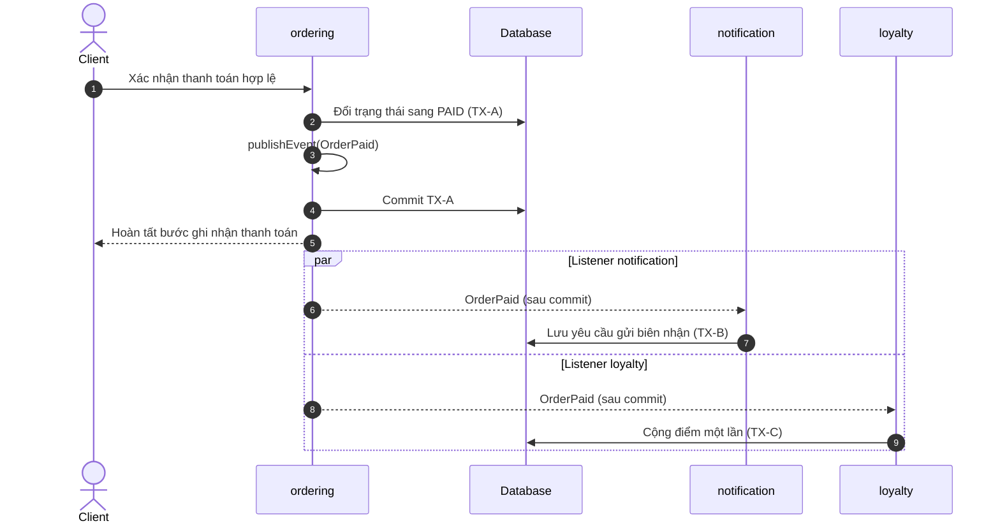
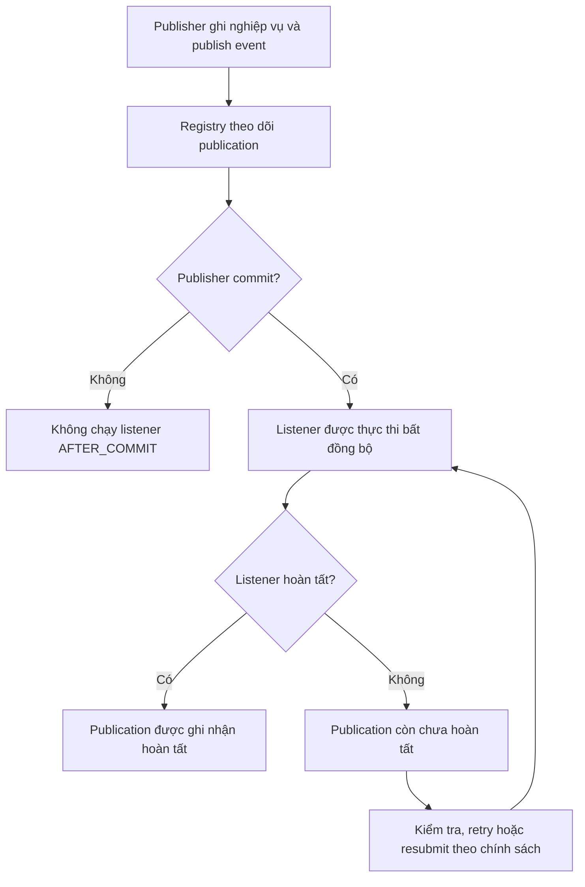
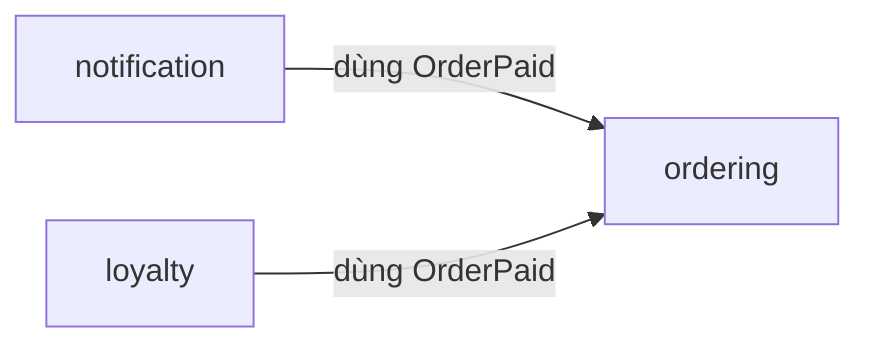

# @ApplicationModuleListener trong Spring Modulith

## 1. Vì sao cần listener chuyên dụng cho giao tiếp giữa các module?

Trong một ứng dụng Spring Boot theo kiến trúc **modular monolith**, nhiều application module cùng chạy trong một tiến trình nhưng có trách nhiệm nghiệp vụ riêng. Chẳng hạn, module `ordering` quản lý đơn hàng; `notification` tạo yêu cầu gửi email; `loyalty` tính điểm thành viên. Khi đơn hàng đã thanh toán thành công, `ordering` có thể công bố sự kiện `OrderPaid` để các module còn lại tự quyết định cách phản ứng.

Một giải pháp đơn giản là gọi trực tiếp `NotificationService` và `LoyaltyService` từ `OrderingService`. Nhưng khi đó module `ordering` phải biết tới các service của những module khác, dễ kéo theo phụ thuộc chéo và quy trình thanh toán phải chờ những tác vụ phụ. Nếu xử lý thông báo lỗi, câu hỏi “có nên rollback giao dịch thanh toán?” cũng trở nên khó trả lời.

**`@ApplicationModuleListener`** là annotation của **Spring Modulith** dùng để khai báo một phương thức lắng nghe application event theo cách phù hợp với giao tiếp giữa các application module: **xử lý sự kiện sau commit, bất đồng bộ và trong một giao dịch riêng**.

Trong phạm vi module học `SPRING_MODULITH_APPLICATION_EVENTS`, đây là một công cụ quan trọng để bảo vệ ranh giới nghiệp vụ, tổ chức publisher/listener, phối hợp sau commit và kết hợp Event Publication Registry, retry, idempotency, kiểm thử và quan sát.

> Ý tưởng chính: module phát công bố một **sự thật nghiệp vụ đã xảy ra**; listener thuộc module nhận sẽ xử lý phần việc của mình sau khi giao dịch của publisher hoàn tất thành công. Listener không được tự động hiểu là một phần của cùng giao dịch với publisher.

## 2. `@ApplicationModuleListener` thực chất kết hợp những cơ chế nào?

`@ApplicationModuleListener` nằm trong package `org.springframework.modulith.events`. Về ý nghĩa, annotation này kết hợp những khả năng mà với Spring Framework thông thường có thể biểu diễn bằng:

```java
@Async
@TransactionalEventListener
@Transactional(propagation = Propagation.REQUIRES_NEW)
public void on(OrderPaid event) {
    // Xử lý event ở module nhận.
}
```

Các annotation trong đoạn trên mô tả **ngữ nghĩa tương đương**, không phải yêu cầu viết thêm ba annotation khi đã dùng `@ApplicationModuleListener`. Thành phần `@TransactionalEventListener` dùng phase mặc định `AFTER_COMMIT`; `@Async` cho phép thực thi bất đồng bộ; `REQUIRES_NEW` yêu cầu một transaction riêng cho công việc của listener.

| Đặc tính | Ý nghĩa với `@ApplicationModuleListener` | Hệ quả cần nhớ |
| --- | --- | --- |
| Transactional event listener | Phản ứng ở phase sau commit của giao dịch phát event | Nếu transaction publisher rollback, listener này không xử lý sự kiện |
| Asynchronous listener | Listener được lên lịch xử lý qua hạ tầng async | Publisher không phải chờ listener hoàn thành; thứ tự hoàn tất không được mặc định bảo đảm |
| Giao dịch riêng | Xử lý của listener tham gia transaction mới, độc lập với transaction đã commit của publisher | Listener lỗi không thể tự rollback dữ liệu publisher |
| Spring application event | Nhận object event do `ApplicationEventPublisher` phát trong ứng dụng | Không tự động là Kafka/RabbitMQ hoặc lời gọi giữa các tiến trình |
| Tích hợp hạ tầng sự kiện Modulith | Có thể kết hợp Event Publication Registry cho transactional listener | Registry phải được cấu hình và cần cơ chế phục hồi phù hợp |

`@ApplicationModuleListener` không phải một message broker, một distributed transaction coordinator hay sự bảo đảm xử lý **exactly once**. Nó là cách thuận tiện để khai báo listener theo đúng ranh giới module và transaction.

## 3. So sánh với các listener khác trong Spring

Đừng nhầm ba lựa chọn này:

| Annotation | Cách xử lý mặc định | Khi nào phù hợp |
| --- | --- | --- |
| `@EventListener` | Với event multicaster mặc định, lời gọi listener thường đồng bộ tại lúc publish, kể cả khi transaction chưa commit | Phản ứng đơn giản trong cùng lời gọi hoặc không cần phụ thuộc commit |
| `@TransactionalEventListener` | Mặc định `AFTER_COMMIT`; **không mặc nhiên bất đồng bộ**, không tự mở một transaction mới cho nghiệp vụ listener | Khi muốn tự kiểm soát phase như `BEFORE_COMMIT`, `AFTER_COMMIT`, `AFTER_ROLLBACK` |
| `@ApplicationModuleListener` | Listener sau commit, bất đồng bộ, giao dịch riêng theo quy ước Spring Modulith | Module khác phản ứng với sự kiện nghiệp vụ đã commit |

Ví dụ khi cần một listener chỉ ghi nhận kết quả sau rollback:

```java
import org.springframework.transaction.event.TransactionPhase;
import org.springframework.transaction.event.TransactionalEventListener;

@TransactionalEventListener(phase = TransactionPhase.AFTER_ROLLBACK)
public void onFailedTransaction(PaymentAttempted event) {
    // Ví dụ riêng về phase AFTER_ROLLBACK, không phải hành vi của
    // @ApplicationModuleListener.
}
```

Đây chỉ là ví dụ về một phase khác. Với `@ApplicationModuleListener`, mục đích thông thường là phản ứng **sau khi giao dịch nguồn đã commit**. Nếu nghiệp vụ cần một kết quả ngay trong cùng transaction để quyết định commit/rollback, gọi public API đồng bộ thường minh bạch hơn.

## 4. Ví dụ xuyên suốt: thanh toán đơn hàng rồi gửi thông báo

Giả sử ứng dụng có ba module:

- `ordering` sở hữu trạng thái đơn hàng và công bố `OrderPaid` sau khi ghi nhận thanh toán hợp lệ.
- `notification` nhận `OrderPaid` và tạo yêu cầu gửi biên nhận.
- `loyalty` nhận cùng event để cộng điểm thành viên theo quy tắc riêng.

Cấu trúc package mặc định của Spring Modulith có thể như sau:

```text
com.example.shop
├── ShopApplication.java
├── ordering/
│   ├── OrderPaid.java                   # Public event contract
│   └── internal/
│       ├── OrderPaymentService.java
│       └── OrderRepository.java
├── notification/
│   └── internal/
│       ├── PaidOrderNotificationListener.java
│       └── NotificationRequestRepository.java
└── loyalty/
    └── internal/
        ├── PaidOrderPointsListener.java
        └── LoyaltyPointsService.java
```

Theo cách tổ chức module mặc định, các package `ordering`, `notification`, `loyalty` là ba application module con trực tiếp dưới package ứng dụng. Các consumer được phép phụ thuộc vào kiểu `ordering.OrderPaid` thuộc **public API**; chúng không import `ordering.internal.OrderRepository`.

### 4.1. Hợp đồng sự kiện do module phát sở hữu

```java
// com/example/shop/ordering/OrderPaid.java
package com.example.shop.ordering;

import java.time.Instant;
import java.util.Objects;
import java.util.UUID;

public record OrderPaid(
        UUID eventId,
        UUID orderId,
        UUID customerId,
        Instant occurredAt) {

    public OrderPaid {
        Objects.requireNonNull(eventId, "eventId");
        Objects.requireNonNull(orderId, "orderId");
        Objects.requireNonNull(customerId, "customerId");
        Objects.requireNonNull(occurredAt, "occurredAt");
    }
}
```

`OrderPaid` là sự thật đã thanh toán thành công theo quy tắc của `ordering`; nó không mang lệnh “hãy gửi email” hay “hãy cộng 20 điểm”. `eventId` định danh **một lần xảy ra** của event, còn `orderId` định danh đơn hàng. Khi cùng event được giao lại, `eventId` phải giữ nguyên để consumer nhận ra nó.

Contract không chứa JPA entity, repository, bean Spring hay object mutable từ nội bộ. Nếu listener thực sự cần dữ liệu khác, nên bổ sung trường có ý nghĩa hoặc cung cấp public query API thích hợp, tránh phá ranh giới module.

### 4.2. Publisher ghi thay đổi trong transaction

```java
// com/example/shop/ordering/internal/OrderPaymentService.java
package com.example.shop.ordering.internal;

import com.example.shop.ordering.OrderPaid;
import java.time.Instant;
import java.util.UUID;
import org.springframework.context.ApplicationEventPublisher;
import org.springframework.stereotype.Service;
import org.springframework.transaction.annotation.Transactional;

@Service
class OrderPaymentService {

    private final OrderRepository orders;
    private final ApplicationEventPublisher events;

    OrderPaymentService(OrderRepository orders,
                        ApplicationEventPublisher events) {
        this.orders = orders;
        this.events = events;
    }

    @Transactional
    public void recordSuccessfulPayment(UUID orderId) {
        PaymentRecording result = orders.markPaidIfEligible(orderId);

        if (result == PaymentRecording.ALREADY_PAID) {
            return; // Retry command không tạo OrderPaid mới.
        }
        if (result != PaymentRecording.CHANGED_TO_PAID) {
            throw new IllegalStateException("Order cannot be marked paid");
        }

        events.publishEvent(new OrderPaid(
                UUID.randomUUID(),
                orderId,
                orders.customerIdOf(orderId),
                Instant.now()));
    }
}
```

`OrderRepository` và `PaymentRecording` là các kiểu nội bộ minh họa, chưa bao gồm cách lưu database hoặc tích hợp cổng thanh toán. Phương thức `markPaidIfEligible()` phải thực hiện chuyển trạng thái có điều kiện và chống cạnh tranh: chỉ lần thực sự chuyển sang `PAID` mới phát sự kiện. Không nên dùng phương thức này như một ví dụ xử lý đầy đủ việc xác thực thanh toán ở hệ thống ngoài.

Phương thức được gọi qua Spring-managed bean để `@Transactional` thực sự có hiệu lực. Lệnh `publishEvent()` nằm **trong giao dịch publisher**; lúc gọi nó không đồng nghĩa transaction đã commit. Listener transactional sau commit chỉ bắt đầu khi giao dịch đó hoàn thành thành công.

### 4.3. Listener trong module `notification`

```java
// com/example/shop/notification/internal/PaidOrderNotificationListener.java
package com.example.shop.notification.internal;

import com.example.shop.ordering.OrderPaid;
import org.springframework.modulith.events.ApplicationModuleListener;
import org.springframework.stereotype.Component;

@Component
class PaidOrderNotificationListener {

    private final NotificationRequestRepository requests;

    PaidOrderNotificationListener(NotificationRequestRepository requests) {
        this.requests = requests;
    }

    @ApplicationModuleListener
    public void on(OrderPaid event) {
        requests.schedulePaidReceiptOnce(event.orderId(), event.eventId());
    }
}
```

Listener được đặt **trong module nhận**, khai báo `@Component` để Spring đăng ký bean, và phương thức nhận payload event đã công bố. Công việc của nó chỉ là tạo yêu cầu gửi biên nhận trong dữ liệu của `notification`, không sửa bảng đơn hàng và không yêu cầu `ordering` biết đến listener này.

`schedulePaidReceiptOnce(...)` là thao tác nghiệp vụ cần triển khai, có ràng buộc idempotency theo `orderId` và loại thông báo. Vì listener được phép chạy lại sau lỗi, không nên viết `requests.insert(...)` thiếu kiểm tra trùng.

### 4.4. Nhiều listener có thể nhận cùng một event

Module `loyalty` có thể có listener riêng:

```java
// com/example/shop/loyalty/internal/PaidOrderPointsListener.java
package com.example.shop.loyalty.internal;

import com.example.shop.ordering.OrderPaid;
import org.springframework.modulith.events.ApplicationModuleListener;
import org.springframework.stereotype.Component;

@Component
class PaidOrderPointsListener {

    private final LoyaltyPointsService points;

    PaidOrderPointsListener(LoyaltyPointsService points) {
        this.points = points;
    }

    @ApplicationModuleListener
    public void on(OrderPaid event) {
        points.awardOnce(event.customerId(), event.orderId(), event.eventId());
    }
}
```

`LoyaltyPointsService` là thành phần nội bộ cần triển khai. Lỗi tạm thời khi cộng điểm không được coi là lý do tự động rollback đơn hàng đã thanh toán. Mỗi consumer tự chịu trách nhiệm về transaction, idempotency và việc khôi phục của mình.

## 5. Dòng thời gian: publisher và listener chạy khi nào?



Sơ đồ mô tả **quan hệ nhân quả**; do listener bất đồng bộ, **không có bảo đảm tổng quát** rằng response HTTP luôn tới client trước khi listener bắt đầu. Cả `notification` lẫn `loyalty` đều cần chờ transaction publisher commit, nhưng thứ tự chúng bắt đầu hoặc hoàn tất phụ thuộc hạ tầng async.

Nếu TX-B rollback vì database `notification` lỗi, TX-A vẫn đã commit; đơn hàng vẫn ở trạng thái `PAID`. TX-C có thể thành công độc lập. Điều này tạo ra **nhất quán cuối cùng** giữa các module: cùng một thời điểm có thể có đơn hàng đã thanh toán nhưng biên nhận hoặc điểm thưởng chưa hoàn tất.

Không được coi “publisher trả kết quả thành công” là bằng chứng mọi listener đã xử lý thành công.

## 6. Điều kiện để listener thực sự chạy

### 6.1. Publisher phải phát trong transaction phù hợp

`@ApplicationModuleListener` kế thừa hành vi của transactional event listener; theo mặc định, nếu sự kiện được phát **ngoài một transaction**, listener transactional không được kích hoạt. Với `@TransactionalEventListener` của Spring, trường hợp này chỉ thay đổi khi chủ động cấu hình `fallbackExecution`.

Vì vậy cần kiểm tra:

1. Publisher có một transaction đang hoạt động tại lệnh `publishEvent()` hay không.
2. `@Transactional` nằm trên phương thức được Spring AOP quản lý; tránh nhầm với việc gọi nội bộ cùng bean (*self-invocation*) khiến proxy không áp dụng.
3. Transaction publisher không bị rollback vì exception hoặc quy tắc rollback khác.
4. Listener được Spring phát hiện và đăng ký đúng application context.

Ví dụ sai:

```java
// Ví dụ khái niệm: không có transaction được mở.
void publishOutsideTransaction(OrderPaid event) {
    publisher.publishEvent(event);
    // @ApplicationModuleListener có thể không được gọi.
}
```

Hãy tránh khắc phục bằng cách tự ép listener chạy trong một transaction giả. Nếu event cần được xử lý sau commit, publisher phải có ranh giới transaction thật và nên có test xác minh rollback/commit.

### 6.2. Hạ tầng bất đồng bộ phải được kích hoạt và cấu hình

`@ApplicationModuleListener` sử dụng cơ chế async của Spring. Ứng dụng cần có hạ tầng asynchronous method execution được kích hoạt theo cấu hình/auto-configuration tương ứng. Khi cấu hình thủ công, có thể dùng:

```java
// com/example/shop/config/AsyncConfiguration.java
package com.example.shop.config;

import org.springframework.context.annotation.Configuration;
import org.springframework.scheduling.annotation.EnableAsync;

@Configuration
@EnableAsync
class AsyncConfiguration {}
```

Ví dụ này cho thấy cách bật xử lý `@Async` của Spring khi dự án cần cấu hình thủ công. Trên ứng dụng thực tế, nên kiểm tra cấu hình Spring Boot/Spring Modulith hiện có trước khi thêm cấu hình trùng lặp. Đồng thời cần chọn executor phù hợp với tải, giới hạn tài nguyên, khả năng giám sát và chính sách xử lý khi hàng đợi đầy.

**Không mặc định** mọi listener bất đồng bộ đều chạy trên một thread riêng được tạo không giới hạn. Chính sách executor quyết định concurrency, queue và khả năng bị từ chối khi quá tải.

### 6.3. Transaction của listener khác transaction publisher

Với ngữ nghĩa `REQUIRES_NEW`, listener thực hiện các thay đổi local trong transaction riêng. Không được phụ thuộc vào `EntityManager`, persistence context hoặc transaction resource của publisher vẫn còn mở khi listener chạy.

Nếu event mang JPA entity hoặc Hibernate lazy proxy, consumer có thể lỗi khi truy cập dữ liệu không còn được quản lý. Nên phát event có payload bất biến, các ID và dữ kiện cần thiết; nếu thiếu thông tin, gọi public query API của module phát theo hợp đồng rõ ràng.

## 7. Khi nào nên dùng và khi nào nên chọn cơ chế khác?

| Nhu cầu | Lựa chọn gợi ý | Lý do |
| --- | --- | --- |
| Gửi biên nhận sau khi đơn đã thanh toán | `@ApplicationModuleListener` | Đây là phản ứng sau commit, có thể xử lý độc lập |
| Cộng điểm thành viên sau thanh toán | `@ApplicationModuleListener`, kèm idempotency | Giao dịch cộng điểm độc lập, có thể retry |
| Cần tra giá để quyết định có nhận đơn ngay | Public API đồng bộ | Caller cần kết quả trước khi ra quyết định |
| Cần cùng rollback với thao tác chính | Lời gọi đồng bộ trong ranh giới transaction được thiết kế | Listener sau commit không chia sẻ rollback với publisher |
| Cần hành vi ở `AFTER_ROLLBACK` hoặc `BEFORE_COMMIT` | `@TransactionalEventListener` với phase thích hợp | Chọn phase rõ ràng thay vì dùng shortcut sau commit |
| Gửi dữ liệu tới một dịch vụ độc lập qua mạng | Integration event/messaging adapter phù hợp | Application event nội bộ không tự biến thành giao tiếp qua broker |
| Đồng bộ state view bất đồng bộ | Listener cộng version/idempotency | Event có thể tới muộn, trùng hoặc ngoài thứ tự |

Không cần thay thế **mọi** lời gọi service bằng application event. Ranh giới module tốt dựa trên trách nhiệm nghiệp vụ và nhu cầu transaction, còn event chỉ là một cách giao tiếp trong số các lựa chọn hợp lý.

## 8. Event Publication Registry giúp gì cho listener?

Một rủi ro có thật là publisher commit thành công, nhưng tiến trình bị dừng trước khi một listener hoàn tất hoặc listener ném exception. Spring Modulith có **Event Publication Registry** để theo dõi publication của event tới các transactional listeners.

Trong mô hình có hai listener `notification` và `loyalty`, registry có thể theo dõi hai publication của cùng event:

```text
OrderPaid(eventId = E-100)
    |
    +-- notification.on(...)  --> publication P-1
    |
    +-- loyalty.on(...)       --> publication P-2

P-1: còn chưa hoàn tất vì listener lỗi
P-2: đã hoàn tất
```

**`eventId` trong payload** là ID nghiệp vụ do ứng dụng gán cho lần xảy ra của event; **publication ID** được registry quản lý để theo dõi giao event tới từng listener. Không được giả định hai ID này là một.



Sơ đồ thể hiện vòng đời **khái niệm**. Để thông tin publication tồn tại bền vững qua khởi động lại, cần chọn module lưu trữ/adapter phù hợp và cấu hình database. Cách phát hiện, tái xử lý, tự động resubmission, các API hoặc chính sách retry cụ thể còn phụ thuộc phiên bản Spring Modulith và cấu hình ứng dụng.

**Chỉ thêm `@ApplicationModuleListener` không có nghĩa hệ thống đã cấu hình retry vô hạn, có persistent store phù hợp hoặc bảo đảm exactly once.** Cần kiểm tra cách registry được bật, cách record được lưu, thời điểm đánh dấu hoàn tất và cách vận hành publication chưa hoàn tất.

### 8.1. Lỗi trong listener ảnh hưởng publication ra sao?

Một listener kết thúc bình thường thường được hạ tầng xem là xử lý thành công. Vì vậy, viết đoạn sau rất nguy hiểm:

```java
@ApplicationModuleListener
public void on(OrderPaid event) {
    try {
        sendReceipt(event);
    } catch (Exception ex) {
        log.warn("Sending receipt failed", ex);
        // Không ném exception: hạ tầng có thể coi listener đã thành công.
    }
}
```

Nếu gửi biên nhận là công việc bắt buộc và chưa có cơ chế khôi phục khác, **nuốt exception** có thể khiến publication được đánh dấu hoàn tất dù xử lý nghiệp vụ thất bại. Nên để lỗi kỹ thuật chưa được xử lý truyền ra, hoặc lưu lại trạng thái công việc bền vững có cơ chế tiếp tục riêng trước khi trả về thành công.

Ngược lại, việc không đủ điều kiện nghiệp vụ là một **kết quả miền**, không nhất thiết là lỗi kỹ thuật cần retry mãi. Cần phân biệt kết quả từ chối hợp lệ với exception do database, network hoặc hợp đồng sai.

## 9. Retry an toàn đòi hỏi listener idempotent

Kể cả với registry, một listener có thể xử lý lại event đã từng tác động thành công. Ví dụ listener đã ghi yêu cầu gửi email vào database, nhưng gặp lỗi trước lúc publication được ghi nhận hoàn tất. Trong lần retry, yêu cầu email có thể được tạo lần thứ hai nếu thiếu ràng buộc nghiệp vụ.

**Idempotency** có nghĩa việc áp dụng cùng một tác động nhiều lần không làm kết quả nghiệp vụ sai lệch so với áp dụng một lần.

Hai lớp chống trùng thường cần phối hợp:

| Lớp | Khóa ví dụ | Mục đích |
| --- | --- | --- |
| Dedup theo event | `(consumerName, eventId)` | Nhận ra cùng publication/event được xử lý lại |
| Bất biến nghiệp vụ | `(orderId, notificationType)` | Ngăn hai event khác ID tạo hai biên nhận cùng loại |

### 9.1. Ví dụ ghi yêu cầu thông báo một lần

Với PostgreSQL, module `notification` có thể lưu yêu cầu gửi biên nhận:

```sql
CREATE TABLE notification_request (
    id UUID PRIMARY KEY,
    order_id UUID NOT NULL,
    kind VARCHAR(40) NOT NULL,
    source_event_id UUID NOT NULL,
    status VARCHAR(20) NOT NULL,
    UNIQUE (order_id, kind)
);
```

Repository có thể dùng một thao tác insert nguyên tử:

```java
// com/example/shop/notification/internal/NotificationRequestRepository.java
package com.example.shop.notification.internal;

import java.util.UUID;
import org.springframework.jdbc.core.JdbcTemplate;
import org.springframework.stereotype.Repository;

@Repository
class NotificationRequestRepository {

    private final JdbcTemplate jdbc;

    NotificationRequestRepository(JdbcTemplate jdbc) {
        this.jdbc = jdbc;
    }

    void schedulePaidReceiptOnce(UUID orderId, UUID eventId) {
        jdbc.update("""
                INSERT INTO notification_request
                    (id, order_id, kind, source_event_id, status)
                VALUES (?, ?, 'ORDER_PAID_RECEIPT', ?, 'PENDING')
                ON CONFLICT (order_id, kind) DO NOTHING
                """, UUID.randomUUID(), orderId, eventId);
    }
}
```

`ON CONFLICT` là cú pháp PostgreSQL; database khác cần cú pháp upsert hoặc xử lý unique constraint tương đương. Với transaction của `@ApplicationModuleListener`, việc ghi yêu cầu được commit hoặc rollback như một công việc local thống nhất. Nếu listener được gọi lại, unique constraint giúp không tạo yêu cầu trùng.

Phần thực sự gửi email nên được xử lý bằng job/worker khác đọc `notification_request`, với chính sách retry, idempotency tại provider (nếu có) và đối soát khi không chắc email đã được gửi hay chưa. Việc lưu yêu cầu không tự bảo đảm **gửi email exactly once**.

### 9.2. Đánh dấu đã xử lý trong cùng transaction

Trong listener xử lý nghiệp vụ phức tạp, có thể dùng bảng inbox:

```sql
CREATE TABLE consumed_event (
    consumer_name VARCHAR(100) NOT NULL,
    event_id UUID NOT NULL,
    processed_at TIMESTAMPTZ NOT NULL DEFAULT CURRENT_TIMESTAMP,
    PRIMARY KEY (consumer_name, event_id)
);
```

Cập nhật inbox và dữ liệu nghiệp vụ local cần nằm trong **cùng transaction**. Nếu ghi inbox thành công rồi nghiệp vụ thất bại trong transaction khác, retry có thể lầm tưởng event đã xử lý xong. Nếu nghiệp vụ thành công mà inbox không lưu, event sẽ phải có khóa bảo vệ nghiệp vụ để tránh hiệu ứng trùng.

Không thay thế ID của event bằng UUID mới ở mỗi lần listener nhận; `event.eventId()` phải là ID ổn định do publisher phát. Nếu listener công bố **một sự kiện kết quả mới**, sự kiện mới đó có ID riêng và có thể mang `causationId` trỏ tới event nguồn.

## 10. Bất đồng bộ: thứ tự, tải và dữ liệu ngữ cảnh

### 10.1. Không mặc định listener được gọi theo thứ tự phát

Với executor bất đồng bộ, thứ tự xử lý phụ thuộc số worker, hàng đợi, thời gian xử lý và cơ chế retry. Chẳng hạn:

```text
T0: ordering phát OrderPaid(orderId=O1, version=5).
T1: ordering phát OrderCancelled(orderId=O1, version=6).
T2: consumer nhận bản version 6 trước.
T3: consumer nhận bản version 5 sau.
```

Nếu consumer dùng các event để xây projection trạng thái hiện tại, nên áp dụng điều kiện `incomingVersion > storedVersion`. Nếu consumer cần ghi audit mọi sự kiện, không thể bỏ qua bản version nhỏ chỉ vì nó đến muộn; cần mô hình xử lý theo trách nhiệm thực tế.

`@ApplicationModuleListener` không tự cung cấp tổng thứ tự xử lý end-to-end cho nhiều event, listener hoặc lần retry.

### 10.2. Tránh giả định thread-local còn nguyên

Listener bất đồng bộ có thể chạy trên thread khác, vì vậy không tự động mang theo tất cả giá trị `ThreadLocal`, MDC, security context hoặc persistence context của publisher. Khi cần truy vết nghiệp vụ:

- Đưa `eventId`, `orderId`, `correlationId` vào payload hoặc metadata hợp đồng.
- Dùng cơ chế context propagation được cấu hình cho tracing nếu cần liên hệ span/thread.
- Hạn chế phụ thuộc vào `SecurityContextHolder` của request gốc bên trong listener xử lý muộn.

Đưa dữ liệu nhạy cảm như access token, thông tin thẻ thanh toán hoặc thông tin cá nhân vào event chỉ để tránh truy vấn lại là một thiết kế rủi ro. Chỉ truyền các ID và giá trị có lý do nghiệp vụ rõ ràng.

### 10.3. Tác vụ chậm cần chính sách tải

Một listener gọi API ngoài mất nhiều giây sẽ tiêu tốn thread và kéo dài thời gian hoàn tất publication. Nếu lượng event tăng mạnh, cần thiết kế executor có giới hạn, quan sát backlog và thời gian xử lý. Với tác vụ dài hoặc nhiều lượt retry, có thể để listener **ghi công việc bền vững** rồi dùng worker khác xử lý thay vì giữ transaction mở trong lúc gọi mạng.

Việc tách listener sang thread khác chỉ giải quyết việc không chặn đường đi của publisher, **không tự loại bỏ quá tải, nghẽn database hoặc nhu cầu điều tiết**.

## 11. Tránh tạo vòng phụ thuộc giữa các module

Giả sử `notification` import `ordering.OrderPaid` để nghe event. Đây là phụ thuộc từ module nhận tới **public contract** của module phát.



Đồ thị này thể hiện **phụ thuộc kiểu Java**, không phải chiều truyền event tại runtime. Module `ordering` không import listener ở `notification` hoặc `loyalty`, nhờ vậy không cần biết bao nhiêu consumer đang tồn tại.

Nếu `ordering` lại import một event nằm trong `notification` để nhận phản hồi, có thể tạo vòng phụ thuộc. Khi workflow cần phản hồi hai chiều, hãy cân nhắc điều phối qua một module riêng hoặc thiết kế lại hợp đồng và nơi sở hữu nghiệp vụ để giữ đồ thị phụ thuộc hợp lệ.

Spring Modulith giúp kiểm tra ranh giới bằng:

```java
// Ví dụ test kiến trúc khi dự án đã có JUnit và Spring Modulith.
import org.junit.jupiter.api.Test;
import org.springframework.modulith.core.ApplicationModules;

class ModulithArchitectureTest {

    @Test
    void modulesRespectBoundaries() {
        ApplicationModules.of(ShopApplication.class).verify();
    }
}
```

`verify()` giúp phát hiện phụ thuộc vòng và truy cập không hợp lệ vào phần nội bộ module. Cần đặt các public event types ở package gốc của module hoặc named interface đã công bố, tránh buộc consumer import package `internal`.

## 12. Kiểm thử `@ApplicationModuleListener` như thế nào?

Kiểm thử tốt cần phân biệt **sự kiện được phát**, **transaction gốc commit**, **listener được kích hoạt** và **hiệu ứng cuối trong module nhận**. Chỉ verify gọi `publishEvent()` không chứng minh các bước còn lại đã hoàn tất.

| Cấp kiểm thử | Nội dung kiểm tra | Kết quả cần chứng minh |
| --- | --- | --- |
| Kiến trúc | `ApplicationModules.verify()` | Listener không làm lộ phụ thuộc nội bộ hoặc tạo vòng module |
| Publisher | Ghi đơn hợp lệ và phát `OrderPaid` | Event chỉ phát khi có chuyển trạng thái thật sự |
| Commit | Commit transaction publisher | Listener sau commit xử lý event |
| Rollback | Bắt lỗi khiến transaction publisher rollback | Listener `@ApplicationModuleListener` không chạy |
| Multiple listeners | `notification` và `loyalty` cùng nghe `OrderPaid` | Mỗi module tạo tác động riêng đúng một lần |
| Listener error | Repository consumer lỗi tạm thời | Trạng thái publisher vẫn commit; publication chưa hoàn tất được theo dõi khi có registry phù hợp |
| Retry/replay | Cùng event được xử lý lại | Không nhân đôi yêu cầu thông báo hoặc điểm |
| Async | Chờ điều kiện nghiệp vụ, không đoán thời gian chạy | Kiểm thử ổn định với timeout hợp lý |

### 12.1. Kiểm thử module bằng Spring Modulith

Spring Modulith cung cấp `@ApplicationModuleTest` để dựng ngữ cảnh kiểm thử theo application module; các công cụ hỗ trợ kịch bản event như `Scenario` hoặc `PublishedEvents` có thể giúp xác nhận sự kiện phát và kết quả xử lý theo phiên bản thư viện.

```java
import org.junit.jupiter.api.Test;
import org.springframework.modulith.test.ApplicationModuleTest;

@ApplicationModuleTest
class OrderingModuleTests {

    @Test
    void publishesOrderPaidForFirstSuccessfulTransition() {
        // Arrange: đơn ở trạng thái đủ điều kiện.
        // Act: ghi nhận thanh toán thành công qua public API.
        // Assert: đơn đã PAID và có OrderPaid với đúng orderId.
        // Lặp lại cùng command: không phát sự kiện mới.
    }
}
```

Đây là **khung bài tập**, chưa phải test runnable vì thiếu fixture, bean nghiệp vụ và các assertion. Khi viết test thật, hãy chọn API kiểm thử có sẵn theo phiên bản Spring Modulith đang dùng.

### 12.2. Cẩn thận với `@Transactional` trên test

Một test được gắn `@Transactional` thường rollback khi kết thúc. Nếu phát event trong transaction test ấy, listener `AFTER_COMMIT` sẽ **không được gọi**. Không nên sửa production code để làm test pass trong tình huống này.

Để kiểm thử sau commit, có thể để service nghiệp vụ tự mở và commit transaction thật, hoặc dùng công cụ transaction test để chủ động hoàn thành transaction rồi mới chờ điều kiện listener. Test phải mô phỏng chính xác ranh giới commit mà production sử dụng.

### 12.3. Chờ kết quả bất đồng bộ

Tránh:

```java
Thread.sleep(500);
assertThat(notificationCount()).isEqualTo(1);
```

Máy CI có thể chạy chậm hoặc nhanh khác nhau; thời gian cố định không chứng minh sự kiện đã hoàn tất. Nên dùng tiện ích chờ điều kiện có timeout (chẳng hạn các công cụ kiểm thử scenario của Spring Modulith hoặc await condition trong test integration):

```text
Kích hoạt publisher commit
    → chờ cho tới khi bảng notification_request có đúng yêu cầu
    → assert orderId, loại thông báo và tính duy nhất
    → timeout rõ ràng nếu listener không hoàn thành
```

Đồng thời kiểm thử rollback và case ném exception để biết rõ listener không tự ý thực thi khi giao dịch publisher chưa hợp lệ.

## 13. Quan sát listener trong môi trường vận hành

Do publisher và consumer hoạt động tách thời điểm, HTTP trả kết quả thành công chưa đủ để biết toàn bộ quy trình đã hoàn tất. Nên đo và ghi nhận:

| Thông tin | Ý nghĩa |
| --- | --- |
| `eventId`, `eventType`, `orderId`, `correlationId` | Ghép các bước của cùng sự kiện và cùng workflow |
| Listener/module đích | Xác định consumer nào đang xử lý |
| Thời gian từ event đến listener | Độ trễ sau commit và tình trạng backlog |
| Số publication chưa hoàn tất | Nhận biết lỗi hoặc tác vụ còn chờ phục hồi |
| Số retry và lỗi cuối | Phân biệt lỗi tạm thời với sự cố kéo dài |
| Số yêu cầu biên nhận trùng bị chặn | Theo dõi hiệu quả idempotency |
| Số đơn đã `PAID` nhưng chưa có yêu cầu thông báo | Phát hiện nghiệp vụ còn dở dang |

Ví dụ log từ consumer đã lược bỏ dữ liệu nhạy cảm:

```json
{
  "module": "notification",
  "listener": "PaidOrderNotificationListener",
  "eventType": "OrderPaid",
  "eventId": "e738149f-87e0-4b4f-8c94-3aee696d616a",
  "orderId": "d05f3607-004a-43d0-93f4-7d41be785d34",
  "result": "REQUEST_SCHEDULED"
}
```

Có thể kết hợp log với Spring Boot Actuator, Micrometer/Tracing hoặc công cụ quan sát khác khi được cấu hình. Không mặc định Spring Modulith tự ghi toàn bộ các trường và metric trên. Tránh đưa thông tin thanh toán hoặc payload cá nhân vào log nếu không thực sự cần.

## 14. Các lỗi phổ biến khi dùng `@ApplicationModuleListener`

| Lỗi thiết kế | Hậu quả | Cách khắc phục |
| --- | --- | --- |
| Phát event ngoài transaction nhưng mong listener sau commit chạy | Listener có thể không được kích hoạt | Tạo ranh giới transaction thật ở publisher |
| Nghĩ `@ApplicationModuleListener` là listener đồng bộ | Caller không nhận lỗi/kết quả của consumer như mong đợi | Mô hình hóa trạng thái xử lý bất đồng bộ |
| Đòi listener rollback transaction publisher đã commit | Dữ liệu nguồn đã bền vững, không rollback được | Retry hoặc thiết kế bù trừ riêng |
| Đưa JPA entity mutable vào payload | Coupling persistence, lỗi lazy loading và replay | Event immutable, chứa ID hoặc dữ liệu thiết yếu |
| Nuốt exception rồi trả về bình thường | Publication có thể bị coi đã xử lý dù nghiệp vụ thất bại | Báo lỗi hoặc lưu công việc bền vững có phục hồi riêng |
| Không chọn adapter registry bền vững nhưng kỳ vọng phục hồi sau crash | Thiếu dữ liệu theo dõi publication | Cấu hình persistence, kiểm thử dừng/khởi động lại |
| Xem registry như bảo đảm exactly once | Consumer xử lý trùng khi replay | Dedup theo event và khóa nghiệp vụ |
| Cộng điểm không có khóa unique theo đơn | Retry có thể cộng nhiều lần | `awardOnce(orderId)` với bảo vệ transaction |
| Dùng `Thread.sleep()` để xác minh async | Test chập chờn | Chờ điều kiện/sự kiện có timeout |
| Listener import lớp `internal` của module phát | Phá ranh giới, tăng coupling | Dùng public event/API, verify kiến trúc |
| Giả định mọi event có thứ tự giống nhau | Projection có thể bị ghi lùi | Version, trạng thái và quy tắc xử lý out-of-order |
| Executor không có giới hạn hoặc giám sát | Nghẽn thread, tăng độ trễ | Cấu hình executor và giám sát backlog |

## 15. Bài tập thực hành

**Bối cảnh:** Ứng dụng có các module `ordering`, `notification`, `loyalty`. Khi đơn được ghi nhận `PAID`, module `ordering` phát `OrderPaid`. `notification` tạo một yêu cầu gửi biên nhận; `loyalty` cộng điểm cho đơn đó. Hai module sau phải hoàn thành độc lập và không làm rollback giao dịch thanh toán.

**Nhiệm vụ:**

1. Tạo record `OrderPaid(eventId, orderId, customerId, occurredAt)` thuộc public API `ordering`.
2. Viết service ghi nhận chuyển trạng thái `UNPAID → PAID` có `@Transactional` và `publishEvent()`; không phát event mới khi cùng thao tác được retry sau khi đã thành công.
3. Tạo listener `@ApplicationModuleListener` tại `notification.internal` và `loyalty.internal`, mỗi listener chỉ cập nhật dữ liệu thuộc module của mình.
4. Đảm bảo các listener được đăng ký và hạ tầng async hoạt động đúng theo cấu hình Spring Boot/Spring Modulith đang dùng.
5. Dùng unique key theo `(orderId, notificationType)` và `orderId` trong quy tắc cộng điểm để ngăn tác động trùng.
6. Kiểm thử publisher commit: cuối cùng có đúng một yêu cầu biên nhận và một lần cộng điểm; dùng công cụ chờ event/điều kiện có timeout.
7. Kiểm thử publisher rollback: cả hai listener sau commit đều không chạy.
8. Làm repository của `notification` ném lỗi một lần; quan sát publication chưa hoàn tất trong registry bền vững và thử replay theo cơ chế được phiên bản đang dùng hỗ trợ.
9. Thực hiện lại cùng event ID: giữ nguyên số yêu cầu biên nhận và điểm thưởng.
10. Dùng `ApplicationModules.of(ShopApplication.class).verify()` để phát hiện phụ thuộc không hợp lệ giữa các module.

**Câu hỏi tự đánh giá:**

- Vì sao `@EventListener` đồng bộ mặc định có thể thấy dữ liệu chưa commit, còn `@ApplicationModuleListener` phản ứng sau commit?
- Vì sao transaction của listener không thể rollback transaction publisher đã thành công?
- Tại sao cùng một `OrderPaid` có thể có hai publication độc lập trong Event Publication Registry?
- Nếu gửi email thành công nhưng việc đánh dấu publication hoàn tất thất bại, cần bảo vệ thao tác nào để retry an toàn?
- Tại sao test được gắn `@Transactional` và rollback có thể làm listener sau commit không bao giờ chạy?

**Tiêu chí hoàn thành:** Giải thích được ý nghĩa các annotation thành phần; triển khai được publisher, hai `@ApplicationModuleListener` đúng ranh giới, sau commit, async và transaction riêng; phân biệt trạng thái nghiệp vụ với trạng thái publication; chứng minh idempotency, retry và kiểm thử rollback/commit.

## 16. Ghi nhớ

**`@ApplicationModuleListener`** là cách Spring Modulith đơn giản hóa việc lắng nghe application event **sau khi transaction publisher commit**, xử lý **bất đồng bộ** và trong **giao dịch riêng**. Annotation này thích hợp khi module nhận tự thực hiện phần việc sau một sự kiện nghiệp vụ, đồng thời giữ ranh giới module rõ ràng. Để sử dụng đáng tin cậy, publisher phải phát sự kiện trong transaction hợp lệ; listener phải tránh phụ thuộc dữ liệu nội bộ của publisher, xử lý lỗi minh bạch, hỗ trợ idempotency và được kiểm thử với commit/rollback thực tế. Event Publication Registry có thể theo dõi publication chưa hoàn tất khi được cấu hình phù hợp, nhưng retry, quan sát và bảo vệ hiệu ứng nghiệp vụ vẫn là những trách nhiệm cần thiết của ứng dụng.
