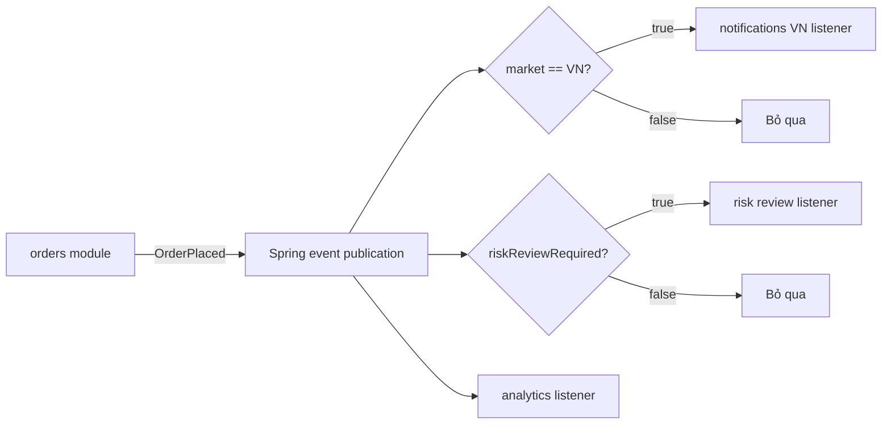

# Điều kiện trên listener trong Spring Modulith

Khi ứng dụng phát một application event, **không phải listener nào nhận đúng kiểu event cũng nhất thiết cần xử lý mọi instance**. Ví dụ, module `notifications` chỉ gửi thông báo bản địa hóa cho đơn thuộc thị trường Việt Nam, còn `risk` chỉ quan tâm đơn có giá trị từ một ngưỡng nhất định. Spring cho phép đặt **điều kiện ngay trên listener** để quyết định có gọi handler cho một event hay không.

Bài học thuộc chương **Listener và subscriber**, trong module `SPRING_MODULITH_APPLICATION_EVENTS`. Trọng tâm là cách khai báo `condition` bằng Spring Expression Language (SpEL) trên `@EventListener`, `@TransactionalEventListener` và `@ApplicationModuleListener`; phân biệt lọc thông điệp với xác thực nghiệp vụ; kết hợp transaction, Event Publication Registry, retry, idempotency và kiểm thử để giữ ranh giới module rõ ràng.

> **Mấu chốt:** Điều kiện trên listener là **bộ lọc cho việc tiếp nhận event**. Nó không thay thế quy tắc nghiệp vụ của module phát, không tự đảm bảo transaction đã commit và không phải cơ chế bảo mật truy cập dữ liệu.

## 1. Vì sao một listener cần điều kiện?

Giả sử module `orders` phát event `OrderPlaced` mỗi khi đặt hàng hợp lệ. Các module quan tâm đến những nhóm đơn khác nhau:

- `billing` tạo hóa đơn cho các đơn thuộc phạm vi mà nó xử lý.
- `notifications` gửi nội dung email tiếng Việt cho đơn có `market = "VN"`.
- `risk` gửi yêu cầu kiểm tra bổ sung cho những đơn có `riskReviewRequired = true`.
- `analytics` thống kê mọi đơn, bất kể thị trường.

Nếu mỗi module chỉ cần một nhóm sự kiện, có ba lựa chọn:

1. **Điều kiện trên listener:** chỉ gọi handler khi field của event phù hợp.
2. **Điều kiện trong thân handler:** nhận lời gọi rồi chủ động bỏ qua nếu không liên quan.
3. **Tách kiểu event chuyên biệt:** module phát một sự thật nghiệp vụ khác, ví dụ `OrderFlaggedForReview`, khi đó listener không cần suy diễn lại ý nghĩa của event gốc.

Các cách này phục vụ mục tiêu khác nhau. Điều kiện trên annotation phù hợp với **bộ lọc nhẹ, ổn định, dựa vào dữ liệu bất biến có sẵn trên event**. Điều kiện trong thân handler phù hợp khi cần gọi domain service, đọc trạng thái hiện tại hoặc phản hồi một kết quả nghiệp vụ phức tạp. Tách event phù hợp khi bản thân điều kiện tạo ra **một sự thật nghiệp vụ riêng** mà nhiều module cần biết.

### Minh họa luồng lọc



Một event có thể được hai listener nhận hoặc không có listener có điều kiện nào phù hợp. Publisher không cần biết logic lọc của từng module; mỗi module sở hữu quyết định xử lý tác vụ của mình.

## 2. Chuẩn bị event có dữ liệu đủ để lọc

Ví dụ public event của module `orders`:

```java
// com.example.shop.orders.OrderPlaced.java
package com.example.shop.orders;

import java.time.Instant;
import java.util.UUID;

public record OrderPlaced(
        UUID eventId,
        UUID orderId,
        String market,
        boolean riskReviewRequired,
        Instant occurredAt
) {}
```

Các field có ý nghĩa:

| Field | Vai trò | Ví dụ |
| --- | --- | --- |
| `eventId` | Định danh event để tracing/idempotency | UUID |
| `orderId` | Định danh đơn hàng | UUID |
| `market` | Thị trường của đơn tại thời điểm đặt | `"VN"`, `"SG"` |
| `riskReviewRequired` | Kết quả phân loại rủi ro đã có tại thời điểm hình thành event | `true`/`false` |
| `occurredAt` | Thời điểm nghiệp vụ ghi nhận event | UTC timestamp |

**Điều kiện phải được xây trên dữ liệu đúng nghĩa.** Ở đây giả định `market` đã được module `orders` xác định hợp lệ và không thay đổi trong event. Trường `riskReviewRequired` chỉ nên xuất hiện nếu `orders` thực sự có quyền và dữ liệu để xác định thông tin ấy. Nếu quyết định thuộc module `risk`, module đó nên tự đánh giá trong handler hoặc công bố sự kiện riêng; đừng gán quyền đánh giá rủi ro sai module chỉ để điều kiện SpEL ngắn hơn.

Event dạng record là immutable về việc gán lại các field, giúp listener không gặp một payload bị thay đổi giữa lúc publish và lúc chạy. Tránh đặt JPA entity hoặc các object mutable trong event chỉ để dùng làm điều kiện.

## 3. Cú pháp cơ bản: `@EventListener(condition = "...")`

Spring Framework cho phép `@EventListener` khai báo một biểu thức **Spring Expression Language (SpEL)**. Nếu expression cho kết quả đúng, Spring gọi method listener; nếu sai, handler được bỏ qua cho lần phát đó.

Ví dụ:

```java
// com.example.shop.notifications.internal.VietnamOrderListener.java
package com.example.shop.notifications.internal;

import com.example.shop.orders.OrderPlaced;
import org.springframework.context.event.EventListener;
import org.springframework.stereotype.Component;

@Component
class VietnamOrderListener {

    private final NotificationService notifications;

    VietnamOrderListener(NotificationService notifications) {
        this.notifications = notifications;
    }

    @EventListener(condition = "#p0.market() == 'VN'")
    void on(OrderPlaced event) {
        notifications.recordVietnamOrder(event.orderId());
    }
}
```

`NotificationService` và `recordVietnamOrder(...)` là ví dụ service nội bộ cần tự triển khai. `#p0` trỏ tới **tham số thứ nhất của method listener**, tức object `OrderPlaced`. Biểu thức gọi getter dạng record `market()` rồi so sánh với chuỗi `'VN'`.

Những trường hợp:

| Payload | Biểu thức | Handler được gọi? |
| --- | --- | --- |
| `market = "VN"` | `#p0.market() == 'VN'` | Có |
| `market = "SG"` | `#p0.market() == 'VN'` | Không |
| `market = null` | `#p0.market() == 'VN'` | Không |
| `market = "vn"` | `#p0.market() == 'VN'` | Không vì phân biệt chữ hoa/thường |

Có thể dùng so sánh không phân biệt hoa/thường nếu hợp đồng dữ liệu yêu cầu, nhưng **chuẩn hóa dữ liệu ngay tại boundary của module phát** thường tốt hơn là viết biểu thức ngày càng phức tạp ở nhiều listener.

### Condition là giá trị chuỗi, SpEL quyết định kết quả

Ví dụ expression `"#p0.riskReviewRequired()"` trả về boolean của event:

```java
@EventListener(condition = "#p0.riskReviewRequired()")
void on(OrderPlaced event) {
    // Chỉ nhận đơn đã được đánh dấu cần kiểm tra.
}
```

`condition = ""` (mặc định) nghĩa là **không có bộ lọc**, mọi event có kiểu phù hợp đều được xử lý theo cơ chế của listener.

Spring cho phép biểu thức cho kết quả boolean hoặc một số chuỗi biểu diễn true, nhưng nên viết expression có **kết quả boolean rõ ràng** để dễ đọc và dễ test. Tránh dùng expression gây side effect như gọi method thay đổi dữ liệu.

## 4. Các biến SpEL có thể dùng trong condition

Spring cung cấp context riêng cho điều kiện event listener.

| Ký hiệu | Ý nghĩa | Ví dụ |
| --- | --- | --- |
| `#p0` hoặc `#a0` | Tham số method vị trí 0 | `#p0.market() == 'VN'` |
| `#root.args[0]` | Phần tử đầu của mảng tham số listener | `#root.args[0].riskReviewRequired()` |
| `#root.event` | Event mà Spring event infrastructure dispatch | `#root.event` |
| `#tenThamSo` | Tham số theo tên nếu tên có sẵn trong bytecode | `#event.market() == 'VN'` |
| `T(java.lang.Math)` | Tham chiếu kiểu Java trong SpEL | `T(java.lang.Math).abs(-2) == 2` |
| `and`, `or`, `!` | Toán tử logic | `#p0.market() == 'VN' and #p0.riskReviewRequired()` |

Với code Java biên dịch mà không giữ tên parameter, expression `#event.market()` có thể không tìm được biến `event`. Cú pháp **`#p0` hoặc `#root.args[0]` ít phụ thuộc cấu hình compiler hơn**.

Lưu ý về `#root.event`: khi publish một object thuần (ví dụ Java record không kế thừa `ApplicationEvent`), Spring có thể bọc object trong `PayloadApplicationEvent` ở tầng dispatch. Vì thế, nếu muốn truy cập dữ liệu record, cách ổn định là dùng **tham số handler** (`#p0`) thay vì giả định `#root.event` luôn chính là record.

### Kết hợp nhiều điều kiện

```java
@EventListener(
    condition = "#p0.market() == 'VN' and #p0.riskReviewRequired()"
)
void on(OrderPlaced event) {
    // Xử lý khi đơn ở VN VÀ đã được đánh dấu cần đánh giá rủi ro.
}
```

Điều kiện dùng `and` ngắn mạch: vế phải không cần tính nếu vế trái đã sai. Nhưng đừng dùng logic condition dài nhiều dòng với việc truy xuất database hoặc gọi HTTP; những kiểm tra đó thuộc application/domain service.

### Xử lý nullable field

Nếu dữ liệu có thể null, phải tránh gọi method trên null. Ví dụ:

```java
@EventListener(
    condition = "#p0.market() != null and #p0.market().startsWith('V')"
)
void on(OrderPlaced event) {
    // Dùng khi hợp đồng thực sự chấp nhận market nullable.
}
```

Ở ví dụ này, `startsWith(...)` chỉ chạy khi market khác null. Cách bền vững hơn là **validate event khi tạo**, giúp mọi listener nhận dữ liệu nhất quán.

## 5. Condition khác việc lọc kiểu event

Spring tìm listener theo kiểu payload trước; condition chỉ là bước lọc bổ sung.

```java
@EventListener(condition = "#p0.market() == 'VN'")
void handle(OrderPlaced event) {
    // Chỉ nhận OrderPlaced của VN.
}
```

Listener này **không** nhận `OrderCancelled` chỉ vì record đó cũng có field `market`. Khi business fact khác nhau, nên có **kiểu event khác nhau**, thay vì tạo một class `GenericEvent` và dùng hàng chục if/SpEL để phân loại.

Một handler có thể cấu hình nhiều event classes trong `@EventListener(classes = {...})`, nhưng nếu method nhận nhiều loại event không có tham số chung, việc dùng condition dựa vào field cụ thể sẽ khó an toàn. Với mô hình nghiệp vụ, nên ưu tiên **một handler nhận một event contract rõ nghĩa**.

### Chọn type-specific hay condition?

| Vấn đề | Type-specific listener | Condition listener |
| --- | --- | --- |
| Hai sự thật nghiệp vụ khác nhau | Ưu tiên hai event type riêng | Dễ làm mờ ngữ nghĩa nếu cố gộp |
| Cùng sự thật, một nhóm dữ liệu cần xử lý | Một event type | Điều kiện ngắn phù hợp |
| Filter cần truy vấn database bên nhận | Không giải quyết bằng kiểu | Nên kiểm tra trong service/handler |
| Điều kiện phụ thuộc cấu hình có thể thay đổi | Có thể đặt policy trong service | Annotation expression tĩnh có thể khó quản lý |
| Nhiều subscriber có cùng điều kiện nghiệp vụ | Cân nhắc event chuyên biệt từ nơi sở hữu sự thật | Sao chép SpEL ở nhiều nơi gây sai khác |

## 6. `@TransactionalEventListener(condition = "...")`: lọc kèm ràng buộc transaction

Đối với tác vụ phải xử lý sau khi thay đổi nghiệp vụ nguồn được commit, Spring hỗ trợ `@TransactionalEventListener` với cả `phase` và `condition`.

```java
// com.example.shop.notifications.internal.VietnamConfirmationListener.java
package com.example.shop.notifications.internal;

import com.example.shop.orders.OrderPlaced;
import org.springframework.stereotype.Component;
import org.springframework.transaction.event.TransactionPhase;
import org.springframework.transaction.event.TransactionalEventListener;

@Component
class VietnamConfirmationListener {

    private final NotificationService notifications;

    VietnamConfirmationListener(NotificationService notifications) {
        this.notifications = notifications;
    }

    @TransactionalEventListener(
        phase = TransactionPhase.AFTER_COMMIT,
        condition = "#p0.market() == 'VN'"
    )
    void on(OrderPlaced event) {
        notifications.enqueueVietnamConfirmation(event.orderId());
    }
}
```

Có hai bộ lọc **độc lập**:

1. **Điều kiện nội dung:** market của event phải là `"VN"`.
2. **Điều kiện transaction:** sự kiện phải gắn với một transaction và phase `AFTER_COMMIT` phải xảy ra thành công.

Nếu event có `market = "VN"` nhưng transaction nguồn rollback, handler `AFTER_COMMIT` **không chạy**. Nếu transaction commit nhưng `market = "SG"`, handler cũng **không chạy**. Nếu event phát ngoài transaction, listener transactional mặc định **bỏ qua**, trừ khi cấu hình `fallbackExecution = true`.

| market | Transaction nguồn | Handler `AFTER_COMMIT`? |
| --- | --- | --- |
| VN | Commit | Có |
| SG | Commit | Không |
| VN | Rollback | Không |
| VN | Không có transaction | Mặc định không |

**Condition không phải cách kiểm tra commit.** Đừng viết `condition = "true"` rồi kỳ vọng có ràng buộc giao dịch; phase của transactional listener mới xác định quy tắc đó.

### Ghi dữ liệu sau commit

Một `@TransactionalEventListener(AFTER_COMMIT)` đơn thuần không tự khởi động transaction mới. Nếu handler ghi database, hãy sử dụng một service được gọi qua Spring proxy và mở transaction mới khi cần, chẳng hạn `@Transactional(propagation = REQUIRES_NEW)` ở method service.

Tránh đặt side effect quan trọng vào listener đồng bộ nếu thất bại của listener có thể làm rollback nghiệp vụ chính ngoài ý muốn.

## 7. `@ApplicationModuleListener(condition = "...")` trong Spring Modulith

Spring Modulith cung cấp `@ApplicationModuleListener` như cấu hình gọn cho listener **sau commit, bất đồng bộ và thực thi trong transaction riêng**. Thuộc tính `condition` được hỗ trợ **từ Spring Modulith 1.2**; với dự án dùng bản cũ hơn, cần kiểm tra API và nâng cấp có kiểm soát.

Ví dụ module `risk` chỉ xử lý event đánh dấu cần review:

```java
// com.example.shop.risk.internal.ReviewOrderListener.java
package com.example.shop.risk.internal;

import com.example.shop.orders.OrderPlaced;
import org.springframework.modulith.events.ApplicationModuleListener;
import org.springframework.stereotype.Component;

@Component
class ReviewOrderListener {

    private final RiskReviewService reviews;

    ReviewOrderListener(RiskReviewService reviews) {
        this.reviews = reviews;
    }

    @ApplicationModuleListener(
        condition = "#p0.riskReviewRequired()"
    )
    void on(OrderPlaced event) {
        reviews.openReviewIfAbsent(event.orderId(), event.eventId());
    }
}
```

Ở ví dụ này `RiskReviewService` là service nội bộ của module `risk`, cần tự triển khai tính idempotent. Listener `risk` chỉ import public event `OrderPlaced` thuộc `orders`. Module `orders` không cần import `RiskReviewService`.

Ưu điểm của điều kiện annotation là **handler không phải chạy để bỏ qua những event không thuộc phạm vi**; trong tổ hợp với Event Publication Registry, việc lọc đúng ngay từ đầu còn có thể tránh công việc theo dõi publication không cần thiết. Hành vi cụ thể của registry, cách chọn target listener và thời điểm đánh giá condition phải được kiểm thử với **phiên bản Spring Modulith đang sử dụng**.

### Khi nào không nên viết điều kiện ở annotation?

Ví dụ module `risk` cần đánh giá thời gian thực dựa trên lịch sử thanh toán, rule engine hoặc dữ liệu thay đổi hàng ngày. Không nên chèn toàn bộ logic này vào SpEL:

```java
// Không nên: một condition dài, truy vấn hệ thống ngoài và có side effect.
// @ApplicationModuleListener(condition = "@riskEngine.fetchAndUpdate(...)")
```

Tốt hơn để listener nhận một event có **hợp đồng đúng** và gọi service:

```java
@ApplicationModuleListener
void on(OrderPlaced event) {
    if (!reviews.shouldOpenReview(event.orderId())) {
        return;
    }
    reviews.openReviewIfAbsent(event.orderId(), event.eventId());
}
```

Cần nhận thức khác biệt: khi handler thực sự chạy rồi trả về bình thường sau nhánh bỏ qua, registry có thể ghi nhận invocation hoàn thành. Nếu muốn tránh tạo publication cho sự kiện không liên quan, điều kiện annotation có lợi trong các phiên bản hỗ trợ. Nhưng nếu logic là một quyết định nghiệp vụ, tính đúng đắn và khả năng audit quan trọng hơn việc giảm số bản ghi.

## 8. Event Publication Registry tương tác thế nào với condition?

Event Publication Registry trong Spring Modulith theo dõi việc giao event cho **transactional listeners** khi cấu hình persistence phù hợp (JDBC, JPA, MongoDB hoặc backend được phiên bản hỗ trợ). Với mỗi publication cần theo dõi, registry có thể ghi trạng thái đang chờ, đang xử lý, thành công hoặc thất bại theo phiên bản.

Điều kiện trên listener góp phần quyết định một event có **thực sự thuộc phạm vi xử lý của listener** hay không. Với hệ thống cần tránh tồn đọng publication không liên quan, nên dùng `@ApplicationModuleListener(condition=...)` khi chỉ cần lọc payload đơn giản và framework version hỗ trợ.

**Không nên suy từ annotation rằng toàn bộ vòng đời registry đã được kiểm chứng.** Cần xác minh:

- Event **khớp condition** dẫn tới một publication tương ứng với listener, và hoàn thành khi handler thành công.
- Event **không khớp condition** không tạo công việc xử lý hoặc publication chưa hoàn thành ngoài mong muốn.
- Nếu handler ném exception, event phù hợp vẫn được ghi nhận theo chính sách lỗi và có thể resubmit khi được cấu hình.
- Nếu event được xử lý lại, điều kiện được đánh giá trên dữ liệu event còn nguyên nghĩa và handler vẫn idempotent.
- Trong các phiên bản Spring Modulith khác nhau, tên/status bản ghi và API recovery có thể thay đổi; test phải dựa trên phiên bản thực tế.

### Condition không thay thế idempotency

Nếu hai event cùng `orderId` và đều khớp condition, Spring có thể gọi listener hai lần. Hoặc cùng một event có thể được giao lại sau crash/recovery. **Điều kiện true không có nghĩa chỉ chạy một lần.**

Với thao tác “tạo phiếu review”, module `risk` nên có **khóa duy nhất theo business key phù hợp** (ví dụ một review mở cho mỗi đơn theo rule), xử lý race condition và lưu trạng thái hoàn thành trong transaction độc lập. Không chỉ kiểm tra bằng `if (exists(...))` rồi insert mà thiếu ràng buộc dữ liệu.

## 9. Điều kiện biến đổi theo thời gian và retry

Một điều kiện tốt thường phụ thuộc vào **snapshot bất biến trong event**. Nếu expression đọc bean bên ngoài hoặc biến cấu hình, kết quả có thể đổi giữa lần publish đầu và khi retry.

Ví dụ:

```java
@ApplicationModuleListener(
    condition = "@notificationPolicy.enabledFor(#p0.market())"
)
void on(OrderPlaced event) {
    // Chỉ xử lý nếu policy hiện tại cho phép.
}
```

Ở đây `@notificationPolicy` là Spring bean do ứng dụng tự khai báo, method `enabledFor(String)` giả định phải **thuần đọc** và không tạo side effect. Tuy kỹ thuật SpEL có thể tham chiếu bean, cần cân nhắc:

- Chính sách bật/tắt hôm nay có thể khác khi event được phát ngày hôm qua.
- Retry một publication cũ có thể nhìn thấy kết quả lọc khác và không chạy side effect đã được kỳ vọng.
- Nếu bean cần database/network, việc evaluate condition trở nên chậm và tạo thêm đường lỗi.
- Condition khó tái dựng lịch sử nếu không lưu phiên bản policy hoặc snapshot quyết định.

Với sự thật có ý nghĩa bền vững, hãy đưa **quyết định nghiệp vụ đã được xác nhận** vào event do module có quyền sở hữu tạo ra, hoặc lưu trạng thái workflow rõ ràng. Với tính năng chỉ để tối ưu trải nghiệm có thể thay đổi theo thời gian, policy động có thể phù hợp nhưng cần nói rõ mục tiêu vận hành.

## 10. Condition với nhiều listener và quyền sở hữu nghiệp vụ

Giả sử có hai listener trên cùng event:

```java
@Component
class OrderSubscriptions {

    @EventListener(condition = "#p0.market() == 'VN'")
    void onVietnam(OrderPlaced event) {
        // Logic dành cho thị trường VN
    }

    @EventListener(condition = "#p0.market() == 'SG'")
    void onSingapore(OrderPlaced event) {
        // Logic dành cho thị trường SG
    }
}
```

Mỗi listener được xét **độc lập**. Event `market = "VN"` phù hợp với listener thứ nhất, không phù hợp listener thứ hai. Nhưng vì cả hai nằm trong cùng class, cần hỏi liệu chúng có cùng trách nhiệm nghiệp vụ hay nên tách thành các module/service phù hợp.

Nếu module `analytics` cần thống kê **mọi đơn** thì không thêm condition vào listener của nó. Việc `notifications` chọn thị trường VN không nên khiến publisher ngừng phát `OrderPlaced` cho thị trường khác.

### Điều kiện không phải kiểm soát quyền truy cập

Không được xem SpEL condition là nơi duy nhất xác minh authorization. Ví dụ `condition = "#p0.market() == 'VN'"` không bảo đảm caller được phép tạo đơn VN. Module sở hữu phải validate quyền và trạng thái trước khi commit; listener nhận event thì cũng phải tuân thủ quyền truy cập dữ liệu của chính nó.

## 11. Những lỗi condition thường gặp

| Sai lầm | Biểu hiện | Cách xử lý |
| --- | --- | --- |
| Dùng `#event.field` nhưng compiler không giữ tên tham số `event` | SpEL không resolve biến | Dùng `#p0` hoặc `#root.args[0]`, hoặc cấu hình compiler parameter names |
| Dùng `#root.event.market` cho payload record thuần | Có thể tham chiếu wrapper `PayloadApplicationEvent` | Tham chiếu method argument `#p0` |
| So sánh `"vn"` với `'VN'` | Handler bị bỏ qua | Chuẩn hóa dữ liệu và test case-sensitive |
| Gọi method trên field null | Lỗi đánh giá SpEL | Validate payload hoặc dùng điều kiện null-safe |
| Expression trả kết quả không rõ nghĩa | Khó debug và khó test | Viết boolean expression ngắn |
| Condition gọi database/network | Tốn tài nguyên khi dispatch, đường lỗi phức tạp | Chuyển nghiệp vụ sang service hoặc snapshot đúng nghĩa |
| Dùng condition cho business validation ở publisher | Event sai vẫn được phát | Xác thực/chuyển trạng thái tại module sở hữu trước publish |
| Coi condition là xử lý `AFTER_COMMIT` | Side effect có thể xảy ra trước commit | Chọn `@TransactionalEventListener` hoặc `@ApplicationModuleListener` đúng |
| Chỉ viết `if (...) return` trong handler nhưng mong không có publication | Registry vẫn có thể theo dõi handler đã được gọi | Dùng annotation condition khi phù hợp và kiểm thử registry |
| Điều kiện phụ thuộc trạng thái hiện tại khi retry | Retry có thể cho kết quả khác | Dùng immutable event snapshot hoặc policy version được lưu |
| Không có idempotency vì đã lọc | Lỗi trùng khi giao lại | Dùng khóa duy nhất, transaction và replay test |
| Không test `condition=false` | Một refactor có thể làm handler nhận sai nhóm event | Có test âm/dương cho biểu thức |

## 12. Kiểm thử điều kiện listener

Đối với condition SpEL, nên thử **cả trường hợp thỏa và không thỏa**, thay vì chỉ xác minh producer đã phát event.

### 12.1. Unit test ý nghĩa biểu thức

Nếu condition đủ đơn giản, tạo các event với payload khác nhau:

| Test case | market | riskReviewRequired | `condition = "#p0.market() == 'VN'"` | `condition = "#p0.riskReviewRequired()"` |
| --- | --- | --- | --- | --- |
| A | VN | false | true | false |
| B | SG | true | false | true |
| C | VN | true | true | true |
| D | null | false | false | false |

Nên để **Spring đánh giá expression thực** trong integration test; unit test gọi trực tiếp `listener.on(event)` sẽ **bỏ qua cơ chế annotation condition** và vì thế không chứng minh được SpEL hoạt động.

### 12.2. Integration test với `@EventListener` đồng bộ

Có thể tạo một test observer đơn giản và dùng `ApplicationEventPublisher` để kiểm tra số lần handler được gọi:

```java
// Ví dụ test support: OrderEventCounter.java
package com.example.shop.testing;

import com.example.shop.orders.OrderPlaced;
import java.util.concurrent.atomic.AtomicInteger;
import org.springframework.context.event.EventListener;
import org.springframework.stereotype.Component;

@Component
class OrderEventCounter {

    private final AtomicInteger vnCount = new AtomicInteger();

    @EventListener(condition = "#p0.market() == 'VN'")
    void count(OrderPlaced event) {
        vnCount.incrementAndGet();
    }

    int count() {
        return vnCount.get();
    }

    void reset() {
        vnCount.set(0);
    }
}
```

```java
// Ví dụ test dùng Spring context có bean OrderEventCounter.
package com.example.shop.testing;

import static org.assertj.core.api.Assertions.assertThat;
import java.time.Instant;
import java.util.UUID;
import org.junit.jupiter.api.Test;
import org.springframework.beans.factory.annotation.Autowired;
import org.springframework.context.ApplicationEventPublisher;
import org.springframework.boot.test.context.SpringBootTest;

@SpringBootTest
class ListenerConditionTest {

    @Autowired ApplicationEventPublisher publisher;
    @Autowired OrderEventCounter counter;

    @Test
    void onlyVietnamOrdersTriggerListener() {
        counter.reset();

        publisher.publishEvent(event("SG"));
        publisher.publishEvent(event("VN"));
        publisher.publishEvent(event("VN"));

        assertThat(counter.count()).isEqualTo(2);
    }

    private static OrderPlaced event(String market) {
        return new OrderPlaced(
            UUID.randomUUID(), UUID.randomUUID(),
            market, false, Instant.now()
        );
    }
}
```

Đoạn test trên giả định context chỉ có một test đang tác động counter tại một thời điểm và dùng dispatcher đồng bộ mặc định. Khi chạy test song song, hãy cô lập counter bằng context hoặc test fixture phù hợp để tránh nhiễu. Đối với listener bất đồng bộ, không kiểm tra count ngay sau khi publish; phải đợi theo điều kiện với timeout rõ ràng.

### 12.3. Kiểm thử `@TransactionalEventListener` và `@ApplicationModuleListener`

Với listener sau commit, cần chủ động tạo transaction **thực sự commit**. Một test được Spring tự rollback ở cuối có thể khiến handler `AFTER_COMMIT` không chạy. Có thể dùng `TransactionTemplate` trong integration test:

```java
// Ý tưởng kiểm thử; runner cần cấu hình bean và persistence thực.
transactionTemplate.executeWithoutResult(status -> {
    publisher.publishEvent(vietnamOrderPlaced);
});

// Sau khi executeWithoutResult trả về và transaction commit,
// đợi listener async hoàn thành bằng assertion có timeout.
// Kiểm tra DB của notifications/risk chứ không chỉ kiểm tra publisher.
```

Kịch bản tối thiểu:

1. `market="VN"` và transaction commit → listener sau commit được xử lý.
2. `market="SG"` và transaction commit → listener không thực hiện side effect.
3. `market="VN"` nhưng transaction rollback → listener `AFTER_COMMIT` không thực thi.
4. Event phát ngoài transaction → listener transactional mặc định không chạy.
5. Handler ném exception cho event thỏa condition → publication được ghi nhận chưa hoàn thành/thất bại theo registry version nếu đã cấu hình.
6. Event không thỏa condition → xác minh không còn publication pending không cần thiết.
7. Retry/resubmit của event thỏa condition → listener vẫn xử lý idempotent.
8. Thay đổi rule/policy động → kết quả phải phù hợp hợp đồng về thời điểm và snapshot.

### 12.4. Kiểm tra tính đúng đắn của publisher

Spring Modulith có `@ApplicationModuleTest` và `PublishedEvents` để kiểm tra event được phát từ use case của module `orders`:

```java
package com.example.shop.orders;

import static org.assertj.core.api.Assertions.assertThat;
import java.util.UUID;
import org.junit.jupiter.api.Test;
import org.springframework.beans.factory.annotation.Autowired;
import org.springframework.modulith.test.ApplicationModuleTest;
import org.springframework.modulith.test.PublishedEvents;

@ApplicationModuleTest
class OrdersEventContractTest {

    @Autowired Orders orders;

    @Test
    void emitsCorrectMarket(PublishedEvents events) {
        UUID orderId = orders.place(
            new PlaceOrder(UUID.randomUUID(), "BOOK-001", 2, "VN")
        );

        assertThat(events.ofType(OrderPlaced.class)
                .matching(OrderPlaced::orderId, orderId)
                .matching(OrderPlaced::market, "VN"))
            .hasSize(1);
    }
}
```

`Orders` và `PlaceOrder` trong đoạn test là public API **minh họa**; cần tự triển khai và cấu hình persistence phù hợp. Test này xác nhận **event chứa dữ liệu lọc đúng**, nhưng `PublishedEvents` không tự chứng minh listener được gọi hay publication hoàn thành. Để kiểm thử condition, dùng test thật sự dispatch event vào Spring context như ở trên.

## 13. Condition, retry và quan sát trong sản xuất

Khi người dùng báo “đơn ở VN không gửi email”, quy trình chẩn đoán cần đi theo các bước:

1. `orders` có thực sự tạo và commit đơn không?
2. Event `OrderPlaced` có được publish cùng `market="VN"` không?
3. Listener có tồn tại trong Spring context, và annotation condition có cú pháp hợp lệ không?
4. Transaction nguồn có tồn tại và commit đúng phase không?
5. Event bị condition bỏ qua hay handler đã chạy rồi lỗi?
6. Registry có publication tương ứng không, và đang ở trạng thái nào?
7. Side effect đã xảy ra nhưng trạng thái publication chưa hoàn thành, dẫn đến retry hay chưa?

Nếu cần logging để giải thích vì sao condition loại event, đừng đặt log có side effect **bên trong SpEL**. Có thể ghi thông tin an toàn tại publisher, instrumentation/test adapter hoặc trong handler khi thực sự nhận event.

Ví dụ log có cấu trúc do ứng dụng tự định nghĩa:

```json
{
  "eventType": "OrderPlaced",
  "eventId": "e5836f70-b123-43a5-9cb3-dae469ac25df",
  "sourceModule": "orders",
  "listener": "notifications.VietnamConfirmationListener",
  "market": "VN",
  "filter": "market == VN",
  "processingStatus": "COMPLETED"
}
```

Không khẳng định Spring Modulith tự sinh JSON như trên. Nếu log trạng thái completion, phải phân biệt **handler đã thực thi thành công** với **event vừa được publish** hoặc **điều kiện phù hợp**. Tránh log payload nhạy cảm và giá trị cá nhân không cần thiết.

## 14. Bài tập và câu hỏi tự đánh giá

### Bài tập A — Viết condition

Với event:

```java
public record StockReserved(
        UUID reservationId,
        String warehouse,
        int quantity,
        boolean priority
) {}
```

Hãy viết listener chỉ xử lý khi kho là `"HN"` và event có `priority=true`.

**Gợi ý:**

```java
@EventListener(
    condition = "#p0.warehouse() == 'HN' and #p0.priority()"
)
void on(StockReserved event) {
    // Tác vụ phù hợp với kho ưu tiên.
}
```

### Bài tập B — Transaction và điều kiện

Một listener `@TransactionalEventListener(phase = AFTER_COMMIT, condition = "#p0.market() == 'VN'")` nhận:

1. Event VN được publish trong transaction commit.
2. Event VN được publish trong transaction rollback.
3. Event SG được publish trong transaction commit.
4. Event VN được publish ngoài transaction.

<details>
<summary>Đáp án</summary>

- Trường hợp **1**: listener được gọi sau commit.
- Trường hợp **2**: listener không chạy ở phase AFTER_COMMIT.
- Trường hợp **3**: condition trả false, listener không chạy.
- Trường hợp **4**: mặc định không chạy do không có transaction; chỉ thay đổi nếu cấu hình fallbackExecution theo chủ ý.

</details>

### Bài tập C — Condition hay business rule?

Module `billing` chỉ lập hóa đơn khi đơn đã thanh toán và khách đáp ứng điều kiện xuất hóa đơn theo luật địa phương. Có nên viết toàn bộ logic đó vào `@ApplicationModuleListener(condition = "...")`?

**Gợi ý:** Không nên. Phân biệt sự thật cần công bố (ví dụ `PaymentCaptured` hay `InvoiceRequested`), trạng thái do `billing` sở hữu, và quy tắc pháp lý cần được kiểm tra trong domain/application service. Condition nên lọc nhanh những thuộc tính rõ ràng, bất biến; business rule phải được kiểm tra trong module có quyền quyết định, có test và transaction phù hợp.

## 15. Ghi nhớ

- Cả `@EventListener` và `@TransactionalEventListener` đều hỗ trợ `condition` SpEL; `@ApplicationModuleListener(condition = ...)` có từ **Spring Modulith 1.2**.
- Dùng `#p0` hoặc `#root.args[0]` để tham chiếu payload method listener ổn định; tránh phụ thuộc tên parameter không có trong bytecode.
- **Condition lọc event theo nội dung; phase/transaction quyết định thời điểm xử lý**. Một condition đúng không chứng minh dữ liệu nguồn đã commit.
- Ưu tiên expression ngắn, thuần, không side effect, đọc **immutable event snapshot**. Đặt nghiệp vụ phức tạp vào service của module sở hữu.
- Với Event Publication Registry, kiểm chứng event phù hợp/không phù hợp có đúng target publication và trạng thái xử lý không; hỗ trợ retry/recovery cần cấu hình và kiểm thử.
- Condition không ngăn giao lại event, không đảm bảo exactly-once và không thay thế idempotency hoặc kiểm soát quyền truy cập.
- Test nên bao gồm case true/false, null, transaction commit/rollback, lỗi listener, resubmit và thay đổi rule theo thời gian.

**Tài liệu tham khảo chính thức:**

- [Spring Framework — `EventListener` API và biểu thức `condition`](https://docs.spring.io/spring-framework/docs/current/javadoc-api/org/springframework/context/event/EventListener.html)
- [Spring Framework — Transaction-bound Events](https://docs.spring.io/spring-framework/reference/data-access/transaction/event.html)
- [Spring Framework — `TransactionalEventListener` API](https://docs.spring.io/spring-framework/docs/current/javadoc-api/org/springframework/transaction/event/TransactionalEventListener.html)
- [Spring Modulith — `ApplicationModuleListener` API](https://docs.spring.io/spring-modulith/docs/current/api/org/springframework/modulith/events/ApplicationModuleListener.html)
- [Spring Modulith — Working with Application Events và Event Publication Registry](https://docs.spring.io/spring-modulith/reference/events.html)
