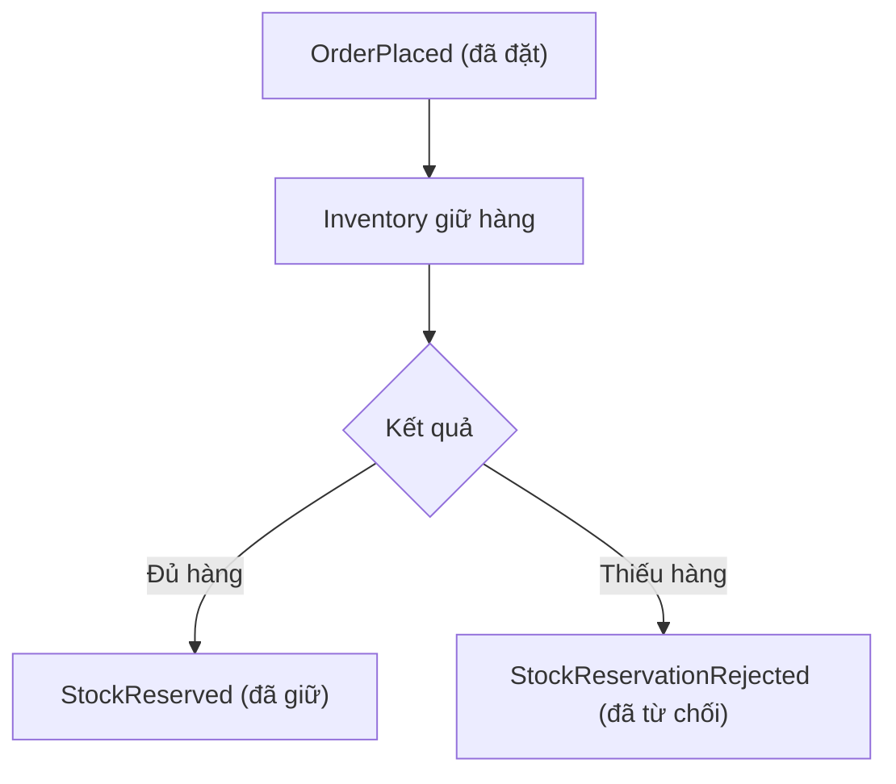
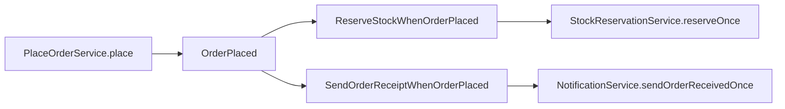
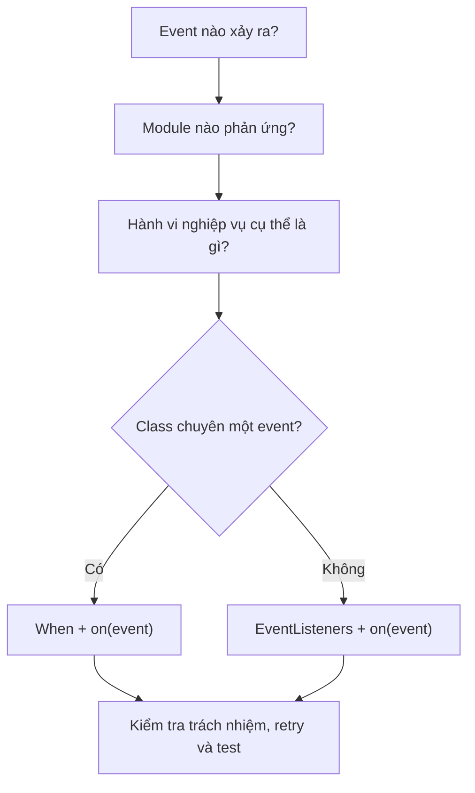

# Đặt tên handler trong Spring Modulith application events

## 1. Vì sao tên handler quan trọng?

Trong một **modular monolith**, module `order` có thể phát `OrderPlaced` và nhiều module khác tự quyết định phản ứng: `inventory` giữ hàng, `notification` thông báo tiếp nhận đơn, `analytics` ghi nhận số liệu. Tên class và method nhận event là nơi developer nhìn thấy đầu tiên để biết **ai phản ứng trước sự kiện nào và thực hiện hành vi gì**.

Bài học thuộc chương **Listener và subscriber**, chủ đề **Đặt tên handler**, trong phạm vi **SPRING_MODULITH_APPLICATION_EVENTS**. Mục tiêu của module học là tổ chức giao tiếp giữa các module Spring Modulith bằng application events để giảm phụ thuộc, giữ ranh giới nghiệp vụ và xử lý giao sự kiện đáng tin cậy với publisher, listener sau commit, Event Publication Registry, retry, kiểm thử và quan sát.

Tên như `EventHandler`, `process()`, `doWork()` hay `onEvent()` quá chung chung khi dự án có hàng chục consumer. Nhưng một tên kỹ thuật kiểu `AsyncTransactionAfterCommitEventListener` lại mô tả cách chạy nhiều hơn mục đích nghiệp vụ. **Tên tốt phải làm nổi bật hành vi, ngữ cảnh sự kiện và trách nhiệm sở hữu**, trong khi annotation và cấu hình ghi rõ cơ chế thực thi.

Sau bài này, bạn có thể:

1. Phân biệt tên **event**, **listener/subscriber**, **handler method** và **domain/application service**.
2. Chọn quy ước đặt tên nhất quán cho class, method, package và kiểm thử.
3. Đặt tên phản ánh hành vi, không nhầm event “đã xảy ra” với command “yêu cầu thực hiện”.
4. Thiết kế nhiều handler cho cùng một event mà vẫn xác định rõ trách nhiệm của từng module.
5. Đánh giá tác động của đổi tên handler tới vận hành, log, registry, retry và các bài kiểm thử.

## 2. Phân biệt những khái niệm thường có tên giống nhau

| Thành phần | Nhiệm vụ | Ví dụ tên |
| --- | --- | --- |
| **Event type** | Thông báo sự thật nghiệp vụ đã xảy ra | `OrderPlaced`, `PaymentCaptured` |
| **Publisher** | Công bố sự kiện sau khi thực hiện nghiệp vụ thuộc module mình | `CheckoutService.placeOrder(...)` |
| **Listener/subscriber class** | Nhận một hoặc nhiều loại event và kết nối chúng với use case của module sở hữu | `ReserveStockWhenOrderPlaced` |
| **Handler method** | Điểm vào được annotation đánh dấu để gọi khi có event | `on(OrderPlaced event)` |
| **Application/domain service** | Thực thi quy tắc, transaction và cập nhật dữ liệu của module | `StockReservationService.reserveOnce(...)` |
| **Listener target/định danh vận hành** | Mục tiêu thực thi dùng trong theo dõi publication tùy cấu hình | Phụ thuộc class và method listener thực tế |

Trong ngữ cảnh Spring, `listener`, `subscriber` và `handler` có thể được dùng gần nghĩa nhau, nhưng **không phải ba annotation riêng biệt bắt buộc**. Spring có `@EventListener`, `@TransactionalEventListener`, còn Spring Modulith cung cấp `@ApplicationModuleListener`; một handler method được annotation sẽ nhận event theo cơ chế tương ứng.

Nên thống nhất một từ trong từng codebase. Ví dụ, toàn dự án gọi các lớp adapter nhận event là `...Listener`, còn động từ nghiệp vụ nằm trong application service. Hoặc chọn tên hành vi `ReserveStockWhenOrderPlaced` cho class và phương thức `on(...)` làm entry point. Cả hai cách có thể tốt nếu tài liệu và cấu trúc package giúp người đọc nhận biết rõ vai trò.

**Quan trọng:** Sự kiện là **sự thật ở thì quá khứ**; handler biểu thị **phản ứng của consumer**; service nội bộ biểu thị **năng lực nghiệp vụ được consumer sở hữu**.

## 3. Quy tắc đề xuất: tên phản ánh “hành vi khi sự kiện xảy ra”

Có hai dạng tên hữu ích, chọn một dạng chủ đạo cho dự án:

| Dạng | Ví dụ | Điểm mạnh | Lưu ý |
| --- | --- | --- | --- |
| `<Action>When<Event>` | `ReserveStockWhenOrderPlaced` | Nhìn ngay thấy **hành động và nguyên nhân** | Tên có thể dài nếu event quá dài |
| `<Event><BusinessContext>Listener` | `OrderPlacedInventoryListener` | Tìm kiếm theo event và tách consumer rõ ràng | Cần xem method để biết hành động cụ thể |

Ví dụ minh họa:

```text
order.OrderPlaced
    ├── inventory.internal.ReserveStockWhenOrderPlaced
    ├── notification.internal.SendOrderReceiptWhenOrderPlaced
    └── analytics.internal.RecordOrderMetricWhenOrderPlaced
```

Ở đây `OrderPlaced` có cùng một ý nghĩa cho mọi consumer. `inventory` giữ hàng; `notification` gửi **thông báo đã tiếp nhận đơn**, không mặc định nói “đơn đã xác nhận thanh toán hoặc giao hàng”. Tên handler phải phản ánh chính xác điều consumer có quyền làm.

Quy ước mẫu:

```text
Event:           OrderPlaced
Handler class:   ReserveStockWhenOrderPlaced
Handler method:  on(OrderPlaced event)
Domain service:  StockReservationService.reserveOnce(...)
Package:         com.example.shop.inventory.internal
```

Một lựa chọn khác:

```text
Handler class:   OrderPlacedInventoryListener
Handler method:  reserveStock(OrderPlaced event)
```

Không cần ép mọi handler có cả `Listener` lẫn `Handler` trong tên như `OrderPlacedEventListenerHandler`. Loại bỏ các từ thừa giúp tên ngắn và dễ tìm hơn.

### 3.1. Ưu tiên hành vi nghiệp vụ thay cho chi tiết kỹ thuật

| Tên mơ hồ hoặc dễ sai | Tên nên cân nhắc | Lý do |
| --- | --- | --- |
| `GenericEventHandler` | `ReserveStockWhenOrderPlaced` | Xác định được cả sự kiện lẫn hành vi |
| `ProcessOrderEventListener` | `SendOrderReceiptWhenOrderPlaced` | Tránh từ `process` quá rộng |
| `AsyncOrderEventHandler` | `OrderPlacedInventoryListener` | Đặt async ở annotation/cấu hình, không nhầm ý định nghiệp vụ |
| `OrderPlacedListener1` | `RecordOrderMetricWhenOrderPlaced` | Tách listener theo trách nhiệm chứ không đánh số |
| `UpdateEverythingOnOrderPlaced` | Các listener độc lập cho từng use case | Tránh class làm quá nhiều việc |
| `SendOrderConfirmedEmailOnOrderPlaced` | `SendOrderReceiptWhenOrderPlaced` | Không tuyên bố đơn đã xác nhận khi event chỉ nói đã đặt |
| `OrderRepositoryListener` | `ReserveStockWhenOrderPlaced` | Adapter nhận event không phải repository |

Không coi các từ `handle`, `on`, `process` là tuyệt đối sai. Chúng phù hợp với **tên method ngắn trong class có tên rõ**. Vấn đề là **tổng thể tên class + method + package** có cho người đọc hiểu chính xác trách nhiệm hay không.

## 4. Tên event và tên handler không được đánh đồng

Event thường ở thì quá khứ vì mô tả điều **đã xảy ra**; handler là tên một **phản ứng**. Từ đó nên tránh:

- `CreateOrderEvent`: nghe như command “hãy tạo đơn”, không phải sự thật; cân nhắc `OrderPlaced`.
- `ReserveStockEvent`: chưa rõ là yêu cầu giữ hàng hay việc đã giữ thành công; phân biệt `ReserveStock` (command) và `StockReserved` (event).
- `StockReservedListener` xử lý `OrderPlaced`: tên class nói nhầm loại event mà listener nhận.
- `ConfirmPaymentOnOrderPlaced`: tên ám chỉ việc xác nhận thanh toán chỉ dựa trên một đơn vừa đặt; thường không đúng nghiệp vụ.

Một chuỗi sự kiện có thể mang những ngữ nghĩa khác nhau:



Khi `inventory` sở hữu quyết định giữ hàng, tên `ReserveStockWhenOrderPlaced` thể hiện hành vi nó thực hiện. Nếu muốn phát `StockReserved`, tên sự kiện đó thể hiện **kết quả nghiệp vụ đã hoàn tất**, không được dùng thay thế cho `ReserveStock` trước khi ghi reservation thành công.

Lưu ý ranh giới Spring Modulith: `inventory` import kiểu event công khai của `order`; module phát không cần biết listener. Nếu cả hai module cùng import event từ nhau, vẫn có thể hình thành **phụ thuộc vòng tĩnh** dù trao đổi qua event. Tên hay không chữa được chiều phụ thuộc sai; cần thiết kế contract và module điều phối phù hợp.

## 5. Tên class, method và package phải bổ trợ nhau

Với ứng dụng `com.example.shop`, một cấu trúc thuận tiện:

```text
com.example.shop
├── ShopApplication.java
├── order/
│   ├── OrderPlaced.java                        # Public event contract
│   └── internal/
│       ├── CheckoutService.java                # Publisher
│       └── OrderRepository.java
├── inventory/
│   └── internal/
│       ├── ReserveStockWhenOrderPlaced.java    # Listener adapter
│       ├── StockReservationService.java        # Business use case
│       └── ReservationRepository.java
├── notification/
│   └── internal/
│       ├── SendOrderReceiptWhenOrderPlaced.java
│       └── NotificationService.java
└── analytics/
    └── internal/
        └── RecordOrderMetricWhenOrderPlaced.java
```

Trong cấu trúc nhận diện mặc định của Spring Modulith, các package trực tiếp dưới package ứng dụng thường là **application module**; các package con như `internal` chứa chi tiết triển khai. Event class `order.OrderPlaced` nằm ở API công khai; listener trong `inventory` không import trực tiếp `order.internal`.

### 5.1. Khi method có thể chỉ tên `on`

```java
@Component
class ReserveStockWhenOrderPlaced {

    @ApplicationModuleListener
    void on(OrderPlaced event) {
        // Gọi use case giữ hàng thuộc inventory.
    }
}
```

Tổ hợp tên class `ReserveStockWhenOrderPlaced` và method `on(OrderPlaced event)` đã rõ. Với mỗi class chuyên một listener, `on(...)` ngắn gọn và dễ quét. Nếu class tên `OrderPlacedInventoryListener`, có thể đặt method `reserveStock(...)` để thêm thông tin.

### 5.2. Khi method nên gọi tên sự kiện

```java
@Component
class InventoryEventListeners {

    @ApplicationModuleListener
    void onOrderPlaced(OrderPlaced event) {
        // Tạo reservation.
    }

    @ApplicationModuleListener
    void onOrderCancelled(OrderCancelled event) {
        // Giải phóng reservation nếu nghiệp vụ cho phép.
    }
}
```

Đoạn này chỉ minh họa **quy ước tên**; `OrderCancelled` là event công khai giả định của `order`. Khi một class xử lý nhiều loại sự kiện, `onOrderPlaced` và `onOrderCancelled` giúp phân biệt entry point trong log và review. Tuy nhiên class gom nhiều listener sẽ khó bảo trì nếu các handler có trách nhiệm hoặc vòng đời lỗi khác nhau. Khi đó tách thành `ReserveStockWhenOrderPlaced` và `ReleaseReservationWhenOrderCancelled` là lựa chọn rõ ràng hơn.

### 5.3. Đừng lặp lại quá nhiều ngữ cảnh trong tên

Package `inventory.internal` đã cho biết module sở hữu hành vi. Tên `InventoryOrderPlacedInventoryStockReservationEventListenerHandler` quá dài và vẫn không có ý nghĩa hơn `ReserveStockWhenOrderPlaced`.

Tránh đổi tên theo sở thích cá nhân mỗi khi gặp code mới: nhất quán trong từng module và toàn dự án thường quan trọng hơn chọn ra một “cú pháp tên hoàn hảo”.

## 6. Ví dụ xuyên suốt: event, publisher và hai handler độc lập

Giả sử `order` tiếp nhận đơn và lưu trạng thái `PENDING_STOCK`; `inventory` cố giữ hàng, `notification` gửi thông báo **đã nhận đơn**. Bên phát không cần biết lớp listener nào tồn tại. Ví dụ sau minh họa cách tên class và method truyền đạt đúng quyền sở hữu nghiệp vụ.

### 6.1. Hợp đồng sự kiện công khai của order

```java
// com/example/shop/order/OrderPlaced.java
package com.example.shop.order;

import java.time.Instant;
import java.util.List;
import java.util.Objects;
import java.util.UUID;

public record OrderPlaced(
        UUID eventId,
        UUID orderId,
        Instant occurredAt,
        List<Line> lines
) {
    public OrderPlaced {
        Objects.requireNonNull(eventId, "eventId");
        Objects.requireNonNull(orderId, "orderId");
        Objects.requireNonNull(occurredAt, "occurredAt");
        lines = List.copyOf(Objects.requireNonNull(lines, "lines"));
        if (lines.isEmpty()) {
            throw new IllegalArgumentException("Order must contain lines");
        }
    }

    public record Line(UUID skuId, int quantity) {
        public Line {
            Objects.requireNonNull(skuId, "skuId");
            if (quantity <= 0) {
                throw new IllegalArgumentException("Quantity must be positive");
            }
        }
    }
}
```

`OrderPlaced` thuộc API công khai của `order`, mô tả **sự thật đơn đã được tiếp nhận**. `eventId` định danh sự kiện, `orderId` định danh đơn, `occurredAt` chỉ thời điểm nghiệp vụ, `lines` là snapshot dòng hàng để consumer xử lý. Những kiểu dữ liệu ở đây không chứa entity JPA nội bộ.

### 6.2. Publisher đặt tên theo use case của order

```java
// Trích method trong com.example.shop.order.internal.PlaceOrderService
@Transactional
public UUID place(PlaceOrderCommand command) {
    Order order = Order.placePendingStock(command);
    orders.save(order);

    var lines = order.lines().stream()
            .map(line -> new OrderPlaced.Line(
                    line.skuId(), line.quantity()))
            .toList();

    publisher.publishEvent(new OrderPlaced(
            UUID.randomUUID(), order.id(), clock.instant(), lines
    ));
    return order.id();
}
```

`Order`, `PlaceOrderCommand`, `orders`, `publisher` và `clock` là thành phần minh họa của ứng dụng; `publisher` có kiểu `ApplicationEventPublisher` và `clock` là `java.time.Clock` được inject. Tên `PlaceOrderService.place(...)` nói về **hành động do order sở hữu**, không phải `DispatchOrderPlacedToInventoryService`. Publisher không nên biết danh sách listener.

### 6.3. Inventory đặt tên handler theo việc giữ hàng

```java
// com/example/shop/inventory/internal/ReserveStockWhenOrderPlaced.java
package com.example.shop.inventory.internal;

import com.example.shop.order.OrderPlaced;
import org.springframework.modulith.events.ApplicationModuleListener;
import org.springframework.stereotype.Component;

@Component
class ReserveStockWhenOrderPlaced {

    private final StockReservationService reservations;

    ReserveStockWhenOrderPlaced(StockReservationService reservations) {
        this.reservations = reservations;
    }

    @ApplicationModuleListener
    void on(OrderPlaced event) {
        var items = event.lines().stream()
                .map(line -> new ReservationItem(
                        line.skuId(), line.quantity()))
                .toList();

        reservations.reserveOnce(
                event.eventId(), event.orderId(), items
        );
    }
}
```

`ReservationItem` và `StockReservationService` là các kiểu **nội bộ của inventory** do ứng dụng định nghĩa. Listener chuyển dữ liệu event sang use case của module; `reserveOnce` sở hữu chính sách tồn kho, transaction, idempotency và kết quả. Tên class nói rõ việc giữ hàng khi đơn được đặt; method `on` chỉ là điểm vào adapter.

Tên như `OrderStockManager` dễ gây hiểu nhầm rằng listener chứa mọi logic tồn kho. Trong thiết kế có ranh giới, hành vi cốt lõi được đặt trong `StockReservationService` của module sở hữu.

### 6.4. Notification đặt tên phù hợp sự thật nghiệp vụ

```java
// com/example/shop/notification/internal/SendOrderReceiptWhenOrderPlaced.java
package com.example.shop.notification.internal;

import com.example.shop.order.OrderPlaced;
import org.springframework.modulith.events.ApplicationModuleListener;
import org.springframework.stereotype.Component;

@Component
class SendOrderReceiptWhenOrderPlaced {

    private final NotificationService notifications;

    SendOrderReceiptWhenOrderPlaced(NotificationService notifications) {
        this.notifications = notifications;
    }

    @ApplicationModuleListener
    void on(OrderPlaced event) {
        notifications.sendOrderReceivedOnce(
                event.eventId(), event.orderId()
        );
    }
}
```

`NotificationService` là service do `notification` tự định nghĩa. Tên `SendOrderReceiptWhenOrderPlaced` thể hiện thông báo **đã nhận đơn**, không khẳng định đơn đã giữ hàng hay thanh toán. Nếu muốn gửi thư xác nhận giữ hàng, cần phản ứng với sự thật nghiệp vụ tương ứng, thay vì dùng `OrderPlaced` sai nghĩa.

### 6.5. Đọc trách nhiệm từ luồng xử lý



Đây là luồng sự kiện runtime. Về **dependency Java**, các listener ở `inventory` và `notification` import event công khai từ `order`, còn module `order` không import implementation của các listener. Tên lớp giúp nhìn ra trách nhiệm, nhưng kiến trúc vẫn phải được kiểm tra bằng dependency thực tế.

## 7. Khi một event có nhiều handler

Mỗi handler nên có **một mục đích nghiệp vụ có thể kiểm thử và xử lý lỗi độc lập**, ngay cả khi tất cả cùng nhận một kiểu event.

| Event nhận | Module sở hữu handler | Tên class | Trách nhiệm |
| --- | --- | --- | --- |
| `OrderPlaced` | `inventory` | `ReserveStockWhenOrderPlaced` | Giữ tồn kho |
| `OrderPlaced` | `notification` | `SendOrderReceiptWhenOrderPlaced` | Gửi xác nhận tiếp nhận |
| `OrderPlaced` | `analytics` | `RecordOrderMetricWhenOrderPlaced` | Cập nhật thống kê |
| `PaymentCaptured` | `accounting` | `RecordRevenueWhenPaymentCaptured` | Ghi nhận nghiệp vụ kế toán |
| `OrderCancelled` | `inventory` | `ReleaseReservationWhenOrderCancelled` | Giải phóng reservation hợp lệ |
| `ShipmentDispatched` | `notification` | `NotifyCustomerWhenShipmentDispatched` | Gửi thông báo vận chuyển |

Ví dụ thiết kế cần tránh nếu các bước thuộc những module khác nhau:

```java
@ApplicationModuleListener
void on(OrderPlaced event) {
    reserveStock(event);
    sendEmail(event);
    recordAnalytics(event);
}
```

Một lỗi gửi email có thể khiến **toàn bộ callback** bị chạy lại, kéo theo nguy cơ giữ hàng và cập nhật số liệu lần thứ hai. Nếu các hành vi có chính sách transaction và retry riêng, nên tách thành listener độc lập, tên class rõ ràng. Tuy nhiên trong **một use case và cùng một transaction nội bộ**, service có thể cần nhiều bước để bảo vệ bất biến; tiêu chí tách là trách nhiệm và tính phục hồi, không phải số dòng code.

## 8. Annotation quyết định cách chạy, không phải tên class

Spring và Spring Modulith cung cấp nhiều cơ chế gọi handler:

| Cách đăng ký | Đặc điểm thường gặp | Cạm bẫy đặt tên |
| --- | --- | --- |
| `@EventListener` | Mặc định đồng bộ với lời gọi publish, trừ khi cấu hình bất đồng bộ riêng | Tên có `Async` dù vẫn đồng bộ gây hiểu nhầm |
| `@TransactionalEventListener` | Kích hoạt theo giai đoạn transaction; mặc định là `AFTER_COMMIT` | Không tự suy ra callback chạy ở thread khác |
| `@ApplicationModuleListener` | Listener transactional bất đồng bộ sau commit, thường với transaction riêng | Không suy ra `publishEvent` tức là mọi handler đã thành công |

Ví dụ với event nội bộ đồng bộ:

```java
@Component
class RefreshReadModelOnOrderPlaced {

    @EventListener
    void on(OrderPlaced event) {
        // Theo semantics @EventListener và cấu hình hiện hành.
    }
}
```

Ví dụ với Spring Modulith:

```java
@Component
class ReserveStockWhenOrderPlaced {

    @ApplicationModuleListener
    void on(OrderPlaced event) {
        // Xử lý sau commit theo semantics của annotation.
    }
}
```

Hai đoạn code là minh họa **cách đăng ký**, không phải hai class cùng tồn tại trong một package với tên trùng nhau. Khi đã dùng annotation, không nhất thiết đặt tất cả tên class thành `AsyncAfterCommitTransactional...`. Những từ này mô tả hạ tầng và dễ lỗi thời khi cấu hình đổi, trong khi tên hành vi nghiệp vụ thường bền vững hơn.

`Listener`, `Subscriber` và `Handler` trong tên class là quy ước ngôn ngữ của đội ngũ; không buộc phải tạo ba lớp riêng cho cùng một tác vụ. Chọn một quy ước ổn định và review theo ngữ nghĩa thực tế.

## 9. Tên handler đi cùng idempotency và chính sách lỗi

Một tên `ReserveStockWhenOrderPlaced` đưa ra kỳ vọng: handler phải **xử lý yêu cầu giữ hàng tới một trạng thái nghiệp vụ rõ ràng**. Với cơ chế bất đồng bộ sau commit, công việc có thể thất bại và phải chạy lại. Tên handler không thể thay thế quy tắc idempotency hoặc báo lỗi.

**Nguyên tắc:** Đặt tên adapter theo “khi event nào, thực hiện phản ứng gì”; còn chính sách bền vững phải nằm trong nghiệp vụ của module sở hữu:

```text
Adapter:
  ReserveStockWhenOrderPlaced.on(event)

Use case của inventory:
  StockReservationService.reserveOnce(eventId, orderId, items)

Bất biến:
  Với cùng business key (orderId, reservationPurpose),
  không được giữ hàng hai lần.
```

Trong triển khai thật, chỉ kiểm tra `existsByOrderId(...)` rồi `save(...)` **chưa đủ** chống hai lượt retry chạy song song. Cần giao dịch, unique constraint và cơ chế locking hoặc kiểm tra phiên bản phù hợp để bảo vệ số lượng tồn.

### 9.1. Lỗi kỹ thuật và kết quả nghiệp vụ phải khác nhau

- **Lỗi kỹ thuật có thể phục hồi:** Cơ sở dữ liệu không kết nối, transaction rollback hoặc hạ tầng bị gián đoạn. Listener cần phản ánh lỗi thay vì nuốt exception rồi trả về như đã thành công.
- **Kết quả nghiệp vụ hợp lệ nhưng không đạt kỳ vọng:** Ví dụ không đủ hàng. `inventory` có thể lưu kết quả từ chối và để callback kết thúc bình thường, vì yêu cầu đã được **xử lý đúng quy tắc**, dù không giữ hàng.
- **Tác vụ ngoài hệ thống:** Gửi email hoặc gọi payment gateway có thể thành công nhưng việc ghi nhận completion thất bại. Retry phải đi qua cơ chế chống trùng/outbox/đối soát tương ứng.

Ví dụ **không nên** dùng cho lỗi kỹ thuật cần retry:

```java
@ApplicationModuleListener
void on(OrderPlaced event) {
    try {
        reservations.reserveOnce(event.eventId(), event.orderId(), items);
    } catch (RuntimeException failure) {
        log.error("Reservation failed", failure);
        // Không ném lỗi trở lại: callback có thể bị coi là đã hoàn tất.
    }
}
```

Đây là đoạn **giả mã** để minh họa chống nuốt exception; `items` và `log` là thành phần giả định. Với listener được hạ tầng theo dõi, một callback trở về bình thường có thể dẫn tới publication được ghi nhận hoàn tất dù nghiệp vụ chưa thực hiện xong.

### 9.2. Một tên “đúng” nhưng nội dung “sai”

Tên `SendOrderReceiptWhenOrderPlaced` không có giá trị nếu implementation gửi thư xác nhận rằng **đã giao hàng**. Tên, event contract, nội dung side effect và test phải thống nhất với nhau.

Điều tương tự xảy ra nếu `ReserveStockWhenOrderPlaced` chỉ đưa yêu cầu giữ hàng vào một task bất đồng bộ trong bộ nhớ rồi trả về. Với cách đó, hoàn tất callback chỉ nói **đã đặt lịch công việc**, không nói **đã giữ hàng**. Nếu muốn chủ động tách tác vụ, tên handler và contract nên phản ánh **việc ghi nhận yêu cầu bền vững**, ví dụ `EnqueueStockReservationWhenOrderPlaced`, đi kèm outbox và vòng đời xử lý riêng.

## 10. Đổi tên handler và Event Publication Registry

Khi dự án bật **Event Publication Registry** với cách lưu trữ thích hợp, Spring Modulith có thể theo dõi publication dành cho từng transactional listener và ghi nhận những lần xử lý hoàn tất. Các publication chưa hoàn tất có thể cần được phục hồi sau khi sửa lỗi hoặc triển khai phiên bản mới.

Điều này khiến đổi tên handler **không luôn chỉ là thay đổi thẩm mỹ**. Tùy phiên bản và cơ chế định danh listener đích, class/method hoặc dạng định danh tương ứng có thể liên quan tới bản ghi publication đang lưu. Nếu triển khai một bản mới ngay khi registry còn publication chưa hoàn tất, đổi tên class/method hoặc di chuyển package có thể ảnh hưởng khả năng ánh xạ publication cũ về đúng listener để chạy lại.

Ví dụ trước refactor:

```text
com.example.shop.inventory.internal.OrderPlacedListener.on(OrderPlaced)
```

Sau refactor:

```text
com.example.shop.inventory.internal.ReserveStockWhenOrderPlaced.on(OrderPlaced)
```

Hai tên có thể cùng biểu diễn một trách nhiệm, nhưng **không mặc định rằng publication cũ sẽ tự được chuyển sang listener mới**. Cần xem cách lưu target identifier và khả năng replay của phiên bản Spring Modulith đang sử dụng.

### Checklist trước khi đổi tên/di chuyển handler

1. Xác định ứng dụng có bật registry hay không, dùng loại lưu trữ nào và có publication chưa hoàn tất không.
2. Kiểm tra cơ chế xác định target listener của phiên bản thư viện thực tế, tránh suy đoán từ tên cột SQL.
3. Đánh giá các publication còn tồn đọng trước thời điểm deploy; lập phương án xử lý chúng an toàn.
4. Xem log, metric, alert và dashboard có đang phân nhóm theo tên class hoặc method cũ không.
5. Giữ nguyên **hợp đồng nghiệp vụ của event** và kiểm thử idempotency khi replay; đừng phát một event mới chỉ để thay tên handler.
6. Thực hiện integration test cho tình huống publication tạo bởi phiên bản cũ nhưng được khôi phục bởi phiên bản mới nếu hệ thống có yêu cầu hỗ trợ trạng thái đó.

Đây là lưu ý quan trọng trong **vòng đời publication**: một refactor an toàn về phía trình biên dịch chưa chắc an toàn với trạng thái xử lý sự kiện đang lưu trong database. Không nên tuyên bố tên method luôn là khóa registry trong mọi phiên bản; **phải kiểm chứng theo phiên bản thực tế**.

## 11. Đặt tên log, metric và test theo handler

Tên handler rõ ràng là công cụ giúp vận hành hệ thống bất đồng bộ. Khi một event có ba consumer, log `OrderPlaced failed` không cho biết thất bại ở bước giữ hàng, gửi thông báo hay ghi số liệu.

### 11.1. Log có định danh và kết quả xử lý

Ví dụ log có cấu trúc về mặt ý tưởng:

```text
eventType=OrderPlaced
eventId=6a02e29c-f89f-4b35-a63c-9419ff0c054b
orderId=c2c87638-cee9-4d6c-a35a-651c2f9c390a
handler=inventory.ReserveStockWhenOrderPlaced
outcome=RETRYABLE_FAILURE
cause=DATABASE_TIMEOUT
```

Nên kết hợp các thuộc tính:

| Thuộc tính | Mục đích |
| --- | --- |
| `eventType` | Xác định sự kiện từ module phát |
| `eventId`, `aggregateId` | Theo dõi một sự kiện và đối tượng nghiệp vụ qua nhiều lần xử lý |
| `handler`/`listener` | Xác định chính xác consumer chịu tác vụ |
| `outcome` | Phân biệt `SUCCESS`, `BUSINESS_REJECTED`, `RETRYABLE_FAILURE` |
| `attempt` nếu được theo dõi | Phân biệt các lần thử của cùng publication |
| `duration` | Đo thời gian xử lý của từng handler |

Tên class giúp tìm code, nhưng **đừng sử dụng tên class làm định danh nghiệp vụ duy nhất**. Nó có thể thay đổi khi refactor. `eventId` và business key là các khóa quan trọng để kiểm tra idempotency; `handler` là thông tin định tuyến/quan sát phụ thuộc phiên bản triển khai.

### 11.2. Tên metric nên ổn định hơn tên class

Ví dụ metric khái niệm:

```text
application_event_handler_total{
  event_type="OrderPlaced",
  consumer_module="inventory",
  operation="reserve_stock",
  outcome="success"
}
```

Đây là **quy ước metric do ứng dụng tự đặt**, không phải metric mặc định bắt buộc của Spring Modulith. Khi đặt tên metric, nên tránh trường có cardinality cao như `eventId` hay `orderId` trong label: một metric với hàng triệu label sẽ gây tốn bộ nhớ và làm dashboard khó dùng. ID riêng phù hợp hơn với log và trace.

### 11.3. Tên test phản ánh hành vi, không chỉ annotation

| Tên test quá yếu | Tên test mang tiêu chí rõ |
| --- | --- |
| `testListener()` | `reservesStockWhenOrderPlaced()` |
| `testEvent()` | `doesNotReserveStockTwiceForSameOrder()` |
| `testFailure()` | `leavesPublicationIncompleteWhenReservationFails()` |
| `testEmail()` | `sendsOrderReceiptNotShippingConfirmation()` |
| `testRollback()` | `doesNotHandleOrderPlacedAfterSourceRollback()` |

Không cần copy nguyên tên method handler vào tất cả test. Mỗi test nên mô tả **một cam kết**: phản ứng đúng sự kiện, giữ bất biến, xử lý lỗi hoặc phối hợp transaction.

## 12. Kiểm thử tên handler và hợp đồng thực thi

Tên hay phải được bảo vệ bằng kiểm thử, không chỉ dựa trên review. Ví dụ các lớp kiểm thử phù hợp:

1. **Unit test adapter:** Gọi `ReserveStockWhenOrderPlaced.on(event)` và xác minh service nhận đúng `eventId`, `orderId`, danh sách dòng hàng. Test này chưa chứng minh after-commit.
2. **Unit/integration test nghiệp vụ:** `StockReservationService.reserveOnce(...)` nhận cùng business key hai lần vẫn chỉ có một reservation; kiểm thử concurrency với database thật nếu dùng unique constraint/locking.
3. **Spring integration test:** Phát event trong transaction, commit, đợi hành vi listener hoàn tất và kiểm tra kết quả; rollback không kích hoạt tác vụ after-commit như giao dịch đã thành công.
4. **Failure/retry test:** Listener ném lỗi kỹ thuật, publication chưa được ghi nhận hoàn tất nếu registry có cấu hình, sau khi phục hồi chạy lại không nhân đôi side effect.
5. **Architecture test:** Kiểm tra handler ở `inventory.internal` chỉ dùng API công khai của `order`, không truy cập `order.internal`.

Ví dụ kiểm tra ranh giới module:

```java
package com.example.shop;

import org.junit.jupiter.api.Test;
import org.springframework.modulith.core.ApplicationModules;

class ModuleArchitectureTests {

    @Test
    void applicationModulesRespectBoundaries() {
        ApplicationModules.of(ShopApplication.class).verify();
    }
}
```

`ShopApplication` là lớp `@SpringBootApplication` giả định ở package gốc `com.example.shop`. `verify()` giúp phát hiện phụ thuộc vòng hoặc tham chiếu vào implementation nội bộ theo mô hình Spring Modulith; **không phải** kiểm thử mọi semantics event hoặc xem tên handler có diễn đạt đúng nghiệp vụ hay không.

### Kiểm thử handler với một event cụ thể

```java
// Ví dụ kiểm tra mapping adapter; tên class/service do ứng dụng định nghĩa.
@Test
void forwardsOrderLinesToReservationUseCase() {
    var event = new OrderPlaced(
            UUID.randomUUID(),
            UUID.randomUUID(),
            Instant.parse("2026-11-25T08:00:00Z"),
            List.of(new OrderPlaced.Line(UUID.randomUUID(), 2))
    );

    var listener = new ReserveStockWhenOrderPlaced(reservations);
    listener.on(event);

    verify(reservations).reserveOnce(
            eq(event.eventId()),
            eq(event.orderId()),
            anyList()
    );
}
```

Đoạn code minh họa JUnit/Mockito; các import `UUID`, `Instant`, `List`, `verify`, `eq`, `anyList` và fixture mock `reservations` được lược bớt. Nó kiểm tra **adapter chuyển đúng dữ liệu**, không kiểm tra listener đã được Spring đăng ký, after-commit, registry hoặc transaction. Cần integration test riêng cho những hợp đồng đó.

Trong test bất đồng bộ, tránh kết luận thành công chỉ dựa trên `Thread.sleep(...)` cố định. Nên dùng cơ chế chờ điều kiện với timeout và kiểm tra kết quả nghiệp vụ; các test rollback cần transaction thật sự commit/rollback đúng thời điểm.

## 13. Checklist review khi tạo hoặc đổi tên handler

Trước khi merge một handler mới, người review có thể dùng bảng sau:

| Câu hỏi | Nếu câu trả lời là “không” |
| --- | --- |
| Tên event có diễn đạt đúng một sự thật nghiệp vụ đã xảy ra? | Xem lại ngữ nghĩa event/command và hợp đồng công khai |
| Tên handler cho biết consumer **làm gì** khi event xảy ra? | Đổi `GenericHandler`, `ProcessEvent` sang tên có hành vi cụ thể |
| Package cho biết **module sở hữu** tác vụ? | Di chuyển listener về module nhận trách nhiệm hoặc thiết kế lại module |
| Method và class có bổ trợ nhau, không trùng lặp vô ích? | Chọn dạng `<Action>When<Event>` + `on`, hoặc `<Event><Context>Listener` + method có hành vi |
| Hành vi thuộc đúng nghiệp vụ của consumer? | Đưa quy tắc trở về service/module sở hữu |
| Một handler có chính sách transaction/retry nhất quán? | Tách khi tác vụ độc lập cần phục hồi riêng |
| Tên có khẳng định một kết quả chưa xảy ra? | Phân biệt `OrderPlaced`, `StockReserved`, `OrderConfirmed` |
| Có tiêu chí idempotency cho side effect? | Thêm business key, transaction và kiểm thử xử lý trùng |
| Đổi tên có thể ảnh hưởng publication chưa hoàn tất? | Kiểm tra registry/target identifier và kế hoạch migration |
| Log, metric và test tìm được đúng handler? | Bổ sung event ID, consumer, operation, outcome và test theo hành vi |

### Quy trình chọn tên trong 4 bước



Sơ đồ là **quy trình đặt tên đề xuất**, không phải quy tắc bắt buộc của Spring Modulith. Nếu nhiều event khác nhau cùng hướng tới một use case, có thể chọn tên class theo use case, với method nêu rõ sự kiện. Điều quan trọng là tập hợp tên **class + method + package + event type** không còn mơ hồ.

## 14. Bài tập thực hành

**Bối cảnh:** Ứng dụng có các module `order`, `inventory`, `payment`, `notification`, `analytics`. Khi `OrderPlaced` được phát, hệ thống cần giữ hàng, gửi thông báo đã tiếp nhận và ghi metric. Khi `PaymentCaptured`, hệ thống ghi nhận thanh toán thành công và gửi biên nhận; có thể cần cập nhật trạng thái quy trình sau commit.

### Bài 1 — Đổi tên các handler chưa rõ

Hãy đánh giá những tên:

```text
GenericListener.onEvent(OrderPlaced)
OrderEventHandler.run(OrderPlaced)
AsyncHandler.handle(OrderPlaced)
OrderConfirmedEmailListener.on(OrderPlaced)
PaymentService.on(PaymentCaptured)
```

Với mỗi trường hợp, hãy xác định module sở hữu và hành vi thực sự; sau đó đề xuất class/method tốt hơn. Ví dụ, `OrderConfirmedEmailListener` là tên **sai ngữ nghĩa** nếu `OrderPlaced` chỉ nghĩa “đã tiếp nhận”. Một phương án đúng là `notification.internal.SendOrderReceiptWhenOrderPlaced.on`.

### Bài 2 — Một event, ba listener

Đề xuất ba class:

```text
inventory.internal.ReserveStockWhenOrderPlaced
notification.internal.SendOrderReceiptWhenOrderPlaced
analytics.internal.RecordOrderMetricWhenOrderPlaced
```

Mỗi class có đúng một method `@ApplicationModuleListener void on(OrderPlaced event)`. Hãy vẽ chiều phụ thuộc Java và giải thích vì sao publisher thuộc `order` không cần biết tên các class trên. Đề xuất các use case nội bộ mà mỗi adapter gọi, cùng khóa idempotency cho từng side effect.

### Bài 3 — Đặt tên khi có sự kiện kết quả

Sau khi giữ hàng thành công, `inventory` tạo một sự thật mới: `StockReserved`. Hãy đặt tên handler phù hợp để gửi email báo giữ hàng thành công. Bạn cần phân biệt rõ:

- Tên event nghiệp vụ: `StockReserved`.
- Tên phản ứng của `notification`, ví dụ `SendStockReservedNoticeWhenStockReserved`.
- Tên use case thực thi gửi, ví dụ `NotificationService.sendStockReservationNoticeOnce(...)`.

Nếu module `order` cũng cần phản ứng với `StockReserved`, hãy kiểm tra **đồ thị import**: `inventory` đã import `OrderPlaced` của `order` có thể tạo vòng tĩnh nếu `order` lại import `StockReserved` của `inventory`. Một module điều phối hoặc thiết kế hợp đồng khác có thể cần thiết; **đặt tên handler không loại bỏ được vòng dependency**.

### Bài 4 — Refactor và publication chưa hoàn tất

Giả sử registry vẫn còn publication dành cho `inventory.internal.OrderPlacedListener.on`. Bạn muốn đổi class thành `ReserveStockWhenOrderPlaced`. Hãy liệt kê cách kiểm tra định danh listener trong registry, cách xử lý publication chưa hoàn tất và phép thử sau khi triển khai. Không mặc định mọi phiên bản Spring Modulith tự map tên cũ sang tên mới.

### Bài 5 — Kiểm thử hành vi chứ không chỉ tên

Viết các test đáp ứng:

1. `forwardsOrderLinesToReservationUseCase`: listener ánh xạ đúng các dòng hàng từ event.
2. `doesNotReserveStockTwiceForSameOrder`: cùng business key xử lý hai lần vẫn có một reservation.
3. `doesNotSendShippingConfirmationOnOrderPlaced`: thông báo chỉ nói đã tiếp nhận, không nói đã giao.
4. `doesNotCompletePublicationWhenTechnicalFailureOccurs`: với registry phù hợp, lỗi kỹ thuật không biến thành completed giả.
5. `applicationModulesRespectBoundaries`: `ApplicationModules.of(ShopApplication.class).verify()` không có vòng hoặc import nội bộ bất hợp lệ.

**Tự đánh giá:** Người chưa đọc code trong method có thể nhìn tên handler và biết event nào làm nó chạy, module nào sở hữu và tác vụ cụ thể là gì không? Khi gặp lỗi hoặc retry, họ có tìm đúng listener và giải thích được side effect liên quan không? Nếu câu trả lời là “có”, tên đã phục vụ tốt việc phát triển và vận hành.

## 15. Ghi nhớ

- **Event** đặt theo sự thật đã xảy ra (`OrderPlaced`); **handler** đặt theo phản ứng mà consumer sở hữu (`ReserveStockWhenOrderPlaced`).
- Có thể dùng `<Action>When<Event>` cùng method `on(event)`, hoặc `<Event><Context>Listener` cùng method mang tên hành vi. Chọn **một quy ước nhất quán** thay vì trộn tùy tiện.
- `@ApplicationModuleListener`, `@TransactionalEventListener` và `@EventListener` mang semantics thực thi khác nhau; **tên class không thay thế annotation**.
- Tên handler phải phù hợp trạng thái nghiệp vụ: nhận `OrderPlaced` không có nghĩa đã giữ hàng, thanh toán hay giao hàng.
- Mỗi module giữ quy tắc và side effect của mình; publisher không import listener và handler không đọc/ghi trực tiếp repository nội bộ module khác.
- Nếu cần retry, handler và service phải hỗ trợ idempotency. Nuốt lỗi hoặc trả về trước khi tác vụ được bảo đảm dễ khiến publication được hiểu là đã hoàn tất sai.
- Refactor tên class/method có thể ảnh hưởng cách khôi phục publication còn tồn đọng, tùy registry và phiên bản; cần kiểm chứng trước khi triển khai.
- Duy trì log, metric, kiểm thử hành vi và `ApplicationModules.verify()` để giữ tên, trách nhiệm và ranh giới module nhất quán theo thời gian.

Đặt tên handler tốt không chỉ là vấn đề thẩm mỹ của Java code. Đó là cách biểu đạt **hợp đồng trách nhiệm giữa các module**, giúp developer hiểu luồng application events và giúp người vận hành xác định đúng nơi xử lý khi sự kiện đến trễ, bị xử lý lại hoặc thất bại.
