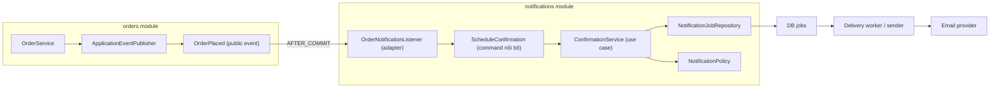
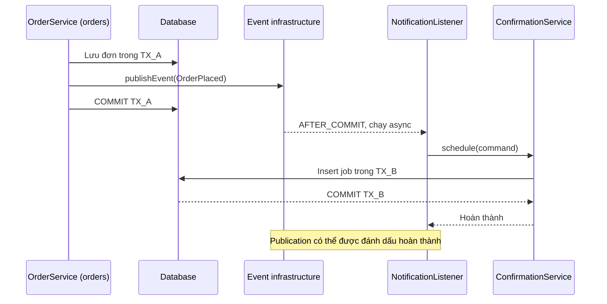
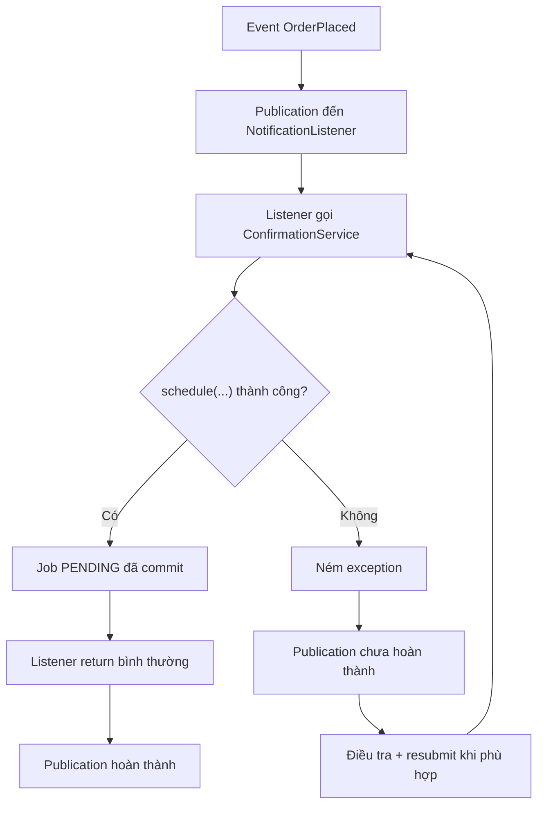

# Tách listener khỏi service trong Spring Modulith Application Events

## 1. Vấn đề thiết kế: listener không nên trở thành service nghiệp vụ

Trong **Spring Modulith**, các application module có thể giao tiếp bằng event để giảm phụ thuộc trực tiếp và giữ ranh giới nghiệp vụ rõ ràng. Module phát công bố một sự thật như `OrderPlaced`; module nhận tự quyết định cách phản ứng. Một cách triển khai quen thuộc là viết toàn bộ logic vào phương thức gắn `@EventListener` hoặc `@ApplicationModuleListener`.

Cách đó ban đầu có vẻ nhanh, nhưng khi chức năng mở rộng, listener dễ biến thành một “service thứ hai”: vừa đọc dữ liệu, kiểm tra quy tắc, thao tác repository, gọi API ngoài, thực hiện retry, log, xử lý lỗi và quyết định trạng thái. Khi đó khó kiểm thử từng trách nhiệm, tái sử dụng nghiệp vụ và giải thích vì sao module lại xử lý như vậy.

Bài học **“Tách listener khỏi service”** thuộc chương **“Listener và subscriber”** của **SPRING_MODULITH_APPLICATION_EVENTS** hướng đến cách chia trách nhiệm:

- **Listener:** điểm tiếp nhận sự kiện, thích nghi hợp đồng event sang một lời gọi nghiệp vụ thuộc module nhận, chuyển tiếp lỗi và bổ sung ngữ cảnh quan sát tối thiểu.
- **Application service/use-case service:** thực hiện ca sử dụng của module nhận, phối hợp domain model, repository, transaction và chính sách idempotency.
- **Domain model/domain service:** bảo vệ invariant và các quy tắc nghiệp vụ cốt lõi.
- **Infrastructure adapter:** gửi email, gọi HTTP, lưu persistence, giao tiếp broker và những thao tác hạ tầng.

Cách chia trên không có nghĩa mỗi class phải chỉ có một dòng. Mục tiêu là **làm rõ quyền sở hữu hành vi**, không chỉ dời hàng trăm dòng từ listener sang một class có tên `SomethingService`.

### Mục tiêu học tập

Sau bài này, bạn có thể phân biệt **listener mỏng** với **service xử lý nghiệp vụ**, tổ chức package theo ranh giới Spring Modulith, chọn transaction và điểm xử lý after-commit, thiết kế lỗi/retry/idempotency, kiểm thử listener và service độc lập, rồi đánh giá khi nào nên hoặc không nên tách thêm lớp.

## 2. Listener và service khác nhau ở đâu?

| Góc nhìn | Listener / subscriber | Application service |
|---|---|---|
| Vai trò chính | Tiếp nhận event từ hạ tầng Spring và chuyển thành yêu cầu có ý nghĩa cho module | Thực thi một use case do module sở hữu |
| Input điển hình | `OrderPlaced`, `PaymentCaptured`, `StockReserved` | `ScheduleOrderConfirmation`, `ReserveStock`, `RecordPayment` |
| Phụ thuộc nên có | Public event contract, một hoặc ít use-case interface, logger/metric | Domain model, repository, policy, các adapter cần thiết |
| Quy tắc nghiệp vụ | Rất ít; chỉ kiểm tra hợp đồng đầu vào cần thiết hoặc chọn tuyến xử lý | Sở hữu rule, transaction và quyết định trạng thái |
| Chống trùng | Truyền định danh/correlation cần thiết | Thực thi idempotency nguyên tử và kiểm tra trạng thái |
| Xử lý exception | Không che lỗi cần phục hồi; đưa lỗi ra cho cơ chế quản lý publication | Phân loại lỗi, rollback, thực thi quy tắc về retry hoặc kết quả nghiệp vụ |
| Kiểm thử | Event đến có gọi đúng use case với tham số đúng? | Use case có đạt invariant và side effect đúng trong các tình huống? |
| Mức phụ thuộc vào Spring event API | Có thể phụ thuộc annotation Spring | Không cần phụ thuộc annotation event; có thể gọi từ adapter khác |

Listener chính là **adapter đầu vào** của module. Ở góc nhìn hexagonal architecture, một event từ module khác là một kênh kích hoạt use case, tương tự như HTTP controller hoặc scheduled job. Các kênh đầu vào có thể cùng gọi use-case service nhưng vẫn giữ semantics khác nhau.

**Không bắt buộc mọi listener đều gọi service.** Một subscriber cực kỳ đơn giản chỉ tăng bộ đếm kỹ thuật không có quy tắc nghiệp vụ có thể xử lý trực tiếp, nếu cách làm đó vẫn dễ hiểu và không che lỗi. Tuy nhiên, với side effect nghiệp vụ, thao tác dữ liệu hoặc hành vi cần kiểm thử, tách service thường có lợi.

## 3. Ví dụ phản mẫu: listener ôm toàn bộ trách nhiệm

Xét chức năng gửi email “đã tiếp nhận đơn” trong module `notifications`.

```java
// Phản mẫu rút gọn để thảo luận, chưa phải code production.
@Component
class OrderNotificationListener {

    private final CustomerRepository customers;
    private final NotificationRepository notifications;
    private final MailClient mailClient;

    @ApplicationModuleListener
    void on(OrderPlaced event) {
        var customer = customers.findByOrderId(event.orderId())
                .orElseThrow();

        if (customer.optedOut()) {
            return;
        }

        if (notifications.existsByOrderId(event.orderId())) {
            return;
        }

        mailClient.send(
                customer.email(),
                "Your order was received"
        );

        notifications.save(
                Notification.sent(event.orderId(), customer.email())
        );
    }
}
```

Những vấn đề cần nhận diện:

1. **Trách nhiệm lẫn lộn:** Event adapter biết cách tra khách, áp dụng chính sách nhận thông báo, kiểm tra trùng, gửi email và lưu trạng thái.
2. **Khó tái sử dụng:** Nếu một HTTP endpoint hoặc scheduled job cần lập kế hoạch gửi email, logic bị buộc vào annotation listener.
3. **Coupling tới nội bộ module khác:** Nếu `CustomerRepository` thuộc module `customers`, việc import repository nội bộ sẽ vi phạm ranh giới thiết kế; cần public query contract hoặc dữ liệu theo đúng quyền truy cập.
4. **Race condition:** `existsByOrderId()` rồi `save()` không bảo đảm duy nhất khi hai listener chạy đồng thời.
5. **Khoảng lỗi hệ thống ngoài:** Email có thể đã được gửi nhưng tiến trình chết trước khi `notifications.save(...)`; replay có thể gửi lần nữa.
6. **Khó kiểm thử:** Muốn test việc map event sang nghiệp vụ lại phải mock database, policy và mail client.
7. **Lỗi không rõ semantics:** Một `return` khi opted out có phải hoàn tất publication hợp lệ? Cần quyết định và ghi nhận theo nghiệp vụ.

Tách listener khỏi service **không tự giải quyết** tất cả lỗi trên, nhưng tạo một ranh giới để xử lý chúng đúng nơi.

## 4. Kiến trúc mục tiêu: listener mỏng, service sở hữu use case

Ví dụ cấu trúc theo package root của Spring Boot:

```text
com.example.shop
├── ShopApplication.java
├── orders
│   ├── OrderPlaced.java                   # Public event API
│   └── internal
│       ├── OrderService.java              # Publisher
│       └── OrderRepository.java
└── notifications
    └── internal
        ├── OrderNotificationListener.java # Event adapter
        ├── ScheduleConfirmation.java      # Input use case
        ├── ConfirmationService.java       # Application service
        ├── NotificationJob.java           # Domain/persistence model
        ├── NotificationJobRepository.java # Outbound persistence port
        └── MailDeliveryAdapter.java       # Adapter hệ thống ngoài
```

Ở ví dụ này, `orders` và `notifications` là hai application module; lớp `OrderPlaced` ở package công khai của `orders`, còn các thành phần triển khai của notifications nằm dưới `notifications.internal`.



**Hai ranh giới quan trọng:**

- **Giữa các module:** `notifications` chỉ biết `orders.OrderPlaced`; nó không cần gọi `orders.internal.OrderRepository`.
- **Bên trong module nhận:** Listener chỉ dịch event sang command nội bộ. Service và domain model quyết định ca sử dụng; adapter email/database triển khai chi tiết kỹ thuật.

Cùng một service có thể được gọi qua nhiều adapter mà không phải sao chép logic. Nhưng không mở public API cho service chỉ để “dùng chung ở mọi nơi” nếu đó là nghiệp vụ riêng của module.

## 5. Thiết kế event contract đủ ổn định

Event nên mô tả một **fact đã xảy ra**, không mô tả chi tiết cách consumer phải xử lý. Ví dụ:

```java
// orders/OrderPlaced.java
package com.example.shop.orders;

import java.time.Instant;
import java.util.UUID;

public record OrderPlaced(
        UUID eventId,
        UUID orderId,
        Instant occurredAt
) {
    public OrderPlaced {
        if (eventId == null || orderId == null || occurredAt == null) {
            throw new IllegalArgumentException("Required event fields missing");
        }
    }
}
```

Giải thích:

| Field | Ý nghĩa | Listener được làm gì? |
|---|---|---|
| `eventId` | Nhận diện một lần xảy ra của fact | Chuyển tiếp cho service để trace hoặc khử trùng theo fact |
| `orderId` | Đơn hàng đã được đặt | Dùng làm khóa use case thuộc notifications |
| `occurredAt` | Thời điểm fact được tạo theo quy ước publisher | Phục vụ quan sát, business cutoff nếu chính sách yêu cầu |

Không cần nhét email khách, toàn bộ JPA entity, access token hoặc chi tiết thanh toán vào event chỉ để listener dễ gửi thư. Nếu service nhận cần dữ liệu bổ sung, hãy dùng **public API có kiểm soát** hoặc một snapshot hợp lý đã được chủ sở hữu dữ liệu xác định.

**Đừng suy diễn quá mức:** `OrderPlaced` nghĩa là đơn đã được đặt theo contract của `orders`; nó không tự khẳng định thanh toán đã capture hoặc kho đã giữ hàng. Confirmation service chỉ nên gửi thông điệp đúng với fact này.

## 6. Bước 1: publisher chỉ biết sự thật nghiệp vụ

Ví dụ publisher bên module `orders`:

```java
// orders/internal/OrderService.java
package com.example.shop.orders.internal;

import com.example.shop.orders.OrderPlaced;
import java.time.Clock;
import java.util.UUID;
import org.springframework.context.ApplicationEventPublisher;
import org.springframework.stereotype.Service;
import org.springframework.transaction.annotation.Transactional;

@Service
public class OrderService {

    private final OrderRepository orders;
    private final ApplicationEventPublisher events;
    private final Clock clock;

    public OrderService(
            OrderRepository orders,
            ApplicationEventPublisher events,
            Clock clock
    ) {
        this.orders = orders;
        this.events = events;
        this.clock = clock;
    }

    @Transactional
    public UUID placeOrder(PlaceOrderCommand command) {
        Order order = orders.save(Order.place(command));

        events.publishEvent(new OrderPlaced(
                UUID.randomUUID(),
                order.id(),
                clock.instant()
        ));
        return order.id();
    }
}
```

`OrderRepository`, `Order` và `PlaceOrderCommand` là các kiểu giả định; ứng dụng thật cần định nghĩa domain, bean `Clock`, datasource và transaction manager. Mã minh họa tập trung vào **điểm phát event**, không phải toàn bộ ví dụ chạy độc lập.

**Không inject `ConfirmationService` vào `OrderService`** chỉ để “gửi email ngay sau tạo đơn”. Publisher không nên biết module nào cần dùng fact. Các listener độc lập quyết định phản ứng.

Lưu ý: `publishEvent(...)` chạy trong transaction đang mở; **không đồng nghĩa dữ liệu đã commit**. Để thực thi side effect chỉ sau khi fact đã bền vững, listener nhận cần sử dụng semantics after-commit phù hợp.

## 7. Bước 2: listener chỉ làm adapter event → use case

Tạo command nội bộ của module notifications:

```java
// notifications/internal/ScheduleConfirmation.java
package com.example.shop.notifications.internal;

import java.util.UUID;

record ScheduleConfirmation(
        UUID orderId,
        UUID sourceEventId
) {
    ScheduleConfirmation {
        if (orderId == null || sourceEventId == null) {
            throw new IllegalArgumentException("IDs are required");
        }
    }
}
```

Listener nhận event rồi chuyển thành lệnh để service xử lý:

```java
// notifications/internal/OrderNotificationListener.java
package com.example.shop.notifications.internal;

import com.example.shop.orders.OrderPlaced;
import org.springframework.modulith.events.ApplicationModuleListener;
import org.springframework.stereotype.Component;

@Component
class OrderNotificationListener {

    private final ConfirmationService confirmations;

    OrderNotificationListener(ConfirmationService confirmations) {
        this.confirmations = confirmations;
    }

    @ApplicationModuleListener
    void on(OrderPlaced event) {
        confirmations.schedule(new ScheduleConfirmation(
                event.orderId(),
                event.eventId()
        ));
    }
}
```

Listener này **không quyết định người nhận**, **không chọn template email**, **không thao tác repository** và **không gọi mail provider**. Nó biết hai contract: `OrderPlaced` của module phát và `ScheduleConfirmation` của use case nội bộ.

Lợi ích:

- Nếu tên hoặc payload event đổi, lớp adapter là điểm tập trung cập nhật mapping.
- Nếu logic gửi thông báo đổi, service được sửa mà không phải đụng event subscription.
- Các bài test dùng event fixture để xác minh mapping, không cần khởi tạo database.
- Logic service có thể được gọi từ scheduled job hoặc controller trong cùng module mà không phụ thuộc Spring event annotations.

### 7.1. Listener có cần validate event?

Nên phân biệt hai trường hợp:

1. **Validation của hợp đồng kỹ thuật:** Những trường thực sự bắt buộc khác null, event type phù hợp. Tốt nhất event constructor/serializer bảo đảm; listener có thể fail fast cho payload không hợp lệ.
2. **Quyết định nghiệp vụ:** Một đơn có nên nhận email, đã gửi chưa, đang ở trạng thái nào, quyền nhận thông báo ra sao. Các quy tắc này thuộc service/domain của module notifications.

Không viết logic nghiệp vụ lớn trong listener dưới nhãn “validation”. Việc kiểm tra `event.orderId() != null` là guard kỹ thuật; việc kiểm tra `customer.optedOut()` là chính sách nghiệp vụ.

### 7.2. Có nên chuyển thẳng event vào service?

Có thể viết `confirmations.schedule(event)` nếu sự kiện chính là input phù hợp và phụ thuộc đó có chủ đích. Nhưng khi application service nhận trực tiếp `OrderPlaced`, nó sẽ biết contract của module phát. Một command nội bộ giúp tách:

- **External module contract:** `OrderPlaced`.
- **Internal use-case input:** `ScheduleConfirmation`.

Với dự án nhỏ, lớp mapping thêm có thể chưa đáng giá; quyết định dựa vào rủi ro event schema thay đổi, số kênh input và nhu cầu test. Điều quan trọng hơn là **service không phụ thuộc vào API sự kiện Spring**.

## 8. Bước 3: service sở hữu hành vi và trạng thái

Trong ví dụ đáng tin cậy hơn, listener **không gửi email ngay** mà yêu cầu service **lập một notification job bền vững**. Sau đó delivery worker có thể gửi, thử lại và đối soát theo SLA riêng.

```java
// notifications/internal/ConfirmationService.java
package com.example.shop.notifications.internal;

import org.springframework.stereotype.Service;
import org.springframework.transaction.annotation.Transactional;

@Service
class ConfirmationService {

    private final NotificationJobRepository jobs;
    private final NotificationPolicy policy;

    ConfirmationService(
            NotificationJobRepository jobs,
            NotificationPolicy policy
    ) {
        this.jobs = jobs;
        this.policy = policy;
    }

    @Transactional
    public void schedule(ScheduleConfirmation command) {
        if (!policy.isConfirmationAllowed(command.orderId())) {
            // Chỉ dùng nếu "không gửi" là kết quả nghiệp vụ hợp lệ.
            return;
        }

        jobs.insertIfAbsent(
                command.orderId(),
                NotificationType.ORDER_RECEIVED,
                command.sourceEventId()
        );
    }
}
```

Các kiểu `NotificationJobRepository`, `NotificationPolicy` và `NotificationType` là API/kiểu minh họa của chính module notifications. Phương thức `insertIfAbsent` là **hợp đồng ứng dụng tự triển khai** bằng thao tác atomic hoặc ràng buộc unique của database; không phải method có sẵn trong Spring Data.

Ở đây, service quyết định:

- Có được phép lập job xác nhận cho đơn này không?
- Lưu job theo loại thông báo nào?
- Làm sao tạo job **một lần** khi cùng event được giao lại?
- Ghi nhận kết quả thế nào nếu business không muốn gửi?

Listener không cần biết các quy tắc đó. Test service tập trung vào chính chúng.

### 8.1. Thế nào là “thành công” của listener?

Trong thiết kế này, listener hoàn tất khi **confirmation job đã được tạo bền vững hoặc business quyết định hợp lệ rằng không cần tạo**. Nó **không cam kết email đã tới hòm thư**.

Đó là một lựa chọn hợp đồng có chủ đích:

| Hành động | Điểm xác nhận thành công |
|---|---|
| `OrderPlaced` được publish | Module orders đã tạo fact theo transaction của mình |
| `OrderNotificationListener` xử lý thành công | Notifications đã lập job hoặc quyết định bỏ qua đúng nghiệp vụ |
| Delivery worker hoàn thành | Email provider đã chấp nhận/gửi theo định nghĩa của hệ thống |
| Khách thực sự đọc email | Không thể suy ra từ việc publication listener hoàn thành |

Nếu nghiệp vụ yêu cầu publication không được đánh dấu hoàn thành trước khi nhà cung cấp email tiếp nhận, có thể chọn cách xử lý trực tiếp trong service và để lỗi lan ra listener. Đánh đổi là listener lâu hơn, khó kiểm soát side effect ngoài database và sự cố provider ảnh hưởng publication backlog. Không có một cách luôn đúng; cần xác định SLA và điểm xác nhận.

### 8.2. Giữ invariant trong domain/service, không chỉ “dời code”

Chuyển cùng một khối `if (!exists)... save... send...` từ listener sang service chưa đủ. Cần **sửa vấn đề concurrency và idempotency**:

- Dùng unique constraint hoặc UPSERT để nhiều consumer không tạo hai job giống nhau.
- Truy vấn data ownership qua API phù hợp, không import repository nội bộ module khác.
- Phân loại lỗi tạm thời và vĩnh viễn.
- Xác định khi nào skip là hợp lệ và khi nào phải báo lỗi.
- Bảo vệ transaction của service và không giả định hệ thống email ngoài cùng tham gia transaction.

Đó mới là lợi ích kiến trúc của service sở hữu use case.

## 9. Ràng buộc database để bảo vệ idempotency

Giả sử mỗi đơn chỉ được có một job `ORDER_RECEIVED`. Có thể dùng schema ví dụ:

```sql
CREATE TABLE notification_jobs (
    id UUID PRIMARY KEY,
    order_id UUID NOT NULL,
    notification_type VARCHAR(50) NOT NULL,
    source_event_id UUID NOT NULL,
    status VARCHAR(30) NOT NULL,
    CONSTRAINT uq_notification_business
        UNIQUE (order_id, notification_type)
);
```

`(order_id, notification_type)` là khóa phù hợp với **quy tắc “mỗi đơn, mỗi loại thông báo một lần”**, không phải quy tắc chung cho mọi domain. Nếu một đơn có thể gửi nhiều thông báo “nhắc thanh toán” hợp lệ, phải chọn khóa khác, chẳng hạn notification request ID.

Hai mức idempotency cần phân biệt:

- **Publication idempotency:** Một event `eventId=A` có thể được giao lại cho listener do crash/retry.
- **Business idempotency:** Có thể có hai event khác nhau cùng dẫn đến yêu cầu gửi một email `ORDER_RECEIVED` cho cùng đơn. Ràng buộc business key mới bảo vệ quy tắc này.

Phản mẫu dễ gặp:

```java
// KHÔNG đủ an toàn khi hai listener chạy đồng thời.
if (!jobs.existsByOrderIdAndType(orderId, type)) {
    jobs.save(new NotificationJob(orderId, type));
}
```

Hai transaction có thể cùng thấy “chưa có” rồi cùng insert. Nếu business cần chính xác một job, database phải có **ràng buộc unique phù hợp**; service triển khai insert-if-absent và xử lý duplicate key theo cách nhất quán với database sử dụng.

**Chú ý:** Bắt lỗi unique constraint rồi tiếp tục ghi trong cùng transaction có thể không an toàn trên một số DB (transaction đã ở trạng thái lỗi). Có thể dùng câu lệnh UPSERT phù hợp hoặc cơ chế giao dịch được thiết kế rõ ràng. Đừng coi một đoạn try/catch là bằng chứng idempotency nguyên tử.

## 10. Cách phân chia transaction giữa publisher, listener và service

Trong Spring Modulith, `@ApplicationModuleListener` là annotation tiện ích cho xử lý event sau commit, bất đồng bộ và transaction riêng theo semantics được release hỗ trợ. Cần hiểu rõ **transaction nào** đang mở, không chỉ nhìn số lượng annotation.



Sơ đồ mô tả **hai transaction logic**. Thực thi cụ thể phụ thuộc vào AOP, transaction manager và cấu hình listener. Với `@ApplicationModuleListener` trong cấu hình được hỗ trợ, annotation thường thiết lập một transaction độc lập cho listener; phương thức service có `@Transactional` với propagation mặc định `REQUIRED` có thể tham gia transaction đang hoạt động đó.

Không nên tự gắn `REQUIRES_NEW` lên mọi service chỉ vì listener bất đồng bộ. Việc mở thêm transaction lồng nhau có thể làm service commit xong nhưng listener về sau thất bại theo cách khó giải thích.

### 10.1. Quy tắc transaction cần nhớ

1. `OrderService.placeOrder` có transaction nghiệp vụ của orders.
2. `publishEvent` có thể được gọi **trước khi TX_A commit**.
3. Listener sau commit chỉ phản ứng sau khi TX_A thành công, không xử lý cho rollback.
4. TX_B của notifications chỉ bảo vệ dữ liệu của module nhận; nó **không rollback TX_A**.
5. Side effect ngoài database (SMTP, API thanh toán, HTTP provider) không tự tham gia TX_B.
6. Nếu service gọi một method `@Transactional` của chính class qua `this`, proxy Spring có thể không áp dụng annotation; nên review đường gọi thật.
7. Nếu event được publish **ngoài transaction**, `@TransactionalEventListener` mặc định thường không chạy trừ khi cấu hình fallback phù hợp.

### 10.2. Có cần `@Transactional` trên cả listener và service?

Không phải cứ có nhiều annotation là an toàn hơn. Có thể:

- Dùng `@ApplicationModuleListener` cho ranh giới listener và `@Transactional` trên service để thể hiện use case độc lập.
- Để service chịu trách nhiệm transaction nếu adapter khác gọi nó và transaction của listener không phù hợp; phải test propagation thực tế.
- Tránh code phụ thuộc ngầm vào thứ tự commit của service và publication registry; test integration mới xác nhận được hành vi với hạ tầng persistence thật.

Nếu muốn tái sử dụng service từ HTTP controller, việc tự định nghĩa transaction ở service thường làm rõ hơn hợp đồng use case. Khi dự án có nhiều datasource hoặc nhiều transaction manager, cần chọn manager/propagation chính xác.

## 11. Exception phải đi qua đúng ranh giới

Khi có publication registry, một mục tiêu quan trọng là **hạ tầng biết listener chưa hoàn thành**. Vì thế listener không nên nuốt lỗi của service rồi trả về bình thường trong khi tác vụ đáng lẽ phải phục hồi.

### 11.1. Phản mẫu: log xong coi như thành công

```java
@ApplicationModuleListener
void on(OrderPlaced event) {
    try {
        confirmations.schedule(new ScheduleConfirmation(
                event.orderId(), event.eventId()
        ));
    } catch (RuntimeException ex) {
        log.error("Scheduling failed", ex);
        // Không ném lại: caller có thể coi listener thành công.
    }
}
```

Cơ chế completion có thể đánh dấu publication đã xử lý dù không có job nào được lập. Với chức năng quan trọng, việc này có thể biến lỗi tạm thời thành mất công việc lâu dài.

### 11.2. Cách tốt hơn: giữ tín hiệu thất bại

```java
@ApplicationModuleListener
void on(OrderPlaced event) {
    try {
        confirmations.schedule(new ScheduleConfirmation(
                event.orderId(), event.eventId()
        ));
    } catch (RuntimeException ex) {
        log.error(
                "notification-scheduling-failed eventId={}",
                event.eventId(),
                ex
        );
        throw ex;
    }
}
```

Ví dụ giả định listener đã có logger. **Cần bảo vệ log**: exception có thể chứa dữ liệu cá nhân hoặc thông tin bên ngoài; tránh ghi toàn bộ event/credentials. Nếu chỉ cần ghi trạng thái, có thể cho exception tự lan lên mà không catch ở listener.

### 11.3. Bỏ qua hợp lệ khác với nuốt lỗi

Nếu service quyết định “khách không đăng ký email xác nhận” và đó là kết quả nghiệp vụ hợp lệ, có thể ghi nhận quyết định rồi kết thúc bình thường. Trường hợp này không phải “lỗi cần retry”.

Nếu service không tìm thấy dữ liệu do replication lag hoặc hệ thống customers đang lỗi, kết thúc bình thường có thể là **mất notification**. Cần phân loại:

| Kết quả | Listener/service nên làm gì? | Ý nghĩa publication |
|---|---|---|
| Job được tạo thành công | Trả về bình thường | Listener hoàn thành bước lập job |
| Job đã tồn tại với cùng business key | Trả về bình thường sau xác minh phù hợp | Duplicate được xử lý đúng |
| Chính sách nghiệp vụ chủ đích không gửi | Ghi nhận/giải thích quyết định rồi trả về | Hoàn thành hợp lệ |
| Lỗi database tạm thời | Ném lỗi để phục hồi có kiểm soát | Chưa hoàn thành |
| Event contract không còn tương thích | Ghi nhận lỗi, cảnh báo, không che exception | Cần sửa code/migration |
| Remote provider timeout, không biết kết quả | Truy vấn/đối soát trước khi thử lại | Không tự kết luận thất bại hoàn toàn |

**Không retry vô hạn** với lỗi contract hay dữ liệu cố định sai. Event publication registry cho phép nhận diện publication chưa hoàn thành khi có persistence phù hợp, nhưng chiến lược resubmit/retry cần được thiết kế riêng theo release và ứng dụng.

## 12. Tách service lập job khỏi service thực hiện delivery khi nào?

Mẫu “listener → schedule service → durable job → delivery worker” giảm thời gian xử lý listener và tách thất bại của provider khỏi transaction nghiệp vụ. Nó cũng làm rõ **khi nào listener được xem là hoàn thành**.

Hai phương án thông dụng:

| Phương án | Listener gọi | Điểm completion | Ưu điểm | Rủi ro/đánh đổi |
|---|---|---|---|---|
| **A. Thực thi side effect trong service** | `sendConfirmation` | Service trả về sau nỗ lực gửi | Ít lớp và bảng hơn; phản hồi trực tiếp lỗi provider | Lâu, provider lỗi gây backlog; khó nguyên tử với registry |
| **B. Lập job bền vững** | `scheduleConfirmation` | Job đã commit | Listener nhanh; tách SLA và retry của delivery | Thêm job table/worker; “đã xử lý event” chưa phải “email đã gửi” |

Chọn B nếu side effect chậm, có nhiều retry riêng, cần đối soát hoặc workload lớn. Chọn A nếu use case đơn giản, chi phí vận hành job riêng không đáng và kết quả xử lý được bảo vệ bằng idempotency thích hợp.

Với các tác vụ cần trạng thái đồng bộ quan trọng như xác nhận thanh toán để quyết định đơn có được đặt hay không, đừng biến chúng thành listener sau commit chỉ vì muốn tách lớp. **Yêu cầu nhất quán nghiệp vụ quyết định ranh giới**, không phải tên annotation.

### 12.1. Delivery worker cũng cần service/adapter rõ trách nhiệm

Nếu dùng job table:

```text
OrderNotificationListener
        |
        v
ConfirmationService.schedule(...)
        |
        v
notification_jobs: PENDING
        |
        v
NotificationDeliveryWorker
        |
        v
DeliveryService
        |
        v
MailProviderAdapter
```

Worker nhận công việc đến hạn, không nên tự chứa toàn bộ chính sách gửi email. Delivery service quyết định trạng thái gửi, retry, idempotency key và hành vi khi provider trả kết quả không chắc chắn. Mail adapter chỉ hiện thực API provider.

**Không coi job table là phép màu exactly-once.** Sau khi provider đã gửi email mà tiến trình chết trước khi đánh dấu job đã gửi, vẫn có khả năng thử lại. Cần idempotency của bên nhận, cơ chế xác nhận trạng thái hoặc xử lý trùng chấp nhận được theo nghiệp vụ.

## 13. Event publication registry vẫn cần khi đã tách service

Spring Modulith có cơ chế **event publication registry** để theo dõi việc phân phối sự kiện cho những listener tương ứng. Với starter/persistence thích hợp, publication chưa hoàn thành có thể được lưu và xem xét khôi phục khi listener lỗi.

Tách listener khỏi service không làm registry vô dụng. Ngược lại, nó giúp **định nghĩa trạng thái completion rõ ràng**.



**Điều phải kiểm tra theo phiên bản:** loại listener nào được registry theo dõi, dữ liệu serialization, transaction khi ghi publication, API query publication chưa hoàn thành, cách replay/resubmit, retention và cleanup.

### 13.1. Một event có nhiều listener

Giả sử `OrderPlaced` được cả notifications và inventory xử lý. Nếu notifications thất bại nhưng inventory thành công, publication nên được theo dõi **theo từng listener**, không gộp logic “toàn bộ event đã thất bại” rồi chạy lại mọi side effect.

| Event | Consumer | Tác vụ | Kết quả |
|---|---|---|---|
| `OrderPlaced(A)` | `notifications` | Lập job xác nhận | Tạm thời thất bại |
| `OrderPlaced(A)` | `inventory` | Yêu cầu giữ hàng | Hoàn thành |
| `OrderPlaced(A)` | `analytics` | Cập nhật số liệu | Hoàn thành |

Trạng thái trong bảng chỉ là cách diễn giải, không phải schema hay enum chính thức của Spring Modulith.

### 13.2. Tách service không có nghĩa tự động retry

Có registry là có cơ sở lưu và truy xuất publication; **không đồng nghĩa đã có lịch retry phù hợp**. Cần thiết kế:

- Lỗi nào được resubmit?
- Sau bao lâu? Có backoff và giới hạn lần thử không?
- Nếu listener luôn fail với event cũ, ai quyết định migration/skip?
- Có cơ chế cảnh báo publication quá tuổi/SLA không?
- Nếu đã lập job nhưng registry chưa kịp đánh dấu hoàn tất, replay có an toàn không?

Câu trả lời phải dựa vào service idempotent, cơ chế persistence và chính sách vận hành, không chỉ annotation listener.

## 14. Kiểm thử listener tách biệt: event → command

Vì listener mỏng, có thể unit test mà không cần Spring context, database hoặc provider. Test đặt cùng package để gọi method package-private.

```java
// src/test/java/com/example/shop/notifications/internal/OrderNotificationListenerTest.java
package com.example.shop.notifications.internal;

import static org.mockito.ArgumentMatchers.argThat;
import static org.mockito.Mockito.mock;
import static org.mockito.Mockito.verify;

import com.example.shop.orders.OrderPlaced;
import java.time.Instant;
import java.util.UUID;
import org.junit.jupiter.api.Test;

class OrderNotificationListenerTest {

    @Test
    void forwardsPublicEventAsInternalCommand() {
        ConfirmationService service = mock(ConfirmationService.class);
        OrderNotificationListener listener =
                new OrderNotificationListener(service);

        UUID eventId = UUID.randomUUID();
        UUID orderId = UUID.randomUUID();
        var event = new OrderPlaced(
                eventId, orderId, Instant.parse("2026-01-01T09:00:00Z")
        );

        listener.on(event);

        verify(service).schedule(argThat(command ->
                command.orderId().equals(orderId)
                        && command.sourceEventId().equals(eventId)
        ));
    }
}
```

Test này bảo vệ **mapping contract** giữa public event và use case. Nó không chứng minh after-commit, listener async đã chạy hay registry đánh dấu publication; những việc đó cần integration test riêng.

Nếu listener có logic quy tắc nghiệp vụ, test này sẽ ngày càng phải mock repository, API ngoài và policy. Đó là tín hiệu để đưa logic vào service/domain phù hợp.

### 14.1. Test listener không che exception

```java
package com.example.shop.notifications.internal;

import static org.assertj.core.api.Assertions.assertThatThrownBy;
import static org.mockito.ArgumentMatchers.any;
import static org.mockito.Mockito.doThrow;
import static org.mockito.Mockito.mock;

import com.example.shop.orders.OrderPlaced;
import java.time.Instant;
import java.util.UUID;
import org.junit.jupiter.api.Test;

class OrderNotificationFailureTest {

    @Test
    void propagatesServiceFailure() {
        ConfirmationService service = mock(ConfirmationService.class);
        doThrow(new IllegalStateException("temporary DB outage"))
                .when(service).schedule(any(ScheduleConfirmation.class));

        var listener = new OrderNotificationListener(service);
        var event = new OrderPlaced(
                UUID.randomUUID(), UUID.randomUUID(), Instant.now()
        );

        assertThatThrownBy(() -> listener.on(event))
                .isInstanceOf(IllegalStateException.class);
    }
}
```

Test không cần starter Modulith vì nó gọi method trực tiếp; **chưa bảo đảm** registry ghi nhận lỗi trên môi trường thật. Ngoài ra, không dùng một test throw exception để suy ra service đã rollback giao dịch; test transaction phải quan sát database/transaction manager thật.

## 15. Kiểm thử service: business rule và tính duy nhất

Service cần được kiểm thử theo kết quả nghiệp vụ. Với ví dụ lập job, ít nhất có các tình huống:

| Tình huống | Kỳ vọng |
|---|---|
| Nhận command hợp lệ, đủ điều kiện gửi | Tạo một job `ORDER_RECEIVED` |
| Nhận lại cùng event | Vẫn chỉ có một job |
| Nhận event khác cùng đơn, cùng loại notification | Không tạo job thứ hai nếu business quy định một lần |
| Policy không cho gửi | Không lập job; kết quả bỏ qua có chủ đích |
| Database tạm thời lỗi | Transaction rollback; exception được truyền ra |
| Hai thread đồng thời tạo cùng business key | Unique constraint bảo vệ, kết quả idempotent |

Có thể kiểm tra mức repository/domain bằng một integration test với database tương ứng. Ví dụ phương thức kiểm tra contract:

```java
// Khung test minh họa, đặt trong @SpringBootTest / @DataJpaTest
// phù hợp với repository, schema và transaction thực tế.
@Test
void duplicateCommandCreatesSingleNotificationJob() {
    UUID orderId = UUID.randomUUID();

    var first = new ScheduleConfirmation(orderId, UUID.randomUUID());
    var duplicate = new ScheduleConfirmation(orderId, UUID.randomUUID());

    confirmations.schedule(first);
    confirmations.schedule(duplicate);

    assertThat(jobs.countByOrderAndType(
            orderId, NotificationType.ORDER_RECEIVED
    )).isEqualTo(1);
}
```

Code này chỉ là **khung kiểm thử**; `jobs.countByOrderAndType` và cơ chế atomic insert cần triển khai. Dùng hai source event ID khác nhau cố ý để kiểm tra **business idempotency**, không chỉ dedup cùng một bản sao event.

Đừng chỉ mock `jobs.insertIfAbsent(...)` rồi khẳng định đã kiểm thử race condition. Muốn chứng minh tính nguyên tử, cần test trên database và đặc tả concurrency/unique constraint thực tế.

## 16. Kiểm thử tích hợp Spring Modulith và transaction

Unit test listener + service chưa chứng minh event thực sự được Spring phát và nhận sau commit. Cần thêm test ở mức module hoặc application.

### 16.1. Test publisher bằng `PublishedEvents`

```java
// Ví dụ minh họa đặt trong package phù hợp với visibility của use case.
package com.example.shop.orders.internal;

import static org.assertj.core.api.Assertions.assertThat;

import com.example.shop.orders.OrderPlaced;
import org.junit.jupiter.api.Test;
import org.springframework.beans.factory.annotation.Autowired;
import org.springframework.modulith.test.ApplicationModuleTest;
import org.springframework.modulith.test.PublishedEvents;

@ApplicationModuleTest
class OrderPublisherModuleTest {

    @Autowired OrderService orders;
    @Autowired PublishedEvents published;

    @Test
    void publishesOrderPlacedAfterValidStateTransition() {
        PlaceOrderCommand command = OrderFixtures.validCommand();
        UUID orderId = orders.placeOrder(command);

        assertThat(published.ofType(OrderPlaced.class))
                .anySatisfy(event ->
                        assertThat(event.orderId()).isEqualTo(orderId));
    }
}
```

`OrderFixtures` và domain types là thành phần giả định của dự án. `PublishedEvents` xác nhận **publisher đã phát event**, không đồng nghĩa transaction đã commit hoặc listener đã xử lý thành công.

### 16.2. Test after-commit và rollback thực tế

Với listener `@ApplicationModuleListener` hoặc `@TransactionalEventListener(phase = AFTER_COMMIT)`, nên kiểm thử:

- **Commit:** TX của orders thành công; notifications nhận fact và lập job.
- **Rollback:** publisher đã gọi `publishEvent` trong TX nhưng TX rollback; không lập job.
- **Consumer lỗi:** job DB không commit; publication vẫn được nhận diện chưa hoàn thành nếu registry persistence đã được cấu hình.
- **Replay:** xử lý lại cùng event không tạo job trùng.

Một test method có `@Transactional` trong Spring Test thường rollback ở cuối, nên không thể tự suy ra listener after-commit đã chạy. Hãy commit giao dịch thật bằng `TransactionTemplate` hoặc công cụ test phù hợp, rồi chờ **điều kiện có timeout** khi listener async; tránh `Thread.sleep(...)` cố định.

Ví dụ khung integration test:

```java
// Đoạn minh họa trong @SpringBootTest đã cấu hình:
// @Autowired TransactionTemplate transactions;
// @Autowired ApplicationEventPublisher events;
// @Autowired NotificationJobRepository jobs;

@Test
void rollbackDoesNotScheduleConfirmation() {
    UUID orderId = UUID.randomUUID();
    UUID eventId = UUID.randomUUID();

    transactions.executeWithoutResult(status -> {
        events.publishEvent(
                new OrderPlaced(eventId, orderId, Instant.now())
        );
        status.setRollbackOnly();
    });

    assertThat(jobs.countByOrderAndType(
            orderId, NotificationType.ORDER_RECEIVED
    )).isZero();
}
```

Đoạn này không tự chạy độc lập nếu chưa có database, fixture, Spring context và transaction manager. Để test rằng **after-commit listener đã được đăng ký**, hãy bổ sung test commit và chờ job xuất hiện trong khoảng timeout hợp lý. Test rollback có kết quả job bằng 0 cũng phải kiểm tra listener thực sự có khả năng nhận event trong nhánh commit; nếu không, test có thể PASS giả vì listener chưa được đăng ký.

### 16.3. Kiểm thử registry và lỗi phục hồi

Với starter persistence registry phù hợp release hiện tại, thiết lập test riêng:

1. Commit `OrderPlaced` thực tế.
2. Cho `ConfirmationService.schedule(...)` ném lỗi sau khi listener bắt đầu.
3. Xác nhận publication của notifications **chưa hoàn thành**, qua API/query phù hợp phiên bản.
4. Sửa nguyên nhân, kích hoạt resubmission đã cấu hình.
5. Xác nhận một job hợp lệ được tạo, listener hoàn tất và publication chuyển trạng thái phù hợp.
6. Thử replay cùng event hoặc mô phỏng crash sau commit job nhưng trước completion; job không bị nhân đôi.

Không hardcode method registry không biết chính xác; API lưu publication, resubmit và trạng thái thay đổi theo phiên bản/starter. Cần kiểm thử đúng hạ tầng đang chạy, không coi ví dụ mô tả thành API chính thức.

## 17. Kiểm thử ranh giới module, không chỉ listener

Tách listener khỏi service thường đi cùng mục tiêu bảo vệ package boundary của Spring Modulith. Kiểm thử kiến trúc:

```java
package com.example.shop;

import org.junit.jupiter.api.Test;
import org.springframework.modulith.core.ApplicationModules;

class ModuleArchitectureTests {

    @Test
    void verifiesDeclaredModuleBoundaries() {
        ApplicationModules.of(ShopApplication.class).verify();
    }
}
```

Nếu module notifications import `orders.internal.OrderRepository`, cần xem lại public API của orders; một listener mỏng nhưng service đi vòng sang repository nội bộ module khác vẫn là vi phạm thiết kế.

**Lưu ý:** `ApplicationModules.verify()` kiểm tra các ràng buộc kiến trúc mà Modulith hỗ trợ theo cấu hình, không kiểm tra rằng listener đã đủ mỏng, service idempotent hay email đã được gửi đúng một lần. Kiến trúc và hành vi runtime cần các nhóm test riêng.

## 18. Khi nào không nên tách listener và service quá mức?

Một thiết kế nhiều lớp không tự động tốt hơn. Những trường hợp cần cân nhắc:

| Tình huống | Cách tiếp cận gợi ý |
|---|---|
| Listener chỉ ghi metric kỹ thuật đơn giản và không có invariant | Có thể xử lý trực tiếp, giữ rõ ranh giới observability |
| Listener có một lời gọi repository không mang chính sách nghiệp vụ | Tách nếu sẽ mở rộng hoặc có yêu cầu test/retry; tránh lớp wrapper vô nghĩa |
| Một use case có thể gọi qua HTTP/event/schedule | Nên có service/use case chung, mỗi adapter mỏng |
| Service chỉ chuyển tiếp thêm một service khác | Review xem abstraction có làm rõ hợp đồng hay chỉ tăng độ sâu |
| Logic nghiệp vụ thuộc aggregate | Đặt rule vào domain model thay vì đẩy hết sang application service |
| Cần orchestration nhiều module với timeout/compensation | Có thể cần process manager/workflow orchestration rõ; một listener lớn không phù hợp |
| Quy tắc đòi kết quả đồng bộ trước commit | Không thay bằng after-commit event để thỏa mãn mẫu thiết kế |

Một service có tên `EventHandlingService` nhưng chứa logic của mọi event không hẳn là tách tốt. Hãy tổ chức theo **business capability/use case**, ví dụ `ConfirmationService`, `StockReservationService`, `PaymentReconciliationService`.

### 18.1. Tránh lớp “god service” mới

Nếu listener mỏng nhưng `NotificationService` có 40 method từ render template, lập lịch, gửi SMS, gửi email, quản lý consent và cập nhật dashboard, trách nhiệm vẫn bị trộn. Có thể tách theo capability và rule thực tế:

- `ConfirmationService`: quyết định có tạo confirmation job.
- `NotificationPolicy`: quy tắc cho phép gửi theo loại thông báo.
- `DeliveryService`: điều phối gửi và trạng thái delivery.
- `MailProviderAdapter`: tích hợp dịch vụ email cụ thể.

Không cần tạo tất cả class trên từ ngày đầu; chỉ tách khi lý do thay đổi hoặc kiểm thử yêu cầu.

## 19. Observability: biết listener hoàn thành đến đâu

Sau khi tách các giai đoạn, cần metric/log phản ánh **đúng điểm xác nhận**. Một log “listener xử lý thành công” không đồng nghĩa email được gửi tới người dùng.

| Mốc | Tín hiệu cần có | Cách diễn giải |
|---|---|---|
| Publisher công bố event | `eventType`, `eventId`, module nguồn | Event được tạo; chưa chắc commit |
| Publication đã commit và sẵn sàng | Trạng thái publication theo registry | Fact đã được ghi nhận cho listener |
| Listener bắt đầu | Listener ID, event ID, trace/correlation ID | Hạ tầng bắt đầu adapter |
| Service lập job | `jobId`, loại notification, business key được phép | Bước schedule thành công |
| Publication listener hoàn thành | Mark completed của registry | Không còn cần resubmit bước adapter theo contract |
| Delivery worker gửi | Provider request ID, trạng thái gửi | Tiến trình gửi email độc lập |
| Publication/job thất bại | Error code, attempt, tuổi backlog | Cần phân loại và phục hồi |

### 19.1. Không lộ dữ liệu nhạy cảm khi log

Đừng log toàn bộ record/event nếu có thể chứa dữ liệu cá nhân. Dù `OrderPlaced` chỉ chứa ID, chúng vẫn có thể liên kết tới khách hàng. Ưu tiên allowlist các trường được phép và kiểm soát quyền xem log. Không ghi access token, email đầy đủ, số thẻ hoặc payload của hệ thống ngoài vào exception message.

Log có thể đặt ở listener adapter:

```java
@ApplicationModuleListener
void on(OrderPlaced event) {
    log.debug("schedule-confirmation eventId={}", event.eventId());

    confirmations.schedule(new ScheduleConfirmation(
            event.orderId(), event.eventId()
    ));
}
```

Nếu thêm logging lỗi, đừng catch exception rồi nuốt. Với xử lý async, trace context có thể cần cấu hình propagation qua thread; không giả định MDC tự truyền trong mọi executor.

### 19.2. Theo dõi backlog theo ý nghĩa nghiệp vụ

Có thể có **hai backlog** độc lập: publication chưa lập được job và job đã lập nhưng chưa gửi email. Nếu chỉ xem registry, ứng dụng có thể hiển thị “mọi publication hoàn thành” dù delivery worker đang lỗi suốt hai ngày.

Các chỉ số hữu ích:

- Publication chưa hoàn thành theo listener; tuổi bản ghi lâu nhất.
- Tỷ lệ lỗi/resubmission của adapter.
- Số job `PENDING`/`FAILED`; độ tuổi job.
- Thời gian từ `OrderPlaced` đến `JOB_SCHEDULED` và tới `EMAIL_ACCEPTED`.
- Lỗi provider theo nhóm nguyên nhân, không gộp mọi lỗi thành một loại.
- Số business key bị trùng/duplicate bị chặn để phát hiện retry bất thường.

Đặt cảnh báo theo SLA của từng giai đoạn, không chỉ theo tổng số event.

## 20. Checklist refactor listener đang quá tải

Hãy dùng các bước sau khi đưa một listener lớn về thiết kế dễ bảo trì:

1. **Xác định fact:** Event đến khẳng định điều gì đã xảy ra? Không biến `OrderPlaced` thành command “gửi email”.
2. **Đánh dấu trách nhiệm:** Dòng nào chỉ adapter, dòng nào là rule nghiệp vụ, persistence, integration, logging?
3. **Xác định owner:** Mỗi rule thuộc module/domain nào? Có truy cập repository nội bộ module khác không?
4. **Chọn use-case contract:** Service nhận command có tên nghiệp vụ, đủ dữ liệu tối thiểu.
5. **Chuyển logic và sửa invariant:** Đưa business rule vào service/domain; thêm unique constraint/idempotency cần thiết.
6. **Chọn completion point:** Listener kết thúc khi job được lập hay khi side effect hoàn tất?
7. **Định nghĩa transaction:** Test commit/rollback và propagation giữa listener/service.
8. **Giữ lỗi phục hồi được:** Exception thích hợp phải lan ra; không nuốt lỗi vì “event đã publish rồi”.
9. **Tách test:** Listener mapping test, service business test, integration commit/retry/replay test.
10. **Bổ sung observability:** Theo dõi cả publication backlog và side-effect backlog.
11. **Review đơn giản hóa:** Không tạo lớp wrapper hoặc event mới không mang ý nghĩa nghiệp vụ.

### Bảng nhận diện trước/sau

| Trước refactor | Sau refactor mong muốn |
|---|---|
| Listener import repository từ module orders | Listener chỉ import public `OrderPlaced` |
| Listener quyết định consent/template | ConfirmationService/Policy quyết định |
| Listener gọi SMTP và lưu job trong cùng khối dài | Service/adapter có ranh giới dữ liệu và side effect rõ |
| Check exists rồi insert | Insert-if-absent nguyên tử và business unique |
| Catch mọi exception rồi log | Lỗi phục hồi được lan ra; skip nghiệp vụ có chủ đích |
| Test listener cần chạy cả database/email | Unit test listener chỉ mock service |
| “Event complete” bị hiểu là “email delivered” | Completion point và delivery state được định nghĩa riêng |

## 21. Bài tập thực hành

### Bài tập 1 — Tách một listener xử lý nhiều trách nhiệm

Cho listener giả định:

```java
@ApplicationModuleListener
void on(PaymentCaptured event) {
    var invoice = invoiceRepository.findByPaymentId(event.paymentId());
    var email = customerRepository.findEmail(invoice.customerId());
    if (!invoice.sent()) {
        var pdf = pdfRenderer.render(invoice);
        mailClient.send(email, pdf);
        invoice.markSent();
        invoiceRepository.save(invoice);
    }
}
```

Hãy phân loại phần **event adapter**, **invoice business rule**, **PDF rendering**, **email delivery**, **data ownership**. Đề xuất listener mỏng gọi use-case `IssueInvoiceAfterPayment` hoặc `ScheduleInvoiceDelivery`, xác định khi nào việc dùng API công khai của module thanh toán/khách hàng là phù hợp.

Đặc biệt giải thích vì sao check `!invoice.sent()` chưa đủ chống gửi trùng nếu process chết sau khi mail provider đã chấp nhận email.

### Bài tập 2 — So sánh hai completion point

Một đội có hai lựa chọn:

**A.** Listener gọi thẳng service gửi SMS và kết thúc sau khi API provider trả thành công.

**B.** Listener gọi service lập SMS job bền vững; worker gửi SMS sau.

Hãy ghi bảng so sánh: độ trễ listener, registry backlog, job backlog, restart/recovery, idempotency và SLA. Khi nào listener được phép báo hoàn thành? Trường hợp nào vẫn có nguy cơ gửi SMS trùng?

### Bài tập 3 — Thiết kế bộ test theo lớp

Với `OrderNotificationListener` và `ConfirmationService` ở bài này, viết kế hoạch ít nhất sáu test:

- Mapping của event sang command.
- Lỗi service được listener truyền lên.
- Service tạo job một lần theo business key.
- Service không tạo job khi policy từ chối hợp lệ.
- Publisher rollback không tạo side effect sau commit.
- Replay publication sau lỗi vẫn chỉ có một notification job.

Đánh dấu test nào là unit và test nào phải chạy với database/Spring context thật.

### Bài tập 4 — Review module boundary

Một implementation đã tách listener khỏi service nhưng `ConfirmationService` inject `com.example.shop.orders.internal.OrderRepository` để lấy email. Hãy giải thích tại sao thiết kế vẫn chưa đúng ranh giới Spring Modulith. Đề xuất event payload tối thiểu, public read API theo mục đích hoặc một notification job với snapshot có kiểm soát. Bảo đảm không truyền dữ liệu nhạy cảm không cần thiết.

## 22. Tóm tắt trọng tâm

**Tách listener khỏi service** nghĩa là tách **cơ chế tiếp nhận application event** khỏi **quyết định và xử lý nghiệp vụ**. Listener nhận `OrderPlaced`, chuyển sang một use case của module notifications rồi để service/domain bảo vệ invariant, transaction và idempotency. Publisher chỉ phát fact, không biết listener nào sẽ phản ứng.

Trong Spring Modulith, `@ApplicationModuleListener` giúp diễn đạt xử lý hậu commit giữa các module, nhưng không thay thế thiết kế lỗi: publisher có thể đã commit trong khi listener thất bại, publication có thể được replay, và side effect ngoài database không tự chính xác một lần. Định nghĩa rõ **điểm hoàn thành**, giữ exception cần phục hồi, cấu hình registry/retry phù hợp, chống trùng và test cả từng lớp lẫn giao dịch thật sẽ giúp hệ thống giảm phụ thuộc **mà vẫn đáng tin cậy và dễ bảo trì**.

