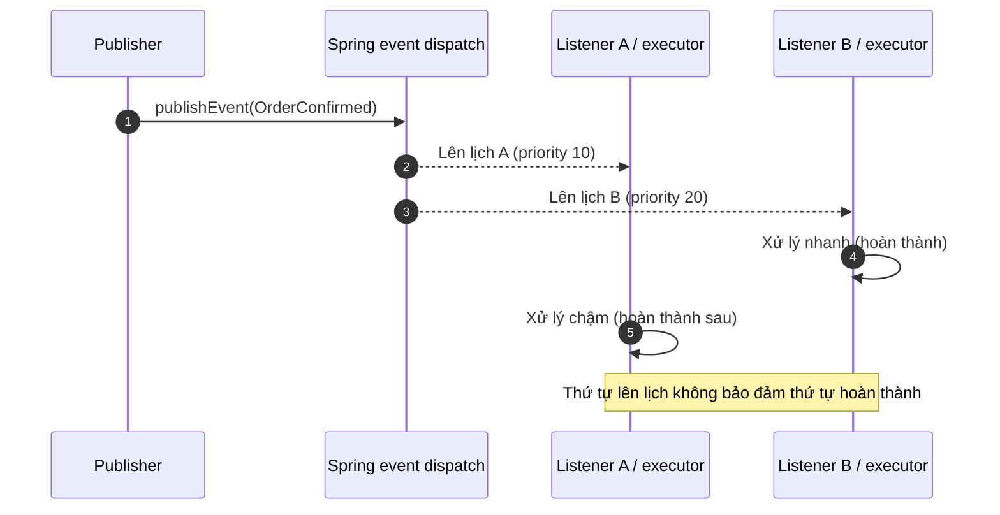
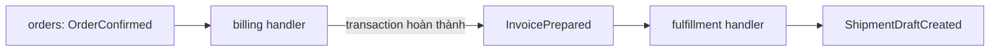
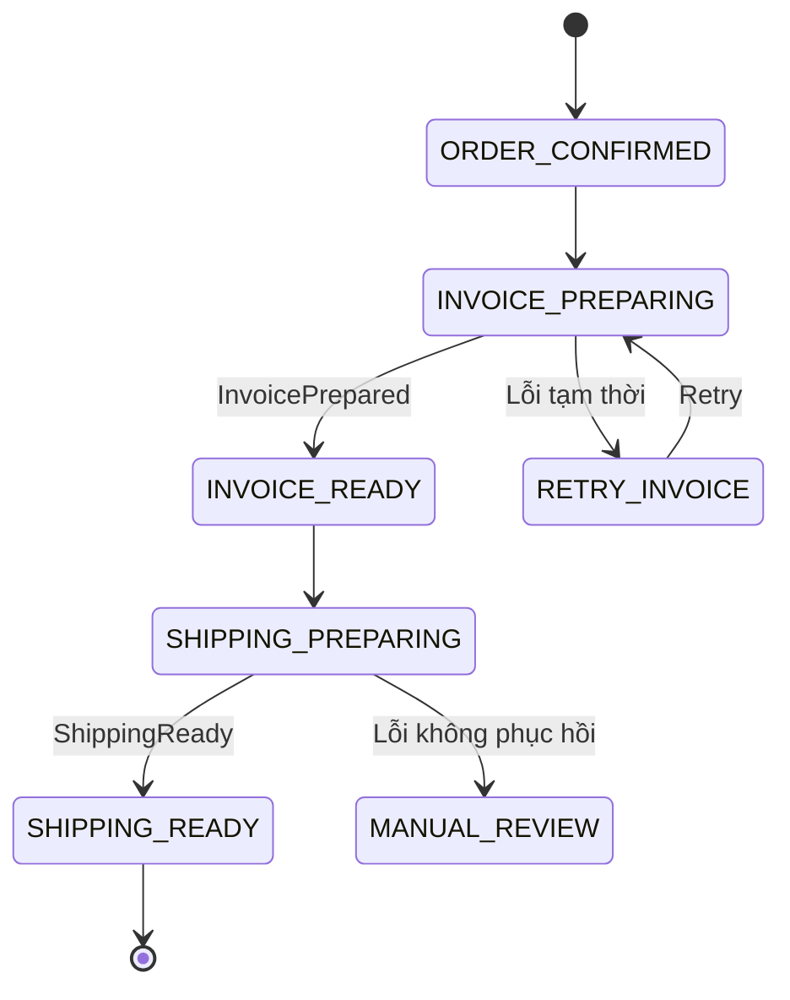

# Độ ưu tiên listener trong điều phối handler Spring Modulith

## 1. Vì sao cần hiểu độ ưu tiên listener?

Spring Modulith giúp các module giao tiếp qua application events để giảm việc gọi trực tiếp service của nhau. Ví dụ, khi module `orders` xác nhận đơn hàng, nó phát `OrderConfirmed`; module `notifications` gửi email, module `loyalty` cộng điểm và module `analytics` cập nhật thống kê.

Khi có nhiều listener cho cùng một event, câu hỏi thường xuất hiện:

- Listener nào được gọi trước?
- Có thể dùng `@Order` để yêu cầu một listener hoàn tất trước listener khác không?
- Điều gì xảy ra khi listener chạy sau transaction commit hoặc bất đồng bộ?
- Nếu một listener lỗi, listener có ưu tiên thấp hơn và các publication khác sẽ ra sao?

**Độ ưu tiên listener** là cơ chế sắp xếp **thứ tự gọi hoặc đăng ký xử lý**, dựa trên cơ chế event của Spring Framework. Nó không tự động trở thành một quy trình nghiệp vụ có bước trước và bước sau. Trong Spring Modulith, cần đặc biệt phân biệt **thứ tự phân phối**, **thời điểm sau commit** và **thứ tự hoàn thành**.

Mục tiêu bài học: sử dụng `@Order` đúng chỗ; hiểu giới hạn của `@EventListener`, `@TransactionalEventListener` và `@ApplicationModuleListener`; chọn phương án điều phối phù hợp khi các module thực sự có quan hệ phụ thuộc.

## 2. Ba khái niệm phải tách biệt

| Khái niệm | Câu hỏi trả lời | Ví dụ |
|---|---|---|
| **Invocation order** – thứ tự gọi | Spring đưa event tới listener nào trước? | `@Order(10)` trước `@Order(20)` trong luồng đồng bộ |
| **Transaction phase** – pha giao dịch | Listener được kích hoạt khi nào so với commit/rollback? | `AFTER_COMMIT` chỉ phản ứng khi transaction nguồn commit thành công |
| **Completion order** – thứ tự hoàn thành | Công việc của listener nào xong trước? | Listener A được lên lịch trước nhưng listener B có thể hoàn thành trước khi chạy async |

Ví dụ hai listener A và B đều nhận `OrderConfirmed`. Spring gọi callback đăng ký xử lý A trước B, nhưng A phải gọi dịch vụ mạng mất 800 ms; B chỉ ghi một bản ghi vào DB mất 30 ms. Nếu cả hai chạy bất đồng bộ, B hoàn thành trước A là hoàn toàn bình thường.



Vì vậy, **không dùng ưu tiên listener để biểu diễn một điều kiện tiên quyết quan trọng của nghiệp vụ**. Nếu B chỉ được bắt đầu sau khi A thành công, cần thể hiện mối quan hệ đó bằng orchestration hoặc một sự kiện nghiệp vụ tiếp theo.

## 3. `@Order` hoạt động như thế nào?

Spring Framework hỗ trợ annotation `org.springframework.core.annotation.Order` trên method listener để ưu tiên việc gọi listener. Quy tắc của interface `Ordered` là:

- **Số càng nhỏ thì ưu tiên càng cao:** `@Order(5)` được ưu tiên trước `@Order(50)`.
- Có thể dùng số âm, số 0 hoặc số dương; không bắt buộc bắt đầu từ 1.
- `Ordered.HIGHEST_PRECEDENCE` tương ứng mức ưu tiên cao nhất; `Ordered.LOWEST_PRECEDENCE` là thấp nhất.
- Listener không khai báo `@Order` thường có mức ưu tiên mặc định thấp nhất.
- Khi hai listener có **cùng mức ưu tiên**, không nên dựa vào thứ tự giữa chúng: vị trí tương đối không được bảo đảm như một hợp đồng nghiệp vụ.

Ví dụ về thứ tự tương đối:

| Listener | Annotation | Thứ tự ưu tiên tương đối |
|---|---|---|
| `first` | `@Order(-10)` | Cao nhất trong bảng |
| `second` | `@Order(0)` | Sau `first` |
| `third` | `@Order(100)` | Sau `second` |
| `last` | Không có `@Order` | Thường thấp nhất |

Giá trị chỉ mang ý nghĩa **so sánh**, không có nghĩa Spring chờ 10 ms, mở 10 thread, retry 10 lần hoặc trao quyền ưu tiên cho thread hệ điều hành.

Cơ chế này **không quyết định thứ tự tạo bean**. `@Order` trên listener khác với quan hệ phụ thuộc khởi tạo bean và không thay thế `@DependsOn`.

## 4. Dùng `@Order` với listener đồng bộ

Ví dụ module `orders` có một event để ghi nhận các bước xử lý cục bộ:

```java
package com.example.shop.orders;

import java.util.UUID;

public record OrderConfirmed(UUID eventId, UUID orderId) {}
```

Hai listener đồng bộ quan sát sự kiện đó:

```java
package com.example.shop.orders;

import org.springframework.context.event.EventListener;
import org.springframework.core.annotation.Order;
import org.springframework.stereotype.Component;

@Component
class OrderDiagnostics {

    private final DiagnosticLog diagnostics;

    OrderDiagnostics(DiagnosticLog diagnostics) {
        this.diagnostics = diagnostics;
    }

    @EventListener
    @Order(10)
    void recordReceipt(OrderConfirmed event) {
        diagnostics.record("received:" + event.eventId());
    }

    @EventListener
    @Order(20)
    void recordCompletionOfDispatch(OrderConfirmed event) {
        diagnostics.record("dispatched:" + event.eventId());
    }
}
```

`DiagnosticLog` là dependency minh họa do ứng dụng định nghĩa. Với **event multicaster đồng bộ mặc định**, Spring gọi `recordReceipt(...)` trước `recordCompletionOfDispatch(...)` khi chúng nhận cùng event. Cần chú ý:

1. `@EventListener` thông thường được gọi **ngay trong lúc `publishEvent(...)` phân phối event**; nếu đang có transaction trên cùng thread, listener thường tham gia phạm vi đó.
2. Nếu listener ưu tiên cao ném exception, exception có thể truyền về publisher và **ngăn các listener tiếp theo chạy**, trừ khi cấu hình error handling đặc biệt. Với transaction, lỗi lan truyền có thể dẫn tới rollback.
3. Nếu multicaster được cấu hình executor bất đồng bộ, hoặc method dùng `@Async`, `@Order` không còn bảo đảm **thứ tự hoàn thành** hai method.
4. Không dùng hai bản ghi diagnostics ở đây làm điều kiện nghiệp vụ: log không có cùng tính nhất quán với một transaction DB và có thể tồn tại ngay cả khi transaction rollback.

**Phạm vi hợp lý:** dùng `@Order` khi muốn việc **gọi các callback đồng bộ** có thứ tự tương đối rõ ràng, ví dụ một số extension point kỹ thuật. Nếu hai hành động bắt buộc luôn tuần tự trong một nghiệp vụ, một service điều phối tường minh thường dễ hiểu và dễ kiểm thử hơn.

## 5. Điều gì thay đổi với `@TransactionalEventListener`?

`@TransactionalEventListener` gắn listener với **một pha của transaction nguồn**. Mặc định là `AFTER_COMMIT`; còn có `BEFORE_COMMIT`, `AFTER_ROLLBACK` và `AFTER_COMPLETION`.

```java
import org.springframework.core.annotation.Order;
import org.springframework.stereotype.Component;
import org.springframework.transaction.event.TransactionPhase;
import org.springframework.transaction.event.TransactionalEventListener;

@Component
class OrderTransactionObservers {

    @TransactionalEventListener(
            phase = TransactionPhase.BEFORE_COMMIT)
    @Order(10)
    void beforeCommit(OrderConfirmed event) {
        // Quan sát bước trước commit; không tự gọi hệ thống ngoài.
    }

    @TransactionalEventListener(
            phase = TransactionPhase.AFTER_COMMIT)
    @Order(10)
    void afterCommitFirst(OrderConfirmed event) {
        // Xử lý sau khi transaction nguồn đã commit.
    }

    @TransactionalEventListener(
            phase = TransactionPhase.AFTER_COMMIT)
    @Order(20)
    void afterCommitSecond(OrderConfirmed event) {
        // Callback sau commit có thứ tự ưu tiên thấp hơn.
    }
}
```

*Ví dụ chỉ mô tả các listener; mỗi method cần có một implementation nghiệp vụ cụ thể trong ứng dụng thật.*

Hai yếu tố phải được hiểu độc lập:

- **Pha giao dịch trước tiên:** `BEFORE_COMMIT` có thời điểm khác `AFTER_COMMIT`. Không thể dùng `@Order(-100)` ở `AFTER_COMMIT` để yêu cầu listener đó chạy **trước** một callback `BEFORE_COMMIT`.
- **Thứ tự trong các callback tương thích:** với cùng pha và cách thực thi đồng bộ, `@Order(10)` được ưu tiên trước `@Order(20)` khi Spring xử lý transaction synchronization. Việc callback đã được đăng ký không đồng nghĩa nghiệp vụ của listener đã hoàn tất nếu nó tự chuyển sang xử lý async.

Khi publisher **không có transaction đang hoạt động**, `@TransactionalEventListener` mặc định **không được gọi**. Thuộc tính `fallbackExecution = true` có thể thay đổi hành vi này, nhưng không làm xuất hiện transaction commit giả định.

Đặc biệt với listener `AFTER_COMMIT`: transaction nguồn đã commit xong; việc ghi DB mới cần transaction riêng thích hợp, không nên kỳ vọng những thay đổi phát sinh sau commit sẽ tự được commit trong transaction cũ.

## 6. `@ApplicationModuleListener`: ưu tiên gọi khác thứ tự kết thúc

Trong Spring Modulith, `@ApplicationModuleListener` là shortcut của ba cơ chế: **`@Async` + `@TransactionalEventListener` + `@Transactional(propagation = REQUIRES_NEW)`**. Nó được thiết kế để module nhận xử lý tác vụ phụ **sau khi nghiệp vụ chính đã commit**, trong một transaction mới và một luồng bất đồng bộ.

Ví dụ module `notifications` và `loyalty` cùng nhận `OrderConfirmed`:

```java
package com.example.shop.notifications;

import com.example.shop.orders.OrderConfirmed;
import org.springframework.core.annotation.Order;
import org.springframework.modulith.events.ApplicationModuleListener;
import org.springframework.stereotype.Component;

@Component
class NotificationHandler {

    private final NotificationService notifications;

    NotificationHandler(NotificationService notifications) {
        this.notifications = notifications;
    }

    @ApplicationModuleListener
    @Order(10)
    void on(OrderConfirmed event) {
        notifications.sendConfirmationOnce(
                event.eventId(), event.orderId());
    }
}
```

```java
package com.example.shop.loyalty;

import com.example.shop.orders.OrderConfirmed;
import org.springframework.core.annotation.Order;
import org.springframework.modulith.events.ApplicationModuleListener;
import org.springframework.stereotype.Component;

@Component
class LoyaltyHandler {

    private final LoyaltyService loyalty;

    LoyaltyHandler(LoyaltyService loyalty) {
        this.loyalty = loyalty;
    }

    @ApplicationModuleListener
    @Order(20)
    void on(OrderConfirmed event) {
        loyalty.creditPointsOnce(
                event.eventId(), event.orderId());
    }
}
```

`NotificationService` và `LoyaltyService` là service nội bộ minh họa, chưa triển khai. Các method tên `...Once` biểu thị nghiệp vụ **cần idempotency** ở phần triển khai, chứ tên method tự nó không tạo bảo đảm chống lặp.

Spring có thể ưu tiên callback `notifications` với `@Order(10)` khi lên lịch, nhưng hai tác vụ chạy bất đồng bộ. `loyalty` **có thể cộng điểm xong trước khi `notifications` gửi email**. Một tác vụ còn có thể lỗi và được khôi phục nhiều giờ sau.

Do đó, `@Order` trên `@ApplicationModuleListener` **không phải hợp đồng bảo đảm A hoàn thành trước B**, không bảo đảm thứ tự commit giữa các transaction mới, và không tạo thứ tự toàn cục giữa các instance ứng dụng.

## 7. Cơ chế sắp xếp và bất đồng bộ: xem một tình huống cụ thể

Giả sử cả hai handler đều ở pha `AFTER_COMMIT`:

| Mốc | Listener `@Order(10)` | Listener `@Order(20)` |
|---|---|---|
| Publisher commit | Được lựa chọn để kích hoạt | Được lựa chọn để kích hoạt |
| Callback được xử lý | Có thể được đưa vào executor trước | Có thể được đưa vào executor sau |
| Thời gian chạy | Gọi email API mất 2 giây | Ghi điểm nội bộ mất 50 ms |
| Hoàn thành | Sau 2 giây | Có thể sau 50 ms |
| Khi gặp lỗi | Có thể retry theo chính sách | Có thể đã hoàn tất không cần retry |

Hai khoảng xử lý **có thể chồng lấp**. Khi dùng executor, thread scheduling, khả năng truy cập network và thời gian transaction đều tác động đến thứ tự kết thúc. Không nên dùng thứ tự quan sát trong log một lần chạy làm bằng chứng cho một thứ tự ổn định.

Ngoài ra, dùng `@Order(1)` với hy vọng listener được đưa vào thread ưu tiên cao hơn là nhầm lẫn. `@Order` không điều chỉnh độ ưu tiên OS của thread, pool size hay queue capacity.

## 8. Có nên phối hợp listener bằng `@Order`?

Dùng bảng sau để chọn cơ chế điều phối:

| Nhu cầu | Cơ chế phù hợp | Vì sao |
|---|---|---|
| Hai callback đồng bộ, độc lập, muốn thứ tự gọi rõ | `@EventListener` + `@Order` | Sắp xếp callback với multicaster đồng bộ |
| Hai callback sau commit, độc lập | `@ApplicationModuleListener` riêng | Giảm phụ thuộc và cho phép xử lý song song |
| Listener B chỉ được chạy **sau khi A thành công** | Orchestrator hoặc event nối tiếp | Diễn đạt quan hệ nhân quả bằng nghiệp vụ |
| Nhiều bước bắt buộc cùng thành công/rollback | Service đồng bộ trong một transaction và ranh giới phù hợp | Cần atomicity, không phù hợp để chia thành async listener |
| Luồng dài qua nhiều module với retry và bù trừ | Process manager/Saga với trạng thái | Theo dõi tiến độ và lỗi ở từng bước |
| Phải xuất event ra broker theo thứ tự | Thiết kế key/partition, transactional outbox hoặc cấu hình serialization phù hợp | `@Order` của listener nội bộ không tạo thứ tự message trên broker |

**Quy tắc thực tế:** nếu hai listener có thể thực hiện độc lập và thứ tự không ảnh hưởng tính đúng đắn, để chúng độc lập. Nếu thứ tự là yêu cầu nghiệp vụ, hãy đưa quan hệ phụ thuộc đó vào **luồng sự kiện hoặc dịch vụ điều phối**, thay vì chỉ thêm giá trị `@Order`.

## 9. Cách 1: điều phối tuần tự trong một module

Nếu hai bước thuộc **cùng một module** và thực sự cần chạy tuần tự, hãy đặt chúng trong một handler có thứ tự lời gọi rõ ràng. Ví dụ module `fulfillment` cần chuẩn bị phiếu đóng gói rồi mới tạo lệnh giao hàng:

```java
package com.example.shop.fulfillment;

import com.example.shop.orders.OrderConfirmed;
import org.springframework.modulith.events.ApplicationModuleListener;
import org.springframework.stereotype.Component;

@Component
class FulfillmentCoordinator {

    private final PackingSlipService packingSlips;
    private final ShipmentDraftService shipments;

    FulfillmentCoordinator(
            PackingSlipService packingSlips,
            ShipmentDraftService shipments) {
        this.packingSlips = packingSlips;
        this.shipments = shipments;
    }

    @ApplicationModuleListener
    void on(OrderConfirmed event) {
        var slip = packingSlips.prepareOnce(
                event.eventId(), event.orderId());

        shipments.createDraftOnce(
                event.eventId(), event.orderId(), slip.id());
    }
}
```

Các service ví dụ là chi tiết **nội bộ của `fulfillment`**. Handler trên bảo đảm **lệnh gọi `prepareOnce(...)` trả về rồi mới gọi `createDraftOnce(...)`**, ngay trong một lượt xử lý. Với `@ApplicationModuleListener`, transaction listener được mở riêng sau commit nguồn.

Cần xem xét cẩn thận nếu một bước gọi dịch vụ bên ngoài: transaction DB không thể rollback một email đã gửi hoặc một yêu cầu HTTP đã được bên ngoài chấp nhận. Với tác vụ liên hệ thống, nên dùng trạng thái quy trình, idempotency và bù trừ thích hợp thay vì kỳ vọng atomicity toàn bộ.

## 10. Cách 2: nối sự kiện nghiệp vụ khi module A hoàn thành

Nếu bước kế tiếp thuộc **module khác**, nên thể hiện mốc hoàn tất bằng một event mới thay vì tăng độ ưu tiên của listener B trên event ban đầu.

Ví dụ: `billing` chuẩn bị hóa đơn sau `OrderConfirmed`; `fulfillment` chỉ tạo phiếu giao sau khi hóa đơn được chuẩn bị.



Handler của `billing`:

```java
package com.example.shop.billing;

import com.example.shop.orders.OrderConfirmed;
import org.springframework.context.ApplicationEventPublisher;
import org.springframework.modulith.events.ApplicationModuleListener;
import org.springframework.stereotype.Component;

@Component
class BillingHandler {

    private final InvoiceService invoices;
    private final ApplicationEventPublisher events;

    BillingHandler(InvoiceService invoices,
                   ApplicationEventPublisher events) {
        this.invoices = invoices;
        this.events = events;
    }

    @ApplicationModuleListener
    void on(OrderConfirmed event) {
        var invoice = invoices.prepareOnce(
                event.eventId(), event.orderId());

        events.publishEvent(new InvoicePrepared(
                invoice.id(), event.orderId()));
    }
}
```

Event `InvoicePrepared` phải được đặt trong **API công khai của `billing`**, chẳng hạn một `public record InvoicePrepared(UUID invoiceId, UUID orderId)`. Module `fulfillment` có listener `@ApplicationModuleListener` chỉ nhận event `InvoicePrepared`. Ở đây, `billing` phát event tiếp theo **trong transaction mới của listener**, còn `fulfillment` được kích hoạt **sau khi transaction đó commit thành công**.

Nhờ vậy, có quan hệ nhân quả rõ ràng: việc xử lý `InvoicePrepared` chỉ bắt đầu từ một lần hoàn thành chuẩn bị hóa đơn hợp lệ. Nếu `billing` thất bại và transaction rollback, listener sau commit của `InvoicePrepared` không chạy.

**Lưu ý:** retry có thể gây phát lại event hoặc cùng một hành động nghiệp vụ. Cần idempotency ở cả `prepareOnce(...)` và consumer của `InvoicePrepared`. Đây là **thứ tự logic theo mốc nghiệp vụ**, không phải bảo đảm mọi message chỉ xuất hiện đúng một lần.

## 11. Cách 3: process manager khi có nhiều bước phụ thuộc

Khi quy trình cần nhiều giai đoạn, điều kiện, timeout, bù trừ hoặc retry, một **process manager** hay **Saga** giúp quan sát trạng thái rõ hơn:



Process manager lưu trạng thái từng bước theo `orderId`/`processId`, quản lý deadline, điều kiện chuyển bước và idempotency. Nó phù hợp khi hai module có vòng đời độc lập và có thể phải chạy lại sau khi ứng dụng khởi động.

Không cần xây Saga cho mọi event; các listener độc lập xử lý sau commit là đủ với nghiệp vụ phụ không có phụ thuộc. Nhưng với yêu cầu “B không được thực hiện cho đến khi A thật sự thành công”, process manager là một công cụ rõ ràng hơn `@Order`.

## 12. Độ ưu tiên ảnh hưởng thế nào đến lỗi và transaction?

Có thể so sánh ba tình huống:

| Kiểu xử lý | Khi listener ưu tiên cao lỗi | Kết quả đối với listener khác |
|---|---|---|
| `@EventListener` đồng bộ | Exception có thể truyền qua `publishEvent(...)`, làm transaction nguồn rollback | Listener chưa được gọi có thể bị bỏ qua; phụ thuộc multicaster và error handler |
| `@TransactionalEventListener(AFTER_COMMIT)` đồng bộ | Transaction nguồn **đã commit**, không thể rollback ngược | Cần kiểm tra exception handling của transaction synchronization; không dựa vào “cứ @Order là tất cả callback sẽ xong” |
| `@ApplicationModuleListener` bất đồng bộ | Exception được xử lý trong công việc riêng; transaction listener rollback theo cấu hình | Các listener khác vẫn có thể xử lý/hoàn thành độc lập |

Với `@EventListener` đồng bộ, một exception ở callback có ưu tiên cao có thể **ngăn xử lý callback kế tiếp** trước khi `publishEvent(...)` trả quyền điều khiển. Nếu nghiệp vụ phải chấp nhận lỗi từng consumer độc lập, chuyển sang listener sau commit và cấu hình xử lý lỗi phù hợp.

Với `@ApplicationModuleListener`, thứ tự ưu tiên không có nghĩa lỗi ở listener A sẽ **chặn** B: mỗi callback được thực thi riêng. Nếu B phụ thuộc A, dùng chuỗi event như mục 10 hoặc một coordinator lưu trạng thái.

## 13. Event Publication Registry không quản lý thứ tự nghiệp vụ

Spring Modulith **Event Publication Registry** hỗ trợ lưu publication cho mỗi transactional listener đủ điều kiện trong transaction gốc. Khi listener hoàn thành, publication tương ứng được đánh dấu hoàn tất; nếu thất bại, publication có thể được khôi phục theo chính sách.

Ví dụ cùng một `OrderConfirmed` có hai publication:

```text
Event OrderConfirmed(eventId=E-123)
  Publication P-1 → notifications  @Order(10): FAILED
  Publication P-2 → loyalty        @Order(20): COMPLETED
```

Kết quả như vậy là hợp lệ khi hai listener chạy độc lập. **Registry theo dõi delivery/execution theo từng listener**, không chờ P-1 thành công rồi mới cho P-2 chạy và không biến `@Order` thành hàng đợi phụ thuộc.

Sau khi lỗi mạng được sửa, `notifications` có thể được gọi lại và xử lý event cũ. Lần retry có thể chạy **sau nhiều event mới**, nên không được xem giá trị `@Order` là bảo đảm thứ tự theo thời gian giữa các event khác nhau.

Cần thiết kế consumer idempotent (ví dụ khóa theo `consumer + eventId`), log có `eventId` và `orderId`, theo dõi publication tồn đọng, retry và lỗi xử lý sau commit. Mục tiêu là giao sự kiện đáng tin cậy, không dựa vào sắp xếp callback để suy ra exactly-once.

## 14. Thứ tự giữa nhiều event khác với thứ tự giữa nhiều listener

Có hai loại thứ tự dễ bị đánh đồng:

- **Listener order:** listener A và B nhận *cùng một event*. `@Order` chủ yếu tác động tới thứ tự gọi callback trong ngữ cảnh phù hợp.
- **Event order:** consumer nhận nhiều event của *cùng một đối tượng nghiệp vụ*, ví dụ `OrderConfirmed` rồi `OrderCancelled`. Đây là bài toán ordering theo dòng sự kiện, cần giải pháp riêng.

Nếu hai event được phát liên tiếp, `@ApplicationModuleListener` xử lý bất đồng bộ nên event sau có thể hoàn thành trước event trước. Khi có retry, đảo thứ tự còn dễ gặp hơn.

Một số hướng bảo vệ:

1. Gắn **phiên bản aggregate** hoặc sequence number từ nguồn dữ liệu khi consumer cần phân biệt trạng thái cũ/mới.
2. Dùng key phù hợp khi externalize qua broker để duy trì thứ tự theo partition/aggregate **theo giới hạn của broker và producer**.
3. Nếu consumer chỉ cần trạng thái cuối, thiết kế cập nhật idempotent và từ chối event có version cũ.
4. Nếu các bước bắt buộc chạy nối nhau, dùng chuỗi event hoặc process manager; không kỳ vọng `@Order` sắp xếp cả một dòng event.

## 15. Kiểm thử độ ưu tiên và điều phối đúng cách

### 15.1. Kiểm thử đồng bộ `@Order`

Với listener `@EventListener` và multicaster đồng bộ, có thể kiểm tra thứ tự quan sát được:

```java
// Giả định test class đã inject ApplicationEventPublisher events
// và DiagnosticLog diagnostics của mục 4; dùng JUnit + AssertJ.
@Test
void synchronousListenersAreInvokedByPriority() {
    UUID eventId = UUID.randomUUID();
    diagnostics.clear();
    events.publishEvent(
            new OrderConfirmed(eventId, UUID.randomUUID()));

    assertThat(diagnostics.entries())
            .containsExactly(
                    "received:" + eventId,
                    "dispatched:" + eventId);
}
```

Kiểm thử cần dùng `DiagnosticLog` ghi nhận có thứ tự, và chạy trong cấu hình multicaster đồng bộ. Không dùng phép thử này để chứng minh thứ tự kết thúc của hai `@ApplicationModuleListener`. Với test async, cần assert **kết quả cuối cùng** bằng điều kiện quan sát có giới hạn thời gian.

### 15.2. Kiểm thử hai listener bất đồng bộ độc lập

Với hai listener cùng nhận `OrderConfirmed`, test nên xác minh:

- Transaction nguồn commit → cả hai module cuối cùng xử lý event theo yêu cầu.
- Transaction nguồn rollback → listener sau commit không thực hiện side effect.
- Listener `notifications` lỗi → `loyalty` vẫn có thể hoàn tất.
- Sau khi sửa lỗi và resubmit publication → `notifications` xử lý đúng một lần về mặt tác động nghiệp vụ nhờ idempotency.

Dùng điều kiện quan sát được, chẳng hạn repository trạng thái hoặc công cụ chờ có timeout; tránh chờ một khoảng `Thread.sleep` rồi suy luận thứ tự cố định.

### 15.3. Kiểm thử quan hệ phụ thuộc bằng event tiếp theo

Nếu `fulfillment` phải chờ `InvoicePrepared`, hãy khẳng định **không tạo shipment** khi chuẩn bị hóa đơn thất bại, rồi khẳng định shipment được tạo khi `InvoicePrepared` đã commit. Kiểm thử cả trường hợp event được xử lý lại. Đây là kiểm thử quy tắc nghiệp vụ mạnh hơn assert rằng một callback có `@Order(10)`.

## 16. Những lỗi thường gặp khi gán độ ưu tiên

| Cách dùng sai | Hậu quả | Cách làm đúng |
|---|---|---|
| Dùng số lớn để chỉ ưu tiên cao | Callback chạy sau listener có số nhỏ | Nhớ **số nhỏ ưu tiên cao** |
| Hai listener cùng `@Order(10)` rồi dựa vào thứ tự mã nguồn | Không có hợp đồng ổn định về thứ tự giữa chúng | Dùng mức khác nhau nếu chỉ cần order tương đối |
| Gắn `@Order` cho `@ApplicationModuleListener` và mong B chờ A hoàn tất | B có thể hoàn thành trước A | Dùng coordinator hoặc sự kiện nối tiếp |
| Gắn `@Order` để “đợi commit” | `@Order` không định nghĩa transaction phase | Dùng `@TransactionalEventListener`/`@ApplicationModuleListener` |
| Dùng `@Order` để giải quyết race condition DB | Không chặn truy cập đồng thời hoặc nhiều instance | Lock/version/idempotency và transaction rõ ràng |
| Coi `@Order` quyết định thứ tự event đi qua Kafka | Không đảm bảo partition/message ordering | Thiết kế key, outbox hoặc cơ chế broker |
| Một listener lỗi rồi phát lại tất cả event theo thứ tự cũ | Có thể tạo duplicate ở listener đã hoàn tất | Dùng registry theo publication và consumer idempotent |

## 17. Checklist thiết kế trước khi thêm `@Order`

- Các listener đang chạy đồng bộ hay bất đồng bộ? Event multicaster có custom executor không?
- Listener dùng `@EventListener` hay `@TransactionalEventListener`, và pha transaction là gì?
- Có thật sự cần **thứ tự gọi**, hay nghiệp vụ cần **thứ tự hoàn thành**?
- Nếu hai listener có cùng priority, ứng dụng có đang dựa vào một thứ tự không được bảo đảm không?
- Có cần rollback cùng transaction, hay cần xử lý sau commit một cách độc lập?
- Nếu listener A lỗi, B có được phép tiếp tục? Câu trả lời đã được thể hiện bằng cấu trúc xử lý chưa?
- Nếu B phụ thuộc A, có thể phát event mốc `ACompleted` hoặc dùng coordinator/process manager không?
- Event Publication Registry, retry và idempotency có bảo vệ trường hợp xử lý lại ngoài thứ tự không?
- Kiểm thử đã kiểm tra **kết quả nghiệp vụ**, rollback, lỗi và duplicate thay vì dựa vào thời gian sleep chưa?

**Kết luận:** Trong Spring Modulith, `@Order` là công cụ ưu tiên callback của Spring Framework, có giá trị nhất khi listener đồng bộ và chỉ cần thứ tự gọi tương đối. Listener sau commit, đặc biệt `@ApplicationModuleListener` bất đồng bộ, có vòng đời và transaction riêng nên **không có bảo đảm hoàn thành theo @Order**. Khi một module phải chờ kết quả thành công của module khác, hãy thể hiện quan hệ đó bằng event kế tiếp, coordinator hoặc process manager, kết hợp publication registry, retry và idempotency để giữ luồng đáng tin cậy.

### Tài liệu tham khảo

- [Spring Framework – Additional Capabilities of ApplicationContext](https://docs.spring.io/spring-framework/reference/core/beans/context-introduction.html): `@EventListener`, `@Async` và `@Order`.
- [Spring Framework – Transaction-bound Events](https://docs.spring.io/spring-framework/reference/data-access/transaction/event.html): `@TransactionalEventListener` và transaction phases.
- [Spring Modulith – Working with Application Events](https://docs.spring.io/spring-modulith/reference/events.html): `@ApplicationModuleListener` và Event Publication Registry.
