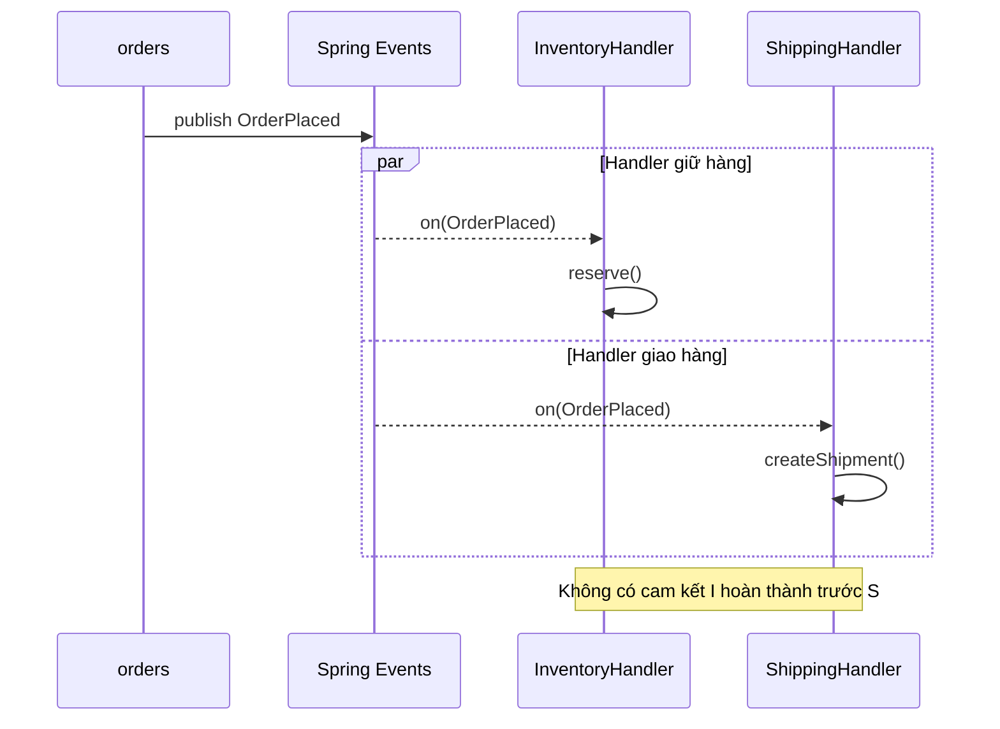
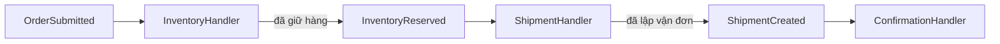

# Phụ thuộc giữa handler trong điều phối Spring Modulith Application Events

## 1. Một event, nhiều handler: điều gì thực sự độc lập?

Trong module học **SPRING_MODULITH_APPLICATION_EVENTS**, application events giúp các module Spring Modulith giao tiếp mà publisher không cần gọi trực tiếp implementation của những module nhận. Ví dụ, khi module `orders` phát `OrderPlaced`, module `notifications` có thể gửi thư, `reporting` cập nhật báo cáo và `search` làm mới chỉ mục.

Mô hình này hoạt động tốt nếu **mỗi handler có thể xử lý sự kiện độc lập**. Vấn đề bắt đầu khi handler B chỉ có thể chạy đúng **sau khi handler A đã hoàn thành thành công**, hoặc khi B cần đọc kết quả A tạo ra.

Ví dụ: cùng nhận `OrderPlaced` nhưng:

- `InventoryReservationHandler` có nhiệm vụ giữ hàng.
- `ShipmentHandler` chỉ được lập vận đơn **nếu đã giữ hàng thành công**.
- `ConfirmationHandler` chỉ được thông báo “đơn sẵn sàng giao” **sau khi lập vận đơn thành công**.

Nếu ba handler cùng lắng nghe `OrderPlaced`, không có quy tắc nghiệp vụ nào tự động bảo đảm “giữ hàng → lập vận đơn → gửi xác nhận”. Đó là **phụ thuộc giữa handler** cần được mô hình hóa rõ.

**Mục tiêu:** phân biệt thứ tự gọi với phụ thuộc nghiệp vụ; nhận diện trường hợp nên để các handler song song, trường hợp phải tạo chuỗi event theo kết quả, và trường hợp cần coordinator/workflow quản lý trạng thái, retry, lỗi và khôi phục.

## 2. Phân loại các kiểu phụ thuộc

Các handler có thể phụ thuộc nhau theo những cách khác nhau:

| Kiểu phụ thuộc | Ví dụ | Yêu cầu thực chất |
| --- | --- | --- |
| **Thời điểm** | Gửi email sau khi đơn được commit | Chọn đúng ranh giới transaction, thường là `AFTER_COMMIT` |
| **Thứ tự** | Tạo vận đơn sau khi giữ hàng | Có một bước báo hoàn thành hoặc điều phối thứ tự |
| **Dữ liệu** | Lập vận đơn cần `reservationId` từ bước giữ hàng | Truyền kết quả bằng contract hoặc API công khai |
| **Thành công** | Chỉ ghi “sẵn sàng giao” khi các bước trước thành công | Không coi việc *bắt đầu* handler là hoàn thành |
| **Tài nguyên dùng chung** | Hai handler cùng cập nhật số lượng hàng | Khóa, transaction, version hoặc idempotency phù hợp |
| **Thời gian và khả năng phục hồi** | Handler B có thể chạy sau khi ứng dụng restart | Có trạng thái bền vững và cơ chế khởi động lại |
| **Phụ thuộc ngầm vào projection** | Handler B đọc dữ liệu chỉ khi A kịp cập nhật read model | Chấp nhận eventual consistency hoặc thay đổi hợp đồng |

Không phải phụ thuộc nào cũng cần một orchestrator riêng. Vấn đề là chọn cơ chế **đúng với bản chất của quan hệ**.

## 3. Tại sao nhiều listener của cùng event không tạo thành một pipeline?

Đoạn code sau biểu diễn một thiết kế dễ gây lỗi:

```java
@Component
class InventoryHandler {
    @ApplicationModuleListener
    void on(OrderPlaced event) {
        inventory.reserve(event.orderId());
    }
}

@Component
class ShippingHandler {
    @ApplicationModuleListener
    void on(OrderPlaced event) {
        shipping.createShipment(event.orderId());
        // Giả định inventory đã reserve xong: không có bảo đảm!
    }
}
```

Hai method là **hai listener riêng** nhận cùng một sự kiện. `@ApplicationModuleListener` hỗ trợ xử lý bất đồng bộ, sau commit và trong transaction riêng của listener. Vì vậy:

1. Cả hai có thể được kích hoạt từ cùng `OrderPlaced`, nhưng **không có thứ tự hoàn thành được bảo đảm**.
2. Handler `ShippingHandler` có thể bắt đầu **trước**, hoặc chạy khi handler giữ hàng đang xử lý dở.
3. Handler giữ hàng có thể thất bại trong khi handler giao hàng vẫn hoàn thành.
4. Retry hoặc khôi phục một publication chỉ liên quan tới việc xử lý publication tương ứng; nó **không tự chờ** các publication của handler khác thành công.
5. Nếu hai handler cập nhật những dữ liệu chung, có thể xuất hiện race condition, lost update hoặc trạng thái trung gian không hợp lệ.

Sơ đồ cho thấy cách suy luận sai khi coi các listener là một chuỗi:



**Kết luận thiết kế:** nếu kết quả A là tiền điều kiện của B, cần thể hiện điều kiện ấy ở contract sự kiện hoặc tại bộ điều phối. Hai listener độc lập cùng lắng nghe một event chỉ phù hợp khi chúng không phụ thuộc vào kết quả của nhau.

## 4. Giới hạn của `@Order`, `@DependsOn` và `@Async`

Một cách sửa vội thường là thêm thứ tự:

```java
@Order(10)
@EventListener
void reserve(OrderPlaced event) { /* ... */ }

@Order(20)
@EventListener
void createShipment(OrderPlaced event) { /* ... */ }
```

Trong cấu hình mặc định, `@EventListener` thường được gọi đồng bộ bởi event multicaster. `@Order` có thể ảnh hưởng đến **thứ tự gọi listener trong quá trình dispatch** ấy. Nhưng cần phân biệt:

- **Thứ tự được gọi** không đồng nghĩa đã **commit thành công một transaction riêng**, hoàn tất một HTTP call, hoặc ghi nhận tác dụng phụ trong hệ thống ngoài.
- Nếu listener chạy bất đồng bộ, thứ tự multicaster kích hoạt các tác vụ không bảo đảm thứ tự **kết thúc** của chúng.
- Listener `@TransactionalEventListener` được kích hoạt theo **phase của transaction**; `@Order` không biến nhiều transaction khác nhau thành một transaction chung.
- Khi một listener lỗi, cơ chế truyền exception tùy loại listener/multicaster; không thể lấy đó làm hợp đồng phối hợp nghiệp vụ bền vững giữa nhiều handler.
- `@DependsOn` kiểm soát **thứ tự khởi tạo bean Spring**, không phải thứ tự xử lý event lúc runtime.
- `@Async` chuyển xử lý sang executor khi được cấu hình phù hợp; nó không tự chờ transaction publisher commit và không giải quyết phụ thuộc A → B.

| Công cụ | Có ích cho | Không nên dùng làm bảo đảm |
| --- | --- | --- |
| `@Order` | Sắp xếp thứ tự một số listener trong cùng hoạt động dispatch | Workflow nhiều bước có retry, restart và transaction độc lập |
| `@DependsOn` | Quan hệ khởi tạo bean | Handler A phải chạy xong trước handler B |
| `@EventListener` đồng bộ | Xử lý đơn giản, có kiểm soát lỗi trong cùng lời gọi | Side effect đã commit ở hệ thống ngoài cùng với business transaction |
| `@TransactionalEventListener(AFTER_COMMIT)` | Chỉ kích hoạt khi publisher commit | Retry, bất đồng bộ, độ bền hoặc thứ tự giữa các listener |
| `@ApplicationModuleListener` | Xử lý module listener bất đồng bộ sau commit, trong transaction riêng | Thứ tự hoàn thành giữa các listener cùng nhận event |

Nếu có một yêu cầu nghiệp vụ “A phải hoàn tất trước B”, hãy dùng **một tín hiệu xác nhận hoàn tất thật sự** hoặc **một coordinator**. `@Order` chỉ nên dùng khi thứ tự dispatch bản thân nó đã đủ và ứng dụng chấp nhận các giới hạn của cơ chế đó.

## 5. Thiết kế đúng khi handler độc lập

Trong một số trường hợp, handler không hề cần chờ nhau:

```text
OrderPlaced
  ├── NotificationHandler: gửi email xác nhận đơn
  ├── ReportingHandler: ghi báo cáo đặt hàng
  └── SearchHandler: đồng bộ chỉ mục tra cứu
```

Ba tác dụng phụ được phép hoàn thành ở các thời điểm khác nhau. Một listener thất bại không nhất thiết chặn hai listener còn lại. Đây là mô hình **fan-out** tự nhiên của application events.

Điều kiện để fan-out an toàn:

1. Handler không sử dụng **kết quả chưa có** của handler khác làm tiền điều kiện.
2. Mỗi handler có contract đầu vào đủ rõ; nếu cần trạng thái mới nhất thì truy vấn qua API module công khai.
3. Mỗi handler tự có chính sách idempotency, retry và quan sát lỗi nếu sự kiện có thể được giao lại.
4. Các trạng thái cập nhật từ nhiều handler không tạo một bất biến bắt buộc phải commit nguyên tử với nhau.
5. Người dùng hoặc API chấp nhận **eventual consistency** của projection/thông báo.

Ví dụ gửi thông báo “đã nhận đơn” có thể độc lập với việc lập vận đơn. Nhưng thông báo “vận đơn đã tạo” thì phải gắn với sự kiện **thật sự lập vận đơn thành công**, không nên suy ra từ `OrderPlaced`.

## 6. Khi phụ thuộc A → B: phát event mô tả kết quả của A

Một cách rõ ràng để diễn tả quan hệ giữa các handler là **chuỗi sự kiện theo các mốc nghiệp vụ**:



Điểm khác biệt then chốt:

- `ShipmentHandler` **không** lắng nghe `OrderSubmitted`; nó lắng nghe `InventoryReserved`.
- `ConfirmationHandler` **không** suy đoán bước trước đã thành công; nó lắng nghe `ShipmentCreated`.
- Nếu giữ hàng thất bại, **không phát `InventoryReserved`**. Một nhánh từ chối nghiệp vụ có thể phát `InventoryReservationRejected` hoặc chuyển workflow sang trạng thái thất bại rõ ràng.

Không nhất thiết đặt tên như ví dụ, nhưng mỗi event phải đúng **sự thật đã xảy ra**. Dùng `OrderSubmitted` cho đơn mới được tiếp nhận khi giữ hàng chưa chắc thành công sẽ rõ nghĩa hơn gọi nó là `OrderConfirmed`.

### 6.1. Công bố hợp đồng sự kiện do module sở hữu

Theo cấu trúc Spring Modulith mặc định, mỗi module nên công bố sự kiện cần dùng liên module ở **base package** hoặc một **named interface** phù hợp.

```java
// com.example.shop.orders.OrderSubmitted
package com.example.shop.orders;

import java.util.UUID;

public record OrderSubmitted(UUID eventId, UUID orderId) {}
```

```java
// com.example.shop.inventory.InventoryReserved
package com.example.shop.inventory;

import java.util.UUID;

public record InventoryReserved(
        UUID eventId,
        UUID orderId,
        UUID reservationId
) {}
```

Ví dụ dùng `eventId` để theo dõi và hỗ trợ chống xử lý trùng, còn `reservationId` là kết quả nghiệp vụ mà bước sau cần. Trong ứng dụng thực tế nên bổ sung validation cho field bắt buộc và định nghĩa chính sách ID ổn định khi retry.

### 6.2. Handler giữ hàng phát event kết quả

```java
// com.example.shop.inventory.internal.InventoryReservationHandler
package com.example.shop.inventory.internal;

import com.example.shop.inventory.InventoryReserved;
import com.example.shop.orders.OrderSubmitted;
import java.util.UUID;
import org.springframework.context.ApplicationEventPublisher;
import org.springframework.modulith.events.ApplicationModuleListener;
import org.springframework.stereotype.Component;

@Component
class InventoryReservationHandler {
    private final ReservationService reservations;
    private final ApplicationEventPublisher events;

    InventoryReservationHandler(
            ReservationService reservations,
            ApplicationEventPublisher events
    ) {
        this.reservations = reservations;
        this.events = events;
    }

    @ApplicationModuleListener
    void on(OrderSubmitted event) {
        // reserveOnce cần cùng kết quả khi xử lý lại cùng sự kiện.
        UUID reservationId =
                reservations.reserveOnce(event.eventId(), event.orderId());

        events.publishEvent(new InventoryReserved(
                UUID.nameUUIDFromBytes(
                        ("inventory-reserved:" + reservationId).getBytes(
                                java.nio.charset.StandardCharsets.UTF_8)),
                event.orderId(),
                reservationId));
    }
}
```

`ReservationService.reserveOnce(...)` là abstraction minh họa. Nó phải **thực sự idempotent**, chẳng hạn dùng khóa nghiệp vụ duy nhất và ghi nhận reservation trong transaction thích hợp. Định danh `InventoryReserved.eventId` ở ví dụ được dẫn xuất ổn định từ `reservationId` nhằm minh họa **retry cùng kết quả không tạo danh tính event mới**. Trong hệ thống thực tế, có thể lưu ID sự kiện kết quả cùng reservation trong một transaction để tái sử dụng chính xác; không nên sinh UUID mới mỗi lần listener được chạy lại.

`@ApplicationModuleListener` sử dụng cơ chế listener sau commit, bất đồng bộ và transaction riêng của Spring Modulith. Khi `InventoryReserved` được publish trong transaction xử lý listener, transactional listener kế tiếp sẽ được kích hoạt theo **commit của transaction này** nếu cấu hình phù hợp.

Điều này không tự bảo đảm listener phụ thuộc được chạy chính xác một lần. Cần cấu hình **Event Publication Registry** với storage phù hợp nếu muốn theo dõi publication chưa hoàn tất, có cơ chế phục hồi và xử lý lặp an toàn.

### 6.3. Handler sau chỉ phản ứng khi điều kiện đã xảy ra

```java
// com.example.shop.shipping.internal.ShipmentHandler
package com.example.shop.shipping.internal;

import com.example.shop.inventory.InventoryReserved;
import org.springframework.modulith.events.ApplicationModuleListener;
import org.springframework.stereotype.Component;

@Component
class ShipmentHandler {
    private final ShipmentService shipments;

    ShipmentHandler(ShipmentService shipments) {
        this.shipments = shipments;
    }

    @ApplicationModuleListener
    void on(InventoryReserved event) {
        shipments.createOnce(event.reservationId(), event.orderId());
    }
}
```

Ở đây `ShipmentHandler` chỉ được kích hoạt khi event `InventoryReserved` **đã được phát**; nếu cần bước tiếp theo sau khi lập vận đơn thành công, `createOnce(...)` cần trả về kết quả và có publisher phát `ShipmentCreated` theo cùng quy tắc. Code mẫu tập trung vào **điều kiện bắt đầu** của handler kế tiếp.

Điều cần kiểm chứng là event kết quả chỉ được phát **sau khi kết quả A thực sự bền vững theo ranh giới giao dịch của A**. Nếu `reserveOnce(...)` chỉ gọi HTTP tới hệ thống kho ngoài, transaction JPA của listener không thể rollback thao tác HTTP đó: cần idempotency key, đối soát hoặc quy trình Saga phù hợp.

## 7. Phân biệt phụ thuộc “đã phát event” với “đã commit kết quả”

Một lỗi thường gặp là phát `InventoryReserved` quá sớm:

```java
void reserveAndPublish(OrderSubmitted event) {
    events.publishEvent(new InventoryReserved(/* ... */));
    reservations.reserve(event.orderId()); // Có thể thất bại sau khi đã publish.
}
```

Nếu handler kế tiếp xử lý `InventoryReserved` trong khi reservation còn chưa thành công, sự kiện đã phát biểu sai sự thật. Với các listener đồng bộ, nó có thể chạy ngay khi publish; với listener sau commit, vẫn phải xem transaction bao trùm logic nào.

Khi reservation chỉ nằm trong cùng database và cùng transaction, một cách hợp lý là:

1. Kiểm tra bất biến và thực hiện reservation.
2. Phát `InventoryReserved` từ trạng thái nghiệp vụ đã xác định trong **transaction đó**.
3. Để downstream listener dùng `AFTER_COMMIT`/`@ApplicationModuleListener`, chỉ phản ứng sau commit thành công.

Nếu reservation nằm ở **dịch vụ ngoài**, không có một transaction database chung đảm bảo “gọi HTTP thành công” và “lưu event kết quả” là nguyên tử. Cần mô hình hóa các trạng thái trung gian hoặc dùng outbox/đối soát phù hợp, tránh ngụ ý một annotation Spring đủ để bảo đảm toàn bộ quá trình.

## 8. Khi nào nên dùng coordinator hoặc state machine?

Chuỗi event theo sự thật nghiệp vụ (**choreography**) dễ hiểu cho một vài bước độc lập. Nhưng khi quy trình có nhiều nhánh, timeout hoặc bù trừ, các handler bắt đầu phụ thuộc lẫn nhau qua nhiều event và khó thấy trạng thái tổng thể.

Ví dụ đặt hàng:

```text
OrderSubmitted
    |
    +-- giữ tồn kho -- InventoryReserved / ReservationRejected
    |
    +-- thu tiền   -- PaymentCaptured / PaymentFailed
    |
    +-- nếu cả tồn kho và thanh toán đều thành công
            --> OrderReadyForFulfillment
    |
    +-- nếu thất bại hoặc timeout
            --> bù trừ / hủy / chờ xử lý thủ công
```

Nếu phải chờ **cả hai điều kiện**, không nên để `InventoryHandler` và `PaymentHandler` cùng tự phát `OrderReadyForFulfillment`. Điều đó có thể tạo sự kiện “sẵn sàng” khi mới một bước thành công hoặc phát trùng hai lần.

**Coordinator/process manager** là thành phần sở hữu trạng thái workflow, ghi nhận kết quả từng bước và chỉ phát event tiếp theo khi điều kiện đã thỏa mãn.

| Tiêu chí | Chuỗi event (choreography) | Coordinator / orchestration |
| --- | --- | --- |
| Quan hệ | Một mốc hoàn thành kích hoạt mốc kế tiếp | Một thành phần quyết định bước tiếp và điều kiện hợp |
| Số bước và nhánh | Phù hợp chuỗi ngắn, ít nhánh | Phù hợp nhiều nhánh, timeout, bù trừ |
| Quan sát tổng thể | Cần tổng hợp log/event | Có trạng thái workflow tập trung |
| Phụ thuộc module | Các module nghe hợp đồng công khai | Coordinator phụ thuộc các hợp đồng công khai cần thiết |
| Khôi phục | Mỗi handler và event chain phải idempotent | Cần lưu trạng thái, event/command id và quy trình khởi động lại |

Một coordinator **không nhất thiết** phải là framework workflow phức tạp. Nó có thể là một module nhỏ với bảng trạng thái bền vững, phương thức nhận kết quả và logic chuyển trạng thái kiểm thử được.

## 9. Mẫu coordinator chờ đủ hai kết quả

Giả sử coordinator xử lý kết quả `InventoryReserved` và `PaymentCaptured`. Đây là **pseudocode Java có tính cấu trúc**, trong đó repository, service và trạng thái workflow do ứng dụng định nghĩa:

```java
@Component
class OrderReadinessCoordinator {
    private final WorkflowRepository workflows;
    private final ApplicationEventPublisher events;

    OrderReadinessCoordinator(
            WorkflowRepository workflows,
            ApplicationEventPublisher events
    ) {
        this.workflows = workflows;
        this.events = events;
    }

    @ApplicationModuleListener
    void on(InventoryReserved event) {
        Workflow state = workflows.lockByOrderId(event.orderId());
        state.markStockReserved(event.eventId());
        publishReadyOnce(state);
    }

    @ApplicationModuleListener
    void on(PaymentCaptured event) {
        Workflow state = workflows.lockByOrderId(event.orderId());
        state.markPaymentCaptured(event.eventId());
        publishReadyOnce(state);
    }

    private void publishReadyOnce(Workflow state) {
        if (state.hasStock() && state.hasPayment()
                && state.markReadyIfNotAlready()) {
            events.publishEvent(new OrderReadyForFulfillment(
                    state.readyEventId(), state.orderId()));
        }
    }
}
```

Các kiểu `Workflow`, `WorkflowRepository`, `PaymentCaptured` và `OrderReadyForFulfillment` là **abstraction minh họa**, không phải API sẵn có của Spring Modulith. Contract của chúng phải được công khai bởi module sở hữu tương ứng khi dùng qua ranh giới module.

Điều kiện triển khai đúng:

- `lockByOrderId` phải dùng khóa/optimistic locking thích hợp để hai event đến đồng thời không cùng nhìn thấy trạng thái chưa sẵn sàng.
- `markStockReserved` và `markPaymentCaptured` phải chống việc xử lý trùng `eventId`.
- `markReadyIfNotAlready` phải là **chuyển trạng thái một lần**, được bảo vệ trong transaction, tránh hai listener phát cùng quyết định.
- `readyEventId()` phải ổn định khi cần xử lý lại trạng thái READY.
- Publication của `OrderReadyForFulfillment` cần được lưu/khôi phục phù hợp, không chỉ trông chờ callback trong RAM.
- Nếu event thất bại vĩnh viễn hoặc timeout, coordinator phải lưu và phát các trạng thái từ chối/hủy/bù trừ theo nghiệp vụ.

Nếu chưa có state machine rõ ràng, giải pháp chỉ dùng hai biến boolean trong bộ nhớ sẽ **mất tiến độ khi restart**. Một coordinator đáng tin cậy phải lưu trạng thái vào kho bền và có thể xử lý lại event đã nhận.

## 10. Phụ thuộc handler và ranh giới transaction

Một handler có thể chạy trước, nhưng **kết quả của nó chưa chắc đã commit**. Khi phối hợp giữa module, cần phân biệt những trường hợp sau:

| Nhu cầu | Gợi ý thiết kế | Rủi ro cần kiểm soát |
| --- | --- | --- |
| A và B phải cùng thành công trong một business transaction | Gọi đồng bộ qua API module phù hợp, nếu cùng nguồn transaction và kiến trúc cho phép | Tránh side effect ngoài DB không rollback được |
| B là công việc phụ có thể chạy sau commit A | Event sau commit; listener riêng | Eventual consistency, retry, idempotency |
| B chỉ được làm sau khi A hoàn thành | A phát event *kết quả*; B nghe event đó | A phải phát sau khi có kết quả thật và lưu publication đúng |
| B cần kết quả từ nhiều handler | Coordinator/state machine lưu các điều kiện | Tranh chấp cập nhật, deadlock, timeout |
| A hoặc B gọi hệ thống khác | Saga, outbox, idempotency key, trạng thái bù trừ | Không có atomic transaction giữa DB và API ngoài |

Với `@TransactionalEventListener(phase = TransactionPhase.AFTER_COMMIT)`, tài nguyên transaction vừa commit đôi khi còn gắn với thread cho đến khi cleanup. Nếu listener đồng bộ muốn ghi database **một cách độc lập**, cần transaction mới, chẳng hạn `@Transactional(propagation = REQUIRES_NEW)` trong service thích hợp; không dựa vào transaction đã commit để lưu một thay đổi mới.

`@ApplicationModuleListener` của Spring Modulith kết hợp xử lý sau commit, bất đồng bộ và transaction riêng của listener. Tuy nhiên, **transaction riêng cho A và B không đồng nghĩa một giao dịch nguyên tử A+B**.

## 11. Lỗi, retry và Event Publication Registry khi các handler phụ thuộc nhau

Spring Modulith có **Event Publication Registry** để theo dõi publication tới các transactional listener được hỗ trợ khi ứng dụng đã cấu hình storage phù hợp. Registry giúp nhận diện publication chưa hoàn tất, nhưng các bảo đảm khôi phục phụ thuộc backend lưu, transaction và cơ chế resubmission được bật/vận hành.

Xét chuỗi:

```text
OrderSubmitted
    ↓
InventoryHandler (publication A)
    ↓ InventoryReserved
ShipmentHandler (publication B)
    ↓ ShipmentCreated
ConfirmationHandler (publication C)
```

Mỗi publication có thể thất bại độc lập:

- **A lỗi trước khi giữ hàng:** không được phát `InventoryReserved`; cần retry A hoặc ghi trạng thái từ chối.
- **A giữ hàng xong nhưng crash trước khi ghi hoàn tất:** A có thể được giao lại, vì thế việc giữ hàng và event kết quả phải chống trùng.
- **B lỗi:** A không nên bị coi là “chưa từng thành công” chỉ vì B lỗi; B cần phục hồi riêng, có thể theo dõi backlog.
- **C lỗi sau khi email đã gửi:** C có thể được giao lại; email cần idempotency hoặc đối soát.
- **Đổi schema/event type:** publication cũ có thể không deserialize được; cần kế hoạch tương thích hoặc migration.

**Publication hoàn tất không tự chứng minh mọi side effect bên ngoài đã thành công đúng một lần.** Nếu listener nuốt exception rồi trả về bình thường, registry có thể coi publication đó đã hoàn tất dù workflow chưa đạt kết quả mong muốn.

Vì vậy, khi handler phụ thuộc, nên có **trạng thái nghiệp vụ bền vững** cho những bước quan trọng, cùng event ID ổn định và kiểm tra điều kiện trước khi phát bước kế tiếp.

## 12. Thiết kế idempotency và chống đảo thứ tự

Giả sử `InventoryReserved` được giao hai lần vì listener gặp lỗi sau khi thực hiện side effect. `ShipmentHandler` phải tránh lập hai vận đơn.

Một cách là định nghĩa khóa duy nhất cho tác vụ nghiệp vụ:

```sql
-- Ví dụ PostgreSQL: một reservation chỉ có một shipment.
CREATE TABLE shipment (
    shipment_id UUID PRIMARY KEY,
    reservation_id UUID NOT NULL UNIQUE,
    order_id UUID NOT NULL,
    created_at TIMESTAMPTZ NOT NULL DEFAULT CURRENT_TIMESTAMP
);
```

Khi `createOnce(reservationId, orderId)` được gọi lại, nó phải tìm shipment đã có và trả về **cùng kết quả**; không tạo shipment thứ hai. Nếu một handler lưu dấu processed event, việc ghi dấu và cập nhật nghiệp vụ nên nằm trong cùng transaction.

Ngược lại, nếu có thể giữ hàng nhiều lần hợp lệ cho cùng đơn, không nên dùng duy nhất `orderId` làm khóa bất biến toàn cục: hãy chọn `reservationId` hoặc một khóa nghiệp vụ tương ứng.

Tình huống đảo thứ tự:

```text
Nguồn: OrderSubmitted(v1) → OrderCancelled(v2)
Consumer: OrderCancelled(v2) → retry OrderSubmitted(v1)
```

Nếu handler đọc snapshot và ghi trạng thái, retry của event cũ có thể ghi đè trạng thái hủy. Có thể xử lý bằng **aggregate version** được bảo đảm tăng đơn điệu, kiểm tra trạng thái hiện hành hoặc một workflow state machine từ chối chuyển trạng thái ngược không hợp lệ. `occurredAt` không tự bảo đảm thứ tự giữa nhiều instance và các lần retry.

## 13. Quan sát dependency giữa handler

Khi một quy trình có nhiều bước, chỉ xem log “listener đã nhận event” không đủ để biết **handler nào đang chặn bước nào**.

Nên theo dõi:

| Tín hiệu | Ý nghĩa |
| --- | --- |
| `eventId`, `orderId`, `correlationId` | Nối event đầu vào và event kết quả của các bước |
| Trạng thái workflow: `PENDING/RESERVED/PAID/READY/FAILED` | Biết đang chờ điều kiện nào |
| Thời gian xử lý từng handler | Nhận diện bước chậm hoặc timeout |
| Số publication chưa hoàn tất theo listener | Nhận diện bước cần retry/khôi phục |
| Tuổi publication cũ nhất | Cảnh báo sự kiện bị kẹt vượt SLA |
| Số lần retry và lỗi gần nhất | Phân biệt lỗi thoáng qua với lỗi nghiệp vụ |
| Số lệnh bù trừ/đối soát | Nhận diện tác dụng phụ phân tán chưa khép kín |

Giữ ID và tên bước ổn định để có thể trả lời: “Đơn 123 đã giữ hàng chưa?”, “Vì sao chưa có vận đơn?”, “Publication nào đang chờ?”, “Retry có gửi email trùng không?”.

Nếu các event chỉ dùng trong JVM, trace có thể nối bằng metadata nghiệp vụ được lưu rõ trong payload hoặc bảng workflow. Không nên phụ thuộc hoàn toàn vào thread-local request context vì listener bất đồng bộ và retry sau restart không còn cùng request/thread.

## 14. Kiểm thử phụ thuộc giữa handler

Kiểm thử phải chứng minh **điều kiện chuyển bước**, không chỉ chứng minh các listener có thể được gọi.

| Kịch bản | Kết quả cần xác minh |
| --- | --- |
| Cùng `OrderSubmitted` có nhiều listener độc lập | Mỗi listener xử lý đúng, không giả định thứ tự hoàn thành |
| Chưa có `InventoryReserved` | `ShipmentHandler` không được phép tạo shipment |
| Reservation thành công và commit | Publication bước kế tiếp được phát đúng một lần về mặt nghiệp vụ |
| Reservation lỗi/rollback | Không phát `InventoryReserved` thành công giả |
| Giao lại `OrderSubmitted` | Không giữ hàng trùng hoặc tạo event kết quả với ID khác cho cùng kết quả |
| Giao lại `InventoryReserved` | Không tạo hai shipment cho cùng reservation |
| Payment và reservation đến đồng thời | Coordinator chỉ chuyển READY một lần |
| Payment lỗi hoặc timeout | Workflow ở trạng thái rõ ràng, không tự phát READY |
| Crash sau A nhưng trước B | Có đường phục hồi B từ publication/state bền vững |
| Đổi phiên bản sự kiện khi còn publication | Event cũ vẫn đọc được hoặc được migration |
| Event cũ đến sau event mới | Không ghi đè trạng thái mới bằng trạng thái cũ |

Về kiến trúc, có thể kiểm tra ranh giới dependency giữa module:

```java
import com.example.shop.ShopApplication;
import org.junit.jupiter.api.Test;
import org.springframework.modulith.core.ApplicationModules;

class ModuleBoundariesTest {
    @Test
    void verifiesDependencies() {
        ApplicationModules.of(ShopApplication.class).verify();
    }
}
```

Phép kiểm tra này giúp phát hiện module này tham chiếu package nội bộ của module khác hoặc phụ thuộc không hợp lệ, **không thay thế integration test** về transaction, thứ tự xử lý, registry và retry. Với bài toán restart, cần kiểm thử trên storage và cấu hình thực tế; việc gọi trực tiếp method listener trong một unit test không chứng minh được khả năng phục hồi.

## 15. Bài tập: chọn cách điều phối đúng

Cho một nền tảng đặt hàng có ba nhu cầu:

**Tình huống A — Gửi email và cập nhật search index sau khi đặt hàng.** Hai công việc không dùng kết quả của nhau. Cho cùng nghe `OrderPlaced` qua transactional listener phù hợp. Thiết kế idempotency cho mỗi consumer, chấp nhận chúng có thể hoàn thành ở thứ tự bất kỳ.

**Tình huống B — Chỉ lập vận đơn sau khi đã giữ hàng.** Không cho hai handler cùng nghe `OrderPlaced` rồi dùng `@Order` để hy vọng có chuỗi xử lý. Đổi thành `OrderSubmitted → InventoryReserved → ShipmentCreated`; event kết quả được module sở hữu phát sau khi bước nghiệp vụ tương ứng thành công và được commit theo thiết kế.

**Tình huống C — Chỉ chuyển đơn sang READY khi cả thanh toán và giữ hàng đều thành công.** Dùng coordinator/state machine lưu trạng thái từng điều kiện, xử lý arrival đồng thời, retry, timeout và nhánh thất bại/bù trừ. Cần bảo đảm phép chuyển READY chỉ xảy ra một lần dù event đến lặp hoặc đảo thứ tự.

Có thể dùng một câu hỏi thực hành cho từng handler: **“Nếu mọi handler khác đều bị tắt, handler này có vẫn xử lý đúng event đầu vào không?”** Nếu câu trả lời là “không, phải chờ X”, hãy xác định một sự kiện kết quả hoặc điều kiện điều phối rõ ràng thay vì coi các listener là một hàng lệnh ngầm.

## 16. Checklist thiết kế phụ thuộc giữa handler

1. Handler có thật sự **độc lập** hay đang dựa vào dữ liệu/kết quả của handler khác?
2. Nếu B cần A thành công, đã có event kết quả hoặc coordinator xác nhận A **thật sự hoàn tất** chưa?
3. Event có tên theo sự thật nghiệp vụ, không mô tả một mệnh lệnh mơ hồ?
4. Contract có cung cấp ID, kết quả và version cần thiết, nhưng không lộ entity/repository nội bộ?
5. Đã xác định ranh giới transaction cho từng bước, listener chạy sau commit khi phù hợp?
6. Có tránh dùng `@Order` hoặc `@DependsOn` để thay thế điều phối workflow bền vững?
7. Nếu một bước có tác dụng phụ ngoài database, có idempotency/đối soát và bù trừ phù hợp?
8. Khi publication lỗi, retry hoặc restart, kết quả bước đã hoàn thành có thể khôi phục và không bị tạo trùng?
9. Nếu cần chờ nhiều nhánh, coordinator có state bền, xử lý đồng thời và timeout không?
10. Có thể quan sát trạng thái từng bước và kiểm thử lỗi, rollback, duplicate, out-of-order cùng restart không?

**Ghi nhớ:** Application events trong Spring Modulith giúp các handler **ít phụ thuộc trực tiếp vào mã nguồn của nhau**, nhưng không tự điều phối thứ tự hoàn thành hay điều kiện nghiệp vụ. Khi handler thực sự độc lập, để chúng phản ứng cùng event. Khi B cần kết quả A, dùng **event kết quả đã commit**; khi nhiều kết quả phải hội tụ hoặc có thất bại/bù trừ, dùng **coordinator với trạng thái bền vững**. Kết hợp transaction, Event Publication Registry, retry, idempotency và kiểm thử để chuỗi xử lý có thể phục hồi mà vẫn giữ đúng ranh giới module.
