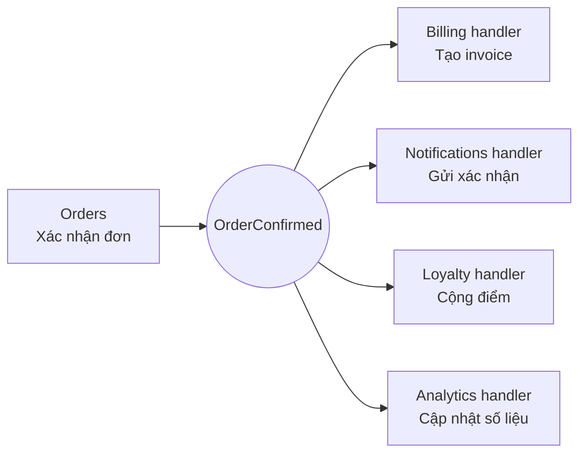
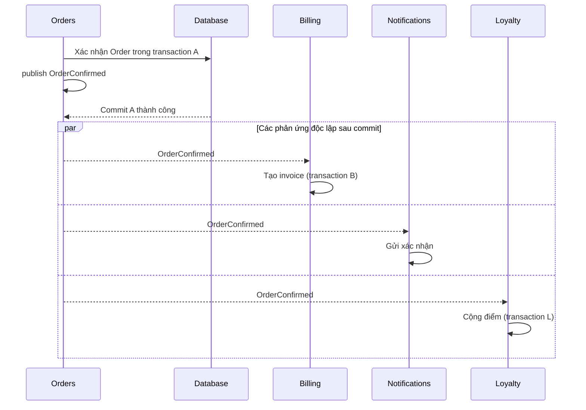
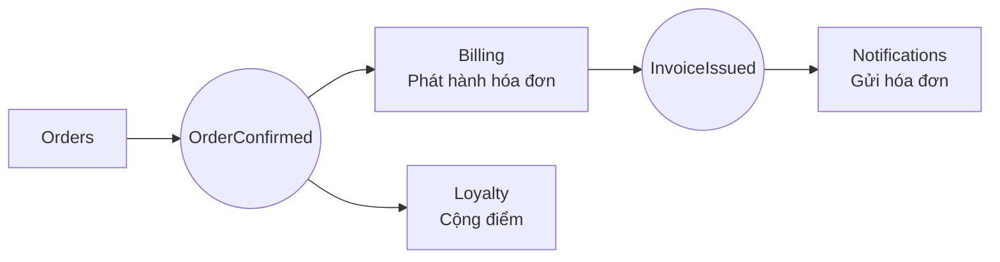
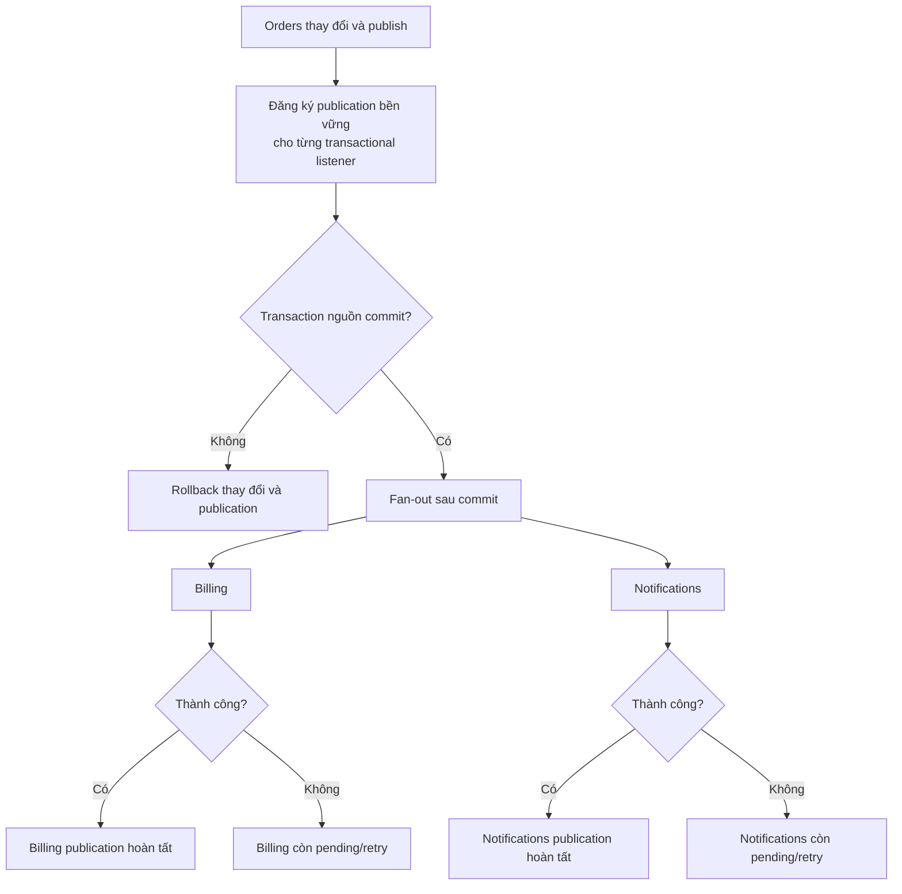

# Handler độc lập

> **Chương:** Điều phối handler  
> **Học phần:** `SPRING_MODULITH_APPLICATION_EVENTS` — giao tiếp giữa các module Spring Modulith bằng application events nhằm giảm phụ thuộc và bảo vệ ranh giới nghiệp vụ; thực hành publisher, listener, xử lý sau commit, Event Publication Registry, retry, kiểm thử và quan sát việc giao sự kiện đáng tin cậy.

## 1. Handler độc lập giải quyết vấn đề gì?

Trong một ứng dụng bán hàng, khi **Orders** xác nhận đơn hàng, nhiều module cần phản ứng:

- **Billing** lập hóa đơn cho đơn đã xác nhận.
- **Notifications** gửi thông báo xác nhận đơn.
- **Loyalty** tính điểm thưởng.
- **Analytics** ghi nhận thống kê bán hàng.

Nếu `OrderService` gọi trực tiếp từng service, Orders sẽ biết cụ thể mọi bên nhận và phải tham gia điều phối công việc của chúng:

```java
@Transactional
public void confirm(UUID orderId) {
    orders.confirm(orderId);
    billing.issueInvoice(orderId);
    notifications.sendOrderConfirmed(orderId);
    loyalty.awardPoints(orderId);
}
```

Đây là đoạn **minh họa vấn đề**: tác vụ gửi email hoặc gọi hệ thống ngoài bên trong transaction nguồn còn tạo rủi ro không thể rollback side effect. Khi thêm Analytics hoặc thay cách gửi thông báo, code của Orders có thể phải sửa dù nghiệp vụ xác nhận đơn không đổi.

Với **handler độc lập**, Orders chỉ công bố một sự thật nghiệp vụ: `OrderConfirmed`. Các module đăng ký listener và xử lý phản ứng do mình sở hữu:



**Handler độc lập** nghĩa là mỗi handler có **một trách nhiệm, dữ liệu và kết quả xử lý riêng**, không cần một handler khác phải chạy xong để chính nó hoàn thành phản ứng. Nhiều handler có thể nhận **cùng một event instance**, nhưng không chia sẻ một giao dịch hậu xử lý chung hay một cam kết hoàn tất đồng thời.

Sự độc lập ở đây gồm ba chiều:

1. **Độc lập về code:** listener của Billing không import service/repository nội bộ của Notifications.
2. **Độc lập về nghiệp vụ:** Billing không đòi Notifications gửi email thành công mới được lập hóa đơn.
3. **Độc lập về xử lý lỗi:** Billing có thể hoàn tất khi Notifications thất bại, nếu cả hai phản ứng được thiết kế là hậu commit với transaction và cơ chế xử lý riêng.

Đây là **mục tiêu kiến trúc**, không phải tính chất tự động của mọi `@EventListener`. Nếu dùng listener đồng bộ trước commit, exception của một handler vẫn có thể ảnh hưởng transaction publisher và các listener khác.

## 2. Một event, nhiều handler: fan-out

Mô hình một publisher phát sự kiện và nhiều consumer lắng nghe gọi là **fan-out**. Publisher công bố **điều đã xảy ra**, không gửi danh sách command cho từng handler.



Sơ đồ diễn tả **các nhánh xử lý độc lập về logic**. Nó **không khẳng định** ba handler luôn chạy trên ba thread khác nhau, luôn khởi động cùng lúc hoặc hoàn tất theo một thứ tự cố định. Điều đó phụ thuộc loại listener và cấu hình executor/transaction.

### 2.1. Những điều được phép và không được phép giả định

| Nội dung | Có thể thiết kế/kỳ vọng | Không nên mặc định |
|---|---|---|
| Publisher | Orders chỉ biết event contract | Mọi listener đều chạy xong khi request trả về |
| Handler | Mỗi handler tự sở hữu dữ liệu và hành động | Handler khác đã xử lý thành công |
| Transaction | Mỗi hậu xử lý có thể có transaction riêng | Tất cả handler cùng commit hoặc cùng rollback |
| Thứ tự | Có thể mô tả rõ quan hệ phụ thuộc bằng event khác | `@Order` đảm bảo thứ tự hoàn tất async |
| Lỗi | Có thể theo dõi/retry riêng từng handler | Lỗi một handler tự bị bỏ qua và không cần giám sát |
| Delivery | Có thể tăng độ bền bằng publication store | Chỉ `publishEvent` đã bảo đảm delivery bền vững |
| Xử lý lại | Có thể dùng idempotency chống trùng | Event chỉ được giao đúng một lần |

Mục tiêu của bài là tổ chức fan-out sao cho **mỗi nhánh có thể phát triển, thử nghiệm, vận hành và phục hồi một cách rõ ràng**.

## 3. Xác định ranh giới trách nhiệm của từng handler

Một handler độc lập nên trả lời được bốn câu hỏi:

1. **Tại sao** nó quan tâm đến sự kiện này?
2. **Dữ liệu nào** thuộc quyền sở hữu của nó?
3. **Kết quả hoàn tất** được xác định như thế nào?
4. **Nếu xử lý lỗi hoặc lặp**, nó cần làm gì?

Ví dụ:

| Module | Nhận `OrderConfirmed` để làm gì? | Tài nguyên sở hữu | Điều kiện thành công |
|---|---|---|---|
| Billing | Tạo hóa đơn | Bảng invoice của Billing | Invoice hợp lệ đã được commit |
| Notifications | Gửi xác nhận đơn | Trạng thái gửi thông báo, tích hợp mail | Gửi/ghi nhận trạng thái theo hợp đồng nhà cung cấp |
| Loyalty | Ghi điểm thưởng | Ledger/điểm của Loyalty | Bút toán điểm hợp lệ đã commit |
| Analytics | Cập nhật số liệu | Read model/report của Analytics | Projection được cập nhật hợp lệ |

Điều cần tránh là để Billing trực tiếp sửa bảng Loyalty hoặc Notifications phụ thuộc vào việc `BillingInvoiceListener` đã chạy. Mỗi handler **chỉ nên cập nhật trạng thái mà module của mình sở hữu**.

### 3.1. Độc lập không có nghĩa bỏ qua bất biến nghiệp vụ

Nếu việc lập hóa đơn **bắt buộc là điều kiện trước khi đơn được xác nhận**, thì không thể tùy ý đẩy nó sang một handler hậu commit độc lập mà vẫn hứa “xác nhận đơn và lập hóa đơn là một thao tác nguyên tử”. Khi đó cần xem lại ranh giới transaction và ngữ nghĩa trạng thái.

Ngược lại, nếu nghiệp vụ chấp nhận “đơn đã xác nhận, hóa đơn đang được phát hành”, fan-out hậu commit là lựa chọn hợp lý. Hệ thống có thể biểu diễn trạng thái `invoiceStatus = PENDING` cho tới khi Billing hoàn tất.

## 4. Hợp đồng event chung nhưng không lộ implementation

Trong Spring Modulith, Orders sở hữu việc xác nhận đơn và công bố `OrderConfirmed`. Những module khác chỉ cần biết **sự kiện công khai**, không nên import entity hay repository nội bộ của Orders.

Một cấu trúc module minh họa:

```text
com.acme.shop
├── ShopApplication.java
├── orders
│   ├── events
│   │   ├── package-info.java
│   │   └── OrderConfirmed.java
│   └── internal
│       ├── OrderService.java
│       └── OrderRepository.java
├── billing
│   ├── package-info.java
│   └── internal
│       ├── OrderConfirmedHandler.java
│       └── InvoiceService.java
├── notifications
│   └── internal
│       └── OrderConfirmationHandler.java
└── loyalty
    └── internal
        └── OrderPointsHandler.java
```

Đánh dấu package event là named interface:

```java
// orders/events/package-info.java
@org.springframework.modulith.NamedInterface("events")
package com.acme.shop.orders.events;
```

Hợp đồng bất biến, gọn và có danh tính:

```java
package com.acme.shop.orders.events;

import java.time.Instant;
import java.util.Objects;
import java.util.UUID;

public record OrderConfirmed(
        UUID eventId,
        UUID orderId,
        Instant occurredAt,
        UUID correlationId
) {
    public OrderConfirmed {
        Objects.requireNonNull(eventId, "eventId");
        Objects.requireNonNull(orderId, "orderId");
        Objects.requireNonNull(occurredAt, "occurredAt");
        Objects.requireNonNull(correlationId, "correlationId");
    }
}
```

`eventId` nhận diện một **lần phát sinh event**; `orderId` nhận diện đối tượng nghiệp vụ. `correlationId` giúp nối các bước trong cùng workflow. Không đồng nhất `eventId` với `orderId` vì một order có thể phát nhiều event ở các thời điểm khác nhau.

Nếu Billing chỉ được phụ thuộc vào interface `events` của Orders:

```java
// billing/package-info.java
@org.springframework.modulith.ApplicationModule(
        allowedDependencies = "orders::events"
)
package com.acme.shop.billing;
```

Tương tự, các module nhận khác có thể chỉ cho phép `orders::events`. Quy tắc này giúp bảo vệ ranh giới **phụ thuộc mã nguồn**; nó không tự quyết định thứ tự listener hay cách retry.

## 5. Publisher chỉ phát khi sự thật nghiệp vụ thực sự xảy ra

Ví dụ Orders xác nhận đơn trong transaction:

```java
package com.acme.shop.orders.internal;

import com.acme.shop.orders.events.OrderConfirmed;
import java.time.Clock;
import java.time.Instant;
import java.util.UUID;
import org.springframework.context.ApplicationEventPublisher;
import org.springframework.stereotype.Service;
import org.springframework.transaction.annotation.Transactional;

@Service
public class OrderService {

    private final OrderRepository orders;
    private final ApplicationEventPublisher events;
    private final Clock clock;

    public OrderService(
            OrderRepository orders,
            ApplicationEventPublisher events,
            Clock clock
    ) {
        this.orders = orders;
        this.events = events;
        this.clock = clock;
    }

    @Transactional
    public void confirm(UUID orderId, UUID correlationId) {
        Order order = orders.findById(orderId).orElseThrow();

        // Ví dụ API domain: true chỉ khi có chuyển trạng thái hợp lệ.
        if (!order.confirmIfAllowed()) {
            return;
        }

        events.publishEvent(new OrderConfirmed(
                UUID.randomUUID(),
                order.getId(),
                Instant.now(clock),
                correlationId
        ));
    }
}
```

Đây là code minh họa, giả định entity `Order` được quản lý và `confirmIfAllowed()` xử lý đầy đủ bất biến nghiệp vụ. Trong thực tế cần chống việc **hai request cạnh tranh** cùng tạo ra hai event cho một chuyển trạng thái; dùng optimistic locking, locking hoặc điều kiện cập nhật atomically tùy domain.

**Publisher không inject `InvoiceService`, `EmailGateway` hoặc `PointsLedger`**. Việc thêm/bỏ một handler thuộc module khác không yêu cầu sửa phương thức `confirm(...)`.

Việc gọi `publishEvent` trong transaction chưa chứng minh transaction đã commit. Đối với phản ứng chỉ hợp lệ sau commit, consumer cần lựa chọn listener theo transaction phase thích hợp.

## 6. Triển khai hai handler độc lập bằng `@ApplicationModuleListener`

### 6.1. Billing: tạo hóa đơn theo quyền sở hữu riêng

```java
package com.acme.shop.billing.internal;

import com.acme.shop.orders.events.OrderConfirmed;
import org.springframework.modulith.events.ApplicationModuleListener;
import org.springframework.stereotype.Component;

@Component
class OrderConfirmedHandler {

    private final InvoiceService invoices;

    OrderConfirmedHandler(InvoiceService invoices) {
        this.invoices = invoices;
    }

    @ApplicationModuleListener
    public void on(OrderConfirmed event) {
        invoices.issueIfAbsent(
                event.orderId(), event.eventId()
        );
    }
}
```

Billing chỉ tiêu thụ event contract, sau đó gọi service **thuộc module Billing**. Thời điểm commit hóa đơn và dữ liệu sử dụng do Billing sở hữu.

### 6.2. Notifications: gửi xác nhận mà không chờ Billing

```java
package com.acme.shop.notifications.internal;

import com.acme.shop.orders.events.OrderConfirmed;
import org.springframework.modulith.events.ApplicationModuleListener;
import org.springframework.stereotype.Component;

@Component
class OrderConfirmationHandler {

    private final ConfirmationDeliveryService delivery;

    OrderConfirmationHandler(ConfirmationDeliveryService delivery) {
        this.delivery = delivery;
    }

    @ApplicationModuleListener
    public void on(OrderConfirmed event) {
        delivery.sendIfNeeded(
                event.orderId(), event.eventId()
        );
    }
}
```

`ConfirmationDeliveryService` là service do ứng dụng tự triển khai. Tên `sendIfNeeded` **không tự bảo đảm chống gửi email trùng**: nếu provider không hỗ trợ idempotency và handler có thể retry, cần thiết kế trạng thái gửi, khóa chống trùng, idempotency key hoặc đối soát tùy kênh.

Hai listener không gọi lẫn nhau. `BillingOrderConfirmedHandler` không cần biết `OrderConfirmationHandler` tồn tại. Chúng có thể được thêm, thay đổi hoặc vô hiệu hóa độc lập nếu hợp đồng và yêu cầu nghiệp vụ cho phép.

### 6.3. Vì sao dùng `@ApplicationModuleListener`?

Spring Modulith cung cấp `@ApplicationModuleListener` như tiện ích kết hợp listener ràng buộc transaction với **pha sau commit**, thực thi **bất đồng bộ** và mở **transaction mới** cho phản ứng (theo semantics `REQUIRES_NEW`).

Điều này phù hợp với fan-out giữa module vì:

- Khi Orders **rollback**, listener sau commit không được kích hoạt để tạo side effect hậu commit.
- Billing và Notifications có thể làm việc trong transaction/bước xử lý **tách khỏi transaction Orders**.
- Lỗi ở Billing **không thể quay ngược** giao dịch Orders đã commit.
- Việc xử lý có thể tiếp tục sau khi request nguồn đã trả kết quả.

Ứng dụng vẫn cần cấu hình xử lý bất đồng bộ phù hợp, chẳng hạn bật `@EnableAsync` và chọn executor có giới hạn. Các listener có thể cạnh tranh tài nguyên executor hoặc database nên “độc lập logic” **không có nghĩa không ảnh hưởng hiệu năng lẫn nhau**.

## 7. Handler độc lập và transaction: không có all-or-nothing xuyên handler

Một workflow fan-out sau commit có thể đạt những trạng thái:

| Orders | Billing | Notifications | Đánh giá |
|---|---|---|---|
| Chưa commit/rollback | Không chạy sau commit | Không chạy sau commit | Không có sự thật nguồn để phản ứng |
| Đã commit | Đang xử lý | Đang xử lý | Hệ thống ở trạng thái trung gian |
| Đã commit | Thành công | Thành công | Các phản ứng hoàn tất |
| Đã commit | Thành công | Thất bại | Hóa đơn hợp lệ; thông báo cần retry |
| Đã commit | Thất bại | Thành công | Đơn xác nhận; hóa đơn cần khôi phục |
| Đã commit | Thất bại | Thất bại | Nguồn đã commit; các consumer cần xử lý lại |

Ví dụ, việc email thành công **không chứng minh** Billing đã tạo invoice. Nếu UI cần thể hiện trạng thái, nên mô hình hóa `invoiceStatus = PENDING/ISSUED/FAILED` hoặc các trạng thái tương ứng trong module sở hữu, tránh gộp mọi phản ứng vào một boolean “order completed”.

### 7.1. So sánh ba loại listener

| Loại | Thời điểm | Điểm cần lưu ý khi muốn độc lập |
|---|---|---|
| `@EventListener` | Thường chạy đồng bộ ngay khi publish | Exception có thể ảnh hưởng publisher và ngăn những listener chưa được gọi; chưa phải hậu commit |
| `@TransactionalEventListener` | Mặc định `AFTER_COMMIT`, không tự async | Có thể dùng sau commit; để ghi dữ liệu mới cần transaction mới phù hợp |
| `@ApplicationModuleListener` | Sau commit, async, transaction mới | Phù hợp fan-out liên module; vẫn cần cấu hình executor, registry/retry và idempotency |

Với `@TransactionalEventListener`, event phát **ngoài một transaction** sẽ mặc định không kích hoạt listener nếu không bật `fallbackExecution = true`. Cần xác định cách publisher phát event và kiểm thử transaction thực.

### 7.2. Không dùng ngoại lệ để “rollback tất cả”

Nếu Billing thất bại sau commit, **throw exception** từ Billing không làm Orders rollback. Đây là hệ quả cố ý của lựa chọn tách transaction. Nếu một phản ứng thất bại đòi hỏi nghiệp vụ bù trừ, hãy mô hình hóa **hành động bù trừ rõ ràng**, ví dụ chuyển trạng thái xử lý invoice sang failed hoặc phát event kết quả thuộc quyền sở hữu Billing; không kỳ vọng transaction bao trùm mọi handler.

## 8. Điều phối thứ tự: độc lập thật hay chỉ độc lập bề ngoài?

**Phản ví dụ:** Notifications muốn gửi email *kèm số hóa đơn* nhưng chỉ lắng nghe `OrderConfirmed`:

```java
@ApplicationModuleListener
public void on(OrderConfirmed event) {
    Invoice invoice = invoices.findByOrderId(event.orderId());
    mail.sendInvoice(invoice);
}
```

Mã trên có ba vấn đề:

1. Notifications đang phụ thuộc vào **kết quả nội bộ của Billing**.
2. Billing có thể chưa tạo hóa đơn khi Notifications chạy.
3. Notifications có thể phá ranh giới module nếu đọc trực tiếp repository/entity nội bộ Billing.

Trong trường hợp này, hai phản ứng **không độc lập về nghiệp vụ**. Đừng thêm `@Order` rồi giả định Billing chắc chắn hoàn thành trước Notifications, bởi các handler hậu commit có thể async và retry khác nhau.

### 8.1. Thiết kế đúng: phát event ở bước tạo ra sự thật tiếp theo

Nếu Notifications chỉ được gửi sau khi hóa đơn được phát hành:



Billing sở hữu `InvoiceIssued` và công bố khi việc phát hành hóa đơn đã diễn ra theo hợp đồng. Đối với phản ứng cần sự thật đã commit, Notifications lắng nghe event đó **sau commit của Billing**. Đây là choreography có quan hệ nhân quả **tường minh**, không phải một thứ tự ngầm giữa hai handler cùng nhận `OrderConfirmed`.

### 8.2. Khi nào nên dùng orchestration?

| Tình huống | Lựa chọn đáng cân nhắc |
|---|---|
| Analytics và Loyalty tự phản ứng, không đợi nhau | Các handler độc lập |
| Gửi mail xác nhận đơn không cần hóa đơn | Handler Notifications độc lập trên `OrderConfirmed` |
| Gửi PDF hóa đơn chỉ khi Billing phát hành xong | Lắng nghe `InvoiceIssued` |
| Luồng có nhiều bước bắt buộc, timeout, retry, hủy/bù trừ | Process manager/orchestrator |
| Yêu cầu kết quả tổng hợp tức thì từ nhiều tác vụ | API/luồng điều phối đồng bộ phù hợp hơn fan-out hậu commit |

Một nguyên tắc dễ nhớ: **nếu một handler cần kiểm tra “handler khác đã chạy chưa?” để biết có thể làm việc của mình hay không, chúng chưa độc lập**. Hãy mô hình hóa sự thật trung gian, workflow hoặc orchestration cho đúng.

## 9. Độc lập về lỗi: tách trạng thái hoàn tất từng handler

Với listener hậu commit, mỗi handler có thể thành công/thất bại riêng. Trong Spring Modulith, **Event Publication Registry** có thể hỗ trợ theo dõi publication tương ứng các transactional event listener khi được cấu hình với kho lưu thích hợp.

Ở mức khái niệm, một event instance `OrderConfirmed(E-42)` có hai publication cần xử lý:

```text
Event instance: OrderConfirmed, eventId = E-42
  ├── Listener Billing        -> publication P-B  -> COMPLETED
  └── Listener Notifications  -> publication P-N  -> INCOMPLETE
```

`P-B` và `P-N` là **ID giả định để diễn giải**. Chúng không nhất thiết trùng `eventId` trong payload hay tuân theo schema bảng cụ thể của Spring Modulith.

Điểm cốt lõi: một handler thành công **không xóa nghĩa vụ xử lý còn tồn của handler khác**. Publication cho Notifications cần được theo dõi/phục hồi theo chính sách mà không yêu cầu Billing tạo hóa đơn lại.



**Lưu ý điều kiện:** Registry cần được **cấu hình với persistent event publication store** phù hợp và transaction nguồn thực tế; chỉ gọi `publishEvent` hoặc thêm `@ApplicationModuleListener` chưa tự bảo đảm phục hồi sau crash. Các hành vi đánh dấu hoàn tất, tự động resubmit và cleanup phụ thuộc phiên bản/cấu hình Spring Modulith. Không mặc định mọi `@EventListener` đồng bộ đều có publication bền vững.

## 10. Retry từng handler và nguy cơ xử lý trùng

Một lần giao sự kiện **có thể xảy ra nhiều lần** nếu quá trình khôi phục thử lại. Giả sử:

1. Billing nhận `E-42` và lưu invoice thành công.
2. Ứng dụng dừng trước khi publication Billing được đánh dấu hoàn tất.
3. Registry phát hiện publication chưa hoàn tất và resubmit.
4. Billing lại nhận `E-42`.

Nếu không chống trùng, hệ thống có thể tạo **hai hóa đơn cho một đơn hàng**.

### 10.1. Idempotency phải gắn với nghiệp vụ của từng handler

| Handler | Bất biến nghiệp vụ | Khóa chống trùng khả dĩ |
|---|---|---|
| Billing | Một invoice cho mỗi order trong ví dụ | `orderId` với unique constraint |
| Loyalty | Mỗi order được cộng một lần theo loại điểm | `(orderId, pointType)` hoặc `(consumerId, eventId)` |
| Analytics | Một event chỉ được áp dụng một lần vào projection | `(projectionId, eventId)` |
| Notifications | Một loại thông báo/đợt gửi theo chính sách | `(orderId, notificationType)` và idempotency phía provider khi có |

Không nhất thiết mọi handler dùng cùng một khóa. `eventId` phù hợp khi muốn ngăn xử lý lại **cùng event instance**. Khóa business phù hợp khi cần ngăn hai event khác ID cùng làm sai một **bất biến nghiệp vụ**.

Ví dụ service của Billing:

```java
package com.acme.shop.billing.internal;

import java.util.UUID;
import org.springframework.stereotype.Service;
import org.springframework.transaction.annotation.Transactional;

@Service
public class InvoiceService {

    private final InvoiceRepository invoices;

    public InvoiceService(InvoiceRepository invoices) {
        this.invoices = invoices;
    }

    @Transactional
    public void issueIfAbsent(UUID orderId, UUID eventId) {
        if (invoices.existsByOrderId(orderId)) {
            return;
        }

        invoices.save(Invoice.forOrder(orderId, eventId));
    }
}
```

`existsByOrderId` là một kiểm tra hỗ trợ dễ đọc nhưng **không chống được race condition** khi hai tiến trình cùng thấy “chưa tồn tại”. Trong mô hình mỗi order có tối đa một invoice, database phải có **unique constraint theo `orderId`** và code cần xử lý xung đột đúng cách. Nếu nghiệp vụ cho phép nhiều hóa đơn trên một đơn, phải chọn khóa khác phản ánh **đúng điều kiện duy nhất**.

### 10.2. Không nuốt lỗi rồi vô tình báo thành công

```java
@ApplicationModuleListener
public void on(OrderConfirmed event) {
    try {
        invoices.issueIfAbsent(event.orderId(), event.eventId());
    } catch (Exception error) {
        log.error("Cannot issue invoice", error);
        // Sai nếu cơ chế registry xem return bình thường là hoàn tất.
    }
}
```

Nếu listener chỉ log và trả về bình thường dù side effect thất bại, hạ tầng có thể đánh dấu publication là **hoàn tất** và không tự retry nữa. Handler cần phân biệt lỗi tạm thời với lỗi vĩnh viễn, ghi log có ngữ cảnh, sau đó **truyền lỗi ra ngoài** theo chính sách retry hoặc chuyển sang trạng thái xử lý lỗi được quản trị rõ ràng.

Với email/thanh toán qua provider bên ngoài, database transaction của handler **không bao trùm** side effect ở provider. Một lời gọi timeout có thể đã được phía nhận thực hiện. Vì vậy thiết kế idempotency phía ngoài, đối soát hoặc bù trừ là phần riêng không thể bỏ qua.

### 10.3. Retry cần có giới hạn và khả năng quan sát

Thiết kế một chính sách retry cho từng consumer:

- Phân loại **lỗi tạm thời** như timeout/connection pool và **lỗi lâu dài** như payload sai hợp đồng.
- Dùng backoff và giới hạn tài nguyên, tránh hàng loạt publication cùng retry ngay khi service phục hồi.
- Theo dõi số publication chưa hoàn tất, tuổi lớn nhất và số lần thử.
- Có quy trình sửa dữ liệu, khôi phục/resubmit thủ công khi cần.
- Có hướng xử lý event “độc hại” (poison event), không để một bản ghi lỗi vô hạn chặn toàn bộ luồng.

Không nên tuyên bố Event Publication Registry tự cung cấp một chính sách retry cụ thể nếu chưa kiểm tra **phiên bản và cấu hình đang triển khai**.

## 11. Độc lập logic vẫn có phụ thuộc tài nguyên

Billing và Notifications không gọi lẫn nhau nhưng có thể cùng sử dụng:

- Thread pool cho listener async.
- Connection pool database.
- CPU, memory, các giới hạn I/O của cùng ứng dụng Spring Boot.
- Hệ thống log/metrics hoặc network.

Nếu Notifications gửi email chậm làm chiếm toàn bộ worker thread, Billing có thể **bị trễ** dù hai handler hoàn toàn độc lập về nghiệp vụ.

### 11.1. Thiết kế executor phù hợp

Một cấu hình cơ sở:

```java
package com.acme.shop.config;

import org.springframework.context.annotation.Bean;
import org.springframework.context.annotation.Configuration;
import org.springframework.scheduling.annotation.EnableAsync;
import org.springframework.scheduling.concurrent.ThreadPoolTaskExecutor;

@Configuration
@EnableAsync
class EventAsyncConfiguration {

    @Bean("applicationTaskExecutor")
    ThreadPoolTaskExecutor applicationTaskExecutor() {
        ThreadPoolTaskExecutor executor = new ThreadPoolTaskExecutor();
        executor.setCorePoolSize(4);
        executor.setMaxPoolSize(8);
        executor.setQueueCapacity(200);
        executor.setThreadNamePrefix("module-event-");
        executor.initialize();
        return executor;
    }
}
```

Đây là **ví dụ cấu hình**, không phải thông số tối ưu. Khi dùng `@ApplicationModuleListener` (annotation chứa `@Async`), cần xác minh cách framework chọn executor trong phiên bản Spring đang chạy; tên bean `applicationTaskExecutor` ở ví dụ không tự chứng minh rằng mọi listener sẽ dùng executor đó. Nếu cần cách ly Billing và Notifications ở mức tài nguyên, có thể cấu hình executor phù hợp cho từng nhóm thông qua cơ chế async được hỗ trợ hoặc tách những công việc I/O dài sang hàng đợi/tác vụ riêng.

**Cần quan sát cả việc executor từ chối task:** nếu queue đầy, một phản ứng chưa khởi chạy vẫn phải được ghi nhận và phục hồi theo bảo đảm đã cam kết. Persistent publication store có thể hỗ trợ theo dõi công việc chưa hoàn tất, nhưng retry/recovery phải được cấu hình và kiểm thử.

### 11.2. Tránh giữ lock lâu

Mỗi handler nên giới hạn phạm vi transaction DB và lock. Không giữ lock database qua một cuộc gọi email dài nếu không bắt buộc. Tách trạng thái gửi với việc gọi hệ thống ngoài khi cần, nhưng lúc đó cũng phải thiết kế trạng thái trung gian, idempotency và các điểm lỗi.

## 12. Eventual consistency giữa các handler

Với fan-out hậu commit, trạng thái của các module **không xuất hiện cùng một thời điểm**. Sau khi Orders đã commit:

```text
t0: Orders.status = CONFIRMED
t1: Billing.invoice = PENDING, Notifications = PENDING
t2: Billing.invoice = ISSUED, Notifications = PENDING
t3: Billing.invoice = ISSUED, Notifications = SENT
```

Thứ tự `t2` và `t3` có thể đổi. Không có bảo đảm mặc định rằng Billing hoàn tất trước Notifications.

Đây là **eventual consistency** nếu hệ thống chấp nhận các trạng thái trung gian và có cơ chế tiến tới trạng thái mong muốn. Cần làm rõ:

1. Trạng thái nào được hiển thị cho người dùng ngay sau `confirmOrder`?
2. Thời gian phản ứng tối đa được chấp nhận là bao lâu?
3. Nếu một handler thất bại kéo dài, có cần báo trạng thái `FAILED_RETRYING` hoặc cảnh báo?
4. Có nghiệp vụ nào cần dừng/đảo tác vụ vì handler khác thất bại không?
5. Người vận hành có thể nhận biết và sửa publication tồn đọng không?

Nếu một invariant yêu cầu tất cả bước **cùng commit** trước khi trả kết quả, handler fan-out độc lập sau commit **không phải** mô hình phù hợp cho invariant đó.

## 13. Kiểm thử handler độc lập theo từng lớp bảo đảm

Đừng chỉ test `publishEvent(...)` được gọi. Cần chứng minh **đúng event, đúng listener, đúng transaction, đúng kết quả, đúng cơ chế xử lý lỗi**.

### 13.1. Test publisher phát đúng event

Với Spring Modulith, `@ApplicationModuleTest` và `PublishedEvents` hỗ trợ xác minh event đã công bố:

```java
@ApplicationModuleTest
class OrderPublicationTests {

    @Autowired
    OrderService orders;

    @Test
    void emitsEventOnlyForConfirmedOrder(PublishedEvents published) {
        UUID orderId = createConfirmableOrder();
        UUID correlationId = UUID.randomUUID();

        orders.confirm(orderId, correlationId);

        assertThat(published.ofType(OrderConfirmed.class)
                .matching(OrderConfirmed::orderId, orderId)
                .matching(OrderConfirmed::correlationId, correlationId))
                .hasSize(1);
    }

    private UUID createConfirmableOrder() {
        // Thay bằng fixture thực tế trong dự án.
        throw new UnsupportedOperationException("Provide test fixture");
    }
}
```

Đây là **khung minh họa**, cần imports, fixture và dependencies test phù hợp. Test thêm khi đơn đã confirmed, đơn không hợp lệ và yêu cầu cạnh tranh để không tạo event không có chuyển trạng thái.

### 13.2. Test module boundary

```java
import org.junit.jupiter.api.Test;
import org.springframework.modulith.core.ApplicationModules;

class ModuleBoundaryTests {

    @Test
    void verifiesModuleDependencies() {
        ApplicationModules.of(ShopApplication.class).verify();
    }
}
```

Kiểm thử này xác minh một phần ranh giới module: API/named interface, các phụ thuộc bị cấm và vòng phụ thuộc. Nó không kiểm chứng hai handler thực sự độc lập về **ý nghĩa nghiệp vụ**, không đo latency hay retry.

### 13.3. Test một handler hỏng, handler còn lại vẫn hoàn tất

Một integration test có giá trị cao:

1. Dùng cơ sở dữ liệu test và transaction **thật sự commit** cho Orders.
2. Cấu hình fake của Notifications **ném lỗi tạm thời**.
3. Đợi Billing hoàn tất theo điều kiện, xác minh invoice đã được commit.
4. Xác minh notification chưa gửi nhưng trạng thái/publication của nó còn cần xử lý.
5. Sửa lỗi Notifications và resubmit publication tương ứng.
6. Đợi Notifications hoàn tất; kiểm tra Billing không tạo thêm invoice.

Điều này chứng minh **failure isolation**, idempotency và khả năng khôi phục ở mức phù hợp với cấu hình thực tế.

### 13.4. Matrix các kịch bản kiểm thử

| Kịch bản | Điều cần chứng minh |
|---|---|
| Orders rollback | Không có side effect sau commit tại Billing/Notifications |
| Orders commit; cả hai thành công | Invoice và thông báo hoàn tất |
| Billing fail, Notifications success | Invoice còn pending/retry; Notifications không bị rollback |
| Notifications fail, Billing success | Invoice vẫn hợp lệ; Notifications được theo dõi để retry |
| Resubmit publication Billing | Không tạo invoice trùng |
| Resubmit publication Notifications | Không gửi thông báo trùng vượt ngoài chính sách |
| Chạy hai handler đồng thời | Không phụ thuộc thứ tự hoàn tất |
| Executor bị quá tải | Có cảnh báo và kế hoạch recovery; không mất phản ứng quan trọng một cách âm thầm |
| Publisher gửi cùng event theo retry | Duy trì `eventId` và idempotency riêng từng handler |
| Dùng event contract cũ sau deployment mới | Serializer/handler vẫn hiểu hoặc có migration |

Với listener sau commit, một test method nằm trong transaction test **rollback mặc định** có thể khiến callback `AFTER_COMMIT` không chạy. Đảm bảo transaction nguồn được commit thật. Với async, dùng cơ chế chờ theo điều kiện và timeout (ví dụ API `Scenario` của Spring Modulith) thay vì `Thread.sleep(...)` cố định.

Test recovery thực tế cần persistent publication store, khả năng mô phỏng lỗi và quy trình resubmit; unit test mock publisher **không đủ**.

## 14. Quan sát độc lập từng handler

Một event được phát thành công không đồng nghĩa mọi handler xử lý thành công. Khi nhiều listener cùng nhận event, log/metric cần trả lời **nhánh nào hoàn tất, nhánh nào bị trễ và nhánh nào cần retry**.

| Dữ liệu theo dõi | Ví dụ | Mục đích |
|---|---|---|
| Event type + ID | `OrderConfirmed`, `eventId` | Tìm đúng event instance |
| Business ID | `orderId` | Liên hệ với đơn hàng |
| Listener/consumer | `BillingOrderConfirmedHandler` | Tách nhánh lỗi |
| Outcome | `COMPLETED`, `FAILED`, `RETRYING` | Biết trạng thái từng handler |
| Tỷ lệ lỗi | Lỗi theo loại event và handler | Phát hiện suy giảm |
| Processing latency | Từ nhận event đến hoàn tất | Đo hiệu suất xử lý |
| End-to-end latency | Từ `occurredAt` tới consumer hoàn tất | Đo mức eventual consistency |
| Backlog và tuổi publication | Số chưa hoàn tất, tuổi lâu nhất | Cảnh báo sự cố tích tụ |
| Executor queue/rejection | Queue depth, rejected tasks | Nhận biết nghẽn tài nguyên chung |
| Correlation | `correlationId`, tracing context | Kết nối request nguồn và phản ứng |

Một bản ghi structured log minh họa:

```json
{
  "eventType": "OrderConfirmed",
  "eventId": "af273eed-7b25-4bd9-95e8-124782fac011",
  "orderId": "71049141-cf4e-4b75-8bf7-5ccb40e07401",
  "consumer": "BillingOrderConfirmedHandler",
  "outcome": "RETRYING",
  "errorCategory": "DB_TIMEOUT"
}
```

Đây là schema log **do dự án lựa chọn**, không phải format Spring Modulith tự sinh. Không ghi payload chứa PII/token không cần thiết. Không dùng `eventId`, `orderId` hoặc `correlationId` làm metrics label có cardinality cao; nên dùng chúng trong log/traces, còn metrics labels là các nhóm có giới hạn như `eventType`, `consumer`, `outcome`.

Khi listener async chạy thread khác hoặc publication được resubmit sau restart, MDC/trace context của HTTP request nguồn **có thể không còn**. Nếu cần correlation bền vững cho nghiệp vụ, truyền qua event contract hoặc metadata được lưu và khôi phục phù hợp.

## 15. Những cách làm khiến handler mất tính độc lập

| Anti-pattern | Vì sao có vấn đề | Cách xử lý |
|---|---|---|
| Handler A gọi trực tiếp bean nội bộ của handler B | Coupling xuyên module và phụ thuộc implementation | Chia trách nhiệm hoặc tạo event kết quả do owner phát |
| Notifications dùng `@Order` để chờ Billing | Không có bảo đảm thứ tự hoàn tất async/retry | Nghe `InvoiceIssued` nếu cần hóa đơn |
| Nhiều handler cùng cập nhật một bảng nghiệp vụ | Không rõ quyền sở hữu dữ liệu, tăng xung đột transaction | Đặt dữ liệu dưới một module owner |
| Một handler bắt exception rồi bỏ qua | Publication có thể bị coi là completed dù nghiệp vụ thất bại | Propagate lỗi hoặc quản trị trạng thái lỗi rõ |
| Thêm `@EventListener` đồng bộ cho tác vụ dài trước commit | Chặn request; lỗi consumer có thể làm rollback source | Cân nhắc listener sau commit hoặc cơ chế phù hợp |
| Nghĩ async là tự động sau commit | Task có thể chạy khi transaction nguồn chưa commit | Dùng transactional event listener phù hợp |
| Một registry dùng chung nghĩa là xử lý “all-or-nothing” | Publication/consumer có trạng thái độc lập | Theo dõi từng target và bù trừ khi cần |
| Retry mà không có idempotency | Invoice/điểm/email có thể trùng | Dùng business key, unique constraint, key phía provider |
| Để tất cả handler dùng executor không giới hạn | Thiếu tài nguyên, latency tăng, ảnh hưởng dây chuyền | Giới hạn queue/pool, giám sát và cân nhắc cách ly |
| Payload chứa entity JPA của Orders | Consumer phụ thuộc lazy state/schema nguồn | Dùng immutable event contract công khai |
| UI chỉ hiện “đơn thành công” và giấu handler lỗi | Người dùng/vận hành không thấy trạng thái trung gian | Có trạng thái tiến độ và cảnh báo phù hợp |
| Test chỉ xác nhận publisher phát event | Không chứng minh rollback, retry, failure isolation | Viết integration test theo matrix |

## 16. Khi nào không nên dùng nhiều handler độc lập?

Fan-out độc lập phù hợp khi các phản ứng **không phụ thuộc vào kết quả của nhau** và nghiệp vụ chấp nhận eventual consistency. Không nên áp dụng máy móc trong các trường hợp:

- **Một bất biến cần atomicity:** tất cả cập nhật phải cùng thành công/thất bại trong một transaction. Cần xem lại ranh giới module hoặc giao tiếp đồng bộ có transaction phù hợp.
- **Nhiều bước có thứ tự bắt buộc:** cần event kết quả tiếp theo, process manager hoặc orchestration.
- **Người gọi phải nhận kết quả tổng hợp ngay:** fan-out async không phù hợp nếu HTTP response cam kết tất cả bước đã xong.
- **Cần điều khiển timeout/bù trừ phức tạp:** dùng quy trình có trạng thái rõ thay vì chuỗi callback ngầm.
- **Side effect bên ngoài không idempotent và không thể đối soát:** thiết kế giao nhận phải được đánh giá kỹ trước khi bật retry tự động.

Đôi khi một API đồng bộ công khai giữa module lại rõ ràng và dễ kiểm soát hơn event. Mục tiêu là **giảm coupling không cần thiết** chứ không phải chuyển mọi lời gọi thành event.

## 17. Bài thực hành: chứng minh Billing và Notifications độc lập

**Bối cảnh:** ứng dụng Spring Boot tổ chức bằng Spring Modulith có Orders, Billing, Notifications. Một đơn được xác nhận phải dẫn tới invoice và thông báo xác nhận; hai phản ứng độc lập về nghiệp vụ.

**Nhiệm vụ:**

1. Định nghĩa `OrderConfirmed` bất biến tại API/named interface của Orders.
2. Publisher phát event trong `@Transactional` **chỉ khi** đơn chuyển trạng thái `CONFIRMED` hợp lệ.
3. Viết hai `@ApplicationModuleListener`, một ở Billing, một ở Notifications. Không cho hai handler inject service/repository nội bộ của nhau.
4. Thiết kế Billing `issueIfAbsent` với **unique constraint theo khóa nghiệp vụ**.
5. Thiết kế Notifications với cơ chế kiểm soát lần gửi phù hợp kênh gửi và quy tắc nghiệp vụ.
6. Cấu hình executor có giới hạn, cùng chính sách xử lý đầy queue/rejection.
7. Nếu yêu cầu không bỏ sót hậu xử lý, cấu hình Event Publication Registry với persistent store và quy trình recovery/resubmit.
8. Viết kiểm thử **Notifications thất bại** nhưng **Billing vẫn hoàn tất**. Đổi lại **Billing thất bại** nhưng Notifications vẫn phản ứng.
9. Resubmit event cùng `eventId`, kiểm tra cả hai handler không gây side effect trùng.
10. Viết `ApplicationModules.verify()` và các integration test với **commit/rollback thật**.
11. Thêm log/metric cho từng handler, publication backlog, tuổi publication và lỗi executor.
12. Thay đổi yêu cầu: “chỉ gửi PDF sau khi invoice đã phát hành”. Thiết kế lại bằng `InvoiceIssued` thay vì cố ép thứ tự Billing/Notifications với `@Order`.

### 17.1. Tiêu chí nghiệm thu

| Tiêu chí | Cách kiểm chứng |
|---|---|
| Orders không phụ thuộc service Billing/Notifications | Rà soát code và test kiến trúc |
| Billing và Notifications không gọi lẫn nhau | Rà soát package/imports |
| Event rollback không gây phản ứng hậu commit | Integration test rollback |
| Hai handler có thể hoàn tất độc lập | Kiểm thử từng nhánh khi nhánh còn lại ném lỗi |
| Một handler lỗi vẫn được theo dõi để retry khi cấu hình | Kiểm tra publication chưa hoàn tất của đúng listener |
| Resubmit không tạo invoice trùng | Kiểm thử concurrency/idempotency và unique constraint |
| Gửi thông báo không lặp ngoài chính sách | Test provider giả lập, retry và idempotency logic |
| Không giả định thứ tự xử lý | Chạy test với thay đổi độ trễ/ngẫu nhiên thời gian xử lý |
| Theo dõi được backlog từng handler | Metric, log, trace và cảnh báo theo consumer |
| Khi cần invoice, Notifications đợi `InvoiceIssued` | Kiểm thử luồng event có quan hệ nhân quả rõ |

### Câu hỏi tự kiểm tra

1. Handler “độc lập” bao gồm những loại độc lập nào? Vì sao vẫn có thể tranh chấp thread pool?
2. Vì sao hai handler cùng nhận `OrderConfirmed` **không** được mặc định cùng thành công hoặc cùng rollback?
3. `@EventListener` khác `@ApplicationModuleListener` thế nào về transaction, async và xử lý lỗi?
4. Vì sao `@Order` không giúp Notifications chờ Billing tạo xong hóa đơn trong fan-out async?
5. Khi Billing thất bại còn Notifications thành công, trạng thái hệ thống nên được mô hình hóa thế nào?
6. Event Publication Registry theo dõi publication theo listener giúp gì cho failure isolation?
7. Tại sao handler vẫn cần idempotency dù có persistent publication store?
8. Khóa chống trùng của Billing và Notifications có nhất thiết giống nhau không?
9. Vì sao test chỉ mock `ApplicationEventPublisher` không đủ chứng minh handler độc lập khi lỗi?
10. Trường hợp nào nên dùng event kết quả hoặc orchestration thay vì nhiều handler độc lập?

## 18. Ghi nhớ

**Handler độc lập** là mô hình mỗi consumer tự sở hữu phản ứng của mình đối với **một sự kiện chung**, không đòi hỏi handler khác đã chạy xong. Trong Spring Modulith, thiết kế này phát huy hiệu quả khi event contract được công khai qua ranh giới module, publisher chỉ chịu trách nhiệm sự thật nguồn và các consumer xử lý hậu commit theo transaction, dữ liệu và chính sách lỗi riêng.

Tuy nhiên, **fan-out không tạo ra transaction toàn cục, thứ tự hoàn tất cố định hay delivery exactly-once**. Muốn đáng tin cậy phải dùng Event Publication Registry với kho lưu phù hợp khi cần, thiết kế retry và idempotency theo từng handler, kiểm thử lỗi từng nhánh, quan sát backlog và chấp nhận eventual consistency. Nếu một phản ứng phải đợi kết quả phản ứng khác, hãy biểu diễn quan hệ nhân quả bằng **event kết quả** hoặc một **process manager/orchestrator**, thay vì giả vờ các handler là độc lập.

### Tài liệu tham khảo

- [Spring Modulith — Working with Application Events](https://docs.spring.io/spring-modulith/reference/events.html): `@ApplicationModuleListener`, Event Publication Registry và độ tin cậy của publication.
- [Spring Modulith — Fundamentals](https://docs.spring.io/spring-modulith/reference/fundamentals.html): ranh giới module, named interfaces và các phụ thuộc được phép.
- [Spring Modulith — Testing Application Modules](https://docs.spring.io/spring-modulith/reference/testing.html): `@ApplicationModuleTest`, `PublishedEvents` và `Scenario`.
- [Spring Framework — Transaction-bound Events](https://docs.spring.io/spring-framework/reference/data-access/transaction/event.html): `@TransactionalEventListener` và các phase sau commit.
- [Spring Framework — Application Events](https://docs.spring.io/spring-framework/reference/core/beans/context-introduction.html#context-functionality-events): phân phối application event và `@EventListener`.
