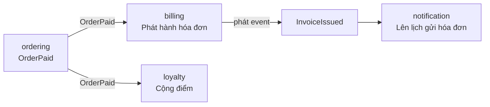
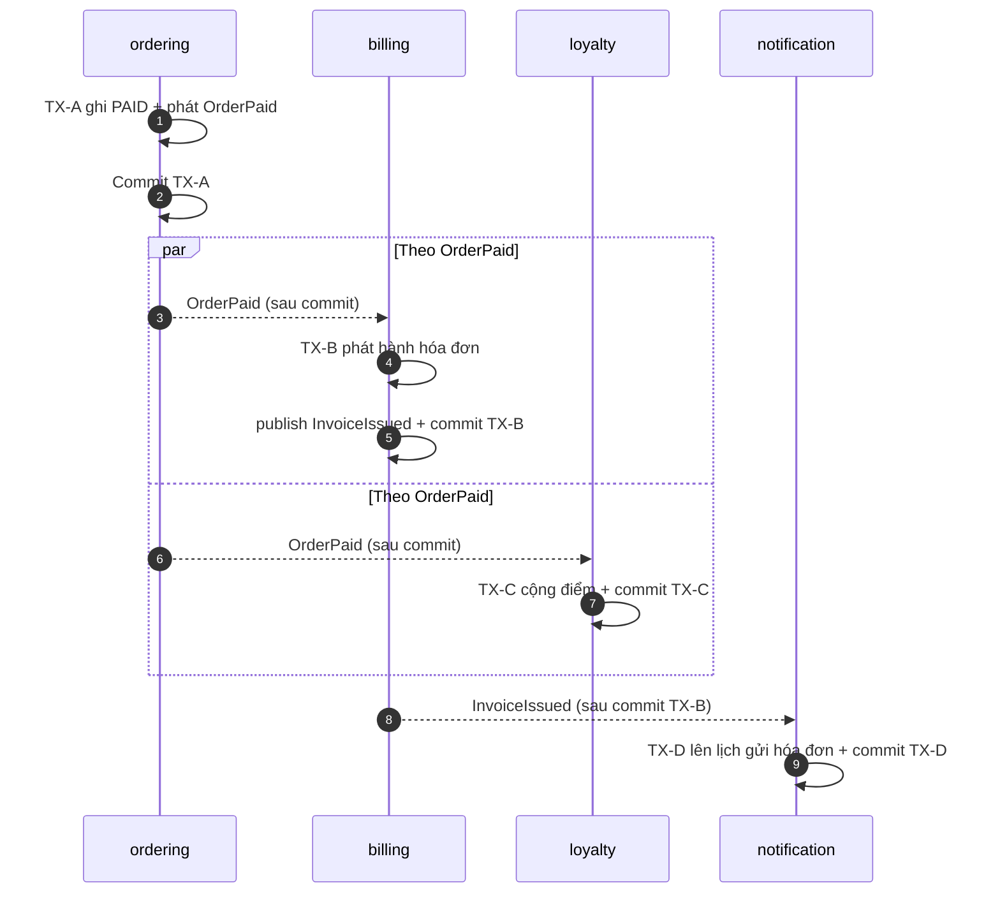

# Một handler một trách nhiệm trong Spring Modulith

## 1. Vì sao cần giới hạn trách nhiệm của event handler?

Trong Spring Modulith, các **application module** có thể phối hợp bằng application events mà không cần gọi trực tiếp vào service hoặc repository nội bộ của nhau. Ví dụ, module `ordering` công bố sự kiện `OrderPaid` sau khi thanh toán đơn hàng được ghi nhận; `billing` phát hành hóa đơn, `loyalty` cộng điểm, còn `notification` gửi thông báo. Mỗi hành động có chủ sở hữu, quy tắc và cơ chế xử lý lỗi khác nhau.

Một cách làm thiếu kiểm soát là viết duy nhất một handler nhận `OrderPaid` rồi thực hiện cả ba tác vụ:

```java
// PHẢN VÍ DỤ: một handler ôm nhiều trách nhiệm độc lập.
@ApplicationModuleListener
void on(OrderPaid event) {
    invoices.createInvoice(event.orderId());
    points.addPoints(event.customerId());
    emails.sendPaidReceipt(event.orderId());
}
```

Đoạn code ngắn nhưng có nhiều câu hỏi khó:

- Nếu hóa đơn đã tạo thành công rồi thao tác cộng điểm lỗi, retry có tạo hóa đơn thứ hai không?
- Nếu gửi email thất bại, vì sao toàn bộ handler phải chạy lại công việc phát hành hóa đơn?
- Handler này thuộc module nào khi nó đồng thời chứa ba quy tắc của ba năng lực nghiệp vụ?
- Muốn thay cách gửi thông báo, tại sao phải sửa và kiểm thử lại mã phát hành hóa đơn?
- Một hệ thống quan sát sự kiện sẽ phân biệt bước nào thành công, bước nào còn chờ ra sao?

Nguyên tắc **“một handler một trách nhiệm”** (*Single Responsibility Principle* áp dụng cho event handling) nghĩa là **mỗi handler có một lý do nghiệp vụ rõ ràng để thay đổi** và chịu trách nhiệm cho **một kết quả hoặc một chính sách nghiệp vụ thống nhất**.

Điều đó không có nghĩa một handler chỉ được gọi một phương thức, sửa một bảng hay có đúng một dòng code. Một handler có thể phối hợp nhiều thao tác nội bộ nếu chúng cùng phục vụ **một invariant hoặc một kết quả nguyên tử**. Điểm cần tránh là gom các hệ quả độc lập thành một đơn vị thất bại, retry, triển khai và kiểm thử không cần thiết.

Trong phạm vi **SPRING_MODULITH_APPLICATION_EVENTS**, việc tách trách nhiệm giúp giữ ranh giới module, sử dụng publisher/listener sau commit, Event Publication Registry, retry và idempotency đúng mức; đồng thời làm cho kiểm thử và khả năng quan sát luồng nghiệp vụ đáng tin cậy hơn.

## 2. Hiểu “trách nhiệm” theo nghiệp vụ, không theo số dòng code

Đối với event handler, hãy bắt đầu bằng câu: **“Khi sự kiện này xảy ra, handler chịu trách nhiệm bảo đảm điều gì?”**

| Handler | Sự kiện nhận | Kết quả thuộc trách nhiệm handler | Không nên làm |
| --- | --- | --- | --- |
| `PaidOrderInvoiceHandler` | `OrderPaid` | Một hóa đơn hợp lệ được phát hành cho đơn đã trả tiền | Tự gửi email hoặc cộng điểm |
| `PaidOrderPointsHandler` | `OrderPaid` | Điểm thưởng của đơn được ghi nhận chính xác một lần | Truy cập bảng hóa đơn |
| `InvoiceNotificationHandler` | `InvoiceIssued` | Một yêu cầu gửi hóa đơn được lập và theo dõi | Tự phát hành hóa đơn mới |
| `SalesProjectionHandler` | `OrderPaid` | Projection doanh thu được cập nhật theo quy tắc riêng | Thay đổi trạng thái thanh toán của `ordering` |

Đây là các **trách nhiệm nghiệp vụ**; việc cập nhật dữ liệu, kiểm tra trùng hoặc ghi audit cho một trách nhiệm vẫn có thể nằm trong cùng handler/service. Ví dụ `PaidOrderInvoiceHandler` có thể kiểm tra invoice đã tồn tại, ghi hóa đơn và lưu dấu idempotency trong **một transaction**. Đó vẫn là một trách nhiệm: *phát hành đúng một hóa đơn*.

### 2.1. Handler không phải nơi chứa tất cả logic miền

Handler lý tưởng thường mỏng: nhận event, điều phối một hành vi của module nhận và để **domain/application service nội bộ** thực thi các bất biến.

```java
@ApplicationModuleListener
public void on(OrderPaid event) {
    invoiceIssuer.issueOnce(event);
}
```

Không nên thay `invoiceIssuer.issueOnce(...)` bằng hàng chục phép kiểm tra thuế, giảm giá, định dạng số hóa đơn và gọi repository của nhiều module khác ngay bên trong listener. Nhiệm vụ kiểm tra điều kiện phát hành hóa đơn thuộc service/aggregate của `billing`; listener chỉ là **điểm tiếp nhận sự kiện và khởi phát use case**.

### 2.2. “Một handler một trách nhiệm” không đồng nghĩa “một event chỉ một handler”

Cùng một sự kiện có thể có **nhiều listener độc lập**, mỗi listener theo đuổi một hệ quả khác nhau. Ngược lại, một handler cũng có thể nhận các event khác nhau nếu chúng đều diễn đạt cách kích hoạt **cùng một chính sách**, nhưng cần bảo đảm method và hợp đồng dễ hiểu.

Không nên chia một công việc cần nguyên tử thành ba listener chỉ để đạt số lượng method nhỏ. Ví dụ tạo hóa đơn và lưu các dòng hóa đơn phải nhất quán có thể là **một transaction** của `billing`. Tách chúng thành hai listener độc lập sẽ khiến giao dịch đầu commit nhưng giao dịch sau lỗi, tạo ra hóa đơn thiếu dòng.

## 3. Thiết kế ví dụ: ba module phản ứng theo trách nhiệm riêng

Xét hệ thống bán hàng với bốn application module:

1. **`ordering`:** quản lý đơn và trạng thái thanh toán; công bố `OrderPaid`.
2. **`billing`:** nhận `OrderPaid`, phát hành hóa đơn; công bố `InvoiceIssued`.
3. **`loyalty`:** nhận `OrderPaid` và ghi nhận điểm thưởng của đơn.
4. **`notification`:** nhận `InvoiceIssued` và lên lịch gửi hóa đơn tới khách.



Sơ đồ diễn tả **luồng dữ liệu khi ứng dụng chạy**. Trong mã nguồn, `billing` và `loyalty` phụ thuộc vào public event `ordering.OrderPaid`; `notification` phụ thuộc vào public event `billing.InvoiceIssued`. `ordering` không import listener hoặc repository của các module khác.

**Vì sao `notification` nghe `InvoiceIssued` thay vì `OrderPaid`?** Vì nghiệp vụ gửi **hóa đơn đã phát hành** phải chờ hóa đơn thực sự có mặt. Nếu lắng nghe `OrderPaid` và chạy độc lập với `billing`, email có thể được gửi trước lúc hóa đơn được tạo hoặc khi việc phát hành hóa đơn thất bại. Việc chọn **đúng sự kiện kích hoạt** là một phần của nguyên tắc một trách nhiệm.

Trái lại, cộng điểm thưởng có thể hoàn toàn độc lập với việc phát hành hóa đơn nếu chính sách kinh doanh chỉ yêu cầu đơn đã được thanh toán. Hai handler cùng nghe `OrderPaid` là hợp lý khi hai hệ quả không bắt buộc đồng thời thành công.

## 4. Cấu trúc package bảo vệ ownership

Trong cách tổ chức mặc định của Spring Modulith, các package con trực tiếp dưới application base package có thể được nhận diện là các application module:

```text
com.example.shop
├── ShopApplication.java
├── ordering
│   ├── OrderPaid.java                    # Public event contract
│   └── internal
│       ├── PaymentService.java
│       └── OrderRepository.java
├── billing
│   ├── InvoiceIssued.java                # Public event contract
│   └── internal
│       ├── PaidOrderInvoiceHandler.java
│       ├── InvoiceIssuer.java
│       └── InvoiceRepository.java
├── loyalty
│   └── internal
│       ├── PaidOrderPointsHandler.java
│       └── PointsLedger.java
└── notification
    └── internal
        ├── InvoiceNotificationHandler.java
        └── NotificationOutbox.java
```

Event contract cần được công bố qua **API hợp lệ của module phát** (chẳng hạn package gốc hoặc named interface nếu dự án dùng package con). Các class handler và service có thể nằm trong package `internal` của **module nhận**. Không để `billing` import `ordering.internal.OrderRepository` để tránh module consumer phụ thuộc trực tiếp vào chi tiết persistence của publisher.

## 5. Định nghĩa sự kiện phù hợp với từng trách nhiệm

Ví dụ public event `OrderPaid`:

```java
// ordering/OrderPaid.java
package com.example.shop.ordering;

import java.time.Instant;
import java.util.Objects;
import java.util.UUID;

public record OrderPaid(
        UUID eventId,
        UUID orderId,
        UUID customerId,
        UUID correlationId,
        Instant occurredAt) {

    public OrderPaid {
        Objects.requireNonNull(eventId, "eventId");
        Objects.requireNonNull(orderId, "orderId");
        Objects.requireNonNull(customerId, "customerId");
        Objects.requireNonNull(correlationId, "correlationId");
        Objects.requireNonNull(occurredAt, "occurredAt");
    }
}
```

`OrderPaid` nói rằng đơn hàng **đã thanh toán thành công**, không ra lệnh trực tiếp “hãy gửi email”. `eventId` nhận diện một lần xảy ra sự kiện, `orderId` là khóa nghiệp vụ và `correlationId` nối các bước cùng luồng.

Module `billing` sở hữu event `InvoiceIssued` vì chỉ nó có thể khẳng định hóa đơn đã được phát hành:

```java
// billing/InvoiceIssued.java
package com.example.shop.billing;

import java.time.Instant;
import java.util.Objects;
import java.util.UUID;

public record InvoiceIssued(
        UUID eventId,
        UUID invoiceId,
        UUID orderId,
        UUID correlationId,
        UUID causationId,
        Instant occurredAt) {

    public InvoiceIssued {
        Objects.requireNonNull(eventId, "eventId");
        Objects.requireNonNull(invoiceId, "invoiceId");
        Objects.requireNonNull(orderId, "orderId");
        Objects.requireNonNull(correlationId, "correlationId");
        Objects.requireNonNull(causationId, "causationId");
        Objects.requireNonNull(occurredAt, "occurredAt");
    }
}
```

Khi `InvoiceIssued` được tạo như kết quả của `OrderPaid`, nó có **event ID mới**, giữ nguyên `correlationId` và dùng `causationId = OrderPaid.eventId`. Khi retry cùng `OrderPaid`, listener không được tạo ra một hóa đơn và sự kiện `InvoiceIssued` mới nếu hóa đơn đã tồn tại theo chính sách một hóa đơn trên một đơn.

**Giới hạn minh họa:** Trong hệ thống kế toán thực tế có thể phát hành nhiều chứng từ hợp lệ cho một đơn (hóa đơn điều chỉnh, thay thế, hoàn tiền). Khóa `orderId` đủ cho ví dụ **một hóa đơn gốc trên một đơn**, nhưng sản phẩm thực tế cần mô hình loại chứng từ, phiên bản và quy tắc riêng, không áp đặt quy tắc này cho mọi hệ thống.

## 6. Publisher chỉ phát sự thật khi chuyển trạng thái thành công

Publisher nằm trong `ordering`, thực hiện thay đổi trạng thái trong transaction rồi phát event:

```java
// ordering/internal/PaymentService.java
package com.example.shop.ordering.internal;

import com.example.shop.ordering.OrderPaid;
import java.time.Instant;
import java.util.UUID;
import org.springframework.context.ApplicationEventPublisher;
import org.springframework.stereotype.Service;
import org.springframework.transaction.annotation.Transactional;

@Service
class PaymentService {

    private final OrderRepository orders;
    private final ApplicationEventPublisher events;

    PaymentService(OrderRepository orders, ApplicationEventPublisher events) {
        this.orders = orders;
        this.events = events;
    }

    @Transactional
    public void markPaid(UUID orderId, UUID correlationId) {
        PaymentResult result = orders.markPaidIfEligible(orderId);

        if (result == PaymentResult.ALREADY_PAID) {
            return; // Retry command không phát thêm OrderPaid.
        }
        if (result != PaymentResult.CHANGED_TO_PAID) {
            throw new IllegalStateException("Cannot mark order as paid");
        }

        events.publishEvent(new OrderPaid(
                UUID.randomUUID(), orderId, orders.customerIdOf(orderId),
                correlationId, Instant.now()));
    }
}
```

`OrderRepository` và `PaymentResult` là các kiểu nội bộ **cần triển khai thêm**; đoạn mã chỉ minh họa thứ tự nghiệp vụ. Việc ghi nhận kết quả thanh toán thật phải dựa trên bằng chứng xác thực từ payment provider, tránh đồng nhất việc nhận một request HTTP với thanh toán đã thành công.

Điểm quan trọng là **event chỉ phát khi có chuyển trạng thái thật**. Nếu publisher đã ghi `PAID` trước đó rồi request được lặp lại, không tạo event thứ hai cho cùng một cột mốc chỉ vì method được gọi thêm một lần. Repository phải bảo vệ cạnh tranh ghi bằng transaction/ràng buộc dữ liệu phù hợp.

## 7. Handler thứ nhất: phát hành hóa đơn và chỉ phát hành hóa đơn

`billing` nhận `OrderPaid` sau commit, thực hiện use case phát hành hóa đơn trong transaction riêng và phát sự kiện kết quả khi có **lần phát hành mới**:

```java
// billing/internal/PaidOrderInvoiceHandler.java
package com.example.shop.billing.internal;

import com.example.shop.billing.InvoiceIssued;
import com.example.shop.ordering.OrderPaid;
import java.util.Optional;
import org.springframework.context.ApplicationEventPublisher;
import org.springframework.modulith.events.ApplicationModuleListener;
import org.springframework.stereotype.Component;

@Component
class PaidOrderInvoiceHandler {

    private final InvoiceIssuer invoices;
    private final ApplicationEventPublisher events;

    PaidOrderInvoiceHandler(InvoiceIssuer invoices,
                            ApplicationEventPublisher events) {
        this.invoices = invoices;
        this.events = events;
    }

    @ApplicationModuleListener
    public void on(OrderPaid event) {
        Optional<InvoiceIssued> issued = invoices.issueOnce(event);
        issued.ifPresent(events::publishEvent);
    }
}
```

**Hợp đồng giả định của `InvoiceIssuer.issueOnce(event)`:** kiểm tra dữ liệu hợp lệ, tạo hóa đơn gốc nếu chưa có, lưu hóa đơn và trả về `Optional.of(InvoiceIssued)` **chỉ khi vừa phát hành mới**; nếu event đến trùng, trả về `Optional.empty()`. Service này phải có unique constraint và xử lý cạnh tranh để hai lượt listener không thể cùng phát hành hai hóa đơn. Phần tính thuế, số hóa đơn và bảng chi tiết thuộc nội bộ `billing`, không thuộc handler.

`events.publishEvent(...)` được gọi trong transaction của listener khi phát hành thành công. Một listener `@ApplicationModuleListener` cho `InvoiceIssued` ở module tiếp theo chỉ xử lý **sau khi transaction phát hành hóa đơn commit**, không nên gửi hóa đơn khi dữ liệu còn chưa được lưu.

Nếu `issueOnce` thất bại vì lỗi tạm thời, hãy để lỗi kỹ thuật được xử lý theo cơ chế thất bại của listener/registry. Nếu không đủ điều kiện phát hành theo nghiệp vụ, service nên có kết quả miền hoặc trạng thái thất bại rõ ràng; không “nuốt lỗi” rồi coi hóa đơn đã phát hành.

### 7.1. Vì sao handler vẫn có thể gọi hai phương thức?

Ở đây handler gọi `invoices.issueOnce(...)` rồi `events.publishEvent(...)`. Hai thao tác đều thuộc **một trách nhiệm duy nhất: hoàn thành và công bố việc phát hành hóa đơn**. Số lời gọi method không phải thước đo Single Responsibility Principle.

Một thiết kế thay thế là domain service/aggregate ghi nhận domain event thông qua Spring Data `@DomainEvents`, nếu phù hợp với mô hình lưu trữ. Không nên đồng thời phát `InvoiceIssued` bằng hai cơ chế cho cùng một chuyển đổi mà không kiểm soát, vì consumer có thể nhận hai event nghiệp vụ.

## 8. Handler thứ hai: cộng điểm độc lập

Module `loyalty` quan tâm trực tiếp đến thanh toán thành công. Nó **không cần chờ hóa đơn**, nếu chính sách trả điểm chỉ phụ thuộc vào `OrderPaid`:

```java
// loyalty/internal/PaidOrderPointsHandler.java
package com.example.shop.loyalty.internal;

import com.example.shop.ordering.OrderPaid;
import org.springframework.modulith.events.ApplicationModuleListener;
import org.springframework.stereotype.Component;

@Component
class PaidOrderPointsHandler {

    private final PointsLedger ledger;

    PaidOrderPointsHandler(PointsLedger ledger) {
        this.ledger = ledger;
    }

    @ApplicationModuleListener
    public void on(OrderPaid event) {
        ledger.awardForPaidOrderOnce(
                event.orderId(), event.customerId(), event.eventId());
    }
}
```

`PointsLedger` là API nội bộ cần triển khai. Nó bảo đảm **mỗi đơn chỉ được cộng điểm thanh toán một lần**, ví dụ lưu bản ghi ledger có unique `(orderId, rewardType)` cùng transaction cập nhật số dư. Nếu điểm đã cộng rồi, lần xử lý lại không cộng thêm; nếu cập nhật thất bại, transaction rollback để retry có thể làm lại an toàn.

Khi một chính sách mới yêu cầu chỉ cộng điểm sau khi hóa đơn phát hành, **thay đổi sự kiện kích hoạt** từ `OrderPaid` sang `InvoiceIssued` (hoặc bổ sung một điều kiện nghiệp vụ công khai thích hợp) sẽ rõ ràng hơn việc thêm nhiều logic kết nối hóa đơn vào handler cũ.

## 9. Handler thứ ba: lên lịch gửi hóa đơn sau khi phát hành

Module `notification` chỉ nhận `InvoiceIssued`. Nó tạo một yêu cầu gửi hóa đơn có thể theo dõi và retry:

```java
// notification/internal/InvoiceNotificationHandler.java
package com.example.shop.notification.internal;

import com.example.shop.billing.InvoiceIssued;
import org.springframework.modulith.events.ApplicationModuleListener;
import org.springframework.stereotype.Component;

@Component
class InvoiceNotificationHandler {

    private final NotificationOutbox outbox;

    InvoiceNotificationHandler(NotificationOutbox outbox) {
        this.outbox = outbox;
    }

    @ApplicationModuleListener
    public void on(InvoiceIssued event) {
        outbox.scheduleInvoiceOnce(
                event.invoiceId(), event.orderId(), event.eventId());
    }
}
```

`NotificationOutbox` là thành phần nội bộ cần triển khai. Nó ghi yêu cầu gửi có khóa duy nhất theo `(invoiceId, notificationType)`, để một sự kiện được gửi lại không tạo hai yêu cầu giống nhau. Worker gửi email/HTTP ở bước khác có thể nhận yêu cầu từ outbox, dùng chính sách retry và khóa idempotency khi provider hỗ trợ.

Vì sao không gửi email trực tiếp trong transaction của `@ApplicationModuleListener`? Có thể làm như vậy ở bài toán nhỏ, nhưng I/O ra ngoài không nằm trong transaction SQL. Một lần email đã gửi thành công, rồi database đánh dấu hoàn tất bị lỗi, có thể khiến listener retry và **gửi trùng**. Lưu công việc bền vững rồi xử lý riêng giúp tách trách nhiệm cập nhật dữ liệu local khỏi một tác động mạng không thể rollback, dù chính worker gửi cũng phải được thiết kế chống trùng.

## 10. Transaction, after commit và tính độc lập của handler

`@ApplicationModuleListener` trong Spring Modulith có ngữ nghĩa tương ứng việc kết hợp **transactional event listener sau commit**, **xử lý bất đồng bộ** và **giao dịch riêng**. Publisher phải phát sự kiện trong transaction thực sự để transactional listener được kích hoạt theo mặc định.

Ví dụ trình tự:



Điều cần nhớ:

- **TX-A** đã commit trước khi các listener phản ứng. Lỗi trong TX-B hoặc TX-C **không tự rollback** trạng thái `PAID`.
- **TX-B và TX-C độc lập**. Lỗi khi cộng điểm không bắt handler phát hành hóa đơn phải chạy lại, và ngược lại.
- **TX-D** chỉ bắt đầu sau khi invoice được công bố trong một transaction đã commit. Thứ tự thực thi với các tác vụ bất đồng bộ khác không được bảo đảm tuyệt đối.
- Nếu handler bị retry, transaction riêng mới có thể được mở; các hiệu ứng phải có **idempotency** tại từng module.

Một phản ví dụ là cố dùng `@EventListener` đồng bộ mà không nhận ra nó có thể chạy trong transaction publisher và kéo lỗi của consumer vào đường đi đồng bộ. `@TransactionalEventListener` của Spring Framework cho phép chọn phase; `@ApplicationModuleListener` đóng gói cách lắng nghe phù hợp với giao tiếp sau commit giữa các module.

**Ngoại lệ cần đánh giá:** Nếu một nghiệp vụ bắt buộc phải được xác nhận nguyên tử cùng với thanh toán, tách nó thành listener sau commit có thể **không đáp ứng yêu cầu**. Cần dùng thiết kế transaction đồng bộ phù hợp, hoặc xác định lại trạng thái trung gian và điểm được phép thông báo “thành công”.

## 11. Độc lập về lỗi không có nghĩa bỏ qua thứ tự nghiệp vụ

Tách handler chỉ phù hợp khi các kết quả **không cần hoàn thành đồng thời** hoặc có một protocol/workflow rõ ràng. Nếu hóa đơn phải có trước khi gửi email đính kèm hóa đơn, gửi email không được là handler song song của `OrderPaid` với handler phát hành hóa đơn.

Có hai mẫu phối hợp thường gặp:

| Mẫu | Cách triển khai | Phù hợp khi | Rủi ro |
| --- | --- | --- | --- |
| **Fan-out độc lập** | Nhiều handler nghe cùng `OrderPaid` | Các hệ quả độc lập như loyalty, analytics | Không có thứ tự hoàn tất mặc định |
| **Event chain có điều kiện** | `OrderPaid → InvoiceIssued → notification` | Bước sau cần kết quả của bước trước | Phải theo dõi bước trung gian và lỗi |
| **Orchestration** | Một module quản lý trạng thái workflow và gọi public API/nhận event kết quả | Nhiều nhánh, timeout, bù trừ | Orchestrator có thể phình to nếu chứa logic mọi module |

Người thiết kế cần phân biệt **phụ thuộc nghiệp vụ** với **phụ thuộc triển khai**. Việc notification cần hóa đơn thực sự tồn tại là phụ thuộc nghiệp vụ đúng; việc notification import `billing.internal.InvoiceRepository` để tải dữ liệu là phụ thuộc triển khai không nên tạo. Có thể dùng public query API của `billing` hoặc đưa dữ kiện cần thiết vào `InvoiceIssued`.

### 11.1. Điều phối viên cũng phải có trách nhiệm giới hạn

Trong luồng nhiều bước, một `CheckoutWorkflowCoordinator` có thể chịu trách nhiệm **theo dõi tiến độ, timeout và yêu cầu bù trừ**. Trách nhiệm của nó là **điều phối trạng thái workflow**, không phải tự tính thuế, kiểm tra tồn kho, gửi mail hoặc cộng điểm. Logic nghiệp vụ chuyên sâu vẫn thuộc module tương ứng.

Orchestrator chỉ nên xuất hiện khi nó giải quyết vấn đề thật: các bước phụ thuộc nhau, cần điều kiện nhánh, cần quyết định retry/bù trừ hoặc cần trạng thái tiến trình tập trung. Một quy trình đơn giản chỉ phát event cho hai consumer độc lập có thể không cần module điều phối riêng.

## 12. Event Publication Registry theo dõi từng handler

Spring Modulith hỗ trợ **Event Publication Registry** để theo dõi việc công bố event tới các transactional event listener. Một `OrderPaid` có thể tạo **nhiều publication** khác nhau tương ứng các listener:

```text
OrderPaid(eventId = E-100)
    ├── billing.PaidOrderInvoiceHandler.on   → publication P-1
    └── loyalty.PaidOrderPointsHandler.on    → publication P-2

P-1: xử lý thành công, đã hoàn tất
P-2: lỗi tạm thời, còn chưa hoàn tất
```

Điều này giúp quan sát đúng trách nhiệm: **billing đã xong, loyalty còn lỗi**, thay vì chỉ thấy một handler tổng hợp “thất bại” không biết cần chạy lại phần nào. Nếu `InvoiceIssued` được phát, handler `notification` có publication riêng cho event kết quả đó.

Với triển khai lưu trữ bền vững và cấu hình tương ứng, registry giúp xác định publication chưa hoàn tất qua sự cố tiến trình. Nhưng hành vi tự động resubmit, retry theo lịch, giới hạn số lần và API vận hành **phụ thuộc vào phiên bản và cấu hình**; không nên coi `@ApplicationModuleListener` tự đảm bảo mọi yếu tố này.

`eventId` là ID nghiệp vụ của sự kiện; ID publication là ID theo dõi một lần giao sự kiện tới listener. Một event có thể có nhiều publication, nên không được đánh đồng hai loại ID.

### 12.1. Retry không nên thực hiện lại phần đã thành công

Khi `billing` thành công còn `loyalty` lỗi, hệ thống nên tái xử lý publication chưa hoàn tất của `loyalty` theo chính sách, **không bắt toàn bộ quy trình thanh toán và phát hành hóa đơn chạy lại từ đầu**.

Đó là lợi ích thực tế của việc mỗi handler có một trách nhiệm và một đơn vị quan sát riêng. Ngược lại, **mỗi listener vẫn có thể được gọi lại** do lỗi hoặc sự cố đánh dấu hoàn tất, nên bản thân handler không được dựa vào giả định “registry sẽ không bao giờ giao trùng”.

## 13. Idempotency theo từng trách nhiệm

Mỗi handler cần khóa chống lặp phản ánh kết quả mà nó sở hữu:

| Trách nhiệm | Khóa nghiệp vụ đề xuất | Nếu chạy lại |
| --- | --- | --- |
| Phát hành hóa đơn gốc | `(orderId, invoiceKind)` | Không tạo hóa đơn gốc thứ hai |
| Cộng điểm từ một đơn đã trả | `(orderId, rewardType)` | Không cộng thêm điểm trùng |
| Lên lịch gửi một hóa đơn | `(invoiceId, notificationType)` | Không tạo yêu cầu gửi trùng |
| Áp dụng chính xác cùng event tại một consumer | `(consumerName, eventId)` | Nhận biết event đã được xử lý |

Ví dụ một schema minh họa cho `billing` dùng PostgreSQL:

```sql
CREATE TABLE invoice (
    invoice_id UUID PRIMARY KEY,
    order_id UUID NOT NULL,
    invoice_kind VARCHAR(32) NOT NULL,
    issued_at TIMESTAMPTZ NOT NULL,
    UNIQUE (order_id, invoice_kind)
);
```

Module `loyalty` có thể có bảng ledger:

```sql
CREATE TABLE loyalty_award (
    order_id UUID NOT NULL,
    reward_type VARCHAR(32) NOT NULL,
    customer_id UUID NOT NULL,
    points INTEGER NOT NULL,
    PRIMARY KEY (order_id, reward_type)
);
```

Những ràng buộc trên chỉ minh họa một chính sách mỗi đơn có **một** bản ghi thuộc từng loại. Với nghiệp vụ nhiều lần phát hành/điều chỉnh hoặc nhiều chương trình thưởng, khóa phải được thiết kế theo mô hình thực tế, không sao chép máy móc.

### 13.1. Không tách dấu xử lý trùng khỏi tác động cần bảo vệ

Nếu lưu `consumed_event(consumerName, eventId)` để chống xử lý trùng, việc ghi dấu này và thay đổi dữ liệu local phải nằm trong **cùng transaction** khi có thể. Nếu đánh dấu đã xử lý trước, rồi transaction ghi hóa đơn thất bại, lần retry có thể bị bỏ qua dù hóa đơn chưa được tạo.

Đối với email/HTTP bên ngoài, transaction local không bao trùm tác động đã gửi. Vì thế, `notification` có thể ghi công việc vào outbox trong transaction của listener và dùng worker gửi riêng; worker cần chính sách idempotency và đối soát bên ngoài.

**Một handler một trách nhiệm** giúp xác định chính xác **khóa chống lặp, transaction và tình trạng hoàn tất** của từng tác vụ.

## 14. Xử lý exception, retry và giới hạn của listener

Một handler tốt phải phân biệt **lỗi kỹ thuật** với **kết quả nghiệp vụ hợp lệ**:

- **Lỗi kỹ thuật tạm thời:** database timeout, network 503. Có thể cho exception đi lên để publication chưa hoàn tất và hệ thống retry theo chính sách.
- **Kết quả nghiệp vụ:** không đủ điều kiện cộng điểm, hóa đơn không thể phát hành vì đơn chưa hợp lệ. Nên có trạng thái/kết quả rõ ràng, không retry vô hạn như lỗi mạng.
- **Dữ liệu hợp đồng sai:** event thiếu ID, schema không tương thích. Cần ghi nhận, cảnh báo và sửa nguyên nhân, không gán mặc định thành công.
- **Hiệu ứng ngoài không chắc đã thực hiện:** email provider timeout sau khi đã gửi. Cần idempotency key/đối soát thay vì gửi lại mù quáng.

Phản ví dụ:

```java
@ApplicationModuleListener
public void on(OrderPaid event) {
    try {
        invoices.issueOnce(event);
    } catch (Exception ex) {
        log.warn("Cannot issue invoice", ex);
        // Nguy hiểm: listener kết thúc bình thường dù việc chính thất bại.
    }
}
```

Nếu không có cơ chế lưu công việc lỗi bền vững riêng, việc **nuốt exception** có thể khiến hạ tầng xem publication đã hoàn tất. Lỗi kỹ thuật chưa xử lý nên được phản ánh đúng qua transaction/registry và hệ thống giám sát. Ngược lại, không nên ném exception vô hạn chỉ vì một quy tắc nghiệp vụ nói “đơn này không thuộc chương trình thưởng”.

### 14.1. Tránh handler phức tạp vì quá nhiều trách nhiệm phụ

Nếu handler phải xử lý timeout, nhiều nhánh bù trừ, cân nhắc quyền truy cập của năm module, viết ba loại dữ liệu khác nhau và gọi nhiều hệ thống bên ngoài, đó có thể là dấu hiệu:

1. Có nhiều trách nhiệm độc lập cần tách thành handler riêng.
2. Có một use case nghiệp vụ lớn cần chuyển phần logic vào application service/aggregate.
3. Có một workflow thực sự phụ thuộc thứ tự cần coordinator với trạng thái riêng.
4. Có một tác vụ I/O dài cần hàng đợi/outbox, không nên giữ transaction mở.

Mục tiêu là **ranh giới phù hợp với nghiệp vụ**, không phải chia nhỏ đến mức mọi method trở thành listener và không ai nhìn thấy quy trình tổng thể.

## 15. Kiểm thử theo trách nhiệm, không chỉ theo số event

Spring Modulith hỗ trợ `@ApplicationModuleTest` để kiểm thử module; các công cụ hỗ trợ kiểm thử event như `Scenario` hoặc `PublishedEvents` có thể giúp chờ và kiểm tra điều kiện phát event theo phiên bản thư viện. Kết hợp unit test service, integration test listener và test kiến trúc.

| Cấp kiểm thử | Tình huống | Điều cần chứng minh |
| --- | --- | --- |
| `ordering` | Đơn từ chưa trả sang `PAID` | Phát một `OrderPaid` đúng payload |
| `billing` | Nhận `OrderPaid` hợp lệ | Phát hành đúng một hóa đơn gốc và `InvoiceIssued` |
| `billing` retry | Nhận lại cùng event | Không tạo hóa đơn và `InvoiceIssued` mới |
| `loyalty` | Nhận `OrderPaid` | Ghi một bản cộng điểm hợp lệ |
| `notification` | Nhận `InvoiceIssued` | Ghi một yêu cầu gửi hóa đơn |
| Trình tự | `OrderPaid` chưa phát hành hóa đơn | Không gửi “hóa đơn đã phát hành” trước khi có `InvoiceIssued` |
| Rollback publisher | TX thanh toán thất bại | Listener sau commit không chạy |
| Lỗi riêng | `loyalty` thất bại, `billing` thành công | Publication độc lập; không rollback hóa đơn/đơn |
| Replay | Resubmit publication của handler lỗi | Kết quả cuối không trùng |
| Kiến trúc | Handler import `ordering.internal` | Bị test ranh giới phát hiện |

### 15.1. Test kiến trúc và phạm vi module

```java
import org.junit.jupiter.api.Test;
import org.springframework.modulith.core.ApplicationModules;

class ModulithArchitectureTest {

    @Test
    void verifyModuleBoundaries() {
        ApplicationModules.of(ShopApplication.class).verify();
    }
}
```

`ApplicationModules.verify()` giúp phát hiện phụ thuộc vòng và truy cập không hợp lệ vào module internals. Nhờ public events, handler nằm trong module riêng mà không cần lấy repository của publisher qua Java imports.

### 15.2. Khung kiểm thử listener

```java
import org.junit.jupiter.api.Test;
import org.springframework.modulith.test.ApplicationModuleTest;

@ApplicationModuleTest
class BillingModuleTests {

    @Test
    void issuesInvoiceOnceOnOrderPaid() {
        // Arrange: tạo dữ liệu và chuẩn bị event OrderPaid.
        // Act: đưa event vào phạm vi module test phù hợp.
        // Assert: có đúng một hóa đơn và một InvoiceIssued khi tạo mới.
        // Replay: giữ nguyên hóa đơn; không phát event kết quả thứ hai.
    }
}
```

Đây là **khung minh họa**, chưa runnable vì thiếu fixture và assertion; cần dựa trên hỗ trợ kiểm thử của phiên bản Spring Modulith đang dùng. Với listener bất đồng bộ, chờ sự kiện/điều kiện có timeout, tránh dùng `Thread.sleep()` cố định làm cơ chế đồng bộ.

**Lưu ý quan trọng:** Test gắn `@Transactional` và rollback mặc định có thể khiến listener `AFTER_COMMIT` không bao giờ chạy. Nếu muốn kiểm tra sau commit, phải để transaction publisher thực sự commit hoặc dùng công cụ kiểm thử transaction để điều khiển commit chủ động. Không sửa production listener để test vượt qua tình huống khác biệt này.

### 15.3. Thử lỗi riêng từng handler

Giả lập `PointsLedger` lỗi một lần trong khi `InvoiceIssuer` chạy thành công. Khi publisher commit:

1. `billing` phát hành hóa đơn và publication của nó có thể hoàn tất.
2. `loyalty` lỗi; publication tương ứng chưa hoàn tất khi có registry phù hợp.
3. Retry riêng `loyalty` và kiểm tra điểm chỉ được cộng một lần.
4. Không ép `billing` tạo hóa đơn mới hoặc `ordering` ghi lại thanh toán.

Test dạng này cho thấy **mục đích của việc phân chia trách nhiệm**, thay vì chỉ đếm bao nhiêu listener đã được khai báo.

## 16. Quan sát tiến trình bằng kết quả từng handler

Trong ứng dụng bất đồng bộ, HTTP trả thành công chỉ có nghĩa bước publisher đã hoàn thành, **không chứng minh mọi handler đã hoàn tất**. Bảng điều khiển hoặc log nên phân biệt:

| Thành phần | Thông tin cần quan sát | Câu hỏi giải quyết |
| --- | --- | --- |
| `ordering` | `OrderPaid` event ID, order ID, thời điểm commit | Đơn đã trả tiền và event phát lúc nào? |
| `billing` | Số hóa đơn tạo mới/trùng, lỗi phát hành | Có đơn nào PAID mà chưa có hóa đơn? |
| `loyalty` | Bản ghi thưởng đã lưu, retry count | Điểm đã cộng chưa? |
| `notification` | Yêu cầu gửi đang chờ, thất bại, đã gửi | Hóa đơn đã được đưa vào kênh gửi chưa? |
| Registry | Publication chưa hoàn tất theo listener, tuổi/lỗi gần nhất | Cần retry handler nào? |
| Truy vết | `eventId`, `correlationId`, `causationId` | Các bước liên quan trong cùng workflow nào? |

Ví dụ log cấu trúc:

```json
{
  "module": "billing",
  "handler": "PaidOrderInvoiceHandler",
  "eventType": "OrderPaid",
  "eventId": "43e5ffed-42c8-4249-8a9e-394eed9907bb",
  "orderId": "4b7bd7d0-6d17-4702-9cc7-a9c8032311dc",
  "correlationId": "da73fa98-9c62-4e05-9e23-d143a8389eb1",
  "result": "INVOICE_ISSUED"
}
```

Log không thay thế Event Publication Registry và database nghiệp vụ. Tracing/metrics qua Micrometer, Spring Boot Actuator hoặc công cụ khác cần cấu hình tương ứng; không nên giả định Spring Modulith tự tạo mọi dashboard. Tránh ghi payload có dữ liệu thanh toán nhạy cảm hoặc thông tin cá nhân không cần thiết.

## 17. Các sai lầm thường gặp

| Sai lầm | Hậu quả | Cách sửa |
| --- | --- | --- |
| Một listener vừa xuất hóa đơn, vừa cộng điểm, vừa gửi email | Retry một lỗi kéo theo nhiều thao tác đã thành công | Tách theo trách nhiệm/module và chính sách thất bại |
| Chia mỗi câu lệnh database thành một listener | Phá giao dịch nguyên tử của một invariant | Giữ các bước thuộc cùng kết quả trong một service/transaction |
| Dùng `OrderPaid` để gửi hóa đơn trước khi được phát hành | Race giữa billing và notification | Nghe `InvoiceIssued` |
| Handler truy cập `ordering.internal.OrderRepository` | Coupling và vi phạm ranh giới | Dùng public event/API |
| Coi nhiều listener độc lập là có thứ tự mặc định | Bước phụ thuộc có thể chạy quá sớm | Event chain hoặc coordinator |
| Nuốt exception khiến listener luôn thành công | Registry không phản ánh việc nghiệp vụ chưa hoàn thành | Phản ánh lỗi kỹ thuật đúng và lưu work bền vững |
| Retry nhưng không có unique nghiệp vụ | Tạo hóa đơn, điểm, thư trùng | Idempotency tại module sở hữu |
| Coi registry bảo đảm exactly once cho email | Trùng tác động bên ngoài khi crash | Outbox/provider idempotency/đối soát |
| Lấy transaction của publisher cho listener sau commit | Không còn cùng transaction để rollback | Thiết kế transaction riêng và trạng thái trung gian |
| Chỉ test happy path tổng hợp | Không biết handler nào sai trong lỗi từng phần | Test theo trách nhiệm và publication |
| Thêm coordinator để thay mọi handler | Biến thành “god module” biết hết chi tiết | Coordinator chỉ quản lý workflow, logic nằm ở owner |

## 18. Bài tập thực hành

**Bối cảnh:** Một cửa hàng có các module `ordering`, `billing`, `loyalty` và `notification`. Đơn được xác nhận đã trả tiền sẽ phát `OrderPaid`. Hóa đơn cần có trước khi gửi email đính kèm; điểm thưởng có thể cộng song song.

**Yêu cầu:**

1. Vẽ sơ đồ event flow và xác định owner của `OrderPaid`, `InvoiceIssued` và các handler.
2. Viết `OrderPaid(eventId, orderId, customerId, correlationId, occurredAt)` ở API `ordering` và `InvoiceIssued` ở API `billing`.
3. Viết publisher `markPaid()` trong transaction chỉ phát event khi chuyển trạng thái mới thành công.
4. Viết `PaidOrderInvoiceHandler` nhận `OrderPaid` bằng `@ApplicationModuleListener`, gọi `InvoiceIssuer.issueOnce` và phát `InvoiceIssued` khi tạo hóa đơn thành công.
5. Viết `PaidOrderPointsHandler` độc lập, dùng unique key theo đơn và loại phần thưởng.
6. Viết `InvoiceNotificationHandler` chỉ lắng nghe `InvoiceIssued`, ghi yêu cầu gửi vào outbox.
7. Mô phỏng hóa đơn đã phát hành nhưng gửi email lỗi; xác minh đơn vẫn `PAID` và tác vụ notification có thể retry.
8. Mô phỏng cộng điểm lỗi nhưng hóa đơn thành công; chỉ resubmit publication của loyalty, không phát hành hóa đơn lần nữa.
9. Kiểm thử event bị nhận trùng và hai lần xử lý song song; các khóa unique phải bảo vệ kết quả nghiệp vụ.
10. Viết test `ApplicationModules.of(ShopApplication.class).verify()` và quan sát publication chưa hoàn tất theo listener.

**Câu hỏi tự đánh giá:**

- Tại sao viết ba phương thức riêng trong cùng một “mega handler” vẫn không giải quyết tốt ranh giới thất bại và retry?
- Nếu phát hành hóa đơn và ghi dòng hóa đơn phải commit cùng nhau, có nên tách thành hai listener không?
- Vì sao `notification` nên nghe `InvoiceIssued` thay vì `OrderPaid` khi email phải đính kèm hóa đơn?
- Khi cùng `OrderPaid` có hai listener và chỉ một listener lỗi, registry cần theo dõi điều gì?
- Nếu worker gửi email đã gửi thành công nhưng database ghi trạng thái thất bại, cần bảo vệ tác động nào khi retry?

**Tiêu chí hoàn thành:** Có thể xác định một kết quả nghiệp vụ rõ cho từng handler, phân biệt handler với domain service và coordinator, triển khai phối hợp fan-out/chaining hợp lý, quản lý transaction và idempotency theo module, kiểm thử độc lập các thất bại và quan sát tiến độ qua registry.

## 19. Ghi nhớ

**Một handler một trách nhiệm** nghĩa là mỗi event handler của Spring Modulith chỉ chịu trách nhiệm kích hoạt và hoàn tất **một hành vi nghiệp vụ nhất quán**, không trộn các hệ quả độc lập thành một khối khó retry và khó giám sát. Nhiều handler có thể lắng nghe cùng một domain event nếu kết quả độc lập; khi bước sau cần kết quả của bước trước, hãy công bố sự kiện cột mốc phù hợp hoặc dùng coordinator có giới hạn trách nhiệm. Với `@ApplicationModuleListener`, các handler sau commit thường thực thi bất đồng bộ trong giao dịch riêng, nên cần hợp đồng công khai, xử lý lỗi rõ ràng, idempotency theo tác động nghiệp vụ, Event Publication Registry bền vững khi phù hợp, kiểm thử từng trạng thái thất bại và khả năng quan sát theo từng handler. Đây là cách giảm phụ thuộc và bảo vệ ranh giới nghiệp vụ mà không đánh mất sự đáng tin cậy của toàn bộ luồng sự kiện.
