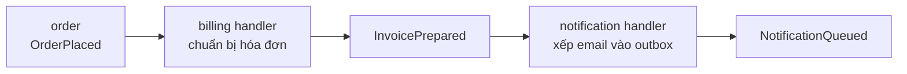
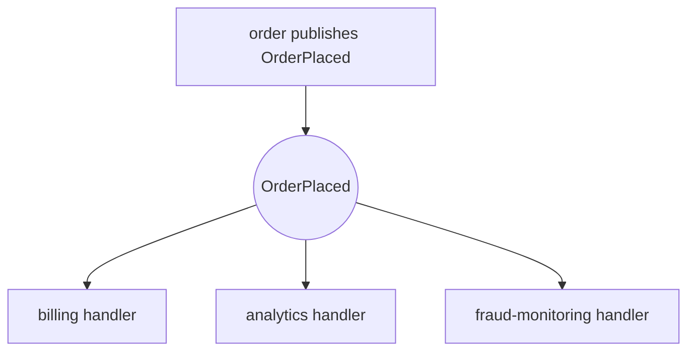
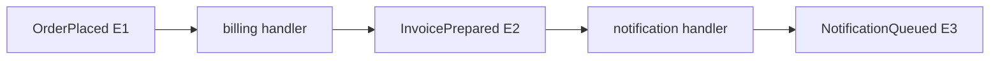
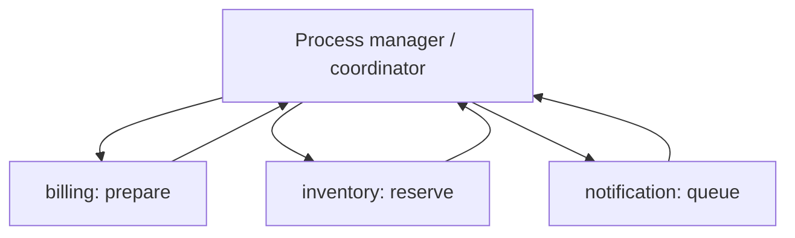
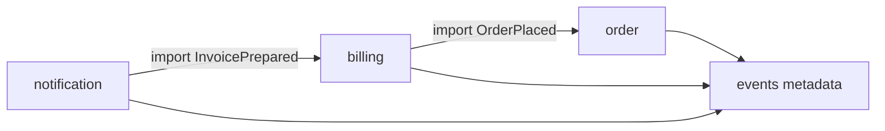
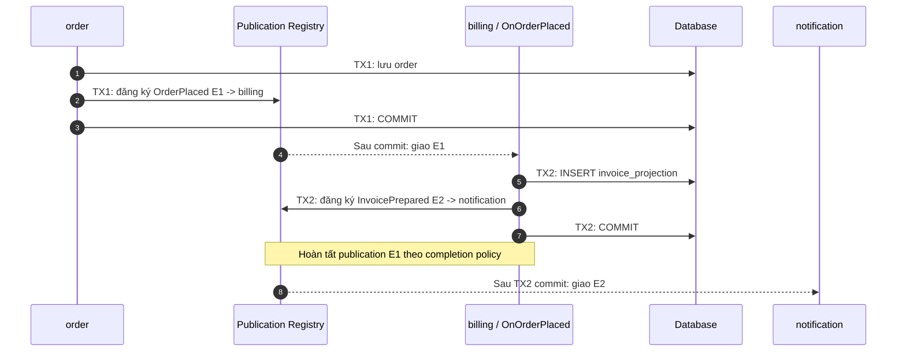
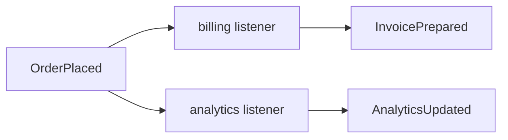
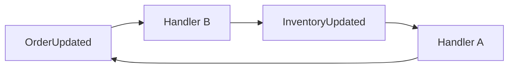
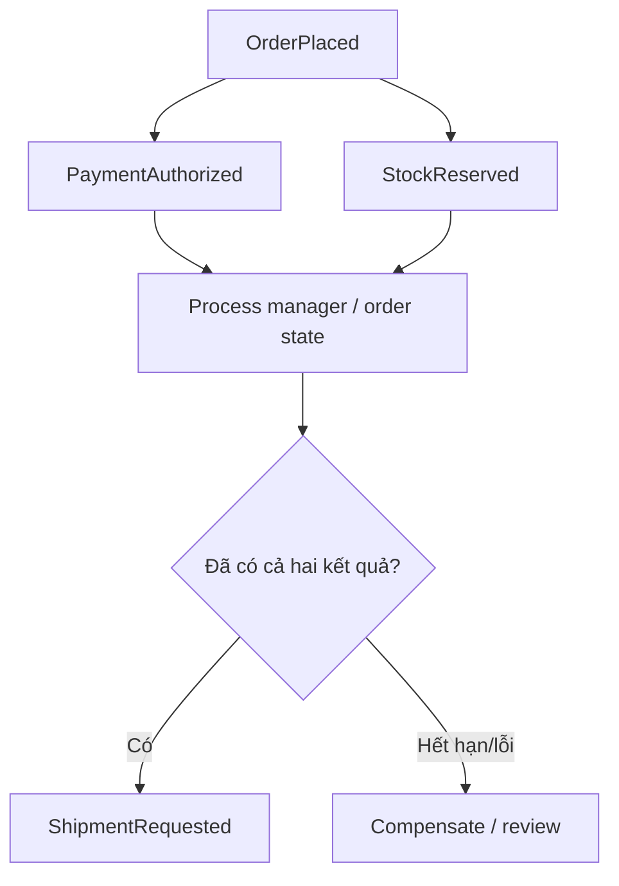

# Chuỗi xử lý event: điều phối nhiều handler trong Spring Modulith

## 1. Chuỗi xử lý event giải quyết bài toán gì?

Một **application event** thông báo một sự thật nghiệp vụ đã xảy ra. Trong modular monolith, module `order` có thể phát `OrderPlaced` mà không cần biết module `billing` hoặc `notification` sẽ làm gì với sự kiện ấy. Một handler xử lý `OrderPlaced`, thực hiện nghiệp vụ riêng rồi phát **một event mới** để handler tiếp theo phản ứng. Những bước này hình thành **chuỗi xử lý event** (*event processing chain*).

Ví dụ trong một ứng dụng Spring Boot dùng Spring Modulith:

1. Module `order` ghi nhận đơn hàng và phát `OrderPlaced`.
2. Handler thuộc `billing` nhận `OrderPlaced`, chuẩn bị dữ liệu hóa đơn và phát `InvoicePrepared`.
3. Handler thuộc `notification` nhận `InvoicePrepared`, xếp một email vào outbox và phát `NotificationQueued`.



Đây là mô hình *event choreography*: mỗi module quyết định phản ứng dựa trên **hợp đồng event công khai**; module phát event không trực tiếp gọi implementation của module nhận. Nó hữu ích khi một hành động nghiệp vụ cần kích hoạt nhiều bước nhưng không nhất thiết phải có câu trả lời đồng bộ cho toàn bộ chuỗi.

Trong dịch vụ học **SPRING_MODULITH_APPLICATION_EVENTS**, thiết kế này liên kết các chủ đề publisher, listener, bảo vệ ranh giới module, giao dịch sau commit, Event Publication Registry, retry và quan sát kết quả. Học xong bài này, bạn phải phân biệt được **quan hệ nhân quả**, **thứ tự thực thi**, **trạng thái mỗi handler** và **điều kiện hoàn thành toàn quy trình**.

> **Quan trọng:** Việc đặt các listener theo chuỗi không tự đảm bảo chúng chạy đúng một lần, đúng thứ tự toàn cục hoặc toàn bộ workflow thành công. Thứ tự logic do event cha–con tạo ra khác với thứ tự giữa các listener độc lập và khác với việc commit một transaction duy nhất.

## 2. Ba mô hình dễ bị nhầm lẫn

### 2.1. Fan-out: một event, nhiều handler độc lập



Ba handler cùng nhận **một event gốc**. Chúng có thể xử lý bất đồng bộ, thành công hoặc thất bại độc lập. Không nên kỳ vọng `analytics` chạy sau `billing` chỉ vì mã Java được khai báo theo một thứ tự hoặc file có tên đứng sau.

Nếu có Event Publication Registry được cấu hình cho các transactional listener phù hợp, **mỗi listener là một publication riêng**. Một publication completed không chứng minh những publication khác đã hoàn tất.

### 2.2. Chaining: handler phát event mới cho bước sau



`InvoicePrepared` chỉ được tạo khi `billing` đạt **điều kiện nghiệp vụ của bước đó**. Cạnh `E1 → E2` là quan hệ nguyên nhân; event E2 có ID riêng và nên mang `causationId = E1.eventId`.

### 2.3. Orchestration: một coordinator nắm tiến trình



Coordinator hoặc process manager giữ **trạng thái workflow** và quyết định bước tiếp theo sau kết quả của những bước khác. Cách này hữu ích khi phải chờ nhiều điều kiện, có deadline, timeout, quyết định bù trừ hoặc một quy trình cần quan sát tập trung.

| Tiêu chí | Fan-out | Chaining / choreography | Orchestration |
| --- | --- | --- | --- |
| Điều gì kích hoạt bước? | Cùng event nguồn | Event mới từ bước trước | Quyết định của coordinator |
| Ai biết consumer nào cần làm gì? | Mỗi subscriber tự biết | Mỗi bước tự công bố kết quả | Coordinator biết quy trình |
| Có thứ tự nguyên nhân giữa các bước? | Không mặc định | Có, nếu event con chỉ phát sau bước trước | Được coordinator điều khiển |
| Quan sát trạng thái toàn quy trình | Cần gom kết quả riêng | Cần correlation/audit hoặc process state | Có thể tập trung tại coordinator |
| Độ phức tạp | Thấp với handler độc lập | Tăng theo độ sâu chuỗi | Tăng ở coordinator, rõ điều kiện chuyển bước |
| Trường hợp phù hợp | Audit, metrics, email độc lập | Xử lý nối tiếp theo kết quả nghiệp vụ | Saga nhiều nhánh, timeout, compensation |

Chỉ lựa chọn chaining khi mỗi event thể hiện **một kết quả nghiệp vụ rõ ràng**. Đừng biến mọi lệnh gọi hàm đơn giản thành event; nếu caller cần kết quả ngay để hoàn thành cùng thao tác, API đồng bộ của module khác có thể hợp lý hơn.

## 3. Một bước trong chuỗi có những thành phần nào?

Một mắt xích an toàn nên xác định đủ:

- **Input contract:** loại event và dữ liệu handler cần đọc, ví dụ `OrderPlaced`.
- **Business operation:** thay đổi trạng thái do module handler sở hữu, ví dụ tạo invoice projection.
- **Output contract:** event phản ánh kết quả mới, ví dụ `InvoicePrepared`. Có thể có nhánh thất bại mang event khác.
- **Transaction boundary:** dữ liệu nào phải commit trước khi downstream handler chạy.
- **Idempotency key:** làm sao nhận biết một event nguồn đã được handler xử lý.
- **Failure policy:** lỗi tạm thời được xử lý lại thế nào; lỗi nghiệp vụ vĩnh viễn có phải một kết quả riêng không.
- **Observability metadata:** `eventId`, `correlationId`, `causationId` và thông tin consumer.

Với ví dụ:

| Bước | Nhận | Thao tác sở hữu | Phát | Điều kiện thành công |
| --- | --- | --- | --- | --- |
| `order` | Lệnh đặt hàng | Lưu đơn | `OrderPlaced` | Đơn được commit |
| `billing` | `OrderPlaced` | Lưu invoice projection | `InvoicePrepared` | Invoice projection được commit |
| `notification` | `InvoicePrepared` | Lưu bản ghi email outbox | `NotificationQueued` | Outbox được commit |
| Email sender độc lập | Email outbox | Giao email theo chính sách retry | Có thể phát `EmailSent` | Provider xác nhận kết quả theo contract |

Lưu ý **`NotificationQueued` không có nghĩa email đã tới hộp thư người nhận**; event này chỉ xác nhận đã đưa vào hàng chờ. Đặt tên event trung thực giúp các module phía sau không suy diễn nhầm rằng quy trình giao email đã hoàn tất.

## 4. Hai đồ thị cần quan sát riêng: runtime và dependency tĩnh

Chuỗi xử lý ở runtime:

```text
OrderPlaced → Billing handler → InvoicePrepared
                              → Notification handler → NotificationQueued
```

Nhưng nếu `billing` import kiểu `order.OrderPlaced`, và `notification` import `billing.InvoicePrepared`, **phụ thuộc mã nguồn** lại có chiều:



Hai sơ đồ không mâu thuẫn:

- `order` phát event nhưng không import bean handler của `billing`.
- `billing` cần biết **type event công khai** của `order` để đăng ký listener.
- `notification` phụ thuộc API event của `billing`, nhưng `billing` không cần biết handler của `notification`.
- Event metadata có thể đặt trong một module hợp đồng nhỏ như `events`; tránh đưa implementation/repository vào module dùng chung.

Trong Spring Modulith, các event nên nằm ở package gốc của module sở hữu hoặc named interface được công bố. Nếu handler xuyên module import `order.internal.OrderEntity`, `ApplicationModules.verify()` có thể phát hiện vi phạm ranh giới. Nếu các module vừa publish vừa import các event của nhau, một **dependency cycle tĩnh** vẫn có thể hình thành dù giao tiếp bằng events.

## 5. Thiết kế metadata để theo dõi chuỗi

Để quan sát chuỗi qua nhiều transaction và thread, nên mang ID theo **hợp đồng event** thay vì dựa duy nhất vào thread-local logging context.

| Metadata | Ý nghĩa | Ví dụ trong chuỗi |
| --- | --- | --- |
| `eventId` | Định danh event hiện tại | `E2` của `InvoicePrepared` |
| `causationId` | ID của sự kiện/lệnh **trực tiếp** gây ra event này | `E1`, nếu `InvoicePrepared` do `OrderPlaced(E1)` tạo |
| `correlationId` | ID chung của một luồng nghiệp vụ | `C1` cho toàn bộ đơn hàng |
| `occurredAt` | Thời điểm event được tạo theo quy ước | UTC instant |
| `orderId` | ID thực thể nghiệp vụ | ID đơn hàng, **không phải event ID** |

Ví dụ:

```text
PlaceOrderCommand C1
    │
    ▼
OrderPlaced E1              eventId=E1, cause=C1, corr=C1
    │
    ▼
InvoicePrepared E2          eventId=E2, cause=E1, corr=C1
    │
    ▼
NotificationQueued E3       eventId=E3, cause=E2, corr=C1
```

Khi event `E1` được xử lý lại do một publication bị retry, **event E1 vẫn giữ ID E1**. Nếu `billing` đã commit công việc và event `E2` một lần thì lần xử lý lại phải nhận biết kết quả đó, tránh sinh `E2'` trùng nghiệp vụ. Việc hai handler khác nhau cùng tạo event con từ `E1` là fan-out hợp lệ: chúng có cùng causation ID nhưng **eventId khác nhau**.

### 5.1. Một record EventMetadata nhỏ, bất biến

File `src/main/java/com/example/shop/events/EventMetadata.java`:

```java
package com.example.shop.events;

import java.time.Clock;
import java.time.Instant;
import java.util.Objects;
import java.util.UUID;

public record EventMetadata(
        UUID eventId,
        UUID causationId,
        UUID correlationId,
        Instant occurredAt) {

    public EventMetadata {
        Objects.requireNonNull(eventId, "eventId");
        Objects.requireNonNull(causationId, "causationId");
        Objects.requireNonNull(correlationId, "correlationId");
        Objects.requireNonNull(occurredAt, "occurredAt");

        if (eventId.equals(causationId)) {
            throw new IllegalArgumentException("Self-causation is invalid");
        }
    }

    public static EventMetadata fromCommand(UUID commandId, Clock clock) {
        Objects.requireNonNull(commandId, "commandId");
        Objects.requireNonNull(clock, "clock");
        return new EventMetadata(
                UUID.randomUUID(), commandId, commandId, clock.instant());
    }

    public static EventMetadata childOf(EventMetadata parent, Clock clock) {
        Objects.requireNonNull(parent, "parent");
        Objects.requireNonNull(clock, "clock");
        return new EventMetadata(
                UUID.randomUUID(),
                parent.eventId(),
                parent.correlationId(),
                clock.instant());
    }
}
```

Đây là **quy ước của ứng dụng**, không phải một metadata record mà Spring Modulith tự chèn vào mọi sự kiện. Bản event dùng Java `record`, nên các trường không bị thay đổi sau khi tạo object. Khi phát lại cùng event, cần giữ nguyên record và các ID, không gọi `childOf()` hoặc `fromCommand()` để tái tạo event gốc.

`fromCommand()` sử dụng `commandId` làm correlation ID của workflow để ví dụ đơn giản; hệ thống khác có thể cấp correlation ID riêng. Nếu chuỗi có nhiều nguyên nhân song song (*fan-in*), một `causationId` đơn lẻ không thể diễn tả mọi prerequisite; cần định nghĩa quy tắc parent chính và lưu quan hệ với các parent khác nếu nghiệp vụ yêu cầu.

## 6. Chuẩn bị Spring Boot + Spring Modulith cho ví dụ

### 6.1. Package theo module nghiệp vụ

```text
src/main/java/com/example/shop/
├── ShopApplication.java
├── events/
│   └── EventMetadata.java
├── order/
│   ├── OrderPlaced.java
│   └── OrderService.java
├── billing/
│   ├── InvoicePrepared.java
│   └── internal/
│       └── OnOrderPlaced.java
└── notification/
    ├── NotificationQueued.java
    └── internal/
        └── OnInvoicePrepared.java
```

Các package con trực tiếp dưới `com.example.shop` được Spring Modulith phát hiện như application modules theo chiến lược mặc định. Vì event API nằm ở package gốc `order`, `billing`, `notification`, module khác có thể import chúng theo ranh giới mặc định. Các handler ở `internal` là implementation của module mình.

### 6.2. Các phụ thuộc minh họa

Ví dụ sử dụng **Spring Boot, Spring Modulith, JDBC và PostgreSQL**. Gradle:

```groovy
dependencies {
    implementation 'org.springframework.boot:spring-boot-starter-jdbc'
    implementation 'org.springframework.modulith:spring-modulith-starter-jdbc'
    runtimeOnly 'org.postgresql:postgresql'

    testImplementation 'org.springframework.boot:spring-boot-starter-test'
    testImplementation 'org.springframework.modulith:spring-modulith-starter-test'
    testImplementation 'org.awaitility:awaitility'
}
```

Phiên bản các dependency cần được quản lý nhất quán với Spring Boot/Spring Modulith đang dùng (ví dụ qua BOM). Starter JDBC của Spring Modulith cung cấp thành phần lưu Event Publication Registry trong cấu hình phù hợp, **không tự thay thế cấu hình DataSource, transaction manager và việc tạo/migration schema của ứng dụng**. Khi chạy ví dụ, phải cấu hình database và schema cho registry theo đúng adapter/version; đừng tự chế một bảng publication giả rồi coi là implementation registry.

Lớp khởi động và `Clock` dùng để tạo thời gian thống nhất:

```java
package com.example.shop;

import java.time.Clock;
import org.springframework.boot.SpringApplication;
import org.springframework.boot.autoconfigure.SpringBootApplication;
import org.springframework.context.annotation.Bean;

@SpringBootApplication
public class ShopApplication {

    public static void main(String[] args) {
        SpringApplication.run(ShopApplication.class, args);
    }

    @Bean
    Clock eventClock() {
        return Clock.systemUTC();
    }
}
```

### 6.3. Ba bảng minh họa cho trạng thái nghiệp vụ

```sql
CREATE TABLE shop_order (
    id UUID PRIMARY KEY,
    state VARCHAR(32) NOT NULL
);

CREATE TABLE invoice_projection (
    source_event_id UUID PRIMARY KEY,
    order_id UUID NOT NULL,
    created_at TIMESTAMPTZ NOT NULL
);

CREATE TABLE notification_outbox (
    source_event_id UUID PRIMARY KEY,
    order_id UUID NOT NULL,
    state VARCHAR(32) NOT NULL,
    created_at TIMESTAMPTZ NOT NULL
);
```

`source_event_id` là ID của event **được handler nhận vào**, không phải ID publication của registry. Khóa chính giúp chống tạo bản ghi trùng khi cùng event được xử lý nhiều lần. Ví dụ dùng PostgreSQL `ON CONFLICT`; database khác cần cú pháp tương đương. Bảng `notification_outbox` là outbox nghiệp vụ để gửi email về sau, **khác** bảng Event Publication Registry lưu việc giao application events cho listeners.

## 7. Bước 1: module order phát OrderPlaced

File `src/main/java/com/example/shop/order/OrderPlaced.java`:

```java
package com.example.shop.order;

import com.example.shop.events.EventMetadata;
import java.util.UUID;

public record OrderPlaced(
        EventMetadata metadata,
        UUID orderId) {}
```

File `src/main/java/com/example/shop/order/OrderService.java`:

```java
package com.example.shop.order;

import com.example.shop.events.EventMetadata;
import java.time.Clock;
import java.util.UUID;
import org.springframework.context.ApplicationEventPublisher;
import org.springframework.jdbc.core.JdbcTemplate;
import org.springframework.stereotype.Service;
import org.springframework.transaction.annotation.Transactional;

@Service
public class OrderService {

    private final JdbcTemplate jdbc;
    private final ApplicationEventPublisher events;
    private final Clock clock;

    public OrderService(
            JdbcTemplate jdbc,
            ApplicationEventPublisher events,
            Clock clock) {
        this.jdbc = jdbc;
        this.events = events;
        this.clock = clock;
    }

    @Transactional
    public UUID placeOrder(UUID commandId) {
        UUID orderId = UUID.randomUUID();
        jdbc.update(
                "INSERT INTO shop_order(id, state) VALUES (?, ?)",
                orderId, "PLACED");

        var metadata = EventMetadata.fromCommand(commandId, clock);
        events.publishEvent(new OrderPlaced(metadata, orderId));
        return orderId;
    }
}
```

Khi `placeOrder(...)` chạy qua proxy giao dịch của Spring:

1. Ghi đơn vào `shop_order` trong transaction nguồn.
2. Tạo event `OrderPlaced(E1)` với cause là command ID.
3. Gọi `publishEvent(...)` trong cùng phạm vi transaction.
4. Event Publication Registry (nếu được cấu hình) đăng ký publication cho mỗi transactional listener đủ điều kiện trong transaction nguồn.
5. Khi transaction **commit**, `@ApplicationModuleListener` ở `billing` mới được kích hoạt theo cơ chế `AFTER_COMMIT`.

Nếu transaction bị rollback, bản ghi đơn không còn và listener sau commit không được kích hoạt như với một giao dịch thành công. `publishEvent(...)` trả về **không đồng nghĩa** chuỗi đã kết thúc: bước `billing`, `notification` còn cần chạy sau đó.

**Giới hạn demo:** phương thức `placeOrder(UUID commandId)` chưa triển khai idempotency ở API đầu vào. Nếu client gửi lại cùng command ID, demo có thể tạo **đơn mới**; production cần khóa duy nhất và quy tắc trả lại kết quả của cùng command khi retry. Đó là lớp idempotency khác với việc một listener nhận lại **cùng eventId**.

## 8. Bước 2: billing handler nhận event và phát InvoicePrepared

File `src/main/java/com/example/shop/billing/InvoicePrepared.java`:

```java
package com.example.shop.billing;

import com.example.shop.events.EventMetadata;
import java.util.UUID;

public record InvoicePrepared(
        EventMetadata metadata,
        UUID orderId) {}
```

File `src/main/java/com/example/shop/billing/internal/OnOrderPlaced.java`:

```java
package com.example.shop.billing.internal;

import com.example.shop.billing.InvoicePrepared;
import com.example.shop.events.EventMetadata;
import com.example.shop.order.OrderPlaced;
import java.time.Clock;
import java.time.OffsetDateTime;
import java.time.ZoneOffset;
import org.springframework.context.ApplicationEventPublisher;
import org.springframework.jdbc.core.JdbcTemplate;
import org.springframework.modulith.events.ApplicationModuleListener;
import org.springframework.stereotype.Component;

@Component
class OnOrderPlaced {

    private final JdbcTemplate jdbc;
    private final ApplicationEventPublisher events;
    private final Clock clock;

    OnOrderPlaced(
            JdbcTemplate jdbc,
            ApplicationEventPublisher events,
            Clock clock) {
        this.jdbc = jdbc;
        this.events = events;
        this.clock = clock;
    }

    @ApplicationModuleListener
    void on(OrderPlaced source) {
        // Idempotency theo event nguồn, trong transaction của listener.
        int inserted = jdbc.update("""
            INSERT INTO invoice_projection
                (source_event_id, order_id, created_at)
            VALUES (?, ?, ?)
            ON CONFLICT (source_event_id) DO NOTHING
            """,
            source.metadata().eventId(),
            source.orderId(),
            OffsetDateTime.now(ZoneOffset.UTC));

        if (inserted == 0) {
            // Event này đã tạo projection ở một lần xử lý thành công.
            return;
        }

        var childMetadata = EventMetadata.childOf(source.metadata(), clock);
        events.publishEvent(
                new InvoicePrepared(childMetadata, source.orderId()));
    }
}
```

Lúc này `billing` chỉ cần biết kiểu `order.OrderPlaced` ở API công khai của module `order`. Nó không import `OrderService` và không gọi repository nội bộ của `order`. Việc publish `InvoicePrepared` do module `billing` sở hữu; các consumer tương lai chỉ cần biết **hợp đồng output** của `billing`.

### 8.1. Tại sao ghi projection và publish child event trong cùng transaction?

`@ApplicationModuleListener` là tiện ích của Spring Modulith cho transactional event listener được gọi sau commit, xử lý bất đồng bộ và chạy trong transaction riêng. Với database và registry persistence tham gia transaction phù hợp, đoạn listener có ý nghĩa:

1. Nhận `OrderPlaced(E1)` sau khi transaction của `order` commit.
2. Trong **transaction của listener `billing`**, ghi invoice projection với unique key `E1`.
3. Chỉ khi ghi mới thành công, tạo `InvoicePrepared(E2)`: `E2.causationId = E1.eventId`, `E2.correlationId = E1.correlationId`.
4. Publish `E2` khi transaction listener `billing` đang hoạt động, để registry ghi nhận downstream publication trong cùng transaction nguồn tương ứng.
5. Khi transaction `billing` commit, listener nhận `InvoicePrepared` mới đủ điều kiện chạy sau commit.

Sơ đồ transaction:



Sơ đồ giả định registry backend đã được cài đặt, bean transaction hoạt động đúng và các listener là transactional listeners được theo dõi. **Thời điểm ghi completion của E1** phụ thuộc cấu hình Spring Modulith (ví dụ completion trong listener transaction hay ở interceptor riêng); không được suy diễn từ sơ đồ rằng mọi implementation đều có cùng một transaction cho completion.

Nếu `INSERT` hoặc việc đăng ký publication mới thất bại và transaction `billing` rollback, ta không muốn có invoice projection đã commit nhưng downstream event lại không được lưu. Cơ chế publication có persistence và transactional participation giúp giảm cửa sổ lỗi này. Với thao tác ngoại hệ thống (REST, cổng thanh toán), một local database transaction **không đủ** để đạt tính nguyên tử giữa hai hệ thống.

### 8.2. Vì sao phải có nhánh inserted == 0?

Giả sử `billing` đã commit invoice projection và event `E2`, nhưng process crash trước khi registry ghi nhận publication `E1` đã hoàn tất theo completion strategy đang dùng. Sau recovery, `E1` có thể được giao lại:

```text
Lần 1: OrderPlaced E1 -> INSERT projection -> publish E2 -> COMMIT
        (crash trước khi completion của publication E1 được ghi)

Lần 2: OrderPlaced E1 -> INSERT ON CONFLICT DO NOTHING
                          inserted = 0 -> return
```

Như vậy, lần retry **không phát thêm `InvoicePrepared(E3)`** cho cùng một kết quả. Đây là phương pháp idempotency ở **handler**, dựa trên event gốc và kết quả nghiệp vụ bền vững, độc lập với việc publication E1 đã được đánh dấu completed hay chưa.

Giới hạn quan trọng: Ví dụ dùng **cùng PostgreSQL transaction** để bảo vệ projection và publish child event có registry persistence. Nếu một event con được gửi thẳng ra broker mà không có outbox/transaction phù hợp, việc kiểm tra `inserted == 0` có thể che khuất trường hợp projection đã commit nhưng message ngoài chưa được gửi; cần giải quyết bằng outbox và quy trình phát hành riêng.

## 9. Bước 3: notification handler nhận InvoicePrepared và xếp việc gửi email

File `src/main/java/com/example/shop/notification/NotificationQueued.java`:

```java
package com.example.shop.notification;

import com.example.shop.events.EventMetadata;
import java.util.UUID;

public record NotificationQueued(
        EventMetadata metadata,
        UUID orderId) {}
```

File `src/main/java/com/example/shop/notification/internal/OnInvoicePrepared.java`:

```java
package com.example.shop.notification.internal;

import com.example.shop.billing.InvoicePrepared;
import com.example.shop.events.EventMetadata;
import com.example.shop.notification.NotificationQueued;
import java.time.Clock;
import java.time.OffsetDateTime;
import java.time.ZoneOffset;
import org.springframework.context.ApplicationEventPublisher;
import org.springframework.jdbc.core.JdbcTemplate;
import org.springframework.modulith.events.ApplicationModuleListener;
import org.springframework.stereotype.Component;

@Component
class OnInvoicePrepared {

    private final JdbcTemplate jdbc;
    private final ApplicationEventPublisher events;
    private final Clock clock;

    OnInvoicePrepared(
            JdbcTemplate jdbc,
            ApplicationEventPublisher events,
            Clock clock) {
        this.jdbc = jdbc;
        this.events = events;
        this.clock = clock;
    }

    @ApplicationModuleListener
    void on(InvoicePrepared source) {
        int inserted = jdbc.update("""
            INSERT INTO notification_outbox
                (source_event_id, order_id, state, created_at)
            VALUES (?, ?, ?, ?)
            ON CONFLICT (source_event_id) DO NOTHING
            """,
            source.metadata().eventId(),
            source.orderId(),
            "PENDING",
            OffsetDateTime.now(ZoneOffset.UTC));

        if (inserted == 0) {
            return; // Đã xếp cùng InvoicePrepared vào outbox.
        }

        var childMetadata = EventMetadata.childOf(source.metadata(), clock);
        events.publishEvent(
                new NotificationQueued(childMetadata, source.orderId()));
    }
}
```

Handler này kết thúc **đúng trách nhiệm được giao**: tạo bản ghi outbox để một email sender khác xử lý sau. Nó không khẳng định email đã gửi thành công, vì vậy event tên `NotificationQueued` thay vì `EmailDelivered`.

Nếu chưa có listener nào đăng ký xử lý `NotificationQueued`, việc publish E3 vẫn tạo domain event trong ứng dụng nhưng **không có publication record cho một listener đích không tồn tại**. Khi sau này thêm consumer phù hợp, framework có thể tạo publication cho consumer đó đối với các event phát sinh **từ thời điểm consumer đã được đăng ký**; không được mặc định các E3 lịch sử sẽ tự xuất hiện trở lại.

### 9.1. Hai trạng thái “đã xong” khác nhau

| Mốc | Hệ thống đã chứng minh được điều gì? | Chưa chứng minh được điều gì? |
| --- | --- | --- |
| `order` commit | Đơn được lưu; E1 đã được phát/đăng ký theo cơ chế | Invoice và email đã hoàn tất |
| `billing` listener completed | Projection của E1 được ghi theo contract | Notification đã xếp hàng hoặc gửi |
| `notification` listener completed | Email task đã xếp hàng trong outbox | SMTP provider đã nhận hoặc người dùng đã đọc |
| Email sender xác nhận gửi | Provider đã chấp nhận công việc theo hợp đồng bên ngoài | Email chắc chắn vào inbox hoặc được đọc |

Như vậy, **chuỗi event hoàn thành một pha** không đồng nghĩa **quy trình nghiệp vụ end-to-end đã hoàn tất**. Nếu domain cần xác nhận “đơn đã thanh toán”, “hóa đơn được phát hành” hoặc “email đã gửi”, phải mô hình hóa những trạng thái đó riêng và chỉ công bố event tương ứng sau khi điều kiện thật sự đạt.

## 10. Thứ tự thực thi trong chuỗi: đâu là bảo đảm và đâu là giả định?

### 10.1. Quan hệ nhân quả trong một chuỗi tuyến tính

Với handler ví dụ:

```text
OrderPlaced E1
    └── BillingOnOrderPlaced hoàn tất nghiệp vụ và publish E2
           └── InvoicePrepared E2
                  └── OnInvoicePrepared hoàn tất nghiệp vụ và publish E3
                         └── NotificationQueued E3
```

E2 **không được tạo ra** cho tới khi handler `billing` quyết định tạo projection; `OnInvoicePrepared` chỉ có thể phản ứng với E2 sau khi E2 được publish. Với `@ApplicationModuleListener` được sử dụng đúng transaction, downstream callback được kích hoạt sau khi transaction nguồn của event đó commit.

Đây là **thứ tự phụ thuộc**, còn thời gian xử lý chính xác phụ thuộc scheduler, thread pool, retry và tải hệ thống. Nếu E1 được giao lại sau khi E3 đã xuất hiện, timeline vận hành có thể chứa các lần attempt xen kẽ; các ID nguyên nhân giúp giải thích quan hệ logic dù log không nằm kề nhau.

### 10.2. Không có thứ tự mặc định giữa các sibling listeners

Giả sử `OrderPlaced` được hai module `billing` và `analytics` xử lý:



Không có bảo đảm `billing` chạy trước `analytics`, dù hai listener cùng event. `@Order` có thể ảnh hưởng thứ tự gọi trong một số cơ chế dispatch đồng bộ, nhưng **không tạo bảo đảm thứ tự hoàn tất** cho nhiều `@ApplicationModuleListener` bất đồng bộ, transaction riêng hoặc giữa các instance. Nếu `analytics` cần dữ liệu hóa đơn, hãy cho nó xử lý **`InvoicePrepared`**, không trông chờ vào thứ tự ngẫu nhiên của hai sibling.

Tương tự, nếu một module nhận nhiều event cùng loại cho các đơn khác nhau, việc sắp xếp theo thời điểm publish không tự thành một “total order” tại mọi consumer. Nếu nghiệp vụ cần thứ tự trên **cùng aggregate**, cân nhắc aggregate version/sequence, optimistic locking, partitioning hoặc một coordinator có trạng thái và kiểm thử xử lý event đến sai thứ tự.

### 10.3. Đừng dùng event để giả lập lời gọi hàm đồng bộ

Anti-pattern:

```text
Controller -> publish CalculatePriceEvent
           -> chờ listener trả kết quả ngay
           -> tạo đơn trong cùng HTTP request
```

Nếu caller cần giá để xác nhận đơn **ngay trong transaction hiện tại**, API đồng bộ như `PricingService.quote(...)` phù hợp hơn. Application events hữu ích khi consumer có thể hoàn tất sau, không cần publisher chặn cho tới khi tất cả phản ứng đã kết thúc.

## 11. Phối hợp lỗi, retry và các nhánh kết quả

### 11.1. Lỗi tạm thời: ném exception để publication còn khả năng phục hồi

Nếu database của `billing` tạm thời mất kết nối, handler cần để lỗi lan ra khỏi method:

```java
@ApplicationModuleListener
void on(OrderPlaced event) {
    // Nếu DB tạm lỗi, JDBC ném exception.
    // Không catch rồi nuốt lỗi ở đây.
    invoiceProjection.prepareOnce(event);
}
```

Nếu nuốt lỗi và trả về bình thường, hạ tầng có thể ghi nhận publication **đã hoàn tất** dù công việc chưa làm xong. Với Event Publication Registry cấu hình persistence, publication chưa completed có thể được tra cứu và xử lý lại theo chính sách/công cụ phù hợp. **Không giả định mọi phiên bản Spring Modulith tự retry vô hạn**; cần thiết lập resubmission/staleness theo tài liệu version thực tế.

### 11.2. Lỗi nghiệp vụ vĩnh viễn: cần kết quả có tên riêng

Một event `OrderPlaced` có thể bị billing từ chối nếu vi phạm quy tắc nghiệp vụ, ví dụ đơn không hợp lệ để phát hành hóa đơn. Nếu lỗi này sẽ **không bao giờ tự biến mất** khi retry, đừng để publication thất bại lặp vô hạn mà không có điểm xử lý.

Một lựa chọn là công bố event:

```java
package com.example.shop.billing;

import com.example.shop.events.EventMetadata;
import java.util.UUID;

public record InvoicePreparationRejected(
        EventMetadata metadata,
        UUID orderId,
        String reasonCode) {}
```

Handler phải xác định việc từ chối là **kết quả nghiệp vụ được chấp nhận**, ghi lại trạng thái/từ chối rồi phát `InvoicePreparationRejected` trong transaction phù hợp. Consumer tiếp theo hoặc process manager sẽ có quy tắc xử lý: hủy công việc chờ, thông báo khách hàng hoặc mở nhiệm vụ hỗ trợ.

`reasonCode` nên là mã ổn định, không chứa exception trace hoặc thông tin nhạy cảm. Nếu thực ra đó là lỗi hạ tầng tạm thời, vẫn nên throw để recovery xử lý; không gửi event “Rejected” chỉ vì DB mất kết nối.

### 11.3. Lỗi ở bước sau không rollback giao dịch của bước trước

Với `@ApplicationModuleListener` sau commit:

```text
TX1 order:         COMMITTED
TX2 billing:       COMMITTED (InvoicePrepared E2)
TX3 notification:  FAILED (có thể retry E2)
```

Lỗi `notification` xảy ra **sau** khi `order` và `billing` đã commit. Không có một transaction bao trùm toàn chuỗi để rollback tự động mọi bước. Điều này là đặc điểm thiết kế của chuỗi giao tiếp không đồng bộ; để hủy một quyết định đã commit cần thao tác **bù trừ nghiệp vụ** có chủ đích, ví dụ `InvoiceCancelled` nếu điều kiện kinh doanh yêu cầu.

Trong các quy trình có điều kiện dừng, timeout, bù trừ hoặc cần nhìn trạng thái tổng thể, cân nhắc lưu một **process state** để quản lý toàn bộ hành trình thay vì suy đoán workflow chỉ từ việc có hoặc không có event con.

### 11.4. Event loop và handler tự kích hoạt lại

Một lỗi nguy hiểm là vô tình tạo vòng:



Nếu mỗi listener lại phát event làm kích hoạt listener trước mà không có điều kiện dừng, ứng dụng có thể sinh một chuỗi vô tận, tăng số publication và quá tải thread pool/database.

Cách phòng tránh: tên event thể hiện **state transition cụ thể**, handler chỉ phát event khi thực sự thay đổi trạng thái, có idempotency/optimistic locking, kiểm soát state machine và phát hiện chu trình ở kiến trúc. Một `hopCount`/TTL cho event liên hệ có thể giúp quan sát/chặn vòng ngoài ý muốn, nhưng không thay thế thiết kế đúng.

## 12. Event Publication Registry trong chuỗi nhiều bước

Event Publication Registry giúp ghi nhận công việc giao event cho transactional listener được hỗ trợ. Với chuỗi E1 → E2 → E3, **mỗi sự kiện phát ra có tập publication của riêng nó**:

| Publication | Event | Listener | Kết quả giả định |
| --- | --- | --- | --- |
| `P1` | `OrderPlaced(E1)` | `OnOrderPlaced` | `COMPLETED` |
| `P2` | `InvoicePrepared(E2)` | `OnInvoicePrepared` | `FAILED` |
| `P3` | `InvoicePrepared(E2)` | Một listener analytics khác | `COMPLETED` |

Trong ví dụ, `NotificationQueued(E3)` chỉ được phát khi `OnInvoicePrepared` hoàn tất việc xếp outbox. Nếu `P2` đang thất bại và transaction của nó rollback, **E3 không được coi là đã được tạo/commit hợp lệ**. Sau khi P2 retry thành công, E3 có thể xuất hiện.

**Nhận diện khác nhau:**

- `eventId` thuộc **event** và phải ổn định qua các lần delivery của cùng event.
- `publicationId` thuộc **hạ tầng giao event tới một listener**. Một event có thể có nhiều publication ID.
- `causationId` thuộc hợp đồng nghiệp vụ, liên kết event con với event/lệnh cha.
- `correlationId` liên kết nhiều event trong một workflow.

Không nên gán publication ID làm causation ID: publication có thể khác nhau theo listener, trong khi nguyên nhân nghiệp vụ của `InvoicePrepared` là `OrderPlaced.eventId`, bất kể registry tạo bao nhiêu bản ghi.

### 12.1. Điều gì xảy ra sau crash?

| Thời điểm crash | Rủi ro | Thiết kế để phục hồi |
| --- | --- | --- |
| Trước khi TX1 commit | Đơn/event nguồn chưa commit | Transaction rollback; không xem đơn đã tạo |
| Sau TX1 commit, trước khi billing chạy | E1 có thể còn chưa xử lý | Publication bền vững để resubmit khi cần |
| Billing đã thực hiện side effect ngoài, chưa commit trạng thái | Side effect có thể bị lặp | External idempotency key/outbox/đối soát |
| Billing đã commit projection + child publication, chưa ghi completion P1 | E1 có thể được giao lại | `source_event_id` unique; handler nhận ra đã làm |
| Notification đang xử lý E2 và crash | E2 có thể cần giao lại | Outbox idempotent theo `E2.eventId` |
| E3 được publish nhưng không có listener | Không có consumer nào xử lý E3 | Không mặc định có lịch sử event toàn cục; cần audit nếu muốn |

Nếu registry persistence không được cấu hình, hoặc thao tác externalization không có chiến lược lưu bền tương ứng, ứng dụng không thể suy ra rằng sau restart toàn bộ event trong bộ nhớ sẽ được phát lại. Độ tin cậy của một chuỗi chỉ mạnh bằng khâu lưu trữ và idempotency của **từng mắt xích**.

### 12.2. Completion của một publication không phải completion toàn workflow

Giả sử P1 completed nhưng P2 failed. Module `billing` hoàn thành trách nhiệm **đã chuẩn bị invoice projection**, nhưng hệ thống chưa hoàn thành việc xếp notification. Một cờ “workflow completed” chỉ nên được cập nhật khi **điều kiện đầu ra mà domain yêu cầu** đã đạt, ví dụ thấy `NotificationQueued` nếu SLA chỉ cần xếp email, hoặc `EmailSent` nếu SLA cần provider chấp nhận email.

Trong hệ thống thực tế, nên ghi trạng thái workflow ở process manager hoặc projection tổng hợp dựa trên các event **được ghi nhận đúng**, thay vì đoán chỉ từ số publication completed.

## 13. Kiểm thử chuỗi event: từ unit test đến integration test

Chuỗi `E1 → E2 → E3` có nhiều ranh giới transaction và chạy bất đồng bộ. Unit test riêng một handler cho biết logic bên trong, nhưng **không đủ** để xác nhận listener chỉ chạy sau commit hoặc publication cũ có thể phục hồi sau crash.

### 13.1. Unit test cho quan hệ nhân quả

File `src/test/java/com/example/shop/events/EventMetadataTests.java`:

```java
package com.example.shop.events;

import static org.junit.jupiter.api.Assertions.assertEquals;
import static org.junit.jupiter.api.Assertions.assertNotEquals;

import java.time.Clock;
import java.time.Instant;
import java.time.ZoneOffset;
import java.util.UUID;
import org.junit.jupiter.api.Test;

class EventMetadataTests {

    private static final Clock CLOCK = Clock.fixed(
            Instant.parse("2026-01-01T10:00:00Z"),
            ZoneOffset.UTC);

    @Test
    void childHasItsOwnIdButKeepsCorrelationAndPointsToParent() {
        UUID commandId = UUID.randomUUID();
        EventMetadata e1 = EventMetadata.fromCommand(commandId, CLOCK);
        EventMetadata e2 = EventMetadata.childOf(e1, CLOCK);
        EventMetadata e3 = EventMetadata.childOf(e2, CLOCK);

        assertEquals(commandId, e1.causationId());
        assertEquals(commandId, e1.correlationId());

        assertEquals(e1.eventId(), e2.causationId());
        assertEquals(e2.eventId(), e3.causationId());
        assertEquals(e1.correlationId(), e2.correlationId());
        assertEquals(e1.correlationId(), e3.correlationId());

        assertNotEquals(e1.eventId(), e2.eventId());
        assertNotEquals(e2.eventId(), e3.eventId());
    }
}
```

Test này kiểm tra một thuộc tính kiến trúc của **hợp đồng event**. Nó không cần Spring context hoặc database và không chứng minh handler đã thực thi, nhưng giúp phát hiện sớm lỗi “sao chép nguyên eventId của cha cho con” hoặc “mọi event con đều trỏ về command thay vì cha trực tiếp”.

### 13.2. Integration test cho đường xử lý thành công

Với database test PostgreSQL đã có ba bảng `shop_order`, `invoice_projection`, `notification_outbox` và Event Publication Registry được cấu hình, có thể kiểm thử đường hoàn tất bằng Spring Boot và Awaitility:

```java
package com.example.shop;

import static org.junit.jupiter.api.Assertions.assertEquals;
import static org.awaitility.Awaitility.await;

import com.example.shop.order.OrderService;
import java.time.Duration;
import java.util.UUID;
import org.junit.jupiter.api.Test;
import org.springframework.beans.factory.annotation.Autowired;
import org.springframework.boot.test.context.SpringBootTest;
import org.springframework.jdbc.core.JdbcTemplate;

@SpringBootTest
class EventChainIntegrationTests {

    @Autowired OrderService orders;
    @Autowired JdbcTemplate jdbc;

    @Test
    void orderEventuallyCreatesInvoiceAndQueuesNotification() {
        UUID orderId = orders.placeOrder(UUID.randomUUID());

        await()
            .atMost(Duration.ofSeconds(15))
            .untilAsserted(() -> {
                Long invoiceCount = jdbc.queryForObject(
                    """
                    SELECT COUNT(*) FROM invoice_projection
                    WHERE order_id = ?
                    """,
                    Long.class,
                    orderId);

                Long queuedCount = jdbc.queryForObject(
                    """
                    SELECT COUNT(*) FROM notification_outbox
                    WHERE order_id = ? AND state = 'PENDING'
                    """,
                    Long.class,
                    orderId);

                assertEquals(1L, invoiceCount);
                assertEquals(1L, queuedCount);
            });
    }
}
```

**Điều kiện chạy:** cấu hình `spring.datasource.*`, PostgreSQL test (có thể qua Testcontainers), migrations cho hai loại schema **domain và publication registry**, event listeners và transaction manager. Mã này minh họa một integration test có thể chạy khi môi trường đã được dựng đủ; không phải bằng chứng test đã được chạy trong module tài liệu.

Không thêm `@Transactional` lên phương thức test end-to-end này: nếu test giữ transaction mở và cuối test rollback theo cơ chế kiểm thử, `AFTER_COMMIT` listener có thể chưa bao giờ được kích hoạt. Vì listener chạy bất đồng bộ, dùng Awaitility với timeout và điều kiện nghiệp vụ quan sát được, tránh dựa vào `Thread.sleep(1000)` rồi coi một giây là luôn đủ.

### 13.3. Ma trận test cần bao phủ

| Kịch bản | Kỳ vọng |
| --- | --- |
| `OrderPlaced` được publish trong transaction commit | Có invoice projection, sau đó có notification outbox |
| Transaction nguồn rollback | `@ApplicationModuleListener` sau commit không xử lý như giao dịch thành công |
| Hai sibling listeners nhận cùng E1 | Thứ tự hoàn tất không được giả định; publication độc lập |
| Billing lỗi DB tạm thời | E1 chưa completed cho billing, có thể được recovery |
| Billing nhận lại cùng E1 | Không tạo hai invoice projection hoặc hai event child cho cùng công việc |
| Notification nhận lại cùng E2 | Không tạo hai outbox records cho cùng E2 |
| Notification lỗi sau khi billing hoàn tất | Invoice vẫn giữ trạng thái đã commit; xử lý lại notification riêng |
| Bước phát event con rồi rollback transaction | Child publication không được commit thành tác vụ sau commit khi registry tham gia cùng transaction |
| Hai đơn hàng được đặt gần nhau | Không trộn `correlationId` và không suy ra thứ tự toàn cục |
| Event cũ được replay sau đổi schema/class | Serializer và listener phiên bản mới vẫn đọc, hoặc có migration tương ứng |
| Listener phát cùng event type vô tình tạo vòng | Có cơ chế phát hiện và ngăn vòng lặp |
| Độ trễ xử lý dài, backlog hoặc nhiều retry | Có metric/alert và batch recovery được kiểm soát |

Với các test cần **crash/restart** hoặc kiểm tra recovery, phải dùng database/persistence test có thể khởi động lại ứng dụng và giữ dữ liệu publication giữa các lần chạy. Không đủ nếu chỉ gọi cùng handler hai lần trong cùng JVM rồi kết luận Event Publication Registry hoạt động.

### 13.4. Kiểm thử ranh giới module

File `src/test/java/com/example/shop/ModuleArchitectureTests.java`:

```java
package com.example.shop;

import org.junit.jupiter.api.Test;
import org.springframework.modulith.core.ApplicationModules;

class ModuleArchitectureTests {

    @Test
    void verifiesModuleDependencies() {
        ApplicationModules.of(ShopApplication.class).verify();
    }
}
```

Kiểm tra này giúp tìm dependency cycle tĩnh và các lần import vào package `internal` của module khác. Nó không kiểm tra retry/ordering hay tính đúng của nội dung event; vì vậy cần dùng song song với unit/integration tests ở trên.

Spring Modulith còn cung cấp `@ApplicationModuleTest` và hỗ trợ kiểm thử publication/event scenario theo module. Khi boot từng module riêng, phải cân nhắc dependencies và stubs của những module khác. Để kiểm chứng **đầy đủ ba bước bất đồng bộ** như demo, integration test trên toàn ứng dụng và database thật hoặc test container phù hợp thường trực quan hơn.

## 14. Quan sát luồng xử lý dài nhiều transaction

Vì một chuỗi có thể chạy trên nhiều thread và ở những thời điểm khác nhau, chỉ nhìn một HTTP access log là không đủ. Nên thu thập:

- `correlationId`: tìm mọi event của cùng một quy trình đặt hàng.
- `eventId`: phân biệt event E1/E2/E3, phát hiện delivery trùng.
- `causationId`: dựng cây quan hệ event cha–con.
- `module` và `handler`: biết mắt xích nào đang hoạt động.
- `publicationId` và listener target khi cần: biết bản giao nào đã completed/failed.
- `attempt`, thời điểm bắt đầu và kết thúc: tìm điểm retry nhiều hoặc xử lý chậm.
- Business IDs như `orderId` và trạng thái công việc đã commit: đối soát domain.

Ví dụ ba log được thiết kế để liên kết bằng ID:

```json
[
  {
    "module": "order",
    "event": "OrderPlaced",
    "eventId": "6a3b5b16-1c2d-43e0-9a3d-0e6c8d449001",
    "causationId": "6a3b5b16-1c2d-43e0-9a3d-0e6c8d440000",
    "correlationId": "6a3b5b16-1c2d-43e0-9a3d-0e6c8d440000",
    "result": "PUBLISHED"
  },
  {
    "module": "billing",
    "event": "InvoicePrepared",
    "eventId": "6a3b5b16-1c2d-43e0-9a3d-0e6c8d449002",
    "causationId": "6a3b5b16-1c2d-43e0-9a3d-0e6c8d449001",
    "correlationId": "6a3b5b16-1c2d-43e0-9a3d-0e6c8d440000",
    "result": "PUBLISHED"
  },
  {
    "module": "notification",
    "event": "NotificationQueued",
    "eventId": "6a3b5b16-1c2d-43e0-9a3d-0e6c8d449003",
    "causationId": "6a3b5b16-1c2d-43e0-9a3d-0e6c8d449002",
    "correlationId": "6a3b5b16-1c2d-43e0-9a3d-0e6c8d440000",
    "result": "PUBLISHED"
  }
]
```

Đây là **định dạng log minh họa do ứng dụng xây dựng**. Spring Modulith không tự sinh mọi trường trên với tên và giá trị tương ứng. Nếu log dùng MDC, nên đưa ID vào MDC khi bắt đầu listener và dọn sau khi kết thúc; nhưng **nguồn dữ liệu đúng là metadata bất biến của event**, vì `@ApplicationModuleListener` chạy bất đồng bộ có thể không kế thừa MDC của request ban đầu.

### 14.1. Tập metric gợi ý

| Metric/tín hiệu | Ý nghĩa | Cách sử dụng |
| --- | --- | --- |
| Publication backlog theo listener | Số publication chưa hoàn tất | Phát hiện một bước bị nghẽn |
| Tuổi publication cũ nhất | Công việc chờ quá lâu | Cảnh báo SLA |
| Failed/resubmitted count | Listener lỗi hoặc phải retry nhiều | Tìm lỗi infrastructure/schema |
| Handler execution latency | Thời gian mỗi mắt xích xử lý | Điều chỉnh concurrency, timeout |
| Số event con theo event cha | Fan-out hoặc lặp không mong muốn | Phát hiện loop, duplicate outputs |
| Event-to-final-stage latency | Thời gian từ `OrderPlaced` đến `NotificationQueued` | Đo hiệu năng end-to-end |
| Outbox pending/failed count | Công việc giao email còn tồn | Tách SLA xếp hàng với SLA gửi thật |
| Completion rate theo loại listener | Mức độ xử lý thành công | Đo độ ổn định và recovery |

Các metric là đề xuất thiết kế; phải chọn cách lấy dữ liệu theo phiên bản Spring Modulith, cấu hình Actuator/Micrometer, registry backend và mức cần quan sát của ứng dụng. **Một event chưa có record publication không tự chứng minh nó đã hoàn tất**: có thể vì listener không được đăng ký/không được registry theo dõi.

### 14.2. TraceId không thay thế causationId

Spring/Micrometer Tracing hoặc OpenTelemetry có thể cho phép lần theo các span, kể cả xử lý async khi context propagation được cấu hình. Tuy nhiên, trace có thể bị sampling, kết thúc trước lúc retry hoặc không đi cùng event qua restart. Vì thế:

- `traceId` phục vụ theo dõi thực thi kỹ thuật trong phạm vi trace.
- `correlationId` phục vụ liên kết công việc trong cùng hành trình nghiệp vụ.
- `causationId` phục vụ dựng quan hệ **trực tiếp** giữa các event.

Ba loại ID có thể xuất hiện trong cùng log nhưng không nên bị gán chung ý nghĩa.

## 15. Khi nào nên thay chaining bằng một coordinator?

Chuỗi tuyến tính đơn giản có thể không cần coordinator. Khi yêu cầu trở nên phức tạp, thiết kế event-choreography thuần có thể khó trả lời:

“Đơn hàng E1 đã xử lý những nhánh nào, nhánh nào còn chờ, nhánh nào cần bù trừ, và khi nào quy trình thật sự kết thúc?”

Các dấu hiệu nên cân nhắc process manager/saga coordinator:

1. Cần chờ **nhiều event độc lập** mới mở khóa bước tiếp theo, ví dụ thanh toán được ủy quyền **và** tồn kho được giữ.
2. Cần timeout, nhắc lại có lịch, hủy quy trình hoặc escalation nếu quá hạn.
3. Có các nhánh **bù trừ** nhiều bước khi một thao tác sau thất bại.
4. Product cần query trạng thái end-to-end từ một nơi, thay vì chắp nối nhiều bảng/log.
5. Workflow có nhiều version hoặc có yêu cầu nâng cấp trạng thái đang chạy.

Ví dụ:



Process manager có thể nhận cả hai event, ghi state theo `orderId`, chỉ công bố `ShipmentRequested` khi hai điều kiện đã đạt, đồng thời xử lý kết quả đến sai thứ tự và tránh phát trùng khi retry. **Causation của event fan-in** cần quy ước rõ: có thể ghi trigger trực tiếp cuối cùng làm `causationId` và lưu cả hai prerequisite vào process state.

Orchestration không làm biến mất rủi ro giao lặp, transaction và registry; nó cho một nơi quản lý **điều kiện tiến trình**, trong khi từng handler vẫn phải idempotent và có các contract ổn định.

## 16. Những lỗi thường gặp khi phối hợp nhiều event handlers

| Triệu chứng | Nguyên nhân thường gặp | Cách xử lý |
| --- | --- | --- |
| Invoice/notification bị tạo hai lần | Handler nhận lại cùng event nhưng không deduplicate | Unique key theo event nguồn và transaction phù hợp |
| Thấy `NotificationQueued` trước khi xử lý xong invoice | Child event publish không gắn đúng transaction hoặc handler công bố quá sớm | Chỉ publish sau quyết định nghiệp vụ, với transaction/source event đúng |
| Một handler lỗi khiến flow đứng mãi | Nuốt exception hoặc registry/recovery không được cấu hình | Để lỗi rõ ràng, theo dõi failed publications, resubmit có kiểm soát |
| Event thất bại nghiệp vụ vĩnh viễn bị retry liên tục | Dùng exception cho một kết quả nghiệp vụ hợp lệ | Mô hình event `Rejected` và state transition rõ |
| Dùng `@Order` để buộc hai async handlers chạy tuần tự | `@Order` không đảm bảo completion order xuyên thread | Handler sau nhận **event kết quả** của handler trước |
| Tưởng một listener completed nghĩa toàn event đã xong | Có nhiều publications cho một event | Theo dõi riêng theo target listener |
| Tưởng publisher return nghĩa chain completed | Listener có thể chạy sau commit, bất đồng bộ | Quan sát final-stage event/state |
| Tạo event con với eventId của cha | Trùng định danh và làm sai causation graph | Tạo ID mới, gán cause = eventId cha |
| Dùng ThreadLocal để lấy causation ở async listener | Context không tự kế thừa qua thread/restart | Mang metadata theo event |
| Emit cùng event type trong chính listener không có điều kiện dừng | Sinh vòng lặp event vô hạn | State transition và điều kiện phát sự kiện cụ thể |
| Publish event mới cho mỗi retry cùng công việc đã commit | Downstream side effect bị nhân bản | Idempotency tại handler và đầu ra được commit cùng transaction |
| Dùng event nội bộ để gọi nhiều service rồi chờ trả về ngay | Khó kiểm soát timeout và nhất quán | API đồng bộ khi cần kết quả trong transaction hiện tại |
| Đưa entity/repository của module khác vào payload | Lộ implementation và tăng coupling tĩnh | Event public chỉ chứa ID và dữ liệu cần thiết |
| Không kiểm tra rollback nguồn | Listener sau commit không được gọi khi không có transaction/commit | Integration test có transaction manager thật |
| Cập nhật projection nhưng bỏ qua compatibility của event cũ | Registry replay lỗi sau triển khai | Contract test với serialized events cũ và migration phù hợp |

## 17. Bài thực hành: chuỗi event từ đặt chỗ đến gửi xác nhận

**Bối cảnh:** ứng dụng đặt chỗ có ba module `reservation`, `billing` và `email`. Người dùng gửi `ConfirmReservationCommand`, hệ thống ghi nhận đặt chỗ rồi cần chuẩn bị hóa đơn và xếp thư xác nhận.

### Yêu cầu thực hiện

1. Vẽ cây package chứa các public events `ReservationConfirmed`, `InvoicePrepared`, `ConfirmationEmailQueued`; đặt các handler trong package `internal` của module sở hữu.
2. Định nghĩa `EventMetadata(eventId, causationId, correlationId, occurredAt)`. Quy định `commandId` là cause/correlation của event đầu.
3. Trong transaction của `reservation`, lưu booking và phát `ReservationConfirmed(E1)`.
4. Tạo `@ApplicationModuleListener` thuộc `billing`: nhận E1, ghi invoice projection với khóa `E1.eventId`, tạo `InvoicePrepared(E2)` có cause `E1`.
5. Tạo `@ApplicationModuleListener` thuộc `email`: nhận E2, ghi outbox idempotent với khóa `E2.eventId`, tạo `ConfirmationEmailQueued(E3)` có cause `E2`.
6. Dùng integration test có database test và Awaitility kiểm tra khi E1 commit thì cuối cùng có một invoice projection và một outbox record.
7. Cố tình làm `billing` lỗi SQL một lần; xác nhận `email` không được xử lý E2 chưa commit, sau đó thử recovery để kết thúc chuỗi.
8. Giao lại E1/E2 lần nữa; xác nhận projection và outbox không bị nhân đôi.
9. Thêm `analytics` nhận `ReservationConfirmed` song song; giải thích vì sao không được dựa vào thứ tự chạy giữa `analytics` và `billing`.
10. Giả sử cần chờ thêm `PaymentAuthorized` trước khi gửi email: quyết định nên tiếp tục chaining hay có process manager và giải thích vì sao.

### Đáp án định hướng

Đường nhân quả mong đợi:

```text
ConfirmReservationCommand C1
  └── ReservationConfirmed E1        cause=C1, corr=C1
        ├── InvoicePrepared E2       cause=E1, corr=C1
        │    └── ConfirmationEmailQueued E3
        │                             cause=E2, corr=C1
        └── AnalyticsRecorded E4     cause=E1, corr=C1
```

E1/E2/E3/E4 đều có `eventId` riêng. Billing và analytics là **sibling consumers** của E1 nên không có thứ tự hoàn tất mặc định. Handler của billing phải commit invoice projection và publication E2 an toàn; handler của email làm tương tự với outbox và event E3. Nếu E1 hoặc E2 được giao lại, consumer sử dụng khóa idempotency để tránh duplicate side effects.

Khi có hai điều kiện độc lập `InvoicePrepared` và `PaymentAuthorized`, cần quản lý state theo `reservationId` và phát thông báo khi **cả hai** đã hoàn tất; một coordinator/process manager là lựa chọn rõ ràng hơn nếu workflow có timeout, bù trừ và yêu cầu quan sát tập trung.

## 18. Checklist triển khai chuỗi xử lý event

- [ ] Mỗi event đặt tên theo **sự thật nghiệp vụ**, không theo “hãy gọi handler X”.
- [ ] Mỗi bước có owner rõ, input/output contract công khai và transaction boundary xác định.
- [ ] Handler import API event của module khác, không import repository/implementation nội bộ.
- [ ] Child event có **eventId mới**, `causationId` của parent và `correlationId` được kế thừa.
- [ ] Publisher không phụ thuộc tĩnh vào consumer implementation.
- [ ] Không giả định thứ tự giữa nhiều `@ApplicationModuleListener` nhận cùng event.
- [ ] Event con chỉ được tạo khi kết quả nghiệp vụ của bước hiện tại được ghi nhận đúng.
- [ ] Dùng transaction + registry persistence phù hợp khi cần giao tiếp đáng tin cậy sau commit.
- [ ] Từng handler có idempotency theo event nguồn và business key khi cần.
- [ ] Lỗi tạm thời được báo để có recovery; lỗi nghiệp vụ vĩnh viễn được mô hình hóa bằng kết quả rõ ràng.
- [ ] Không có vòng kích hoạt vô tận; state transitions và điều kiện dừng kiểm chứng được.
- [ ] Retry, staleness và resubmission có giới hạn, tránh xử lý cạnh tranh không an toàn.
- [ ] Có log/metric/tracing theo eventId, causationId, correlationId và listener.
- [ ] Có integration tests cho commit, rollback, duplicate, retry và eventual completion.
- [ ] Với fan-in hoặc compensation phức tạp, có process manager hoặc state machine phù hợp.
- [ ] Phân biệt **publication completed**, **bước nghiệp vụ completed** và **workflow completed**.

Chuỗi xử lý event tạo ra một tuyến giao tiếp lỏng giữa các module: bước hiện tại công bố **kết quả** và bước sau tự quyết định cách phản ứng. Trong Spring Modulith, sử dụng `@ApplicationModuleListener` sau commit, các event contract rõ ràng và Event Publication Registry giúp những tuyến đó dễ phục hồi hơn. Độ tin cậy cuối cùng vẫn phụ thuộc vào transaction, idempotency, cách xử lý lỗi và khả năng quan sát **từng mắt xích**.

### Tài liệu tham khảo

- [Spring Modulith Reference — Working with Application Events](https://docs.spring.io/spring-modulith/reference/events.html): `@ApplicationModuleListener`, Event Publication Registry, publish/subscribe và recovery.
- [Spring Modulith Reference — Fundamentals](https://docs.spring.io/spring-modulith/reference/fundamentals.html): ranh giới ứng dụng, API/internal và named interfaces.
- [Spring Modulith Reference — Verifying Application Module Structure](https://docs.spring.io/spring-modulith/reference/verification.html): kiểm tra phụ thuộc vòng và truy cập vào API.
- [Spring Modulith Reference — Integration Testing Application Modules](https://docs.spring.io/spring-modulith/reference/testing.html): `@ApplicationModuleTest` và kiểm thử tương tác event.
- [Spring Framework Reference — Transaction-bound Events](https://docs.spring.io/spring-framework/reference/data-access/transaction/event.html): `@TransactionalEventListener` theo transaction phase.
- [Spring Framework Reference — Application Events](https://docs.spring.io/spring-framework/reference/core/beans/context-introduction.html): vai trò của ApplicationContext và cơ chế publish event trong Spring.
