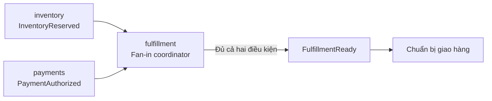
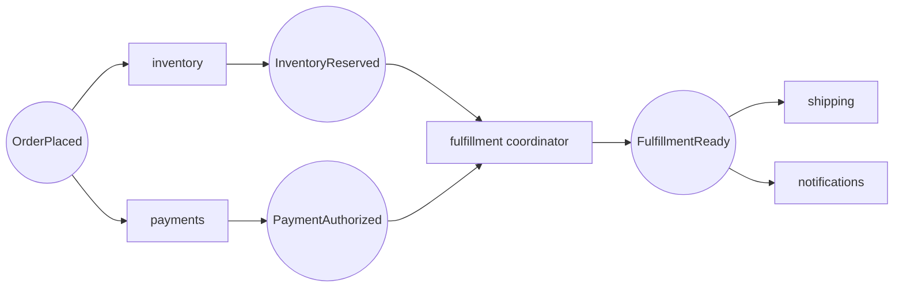
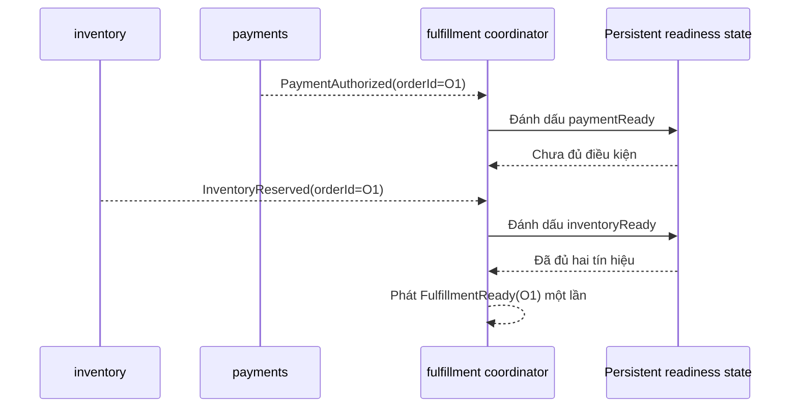
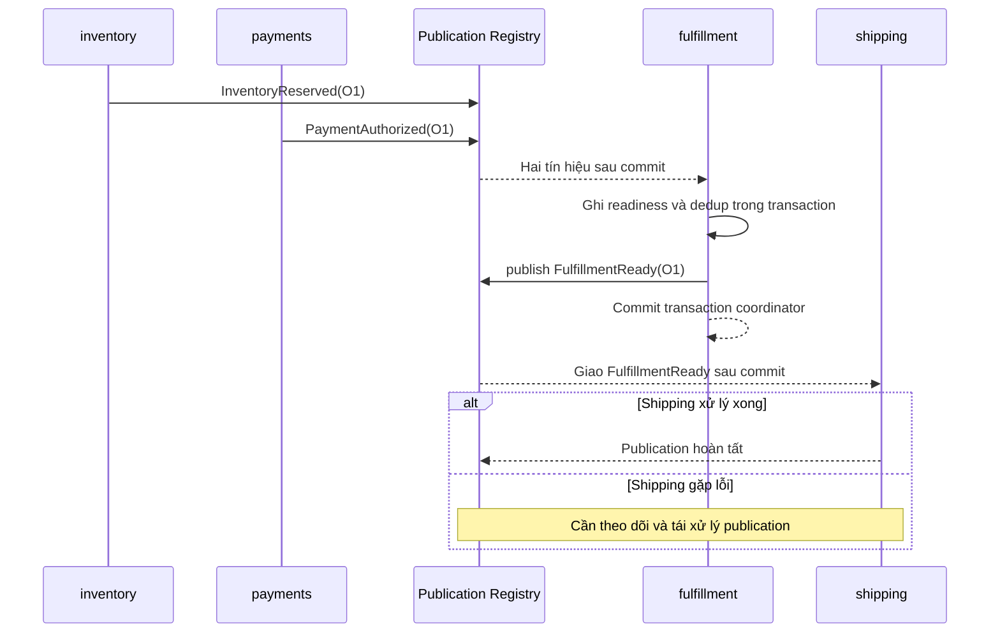

# Fan-in event: Hội tụ nhiều tín hiệu vào một quy trình nghiệp vụ

## 1. Fan-in event là gì?

Trong kiến trúc hướng sự kiện, **fan-out** là mô hình **một sự kiện kích hoạt nhiều consumer**. Ngược lại, **fan-in** là mô hình **nhiều sự kiện hoặc nhiều nguồn sự kiện hội tụ về một thành phần điều phối** để đưa ra quyết định tiếp theo. Thành phần hội tụ có thể gọi là *aggregator*, *process manager* hoặc *coordinator*, tùy trách nhiệm và độ phức tạp của quy trình.

Ví dụ trong ứng dụng đặt hàng:

- Module `inventory` xác nhận đã giữ hàng và phát `InventoryReserved`.
- Module `payments` xác nhận đã ủy quyền thanh toán và phát `PaymentAuthorized`.
- Module `fulfillment` chỉ chuyển đơn sang bước chuẩn bị giao khi **cả hai tín hiệu của cùng một đơn hàng** đều đã được ghi nhận.



Fan-in **không có nghĩa** Spring tự chờ đủ các event, hoặc các listener được thực thi theo thứ tự xác định. Nó là **quy tắc điều phối do ứng dụng thiết kế**, được hiện thực bằng các handler cùng cập nhật một trạng thái nghiệp vụ có thể kiểm chứng.

Trong phạm vi `SPRING_MODULITH_APPLICATION_EVENTS`, fan-in cho thấy cách dùng application events để giảm phụ thuộc trực tiếp giữa module, đồng thời đặt ra những yêu cầu thiết thực về publisher, listener sau commit, Event Publication Registry, retry, idempotency, kiểm thử và quan sát.

> **Ý tưởng cốt lõi:** Sự kiện báo “một phần công việc đã xong”; coordinator ghi nhận những phần đã xong, xác định chúng có thuộc **cùng một quy trình** hay không, rồi chỉ phát sự kiện kết quả khi điều kiện hợp thành đã thỏa mãn.

## 2. Fan-in, fan-out và chuỗi sự kiện khác nhau như thế nào?

| Mẫu tương tác | Cấu trúc | Ví dụ | Đặc điểm cần quản lý |
| --- | --- | --- | --- |
| **Fan-out** | Một publisher → nhiều listener | `OrderPlaced` đến kho, thanh toán, thông báo | Mỗi consumer có trách nhiệm và trạng thái hoàn tất riêng |
| **Fan-in** | Nhiều tín hiệu → một coordinator | `InventoryReserved` và `PaymentAuthorized` cùng đóng góp vào trạng thái đơn | Correlation, trạng thái tổng hợp, trùng lặp và thiếu tín hiệu |
| **Event chain** | Sự kiện A → xử lý → sự kiện B | `OrderPlaced` → `PaymentRequested` → `PaymentAuthorized` | Phụ thuộc quy trình, lỗi giữa chặng và thời gian hoàn tất |
| **Request/response** | Một yêu cầu → một kết quả cần ngay | Đặt hàng gọi API kiểm tra hạn mức trước khi xác nhận | Kết quả đồng bộ và ranh giới transaction rõ ràng |

Một quy trình có thể kết hợp nhiều mẫu. `OrderPlaced` ban đầu **fan-out** sang kho và thanh toán. Sau đó `InventoryReserved` và `PaymentAuthorized` **fan-in** tại `fulfillment`. Cuối cùng, `FulfillmentReady` có thể lại **fan-out** sang các listener chuẩn bị giao hàng hoặc gửi thông báo.



Điều khác biệt của fan-in nằm ở **điều kiện kết hợp**. Nếu chỉ cần bất kỳ một sự kiện đến là tiếp tục, đó có thể là điều kiện OR; nếu cần đủ nhiều sự kiện, đó là điều kiện AND; trường hợp phức tạp hơn có thể cần số lượng tối thiểu, tỷ lệ thành công hoặc tổng hợp theo cửa sổ thời gian.

## 3. Xác định điều kiện hội tụ bằng ngôn ngữ nghiệp vụ

Với quy trình chuẩn bị giao hàng, điều kiện minh họa:

```text
ReadyForFulfillment(orderId)
    = InventoryReserved(orderId)
      AND PaymentAuthorized(orderId)
      AND NOT Cancelled(orderId)
```

Hai tín hiệu là **điều kiện cần**; kiểm tra hủy đơn là một ràng buộc bổ sung của quy trình. Không phải cứ có hai event là luôn được phép giao hàng: các trường hợp như thanh toán bị hủy hiệu lực, giữ hàng hết hạn hoặc đơn đã bị hủy phải được thiết kế theo nghiệp vụ thực tế.

Bảng trạng thái tối giản khi chưa xét hủy/hết hạn:

| Đã giữ hàng? | Đã ủy quyền thanh toán? | Trạng thái coordinator | Hành động |
| --- | --- | --- | --- |
| Không | Không | `WAITING` | Chưa phát sự kiện sẵn sàng |
| Có | Không | `WAITING_PAYMENT` | Chờ tín hiệu thanh toán |
| Không | Có | `WAITING_INVENTORY` | Chờ tín hiệu kho |
| Có | Có | `READY` | Chỉ phát `FulfillmentReady` **một lần** cho lần hội tụ |

Không nên cho hai handler tự phát `FulfillmentReady` ngay khi thấy “tín hiệu của tôi đã đến”, vì điều đó không chứng minh tín hiệu còn lại đã đến. Cả hai handler phải làm việc trên **cùng một trạng thái tổng hợp có khóa theo nghiệp vụ**.

### 3.1. Khóa correlation quan trọng hơn thứ tự sự kiện

Hai sự kiện thuộc cùng một quy trình khi có thể ghép qua một khóa có ý nghĩa, ở đây là `orderId`. `eventId` định danh **một lần xảy ra sự kiện** và giúp loại trùng; nó không thay thế được `orderId` khi ghép hai loại sự kiện từ hai module khác nhau.

| Trường | Vai trò trong fan-in | Điều không nên suy ra |
| --- | --- | --- |
| `orderId` | Khóa nhóm và truy vấn trạng thái tổng hợp | Không chứng minh event không bị phát lại |
| `eventId` | Nhận diện một event để khử trùng, kiểm tra log | Không phải ID chung của cả quy trình |
| `occurredAt` | Thời điểm publisher ghi nhận sự kiện nghiệp vụ | Không phải thứ tự đến hay thứ tự commit tuyệt đối |
| `correlationId` (nếu có) | Liên kết các bước của quy trình lớn hơn | Không mặc nhiên là `orderId` hoặc trace ID |
| `aggregateVersion` (nếu có) | Hỗ trợ phát hiện trạng thái cũ hoặc đảo thứ tự của cùng aggregate | Không thay thế kiểm soát concurrency ở coordinator |

Trong hệ thống đa khách hàng, khóa hội tụ thực tế có thể cần `(tenantId, orderId)` thay vì chỉ `orderId`. Nhiều đợt giữ hàng hoặc nhiều lần thử thanh toán cho **cùng một đơn hàng** còn có thể đòi thêm `attemptId` hoặc `reservationId`; nếu bỏ qua, một tín hiệu từ đợt cũ có thể bị ghép nhầm với tín hiệu từ đợt mới.

## 4. Thiết kế hợp đồng event ổn định giữa các module

Giả sử `inventory` và `payments` là hai application module trong Spring Modulith. Chúng công bố những sự thật **đã xảy ra** thay vì chuyển service hoặc entity nội bộ cho coordinator.

Hợp đồng module kho:

```java
// inventory/events/InventoryReserved.java
package com.example.shop.inventory.events;

import java.time.Instant;
import java.util.Objects;
import java.util.UUID;

public record InventoryReserved(
        UUID eventId,
        UUID orderId,
        Instant occurredAt) {

    public InventoryReserved {
        Objects.requireNonNull(eventId, "eventId");
        Objects.requireNonNull(orderId, "orderId");
        Objects.requireNonNull(occurredAt, "occurredAt");
    }
}
```

Hợp đồng module thanh toán:

```java
// payments/events/PaymentAuthorized.java
package com.example.shop.payments.events;

import java.time.Instant;
import java.util.Objects;
import java.util.UUID;

public record PaymentAuthorized(
        UUID eventId,
        UUID orderId,
        Instant occurredAt) {

    public PaymentAuthorized {
        Objects.requireNonNull(eventId, "eventId");
        Objects.requireNonNull(orderId, "orderId");
        Objects.requireNonNull(occurredAt, "occurredAt");
    }
}
```

Các `record` chỉ mang ID và thời điểm bất biến. Đây là hợp đồng tối giản, phù hợp khi coordinator chỉ cần biết **tín hiệu hoàn tất**. Nếu nghiệp vụ cần phân biệt nhiều lần thử thanh toán hoặc giữ hàng, bổ sung ID của lần thử vào cả mô hình dữ liệu và khóa correlation thay vì âm thầm ghép mọi lần xử lý theo `orderId`.

Nếu event được đặt trong subpackage `events` thì có thể công bố thành named interface ở từng module:

```java
// inventory/events/package-info.java
@org.springframework.modulith.NamedInterface("events")
package com.example.shop.inventory.events;
```

```java
// payments/events/package-info.java
@org.springframework.modulith.NamedInterface("events")
package com.example.shop.payments.events;
```

Module `fulfillment` chỉ cần được phép phụ thuộc vào các hợp đồng sự kiện đó:

```java
// fulfillment/package-info.java
@org.springframework.modulith.ApplicationModule(
    allowedDependencies = {
        "inventory::events",
        "payments::events"
    }
)
package com.example.shop.fulfillment;
```

Như vậy `fulfillment` không được trực tiếp import `inventory.internal.StockRepository` hay `payments.internal.PaymentEntity`. Có thể kiểm tra phụ thuộc qua `ApplicationModules.of(ShopApplication.class).verify()`. **Allowed dependency** kiểm soát ranh giới mã nguồn; nó không định nghĩa điều kiện AND, không lưu trạng thái và không tự chống trùng sự kiện.

## 5. Publisher có trách nhiệm công bố sự thật sau thay đổi nghiệp vụ

Một publisher có thể ghi dữ liệu của module mình rồi phát sự kiện trong cùng transaction:

```java
// Trích đoạn trong inventory.internal.StockReservationService.
@Transactional
public void reserveForOrder(UUID orderId) {
    stockRepository.reserve(orderId);

    events.publishEvent(new InventoryReserved(
        UUID.randomUUID(),
        orderId,
        clock.instant()
    ));
}
```

Module thanh toán cũng chỉ phát `PaymentAuthorized` sau khi đã xác định nghiệp vụ **ủy quyền thanh toán thành công**:

```java
// Trích đoạn trong payments.internal.PaymentService.
@Transactional
public void markAuthorized(UUID orderId) {
    paymentsRepository.markAuthorized(orderId);

    events.publishEvent(new PaymentAuthorized(
        UUID.randomUUID(),
        orderId,
        clock.instant()
    ));
}
```

Trong hai đoạn trích, `events` là `ApplicationEventPublisher`, `clock` là `java.time.Clock` được inject; các repository là thành phần giả định nội bộ module. Đây là mã tập trung vào **ngữ nghĩa phát sự kiện**, chưa phải ứng dụng hoàn chỉnh.

Hai publisher **không cần biết `fulfillment` có bao nhiêu handler** và không cần gọi API của coordinator. Phụ thuộc tĩnh hình thành ở phía consumer, vì coordinator import kiểu sự kiện của các module phát.

**Lưu ý transaction:** `publishEvent(...)` trong một phương thức `@Transactional` không tự đợi commit. Một `@EventListener` thông thường có thể chạy trước khi giao dịch thực sự commit; một listener được cấu hình theo `AFTER_COMMIT` chỉ xử lý sau commit thành công. Thiết kế fan-in phải chọn ngữ nghĩa phù hợp, tránh ghi nhận tín hiệu của giao dịch cuối cùng bị rollback.

## 6. Hai handler cùng chuyển tín hiệu đến một coordinator

Spring Modulith có `@ApplicationModuleListener` để viết handler liên module với ngữ nghĩa **sau commit, bất đồng bộ và transaction riêng** khi hạ tầng transaction được cấu hình phù hợp. Ta đặt hai handler khác nhau trong module `fulfillment`, nhưng cả hai đều gọi chung một thành phần quản lý trạng thái hội tụ.

```java
// fulfillment/internal/FanInListeners.java
package com.example.shop.fulfillment.internal;

import com.example.shop.inventory.events.InventoryReserved;
import com.example.shop.payments.events.PaymentAuthorized;
import org.springframework.modulith.events.ApplicationModuleListener;
import org.springframework.stereotype.Component;

@Component
class FanInListeners {

    private final OrderReadinessCoordinator coordinator;

    FanInListeners(OrderReadinessCoordinator coordinator) {
        this.coordinator = coordinator;
    }

    @ApplicationModuleListener
    void onInventoryReserved(InventoryReserved event) {
        coordinator.inventoryReserved(event.eventId(), event.orderId());
    }

    @ApplicationModuleListener
    void onPaymentAuthorized(PaymentAuthorized event) {
        coordinator.paymentAuthorized(event.eventId(), event.orderId());
    }
}
```

`OrderReadinessCoordinator` là **service nội bộ do ứng dụng xây dựng**, không phải một class sẵn có của Spring Modulith. Cả hai handler chỉ làm nhiệm vụ **dịch event thành tín hiệu**, sau đó giao việc cập nhật trạng thái cho cùng coordinator; không tự suy diễn một event đã đủ để hoàn thành quy trình.

Đừng dùng danh sách listener hay thứ tự tên method như một công cụ phối hợp. Hai callback có thể chạy trên những thread khác nhau; `PaymentAuthorized` hoàn toàn có thể đến **trước** `InventoryReserved`. Khi retry xảy ra, một handler còn có thể được gọi nhiều lần với cùng `eventId`.

Sơ đồ trình tự khi hai event đến theo thứ tự bất kỳ:



Các transaction của `inventory`, `payments` và `fulfillment` là các transaction riêng về mặt nghiệp vụ. Fan-in không tạo một transaction nguyên tử trải dài qua cả ba module.

## 7. Lưu trạng thái hội tụ bền vững, không chỉ giữ trong bộ nhớ

Một lỗi thiết kế thường gặp là dùng hai biến cờ trong singleton Spring bean:

```java
// KHÔNG NÊN dùng trong ứng dụng nhiều đơn hàng hoặc cần khôi phục:
private boolean inventoryReady;
private boolean paymentReady;
```

Thiết kế này có ít nhất ba vấn đề: **trộn dữ liệu giữa các đơn hàng**, **mất trạng thái khi ứng dụng khởi động lại** và **race condition khi listener xử lý đồng thời**. Kể cả dùng `ConcurrentHashMap<UUID, State>` cũng chưa giải quyết việc khôi phục sau crash hoặc phối hợp giữa nhiều instance ứng dụng.

Thay vào đó, coordinator nên lưu **trạng thái dự phóng (projection)** của từng đơn hàng trong một kho lưu trữ bền vững. Đây là bản ghi “đã nhận những tín hiệu nào”, **không phải bản sao toàn bộ bảng dữ liệu** của module kho hay thanh toán.

Ví dụ lược đồ SQL mang tính minh họa:

```sql
CREATE TABLE fulfillment_readiness (
    order_id UUID PRIMARY KEY,
    inventory_ready BOOLEAN NOT NULL DEFAULT FALSE,
    payment_ready BOOLEAN NOT NULL DEFAULT FALSE,
    status VARCHAR(24) NOT NULL DEFAULT 'WAITING',
    readiness_event_id UUID,
    updated_at TIMESTAMP WITH TIME ZONE NOT NULL
);

CREATE TABLE fulfillment_consumed_signal (
    consumer_name VARCHAR(80) NOT NULL,
    signal_type VARCHAR(80) NOT NULL,
    event_id UUID NOT NULL,
    order_id UUID NOT NULL,
    PRIMARY KEY (consumer_name, signal_type, event_id)
);
```

Lược đồ này dùng kiểu `UUID` và `TIMESTAMP WITH TIME ZONE` thường có ở PostgreSQL; khi dùng database khác cần điều chỉnh cú pháp. Đơn vị **sở hữu** hai bảng là module `fulfillment`. Module `inventory` và `payments` không cần import repository tương ứng hoặc tự ghi vào bảng đó.

Mỗi bản ghi `fulfillment_readiness` thể hiện:

- `order_id`: khóa hội tụ của một quy trình đặt hàng.
- `inventory_ready`, `payment_ready`: tín hiệu đã được xác nhận đến coordinator.
- `status`: trạng thái tổng hợp như `WAITING`, `READY`, `CANCELLED` hoặc `EXPIRED` khi miền nghiệp vụ có các nhánh đó.
- `readiness_event_id`: ID của **sự kiện kết quả** `FulfillmentReady` được tạo khi chuyển lần đầu sang READY; giữ nguyên để hỗ trợ khôi phục và đối chiếu.
- `updated_at`: thời điểm cập nhật trạng thái coordinator, **không phải** thời điểm phát sinh tín hiệu nguồn.

Bảng `fulfillment_consumed_signal` hỗ trợ phát hiện **một event nguồn đã được coordinator xử lý hay chưa**. Khóa gồm consumer, loại tín hiệu và event ID để không lẫn giữa các ngữ cảnh xử lý. Trong triển khai đơn giản có thể dùng `orderId` làm khóa chống thao tác trùng của mỗi bước nghiệp vụ, nhưng cần phân biệt việc nhận lại cùng một event với một **sự kiện mới** của cùng đơn.

### 7.1. Một transition phải được ghi nhận nguyên tử

Việc xử lý một tín hiệu gồm các bước sau, về mặt logic phải nằm trong **cùng transaction của coordinator**:

1. Tìm hoặc tạo bản ghi trạng thái theo khóa `orderId`, với cơ chế khóa/concurrency phù hợp.
2. Kiểm tra event nguồn đã được ghi nhận hay chưa. Nếu đã có thì kết thúc **không phát thêm sự kiện kết quả**.
3. Đánh dấu tín hiệu đã đến (`inventoryReady` hoặc `paymentReady`).
4. Nếu thỏa toàn bộ điều kiện và chưa chuyển sang READY trước đó, ghi trạng thái READY và tạo một `readinessEventId` ổn định.
5. Công bố `FulfillmentReady` trong transaction của coordinator, với các listener downstream được thiết kế xử lý sau commit.
6. Commit trạng thái, bản ghi chống trùng và publication liên quan trong ranh giới transaction được cấu hình.

Nếu transaction thất bại, các cập nhật trạng thái và bản ghi dedup trong transaction ấy cũng phải rollback. Khi event nguồn được giao lại, coordinator có thể thử lại mà không bị kẹt ở trạng thái “đã nhận” dù chưa ghi xong dữ liệu.

**Điểm quan trọng:** Không có một bảo đảm exactly-once đầu cuối chỉ nhờ các bước trên. Việc phát `FulfillmentReady` trong transaction chỉ có thể phục hồi đáng tin cậy cho các listener transactional khi Event Publication Registry và persistence tương ứng được cấu hình đúng; nếu có broker ngoài, cần xét thêm cơ chế giao nhận ở biên tích hợp.

## 8. Hiện thực coordinator theo nguyên tắc idempotent

Một lớp miền nhỏ có thể mô tả quy tắc hai tín hiệu hội tụ. Ví dụ sau cố tình tách logic trạng thái khỏi cách lưu trữ:

```java
// fulfillment/internal/ReadinessState.java
package com.example.shop.fulfillment.internal;

import java.util.Objects;
import java.util.UUID;

enum Signal {
    INVENTORY_RESERVED,
    PAYMENT_AUTHORIZED
}

final class ReadinessState {
    private boolean inventoryReady;
    private boolean paymentReady;
    private boolean readyEmitted;
    private UUID readinessEventId;

    // Trả true đúng một lần khi đạt đủ hai điều kiện.
    boolean apply(Signal signal) {
        switch (signal) {
            case INVENTORY_RESERVED -> inventoryReady = true;
            case PAYMENT_AUTHORIZED -> paymentReady = true;
        }

        if (inventoryReady && paymentReady && !readyEmitted) {
            readyEmitted = true;
            return true;
        }
        return false;
    }

    void storeReadinessEventId(UUID eventId) {
        if (!readyEmitted || readinessEventId != null) {
            throw new IllegalStateException("Invalid readiness transition");
        }
        readinessEventId = Objects.requireNonNull(eventId, "eventId");
    }
}
```

Đây là logic **tối giản cho một lần hội tụ**, chưa xét đơn bị hủy, hết hạn hoặc tái ủy quyền thanh toán. Trong ứng dụng thực, trạng thái này phải được ánh xạ tới thực thể lưu trữ có khóa theo `orderId`; một instance `ReadinessState` tạm trong bộ nhớ không đủ cho tính bền vững.

Service điều phối có thể có giao diện minh họa như sau:

```java
// fulfillment/internal/OrderReadinessCoordinator.java (phác thảo)
package com.example.shop.fulfillment.internal;

import com.example.shop.fulfillment.events.FulfillmentReady;
import java.time.Clock;
import java.util.UUID;
import org.springframework.context.ApplicationEventPublisher;
import org.springframework.stereotype.Service;
import org.springframework.transaction.annotation.Transactional;

@Service
class OrderReadinessCoordinator {

    private final ReadinessStore states;
    private final ProcessedSignalStore processed;
    private final ApplicationEventPublisher events;
    private final Clock clock;

    OrderReadinessCoordinator(
            ReadinessStore states,
            ProcessedSignalStore processed,
            ApplicationEventPublisher events,
            Clock clock) {
        this.states = states;
        this.processed = processed;
        this.events = events;
        this.clock = clock;
    }

    @Transactional
    public void inventoryReserved(UUID eventId, UUID orderId) {
        accept(eventId, orderId, "INVENTORY_RESERVED",
                Signal.INVENTORY_RESERVED);
    }

    @Transactional
    public void paymentAuthorized(UUID eventId, UUID orderId) {
        accept(eventId, orderId, "PAYMENT_AUTHORIZED",
                Signal.PAYMENT_AUTHORIZED);
    }

    private void accept(
            UUID eventId, UUID orderId, String source, Signal signal) {
        // Tạo nếu thiếu và khóa đồng bộ trạng thái theo orderId.
        var state = states.getOrCreateAndLock(orderId);

        // Ghi vào DB với unique key; trả false khi đã xử lý.
        if (!processed.recordIfAbsent(
                "FULFILLMENT", source, eventId, orderId)) {
            return;
        }

        if (state.apply(signal)) {
            UUID readinessEventId = UUID.randomUUID();
            state.storeReadinessEventId(readinessEventId);
            events.publishEvent(new FulfillmentReady(
                    readinessEventId, orderId, clock.instant()));
        }
    }
}
```

**Đây là phác thảo kiến trúc, không phải ví dụ ứng dụng hoàn chỉnh có thể biên dịch/chạy độc lập:** `ReadinessStore`, `ProcessedSignalStore` và mapping persistence của `ReadinessState` phải được ứng dụng hiện thực. Những phương thức `getOrCreateAndLock` và `recordIfAbsent` thể hiện **hợp đồng bắt buộc về tính nguyên tử và khóa**, không phải API có sẵn của Spring Modulith. Trường `readinessEventId` cũng phải được lưu bền vững trong cùng transaction.

Event kết quả do module `fulfillment` sở hữu:

```java
// fulfillment/events/FulfillmentReady.java
package com.example.shop.fulfillment.events;

import java.time.Instant;
import java.util.UUID;

public record FulfillmentReady(
        UUID eventId,
        UUID orderId,
        Instant occurredAt) {
}
```

Nếu module khác cần lắng nghe `FulfillmentReady`, hãy công bố nó qua API gốc hoặc named interface của `fulfillment`. Việc sinh `readinessEventId` chỉ được thực hiện khi chuyển trạng thái lần đầu; nếu publication cũ được phát lại thì phải dùng **chính ID của event đã tạo**, không tạo một sự kiện mới chỉ vì retry.

### 8.1. Vì sao khóa đồng thời là điều kiện bắt buộc?

Giả sử `InventoryReserved` và `PaymentAuthorized` cho cùng `orderId` đến gần như đồng thời:

```text
Thread A đọc inventoryReady=false, paymentReady=false
Thread B đọc inventoryReady=false, paymentReady=false
Thread A cập nhật inventoryReady=true
Thread B cập nhật paymentReady=true từ bản ghi cũ
Kết quả có thể mất cập nhật hoặc bỏ lỡ transition READY.
```

Tình huống khác: cả hai thread đọc một bản ghi đã có hai cờ `true` nhưng `readyEmitted=false`, rồi cùng phát `FulfillmentReady`. Một boolean trong heap hoặc điều kiện `if` đơn giản **không bảo đảm** chỉ chuyển trạng thái một lần khi xử lý đồng thời.

Cần chọn và kiểm thử một chiến lược:

- **Pessimistic locking:** khóa bản ghi coordinator của `orderId` trong transaction trước khi thay đổi; bảo đảm thao tác tạo bản ghi ban đầu có cơ chế *atomic upsert* hoặc khóa tương ứng.
- **Optimistic locking:** dùng version (`@Version` hoặc cơ chế tương đương), phát hiện xung đột và thử lại **cả transaction** theo chính sách.
- **Atomic conditional update:** cập nhật trạng thái và chuyển `readyEmitted` từ false sang true bằng điều kiện SQL nguyên tử.

Đối với đơn mới chưa có bản ghi readiness, chỉ `SELECT ... FOR UPDATE` không đủ vì **không có hàng nào để khóa**. Cần giải quyết race khi hai handler đồng thời tạo hàng, ví dụ unique key kết hợp upsert hoặc chiến lược retry của repository. Nếu không xử lý trường hợp này, fan-in vẫn có thể lỗi dù các bước sau đã khóa hàng.

### 8.2. Phân biệt hai lớp idempotency

| Lớp | Chống điều gì? | Khóa gợi ý |
| --- | --- | --- |
| **Nhận tín hiệu** | Cùng `InventoryReserved` hoặc `PaymentAuthorized` bị giao lại | `(consumer, signalType, eventId)` |
| **Chuyển trạng thái kết quả** | Nhiều handler cùng nhận thấy “đủ điều kiện” và phát kết quả lặp | Khóa `orderId` cộng cờ/transition READY nguyên tử |

Không thể chỉ dựa vào `eventId` để tránh phát `FulfillmentReady` hai lần: `InventoryReserved` và `PaymentAuthorized` là **hai event khác nhau**, có ID khác nhau, và cả hai có thể chạy đồng thời. Cũng không thể chỉ dựa vào `readyEmitted` trong bộ nhớ để khử trùng sau khi ứng dụng khởi động lại.

## 9. Thứ tự đến, xử lý lỗi và cửa sổ thời gian

Fan-in nên coi **thứ tự đến là không được bảo đảm**, trừ khi ứng dụng có thiết kế bổ sung. Dù `InventoryReserved` được phát trước, `PaymentAuthorized` vẫn có thể đến coordinator trước do thời gian transaction, scheduling bất đồng bộ, retry hoặc nhiều instance ứng dụng.

Quy tắc đúng trong ví dụ không phụ thuộc event nào đến đầu tiên:

```text
InventoryReserved(O1) -> PaymentAuthorized(O1) => READY(O1)
PaymentAuthorized(O1) -> InventoryReserved(O1) => READY(O1)
PaymentAuthorized(O1) -> PaymentAuthorized(O1) -> InventoryReserved(O1)
    => READY(O1) đúng một lần
```

### 9.1. Thiếu tín hiệu không được coi là thất bại tức thì

Nếu kho đã giữ hàng nhưng thanh toán chưa xong, coordinator nên giữ trạng thái chờ và xác định **hạn xử lý** theo chính sách nghiệp vụ. Thí dụ:

- `WAITING_PAYMENT`: chưa kết luận thành công hoặc thất bại.
- `PAYMENT_REJECTED`: có event thất bại nghiệp vụ rõ ràng, cần giải phóng hàng nếu đã giữ.
- `EXPIRED`: quá thời hạn cho phép mà chưa đủ tín hiệu; có thể cần hủy yêu cầu, giải phóng tài nguyên hoặc cảnh báo.
- `CANCELLED`: đơn đã hủy; tín hiệu đến muộn không được tự khôi phục trạng thái READY.

Việc “không thấy event trong 15 phút” **không tự tạo ra timeout event**. Cần một bộ kiểm tra deadline hoặc một cơ chế scheduler/timeout thích hợp và lưu trạng thái chuyển đổi có idempotency. Hạn xử lý phải dựa trên nhu cầu nghiệp vụ, không được tùy tiện coi tất cả event đến muộn là sai.

### 9.2. Tín hiệu thất bại, rút lại và thay thế

Ví dụ `PaymentDeclined` và `InventoryReservationFailed` là **sự kiện nghiệp vụ riêng** với `PaymentAuthorized` và `InventoryReserved`. Nếu thanh toán bị từ chối, hệ thống có thể:

1. Chuyển quy trình sang một trạng thái thất bại hoặc chờ thử lại có giới hạn.
2. Yêu cầu bù trừ: giải phóng hàng đã giữ, hủy ủy quyền thanh toán còn hiệu lực.
3. Tạo một `attemptId` mới nếu muốn thực hiện lại; không được ghép tín hiệu thất bại hoặc thành công của lần thử cũ vào lần thử mới.

Nếu `FulfillmentReady` đã kích hoạt giao hàng, việc hủy đơn sau đó không thể được xử lý bằng cách **xóa event đã phát**. Cần chính sách hoàn tác, bù trừ hoặc chuyển trạng thái tiếp theo (ví dụ `FulfillmentCancellationRequested`), có kiểm tra giai đoạn xử lý thực tế.

### 9.3. Không dùng số lượng event thô làm điều kiện

Một anti-pattern là “đã nhận hai message cho order này nên READY”. Hai message có thể là **hai lần giao của cùng `InventoryReserved`**, còn `PaymentAuthorized` chưa từng đến. Coordinator cần nhận diện **loại tín hiệu và trạng thái đã được xác thực**, không chỉ đếm số lần callback được gọi.

## 10. Event Publication Registry, retry và fan-in nhiều tầng

Trong Spring Modulith, `@ApplicationModuleListener` được thiết kế cho handler giữa các module, chạy sau commit và trong transaction riêng khi được cấu hình phù hợp. Điều này giúp coordinator không quan sát thành công một transaction nguồn cuối cùng bị rollback.

Nhưng có **hai chặng sự kiện độc lập** cần quan tâm:

1. `inventory` hoặc `payments` phát event nguồn đến `fulfillment`.
2. Khi đủ điều kiện, `fulfillment` phát `FulfillmentReady` đến module chuẩn bị giao hoặc thông báo.

Nếu một handler ở chặng đầu thất bại, trạng thái fan-in có thể thiếu tín hiệu dù publisher đã commit. Nếu chặng thứ hai thất bại, trạng thái coordinator có thể đã chuyển READY nhưng downstream chưa xử lý `FulfillmentReady`.



Sơ đồ **giả định** Event Publication Registry đã được tích hợp với kho lưu trữ phù hợp và các listener thuộc diện được registry theo dõi. Trong thực tế việc đăng ký publication, đánh dấu hoàn thành và tái công bố do cơ chế framework/hạ tầng thực hiện, không phải các module bắt buộc tự gọi một API registry cho từng mũi tên.

Registry giúp ghi nhận publication chưa hoàn thành và hỗ trợ các chính sách khôi phục. Tuy nhiên:

- Không nên mặc định mọi `ApplicationListener` đồng bộ đều có publication bền vững trong registry.
- Không nên mặc định chỉ thêm `@ApplicationModuleListener` là có ngay retry tự động đúng lịch mong muốn. Kho lưu trữ, cách kích hoạt xử lý lại và phiên bản Spring Modulith phải được xác định.
- Registry không tự hiểu rằng “đã nhận một event” khác với “đã nhận **đủ cả hai** event”. Điều kiện fan-in thuộc về **coordinator và kho trạng thái riêng**.
- Registry không tự khắc phục thất bại **nghiệp vụ** như thanh toán bị từ chối hoặc kho không còn hàng. Những trường hợp này cần event thất bại, timeout và quy trình bù trừ.

**Lưu ý lỗi commit/publish:** Khi coordinator cập nhật `READY` và công bố `FulfillmentReady`, cần cơ chế theo dõi publication tham gia transaction một cách phù hợp để tránh cửa sổ crash giữa việc lưu trạng thái và xử lý downstream. Nếu giao sự kiện ra broker hoặc dịch vụ bên ngoài, cần đánh giá thêm integration event, outbox/externalization và xác nhận gửi/nhận. Không thể suy ra bảo đảm exactly-once end-to-end chỉ từ cờ `readyEmitted`.

### 10.1. Retry một event nguồn có thể xảy ra sau READY

Giả sử hai sự kiện đã tạo `FulfillmentReady(O1)` rồi một publication `InventoryReserved(O1)` bị giao lại vì lỗi ghi nhận trạng thái hoàn thành. Với thiết kế đúng:

1. `ProcessedSignalStore` nhận ra `eventId` này đã được ghi nhận; handler có thể kết thúc không đổi trạng thái.
2. Nếu vì lý do nào đó có **event ID mới nhưng cùng một tín hiệu nghiệp vụ**, cờ `inventoryReady` vốn đã true và transition `READY` đã được đánh dấu, vì vậy không phát `FulfillmentReady` lần nữa.
3. Không được tạo `readinessEventId` mới chỉ do source event được phát lại.

Đó là lý do cần **cả dedup event lẫn một transition bền vững**. Chống trùng ở tầng transport không thay thế được tính idempotent ở tầng nghiệp vụ.

## 11. Quan sát một quy trình hội tụ

Fan-in khó chẩn đoán hơn một listener đơn lẻ, vì sự kiện nguồn có thể đã xử lý đúng ở hai module nhưng coordinator vẫn chờ do lỗi giao, lỗi ghép correlation hoặc một nhánh nghiệp vụ chưa hoàn tất.

Các thông tin quan sát nên có:

| Đối tượng | Dữ liệu nên quan sát | Câu hỏi trả lời |
| --- | --- | --- |
| Từng event nguồn | `eventId`, `orderId`, `eventType`, `occurredAt` | Event nào được phát, thuộc đơn nào? |
| Handler fan-in | Module nhận, tên signal, thời điểm xử lý, kết quả dedup | Đã nhận một tín hiệu hay chỉ nhận lại event cũ? |
| Bản ghi readiness | `orderId`, cờ đã nhận, trạng thái, deadline, thời gian cập nhật | Điều kiện nào còn thiếu? |
| Event kết quả | `readinessEventId`, `orderId`, thời điểm chuyển READY | Đã phát sự kiện kết quả chưa? |
| Publication registry | Số publication chưa hoàn tất, thời gian chờ, số lần thử lại | Event nào bị kẹt ở chặng giao nào? |
| Quy trình vận hành | Tỷ lệ chuyển READY, thời gian từ tín hiệu đầu tới READY, số timeout/hủy | Quy trình có đang bị nghẽn không? |

Có thể dùng log có cấu trúc, Micrometer metrics và distributed tracing nếu cần. `correlationId` thuộc miền nghiệp vụ nên được truyền theo chính sách rõ ràng; không mặc định trace ID có thể làm khóa fan-in hay khóa chống trùng khi listener chạy lại ở một phiên xử lý khác.

Khi vận hành, nên cảnh báo những bản ghi `WAITING_PAYMENT`/`WAITING_INVENTORY` quá hạn hoặc các publication chưa hoàn tất quá lâu. Không cần log toàn bộ entity hay dữ liệu thanh toán nhạy cảm để chẩn đoán; chỉ ghi những ID, trạng thái và nguyên nhân lỗi thật sự cần thiết.

## 12. Kiểm thử fan-in: trạng thái, transaction và concurrency

### 12.1. Unit test phép hội tụ thuần nghiệp vụ

Với `ReadinessState` ở mục 8, có thể kiểm tra rằng sự kiện đến theo thứ tự nào cũng chỉ tạo một transition READY:

```java
package com.example.shop.fulfillment.internal;

import static org.junit.jupiter.api.Assertions.*;

import org.junit.jupiter.api.Test;

class ReadinessStateTest {

    @Test
    void paymentThenInventoryBecomesReadyExactlyOnce() {
        var state = new ReadinessState();

        assertFalse(state.apply(Signal.PAYMENT_AUTHORIZED));
        assertTrue(state.apply(Signal.INVENTORY_RESERVED));
        assertFalse(state.apply(Signal.INVENTORY_RESERVED));
        assertFalse(state.apply(Signal.PAYMENT_AUTHORIZED));
    }

    @Test
    void inventoryThenPaymentAlsoBecomesReadyExactlyOnce() {
        var state = new ReadinessState();

        assertFalse(state.apply(Signal.INVENTORY_RESERVED));
        assertTrue(state.apply(Signal.PAYMENT_AUTHORIZED));
        assertFalse(state.apply(Signal.PAYMENT_AUTHORIZED));
    }
}
```

Test này chỉ xác minh **quy tắc AND trong một đối tượng trạng thái**. Nó không chứng minh rằng việc lưu database an toàn trước concurrency hoặc crash. Các phần khó hơn phải được kiểm tra ở cấp integration.

### 12.2. Ma trận kiểm thử cho toàn bộ luồng fan-in

| Kịch bản | Kết quả mong muốn |
| --- | --- |
| `InventoryReserved` đến rồi `PaymentAuthorized` | Chuyển READY và phát một `FulfillmentReady` |
| `PaymentAuthorized` đến trước `InventoryReserved` | Kết quả giống hệt trường hợp đảo ngược |
| Chỉ có một loại event | Giữ trạng thái chờ, không phát READY |
| Cùng `eventId` của nguồn bị giao lại | Không thay đổi business outcome, dedup hoạt động |
| Hai event khác nhau nhưng cùng biểu diễn một bước hoàn tất | Không phát READY nhiều lần |
| Nhiều đơn xen kẽ, ví dụ O1 và O2 | Chỉ ghép event cùng `orderId`, không trộn tín hiệu |
| Source transaction rollback | Listener `AFTER_COMMIT` không ghi nhận tín hiệu nguồn |
| Listener fan-in lỗi rồi được retry | Transaction lỗi rollback; xử lý lại đủ tín hiệu đúng |
| Hai listener chạy đồng thời cho cùng `orderId` | Không mất cập nhật, không phát hai lần; kiểm thử khóa/optimistic retry |
| Cùng event đến hai instance ứng dụng | Kho lưu trữ/unique key chống trùng, không lệ thuộc khóa JVM |
| Một tín hiệu thất bại hoặc đến quá hạn | Áp dụng trạng thái thất bại/timeout và bù trừ theo chính sách |
| Downstream `FulfillmentReady` bị lỗi | Publication dở dang có thể được theo dõi/khôi phục theo hạ tầng đã cấu hình |

Spring Modulith cung cấp `@ApplicationModuleTest` cho kiểm thử theo module. Có thể kết hợp bài kiểm tra ranh giới `ApplicationModules.verify()`, kiểm thử publisher/listener và kiểm thử transaction thật.

Khi kiểm tra listener bất đồng bộ, không nên dựa vào `Thread.sleep(...)` với một thời gian cứng rồi kết luận listener chắc chắn xử lý xong. Hãy dùng điều kiện chờ hoặc tiện ích kiểm thử sự kiện phù hợp với phiên bản đang sử dụng, đồng thời đảm bảo transaction của publisher **được commit thật** khi kiểm thử `AFTER_COMMIT`. Một test method mặc định rollback có thể khiến listener không được kích hoạt.

### 12.3. Kiểm thử cạnh tranh phải dùng kho dữ liệu thực

Unit test cho `ReadinessState.apply(...)` chạy tuần tự **không** kiểm tra hai thread cùng ghi một bản ghi. Hãy kiểm thử cạnh tranh trên database/kho lưu trữ thực tế với:

- Hai transaction đồng thời cập nhật readiness cho cùng `orderId`.
- Hai transaction đồng thời tạo bản ghi readiness **khi chưa tồn tại**.
- Hai lần ghi cùng một `(consumerName, signalType, eventId)` từ những worker khác nhau.
- Xung đột optimistic lock hoặc unique constraint và logic retry transaction.
- Crash giữa thao tác ghi trạng thái và xử lý publication, trong các điều kiện có thể tái hiện an toàn.

Chỉ có thể kết luận fan-in đáng tin cậy khi **trạng thái bền vững, khóa đồng thời và độ tin cậy publication** được thử cùng nhau, không chỉ khi hai handler riêng lẻ đều chạy thành công.

## 13. Những lỗi thiết kế cần tránh

| Lỗi | Hậu quả | Hướng xử lý |
| --- | --- | --- |
| Một bean giữ hai boolean chung cho mọi đơn hàng | Trộn trạng thái giữa các đơn, mất dữ liệu khi restart | Lưu readiness theo business key |
| Chờ hai callback tới rồi tăng bộ đếm | Event trùng làm đạt ngưỡng giả | Lưu **loại tín hiệu** và chống trùng theo ID |
| Dùng `eventId` làm khóa ghép hai loại event | Hai event nguồn hợp lệ không cùng ID | Dùng `orderId` hoặc khóa correlation nghiệp vụ |
| Giả định `InventoryReserved` luôn đến trước | Đảo thứ tự gây lỗi hoặc mất tín hiệu | Thiết kế transition không phụ thuộc thứ tự |
| Dùng `synchronized` làm bảo đảm duy nhất | Không bảo vệ nhiều instance hoặc restart | Unique constraint, locking hoặc atomic update ở kho lưu trữ |
| Hai handler đều phát READY khi thấy đủ cờ | Race gây phát hai lần | Kiểm soát transition READY **nguyên tử** |
| Coi event đến muộn là thành công sau khi đơn hủy | Giao hàng sai trạng thái | State machine có trạng thái kết thúc và chính sách xử lý tín hiệu muộn |
| Không có timeout hoặc cảnh báo | Workflow chờ vô hạn khi thiếu một nhánh | Deadline được lưu, kiểm tra định kỳ và xử lý bù trừ |
| Dựa vào registry để xác định điều kiện AND | Registry theo dõi publication, không hiểu điều kiện nghiệp vụ | Coordinator lưu trạng thái fan-in riêng |
| Phát kết quả ra broker không có kế hoạch lỗi | Crash hoặc mất xác nhận gây thiếu/trùng message | Thiết kế publication/outbox, ack, retry và idempotency |

## 14. Khi nào nên dùng fan-in?

**Nên cân nhắc fan-in** khi nhiều module thực hiện những bước độc lập, một bước nghiệp vụ phía sau cần kết quả tổng hợp, và quy trình cho phép mỗi bước hoàn tất ở những thời điểm khác nhau. Phù hợp với chuẩn bị giao hàng sau thanh toán và giữ hàng, tạo báo cáo sau nhiều nguồn dữ liệu, hoặc kích hoạt một nghiệp vụ khi đủ số xác nhận.

**Không nên dùng fan-in chỉ để tránh một API đồng bộ** nếu người dùng cần câu trả lời ngay, cần một transaction nguyên tử cho toàn bộ quyết định hoặc quy trình thực sự chỉ có một thành phần sở hữu. Khi việc khôi phục, timeout, bù trừ và thứ tự phức tạp, có thể cần một process manager/saga có trạng thái rõ ràng thay vì vài listener và boolean rời rạc.

### Checklist triển khai

1. Định nghĩa điều kiện hội tụ bằng ngôn ngữ nghiệp vụ: AND, OR, N-trên-M hay theo cửa sổ thời gian.
2. Chọn **business correlation key** (`orderId`, kèm `attemptId`/`tenantId` khi cần) để ghép đúng tín hiệu.
3. Công bố những event bất biến, có ID ổn định và API/named interface hợp lệ giữa module.
4. Đặt handler ở module sở hữu quyết định tổng hợp, không cho chúng gọi repository nội bộ của publisher.
5. Lưu trạng thái hội tụ và dedup bền vững; thiết kế atomic transition, transaction và locking.
6. Chấp nhận event trùng, đến đảo thứ tự, đến muộn và bị thiếu; thiết kế timeout, thất bại và bù trừ.
7. Phát event kết quả tại transition phù hợp; cấu hình transactional listener, registry và cách khôi phục publication nếu cần.
8. Kiểm thử trạng thái, rollback, concurrency, retry và observability bằng những tình huống thực tế.

### Bài tập vận dụng

Ứng dụng có `OrderPlaced(O42)`, `InventoryReserved(O42)`, `PaymentAuthorized(O42)` và `PaymentAuthorized(O43)`. Các event đến coordinator theo thứ tự:

```text
1. PaymentAuthorized(O43)
2. PaymentAuthorized(O42)
3. PaymentAuthorized(O42)  // giao lại cùng eventId
4. InventoryReserved(O42)
5. InventoryReserved(O42)   // eventId khác nhưng cùng nghĩa
```

Hãy xác định trạng thái của O42 và O43 sau mỗi bước, khi nào `FulfillmentReady(O42)` được phát, và vì sao không được phát lần thứ hai. Sau đó bổ sung trường hợp thanh toán O42 bị từ chối hoặc đơn bị hủy ngay trước bước 4; mô tả state transition, chính sách xử lý event đến muộn và yêu cầu bù trừ.

**Ghi nhớ:** Fan-in event là **hợp nhất những sự thật nghiệp vụ độc lập thành một quyết định nghiệp vụ mới**. Trong Spring Modulith, các handler nhận event qua hợp đồng module rõ ràng, nhưng logic hội tụ thuộc một coordinator có **trạng thái bền vững, idempotency và kiểm soát concurrency**. Chọn xử lý sau commit, Event Publication Registry, retry, kiểm thử và quan sát phù hợp giúp luồng nhiều bước không mất dấu khi xảy ra lỗi.
