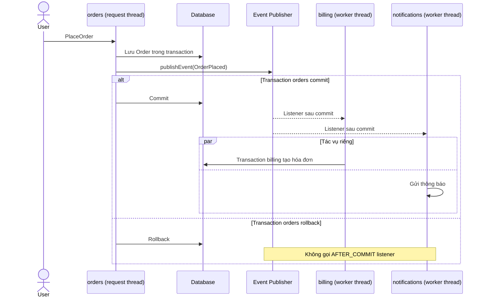
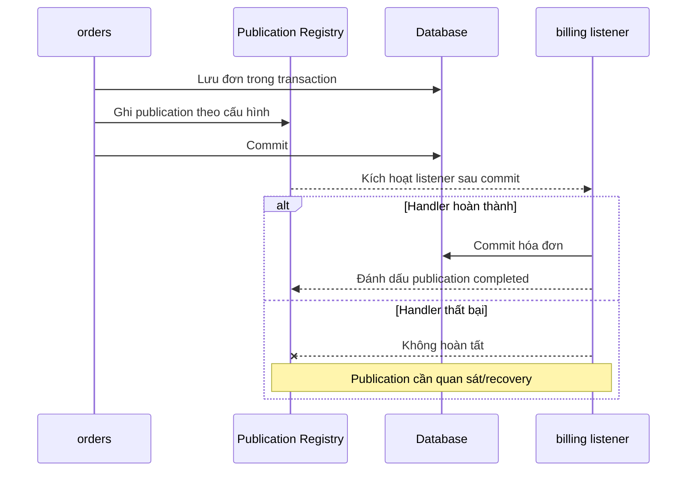

# Xử lý asynchronous trong Spring Modulith Application Events

Khi một module phát application event, câu hỏi quan trọng không chỉ là **ai nhận sự kiện**, mà còn là **người nhận xử lý trên thread nào, ở thời điểm nào và trong transaction nào**. Nếu listener gửi email mất vài giây, gọi API thanh toán chập chờn hoặc cập nhật một read model lớn, việc để listener chạy đồng bộ cùng luồng đặt hàng có thể kéo dài thời gian phản hồi và làm lỗi phụ trợ ảnh hưởng nghiệp vụ chính.

**Xử lý asynchronous (bất đồng bộ)** cho phép publisher không phải chờ handler hoàn tất. Trong Spring Modulith, cách này đặc biệt hữu ích khi tách trách nhiệm giữa các module: `orders` phát `OrderPlaced`, còn `billing` và `notifications` phản ứng độc lập sau khi giao dịch đặt hàng commit. Tuy nhiên, bất đồng bộ **không tự động đồng nghĩa** bền vững, xử lý đúng một lần hoặc luôn có transaction thích hợp.

Bài này thuộc chương **Đồng bộ và bất đồng bộ** của dịch vụ học `SPRING_MODULITH_APPLICATION_EVENTS`. Ta sẽ triển khai các kiểu listener, hiểu thread/transaction boundary, thiết lập executor, xử lý lỗi, dùng Event Publication Registry để khôi phục publication chưa hoàn tất, thiết kế idempotency, kiểm thử và quan sát giao sự kiện đáng tin cậy.

## 1. Asynchronous thực sự thay đổi điều gì?

Ở cách xử lý đồng bộ mặc định, một application event được phát có thể gọi trực tiếp listener ngay trên thread publisher:

```text
HTTP thread
  -> orders.place()
       -> save(Order)
       -> publishEvent(OrderPlaced)
            -> billing listener (chạy xong mới trả về)
            -> notifications listener (chạy xong mới trả về)
       -> return orderId
```

Khi listener thực thi bất đồng bộ, publisher thường chỉ **lên lịch** hoặc **giao việc** cho executor; listener có thể bắt đầu, kết thúc hoặc thất bại ở thời điểm khác:

```text
HTTP thread                     Worker threads
  -> orders.place()
     -> save(Order)
     -> publishEvent(...)
     -> commit
     -> return orderId           -> billing listener
                                  -> notifications listener
```

Hình thứ hai chỉ mô tả khái niệm; listener có thể khởi chạy trước khi HTTP response được gửi, và thứ tự phụ thuộc phase transaction cũng như cách async được cấu hình.

| Khía cạnh | Đồng bộ mặc định | Bất đồng bộ |
| --- | --- | --- |
| Thread chạy listener | Thường cùng thread của publisher | Thường do `TaskExecutor` cấp |
| Publisher chờ handler | Có, với listener đồng bộ | Không chờ việc xử lý kết thúc |
| Thời gian phản hồi | Có thể cộng thêm thời gian listener | Thường không phải đợi tác vụ phụ |
| Exception từ handler | Có thể truyền ngược publisher | Thường được báo qua hạ tầng async/logging/registry; không truyền trực tiếp theo call stack ban đầu |
| Transaction | Có thể cùng transaction nếu thực thi ngay | Không tự kế thừa transaction của thread nguồn |
| Thứ tự hoàn thành | Có tính tuần tự trong một luồng gọi nhất định | Không nên mặc định có thứ tự toàn cục |
| Giới hạn tài nguyên | Thread request có thể bị giữ lâu | Cần quản lý thread pool, queue, rejection và tải |
| Độ bền khi crash | Không mặc định bền vững | Cũng **không** mặc định bền vững |

**Đồng bộ và bất đồng bộ là cách thực thi, không phải bảo đảm phân phối.** Một công việc chạy trên thread pool vẫn có thể mất khi tiến trình JVM dừng nếu không có cơ chế lưu publication và recovery.

## 2. Bảo vệ ranh giới module trước khi bàn về thread

Giả sử có những module sau:

```text
com.example.shop
├── ShopApplication.java
├── orders
│   ├── OrderPlaced.java
│   └── internal
│       ├── PlaceOrderService.java
│       └── OrderRepository.java
├── billing
│   └── internal
│       ├── IssueInvoiceOnOrderPlaced.java
│       ├── InvoiceService.java
│       └── InvoiceRepository.java
└── notifications
    └── internal
        ├── SendOrderConfirmation.java
        └── NotificationService.java
```

Ở mô hình package mặc định của Spring Modulith:

- `orders` sở hữu quy tắc tạo đơn và định nghĩa public event `OrderPlaced`.
- `billing` chỉ nhập public event từ `orders`; không nhập repository hoặc entity dưới `orders.internal`.
- `notifications` nhận cùng public event và tự quyết định cách gửi email.
- Publisher không inject trực tiếp `InvoiceService`, `EmailSender` hoặc listener của những module khác.

Xử lý asynchronous **không bù đắp** được ranh giới module sai. Nếu `billing` cập nhật trực tiếp bảng đơn hoặc gọi implementation internal của `orders`, chuyển nó sang thread khác chỉ khiến vấn đề khó theo dõi hơn.

### Khi nào vẫn cần command đồng bộ?

Nếu đơn **chỉ được xác nhận khi giữ kho thành công**, `orders` có thể cần gọi public command/API của `inventory` và nhận kết quả trước khi hoàn tất. Đừng phát event async `ReserveStockRequested` rồi trả “đặt hàng thành công” nếu nghiệp vụ đòi hỏi kho phải giữ được ngay.

Ngược lại, gửi email xác nhận hoặc tạo bản ghi thống kê sau khi đơn đã hợp lệ thường thích hợp làm tác vụ phản ứng với `OrderPlaced`.

## 3. Event và publisher của module nguồn

Ta dùng một record bất biến làm hợp đồng:

```java
// com.example.shop.orders.OrderPlaced
package com.example.shop.orders;

import java.time.Instant;
import java.util.UUID;

public record OrderPlaced(
        UUID eventId,
        UUID orderId,
        Instant occurredAt
) {}
```

Event cần chứa sự thật nghiệp vụ đã được module `orders` xác nhận, không mang nguyên entity JPA mutable. `eventId` có thể phục vụ theo dõi và xử lý trùng, còn `orderId` là business key cho các nghiệp vụ phát sinh như tạo hóa đơn.

Ví dụ application service phát event:

```java
// com.example.shop.orders.internal.PlaceOrderService
package com.example.shop.orders.internal;

import com.example.shop.orders.OrderPlaced;
import java.time.Clock;
import java.time.Instant;
import java.util.UUID;
import org.springframework.context.ApplicationEventPublisher;
import org.springframework.stereotype.Service;
import org.springframework.transaction.annotation.Transactional;

@Service
class PlaceOrderService {

    private final OrderRepository orders;
    private final ApplicationEventPublisher events;
    private final Clock clock;

    PlaceOrderService(
            OrderRepository orders,
            ApplicationEventPublisher events,
            Clock clock) {
        this.orders = orders;
        this.events = events;
        this.clock = clock;
    }

    @Transactional
    public UUID place(UUID customerId, String sku, int quantity) {
        // Order, OrderRepository là mô hình nội bộ cần triển khai
        // theo quy tắc nghiệp vụ và cấu hình persistence thực tế.
        Order order = Order.place(customerId, sku, quantity);
        orders.save(order);

        events.publishEvent(new OrderPlaced(
                UUID.randomUUID(),
                order.id(),
                Instant.now(clock)
        ));

        return order.id();
    }
}
```

Ví dụ giả định đã có bean `Clock` như `Clock.systemUTC()` và repository/domain model phù hợp. Nó minh họa vị trí phát sự kiện, **không phải project tự chạy độc lập**.

**Thời điểm quan trọng:** `publishEvent(...)` ở trong phương thức `@Transactional`, nhưng lúc gọi nó transaction nguồn **chưa nhất thiết commit**. Muốn consumer chỉ làm việc với trạng thái đã commit, phải chọn listener theo phase, không chỉ gắn `@Async`.

## 4. Ba cách thiết lập listener: không nhầm async với after-commit

### 4.1. `@EventListener`: đồng bộ theo mặc định

```java
package com.example.shop.orders.internal;

import com.example.shop.orders.OrderPlaced;
import org.springframework.context.event.EventListener;
import org.springframework.stereotype.Component;

@Component
class OrderAuditListener {

    @EventListener
    void on(OrderPlaced event) {
        // Minh họa hành vi nội bộ nhanh.
        System.out.println("Published event " + event.eventId());
    }
}
```

Với event multicaster mặc định, handler chạy ngay khi publisher phát event. Nếu listener ném runtime exception, exception có thể truyền về caller và ảnh hưởng transaction đang mở.

Không nên đặt các thao tác mạng lâu dài vào listener đồng bộ nếu chúng không phải điều kiện bắt buộc của nghiệp vụ chính.

### 4.2. `@Async` trên `@EventListener`: async nhưng không tự đợi commit

```java
package com.example.shop.notifications.internal;

import com.example.shop.orders.OrderPlaced;
import org.springframework.context.event.EventListener;
import org.springframework.scheduling.annotation.Async;
import org.springframework.stereotype.Component;

@Component
class AsyncLogListener {

    @Async("orderEventExecutor")
    @EventListener
    void on(OrderPlaced event) {
        // Có thể chạy trên worker thread trước khi đơn commit.
        // Không dùng để gửi thông báo phụ thuộc dữ liệu đã commit.
        System.out.println(event.orderId());
    }
}
```

Gắn `@Async` làm việc xử lý diễn ra qua executor được cấu hình. **Nhưng `@Async` không biết transaction nguồn đã commit hay chưa.** Một handler có thể chạy trong thread khác khi transaction của `orders` còn đang hoạt động; truy vấn DB ở handler có thể không thấy dữ liệu chưa commit hoặc đọc trạng thái khác mong đợi.

Vì vậy, chỉ dùng `@Async @EventListener` khi việc xử lý **không yêu cầu** sự thật đã commit, hoặc bạn đã thiết kế cơ chế đồng bộ hóa rõ ràng.

### 4.3. `@TransactionalEventListener`: chờ phase transaction

```java
package com.example.shop.notifications.internal;

import com.example.shop.orders.OrderPlaced;
import org.springframework.stereotype.Component;
import org.springframework.transaction.event.TransactionPhase;
import org.springframework.transaction.event.TransactionalEventListener;

@Component
class AfterCommitListener {

    private final NotificationService notifications;

    AfterCommitListener(NotificationService notifications) {
        this.notifications = notifications;
    }

    @TransactionalEventListener(phase = TransactionPhase.AFTER_COMMIT)
    void on(OrderPlaced event) {
        notifications.scheduleConfirmation(event.orderId());
    }
}
```

`@TransactionalEventListener` mặc định chạy theo `AFTER_COMMIT`. Nó **không tự động bất đồng bộ**; nếu không có `@Async` hoặc cơ chế async khác, callback vẫn có thể chạy trên thread gắn với transaction tại thời điểm commit.

Event phát **ngoài transaction** thường không kích hoạt transactional listener, trừ khi cấu hình `fallbackExecution = true`. Đây là lý do cần kiểm tra transaction ở use case nguồn trước khi nhận định listener “không hoạt động”.

### 4.4. `@ApplicationModuleListener`: cách viết thường dùng trong Spring Modulith

```java
// com.example.shop.billing.internal.IssueInvoiceOnOrderPlaced
package com.example.shop.billing.internal;

import com.example.shop.orders.OrderPlaced;
import org.springframework.modulith.events.ApplicationModuleListener;
import org.springframework.stereotype.Component;

@Component
class IssueInvoiceOnOrderPlaced {

    private final InvoiceService invoices;

    IssueInvoiceOnOrderPlaced(InvoiceService invoices) {
        this.invoices = invoices;
    }

    @ApplicationModuleListener
    void on(OrderPlaced event) {
        invoices.issueOnce(event.orderId(), event.eventId());
    }
}
```

Trong Spring Modulith, `@ApplicationModuleListener` kết hợp xử lý **sau commit**, **bất đồng bộ** và **transaction riêng** (với semantics tương ứng của `@TransactionalEventListener`, `@Async` và `@Transactional(propagation = REQUIRES_NEW)`). Đây là lựa chọn thường phù hợp cho các phản ứng xuyên module như lập hóa đơn, cập nhật read model và xử lý thông báo sau khi đơn đã lưu.

`InvoiceService.issueOnce(...)` là API nội bộ ví dụ của `billing`, không phải class framework tạo sẵn. Module nhận cần tự triển khai idempotency và business rule.

### So sánh nhanh

| Annotation | Xử lý sau commit? | Chạy async? | Transaction mới khi xử lý? |
| --- | --- | --- | --- |
| `@EventListener` | Không theo mặc định | Không theo mặc định | Không mặc định |
| `@Async + @EventListener` | Không theo mặc định | Có nếu async được bật/cấu hình | Không mặc định |
| `@TransactionalEventListener` | Mặc định có | Không mặc định | Không tự mở transaction mới |
| `@Async + @TransactionalEventListener` | Có, nếu publish trong transaction commit | Có | Không mặc định; cần service transactional thích hợp |
| `@ApplicationModuleListener` | Có | Có | Có, theo cấu hình tổ hợp annotation |

Khác biệt này quan trọng hơn việc “có dùng thread pool hay không”. Đối với tác vụ tạo hóa đơn, ta cần biết dữ liệu nguồn đã commit và transaction của `billing` có thể commit độc lập.

## 5. Asynchronous và ranh giới transaction

Thread-local transaction context của Spring **không tự truyền** từ publisher thread sang async worker thread. Khi một `@Async @EventListener` chạy trên executor, nó không được xem như đang ở trong cùng một JDBC/JPA transaction với `orders`.



Sơ đồ mô tả ý định, không cam kết thời điểm tuyệt đối của worker thread hoặc HTTP response.

### Tại sao tách transaction là lợi ích?

Nếu `billing` lỗi khi tạo hóa đơn sau commit:

- Đơn hàng trong `orders` vẫn đã được commit; không còn transaction nguồn để rollback.
- Việc tạo hóa đơn có thể thất bại và cần xử lý lại, nhưng không làm thay đổi sự thật `OrderPlaced`.
- `notifications` có thể hoàn thành riêng, không phải chờ `billing`.
- Ứng dụng phải biểu thị trạng thái nhất quán cuối cùng và khả năng recovery nếu các tác vụ quan trọng.

Nếu nghiệp vụ **bắt buộc** hóa đơn hoàn tất trong cùng lời gọi API để được coi là thành công, không nên âm thầm chuyển toàn bộ sang async rồi tiếp tục trả trạng thái hoàn tất. Cần cân nhắc command đồng bộ, một workflow có trạng thái hoặc chính sách chờ/timeout rõ ràng.

### Lưu ý khi ghi DB trong `AFTER_COMMIT`

Một `@TransactionalEventListener(AFTER_COMMIT)` không tự mở transaction mới. Để ghi dữ liệu an toàn, có thể delegate sang service khác có `@Transactional(propagation = REQUIRES_NEW)` (gọi qua Spring proxy) hoặc dùng `@ApplicationModuleListener`.

Không cố “kéo dài” transaction nguồn sang thread khác để có hành vi đồng bộ giả tạo. Thread pool không được dùng để chia sẻ `EntityManager`, JDBC connection hoặc managed JPA entity của thread nguồn.

## 6. Tự cấu hình executor cho listener bất đồng bộ

Bất đồng bộ có tài nguyên hữu hạn. Nếu request tạo hàng nghìn event mỗi giây nhưng listener gửi email chậm, hàng đợi có thể lớn nhanh, chiếm bộ nhớ hoặc dẫn đến từ chối công việc.

Có thể cấu hình một `ThreadPoolTaskExecutor` riêng cho những listener sử dụng `@Async("orderEventExecutor")`:

```java
// com.example.shop.config.AsyncEventsConfig
package com.example.shop.config;

import java.util.concurrent.Executor;
import org.springframework.context.annotation.Bean;
import org.springframework.context.annotation.Configuration;
import org.springframework.scheduling.annotation.EnableAsync;
import org.springframework.scheduling.concurrent.ThreadPoolTaskExecutor;

@Configuration
@EnableAsync
class AsyncEventsConfig {

    @Bean(name = "orderEventExecutor")
    Executor orderEventExecutor() {
        ThreadPoolTaskExecutor executor = new ThreadPoolTaskExecutor();
        executor.setCorePoolSize(4);
        executor.setMaxPoolSize(12);
        executor.setQueueCapacity(200);
        executor.setThreadNamePrefix("order-event-");
        executor.setWaitForTasksToCompleteOnShutdown(true);
        executor.setAwaitTerminationSeconds(20);
        executor.initialize();
        return executor;
    }
}
```

Đây chỉ là **giá trị minh họa**, không phải cấu hình hiệu năng tối ưu. Core size, max size, queue capacity và shutdown policy cần dựa trên tải, độ trễ downstream, đặc tính tác vụ và khả năng chịu mất mát của hệ thống.

Đoạn sau dùng executor đã đặt tên cho một listener **after-commit và async**:

```java
package com.example.shop.notifications.internal;

import com.example.shop.orders.OrderPlaced;
import org.springframework.scheduling.annotation.Async;
import org.springframework.stereotype.Component;
import org.springframework.transaction.event.TransactionalEventListener;
import org.springframework.transaction.event.TransactionPhase;

@Component
class EmailAfterCommitAsyncListener {

    private final NotificationService notifications;

    EmailAfterCommitAsyncListener(NotificationService notifications) {
        this.notifications = notifications;
    }

    @Async("orderEventExecutor")
    @TransactionalEventListener(phase = TransactionPhase.AFTER_COMMIT)
    void on(OrderPlaced event) {
        notifications.sendConfirmationOnce(event.orderId(), event.eventId());
    }
}
```

Một `@TransactionalEventListener` kết hợp `@Async` đợi commit của transaction nguồn trước khi thực thi công việc bất đồng bộ. Nhưng annotation này **không tự cấp** transaction ghi DB mới; nếu `sendConfirmationOnce(...)` có cập nhật trạng thái, service đó phải thiết lập transaction phù hợp.

**Không đăng ký đồng thời nhiều listener tương đương cho cùng tác vụ**. Các đoạn code ở bài là những phương án minh họa riêng, không phải hướng dẫn bật cùng lúc `AfterCommitListener`, `EmailAfterCommitAsyncListener` và `@ApplicationModuleListener` cho cùng một email.

### `@ApplicationModuleListener` có dùng executor nào?

Bởi vì `@ApplicationModuleListener` bao gồm xử lý async, hạ tầng async executor do Spring/ứng dụng cấu hình quyết định cách chạy. Không nên suy rằng executor có tên `orderEventExecutor` ở ví dụ trên **tự động** áp dụng riêng cho mọi `@ApplicationModuleListener`. Muốn xác định executor, hãy dựa trên cấu hình async của ứng dụng và API Spring Modulith/Spring Framework của phiên bản đang sử dụng; kiểm tra tên thread và metrics bằng integration test.

## 7. Thread pool, queue, backpressure và rejection

Một số rủi ro vận hành khi chuyển sang async:

| Nguy cơ | Biểu hiện | Hướng xử lý |
| --- | --- | --- |
| Worker threads bão hòa | Event chờ lâu, delay tăng | Giới hạn concurrency, đo p95/p99 latency |
| Queue quá lớn | Tốn RAM, thời gian chờ không đoán được | Bounded queue, cảnh báo backlog |
| Queue đầy | Executor từ chối task | Chọn rejection policy và recovery có chủ đích |
| Downstream chậm | Pool bị chiếm thread khi chờ I/O | Timeout, circuit breaker phù hợp, giới hạn tải |
| Retry dồn dập | Thêm tải lên hệ thống đang lỗi | Backoff, retry budget và jitter |
| Shutdown khi còn task | Công việc chưa xong | Drain graceful khi có thể **và** có lưu publication bền vững nếu cần |
| Một loại event chiếm hết worker | Các tác vụ khác bị trễ | Cân nhắc tách pool/quota theo nhóm tác vụ |

### Không “chữa” queue đầy bằng cách chỉ tăng số thread

Giới hạn tài nguyên là một **quyết định nghiệp vụ và vận hành**. Nếu email có thể gửi muộn, ta có thể đưa task vào hàng chờ bền vững và xử lý theo năng lực. Nếu sự kiện bắt buộc không được mất, chỉ giao vào memory queue là chưa đủ; cần Event Publication Registry hoặc cơ chế lưu công việc phù hợp để phục hồi khi app crash.

Cần có chính sách khi executor từ chối: ghi nhận lỗi, báo metrics, cho publication còn chưa hoàn thành và khôi phục sau. Không âm thầm bỏ task hoặc bắt exception rồi coi như thành công.

**Cảnh báo `CallerRunsPolicy`:** với một số executor, chính sách này có thể khiến task chạy trên thread gọi khi pool đầy. Vì thế listener được nghĩ là “async” có thể làm chậm thread xử lý commit/request, thậm chí phá giả định về cô lập tải. Hãy chọn rejection policy có ý thức và kiểm thử trong điều kiện đầy tải.

### Thread count không đồng nghĩa throughput vô hạn

Với tác vụ I/O-bound, nhiều thread hơn có thể tăng concurrency đến giới hạn nhất định, nhưng upstream/downstream vẫn có connection limit, API rate limit hoặc database pool hữu hạn. Với tác vụ CPU-bound, tăng quá nhiều thread gây context switching. Đo tải thực trước khi điều chỉnh.

## 8. Exception của async listener đi đâu?

Với listener đồng bộ, exception có thể trở về stack của publisher. Với `@Async`, phần xử lý chạy ở thread khác; publisher không tự nhận được exception như một lời gọi method thông thường.

Các trường hợp cần phân biệt:

- **Async method trả `void`:** exception thường được xử lý bởi hạ tầng `AsyncUncaughtExceptionHandler` hoặc logging, tùy cấu hình.
- **Async method trả `Future`/`CompletableFuture`:** caller có thể quan sát lỗi qua future nếu ứng dụng thật sự giữ/đợi future; điều đó không phải đường giao mặc định của mọi event listener.
- **Transactional event listener được registry theo dõi:** publication chưa hoàn thành khi handler lỗi theo cơ chế Spring Modulith đã cấu hình; có thể phục hồi.
- **Gửi email/HTTP bên ngoài:** timeout không chứng minh bên nhận chưa thực hiện; retry có nguy cơ tạo side effect lặp.

**Đừng nuốt exception** ở handler nếu chưa hoàn thành trách nhiệm quan trọng. Ví dụ anti-pattern:

```java
@ApplicationModuleListener
void on(OrderPlaced event) {
    try {
        invoices.issueOnce(event.orderId(), event.eventId());
    } catch (Exception error) {
        // SAI: chỉ ghi log rồi return bình thường,
        // khiến publication có thể được coi hoàn thành dù chưa có hóa đơn.
        log.warn("Could not issue invoice", error);
    }
}
```

Thay vào đó, nắm rõ chính sách retry/recovery; để lỗi được phản ánh vào publication chưa hoàn thành hoặc gửi sang cơ chế xử lý thất bại đã được thiết kế. Nếu cần bỏ qua vĩnh viễn một event không hợp lệ, ghi lý do và trạng thái nghiệp vụ **có chủ đích**, không mặc định “thành công” bằng cách nuốt lỗi.

### Phân loại lỗi trước khi retry

| Loại | Ví dụ | Chiến lược |
| --- | --- | --- |
| Tạm thời | DB timeout, network unavailable, rate limit | Retry có backoff và giới hạn |
| Cố định | Payload không đúng schema, mất quyền truy cập | Điều tra và sửa nguyên nhân; không retry liên tục |
| Không rõ đã thành công | SMTP/API timeout sau request | Kiểm tra trạng thái bên nhận hoặc dùng idempotency key |
| Dữ liệu nghiệp vụ không còn phù hợp | Đơn bị hủy trong khi event đặt hàng đến muộn | State machine, version hoặc compensation |

## 9. Event Publication Registry làm gì cho async processing?

**Event Publication Registry** của Spring Modulith theo dõi publication đến những transactional event listeners khi ứng dụng cấu hình một storage backend phù hợp, ví dụ JDBC/JPA/MongoDB tùy phiên bản. Mục tiêu là biết những publication chưa được ghi nhận hoàn thành, từ đó cho phép khôi phục khi handler thất bại hoặc ứng dụng bị gián đoạn.

Với `@ApplicationModuleListener`, registry có ý nghĩa đặc biệt: đơn hàng đã commit, còn tác vụ `billing` bất đồng bộ có thể cần hoàn tất sau đó hoặc được giao lại.



Sơ đồ biểu diễn cách quản lý publication ở mức khái niệm. Cách persist, ranh giới transaction và các trạng thái cụ thể cần kiểm tra theo backend/phiên bản framework đã dùng.

Những điều registry **không** tự bảo đảm:

1. `@Async` trên bất kỳ method nào cũng không tự có publication registry bền vững; phải dùng đúng kiểu listener/integration và cấu hình lưu trữ.
2. Registry không biến side effect gửi email thành thao tác **exactly once**.
3. Registry không mặc nhiên kích hoạt replay vô hạn hoặc giải quyết mọi lỗi không tương thích schema.
4. Registry không tự externalize event ra broker.
5. Registry không thay thế queue policy, executor sizing, observability hay các ràng buộc dữ liệu của module nhận.

### Incomplete publication và resubmit

Một publication có thể chưa hoàn thành vì handler ném exception, JVM dừng trước khi chạy hoặc lỗi xảy ra trước lúc ghi dấu completed. Chính sách recovery cần xác định cách tìm publication tồn đọng, khi nào resubmit và ai có quyền thao tác.

Điều quan trọng: **resubmit publication**, không gọi lại command `PlaceOrder` để cố phát event mới. Gọi lại command có thể tạo đơn/sự kiện mới và khiến hệ thống càng khó phục hồi.

## 10. Idempotency: async + retry = có thể xử lý nhiều lần

Trong thế giới bất đồng bộ, một handler có thể hoàn thành side effect rồi crash **trước khi registry ghi nhận completed**. Sau restart, event được giao lại: cùng một `OrderPlaced` có thể được xử lý hai lần.

Đối với `billing`, quy tắc nên là **một đơn có hóa đơn hợp lệ theo business key**, không phải “mỗi lần nhận event tạo một hóa đơn”.

Pseudocode triển khai:

```java
// Service nội bộ của billing, minh họa nghiệp vụ:
@Transactional
public void issueOnce(UUID orderId, UUID eventId) {
    if (invoices.existsByOrderId(orderId)) {
        return;
    }

    Invoice invoice = Invoice.forOrder(orderId, eventId);
    invoices.save(invoice);
}
```

Đây là đoạn minh họa, không phải implementation đầy đủ. **Phải có UNIQUE constraint theo business key phù hợp** (ví dụ `order_id`) để bảo vệ khi hai worker chạy song song. Chỉ thực hiện `existsByOrderId()` trước rồi insert vẫn có race condition. Cần xử lý duplicate-key theo transaction một cách an toàn, không nuốt exception nếu transaction đã ở trạng thái rollback-only.

Một số thiết kế idempotency khác:

- **Processed event inbox:** lưu `eventId` đã xử lý cùng side effect trong một transaction.
- **Business key idempotency:** `orderId`/`reservationId` có unique constraint.
- **External idempotency key:** gửi một khóa ổn định đến API bên ngoài nếu API hỗ trợ.
- **State machine:** chỉ cho phép chuyển trạng thái hợp lệ, bỏ qua event cũ hoặc đã hoàn tất.

Nhận diện event trùng và bảo vệ business side effect là hai vấn đề liên quan nhưng không đồng nhất. Ví dụ hai eventId khác nhau cũng có thể tương ứng cùng một đơn nếu publisher hoặc command bị gọi lặp.

### Không giữ trạng thái idempotency chỉ trong RAM

Nếu lưu `Set<UUID> processedEventIds` trong singleton bean, trạng thái sẽ mất khi app restart và không chia sẻ qua các instance của ứng dụng. Những công việc quan trọng cần ghi dấu bền vững bằng database hoặc cơ chế tương đương với concurrency control phù hợp.

## 11. Async làm thay đổi thứ tự và tính nhất quán

Giả sử `orders` phát:

```text
OrderPlaced(orderId=O-42, version=1)
OrderCancelled(orderId=O-42, version=2)
```

Hai listener async có thể chạy lệch thứ tự. Không được mặc định `OrderPlaced` sẽ hoàn thành trước `OrderCancelled`, kể cả publisher đã phát theo thứ tự.

Đối với nghiệp vụ nhạy thứ tự:

- Mang **aggregate version/sequence** khi domain cung cấp được.
- Kiểm tra state machine và ràng buộc hợp lệ ở module nhận.
- Nếu chỉ cần phản ứng sau một nghiệp vụ khác, hãy nghe event **kết quả** của nghiệp vụ đó thay vì dựa vào thứ tự callback.
- Dùng optimistic locking, unique constraint hoặc serialize theo aggregate khi yêu cầu.
- Với broker bên ngoài, chọn partition key phù hợp nhưng nhớ rằng ordering end-to-end còn phụ thuộc producer/retry/consumer concurrency.

Ví dụ `notifications` chỉ gửi email “hóa đơn đã phát hành” khi nhận `InvoiceIssued` từ `billing`. Không nên nghe cùng `OrderPlaced` rồi giả định `billing` sẽ hoàn thành trước thông báo.

## 12. Truyền ngữ cảnh giữa các thread

Một request có thể có correlation ID, MDC logging, thông tin trace và security context. Những giá trị này thường liên quan **ThreadLocal**, vì vậy async worker không mặc nhiên nhận toàn bộ thread context từ caller.

Các lỗi điển hình:

- Log ở publisher có `correlationId` nhưng log listener không có.
- Listener dựa vào `SecurityContextHolder` của request mà không thấy user.
- Handler cố dùng request-scoped bean hoặc HTTP session trên thread worker.
- JPA entity phát ra từ publisher còn lazy field chưa load, worker truy cập và lỗi.
- Tracing mất liên kết giữa span phát và span xử lý.

Thiết kế tốt:

1. Đưa những metadata cần thiết, không nhạy cảm và ổn định vào event, ví dụ `eventId`, `orderId`, `correlationId`.
2. Dùng propagation/tracing integration được cấu hình phù hợp nếu cần truyền context kỹ thuật; kiểm tra bằng test thực tế.
3. Không dùng quyền của request thread làm cơ sở duy nhất để listener thực hiện tác vụ nhạy cảm sau commit.
4. Không truyền `EntityManager`, session/transaction object, request object hoặc JPA entity mutable qua event.
5. Dọn context được truyền qua thread pool để tránh rò rỉ sang tác vụ tiếp theo.

**Security vẫn là trách nhiệm nghiệp vụ.** Nếu worker cần quyền thực hiện hành động, nên áp dụng chính sách service identity và kiểm tra quyền phù hợp, không cố giữ nguyên trạng thái request user qua các tác vụ chạy trễ.

## 13. Kiểm thử xử lý async

Test async khác với test đồng bộ ở chỗ **không được assert kết quả ngay sau khi gọi publish** nếu công việc còn trên executor.

### 13.1. Xác minh publisher phát event

Spring Modulith có `@ApplicationModuleTest` và `PublishedEvents` để kiểm tra event được phát từ use case của module:

```java
package com.example.shop.orders;

import static org.assertj.core.api.Assertions.assertThat;
import java.util.UUID;
import org.junit.jupiter.api.Test;
import org.springframework.beans.factory.annotation.Autowired;
import org.springframework.modulith.test.ApplicationModuleTest;
import org.springframework.modulith.test.PublishedEvents;

@ApplicationModuleTest
class OrdersEventTest {

    @Autowired Orders orders;

    @Test
    void publishesOrderPlaced(PublishedEvents events) {
        UUID orderId = orders.place(
                new PlaceOrder(UUID.randomUUID(), "BOOK-01", 2)
        );

        assertThat(events.ofType(OrderPlaced.class)
                .matching(OrderPlaced::orderId, orderId))
            .hasSize(1);
    }
}
```

`Orders`, `PlaceOrder` và cấu hình persistence trong ví dụ là thành phần giả định của ứng dụng. Test chỉ xác minh **event đã được công bố**, không chứng minh listener async đã hoàn thành hoặc publication được đánh dấu completed.

### 13.2. Kiểm tra listener đã xử lý sau commit

Một integration test nên sử dụng database test và transaction thực sự commit, ví dụ mở transaction bằng `TransactionTemplate` và đợi dữ liệu đầu ra xuất hiện:

```java
// Đoạn minh họa trong integration test có bean:
transactionTemplate.executeWithoutResult(status -> {
    orders.place(customerId, "BOOK-01", 2);
});

// TransactionTemplate đã kết thúc; chờ theo điều kiện với timeout,
// ví dụ dùng Awaitility hoặc cơ chế polling phù hợp:
// await().atMost(Duration.ofSeconds(10))
//        .untilAsserted(() -> assertThat(invoices.countByOrderId(orderId))
//                .isEqualTo(1));
```

Đoạn snippet này minh họa ý tưởng chứ không phải test đầy đủ: cách lấy `orderId` cần được thiết kế trong test thực tế. Khi `orders.place(...)` tự có transaction, cần biết propagation của transaction bên ngoài và bảo đảm test **commit thật**. Test gắn `@Transactional` mặc định rollback ở cuối có thể khiến listener `AFTER_COMMIT` không chạy.

Đừng thay chờ có điều kiện bằng `Thread.sleep(1000)` rồi hy vọng handler luôn xong đúng lúc. Timeout có giới hạn giúp test vừa đáng tin cậy vừa xác định được failure.

### 13.3. Các ca integration test bắt buộc

| Ca kiểm thử | Điều kỳ vọng |
| --- | --- |
| Source transaction commit | Listener after-commit được kích hoạt, side effect cuối cùng xuất hiện |
| Source transaction rollback | Listener `AFTER_COMMIT` không thực hiện side effect |
| Event phát ngoài transaction | Transactional listener mặc định không chạy |
| Listener ném lỗi | Đơn vẫn đã commit; lỗi publication/handler được ghi nhận theo cấu hình |
| Listener tạo hóa đơn rồi crash trước completion | Giao lại an toàn, không nhân đôi hóa đơn |
| Executor queue đầy | Rejection được xử lý và tác vụ không bị báo hoàn thành sai |
| App restart với publication pending | Recovery/resubmit chạy theo chính sách đã cấu hình |
| Event trùng cùng `orderId` | Business uniqueness vẫn giữ |
| Hai event một aggregate xử lý lệch thứ tự | State machine không chuyển sai |
| External API timeout | Không tạo side effect trùng không kiểm soát |

### 13.4. Bảo vệ module boundary

```java
package com.example.shop;

import org.junit.jupiter.api.Test;
import org.springframework.modulith.core.ApplicationModules;

class ModularityTests {

    @Test
    void verifyModules() {
        ApplicationModules.of(ShopApplication.class).verify();
    }
}
```

Test này phát hiện những vi phạm cấu trúc module mà Spring Modulith hỗ trợ, ví dụ tham chiếu `orders.internal` hoặc vòng phụ thuộc. Nó không đo được khả năng retry, thread pool saturation hoặc idempotency; cần test hành vi và vận hành riêng.

## 14. Observability cho hệ thống xử lý async

Khi người dùng phản ánh “đã đặt hàng nhưng chưa có hóa đơn”, các câu hỏi cần trả lời:

1. `orders` đã commit đơn chưa?
2. Event `OrderPlaced` nào liên quan đến đơn này? Có `eventId` không?
3. Listener `billing` đã được lên lịch, bắt đầu, kết thúc hay lỗi chưa?
4. Publication ở registry đã hoàn thành hay vẫn pending/incomplete?
5. Worker pool có queue backlog hoặc rejection không?
6. Side effect tạo hóa đơn đã xảy ra nhưng trạng thái publication chưa hoàn tất?
7. Có lỗi do retry nhiều lần, event trùng hoặc out-of-order không?

Log cấu trúc minh họa, **không phải schema Spring Modulith mặc định**:

```json
{
  "eventType": "OrderPlaced",
  "eventId": "310994f1-550f-444e-9b1c-e6d3375e40db",
  "aggregateId": "935ab7b5-1344-44fa-a2e7-32c5cfe49efe",
  "sourceModule": "orders",
  "listener": "billing.IssueInvoiceOnOrderPlaced",
  "correlationId": "d9ca1c25-4b19-4712-9730-332b602a843d",
  "publicationStatus": "INCOMPLETE",
  "attempt": 3,
  "workerThread": "order-event-7",
  "lastFailureCategory": "DATABASE_TIMEOUT"
}
```

Các chỉ số hữu ích:

| Nhóm | Gợi ý |
| --- | --- |
| Executor | Active threads, queue depth, rejected tasks, thời gian chờ |
| Listener | Processing latency, số lần chạy, success/failure rate |
| Registry | Số publication incomplete, tuổi lớn nhất, số resubmit |
| Nghiệp vụ | Đơn chưa có hóa đơn quá ngưỡng, số email cần gửi |
| Downstream | Timeout/rate limit/error rate của API bên ngoài |

Không ghi toàn bộ payload khách hàng hoặc bí mật vào log. Cần phân biệt trạng thái **event đã publish**, **transaction đã commit**, **listener hoàn tất** và **hệ thống bên ngoài đã xử lý**; đó là bốn điểm quan sát khác nhau.

## 15. Những anti-pattern về asynchronous events

| Anti-pattern | Vì sao có vấn đề | Giải pháp |
| --- | --- | --- |
| Chỉ thêm `@Async` rồi tin dữ liệu đã commit | Handler có thể chạy trước commit | Dùng transactional listener sau commit |
| Tin rằng `@ApplicationModuleListener` tự có giao bền vững | Thiếu registry store/recovery có thể bỏ lỡ tác vụ khi crash | Cấu hình persistence, quan sát và resubmit |
| Một thread pool vô hạn cho mọi event | Bộ nhớ/tài nguyên bị quá tải | Bounded executor, quota, backpressure |
| Không xử lý rejection | Task bị bỏ rơi hoặc không rõ kết quả | Chính sách từ chối và recovery rõ ràng |
| `CallerRunsPolicy` nhưng nghĩ không bao giờ block request | Task có thể chạy trên caller thread | Kiểm thử saturation và chọn policy |
| Nuốt exception ở handler | Publication có thể được coi hoàn tất sai | Ghi nhận lỗi và retry có kiểm soát |
| Retry mà không có idempotency | Hóa đơn/email bị tạo trùng | Unique constraint, inbox, idempotency key |
| Dựa vào thứ tự giữa async listeners | Race condition | State machine hoặc event kết quả |
| Dùng entity JPA từ thread publisher | Lazy loading và context lỗi | Immutable event DTO và public query API |
| Giữ MDC/SecurityContext không kiểm soát | Thiếu trace hoặc rò context | Propagation phù hợp và dọn ThreadLocal |
| Coi `PublishedEvents` chứng minh mọi handler hoàn thành | Nhầm publish với completion | Integration test thực với wait/registry |
| Phát lại command đặt hàng khi listener lỗi | Thêm đơn/event mới không cần thiết | Resubmit publication chưa hoàn thành |

## 16. Bài tập thực hành

Một ứng dụng có `orders`, `billing` và `notifications`. Yêu cầu:

- Đơn phải được lưu thành công trước khi listener hóa đơn chạy.
- Tạo hóa đơn có thể mất vài giây và đôi lúc lỗi database.
- Người dùng nhận `orderId` mà không phải chờ hóa đơn hoàn tất.
- Mỗi đơn chỉ được tạo một hóa đơn hợp lệ, kể cả retry.
- Sau khi ứng dụng restart, những publication hóa đơn chưa xong phải có thể được khôi phục.

Hãy trả lời:

1. `@EventListener` đồng bộ có phù hợp cho việc tạo hóa đơn trong ví dụ không? Vì sao?
2. `@Async @EventListener` có tự đảm bảo chỉ chạy khi transaction `orders` đã commit không?
3. So sánh `@Async @TransactionalEventListener(AFTER_COMMIT)` với `@ApplicationModuleListener` về transaction và khả năng chọn executor.
4. Cần cấu hình gì để tăng khả năng phục hồi khi JVM dừng giữa lúc đơn commit và hóa đơn hoàn tất?
5. Vì sao cần UNIQUE constraint theo `orderId` nếu đã có Event Publication Registry?
6. Khi executor queue đầy, hành vi nào cần được kiểm chứng?
7. Test nào xác minh event đã publish, test nào xác minh hóa đơn đã hoàn tất?
8. Nếu email xác nhận chỉ được gửi **sau khi hóa đơn được phát hành**, listener thông báo nên nghe event nào?

<details>
<summary>Gợi ý đáp án</summary>

1. Thường không phù hợp vì tạo hóa đơn lâu và lỗi phụ có thể ảnh hưởng luồng đặt hàng.
2. Không. `@Async` chỉ thay đổi cách chạy, không tự chờ transaction commit.
3. Cả hai có thể xử lý sau commit và async; `@ApplicationModuleListener` còn mang transaction mới theo cấu hình tổ hợp. Với cách viết tường minh, có thể đặt `@Async("orderEventExecutor")` và mở transaction mới tại service xử lý.
4. Dùng Event Publication Registry với backend bền vững cùng chính sách resubmit/recovery và monitoring phù hợp; test crash/restart.
5. Vì event có thể được giao lại khi side effect đã thành công nhưng publication chưa ghi completed. Registry không thể tự ngăn tạo hai hóa đơn.
6. Executor có thể từ chối task hoặc chuyển task về caller tùy policy; không được đánh dấu publication thành công khi xử lý chưa xong, phải có cảnh báo/recovery.
7. `PublishedEvents` kiểm tra publisher; integration test commit + chờ side effect/registry kiểm tra handler completion.
8. Nghe `InvoiceIssued` do `billing` công bố khi hóa đơn thực sự được phát hành, thay vì trông đợi thứ tự hai listener `OrderPlaced`.

</details>

## 17. Tổng kết

- **Asynchronous** tách thời gian thực thi listener khỏi publisher; nó không tự tạo transaction đúng thời điểm hoặc bảo đảm durability.
- Phân biệt rõ `@Async @EventListener` (**có thể chạy trước commit**), `@TransactionalEventListener(AFTER_COMMIT)` (**chờ commit nhưng không mặc định async**) và `@ApplicationModuleListener` (**sau commit, async, transaction mới**).
- Dùng public event DTO để giữ module boundary; listener chỉ thay đổi dữ liệu và quy tắc do module mình sở hữu.
- Hạ tầng async cần executor với giới hạn threads/queue, chính sách rejection, timeout và quan sát.
- Event Publication Registry có persistence và recovery giúp quản lý publication chưa hoàn thành; listener vẫn cần **idempotency và business uniqueness** vì retry có thể giao lặp.
- Kiểm thử nên bao gồm commit/rollback, async completion, lỗi listener, crash, restart, overload, event duplicate và ordering; phân biệt **publish** với **processing completed**.

**Tài liệu tham khảo chính thức:**

- [Spring Modulith — Working with Application Events](https://docs.spring.io/spring-modulith/reference/events.html)
- [Spring Modulith — Testing Application Modules](https://docs.spring.io/spring-modulith/reference/testing.html)
- [Spring Modulith — Application Modules and Boundaries](https://docs.spring.io/spring-modulith/reference/fundamentals.html)
- [Spring Framework — Annotation-based Async Execution](https://docs.spring.io/spring-framework/reference/integration/scheduling.html)
- [Spring Framework — Transaction-bound Events](https://docs.spring.io/spring-framework/reference/data-access/transaction/event.html)
