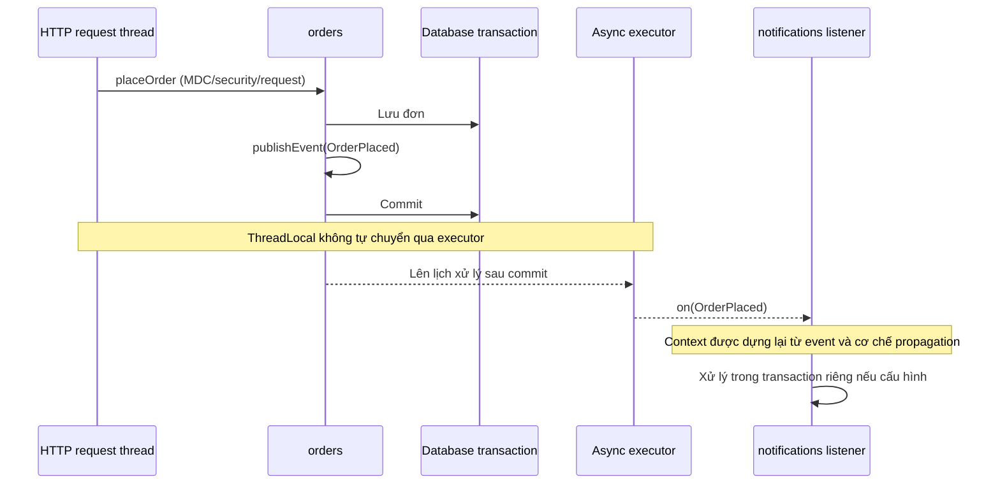

# Context propagation khi xử lý event đồng bộ và bất đồng bộ trong Spring Modulith

## 1. Vì sao context propagation quan trọng?

Trong module học **SPRING_MODULITH_APPLICATION_EVENTS**, một module như `orders` có thể dùng `ApplicationEventPublisher` để phát `OrderPlaced`. Module `notifications` và `reporting` xử lý sự kiện mà không cần publisher biết chi tiết triển khai của họ. Đây là cách giảm phụ thuộc và bảo vệ ranh giới nghiệp vụ trong Spring Modulith.

Khi mọi thứ chạy **đồng bộ trên cùng thread**, các thông tin gắn với thread hiện tại thường còn sẵn cho listener: mã tương quan của request trong logging MDC, thông tin xác thực trong `SecurityContextHolder`, locale của request hoặc transaction đang hoạt động. Nhưng với **listener bất đồng bộ**, công việc chuyển sang thread khác; những thông tin ấy không mặc nhiên đi cùng event.

**Context propagation** là việc chủ động chuyển những phần ngữ cảnh cần thiết qua ranh giới thực thi (thread, executor, callback, transaction hoặc tiến trình), để một tác vụ vẫn có đủ thông tin cho logging, tracing và nghiệp vụ. Điều này **khác với việc truyền payload sự kiện** và không có nghĩa phải sao chép tất cả `ThreadLocal` từ thread phát.

Vấn đề thường gặp:

- Listener chạy thành công nhưng log không có `traceId` hoặc `correlationId`, nên không truy được yêu cầu gốc.
- `SecurityContextHolder.getContext().getAuthentication()` trả về `null` trong thread xử lý bất đồng bộ.
- `RequestContextHolder` không chứa request vì HTTP request đã kết thúc.
- Handler tưởng còn transaction của publisher trong khi nó đang chạy sau commit hoặc trong transaction riêng.
- Retry sau khi ứng dụng restart không còn MDC, security context hoặc context từ request gốc.

**Mục tiêu bài:** phân biệt context nào nên chuyển, context nào không thể hoặc không nên chuyển; thực hành Java, `@Async`, `@TransactionalEventListener`, `@ApplicationModuleListener`, MDC, TaskDecorator và kiểm thử việc truyền context an toàn.

## 2. Phân loại context trước khi lựa chọn cách truyền

Không có một “context” duy nhất trong Spring. Mỗi loại có phạm vi sống và ý nghĩa riêng:

| Context | Nguồn thông thường | Nhu cầu điển hình của listener | Có thể sao chép nguyên vẹn? |
| --- | --- | --- | --- |
| **Business context** | Payload: `orderId`, `eventId`, `tenantId`, `actorId` khi cần | Xử lý đúng nghiệp vụ, chống trùng, đối soát | Truyền dữ liệu tối thiểu, bất biến và có ngữ nghĩa rõ |
| **Logging MDC** | `org.slf4j.MDC`, thường dựa vào `ThreadLocal` | Gắn `correlationId`/`eventId` vào log | Có thể sao chép những key được phép và khôi phục/cleanup sau task |
| **Tracing/Observation** | Micrometer Observation/Tracing hoặc tracing SDK | Liên hệ span, đánh dấu latency và error | Dùng cơ chế context propagation được hỗ trợ, có cấu hình accessor |
| **Security context** | Spring Security `SecurityContextHolder` | Actor/audit hoặc kiểm tra quyền | Không mặc nhiên chuyển toàn bộ Authentication; ưu tiên contract nghiệp vụ |
| **Transaction context** | Spring `TransactionSynchronizationManager` | Gắn công việc vào transaction hiện tại | **Không** copy transaction gốc sang thread khác |
| **Request context** | `RequestContextHolder`, request attributes | HTTP headers hoặc locale cho xử lý request | Không giữ nguyên request object sau khi request kết thúc |
| **Locale/time zone** | `LocaleContextHolder`, thông tin người dùng | Định dạng thông báo cho đúng người nhận | Truyền giá trị locale/time zone nếu cần, tránh dựa vào thread hiện tại |
| **Reactive context** | Reactor `Context` | Tracing, security và transaction trong pipeline reactive | Không phải `ThreadLocal`; dùng cơ chế propagation reactive phù hợp |

Điểm cần nhớ: **business context quan trọng cho tính đúng đắn phải nằm trong event contract hoặc nguồn bền vững**. Logging/tracing context chỉ phục vụ khả năng quan sát có thể được copy ở thời điểm chuyển thread, nhưng không thay thế dữ liệu cần để retry sau restart.

## 3. Context thay đổi ở những ranh giới nào?

Một luồng điển hình:



Có ít nhất ba ranh giới khác nhau:

1. **Thread:** từ thread đang publish sang một thread của executor. `ThreadLocal` mặc định không được truyền qua.
2. **Transaction:** khi publisher commit, transaction đó đã kết thúc; listener sau commit không thể tiếp tục giao dịch gốc như một transaction đang mở.
3. **Thời gian/vòng đời ứng dụng:** khi publication được lưu và xử lý lại sau restart, mọi context chỉ có trong bộ nhớ đã biến mất.

Không nên nhầm việc executor có khả năng copy MDC với việc copy transaction, và cũng không nên nhầm `traceId` có trong log với bằng chứng sự kiện đã được lưu bền.

## 4. Listener đồng bộ: context có sẵn nhưng có nhiều coupling

Trong cấu hình `ApplicationEventMulticaster` mặc định, `@EventListener` thường chạy **đồng bộ** trên thread gọi `publishEvent(...)`:

```java
package com.example.shop.orders.internal;

import com.example.shop.orders.OrderPlaced;
import org.slf4j.MDC;
import org.springframework.context.event.EventListener;
import org.springframework.stereotype.Component;

@Component
class LocalAuditListener {

    @EventListener
    void on(OrderPlaced event) {
        String correlationId = MDC.get("correlationId");
        // Thường là giá trị đang có trên thread của publisher.
        auditLog.record(event.orderId(), correlationId);
    }
}
```

`auditLog` là dependency minh họa cần khai báo/tiêm trong chương trình thực tế. Ví dụ trên chỉ minh họa việc đọc MDC khi listener đồng bộ.

Nếu publisher đang ở trong `@Transactional`, listener đồng bộ có thể chạy **trước commit** và thấy transaction của publisher trên cùng thread. Khi đó:

- Listener chậm làm tăng thời gian xử lý request.
- Exception không được bắt có thể lan về publisher và làm transaction thất bại, tùy cấu hình multicaster và error handling.
- Nếu listener gọi email/HTTP bên ngoài, tác dụng phụ đó không rollback được chỉ vì transaction database rollback sau đó.
- Các thành phần chia sẻ thread-local context, nhưng sự chia sẻ ấy là **coupling theo cách thực thi**, không phải contract nghiệp vụ bền vững.

**Ngoại lệ:** nếu ứng dụng cấu hình `ApplicationEventMulticaster` dùng một `TaskExecutor` bất đồng bộ, không được mặc định mọi `@EventListener` chạy trên thread publisher. Với các transactional event listener, việc đăng ký callback gắn với transaction phải tuân theo khả năng hỗ trợ async của listener/multicaster; không chuyển toàn bộ callback sang executor tùy tiện rồi giả định transaction vẫn còn.

## 5. `@Async` làm mất những ThreadLocal nào?

`@Async` thường lên lịch method chạy trên một executor. Thread worker có thể là thread được tái sử dụng từ pool, không phải thread xử lý HTTP ban đầu.

```java
package com.example.shop.notifications.internal;

import com.example.shop.orders.OrderPlaced;
import org.slf4j.MDC;
import org.springframework.context.event.EventListener;
import org.springframework.scheduling.annotation.Async;
import org.springframework.stereotype.Component;

@Component
class AsyncOrderAuditListener {

    @Async("eventExecutor")
    @EventListener
    public void on(OrderPlaced event) {
        String correlationId = MDC.get("correlationId");
        // Có thể null nếu executor không có chính sách propagation.
        auditLog.record(event.orderId(), correlationId);
    }
}
```

Đây là đoạn minh họa: cần bật `@EnableAsync`, khai báo bean `eventExecutor` và tiêm `auditLog`. Quan trọng hơn, **`@Async` không có nghĩa là xử lý sau commit**. Method có thể chạy khi publisher chưa commit, nên consumer có thể truy vấn một đơn chưa xuất hiện trong transaction của mình hoặc gây tác dụng phụ cho giao dịch sau đó rollback.

Nếu cần sau commit, có thể kết hợp:

```java
@Async("eventExecutor")
@TransactionalEventListener(phase = TransactionPhase.AFTER_COMMIT)
public void on(OrderPlaced event) {
    notificationService.sendConfirmation(event.orderId());
}
```

Trong ví dụ này, `@TransactionalEventListener` đăng ký xử lý tại pha transaction phù hợp; `@Async` chuyển việc **chạy callback đã đủ điều kiện** sang executor. Nó không mang transaction publisher qua thread, và cũng không bảo đảm message được lưu bền nếu ứng dụng crash. Event phải được phát bên trong transaction phù hợp; khi không có transaction, transactional listener theo mặc định không chạy, trừ khi bật `fallbackExecution`.

## 6. `@ApplicationModuleListener` và việc mất context

Spring Modulith cung cấp `@ApplicationModuleListener` cho giao tiếp giữa các module. Annotation này kết hợp semantics listener **bất đồng bộ, xử lý sau commit và transaction riêng**; nó thích hợp cho tác vụ như gửi thông báo hoặc xây projection.

```java
package com.example.shop.notifications.internal;

import com.example.shop.orders.OrderPlaced;
import org.springframework.modulith.events.ApplicationModuleListener;
import org.springframework.stereotype.Component;

@Component
class OrderNotificationListener {
    private final ConfirmationSender sender;

    OrderNotificationListener(ConfirmationSender sender) {
        this.sender = sender;
    }

    @ApplicationModuleListener
    void on(OrderPlaced event) {
        sender.sendOnce(event.eventId(), event.orderId());
    }
}
```

`ConfirmationSender.sendOnce(...)` là API ví dụ và phải được triển khai với idempotency phù hợp. Hai ranh giới cần tách biệt:

- **Thread context:** phương thức có thể chạy trên worker thread, nơi MDC, security hay request thread-local ban đầu không hiện diện nếu chưa được propagate.
- **Transaction context:** listener xử lý với transaction **của chính nó**, không phải transaction publisher đã commit.

Event Publication Registry có thể theo dõi publication của các transactional listener được hỗ trợ khi đã cấu hình storage cần thiết. Nếu cần retry/replay, event phải chứa dữ liệu cần thiết để consumer xử lý lại; **registry không lưu thay toàn bộ ThreadLocal của HTTP request hoặc một Authentication object**.

## 7. Đừng truyền transaction của publisher sang thread mới

Transaction dùng tài nguyên như connection, persistence context và synchronization gắn với execution context. Sao chép thủ công `TransactionSynchronizationManager` hoặc truyền `EntityManager` qua thread để “giữ lại transaction” là một thiết kế không an toàn.

Ví dụ anti-pattern:

```java
@Async
public void handle(OrderPlaced event) {
    // Không được giả định transaction của nơi publish vẫn mở ở đây.
    entityManager.find(OrderEntity.class, event.orderId());
}
```

Hãy để module nhận thao tác qua API công khai, hoặc dùng repository thuộc module của nó trong transaction mới. Nếu listener cần query database, cấu hình transaction của **consumer** theo nhu cầu:

```java
@Service
class ReportingService {
    private final OrderProjectionRepository projections;

    ReportingService(OrderProjectionRepository projections) {
        this.projections = projections;
    }

    @Transactional
    public void updateFrom(OrderPlaced event) {
        projections.upsertFromEvent(event.orderId(), event.eventId());
    }
}
```

`OrderProjectionRepository` và `upsertFromEvent` là abstraction minh họa của module nhận, phải được triển khai. Với `@ApplicationModuleListener`, bản thân listener đã có ngữ nghĩa transaction riêng; ví dụ `ReportingService` cho thấy nguyên tắc **khai báo ranh giới transaction ở nơi xử lý**, không sao chép transaction gốc.

Đối với listener chạy đồng bộ ở `AFTER_COMMIT`, tài nguyên giao dịch của publisher có thể còn bị ràng buộc tới thread trong giai đoạn callback; nếu thực hiện **một giao dịch ghi mới**, hãy mở transaction mới thích hợp (chẳng hạn `REQUIRES_NEW`) thay vì giả định transaction đã commit có thể commit lần nữa.

## 8. Truyền MDC qua executor bằng `TaskDecorator`

MDC giúp thêm `correlationId`, `traceId`, `eventId` vào log. Với `@Async`, nếu muốn giữ một số MDC ở **thời điểm submit task**, có thể dùng `TaskDecorator` của Spring.

Ví dụ sau sao chép MDC từ thread submit sang task, sau đó **khôi phục MDC trước đó của worker** trong `finally` để tránh rò rỉ giữa các task dùng chung thread:

```java
package com.example.shop.config;

import java.util.Map;
import org.slf4j.MDC;
import org.springframework.core.task.TaskDecorator;

public final class MdcTaskDecorator implements TaskDecorator {

    @Override
    public Runnable decorate(Runnable task) {
        Map<String, String> captured = MDC.getCopyOfContextMap();

        return () -> {
            Map<String, String> previous = MDC.getCopyOfContextMap();
            try {
                restore(captured);
                task.run();
            } finally {
                restore(previous);
            }
        };
    }

    private static void restore(Map<String, String> context) {
        if (context == null || context.isEmpty()) {
            MDC.clear();
        } else {
            MDC.setContextMap(context);
        }
    }
}
```

Đăng ký decorator vào executor dành cho handler:

```java
package com.example.shop.config;

import org.springframework.context.annotation.Bean;
import org.springframework.context.annotation.Configuration;
import org.springframework.scheduling.annotation.EnableAsync;
import org.springframework.scheduling.concurrent.ThreadPoolTaskExecutor;

@Configuration
@EnableAsync
class EventAsyncConfiguration {

    @Bean("eventExecutor")
    ThreadPoolTaskExecutor eventExecutor() {
        ThreadPoolTaskExecutor executor = new ThreadPoolTaskExecutor();
        executor.setCorePoolSize(2);
        executor.setMaxPoolSize(8);
        executor.setQueueCapacity(200);
        executor.setThreadNamePrefix("event-");
        executor.setTaskDecorator(new MdcTaskDecorator());
        executor.initialize();
        return executor;
    }
}
```

Và chỉ định executor tại listener:

```java
@Async("eventExecutor")
@TransactionalEventListener(phase = TransactionPhase.AFTER_COMMIT)
public void on(OrderPlaced event) {
    log.info("Handling orderId={}", event.orderId());
}
```

Đoạn trên là một ví dụ hoàn chỉnh về **nguyên tắc chuyển MDC qua executor**, không phải cấu hình mặc định của mọi Spring Boot hoặc Spring Modulith version. Cần bổ sung import, logger và bean liên quan khi tích hợp mã vào dự án.

Những giới hạn quan trọng:

1. Decorator **chỉ sao chép MDC ở thời điểm task được submit**; nếu lúc ấy MDC đã bị xóa, nó không thể khôi phục correlation của request gốc.
2. Decorator này **không** chuyển transaction, Spring Security context, locale hoặc toàn bộ trace/observation context.
3. `MDC.getCopyOfContextMap()` phụ thuộc SLF4J backend có hỗ trợ MDC; cần kiểm thử với cấu hình logging thật.
4. Không nên sao chép bí mật, access token hoặc dữ liệu cá nhân vào MDC rồi nhân bản sang nhiều thread.
5. Nếu executor bị bão hòa/từ chối task, context propagation không giải quyết được việc **tác vụ có được thực thi không**; cần theo dõi queue, exception và chính sách phục hồi publication.

## 9. Micrometer Context Propagation và tracing

Trong các ứng dụng Spring Framework có tích hợp Micrometer, có thể sử dụng `ContextPropagatingTaskDecorator` (có từ Spring Framework 6.1) để chuyển những **context đã được đăng ký ThreadLocal accessor** qua executor.

```java
import org.springframework.core.task.support.ContextPropagatingTaskDecorator;
import org.springframework.scheduling.concurrent.ThreadPoolTaskExecutor;

// Khi tạo executor:
ThreadPoolTaskExecutor executor = new ThreadPoolTaskExecutor();
executor.setCorePoolSize(2);
executor.setMaxPoolSize(8);
executor.setTaskDecorator(new ContextPropagatingTaskDecorator());
executor.initialize();
```

Cách này phù hợp để phối hợp Micrometer Observation/Tracing, với điều kiện có **dependency, ContextRegistry và các accessor liên quan** trong môi trường thực tế. Nó không mặc nhiên sao chép mọi `ThreadLocal` tùy biến hoặc đảm bảo MDC được truyền nếu chưa có cơ chế accessor tương ứng.

Chọn cách áp dụng:

| Mục đích | Lựa chọn |
| --- | --- |
| Chỉ copy một số key MDC đơn giản | `MdcTaskDecorator` như ví dụ, khôi phục `finally` |
| Truyền tracing/observation context đã đăng ký | Micrometer Context Propagation + `ContextPropagatingTaskDecorator` |
| Truyền thông tin actor của Spring Security cho tác vụ có vòng đời ngắn | Cơ chế ủy quyền `SecurityContext` của Spring Security khi thật sự cần |
| Phục hồi event sau restart hoặc qua broker | Dữ liệu hợp đồng bền vững: `eventId`, `correlationId`, ID nghiệp vụ và metadata tối thiểu |

Không nên vô tình cấu hình nhiều decorator cùng sửa một context với quy tắc cleanup mâu thuẫn. Chọn một chính sách thống nhất, đo được bằng test, và hiểu rằng observation span khi replay có thể phải là **span mới có liên kết với event gốc**, không phải “giữ sống” span của request đã kết thúc.

## 10. Security context: lan truyền khi cần, không lấy đó làm nguồn sự thật

Spring Security thường đặt `SecurityContextHolder` theo thread. Vì thế trong listener bất đồng bộ:

```java
Authentication authentication =
        SecurityContextHolder.getContext().getAuthentication();
// Có thể null hoặc không phản ánh request gốc trên worker thread.
```

Spring Security có những wrapper executor như `DelegatingSecurityContextAsyncTaskExecutor` giúp chạy task với một `SecurityContext` được nắm bắt hoặc cung cấp theo cấu hình. Đây là cơ chế có ích cho **tác vụ ngắn trong cùng tiến trình** khi cần danh tính người gọi.

Tuy nhiên, với event có thể được lưu để retry:

- Khi xử lý lại sau vài giờ, phiên đăng nhập của người thao tác có thể đã hết hạn hoặc quyền đã thay đổi.
- Sao chép nguyên `Authentication` hoặc credential vào payload tạo rủi ro bảo mật và làm contract phụ thuộc implementation Spring Security.
- Truyền `SecurityContextHolder` của thread gốc không mang lại quyền giao dịch hay transaction của request sang listener.
- Consumer cần có **chính sách ủy quyền riêng**: quyền tại thời điểm phát, quyền hiện hành, hay quyền của service để hoàn thành side effect?

Khi nghiệp vụ cần biết **ai thực hiện hành động**, hãy cân nhắc một `actorId` hoặc thông tin audit được phép trong event, kèm kiểm tra quyền khi yêu cầu ban đầu được chấp nhận. Consumer không nên mặc định `actorId` là credential để thực hiện thao tác đặc quyền.

Với multi-tenant, nếu cần `tenantId` để đọc/ghi đúng phân vùng, cần đưa giá trị đó vào contract hoặc nguồn dữ liệu đáng tin cậy, xác minh tenant scope tại consumer, và không chỉ đọc từ một tenant ThreadLocal vốn có thể biến mất khi chuyển thread.

## 11. Request context, locale và dữ liệu đầu vào không nên giữ lâu

Một request HTTP có thể chứa `HttpServletRequest`, `RequestAttributes`, locale, timezone, headers hoặc session. Những thứ này gắn với vòng đời request; một listener sau commit hoặc sau restart **không được phụ thuộc** vào việc request object còn sống.

**Anti-pattern:**

```java
@ApplicationModuleListener
void on(OrderPlaced event) {
    var attributes = RequestContextHolder.currentRequestAttributes();
    // Có thể ném IllegalStateException trên thread khác,
    // hoặc request gốc đã kết thúc.
}
```

Đúng hơn là chốt các giá trị nghiệp vụ cần thiết **trước khi phát**:

```java
public record OrderPlaced(
        UUID eventId,
        UUID orderId,
        String correlationId,
        String notificationLocale
) {}
```

`notificationLocale` có thể là mã BCP 47 như `vi-VN`, nếu yêu cầu thông báo tại thời điểm đặt cần lưu ngôn ngữ. Nếu hệ thống muốn dùng **ngôn ngữ hiện tại của khách**, chỉ cần ID khách và đọc qua API công khai phù hợp. Phải chọn rõ snapshot hay trạng thái hiện hành, tránh đưa object request hoặc toàn bộ headers vào event.

Các headers như `Authorization`, cookie hoặc session token **không nên sao chép vào event**. Với dữ liệu được đưa vào log, hạn chế field nhạy cảm và quy định thời gian lưu.

## 12. Correlation ID bền vững hơn việc chờ MDC tự đi theo

Một mẫu thiết kế hữu ích là đặt `eventId`, `orderId` và `correlationId` trực tiếp vào event contract. Listener có thể tự dựng MDC **mỗi lần xử lý**, kể cả khi được retry bởi publication registry hoặc xử lý trên thread khác.

### 12.1. Định nghĩa event

```java
package com.example.shop.orders;

import java.time.Instant;
import java.util.Objects;
import java.util.UUID;

public record OrderPlaced(
        UUID eventId,
        UUID orderId,
        String correlationId,
        Instant occurredAt
) {
    public OrderPlaced {
        Objects.requireNonNull(eventId, "eventId");
        Objects.requireNonNull(orderId, "orderId");
        Objects.requireNonNull(correlationId, "correlationId");
        Objects.requireNonNull(occurredAt, "occurredAt");
    }
}
```

Hợp đồng này lưu danh tính nghiệp vụ; không lưu `MDC`, `SecurityContext` hoặc `EntityManager` như object Java. `correlationId` có thể được tạo ở HTTP boundary nếu request chưa có định danh đáng tin cậy; cần chuẩn hóa/kiểm soát độ dài và nội dung giá trị nhập từ ngoài để tránh giả mạo correlation hoặc log injection.

### 12.2. Publisher lấy correlation tại biên và đưa vào event

```java
package com.example.shop.orders.internal;

import com.example.shop.orders.OrderPlaced;
import java.time.Clock;
import java.time.Instant;
import java.util.UUID;
import org.springframework.context.ApplicationEventPublisher;
import org.springframework.stereotype.Service;
import org.springframework.transaction.annotation.Transactional;

@Service
class OrderPlacementService {
    private final OrderRepository repository;
    private final ApplicationEventPublisher publisher;
    private final Clock clock;

    OrderPlacementService(
            OrderRepository repository,
            ApplicationEventPublisher publisher,
            Clock clock
    ) {
        this.repository = repository;
        this.publisher = publisher;
        this.clock = clock;
    }

    @Transactional
    public UUID place(PlaceOrderCommand command, String correlationId) {
        var created = repository.create(command);

        publisher.publishEvent(new OrderPlaced(
                UUID.randomUUID(),
                created.id(),
                correlationId,
                Instant.now(clock)
        ));
        return created.id();
    }
}
```

`OrderRepository` và `PlaceOrderCommand` là abstraction minh họa, `Clock` cần có bean phù hợp. Quan trọng: `correlationId` đã được xác định trước khi publish; chính event giữ lại ID khi callback chuyển thread hoặc registry phát lại. Một retry **cùng sự kiện** phải giữ lại `eventId` và `correlationId`, không tạo một event ID mới ở mỗi lần giao.

### 12.3. Listener tự dựng MDC và luôn cleanup

```java
package com.example.shop.notifications.internal;

import com.example.shop.orders.OrderPlaced;
import java.util.Map;
import org.slf4j.MDC;
import org.springframework.modulith.events.ApplicationModuleListener;
import org.springframework.stereotype.Component;

@Component
class ConfirmationListener {
    private final ConfirmationSender sender;

    ConfirmationListener(ConfirmationSender sender) {
        this.sender = sender;
    }

    @ApplicationModuleListener
    void on(OrderPlaced event) {
        Map<String, String> originalMdc = MDC.getCopyOfContextMap();
        try {
            MDC.put("correlationId", event.correlationId());
            MDC.put("eventId", event.eventId().toString());
            MDC.put("orderId", event.orderId().toString());
            sender.sendOnce(event.eventId(), event.orderId());
        } finally {
            if (originalMdc == null || originalMdc.isEmpty()) {
                MDC.clear();
            } else {
                MDC.setContextMap(originalMdc);
            }
        }
    }
}
```

`ConfirmationSender.sendOnce(...)` là API minh họa và phải xử lý idempotency/đối soát thực sự cho email. Phần dựng MDC có giá trị cho **logging**; nó không cấu hình trace span hoặc business transaction. Đối với tracing, nên khởi tạo span/observation bằng công cụ đo đạc đang dùng và liên kết với `correlationId` hoặc `eventId` theo chính sách của hệ thống.

**Ưu điểm của cách này:** ngay cả khi không truyền được ThreadLocal tại lúc enqueue, listener vẫn có các khóa truy vết quan trọng. Đây cũng là hướng đáng tin hơn cho retry, vì business metadata bền hơn vòng đời của một HTTP request.

## 13. Retry, replay và restart: context gốc không còn tồn tại

Khi sử dụng Event Publication Registry với persistence phù hợp, một publication chưa hoàn tất có thể được xem xét và resubmit theo cơ chế được cấu hình. Khi listener chạy lại:

```text
Request lúc 09:00
  MDC: correlationId=c-123, user session, trace span, locale
  publish OrderPlaced(eventId=e-456, correlationId=c-123)
  commit
  → Listener lỗi / app restart

Phục hồi lúc 10:00
  Thread mới, không còn request/session/transaction gốc
  đọc OrderPlaced(eventId=e-456, correlationId=c-123)
  → tái dựng log context từ payload
  → mở transaction consumer mới
  → xử lý idempotent
```

Không nên cố lưu toàn bộ `SecurityContext`, MDC, request attributes hay transaction synchronization vào publication để “giữ lại” context. Những object đó có vòng đời ngắn và có thể chứa bí mật; việc serialize cũng có thể không khả thi.

Thay vào đó:

- **Business context:** lưu ID nghiệp vụ, `eventId`, actor/tenant khi thật sự cần, snapshot phù hợp và version phục vụ đúng đắn.
- **Correlation:** lưu định danh ổn định để nối các lần xử lý khác nhau.
- **Trace:** lần retry là một hoạt động mới, có thể tạo observation/span mới và liên kết với event gốc.
- **Security:** consumer xác thực/ủy quyền theo service và contract, không dựa vào session đã kết thúc.
- **Transaction:** mỗi lần retry là một lần xử lý mới với transaction riêng.
- **Idempotency:** xác định rõ event đã được áp dụng chưa trước khi tác động database hoặc dịch vụ ngoài.

Registry chỉ phục vụ loại publication và listener được hỗ trợ theo cấu hình thực tế. Không được suy luận mọi `@EventListener` được lưu lại, tự phục hồi hoặc được giao đúng một lần.

## 14. Lỗi thường gặp khi propagate context

### Lỗi 1: Dùng `InheritableThreadLocal` để chữa mất context trong thread pool

`InheritableThreadLocal` chỉ kế thừa context trong những trường hợp tạo **thread con mới** theo cơ chế của Java; với thread pool, thread có thể được tạo trước yêu cầu hiện tại và tái sử dụng cho nhiều request. Cách này có thể giữ **context cũ hoặc không đúng user**, nguy hiểm với security và tenant isolation.

### Lỗi 2: Sao chép mọi thứ sang worker

Copy transaction resources, request object, principal kèm credential, toàn bộ MDC hoặc servlet headers làm tăng rủi ro rò rỉ và coupling. Chỉ truyền context cần thiết qua cơ chế hỗ trợ, ưu tiên dữ liệu bất biến trong event.

### Lỗi 3: Quên cleanup MDC

Executor dùng lại thread; nếu handler gọi `MDC.put(...)` mà không xóa/khôi phục, log của event sau có thể mang `orderId` hoặc `tenantId` trước đó. Dùng `try/finally` và kiểm thử liên tiếp nhiều task trên **cùng worker thread**.

### Lỗi 4: Nhầm `@Async` với `AFTER_COMMIT`

Chuyển task sang executor không đảm bảo transaction gốc đã commit. Consumer có thể thấy dữ liệu chưa có hoặc gây tác dụng phụ không thể rollback. Chọn `@TransactionalEventListener` hoặc `@ApplicationModuleListener` đúng với yêu cầu.

### Lỗi 5: Tin rằng propagate MDC giúp khôi phục event

MDC chỉ tồn tại trong bộ nhớ; nếu process crash, task decorator không giúp publication tồn tại. Cần Event Publication Registry/outbox phù hợp cho công việc quan trọng, cùng chiến lược retry và idempotency.

### Lỗi 6: Mang nguyên quyền người dùng vào xử lý muộn

Authentication có thể hết hạn hoặc quyền đã đổi trước khi event được retry. Consumer cần chính sách quyền rõ ràng và audit actor theo dữ liệu được phép, không mặc định sử dụng session cũ.

### Lỗi 7: Trộn correlation với bảo đảm thứ tự

`correlationId` nhóm các hoạt động thuộc một luồng, nhưng không bảo đảm thứ tự event. Nếu projection có thể nhận event sai thứ tự, cần version/sequence đáng tin cậy hoặc đọc lại trạng thái hiện tại.

## 15. Kiểm thử context propagation và độ tin cậy

Các test nên bao phủ **hai mặt riêng biệt**: context được cung cấp đúng khi chuyển thread, và business event vẫn xử lý đúng khi context gốc không tồn tại.

| Kịch bản | Điều cần chứng minh |
| --- | --- |
| `@EventListener` đồng bộ mặc định | Với multicaster đồng bộ, MDC trên cùng thread hiện diện; hiểu coupling với transaction |
| `@Async` không decorator | Không giả định MDC, request hoặc security context tự xuất hiện |
| `@Async` có MDC decorator | Key mong đợi được chụp tại lúc submit và khôi phục sau task |
| Hai task liên tiếp cùng worker | Task sau không thừa kế nhầm `eventId`/tenant của task trước |
| `@TransactionalEventListener(AFTER_COMMIT)` | Rollback publisher không kích hoạt side effect |
| `@ApplicationModuleListener` | Listener chạy với transaction riêng theo cấu hình; không dùng transaction publisher |
| Event phát ngoài transaction | Transactional listener có hành vi như contract đã chọn, không âm thầm mất |
| Request hoàn tất trước khi xử lý | Listener vẫn tìm được business/correlation ID từ event |
| Retry sau restart | Không cần HTTP request hay `SecurityContextHolder` cũ; event vẫn đủ dữ liệu xử lý |
| Xử lý duplicate | Cùng `eventId` không tạo tác dụng phụ trùng |
| Tracing context | Có span/observation đúng theo cơ chế accessor, không giả định MDC tự đủ |
| Tenant/actor context | Không nhầm tenant/người dùng khi chuyển thread hoặc replay |

Ví dụ unit test cho decorator MDC, với logging backend hỗ trợ MDC:

```java
import static org.junit.jupiter.api.Assertions.assertEquals;
import static org.junit.jupiter.api.Assertions.assertNull;

import com.example.shop.config.MdcTaskDecorator;
import java.util.concurrent.ExecutorService;
import java.util.concurrent.Executors;
import java.util.concurrent.Future;
import org.junit.jupiter.api.Test;
import org.slf4j.MDC;

class MdcTaskDecoratorTest {

    @Test
    void transfersAndCleansCorrelationId() throws Exception {
        MdcTaskDecorator decorator = new MdcTaskDecorator();
        ExecutorService pool = Executors.newSingleThreadExecutor();
        try {
            MDC.put("correlationId", "request-123");

            Runnable decorated = decorator.decorate(() ->
                    assertEquals("request-123", MDC.get("correlationId")));
            Future<?> first = pool.submit(decorated);
            first.get();

            // Kiểm tra task kế tiếp trên chính worker không bị rò rỉ MDC.
            Future<String> second = pool.submit(() ->
                    MDC.get("correlationId"));
            assertNull(second.get());
        } finally {
            MDC.clear();
            pool.shutdownNow();
        }
    }
}
```

Test giả định executor được tạo mới và worker không có MDC trước tác vụ đầu. Trong dự án thật, hãy kiểm thử thêm MDC vốn tồn tại trên worker, các exception trong task và cấu hình tracing/security mà ứng dụng sử dụng.

**Integration test** với Spring phải xác minh rằng `@Async` thực sự đi qua executor được trang trí; test chỉ gọi trực tiếp method listener sẽ bỏ qua proxy/dispatch và không phát hiện lỗi propagation. Test restart/registry cần backend lưu publication thật hoặc gần production, không được xem unit test MDC là bằng chứng về khả năng phục hồi.

## 16. Quy trình chọn chiến lược context propagation

Một trình tự thực hành hữu ích khi thêm handler bất đồng bộ:

1. **Liệt kê context** mà handler đang đọc (`MDC`, trace, security, tenant, locale, request, transaction).
2. **Phân loại mục đích**: dữ liệu nào quyết định kết quả nghiệp vụ, dữ liệu nào chỉ phục vụ logging/observability?
3. **Đưa context nghiệp vụ thiết yếu vào contract** hoặc một nguồn dữ liệu bền vững, với ID và snapshot tối thiểu.
4. **Chọn đúng listener**: đồng bộ khi thật sự cần cùng lời gọi/transaction, sau commit khi side effect không nên xảy ra trước commit, và bất đồng bộ khi cho phép hoàn thành muộn.
5. **Cấu hình executor** và decorator/propagator phù hợp cho MDC, tracing hoặc security; kiểm tra accessor và cleanup.
6. **Không kéo transaction/request sang thread khác**. Định nghĩa transaction và quyền truy cập ở consumer.
7. **Thiết kế xử lý lại**: ID event ổn định, idempotency, Event Publication Registry/outbox nếu cần và cách tái dựng log context sau restart.
8. **Kiểm thử cả đường lỗi**: rollback, executor rejection, context leak giữa các task, replay, tenant sai và consumer chạy không có request gốc.
9. **Quan sát**: liên kết log qua `eventId`/`correlationId`, đo latency và publication chưa hoàn tất mà không log dữ liệu nhạy cảm.

**Ghi nhớ:** Context propagation không phải “copy toàn bộ môi trường của publisher sang listener”. Trong Spring Modulith, listener đồng bộ có thể chia sẻ thread-local context; listener bất đồng bộ tạo **ranh giới thread**, còn listener sau commit tạo **ranh giới transaction** (không nhất thiết là thread mới nếu chạy đồng bộ). Hãy dùng TaskDecorator hoặc Micrometer cho những context ngắn hạn như MDC/tracing khi phù hợp; giữ **business context bất biến và bền vững trong event contract** để retry, khôi phục và đối soát. Tính đúng đắn nghiệp vụ vẫn cần ranh giới module rõ ràng, transaction phù hợp, Event Publication Registry, idempotency và kiểm thử.
