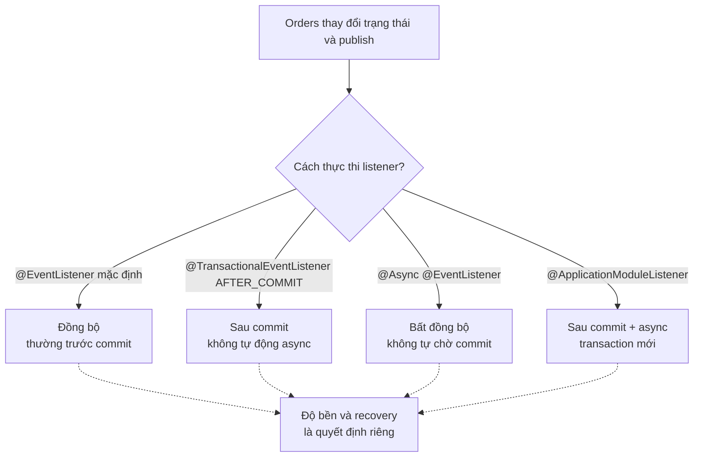
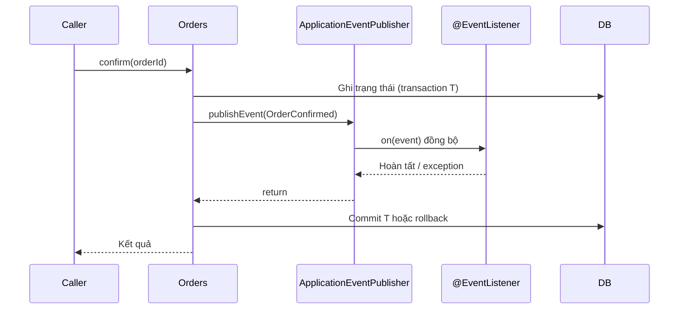
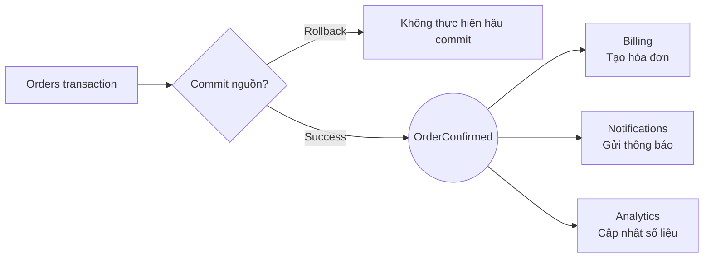
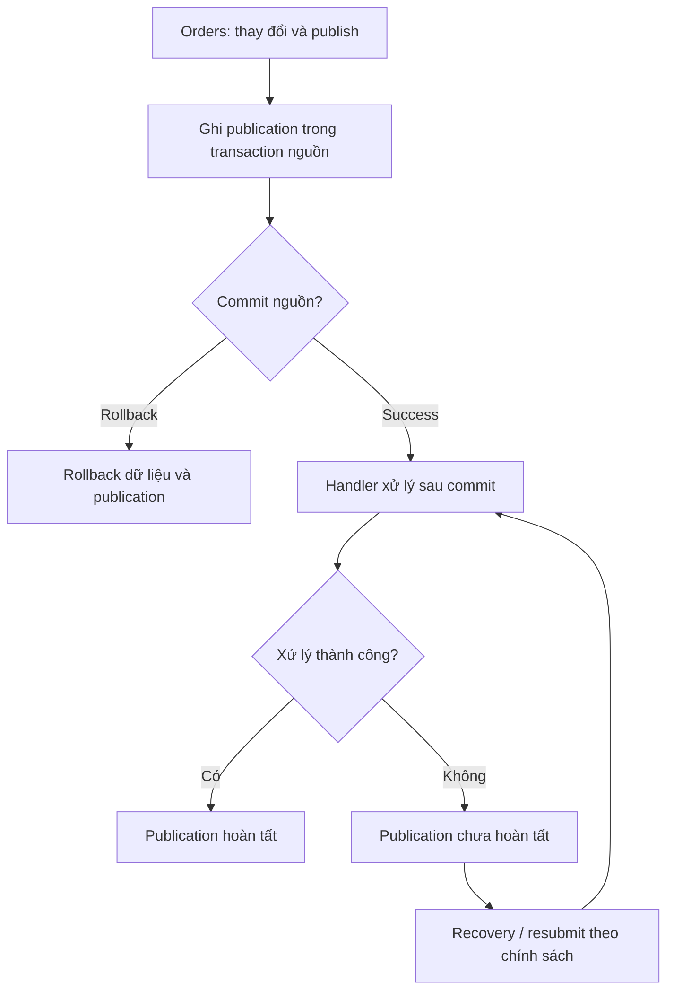

# Khi nào dùng đồng bộ

> **Chương:** Đồng bộ và bất đồng bộ  
> **Học phần:** `SPRING_MODULITH_APPLICATION_EVENTS` — giao tiếp giữa các module Spring Modulith bằng application events để giảm phụ thuộc, giữ ranh giới nghiệp vụ, sử dụng publisher/listener, xử lý sau commit, Event Publication Registry, retry, kiểm thử và quan sát các phản ứng sự kiện đáng tin cậy.

## 1. Câu hỏi đúng không phải “đồng bộ có cũ kỹ không?”

Trong một ứng dụng bán hàng tổ chức bằng Spring Modulith, người dùng bấm **Xác nhận đơn hàng**. Để trả về kết quả chính xác, hệ thống có thể cần kiểm tra quyền, trạng thái đơn và các bất biến nghiệp vụ. Sau đó, nhiều công việc phát sinh:

- Tính lại tổng tiền và xác nhận trạng thái đơn.
- Kiểm tra hoặc giữ tồn kho theo quy tắc nghiệp vụ.
- Phát hành hóa đơn.
- Gửi email xác nhận.
- Cập nhật thống kê và điểm thưởng.

Nếu đẩy **mọi thứ** sang bất đồng bộ, API có thể trả về “thành công” dù một điều kiện bắt buộc chưa được kiểm tra. Nếu giữ **mọi thứ** đồng bộ, request bị chậm vì email, thống kê hoặc hệ thống ngoài đang lỗi.

Quyết định đúng bắt đầu từ **ngữ nghĩa và mức nhất quán nghiệp vụ**:

> **Dùng đồng bộ khi người gọi cần kết quả ngay để quyết định bước tiếp theo, hoặc khi một điều kiện bắt buộc phải được kiểm chứng và hoàn tất trong ranh giới giao dịch phù hợp.** Dùng bất đồng bộ/hậu commit cho phản ứng có thể hoàn thành sau, có trạng thái trung gian rõ ràng và được thiết kế phục hồi nếu thất bại.

Trong Spring Modulith, có **hai hình thức đồng bộ cần phân biệt**:

1. **Gọi API trực tiếp, đồng bộ:** module A gọi một interface công khai của module B và nhận kết quả/exception rõ ràng.
2. **Xử lý event đồng bộ:** A phát event qua `ApplicationEventPublisher`; listener `@EventListener` mặc định chạy trong lời gọi publish, dù A không trực tiếp biết B.

Hai hình thức không tương đương về **hợp đồng gọi**, khả năng kiểm soát kết quả và tính dễ hiểu của quy trình.

## 2. “Đồng bộ” và “sau commit” là hai trục độc lập

Một nhầm lẫn phổ biến là đồng bộ nghĩa là “chạy trong transaction” và bất đồng bộ nghĩa là “sau commit”. Thực tế:

- **Đồng bộ/bất đồng bộ** mô tả **người gọi có chờ tác vụ hoàn tất hay không**.
- **Trước/sau commit** mô tả **tác vụ chạy vào thời điểm nào so với transaction nguồn**.
- **Bền vững/best-effort** mô tả **công việc có thể được khôi phục khi tiến trình gặp lỗi hay không**.



| Cơ chế | Người gọi chờ? | Liên hệ transaction nguồn | Độ tin cậy mặc định |
|---|---|---|---|
| Gọi Java service trực tiếp | Có | Có thể tham gia cùng transaction nếu cùng thread và transaction manager phù hợp | Không tự ghi công việc để retry |
| `@EventListener` | Có theo multicaster mặc định | Thường chạy ngay trong thread/transaction publisher | Không tự có persistent publication |
| `@Async @EventListener` | Thường không | Có thể bắt đầu **trước commit**; không tự chia sẻ transaction context | Không tự bền vững |
| `@TransactionalEventListener` mặc định | Callback sau commit; không tự `@Async` | `AFTER_COMMIT`; source đã commit | Không tự đồng nghĩa retry bền vững |
| `@ApplicationModuleListener` | Bất đồng bộ | Sau commit; phản ứng trong transaction mới | Có thể tích hợp Publication Registry khi cấu hình store |

Đây là bảng về hành vi **thông thường và mặc định**; ứng dụng có thể thay multicaster, executor, transaction configuration hoặc phiên bản thư viện. Muốn đưa ra cam kết cho hệ thống thật phải kiểm tra cấu hình và test.

## 3. Tiêu chí thứ nhất: cần quyết định ngay hay chấp nhận kết quả đến sau?

Hãy hỏi: **Nếu phản ứng chưa hoàn thành, API hiện tại có thể trả “thành công” mà vẫn đúng nghiệp vụ không?**

Ví dụ:

| Công việc | Người gọi cần ngay? | Lựa chọn thường phù hợp |
|---|---|---|
| Kiểm tra đơn còn ở trạng thái được phép xác nhận | Có | Đồng bộ trong domain/application service |
| Xác thực quyền xác nhận đơn | Có | Đồng bộ trước khi ghi trạng thái |
| Tính tổng tiền cuối cùng để hiển thị người mua | Có nếu response cam kết tổng tiền | Đồng bộ tại module sở hữu logic giá |
| Kiểm tra hạn mức giao dịch trước khi chấp thuận | Có nếu là điều kiện bắt buộc | API đồng bộ hoặc quy trình chờ/phê duyệt rõ |
| Ghi trạng thái đơn và ràng buộc dữ liệu cục bộ | Có | Transaction nguồn đồng bộ |
| Gửi email xác nhận | Thường không | Hậu commit/bất đồng bộ |
| Tạo báo cáo, projection, điểm thưởng | Thường chấp nhận trễ | Hậu commit với retry/idempotency khi quan trọng |
| Phát hành hóa đơn | Tùy hợp đồng HTTP và nghiệp vụ | Có thể đồng bộ hoặc phản ứng hậu commit với trạng thái PENDING |

Không có danh sách áp dụng được cho mọi dự án. Nếu `confirmOrder` được định nghĩa là **chỉ thành công khi invoice được phát hành**, Billing không thể bị xem là phản ứng “tùy chọn” chỉ vì nhóm lập trình thích event-driven. Phải đổi **định nghĩa trạng thái/response** hoặc cách tổ chức quy trình.

### 3.1. Hai hợp đồng API khác nhau

**Hợp đồng A — hoàn tất ngay:**

```http
POST /orders/{id}/confirm

200 OK
{
  "status": "CONFIRMED",
  "invoiceStatus": "ISSUED"
}
```

Nếu response cam kết invoice `ISSUED`, server phải có đủ bằng chứng rằng phát hành hóa đơn đã hoàn tất trước khi trả về. Nếu Billing là một hệ thống bên ngoài, không thể giả định transaction DB cục bộ bao trùm luôn việc phát hành.

**Hợp đồng B — chấp nhận xử lý hậu kỳ:**

```http
POST /orders/{id}/confirm

200 OK
{
  "status": "CONFIRMED",
  "invoiceStatus": "PENDING"
}
```

Sau đó Billing có thể phát `InvoiceIssued` và hệ thống cập nhật trạng thái. Trả `202 Accepted` cũng có thể phù hợp nếu **ngay cả việc xác nhận đơn** mới chỉ được tiếp nhận để xử lý sau. Việc dùng mã HTTP phụ thuộc **chính xác phần công việc đã hoàn thành**, không phải chỉ vì có một listener async ở phía sau.

## 4. Tiêu chí thứ hai: các thay đổi có cần cùng thành công hoặc cùng rollback?

Trong một modular monolith, nhiều module có thể chạy **cùng tiến trình**, thậm chí cùng datasource và transaction manager. Điều này tạo khả năng gọi đồng bộ và tham gia một transaction cục bộ. Tuy nhiên, **khả năng kỹ thuật** không có nghĩa mọi hành động liên module **nên** chia sẻ một transaction.

### 4.1. Bất biến phải nguyên tử

Giả sử quy tắc là: “Mỗi lần xác nhận đơn, tổng tiền và trạng thái đơn phải được cập nhật **cùng nhau**; không chấp nhận tổng tiền mới nhưng trạng thái cũ.”

Hai thay đổi này nên nằm trong một transaction đồng bộ của **module sở hữu đơn**. Domain method:

```java
@Transactional
public ConfirmedOrder confirm(UUID orderId) {
    Order order = orders.findById(orderId).orElseThrow();

    order.recalculateTotal();
    order.confirm(); // Kiểm tra các bất biến bắt buộc.

    return new ConfirmedOrder(
            order.getId(),
            order.getConfirmedTotal()
    );
}
```

`ConfirmedOrder` là DTO trả kết quả minh họa. Trong trường hợp này không cần phát event để xác nhận điều kiện mà application service **bắt buộc phải biết** trước khi hoàn tất.

### 4.2. Gọi đồng bộ xuyên module: được phép nhưng phải có hợp đồng

Giả sử Orders phải kiểm tra chính sách giữ hàng cục bộ do Inventory sở hữu **trước khi xác nhận**. Nếu cả hai module cùng datasource và có một transaction manager phù hợp, Orders có thể gọi một **API công khai** của Inventory:

```java
package com.acme.shop.inventory;

import java.util.UUID;

public interface InventoryReservation {

    ReservationResult reserveForOrder(UUID orderId);
}
```

```java
package com.acme.shop.inventory;

public record ReservationResult(
        boolean reserved,
        String reasonCode
) {}
```

Orders sử dụng hợp đồng:

```java
package com.acme.shop.orders.internal;

import com.acme.shop.inventory.InventoryReservation;
import com.acme.shop.inventory.ReservationResult;
import java.util.UUID;
import org.springframework.stereotype.Service;
import org.springframework.transaction.annotation.Transactional;

@Service
public class OrderService {

    private final OrderRepository orders;
    private final InventoryReservation inventory;

    public OrderService(
            OrderRepository orders,
            InventoryReservation inventory
    ) {
        this.orders = orders;
        this.inventory = inventory;
    }

    @Transactional
    public void confirm(UUID orderId) {
        Order order = orders.findById(orderId).orElseThrow();

        ReservationResult result =
                inventory.reserveForOrder(orderId);

        if (!result.reserved()) {
            throw new StockNotAvailableException(result.reasonCode());
        }

        order.confirm();
    }
}
```

`StockNotAvailableException` là ngoại lệ nghiệp vụ do dự án định nghĩa. Ví dụ này giả định `InventoryReservation` thực thi **đồng bộ trong cùng hệ thống quản lý transaction**, không gọi dịch vụ kho từ xa và không bắt/nuốt exception theo cách làm mất rollback.

**Ranh giới kiến trúc:** Orders chỉ import `com.acme.shop.inventory.InventoryReservation` và DTO API; nó không import `inventory.internal.StockRepository`. Cần kiểm tra ranh giới bằng Spring Modulith, đồng thời cân nhắc liệu việc đưa Inventory vào transaction nguồn có làm tăng lock contention/coupling hay không.

### 4.3. Khi inventory ở một dịch vụ bên ngoài

Nếu `reserveForOrder` gọi HTTP tới dịch vụ Inventory độc lập, `@Transactional` ở Orders **không thể tự rollback** trạng thái đã được ghi ở Inventory. Một request đồng bộ HTTP có thể cho phản hồi tức thì, nhưng không cung cấp **atomicity xuyên hệ thống**.

Khi cần phối hợp nhiều hệ thống độc lập, cần một **quy trình có trạng thái**, timeout, retry, idempotency và khả năng bù trừ (saga/orchestration) nếu phù hợp. Không áp dụng lời hứa “một transaction cho tất cả” chỉ vì code bên gọi là đồng bộ.

## 5. Gọi service trực tiếp hay phát synchronous event?

Đây là quyết định quan trọng nhất khi tổ chức giao tiếp bằng application events.

| Tiêu chí | Gọi API đồng bộ trực tiếp | `@EventListener` đồng bộ |
|---|---|---|
| Hợp đồng | “Hãy thực hiện X, trả kết quả hoặc báo lỗi” | “Sự việc Y đã xảy ra” |
| Kiểu kết quả | Return value/exceptions rõ ràng | Publisher không trực tiếp nhận kết quả từ từng listener |
| Số bên nhận | Thường một API đích được biết rõ | Một event có thể fan-out nhiều listener |
| Độ rõ của bước bắt buộc | Cao | Thấp nếu lạm dụng event làm command ngầm |
| Ảnh hưởng lỗi | Hiển thị rõ trong call stack | Listener đồng bộ có thể ném lỗi về publisher |
| Phụ thuộc mã nguồn | Caller phụ thuộc API module đích | Consumer phụ thuộc event API module phát |
| Thứ tự xử lý | Thể hiện rõ trong code caller | Có thể phụ thuộc thứ tự listener/registration, khó quản trị |
| Mở rộng phản ứng | Thường phải sửa caller | Có thể thêm listener mới mà không sửa publisher |

### 5.1. Trường hợp nên gọi trực tiếp

Giả sử để xác nhận đơn, Orders **phải biết** Inventory đã giữ hàng thành công hay chưa. Sử dụng:

```java
ReservationResult result =
        inventory.reserveForOrder(orderId);

if (!result.reserved()) {
    throw new StockNotAvailableException(result.reasonCode());
}
```

Đây là **command/query có kết quả bắt buộc**. Đổi thành sự kiện `OrderConfirmationRequested` rồi chờ một listener nào đó ném lỗi có thể khiến ranh giới nghiệp vụ không rõ: caller phải biết liệu listener tồn tại, đã chạy và đã hoàn tất chưa.

### 5.2. Trường hợp dùng synchronous event có thể phù hợp

Ví dụ một module muốn cập nhật một **projection phụ**, nhanh và nằm cùng transaction theo thiết kế. Publisher công bố `OrderStatusChanged`; một listener đồng bộ ghi vào read model mà nhóm đã quyết định được cập nhật nguyên tử với trạng thái nguồn:

```java
@Component
class OrderSummaryProjector {

    private final SummaryRepository summaries;

    OrderSummaryProjector(SummaryRepository summaries) {
        this.summaries = summaries;
    }

    @EventListener
    public void on(OrderStatusChanged event) {
        summaries.apply(event);
    }
}
```

Ví dụ giả định listener được thực thi đồng bộ trong **transaction nguồn**, cùng transaction manager và datasource cần thiết. Nếu listener lỗi và exception được truyền ra, transaction có thể rollback. Nhóm phải **chủ động chấp nhận** coupling lỗi đó; nếu projection chỉ là hậu xử lý không quan trọng với việc xác nhận đơn, nên tách sau commit.

**Nguyên tắc lựa chọn:** Synchronous event hữu ích khi muốn **một notification nhiều bên nhận trong cùng quy trình** và hiểu rõ hiệu ứng lỗi. Khi publisher cần **một kết quả bắt buộc cụ thể**, public API đồng bộ thường dễ đọc và đáng tin hơn.

## 6. `@EventListener` đồng bộ trong transaction: điều gì thực sự diễn ra?

Spring Framework mặc định dùng `ApplicationEventPublisher` và multicaster gọi những listener phù hợp **ngay khi publish**. Ví dụ:

```java
package com.acme.shop.orders.events;

import java.time.Instant;
import java.util.UUID;

public record OrderConfirmed(
        UUID eventId,
        UUID orderId,
        Instant occurredAt
) {}
```

Publisher:

```java
@Transactional
public void confirm(UUID orderId) {
    Order order = orders.findById(orderId).orElseThrow();
    order.confirm();

    events.publishEvent(new OrderConfirmed(
            UUID.randomUUID(),
            orderId,
            clock.instant()
    ));
}
```

Listener:

```java
@Component
class LocalOrderObserver {

    @EventListener
    public void on(OrderConfirmed event) {
        // Chạy đồng bộ theo cấu hình multicaster mặc định.
        // Transaction Orders thường chưa commit.
    }
}
```



Sự kiện có tên `OrderConfirmed` nhưng việc gọi listener đồng bộ **không chứng minh transaction nguồn đã commit**. Sau khi `publishEvent(...)` trở về, `@Transactional` của service vẫn phải kết thúc và transaction manager mới thực hiện commit.

### 6.1. Exception và rollback

Nếu listener đồng bộ ném một `RuntimeException` và không bị bắt, exception thường quay về `publishEvent(...)` và có thể khiến transaction nguồn rollback theo quy tắc Spring:

```java
@EventListener
public void on(OrderConfirmed event) {
    throw new IllegalStateException("Projection failed");
}
```

Điều đó **không phải** là giải pháp đáng tin cậy để thực thi điều kiện nghiệp vụ ẩn trong một listener ở module khác. Một người thay đổi annotation, bật async hoặc bắt exception có thể vô tình làm thay đổi hành vi xác nhận đơn. Điều kiện bắt buộc cần có hợp đồng gọi/kiểm thử rõ.

Nếu listener có side effect bên ngoài trước commit (gửi email, gọi payment API), transaction rollback **không thu hồi** side effect đó. Khi side effect phải chỉ xuất hiện sau commit, dùng transactional listener hoặc kiến trúc outbox phù hợp.

### 6.2. Có thể dùng `@Order` không?

`@Order` điều chỉnh thứ tự ưu tiên thực thi listener trong dispatch đồng bộ:

```java
@Order(10)
@EventListener
public void observeFirst(OrderConfirmed event) { /* ... */ }

@Order(20)
@EventListener
public void observeLater(OrderConfirmed event) { /* ... */ }
```

Giá trị order thấp hơn được ưu tiên hơn. Tuy nhiên, `@Order` không thể biến fan-out thành một **workflow phụ thuộc có bảo đảm hoàn tất** khi các listener chạy async hoặc sau commit, retry độc lập. Nếu Notifications cần **hóa đơn đã phát hành**, hãy để Billing phát `InvoiceIssued`, rồi Notifications lắng nghe event đó.

## 7. Khi nào một listener đồng bộ thực sự có ích?

Hãy đánh giá một listener đồng bộ bằng các câu hỏi:

1. **Công việc có nhỏ và có giới hạn thời gian rõ ràng không?** Nếu gọi HTTP mất vài giây, tránh giữ request/transaction chờ mà không cần.
2. **Kết quả có cần hoàn tất trước khi caller tiếp tục không?** Nếu có, tại sao không dùng API đồng bộ rõ hơn?
3. **Nếu listener thất bại, có chấp nhận publisher thất bại/rollback không?** Nếu không, chọn hậu commit.
4. **Side effect có rollback được trong transaction hiện tại không?** Nếu gửi email thì không.
5. **Nó có phụ thuộc vào dữ liệu chưa commit không?** Nếu có, phải hiểu isolation và transaction propagation.
6. **Tương lai có thể chuyển listener sang async không?** Nếu chuyển mà làm hỏng bất biến, đang có coupling ngầm.

Ví dụ những phản ứng đồng bộ có thể phù hợp trong giới hạn rõ:

- Quan sát trạng thái cục bộ phục vụ đo đạc ngắn, không có I/O nặng.
- Cập nhật một cấu trúc in-memory chỉ phục vụ lời gọi hiện tại, hiểu rõ khả năng rollback và không xem nó là dữ liệu bền vững.
- Đồng bộ hóa một projection cục bộ bắt buộc giữ cùng transaction, sau khi đã cân nhắc có nên gọi service trực tiếp thay vì event.
- Cơ chế extension point có hợp đồng rõ rằng lỗi extension sẽ làm tác vụ nguồn thất bại.

**Không áp dụng** cho tác vụ gửi email, external API hoặc xử lý tốn nhiều thời gian trừ khi có lý do đặc biệt và đã chấp nhận rủi ro transaction/latency.

## 8. Khi nào nên chọn sau commit hoặc bất đồng bộ thay vì đồng bộ?

Sau khi Orders commit, một số phản ứng có thể hoàn tất riêng:



Các trường hợp thiên về phản ứng hậu commit/async:

- Công việc không bắt buộc hoàn tất trước HTTP response.
- Phản ứng liên module có quyền sở hữu dữ liệu và transaction riêng.
- Gọi hệ thống ngoài với thời gian đáp ứng không ổn định.
- Cần giảm thời gian giữ lock, DB connection hoặc thread request.
- Cho phép trạng thái trung gian như `INVOICE_PENDING` hoặc `NOTIFICATION_PENDING`.
- Cần quan sát, retry độc lập một consumer mà không rollback trạng thái nguồn đã commit.

**Bất đồng bộ không tự động đáng tin hơn.** Nếu ứng dụng chết giữa commit nguồn và lúc một task async được chạy mà không lưu publication bền vững, có thể bỏ sót phản ứng. Độ tin cậy phải được thiết kế riêng.

### 8.1. `@TransactionalEventListener`: đồng bộ nhưng sau commit

```java
@Component
class OrderNotificationListener {

    private final NotificationGateway notifications;

    OrderNotificationListener(NotificationGateway notifications) {
        this.notifications = notifications;
    }

    @TransactionalEventListener(
            phase = TransactionPhase.AFTER_COMMIT
    )
    public void on(OrderConfirmed event) {
        notifications.sendConfirmation(event.orderId());
    }
}
```

`@TransactionalEventListener` mặc định ở pha `AFTER_COMMIT` và **không tự thêm `@Async`**. Callback sau commit có thể vẫn chạy trên thread của nguồn; vì vậy caller có thể còn chờ **thời gian thực thi callback**, dù việc commit chính đã kết thúc. Nếu callback throw, transaction nguồn đã commit **không thể rollback** chỉ vì callback lỗi.

Nếu callback sau commit cần **ghi dữ liệu DB mới**, hãy dùng một transaction mới thích hợp, ví dụ gọi service `@Transactional(propagation = Propagation.REQUIRES_NEW)`. Việc resource của transaction nguồn còn gắn với thread ngay sau commit có thể khiến một thao tác ghi không có commit mới như mong đợi.

Một event phát **ngoài transaction** sẽ không gọi listener transactional theo mặc định, trừ khi bật `fallbackExecution = true`.

### 8.2. `@Async @EventListener`: bất đồng bộ chưa chắc sau commit

```java
@Async
@EventListener
public void on(OrderConfirmed event) {
    analytics.update(event.orderId());
}
```

Nếu phát trong transaction nguồn, task này **có thể bắt đầu trước commit**, đọc thiếu dữ liệu mới hoặc xử lý một việc mà nguồn sau đó rollback. Cần bật/cấu hình `@EnableAsync` và executor phù hợp. Đừng dùng `@Async` thay cho việc chọn transaction phase.

### 8.3. `@ApplicationModuleListener`: tiện ích phù hợp giữa module

```java
package com.acme.shop.billing.internal;

import com.acme.shop.orders.events.OrderConfirmed;
import org.springframework.modulith.events.ApplicationModuleListener;
import org.springframework.stereotype.Component;

@Component
class OrderConfirmedHandler {

    private final InvoiceService invoices;

    OrderConfirmedHandler(InvoiceService invoices) {
        this.invoices = invoices;
    }

    @ApplicationModuleListener
    public void on(OrderConfirmed event) {
        invoices.issueIfAbsent(
                event.orderId(),
                event.eventId()
        );
    }
}
```

Spring Modulith `@ApplicationModuleListener` kết hợp semantics **transactional listener sau commit**, xử lý **async** và **transaction mới** cho listener (theo cơ chế `REQUIRES_NEW`). Đây là lựa chọn thường phù hợp với phản ứng giữa module có thể đến trễ.

Ứng dụng phải cấu hình/kiểm tra executor cho xử lý async, idempotency của Billing và kho lưu publication nếu yêu cầu khôi phục. **Một annotation không tự đảm bảo exactly-once.**

## 9. Ranh giới module vẫn quan trọng khi gọi đồng bộ

Gọi đồng bộ không nhất thiết làm mất kiến trúc module. Ranh giới đúng là caller chỉ tham chiếu **API được công bố**:

```text
com.acme.shop
├── ShopApplication.java
├── orders
│   └── internal
│       └── OrderService.java
├── inventory
│   ├── InventoryReservation.java    # Public API của Inventory
│   ├── ReservationResult.java       # DTO công khai
│   └── internal
│       ├── StockRepository.java
│       └── InventoryReservationService.java
└── billing
    └── internal
        └── OrderConfirmedHandler.java
```

Trong closed module theo chiến lược mặc định, những public types ở **base package** là API công khai, còn subpackage là nội bộ trừ khi được xuất qua `@NamedInterface`.

Nếu Orders cần gọi Inventory API:

```java
// orders/package-info.java
@org.springframework.modulith.ApplicationModule(
        allowedDependencies = "inventory"
)
package com.acme.shop.orders;
```

Quy tắc trên cho Orders tham chiếu API mặc định của Inventory. Nó **không** cho phép import `inventory.internal.StockRepository`.

Nếu dùng event contract `orders.events` cho Billing:

```java
// orders/events/package-info.java
@org.springframework.modulith.NamedInterface("events")
package com.acme.shop.orders.events;
```

```java
// billing/package-info.java
@org.springframework.modulith.ApplicationModule(
        allowedDependencies = "orders::events"
)
package com.acme.shop.billing;
```

Hãy dùng `ApplicationModules.verify()` để kiểm tra các phụ thuộc đã công bố:

```java
import org.junit.jupiter.api.Test;
import org.springframework.modulith.core.ApplicationModules;

class ArchitectureTests {

    @Test
    void modulesRespectBoundaries() {
        ApplicationModules.of(ShopApplication.class).verify();
    }
}
```

Kiểm thử module giúp phát hiện import vào internal package và một số vòng phụ thuộc; nó **không tự chứng minh** ranh giới transaction hay tính an toàn của việc gọi hệ thống ngoài.

## 10. Độ trễ: đồng bộ có “nhanh hơn” bất đồng bộ không?

Đồng bộ không đồng nghĩa nhanh; bất đồng bộ không đồng nghĩa có tổng thời gian xử lý ngắn hơn.

Với request xác nhận đơn:

```text
Đồng bộ:
  request -> kiểm tra -> cập nhật -> gọi Billing -> gửi email -> response
  Thời gian response chịu tổng độ trễ các bước đang chờ.

Hậu commit/async:
  request -> kiểm tra -> cập nhật -> commit -> response
                                  ├-> Billing
                                  ├-> Email
                                  └-> Analytics
  Response có thể sớm hơn; hoàn tất end-to-end có thể xảy ra sau.
```

Điều cần đo ở cả hai cách:

| Chỉ số | Vì sao quan trọng? |
|---|---|
| `p50/p95/p99 request latency` | Thời gian người dùng đợi và tình trạng tail latency |
| Transaction duration | Thời gian giữ lock/connection và nguy cơ xung đột |
| Số request đồng thời | Mức tiêu thụ thread và khả năng chịu tải |
| Queue depth / executor rejection | Tắc nghẽn xử lý async |
| Event-to-completion latency | Mức độ eventual consistency thực tế |
| Failure/retry rate | Chất lượng xử lý hậu commit |
| Publication backlog và tuổi bản ghi cũ nhất | Khả năng hệ thống bị tích tụ công việc |

Một synchronous call tới một service bên ngoài bị timeout có thể làm request treo lâu hơn dự định. Cần thiết kế timeout, circuit breaker, rate limiting và fallback phù hợp khi giao tiếp ngoài tiến trình. **Không** âm thầm biến một kiểm tra bắt buộc thành “bỏ qua khi timeout” trừ khi nghiệp vụ chấp thuận chính sách fail-open.

### 10.1. Blocking và thread pool

Với mô hình request thread truyền thống, gọi đồng bộ tiêu thụ thread trong lúc chờ I/O. Nếu nhiều request cùng chờ, pool cạn có thể làm throughput giảm. Async giảm thời gian chiếm thread request nhưng **không làm biến mất công việc**: task vẫn cần CPU, thread/connection và queue ở nơi khác.

Một hệ thống async không giới hạn queue có thể trả HTTP nhanh nhưng backlog tăng đến mức không đạt yêu cầu nghiệp vụ. Vì vậy **so sánh bằng SLO end-to-end**, không chỉ nhìn thời gian phản hồi của controller.

## 11. Độ tin cậy: chọn đồng bộ không xóa nhu cầu xử lý lỗi

Với lời gọi đồng bộ trong cùng một transaction DB, lỗi có thể khiến toàn bộ thao tác cục bộ rollback. Điều này hữu ích cho **bất biến nguyên tử** nhưng không giải quyết:

- Side effect đã gửi tới broker/email/payment bên ngoài.
- Lỗi xảy ra **sau khi transaction nguồn commit**.
- Retry của client khi không chắc request trước đó đã thành công.
- Hai request cạnh tranh thực hiện cùng một hành động.

Với fan-out sau commit, Spring Modulith cung cấp **Event Publication Registry** để theo dõi publication cho các transactional listener phù hợp khi được cấu hình kho lưu.



**Điều kiện:** Cần persistent publication store được cấu hình đúng, listener transactional phù hợp và cơ chế resubmit/recovery được vận hành/kiểm thử theo phiên bản Spring Modulith. `@EventListener` đồng bộ thông thường **không mặc định được theo dõi giống một transactional publication**. Việc chỉ gọi `publishEvent` không tự tạo hàng đợi bền vững.

### 11.1. Bảo đảm gì khi xử lý lại?

Nếu Billing đã commit invoice nhưng tiến trình dừng trước khi publication được đánh dấu hoàn tất, lần retry có thể gọi Billing lần nữa. Dù dùng đồng bộ hay async, **idempotency** luôn cần khi hành động có thể được yêu cầu lặp:

```java
@Service
public class InvoiceService {

    private final InvoiceRepository invoices;

    public InvoiceService(InvoiceRepository invoices) {
        this.invoices = invoices;
    }

    @Transactional
    public void issueIfAbsent(UUID orderId, UUID eventId) {
        if (invoices.existsByOrderId(orderId)) {
            return;
        }
        invoices.save(Invoice.forOrder(orderId, eventId));
    }
}
```

Trong ví dụ **một invoice cho mỗi order**, database cần **unique constraint trên `invoice.order_id`**; `existsByOrderId` một mình không an toàn khi xử lý đồng thời. Phải xử lý unique-violation đúng và tránh retry vô hạn lỗi dữ liệu không thể khắc phục.

`eventId` nhận diện một event instance, còn `orderId` là khóa bất biến nghiệp vụ ở ví dụ. Nếu provider bên ngoài có idempotency key, phải sử dụng nó theo hợp đồng provider. **Không cam kết exactly-once end-to-end** chỉ dựa vào registry hay annotation.

## 12. Một ma trận quyết định thực dụng

Chọn từ **yêu cầu quan sát được của người dùng**, không phải từ từ khóa “event-driven”.

| Câu hỏi | Nếu câu trả lời là “có” | Hướng thường phù hợp |
|---|---|---|
| Caller có cần một giá trị kết quả ngay? | Có | API đồng bộ, return/exception rõ |
| Đây là điều kiện bắt buộc để thao tác hiện tại thành công? | Có | Kiểm tra đồng bộ trước khi commit |
| Các cập nhật nằm trong một datasource/transaction và phải nguyên tử? | Có | Thực hiện đồng bộ trong transaction phù hợp |
| Tác vụ chạy lâu hoặc phụ thuộc API ngoài không ổn định? | Có | Cân nhắc hậu commit/async nếu nghiệp vụ cho phép |
| Side effect chỉ được làm nếu source đã commit? | Có | `@TransactionalEventListener(AFTER_COMMIT)` hoặc `@ApplicationModuleListener` |
| Cần một consumer có transaction riêng? | Có | `@ApplicationModuleListener`/listener giao dịch phù hợp |
| Phải phục hồi khi process crash? | Có | Persistent publication/outbox + recovery |
| Các handler có thể hoàn tất khác thời điểm? | Có | Fan-out hậu commit với trạng thái trung gian |
| Một handler cần kết quả của handler khác? | Có | Event kết quả như `InvoiceIssued` hoặc orchestration |
| Phụ thuộc ngoài tiến trình nhưng cần atomicity với DB? | Có | Không có bảo đảm từ `@Transactional` cục bộ; xem lại quy trình |

### 12.1. Ví dụ phân loại theo yêu cầu

**A. Kiểm tra quyền hạn:** đồng bộ; request không được tiếp tục nếu chưa xác thực và phân quyền.

**B. Giữ tồn kho trước xác nhận:** nếu là bất biến bắt buộc và Inventory cục bộ cùng transaction, có thể gọi API đồng bộ. Nếu Inventory là hệ thống độc lập, cần thiết kế timeout, reservation và workflow tương ứng.

**C. Gửi email sau xác nhận:** hậu commit/async; không cho email đã gửi trở thành bằng chứng đơn đã commit. Nếu gửi email quan trọng, phải có retry/idempotency.

**D. Cập nhật Analytics:** thường hậu commit; chấp nhận eventual consistency và có khả năng rebuild projection.

**E. Hiển thị số hóa đơn ngay trong response:** nếu business contract cam kết số hóa đơn đã phát hành, cần hoàn thành bước đó trước response hoặc thay response thành trạng thái chờ; không giả định handler hậu commit đã xong.

## 13. Quan sát để biết lựa chọn có đúng không

Sau khi chọn đồng bộ hoặc async, cần đo **hành vi thực tế**.

### 13.1. Đối với đường đồng bộ

Ghi nhận:

- Thời gian xử lý API từng bước và tổng latency.
- Thời gian transaction, lock wait và số connection đang sử dụng.
- Số lỗi do validation/invariant, timeout và lỗi service đích.
- Số lần client retry và tình huống trùng request.
- Mức độ phụ thuộc trực tiếp giữa module, tỷ lệ thay đổi API công khai.

### 13.2. Đối với đường hậu commit/async

Ghi nhận:

- `eventType`, `eventId`, `orderId`, `correlationId` trong structured logs.
- Listener/consumer và kết quả `SUCCEEDED/FAILED/RETRYING`.
- Số publication chưa hoàn tất, tuổi lớn nhất và nguyên nhân lỗi.
- Event-to-handler-completion latency.
- Executor queue, task rejection, retry/backoff và độ trễ thực tế.

Ví dụ log:

```json
{
  "eventType": "OrderConfirmed",
  "eventId": "90d6c18d-f6c7-4fbc-adcc-3d343cc5d1f4",
  "orderId": "e79a653b-755e-41a7-802d-91c409f8c6b2",
  "listener": "BillingOrderConfirmedHandler",
  "outcome": "RETRYING",
  "errorCategory": "DB_TIMEOUT"
}
```

Đây là **schema log minh họa** do ứng dụng thiết kế. Đừng đưa `eventId`, `orderId`, `correlationId` vào metric labels có cardinality cao; nên dùng log/traces. Các nhãn metrics nên giới hạn như `eventType`, `listener`, `outcome`.

Với async, MDC/trace context có thể không theo thread hoặc có thể không tồn tại khi resubmit sau restart. Nếu cần correlation bền vững, truyền ID ổn định qua event contract hoặc metadata được lưu thích hợp.

## 14. Kiểm thử lựa chọn đồng bộ bằng các kịch bản cụ thể

Đừng chỉ kiểm tra method được gọi; phải kiểm tra **trạng thái và điều kiện commit**.

### 14.1. Test điều kiện bắt buộc đồng bộ

Với ví dụ Orders cần Inventory:

1. Inventory trả `reserved = true`: đơn được xác nhận và transaction commit.
2. Inventory trả `reserved = false`: Orders trả lỗi nghiệp vụ, đơn không được xác nhận.
3. Inventory ném unchecked exception trong cùng transaction: kiểm tra rollback dữ liệu cục bộ.
4. Hai request cùng xác nhận một order: không tạo hai reservation hoặc hai chuyển trạng thái sai.
5. API Inventory ở package nội bộ: test ranh giới Spring Modulith phải báo vi phạm.

### 14.2. Test `@EventListener` đồng bộ

```java
@Component
class SynchronousObserver {

    private final List<UUID> observed = new CopyOnWriteArrayList<>();

    @EventListener
    public void on(OrderConfirmed event) {
        observed.add(event.orderId());
    }

    boolean hasObserved(UUID orderId) {
        return observed.contains(orderId);
    }
}
```

Trong test cấu hình multicaster mặc định, phát event rồi kiểm tra `hasObserved(orderId)` ngay sau `publishEvent(...)` để chứng minh handler đã chạy đồng bộ. `CopyOnWriteArrayList` chỉ là **trạng thái trong bộ nhớ cho minh họa test**; không phải cách lưu event production hoặc bảo đảm thread-safety cho toàn bộ hệ thống.

Để kiểm tra rollback: tạo một listener đồng bộ ném `RuntimeException`, gọi service `@Transactional` qua **Spring proxy**, rồi xác minh dữ liệu nguồn không commit. Đừng chỉ gọi method bằng `new` hoặc tự-invoke method transactional khiến AOP bị bỏ qua.

### 14.3. Test event hậu commit và eventual consistency

```java
@ApplicationModuleTest
class OrderPublishingTests {

    @Autowired
    OrderService orders;

    @Test
    void publishesConfirmedEvent(PublishedEvents publishedEvents) {
        UUID orderId = createConfirmableOrder();

        orders.confirm(orderId);

        assertThat(publishedEvents.ofType(OrderConfirmed.class)
                .matching(OrderConfirmed::orderId, orderId))
                .hasSize(1);
    }

    private UUID createConfirmableOrder() {
        // Viết fixture đúng với domain trong dự án.
        throw new UnsupportedOperationException("Implement fixture");
    }
}
```

Đoạn trên chỉ là **khung minh họa** cần bổ sung import, fixture và cấu hình module test. Nó chứng minh event được phát, **không** tự chứng minh Billing đã xử lý sau commit.

Với `@TransactionalEventListener` hoặc `@ApplicationModuleListener`, hãy:

- Chạy transaction nguồn **commit thực**; test transaction rollback mặc định không kích hoạt listener `AFTER_COMMIT`.
- Dùng `Scenario` của Spring Modulith hoặc cơ chế chờ điều kiện có timeout để xác minh kết quả async.
- Kiểm tra rollback nguồn không gây side effect hậu commit.
- Mô phỏng consumer lỗi và kiểm tra publication tồn đọng, resubmit với persistent store thực tế.
- Phát lại event có cùng ID để kiểm tra idempotency.

### 14.4. Test ranh giới kiến trúc

```java
import org.junit.jupiter.api.Test;
import org.springframework.modulith.core.ApplicationModules;

class ModulithArchitectureTests {

    @Test
    void verifyModuleBoundaries() {
        ApplicationModules.of(ShopApplication.class).verify();
    }
}
```

Test này phát hiện một số phụ thuộc code không hợp lệ và vòng phụ thuộc; nó không chứng minh “đồng bộ là đúng” về mặt business. Cần test nghiệp vụ, transaction, concurrency và performance riêng.

## 15. Những ngộ nhận cần tránh

| Ngộ nhận | Hệ quả | Cách hiểu đúng |
|---|---|---|
| “Event-driven thì phải async” | Đẩy điều kiện bắt buộc ra khỏi request | Có thể dùng API đồng bộ hoặc synchronous event khi phù hợp |
| “Đồng bộ thì data luôn commit khi listener chạy” | Listener thấy trạng thái chưa commit | `@EventListener` mặc định chạy lúc publish, trước commit nguồn |
| “`@TransactionalEventListener` là async” | Bất ngờ vì caller còn chờ callback | After commit là transaction phase, không phải async |
| “`@Async` nghĩa là sau commit” | Side effect xảy ra trước khi nguồn commit | Chọn transaction phase riêng |
| “`@Order` đảm bảo Billing xong trước Notifications” | Workflow hỏng khi async/retry | Dùng `InvoiceIssued` hoặc orchestration |
| “Gọi đồng bộ module khác phá kiến trúc Modulith” | Tạo event không cần thiết | API công khai đồng bộ vẫn hợp lệ khi có hợp đồng rõ |
| “Gọi đồng bộ API ngoài dưới `@Transactional` là nguyên tử” | Side effect ngoài không rollback | Workflow/compensation nếu qua hệ thống độc lập |
| “`publishEvent` tự lưu bền vững” | Mất phản ứng khi crash | Registry/outbox và persistent store khi cần |
| “Registry nghĩa là exactly-once” | Side effect trùng khi retry | Idempotency và unique constraint |
| “HTTP 200 nghĩa là mọi handler xong” | UI hiển thị sai trạng thái | Response phân biệt source commit và hậu xử lý |
| “Async làm hệ thống luôn nhanh hơn” | Queue/backlog tăng âm thầm | Đo latency end-to-end và giới hạn tài nguyên |
| “Test thấy event được phát tức đã commit” | Đánh giá sai callback sau commit | Test transaction/side effect thật |

## 16. Bài thực hành: lựa chọn đồng bộ theo hợp đồng nghiệp vụ

**Bối cảnh:** Ứng dụng Spring Boot/Spring Modulith có Orders, Inventory, Billing, Notifications và Analytics. Người dùng xác nhận đơn; phải giữ hàng hợp lệ trước khi xác nhận; hóa đơn và thông báo có thể hoàn tất sau.

### 16.1. Nhiệm vụ triển khai

1. Định nghĩa rõ response: nếu Order được xác nhận và Inventory giữ hàng thành công thì trả `CONFIRMED`; hóa đơn có thể ở `PENDING`.
2. Tạo public API `InventoryReservation.reserveForOrder(orderId)` cùng DTO `ReservationResult`.
3. Để `OrderService.confirm(...)` gọi Inventory **đồng bộ** trước khi xác nhận; thiết kế rollback/cạnh tranh cho trường hợp cùng datasource.
4. Nếu Inventory thực tế là hệ thống ngoài, mô tả lại luồng với timeout, trạng thái reservation, idempotency và bù trừ; **không** giả định transaction nguyên tử.
5. Cho Orders phát `OrderConfirmed` sau khi chuyển trạng thái hợp lệ trong transaction.
6. Viết một `@EventListener` cục bộ để quan sát và test tính đồng bộ của dispatch mặc định.
7. Cho Billing dùng `@ApplicationModuleListener` để tạo invoice trong transaction mới sau commit và có unique constraint phù hợp.
8. Cho Notifications xử lý sau commit; tránh gọi email khi Orders còn có thể rollback.
9. Nếu phản ứng không được bỏ sót sau crash, cấu hình Event Publication Registry với persistent store và recovery/resubmit.
10. Viết integration test cho Inventory từ chối, transaction rollback, Billing thất bại, retry lặp, concurrency và thời gian xử lý.
11. Dùng `ApplicationModules.verify()` để bảo đảm Orders chỉ gọi API Inventory công khai, Billing chỉ thấy event API Orders.
12. Bổ sung log/metric về latency request, transaction duration, publication backlog, event-to-completion latency và lỗi từng consumer.

### 16.2. Tiêu chí nghiệm thu

| Tiêu chí | Cách chứng minh |
|---|---|
| Inventory từ chối thì Order không confirmed | Integration test với transaction thật |
| Gọi Inventory đồng bộ trả kết quả rõ ràng | Test public API/exception |
| Không import repository nội bộ module khác | `ApplicationModules.verify()` |
| Orders chỉ phát event khi chuyển trạng thái hợp lệ | `PublishedEvents` và test nghiệp vụ |
| Listener đồng bộ chạy trước khi `publishEvent` trở về | Test với multicaster mặc định |
| Rollback Orders không kích hoạt Billing sau commit | Integration test rollback |
| Billing lỗi không làm rollback Orders đã commit | Test failure isolation |
| Retry không tạo invoice trùng | Unique constraint + test concurrency |
| Publication tồn đọng được phục hồi nếu đã cấu hình | Test registry/recovery với persistence |
| Response không tuyên bố các bước chưa hoàn tất | Contract test API |

### Câu hỏi tự kiểm tra

1. “Đồng bộ” và “sau commit” khác nhau như thế nào?
2. Tại sao `@EventListener` có thể xử lý `OrderConfirmed` dù transaction Orders chưa commit?
3. Khi nào gọi API trực tiếp rõ hơn phát một event đồng bộ?
4. Vì sao một validation bắt buộc không nên ẩn trong listener mà publisher không biết có tồn tại?
5. Nếu Inventory ở tiến trình độc lập, `@Transactional` có làm rollback được việc giữ hàng từ xa không?
6. `@TransactionalEventListener(AFTER_COMMIT)` có tự chạy bất đồng bộ không?
7. `@Async @EventListener` có luôn chạy sau commit không?
8. Vì sao queue async phải được đo cùng với HTTP latency?
9. Trong trường hợp nào Event Publication Registry cần thiết?
10. Phản ứng hậu commit có thể gây ra vấn đề exactly-once nào dù source đã commit?

## 17. Ghi nhớ

**Dùng đồng bộ** khi một quyết định hoặc bất biến bắt buộc cần được hoàn tất trước khi thao tác hiện tại có thể công bố thành công, khi caller cần giá trị trả về ngay, hoặc khi các cập nhật cục bộ cần cùng transaction. Trong Spring Modulith, **gọi API công khai đồng bộ giữa module là hợp lệ** nếu trách nhiệm, phụ thuộc và transaction rõ ràng; event không phải lựa chọn bắt buộc cho mọi tương tác.

`@EventListener` mặc định **đồng bộ lúc publish**, thường **trước commit**. `@TransactionalEventListener` xử lý theo transaction phase (mặc định `AFTER_COMMIT`) nhưng **không tự async**. `@ApplicationModuleListener` thích hợp cho phản ứng liên module hậu commit, async và transaction mới khi nghiệp vụ chấp nhận eventual consistency. Nếu cần độ tin cậy qua crash, phải cấu hình publication bền vững, recovery/retry, idempotency và kiểm thử tương ứng.

### Tài liệu tham khảo

- [Spring Modulith — Working with Application Events](https://docs.spring.io/spring-modulith/reference/events.html): listener giữa module, `@ApplicationModuleListener` và Event Publication Registry.
- [Spring Modulith — Fundamentals](https://docs.spring.io/spring-modulith/reference/fundamentals.html): API của application module và kiểm soát phụ thuộc.
- [Spring Modulith — Testing Application Modules](https://docs.spring.io/spring-modulith/reference/testing.html): `@ApplicationModuleTest`, `PublishedEvents` và `Scenario`.
- [Spring Framework — Standard and Custom Events](https://docs.spring.io/spring-framework/reference/core/beans/context-introduction.html#context-functionality-events): `ApplicationEventPublisher`, `@EventListener` và dispatch mặc định.
- [Spring Framework — Transaction-bound Events](https://docs.spring.io/spring-framework/reference/data-access/transaction/event.html): transaction phase và `@TransactionalEventListener`.
- [Spring Framework — Annotation-driven Async Execution](https://docs.spring.io/spring-framework/reference/integration/scheduling.html#scheduling-annotation-support-async): `@EnableAsync`, `@Async` và executor.
