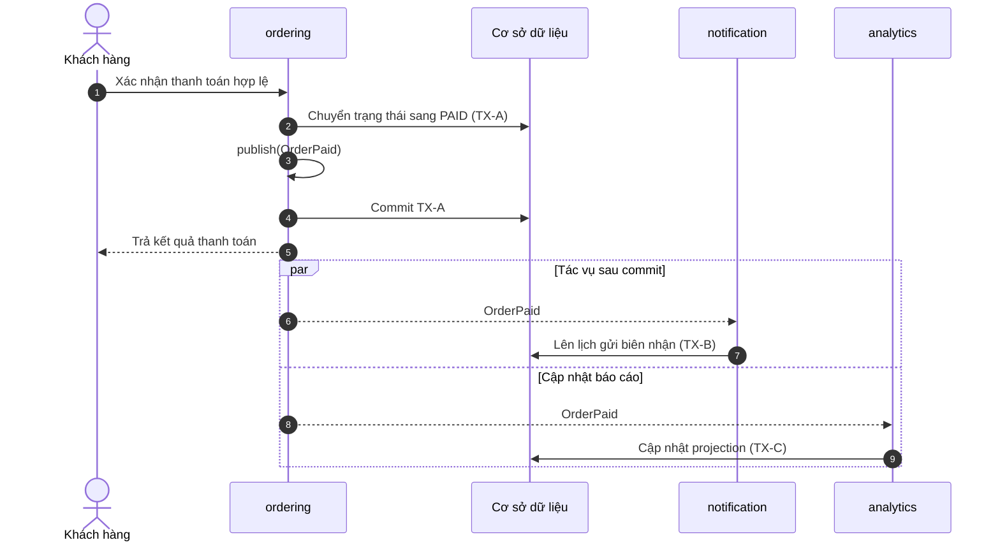
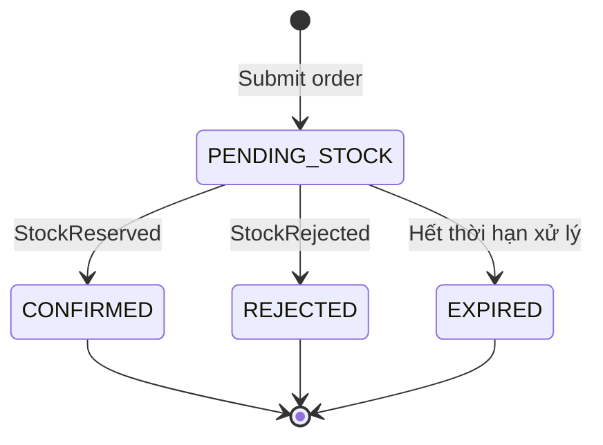

# Khi nào dùng bất đồng bộ trong Spring Modulith?

## 1. Câu trả lời ngắn: chọn bất đồng bộ theo ranh giới nghiệp vụ

Trong một ứng dụng **Spring Modulith**, các module như `ordering`, `inventory`, `billing` và `notification` thường cần phối hợp để hoàn tất một yêu cầu. Có hai nhóm nhu cầu rất khác nhau:

- **Đồng bộ (synchronous):** bên gọi phải nhận được kết quả của bước khác **trước khi có thể ra quyết định hoặc trả lời đúng cho người dùng**.
- **Bất đồng bộ (asynchronous):** bên gọi có thể hoàn tất phần trách nhiệm của mình, còn bước tiếp theo được xử lý **sau**, có thể trong một giao dịch riêng, với trạng thái trung gian và cơ chế phục hồi khi thất bại.

**Nên dùng bất đồng bộ khi việc thực thi bước sau không phải điều kiện tiên quyết để cam kết kết quả của bước trước**, đồng thời nghiệp vụ chấp nhận được độ trễ, trạng thái chưa hoàn tất và khả năng xử lý lại. Ví dụ: sau khi ghi nhận thanh toán đã thành công, việc tạo yêu cầu gửi biên nhận, cập nhật dashboard hoặc cộng điểm có thể diễn ra sau commit, nếu chính sách nghiệp vụ cho phép.

**Không nên chọn bất đồng bộ chỉ vì nghe có vẻ nhanh hơn.** Nếu khách hàng chỉ được thông báo “đơn đã xác nhận” khi đã giữ được hàng, một bước giữ hàng chạy sau commit đòi hỏi trạng thái `PENDING_STOCK`, phản hồi tiếp theo và thiết kế workflow rõ ràng. Nếu hệ thống không cho phép trạng thái trung gian đó, lời gọi đồng bộ qua **public API** của module có thể thích hợp hơn.

Phạm vi bài học là **SPRING_MODULITH_APPLICATION_EVENTS**: tổ chức giao tiếp giữa các module bằng Spring application events nhằm giảm phụ thuộc và bảo vệ ranh giới nghiệp vụ; thực hành publisher, listener sau commit, Event Publication Registry, retry, kiểm thử và quan sát việc giao sự kiện đáng tin cậy. Quyết định đồng bộ hay bất đồng bộ là quyết định **nghiệp vụ và nhất quán**, còn annotation chỉ là công cụ triển khai.

## 2. Phân biệt ba khái niệm dễ bị nhầm

### 2.1. Lời gọi đồng bộ

`ordering` gọi một public API của `inventory` và chờ kết quả:

```java
// API công khai do module inventory sở hữu.
public interface InventoryAvailability {
    boolean canReserve(UUID productId, int quantity);
}

// Bên trong ordering, gọi và sử dụng kết quả ngay.
if (!inventoryAvailability.canReserve(productId, quantity)) {
    throw new InsufficientStockException(productId);
}
```

Lời gọi đồng bộ tạo phụ thuộc có chủ đích từ module gọi đến **hợp đồng công khai** của module đích. Nó không sai kiến trúc nếu phụ thuộc đó là cần thiết. Tuy nhiên, `canReserve()` chỉ kiểm tra tồn kho tại một thời điểm, **không đảm bảo đã giữ hàng**. Nếu nghiệp vụ cần giữ hàng chắc chắn, cần một thao tác cập nhật nguyên tử hoặc một workflow giữ hàng có trạng thái rõ ràng.

### 2.2. Event không tự đồng nghĩa với bất đồng bộ

`ApplicationEventPublisher.publishEvent(...)` công bố sự kiện trong `ApplicationContext` của Spring:

```java
events.publishEvent(new OrderSubmitted(orderId));
```

Nếu consumer dùng `@EventListener` với multicaster mặc định, listener **thường chạy đồng bộ** ngay trong luồng gọi phát event. Lỗi của listener có thể ảnh hưởng lời gọi publisher. Vì vậy không thể suy từ việc có `publishEvent()` rằng xử lý đã tách khỏi đường đi đồng bộ.

### 2.3. Listener sau commit, bất đồng bộ và giao dịch riêng

Spring Modulith cung cấp `@ApplicationModuleListener` để biểu diễn mô hình quen thuộc khi giao tiếp giữa các module:

```java
@ApplicationModuleListener
public void on(OrderPaid event) {
    receiptRequests.scheduleOnce(event.orderId(), event.eventId());
}
```

Annotation này kết hợp ý nghĩa của **transactional event listener ở pha sau commit**, **xử lý bất đồng bộ** và **giao dịch mới cho listener**. Về mặt khái niệm có thể so với:

```java
@Async
@TransactionalEventListener(phase = TransactionPhase.AFTER_COMMIT)
@Transactional(propagation = Propagation.REQUIRES_NEW)
public void on(OrderPaid event) {
    // ...
}
```

Đây là cách **giải thích ngữ nghĩa**, không phải yêu cầu thêm cả ba annotation khi đã dùng `@ApplicationModuleListener`. Cấu hình executor, transaction manager, registry và retry vẫn cần được kiểm tra theo phiên bản Spring Boot/Spring Modulith trong dự án.

| Khái niệm | Câu hỏi nó trả lời | Điều không tự đảm bảo |
| --- | --- | --- |
| Event | Module phát đang thông báo sự thật gì? | Không tự làm listener bất đồng bộ |
| Async | Caller có phải chờ công việc hoàn tất không? | Không tự đảm bảo lưu bền vững, giao đúng một lần |
| After commit | Dữ liệu của publisher đã commit trước khi listener xử lý chưa? | Không biến hai transaction thành một |
| Transaction riêng | Nếu consumer thất bại có rollback thay đổi cục bộ không? | Không rollback được publisher đã commit |
| Event Publication Registry | Publication nào chưa được ghi nhận hoàn tất? | Không thay thế idempotency của nghiệp vụ |

## 3. Năm điều kiện ủng hộ xử lý bất đồng bộ

Trước khi chọn `@ApplicationModuleListener`, hãy đánh giá năm câu hỏi:

1. **Kết quả bước sau không bắt buộc để trả lời ngay.** Người dùng chỉ cần biết đơn đã được tiếp nhận; email xác nhận hoặc dashboard có thể cập nhật muộn.
2. **Có điểm commit nghiệp vụ rõ.** Publisher công bố một sự thật như `OrderPaid` sau khi ghi nhận trạng thái hợp lệ trong transaction. Listener có thể tin sự thật đó đã commit.
3. **Có thể biểu diễn trạng thái trung gian.** Nếu chờ xử lý kho hoặc phát hành hóa đơn, hệ thống có trạng thái `PENDING_*` và API/UX cho biết “đang xử lý”.
4. **Bước sau có thể được thử lại mà không tạo tác động trùng.** Có khóa idempotency, kiểm soát cạnh tranh, và cách đối soát khi kết quả không chắc chắn.
5. **Có cách quan sát và phục hồi.** Có thể thấy publication chưa hoàn tất, listener lỗi, đơn bị kẹt và thời hạn xử lý; có chính sách retry, cảnh báo hoặc can thiệp.

Khi năm điều kiện này thỏa mãn, bất đồng bộ thường giúp **giảm thời gian chờ của đường đi chính**, **giới hạn tác động của lỗi ở module phụ** và **giảm phụ thuộc trực tiếp giữa publisher với consumer**.

Nhưng nếu thiếu điều kiện 3–5, chuyển sang async có thể chỉ chuyển lỗi từ request hiện tại thành lỗi âm thầm nhiều phút sau.

## 4. Khi nào nên giữ đồng bộ?

Đồng bộ hợp lý khi một kết quả là **tiền điều kiện không thể trì hoãn** của hành động hiện tại:

| Tình huống | Vì sao cần đồng bộ hoặc thiết kế khác? | Hướng tiếp cận |
| --- | --- | --- |
| Phải xác thực quyền thực hiện trước khi chấp nhận thao tác | Không được commit rồi mới phát hiện caller không đủ quyền | Kiểm tra quyền đồng bộ tại ranh giới request/use case |
| Phải bảo vệ giới hạn tín dụng trước khi chấp thuận giao dịch | Trả “đã chấp thuận” quá sớm có thể vi phạm invariant | Public API đồng bộ với cơ chế cập nhật nguyên tử phù hợp |
| Cần giữ hàng **trước khi** tuyên bố đơn đã xác nhận | Giữ hàng trễ có thể thất bại | Giữ đồng bộ hoặc trả `PENDING_STOCK` cho workflow async |
| Bước thứ hai phải rollback cùng thay đổi đầu tiên | Hai transaction sau commit không có nguyên tử chung | Cùng transaction khi phù hợp tài nguyên; nếu không thì có workflow/bù trừ |
| Người dùng phải nhận giá trị tính toán ngay | Chưa có kết quả thì không thể trả response đúng | Gọi API/query đồng bộ |
| Module nhận không thể retry an toàn và không có đối soát | Giao trùng sau lỗi có thể gây mất tiền/dữ liệu | Thiết kế idempotency/khôi phục trước khi chuyển async |

**Lưu ý giao dịch:** Gọi hai module đồng bộ trong cùng một JVM không tự đảm bảo chúng chia sẻ một transaction. Điều đó còn phụ thuộc transaction manager, propagation và tài nguyên dữ liệu. Với dịch vụ ngoài như cổng thanh toán, một transaction SQL nội bộ **không** thể đảm bảo rollback một giao dịch đã thực hiện ở hệ thống bên ngoài.

**Ví dụ bất biến tồn kho:** nếu thao tác là “chỉ bán khi số lượng còn đủ”, phải dùng phép giữ hàng hoặc trừ tồn có khóa/version/ràng buộc nguyên tử. Một lời gọi kiểm tra `isAvailable()` thuần đọc không thay thế invariant đồng thời, dù nó là sync.

## 5. Ma trận quyết định nhanh

| Tiêu chí | Nghiêng về đồng bộ | Nghiêng về bất đồng bộ |
| --- | --- | --- |
| Caller cần kết quả của consumer ngay | Có | Không |
| Tác vụ là điều kiện để transaction chính được coi là thành công | Có | Không |
| Có thể chấp nhận vài giây/phút trễ | Không | Có, có SLA |
| Có trạng thái chờ minh bạch | Không có | Có `PENDING_*` và chính sách timeout |
| Consumer chủ yếu làm I/O ngoài hoặc công việc phụ | Có thể gây chặn request | Thường phù hợp nếu có hàng đợi/khôi phục |
| Cần retry và xử lý lỗi riêng | Khó tách lỗi | Phù hợp với publication registry và idempotency |
| Không thể tạo khóa idempotency hiệu quả | Rủi ro nếu xử lý lại | Cần bổ sung thiết kế trước |
| Tải tăng đột biến | Request thread dễ nghẽn | Có thể hấp thụ bằng executor/hàng đợi **được giới hạn** |
| Muốn tách ranh giới module | Public API là đủ khi có lý do | Event giúp publisher không biết số consumer |

Một **quy trình hỗn hợp** thường tối ưu hơn việc cố chọn một cách cho tất cả: xác thực và bảo vệ bất biến cần thiết theo lối đồng bộ; công bố domain event ở cột mốc đã commit; sau đó dùng listener bất đồng bộ cho các hệ quả có thể hoàn tất muộn.

## 6. Kịch bản A: gửi biên nhận sau thanh toán — nên bất đồng bộ

Giả sử các module:

- `ordering`: ghi nhận đơn chuyển thành `PAID` và công bố `OrderPaid`.
- `notification`: tạo yêu cầu gửi biên nhận, sau đó worker gửi email.
- `analytics`: cập nhật báo cáo doanh thu và trạng thái tổng hợp.

Người dùng chỉ cần biết việc thanh toán đã được xác nhận theo quy tắc hệ thống. Gửi email và cập nhật báo cáo **không phải điều kiện để thanh toán có hiệu lực**, nên có thể xử lý sau commit.



Sơ đồ diễn tả quan hệ logic. Trong thực tế, do xử lý bất đồng bộ, listener có thể bắt đầu **trước hoặc sau lúc HTTP response đến client**; điều được yêu cầu là listener sau commit phải bắt đầu sau khi transaction publisher commit, không phải sau thời điểm response được gửi.

TX-A, TX-B và TX-C không phải một transaction chung. Nếu hệ thống email lỗi, TX-A đã commit vẫn giữ trạng thái `PAID`. Nên ghi nhận yêu cầu gửi để retry, không đảo ngược thanh toán chỉ vì email chưa đi được.

### 6.1. Công bố hợp đồng event tối thiểu

```java
// ordering/OrderPaid.java — public API của module ordering
package com.example.shop.ordering;

import java.time.Instant;
import java.util.Objects;
import java.util.UUID;

public record OrderPaid(
        UUID eventId,
        UUID orderId,
        UUID customerId,
        Instant occurredAt) {

    public OrderPaid {
        Objects.requireNonNull(eventId);
        Objects.requireNonNull(orderId);
        Objects.requireNonNull(customerId);
        Objects.requireNonNull(occurredAt);
    }
}
```

Payload dùng các ID và dữ liệu có ý nghĩa, không mang JPA entity hay repository nội bộ. `eventId` nhận diện một lần xảy ra; `orderId` nhận diện đối tượng nghiệp vụ. Hai ID có ý nghĩa khác nhau cho chống trùng và truy vết.

### 6.2. Publisher chỉ phát khi chuyển trạng thái thành công

```java
// ordering/internal/OrderPaymentService.java
package com.example.shop.ordering.internal;

import com.example.shop.ordering.OrderPaid;
import java.time.Instant;
import java.util.UUID;
import org.springframework.context.ApplicationEventPublisher;
import org.springframework.stereotype.Service;
import org.springframework.transaction.annotation.Transactional;

@Service
class OrderPaymentService {

    private final OrderRepository orders;
    private final ApplicationEventPublisher events;

    OrderPaymentService(OrderRepository orders,
                        ApplicationEventPublisher events) {
        this.orders = orders;
        this.events = events;
    }

    @Transactional
    public void recordSuccessfulPayment(UUID orderId) {
        PaymentUpdate result = orders.markPaidIfEligible(orderId);

        if (result == PaymentUpdate.ALREADY_PAID) {
            return; // Retry không tạo event mới.
        }
        if (result != PaymentUpdate.CHANGED_TO_PAID) {
            throw new IllegalStateException("Cannot mark order paid");
        }

        events.publishEvent(new OrderPaid(
                UUID.randomUUID(),
                orderId,
                orders.customerIdOf(orderId),
                Instant.now()));
    }
}
```

`OrderRepository` và `PaymentUpdate` là các kiểu **nội bộ minh họa**, cần được khai báo và cài đặt đầy đủ trong dự án chạy thật. `markPaidIfEligible()` phải bảo vệ cạnh tranh bằng transaction/ràng buộc dữ liệu phù hợp; nó không đại diện cho tích hợp cổng thanh toán. Chỉ khi đã xác minh bằng chứng thanh toán hợp lệ, hệ thống mới nên gọi use case này.

### 6.3. Listener bất đồng bộ tạo công việc bền vững

```java
// notification/internal/PaidReceiptListener.java
package com.example.shop.notification.internal;

import com.example.shop.ordering.OrderPaid;
import org.springframework.modulith.events.ApplicationModuleListener;
import org.springframework.stereotype.Component;

@Component
class PaidReceiptListener {

    private final ReceiptRequestRepository receipts;

    PaidReceiptListener(ReceiptRequestRepository receipts) {
        this.receipts = receipts;
    }

    @ApplicationModuleListener
    public void on(OrderPaid event) {
        receipts.scheduleOnce(event.orderId(), event.eventId());
    }
}
```

`ReceiptRequestRepository.scheduleOnce(...)` là thao tác giả định có **khóa nghiệp vụ duy nhất**: mỗi đơn chỉ có một yêu cầu biên nhận thanh toán theo chính sách của ví dụ. Việc ghi yêu cầu là thay đổi local được thực hiện trong transaction của listener; email thực tế có thể được worker riêng xử lý sau. Một lỗi gửi email không được buộc thao tác ghi nhận thanh toán chạy lại.

## 7. Kịch bản B: giữ tồn kho trước xác nhận — cân nhắc rất kỹ

Giả sử business yêu cầu: **đơn chỉ được coi là xác nhận khi hàng đã được giữ chắc chắn**.

**Phương án đồng bộ:** `ordering` gọi public API `inventory.reserve(...)`, chờ kết quả rồi xác nhận đơn. Cần đánh giá ranh giới transaction và invariant tồn kho, kể cả các lỗi từ database/ngoại hệ thống. Phương án phù hợp nếu độ trễ thấp, việc giữ hàng có thể thực thi an toàn trong đường đi đồng bộ, và sản phẩm cần câu trả lời cuối ngay.

**Phương án bất đồng bộ:** `ordering` tạo đơn ở trạng thái `PENDING_STOCK`, phát `OrderSubmitted`, trả `orderId` kèm trạng thái đang xử lý. `inventory` giữ hàng sau commit và phát `StockReserved` hoặc `StockRejected`. Một module điều phối nhận kết quả và gọi API công khai của `ordering` để hoàn tất đơn.



Việc có trạng thái `EXPIRED` trong sơ đồ là **một lựa chọn thiết kế**, cần kèm quy trình kiểm tra/bù trừ lượng hàng đã giữ nếu listener hoặc kết quả trả về trễ. Không nên tự động coi “quá thời gian chờ” là “chưa giữ hàng”: có thể hàng đã được giữ nhưng thông tin kết quả bị mất hoặc chưa được xử lý.

| Câu hỏi | Nếu chọn đồng bộ | Nếu chọn bất đồng bộ |
| --- | --- | --- |
| Khi nào trả “CONFIRMED”? | Sau khi giữ hàng thành công | Chỉ sau khi workflow xử lý `StockReserved` |
| Khi nào trả response đầu? | Khi có kết quả cuối hoặc lỗi | Có thể trả ngay `PENDING_STOCK` |
| Nếu giữ hàng lỗi? | Caller nhận lỗi/kết quả ngay | Đơn giữ trạng thái chờ, retry hoặc chuyển `REJECTED` |
| Nếu thông điệp kết quả đến trễ? | Không có listener bất đồng bộ ở bước này | Phải bảo vệ chuyển trạng thái và đối soát |
| Nếu bước sau thất bại? | Phụ thuộc transaction và lời gọi đồng bộ | Không rollback publisher; cần workflow/bù trừ |

**Ranh giới quyết định:** không được giữ API trả “đã đặt và xác nhận thành công” trong khi thực tế mới công bố `OrderSubmitted` cho consumer bất đồng bộ. Thay đổi từ sync sang async thường là **thay đổi hợp đồng API và trải nghiệm người dùng**, không chỉ đổi annotation.

## 8. Sau commit là ranh giới quan trọng của sự thật nghiệp vụ

Với `@TransactionalEventListener`, pha mặc định là `AFTER_COMMIT`; `@ApplicationModuleListener` dựa trên mô hình này để xử lý sau commit trong giao dịch riêng. Ba thời điểm cần phân biệt:

1. **Phát event:** publisher gọi `publishEvent(...)` trong transaction, có thể vẫn chưa commit.
2. **Commit transaction nguồn:** dữ liệu publisher được ghi nhận thành công.
3. **Listener xử lý:** bắt đầu công việc bất đồng bộ với transaction riêng, có thể thất bại và xử lý lại.

```text
TX-A: ordering thay đổi dữ liệu + publish event
   ├── rollback → listener AFTER_COMMIT không chạy
   └── commit   → listener sau commit được kích hoạt
                    └── TX-B: notification xử lý
                          ├── thành công
                          └── rollback / cần retry
```

**Không có rollback dây chuyền:** nếu TX-A đã commit, lỗi ở TX-B không đảo ngược TX-A. Đây là điểm đánh đổi nhất quán cuối cùng (*eventual consistency*) khi chọn bất đồng bộ.

**Bẫy hay gặp:** nếu publisher phát event **không có transaction**, `@TransactionalEventListener` mặc định không được gọi (trừ khi cấu hình `fallbackExecution`). Cần kiểm tra `@Transactional` thực sự có hiệu lực qua Spring-managed proxy, tránh self-invocation hoặc nhầm đường đi làm mất transaction.

**Hạ tầng async:** khi ứng dụng sử dụng cơ chế `@Async`, cần bảo đảm async execution đã được bật hoặc được auto-configure phù hợp; executor có thread, queue và giới hạn thích hợp. Đừng mặc định việc dùng annotation là đã có thread pool được cấu hình an toàn cho mọi tải.

## 9. Bất đồng bộ cần Event Publication Registry để biết việc nào chưa xong

Giả sử một `OrderPaid` có hai listener: `notification` và `analytics`. Có thể listener báo cáo thành công còn gửi biên nhận thất bại. Spring Modulith cung cấp **Event Publication Registry** để theo dõi publication tới transactional listeners:

```text
OrderPaid(eventId = E-100)
   ├── notification.on(...)  → publication P-1: chưa hoàn tất
   └── analytics.on(...)     → publication P-2: đã hoàn tất
```

**ID event nghiệp vụ** trong payload khác **ID bản ghi publication** được hạ tầng quản lý. Một event có thể có nhiều publication theo các listener.

Khi dùng implementation lưu trữ bền vững được cấu hình phù hợp (chẳng hạn cơ chế JDBC/JPA hỗ trợ trong hệ sinh thái Spring Modulith), registry giúp phát hiện publication chưa được ghi nhận hoàn tất và hỗ trợ vận hành khôi phục sau lỗi.

**Không được kết luận “thêm `@ApplicationModuleListener` là đã có retry tự động vô hạn và exactly once”.** Chính sách tự động resubmit, lịch retry, cách truy cập publication và chi tiết persistence phụ thuộc phiên bản và cấu hình. Cần kiểm tra giải pháp lưu trữ, thời điểm hoàn tất và đường xử lý những publication bị kẹt.

### 9.1. Vì sao cần idempotency dù có registry?

Giả sử notification đã ghi yêu cầu gửi thành công vào database nhưng tiến trình dừng trước lúc publication được ghi nhận hoàn tất. Khi tái xử lý, cùng event có thể đến lần nữa. Nếu listener luôn `INSERT`, hệ thống có hai yêu cầu gửi.

Hai lớp chống trùng cần được cân nhắc:

| Lớp | Khóa ví dụ | Bảo vệ điều gì? |
| --- | --- | --- |
| Theo event | `(consumerName, eventId)` | Cùng event được xử lý lại |
| Theo hiệu ứng nghiệp vụ | `(orderId, notificationType)` | Hai event khác ID vẫn không tạo cùng biên nhận hai lần |

Ví dụ bảng lưu yêu cầu gửi:

```sql
CREATE TABLE receipt_request (
    id UUID PRIMARY KEY,
    order_id UUID NOT NULL,
    kind VARCHAR(40) NOT NULL,
    source_event_id UUID NOT NULL,
    status VARCHAR(20) NOT NULL,
    UNIQUE (order_id, kind)
);
```

Repository nên sử dụng cơ chế insert/upsert có bảo vệ concurrency; không chỉ `SELECT` rồi `INSERT` mà không có unique constraint. Với consumer dùng inbox `consumed_event`, việc ghi dấu đã xử lý và thay đổi local cần ở **cùng transaction** để không đánh dấu thành công khi nghiệp vụ vẫn rollback.

Đối với email, HTTP hoặc cổng thanh toán bên ngoài, transaction local không bao trùm hiệu ứng ở provider. Sau khi request đã thành công nhưng response bị mất, retry có thể làm lại. Cần idempotency key phía provider, tra cứu kết quả hoặc đối soát theo nghiệp vụ.

## 10. Async làm giảm chờ đợi, không xóa công việc hay tạo năng lực vô hạn

Một hiểu lầm phổ biến: chuyển từ sync sang async sẽ khiến hệ thống “xử lý nhanh hơn”. Thực tế:

- **Độ trễ được cảm nhận của caller** có thể giảm vì không chờ consumer.
- **Tổng lượng công việc** không giảm, và có thể tăng do serialization, lưu publication, retry hoặc đối soát.
- **Thông lượng tối đa** vẫn bị giới hạn bởi CPU, database connection pool, executor, API ngoài và tốc độ consumer.
- **Độ trễ hoàn tất nghiệp vụ end-to-end** có thể lớn hơn, đặc biệt khi backlog tăng.

Vì vậy, khi chọn async cần một chính sách **backpressure**: giới hạn executor/queue, timeout, số lần retry, tốc độ truy cập hệ thống ngoài và cách báo quá tải. Một executor không giới hạn hoặc queue tích lũy liên tục chỉ đẩy nghẽn ra chỗ khác.

### 10.1. Mốc đo phù hợp

| Chỉ số | Sync | Async |
| --- | --- | --- |
| Thời gian trả API | Bao gồm consumer đồng bộ | Thường chủ yếu thời gian publisher |
| Thời gian hoàn tất tác vụ | Gần thời gian trả API với quy trình giản đơn | Phải đo riêng |
| Backlog | Chủ yếu thấy request thread chờ | Cần đo queue/publication pending |
| Lỗi | Thường trả qua call stack | Cần log, metric, registry và retry |
| Khả năng hủy/timeout | Caller có thể ngắt chờ | Phải định nghĩa trạng thái và hành động khôi phục riêng |

Khi SLA yêu cầu “gửi email trong 30 giây”, chỉ đo response của `placeOrder()` là không đủ. Cần đo từ sự kiện nghiệp vụ được tạo/commit đến lúc tác vụ gửi hoàn tất; báo động khi quá ngưỡng.

## 11. Thứ tự và tính nhất quán: event đến sau chưa chắc là event mới hơn

Listener bất đồng bộ có thể xử lý event trùng hoặc ngoài thứ tự. Ví dụ:

```text
T1: OrderStatusChanged(orderId=A, status=PENDING_STOCK, version=2)
T2: OrderStatusChanged(orderId=A, status=CONFIRMED, version=3)
T3: Consumer analytics nhận version=3 trước
T4: Consumer analytics nhận version=2 sau
```

Nếu projection luôn ghi `newStatus` của event vừa tới, T4 sẽ kéo trạng thái về `PENDING_STOCK`. Với consumer duy trì **trạng thái mới nhất**, có thể dùng `aggregateVersion` tăng do module owner kiểm soát:

```sql
UPDATE order_projection
SET status = :incoming_status,
    aggregate_version = :incoming_version
WHERE order_id = :order_id
  AND aggregate_version < :incoming_version;
```

Với record chưa tồn tại, cần insert/upsert có điều kiện và xử lý cạnh tranh. Consumer ghi **lịch sử audit đầy đủ** lại có nhu cầu khác: không thể bỏ qua mọi event cũ chỉ vì projection đang ở version cao hơn.

`@ApplicationModuleListener` không mặc nhiên cung cấp thứ tự tuyệt đối xuyên tất cả events, listener hoặc transaction. Nếu thứ tự là yêu cầu nghiệp vụ bắt buộc, cần mô hình hóa và kiểm thử tường minh, hoặc xem xét giữ bước đó đồng bộ.

## 12. Những quyết định liên quan lỗi, timeout và bù trừ

Khi tách các bước thành transaction riêng, thất bại giữa quy trình là trạng thái **có thể xảy ra bình thường**, không phải ngoại lệ kiến trúc. Cần phân biệt:

| Loại tình huống | Ví dụ | Hành động phù hợp |
| --- | --- | --- |
| Lỗi kỹ thuật tạm thời | Timeout database, provider trả 503 | Retry có backoff/giới hạn, theo dõi pending |
| Kết quả nghiệp vụ hợp lệ | Không đủ tồn kho | Công bố `StockRejected` hoặc kết quả miền tương đương, không retry vô hạn |
| Không biết thao tác ngoài đã thành công chưa | HTTP timeout sau khi gửi thanh toán | Đối soát bằng khóa idempotency, không gửi lại mù quáng |
| Quá SLA nhưng công việc còn pending | Hóa đơn chưa phát hành sau 10 phút | Cảnh báo, retry có giới hạn, chính sách timeout/bù trừ |
| Dữ liệu event sai contract | Thiếu order ID, version không hỗ trợ | Chặn xử lý sai, ghi lỗi và khắc phục payload/schema |

Với workflow giữ hàng hoặc thanh toán, việc “bù trừ” không phải SQL rollback của transaction gốc. Đó có thể là **một lệnh nghiệp vụ mới**, ví dụ giải phóng hàng đã giữ khi đơn hết hạn, cùng các điều kiện idempotency và kiểm tra trạng thái.

**Một quy tắc quan trọng:** Nếu tác vụ không thể bù trừ, không thể nhận biết nó đã thành công chưa và cũng không thể retry an toàn, đừng chuyển nó sang async trước khi giải quyết các vấn đề này.

## 13. Đừng để async phá ranh giới module

Event hữu ích vì module phát chỉ biết **điều đã xảy ra**, không cần biết ai sẽ nghe. Nhưng nếu consumer import `ordering.internal.OrderRepository` hoặc nhận nguyên JPA entity từ event, coupling chưa được giải quyết.

Ví dụ cấu trúc:

```text
com.example.shop
├── ShopApplication.java
├── ordering
│   ├── OrderPaid.java                 # Public event
│   └── internal
│       ├── OrderPaymentService.java
│       └── OrderRepository.java
├── notification
│   └── internal
│       ├── PaidReceiptListener.java
│       └── ReceiptRequestRepository.java
└── analytics
    └── internal
        └── SalesProjectionListener.java
```

Trong mô hình module mặc định, application module thường được xác định từ các package con trực tiếp của base package. Các event cần consumer khác tham chiếu nên nằm trong **public API hoặc named interface** được công bố. Không xuất các class `internal` chỉ để listener tiện sử dụng.

Một test kiến trúc tiêu biểu:

```java
import org.junit.jupiter.api.Test;
import org.springframework.modulith.core.ApplicationModules;

class ArchitectureTest {

    @Test
    void moduleDependenciesAreValid() {
        ApplicationModules.of(ShopApplication.class).verify();
    }
}
```

Test giúp kiểm tra các phụ thuộc không hợp lệ và chu trình module. Lưu ý hướng phụ thuộc trong mã Java: consumer import public event type của publisher. Nếu hai module lần lượt import event nhau, có thể xuất hiện **vòng phụ thuộc** dù runtime giao tiếp qua event; khi đó cần xem xét module điều phối hoặc tái thiết kế quyền sở hữu hợp đồng.

## 14. Kiểm thử quyết định bất đồng bộ

Kiểm thử cần xác minh cả **lợi ích** lẫn **chi phí** của việc tách transaction: response của publisher, trạng thái trung gian, listener sau commit, khả năng xử lý lại và thời điểm hoàn tất cuối.

| Test case | Kỳ vọng |
| --- | --- |
| Publisher tạo event trong TX và commit | Listener sau commit có thể xử lý event |
| Publisher rollback | Listener `@ApplicationModuleListener` không chạy |
| Listener email thất bại | Đơn `PAID` không rollback; publication còn chưa hoàn tất khi có registry phù hợp |
| Listener nhận lại cùng event | Không tạo yêu cầu email trùng |
| Hai event khác ID cùng chỉ một hiệu ứng | Unique nghiệp vụ vẫn ngăn tác động trùng |
| Analytics nhận version 3 rồi 2 | Projection giữ trạng thái version 3 |
| Executor quá tải hoặc consumer chậm | Có metric/backlog và chính sách ứng xử đã định |
| Đơn `PENDING_STOCK` quá thời hạn | Có quy trình cảnh báo và xử lý timeout/bù trừ |
| Consumer truy cập package `internal` | Kiểm tra kiến trúc phát hiện vi phạm |

Spring Modulith cung cấp `@ApplicationModuleTest` và các công cụ kiểm thử sự kiện như `PublishedEvents` hoặc `Scenario` ở các phiên bản hỗ trợ. Ví dụ khung:

```java
import org.junit.jupiter.api.Test;
import org.springframework.modulith.test.ApplicationModuleTest;

@ApplicationModuleTest
class OrderingModuleTests {

    @Test
    void publishesOrderPaidOnlyForCommittedTransition() {
        // Arrange: tạo đơn chưa thanh toán.
        // Act: ghi nhận thanh toán hợp lệ qua public API.
        // Assert: trạng thái PAID và đúng một OrderPaid.
        // Repeat: không tạo OrderPaid mới nếu trạng thái đã PAID.
    }
}
```

Đây là **khung minh họa** chứ chưa phải test chạy độc lập; phải viết fixture và assertion thật. Với listener bất đồng bộ, cần chờ điều kiện/sự kiện với timeout có giới hạn thay vì cố định `Thread.sleep()`.

**Lưu ý riêng với test transaction:** test đánh dấu `@Transactional` và rollback mặc định có thể khiến listener `AFTER_COMMIT` không bao giờ được kích hoạt. Để kiểm thử sau commit, hãy để transaction publisher thật sự commit hoặc điều khiển transaction test bằng cơ chế thích hợp. Đừng sửa production listener chỉ để vượt qua một test chưa mô phỏng đúng commit.

## 15. Quan sát async bằng trạng thái nghiệp vụ, không chỉ bằng log event

Một đường đi bất đồng bộ tốt phải trả lời được ba câu hỏi vận hành: **đã phát sự kiện chưa? consumer nào đã hoàn tất? nghiệp vụ cuối cùng đang ở đâu?**

Nên theo dõi:

- **Trạng thái nguồn:** số đơn `PAID`, `PENDING_STOCK`, `CONFIRMED`, `REJECTED` và thời gian tồn tại ở trạng thái trung gian.
- **Publication:** số publication chưa hoàn tất, tuổi của bản ghi lâu nhất, tên listener lỗi và số lần retry theo chính sách.
- **Độ trễ:** từ commit bước đầu đến listener bắt đầu, hoàn tất; độ trễ end-to-end của workflow.
- **Độ tin cậy:** số event trùng bị loại theo idempotency, số thao tác đối soát và bù trừ.
- **Tải:** executor queue, thread hoạt động, kết nối database và lỗi timeout đến downstream.

Ví dụ log consumer:

```json
{
  "eventType": "OrderPaid",
  "eventId": "e2e590c7-dca7-4773-bf78-1b46ef82354a",
  "orderId": "ab853510-8887-43eb-8a89-4c9077c908ad",
  "module": "notification",
  "listener": "PaidReceiptListener",
  "result": "RECEIPT_REQUEST_SCHEDULED"
}
```

Để ghép nhiều sự kiện của cùng workflow, có thể thêm `correlationId` vào hợp đồng/log. Kết hợp với Spring Boot Actuator, Micrometer Tracing hoặc nền tảng observability khi được cấu hình; không mặc định framework tự xuất mọi metric này. Tránh đưa dữ liệu nhạy cảm vào payload/log khi không có nhu cầu rõ và biện pháp bảo vệ tương ứng.

## 16. Những ngộ nhận thường gặp

| Ngộ nhận | Hậu quả | Cách hiểu đúng |
| --- | --- | --- |
| “Có `publishEvent()` là bất đồng bộ” | `@EventListener` mặc định có thể vẫn chạy đồng bộ | Chọn annotation/listener và executor có chủ đích |
| “Bất đồng bộ luôn nhanh hơn” | Tổng công việc vẫn vậy; backlog tăng | Đo latency caller và hoàn tất end-to-end riêng |
| “Sau commit nghĩa là còn chung transaction với publisher” | Không thể rollback dữ liệu publisher từ consumer | Thiết kế transaction riêng, retry hoặc bù trừ |
| “Registry bảo đảm exactly once” | Giao lại có thể tạo tác động trùng | Idempotency theo event và theo nghiệp vụ |
| “Đặt hàng đã gửi event nghĩa là đã xác nhận” | API/UX thông báo sai trạng thái | Mô hình hóa `PENDING_*` và điều kiện xác nhận |
| “Có timeout là bước chưa làm gì” | Có thể đã thực hiện nhưng response mất | Đối soát trạng thái và dùng khóa idempotency |
| “Async không cần quản lý tải” | Queue/thread cạn tài nguyên | Executor giới hạn, backpressure và SLA |
| “Thứ tự phát là thứ tự xử lý” | Projection bị ghi lùi | Aggregate version và quy tắc ordering phù hợp |
| “Consumer chỉ cần nhận entity từ publisher” | Rò rỉ persistence và phụ thuộc nội bộ | Payload bất biến, public API |
| “Chạy thử bằng `Thread.sleep()` là đủ” | Test chập chờn và bỏ sót lỗi commit | Chờ điều kiện/Scenario với timeout |

## 17. Bài tập thực hành: chọn sync và async có căn cứ

**Bối cảnh:** Một cửa hàng có bốn module `ordering`, `inventory`, `notification` và `analytics`. Người dùng đặt đơn; hệ thống phải giữ hàng trước khi xác nhận, gửi email xác nhận và cập nhật doanh thu. Đội sản phẩm muốn trả response nhanh nhưng vẫn cần độ chính xác cao.

**Nhiệm vụ:**

1. Lập bảng các bước: xác thực yêu cầu, kiểm tra quyền, giữ hàng, tạo đơn, gửi email, cập nhật dashboard. Với từng bước, nêu **có cần kết quả ngay không**, có chấp nhận trạng thái trung gian không, và chọn sync/async.
2. Đề xuất hai luồng: (a) giữ hàng đồng bộ rồi xác nhận; (b) tạo đơn `PENDING_STOCK` rồi giữ hàng sau commit. So sánh hợp đồng API, transaction và UX.
3. Với phương án (b), xác định event `OrderSubmitted`, `StockReserved` và `StockRejected`, trạng thái cuối, timeout và điều kiện bù trừ.
4. Dùng `ApplicationEventPublisher` phát một event trong transaction của module owner; tạo `@ApplicationModuleListener` để module khác phản ứng sau commit.
5. Gắn một tác vụ phụ như email hoặc analytics với listener bất đồng bộ; thiết kế khóa idempotency và công việc lưu bền vững phù hợp.
6. Khi có Event Publication Registry bền vững, mô phỏng listener ném exception và thực hiện resubmit theo cơ chế được phiên bản đang dùng hỗ trợ. Kiểm tra trạng thái nghiệp vụ không tự rollback.
7. Tạo test rollback publisher, duplicate event, lỗi downstream, event ngoài thứ tự và consumer quá chậm. Không dùng thời gian ngủ cố định để làm test pass.
8. Thêm log có `eventId`, `orderId`, listener, trạng thái xử lý; viết một truy vấn tìm những đơn `PENDING_STOCK` vượt SLA.
9. Chạy `ApplicationModules.of(ShopApplication.class).verify()` để bảo đảm event listener không truy cập package nội bộ của module phát.

**Câu hỏi tự đánh giá:** Nếu khách hàng cần biết “đơn đã giữ hàng thành công” ngay khi API trả, nhưng đội phát triển muốn chuyển thao tác giữ kho sang listener sau commit, phải thay đổi điều gì trong hợp đồng API và state machine? Nếu email đã gửi thành công nhưng publication vẫn chưa hoàn tất, vì sao retry có thể gây gửi trùng? Nếu dashboard chậm 20 giây nhưng đơn hàng đã thanh toán, đây là lỗi consistency hay một sự đánh đổi được chấp nhận trong SLA?

**Tiêu chí hoàn thành:** Người học chỉ ra được các điều kiện chọn bất đồng bộ; biết khi nào giữ đồng bộ để bảo vệ invariant, phân biệt việc phát event với cách xử lý listener, giải thích after-commit/transaction riêng, xây được trạng thái trung gian, retry/idempotency và kiểm thử/quan sát một luồng xuyên module.

## 18. Ghi nhớ

Chọn **bất đồng bộ** trong Spring Modulith khi một bước có thể hoàn thành **sau điểm commit của nghiệp vụ chính**, không cần chặn phản hồi, và hệ thống chấp nhận được **nhất quán cuối cùng** cùng trạng thái trung gian, retry và quan sát. Chọn **đồng bộ** khi phải nhận kết quả để bảo vệ một invariant hoặc đưa ra cam kết tức thời. `@ApplicationModuleListener` giúp thực hiện listener bất đồng bộ sau commit trong giao dịch riêng; Event Publication Registry hỗ trợ theo dõi publication chưa hoàn tất nhưng không thay thế idempotency hoặc bù trừ. Một thiết kế tốt thường phối hợp cả hai: đồng bộ cho quyết định không thể trì hoãn, bất đồng bộ cho hệ quả độc lập, luôn có hợp đồng trạng thái, khả năng phục hồi và kiểm thử minh bạch.
