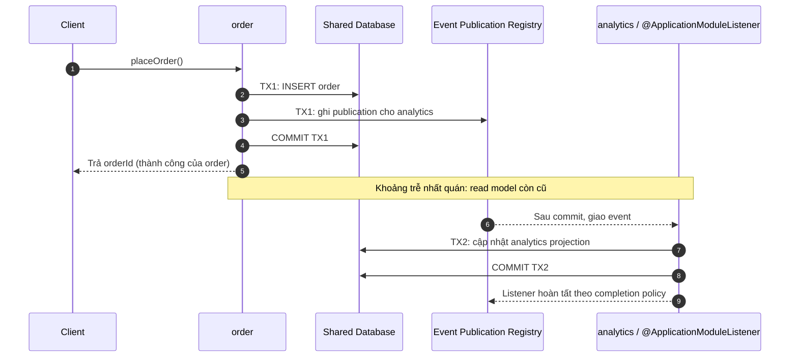
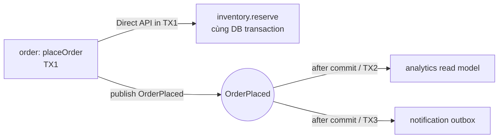
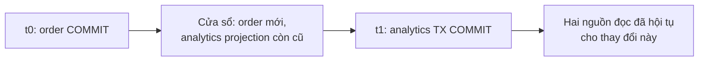
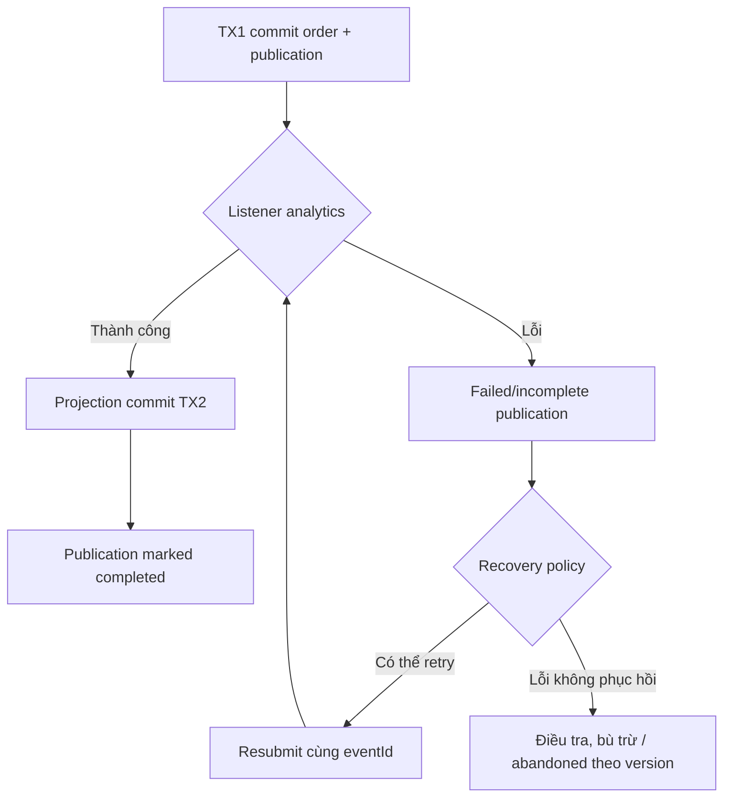
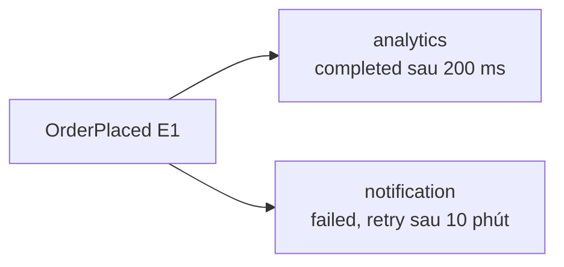
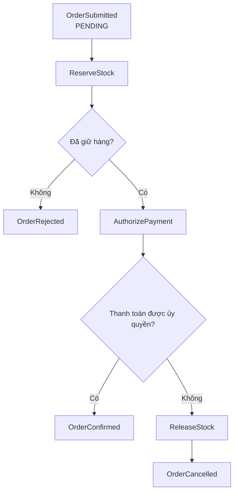
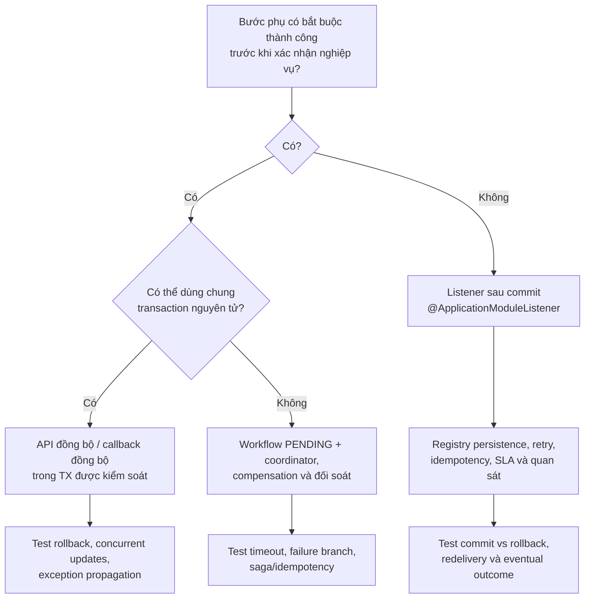
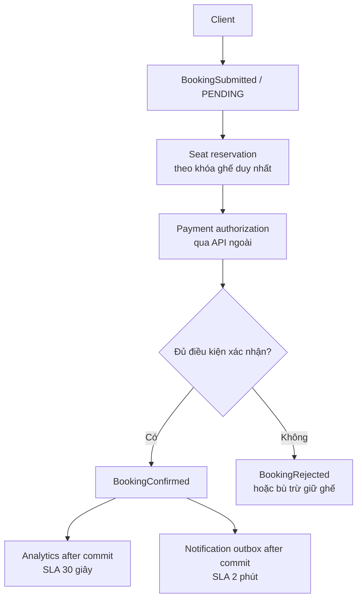

# Đánh đổi độ nhất quán giữa application events đồng bộ và bất đồng bộ trong Spring Modulith

## 1. Vấn đề kiến trúc: kết quả nghiệp vụ phải nhất quán vào thời điểm nào?

Giả sử hệ thống thương mại điện tử có các application module `order` (đơn hàng), `inventory` (tồn kho), `billing` (hóa đơn) và `notification` (thông báo). Khi khách hàng nhấn “Đặt hàng”, hệ thống có thể cần:

1. Lưu đơn hàng.
2. Giữ số lượng tồn kho.
3. Tạo bản ghi phục vụ lập hóa đơn.
4. Gửi email hoặc cập nhật một mô hình đọc (*read model*).

Nếu **đơn hàng và giữ hàng phải cùng thành công hoặc cùng thất bại**, ta đang yêu cầu một bất biến nhất quán mạnh tại ranh giới nghiệp vụ đó. Nhưng email hoặc mô hình tìm kiếm có thể được cập nhật **sau một khoảng trễ chấp nhận được**; bắt email thành công trước khi xác nhận đơn thường làm tăng độ trễ và giảm khả năng chịu lỗi của thao tác chính.

Spring Modulith giúp tổ chức những trách nhiệm này theo module, trao đổi qua `ApplicationEventPublisher` và các listener. Lựa chọn **đồng bộ hay bất đồng bộ** không chỉ là quyết định dùng thread nào. Nó quyết định thời điểm consumer nhìn thấy dữ liệu, phạm vi transaction, cách lỗi lan truyền, tính quan sát được và mô hình khôi phục.

Đây là bài **“Đánh đổi độ nhất quán”** thuộc chương **“Đồng bộ và bất đồng bộ”** của dịch vụ học **SPRING_MODULITH_APPLICATION_EVENTS**. Mục tiêu: chọn đúng hình thức giao tiếp giữa các module để **giảm phụ thuộc mà vẫn bảo vệ ranh giới nghiệp vụ**, nhất là khi publisher, listener sau commit, Event Publication Registry, retry và kiểm thử đều tham gia.

### 1.1. Câu hỏi phải đặt trước khi chọn annotation

> “Nếu bước phụ chưa hoàn tất, liệu kết quả nghiệp vụ vừa trả về cho người dùng **đã được phép tồn tại** hay chưa?”

- **Không được phép:** một hoặc nhiều bước tạo thành một bất biến bắt buộc. Cần một cơ chế phối hợp/transaction đảm bảo các thay đổi thuộc phạm vi đó đi cùng nhau, hoặc thiết kế trạng thái chưa hoàn tất thay vì tuyên bố thành công sớm.
- **Được phép:** tác vụ phụ có thể hoàn tất sau; cần thiết kế **eventual consistency** rõ SLA, tình trạng đang xử lý, retry, idempotency và cơ chế xử lý khi thất bại kéo dài.

Không nên đồng nhất “đồng bộ” với “mạnh” và “bất đồng bộ” với “yếu” trong mọi hoàn cảnh. **Đồng bộ hay bất đồng bộ là cách thực thi**, còn **nhất quán** là cam kết về trạng thái và khả năng quan sát của dữ liệu. Một lời gọi HTTP đồng bộ sang hệ thống khác không tự tạo transaction nguyên tử giữa hai database.

## 2. Những khái niệm nhất quán cần phân biệt

| Thuật ngữ | Ý nghĩa thực tế | Ví dụ |
| --- | --- | --- |
| **Atomicity** | Trong một transaction, các thao tác được commit/rollback như một đơn vị | Lưu đơn và trừ tồn kho trong cùng database transaction |
| **Strong consistency** (theo yêu cầu nghiệp vụ) | Tại một điểm đã xác định, tất cả dữ liệu cần để bảo đảm bất biến phải phản ánh một quyết định nhất quán | Không xác nhận đơn nếu không giữ được hàng |
| **Eventual consistency** | Các trạng thái có thể tạm thời khác nhau nhưng được kỳ vọng hội tụ khi xử lý thành công | Đơn đã lưu, projection báo cáo cập nhật vài giây sau |
| **Read-your-writes** | Sau khi ghi, caller có thể thấy kết quả ghi của chính mình ở nơi được cam kết | API trả lại trạng thái đơn vừa lưu |
| **Causal consistency** | Kết quả phụ thuộc một sự kiện phải tôn trọng quan hệ nguyên nhân phù hợp | `InvoicePrepared` được tạo từ `OrderPlaced` đã commit |
| **Idempotency** | Xử lý lại cùng công việc không tạo hiệu ứng nghiệp vụ trùng | Retry `OrderPlaced(E1)` không giữ hàng hai lần |
| **Durability** | Trạng thái đã commit và dữ liệu publication cần giữ sống qua restart | Bản ghi registry còn sau khi tiến trình chết |

Trong thực hành Java/Spring, “strong consistency” thường được dùng gần với **atomicity và isolation ở một database transaction**. Nhưng hai khái niệm không đồng nhất với **linearizability** trong hệ thống phân tán. Transaction có isolation `READ_COMMITTED`, `REPEATABLE_READ` hoặc `SERIALIZABLE` cho những khả năng quan sát khác nhau; sự kiện đồng bộ **không tự nâng isolation level**.

**Ranh giới một transaction** là điều kiện quan trọng: khi hai module dùng cùng `DataSource` và transaction manager, chúng có thể cùng tham gia một database transaction. Khi một module gửi HTTP, email hoặc viết một database hoàn toàn độc lập, cần đánh giá lại bảo đảm nguyên tử dù code chạy trong cùng thread.

## 3. Ba trục quyết định độc lập: dispatch, transaction và delivery

Để không nhầm lẫn, hãy tách ba trục:

1. **Dispatch:** listener chạy ngay trên đường gọi hiện tại (đồng bộ) hay được chuyển sang executor/thread khác (bất đồng bộ)?
2. **Transaction phase:** listener chạy ngay khi event được publish, **trước commit**, **sau commit**, **sau rollback** hay sau khi transaction hoàn tất?
3. **Delivery reliability:** event có chỉ tồn tại trong bộ nhớ hay có publication log bền vững để phát hiện/khôi phục công việc chưa hoàn tất?

| Cơ chế | Dispatch thường gặp | Quan hệ với transaction nguồn | Độ tin cậy mặc định |
| --- | --- | --- | --- |
| `@EventListener` | Đồng bộ với Spring multicaster mặc định | Được gọi ngay tại `publishEvent()`; có thể tham gia transaction nguồn | Không tự có persistent publication |
| `@EventListener` + `@Async` | Bất đồng bộ | Thường không tham gia transaction nguồn; có thể chạy trước commit | Không tự có persistent publication |
| `@TransactionalEventListener` | Thường đồng bộ khi callback được kích hoạt | Mặc định phase `AFTER_COMMIT`; không đồng nghĩa chạy trong transaction ghi mới | Không tự bảo đảm replay |
| `@Async` + `@TransactionalEventListener` | Bất đồng bộ sau commit | Tách đường xử lý khỏi transaction nguồn | Cần cơ chế lưu publication nếu không muốn mất event |
| `@ApplicationModuleListener` | Bất đồng bộ | Meta-annotation cho listener sau commit, transaction mới (`REQUIRES_NEW`) | Kết hợp registry persistence để theo dõi/khôi phục |

**Lưu ý:** `@EventListener` đồng bộ dựa trên cấu hình mặc định của `ApplicationEventMulticaster`. Nếu ứng dụng cấu hình multicaster bất đồng bộ hoặc một listener có xử lý `@Async` riêng, không còn được mặc định coi tất cả lời gọi `@EventListener` cùng thread/transaction. Với các invariant quan trọng cần **cấu hình và test rõ ràng**, không chỉ dựa vào tên annotation.

`@ApplicationModuleListener` là lựa chọn thường dùng để tích hợp các module qua application events sau commit. Nó là annotation tiện ích tương đương cấu hình `@Async`, `@TransactionalEventListener` và `@Transactional(propagation = REQUIRES_NEW)`; khả năng khôi phục phụ thuộc Event Publication Registry đã được cấu hình với persistence phù hợp.

## 4. Đồng bộ: nhất quán cùng transaction khi điều kiện được thỏa mãn

### 4.1. Luồng xử lý

```mermaid
sequenceDiagram
    autonumber
    participant C as Client
    participant O as order / Publisher
    participant I as inventory / @EventListener
    participant DB as Shared Database

    C->>O: placeOrder()
    O->>DB: BEGIN TX; INSERT order
    O->>I: publish OrderPlaced -> xử lý đồng bộ
    I->>DB: UPDATE inventory_stock
    alt Đủ hàng
        I-->>O: Trả về bình thường
        O->>DB: COMMIT TX
        O-->>C: Thành công
    else Không đủ hàng / DB lỗi
        I--xO: Ném exception
        O->>DB: ROLLBACK TX
        O-->>C: Thất bại
    end
```

Nếu publisher mở một transaction thật, listener xử lý đồng bộ trên cùng đường gọi, thao tác JDBC của hai module cùng tham gia **một transaction manager và một database resource**, và exception không bị nuốt, thì:

- Cập nhật của `order` và `inventory` có thể cùng commit/rollback.
- Client không nhận phản hồi thành công trước khi listener đồng bộ hoàn thành.
- Lỗi listener có thể làm thất bại request nguồn.

Đây là một bảo đảm **có điều kiện**, không phải tính chất tự động của mọi `ApplicationEventPublisher`. Nếu listener mở `REQUIRES_NEW`, ghi ra một database khác hoặc thực hiện side effect ngoài, thao tác ấy không còn nguyên tử cùng transaction nguồn.

### 4.2. Vì sao dùng event đồng bộ thay vì API trực tiếp?

Một `@EventListener` đồng bộ vẫn làm publisher **không import class consumer**. Nhưng về thời gian chạy và độ tin cậy, publisher vẫn **bị gắn vào các listener**: thêm một listener chậm hoặc lỗi có thể làm request chậm/lỗi theo. Cần cân nhắc:

- Với nghiệp vụ **cần kết quả ngay**, API công khai như `InventoryManagement.reserve(...)` thường diễn đạt hợp đồng rõ hơn.
- Event đồng bộ có thể phù hợp khi muốn **nhiều phản ứng trong một transaction** nhưng cần hiểu rõ hậu quả khi thêm listener mới.
- Không nên thiết kế event đồng bộ như một “lời gọi RPC bí mật” buộc publisher chờ kết quả nhưng không có API trả kết quả. Với nghiệp vụ có quyết định chính, lời gọi method trực tiếp thường dễ kiểm soát hơn.

### 4.3. Thời gian giữ transaction tăng

Nếu một transaction nguồn kéo dài từ 20 ms lên 800 ms do ba listener đồng bộ:

- Các connection, row locks và tài nguyên transaction có thể bị giữ lâu hơn.
- Lock contention/deadlock và tail latency có thể tăng theo tải.
- Một listener mới có thể thay đổi đặc tính hiệu năng của một use case tưởng như không liên quan.
- Nếu listener gọi mạng từ trong transaction, một lỗi mạng kéo dài có thể giữ lock không cần thiết.

Vì vậy “nhất quán mạnh” không miễn phí. Nên đặt **đúng các bất biến bắt buộc** vào transaction, thay vì ôm cả email, analytics và index cập nhật đồng bộ.

## 5. Bất đồng bộ sau commit: eventual consistency có chủ đích

Một cách giảm phạm vi transaction là:

1. Module `order` commit trạng thái nguồn trước.
2. `@ApplicationModuleListener` nhận event **sau commit** trên luồng xử lý riêng.
3. Module nhận mở **transaction mới**, cập nhật projection hoặc tác vụ phụ.
4. Một khoảng thời gian tồn tại khi dữ liệu nguồn đã commit nhưng projection/consumer **chưa theo kịp**.



**Giá trị nhận được:**

- Request `placeOrder` không chờ analytics hoàn tất.
- Transaction nguồn ngắn hơn, ít bị ảnh hưởng bởi tải của consumer.
- Consumer có thể được scale/điều chỉnh concurrency riêng.
- Một lỗi ở analytics sau commit **không rollback được** đơn hàng đã commit — đây vừa là lợi thế cô lập lỗi, vừa là ràng buộc cần thiết kế khôi phục.

**Giá phải trả:**

- Dữ liệu phân tán giữa các module có một khoảng **không đồng nhất tạm thời**.
- Consumer có thể trễ, lỗi hoặc nhận lại event; phải xử lý duplicate/out-of-order khi cần.
- UI/API cần biểu diễn đúng trạng thái, ví dụ `PENDING`, `PROCESSING`, `READY` hoặc cập nhật trạng thái trên màn hình.
- Không có bảo đảm “sẽ hội tụ” nếu event bị mất, consumer lỗi vĩnh viễn hoặc không có retry/đối soát. **Eventual consistency là mục tiêu cùng cơ chế vận hành**, không phải lời đảm bảo tự động của `@Async`.

### 5.1. Bất đồng bộ khác với an toàn giao sự kiện

`@Async` chỉ chuyển công việc sang executor; nó không tự ghi event vào storage. Nếu process chết **sau commit nguồn nhưng trước lúc async listener bắt đầu**, công việc có thể mất nếu không có cơ chế ghi bền.

Spring Modulith Event Publication Registry giải quyết một phần cửa sổ này bằng cách ghi publication cho những transactional listener được theo dõi **trong transaction nguồn**, rồi đánh dấu completion khi listener thành công. Khi thất bại, publication có thể được tìm thấy để resubmit theo chính sách. Registry không thay thế idempotency và không tự bảo đảm exactly-once với hệ thống ngoài.

### 5.2. “Sau commit” không có nghĩa “chắc chắn chạy”

Theo ngữ nghĩa Spring, `@TransactionalEventListener` mặc định lắng nghe `AFTER_COMMIT`. Nếu publisher **không có transaction đang hoạt động**, listener mặc định không được gọi, trừ khi cấu hình `fallbackExecution = true` phù hợp. Với Spring Modulith, các ví dụ sau commit cần một transaction nguồn thực sự và listener đúng annotation.

## 6. So sánh quyết định đồng bộ và bất đồng bộ

| Tiêu chí | Đồng bộ, cùng transaction | Bất đồng bộ sau commit |
| --- | --- | --- |
| Trạng thái khi API trả thành công | Các cập nhật **cùng TX** đã commit | Chỉ trạng thái **nguồn** được bảo đảm; downstream có thể chưa xong |
| Lan truyền lỗi listener | Có thể rollback transaction nguồn nếu exception lan ra | Không tự rollback transaction nguồn đã commit |
| Thời gian giữ lock/connection nguồn | Có thể tăng theo công việc listener | Thường ngắn hơn |
| Khả năng chịu lỗi consumer | Consumer chậm/lỗi ảnh hưởng đường request | Consumer lỗi cần retry/giám sát riêng |
| Trải nghiệm người dùng | Kết quả thường sẵn có ngay nhưng phải chờ | Phản hồi nhanh hơn, cần trạng thái đang xử lý |
| Event Publication Registry | `@EventListener` thường không được registry theo dõi | Transactional listener phù hợp có thể được theo dõi khi cấu hình persistence |
| Retry cùng event | Cần thiết kế lại request/transaction và idempotency | Có thể resubmit publication; handler bắt buộc idempotent |
| Quan sát trạng thái | Thường trực tiếp trong response/result | Cần metrics, publication status, process status/read model |
| Độ phức tạp | Gọn khi một DB và ít bước | Tăng vì eventual consistency, error handling và recovery |
| Ngữ nghĩa đúng nhất | Bất biến phải đạt **trước** response thành công | Tác vụ phụ được phép hoàn tất **sau** commit |

Từ bảng trên, không có lựa chọn “tối ưu tuyệt đối”. Để giảm latency của request, bất đồng bộ đem lại lợi ích nhưng chuyển một phần độ phức tạp sang **độ tin cậy và trạng thái sau commit**. Để giữ invariant cứng, đồng bộ cùng transaction thuận tiện nhưng mở rộng phạm vi transaction và coupling vận hành.

## 7. Ví dụ tình huống: giữ hàng bắt buộc, cập nhật báo cáo có thể trễ

Giả sử có ba yêu cầu khác nhau:

1. **Không bán vượt tồn kho:** đơn được xác nhận thành công phải có hàng giữ tương ứng.
2. **Báo cáo doanh thu theo ngày:** có thể trễ vài giây mà không làm đơn sai.
3. **Email xác nhận:** gửi có thể trễ, nhưng không được quên và không nên gửi hai lần.

Thiết kế thường hợp lý là:



Module `order` gọi **API công khai** của `inventory` cho bất biến cứng. Mỗi module có thể sở hữu bảng riêng, nhưng transaction chỉ nguyên tử nếu cùng database resource/transaction manager phù hợp. `analytics` và `notification` chỉ import event công khai của `order`; publisher không import implementation của hai consumer.

Với `notification`, listener có thể ghi một email task vào outbox và hoàn tất, sau đó worker khác gửi email theo retry/idempotency. “Publication completed” khi **đã xếp outbox** không có nghĩa email đã được hộp thư người nhận chấp nhận.

### 7.1. Có được giữ tồn kho bằng async event không?

**Có, nếu đổi điều kiện thành công của use case.** Thay vì trả `CONFIRMED` khi vừa lưu đơn, API trả `PENDING_RESERVATION`. Module `inventory` nhận event và quyết định giữ hàng; quy trình cuối cùng chuyển đơn thành `CONFIRMED` hoặc `REJECTED` qua workflow có state rõ ràng.

Nhưng khi đó, **business invariant mới** là “không giao hàng/thu tiền như đã xác nhận trước khi tồn kho được giữ”. Không còn cam kết “đơn đã được xác nhận ngay tại response đầu tiên”.

Nếu sự kiện `OrderSubmitted` do `order` phát và `inventory` trả event `StockReserved`, tránh tạo vòng import tĩnh `inventory → order → inventory` giữa module. Có thể dùng process manager/module điều phối riêng phụ thuộc các public event của cả hai, hoặc tổ chức các hợp đồng theo hướng dependency một chiều phù hợp với `ApplicationModules.verify()`.

### 7.2. Phân biệt hai loại “thành công”

| Trạng thái API/Workflow | Ý nghĩa |
| --- | --- |
| `202 Accepted / PENDING_RESERVATION` | Hệ thống đã ghi nhận yêu cầu, nhưng còn chờ giữ hàng |
| `CONFIRMED` | Các điều kiện xác nhận đã được thỏa |
| `REJECTED` | Yêu cầu không thể hoàn tất, ví dụ hết hàng |
| `REPORT_PENDING` | Order có thể hợp lệ nhưng projection báo cáo còn trễ |
| `EMAIL_QUEUED` | Email đã vào hàng chờ; chưa phải `EMAIL_DELIVERED` |

HTTP status code chỉ là ví dụ về thiết kế API; không phải Spring Modulith tự tạo các trạng thái đó. Những trạng thái domain phải được định nghĩa, lưu và cập nhật minh bạch theo yêu cầu sản phẩm.

## 8. Ví dụ Java: cùng một event, một invariant đồng bộ và một projection bất đồng bộ

Để minh họa hai lựa chọn **có mục đích khác nhau**, xây dựng ứng dụng Spring Boot với ba module:

```text
com.example.shop
├── ShopApplication.java
├── order/
│   ├── OrderPlaced.java            public event
│   └── OrderService.java           publisher
├── inventory/
│   └── internal/
│       └── ReserveStockOnOrder.java   synchronous listener
└── analytics/
    └── internal/
        └── OrderAnalyticsListener.java asynchronous after-commit listener
```

Trong ví dụ này, **giữ hàng là điều kiện để đơn được coi thành công**; `analytics` chỉ làm projection cho báo cáo. Có thể dùng event đồng bộ để giữ tính nguyên tử, nhưng **đối với một invariant cứng, gọi API công khai của inventory trực tiếp thường diễn đạt phụ thuộc nghiệp vụ rõ ràng hơn**. Ví dụ listener đồng bộ được dùng để nhìn thấy chính xác đánh đổi về transaction.

### 8.1. Dependencies và cấu hình ứng dụng

Gradle minh họa (quản lý version Spring Boot/Spring Modulith tương thích bằng BOM/dependency management phù hợp):

```groovy
dependencies {
    implementation 'org.springframework.boot:spring-boot-starter-jdbc'
    implementation 'org.springframework.modulith:spring-modulith-starter-jdbc'
    runtimeOnly 'org.postgresql:postgresql'

    testImplementation 'org.springframework.boot:spring-boot-starter-test'
    testImplementation 'org.springframework.modulith:spring-modulith-starter-test'
    testImplementation 'org.awaitility:awaitility'
}
```

Với registry dùng JDBC, ngoài các dependency trên cần cấu hình `DataSource`, transaction manager và schema registry đúng theo Spring Modulith version/adapter. Cơ chế tạo schema/migration được dự án quản lý cụ thể (Flyway/Liquibase hoặc hỗ trợ tích hợp phù hợp); **không suy rằng starter tự tạo mọi bảng nghiệp vụ**.

Lớp khởi động:

```java
package com.example.shop;

import org.springframework.boot.SpringApplication;
import org.springframework.boot.autoconfigure.SpringBootApplication;

@SpringBootApplication
public class ShopApplication {

    public static void main(String[] args) {
        SpringApplication.run(ShopApplication.class, args);
    }
}
```

SQL PostgreSQL cho **các bảng nghiệp vụ**:

```sql
CREATE TABLE inventory_stock (
    sku VARCHAR(80) PRIMARY KEY,
    available INTEGER NOT NULL CHECK (available >= 0)
);

CREATE TABLE shop_order (
    id UUID PRIMARY KEY,
    sku VARCHAR(80) NOT NULL,
    quantity INTEGER NOT NULL CHECK (quantity > 0),
    state VARCHAR(32) NOT NULL
);

CREATE TABLE analytics_order_projection (
    source_event_id UUID PRIMARY KEY,
    order_id UUID NOT NULL,
    created_at TIMESTAMPTZ NOT NULL
);
```

Đây **không phải** schema Event Publication Registry. Registry có bảng/collection hạ tầng riêng và có thể thay đổi theo phiên bản. Khóa `source_event_id` ở projection là khóa idempotency ứng dụng tạo cho consumer, không phải publication ID của framework.

### 8.2. Event do module order sở hữu

File `src/main/java/com/example/shop/order/OrderPlaced.java`:

```java
package com.example.shop.order;

import java.util.UUID;

public record OrderPlaced(
        UUID eventId,
        UUID orderId,
        String sku,
        int quantity) {}
```

Đặt record trong **package gốc** của `order` để module khác có thể import qua API công khai mặc định của Spring Modulith. Không truyền entity JPA hoặc repository implementation vào event; các module nhận chỉ cần ID và dữ liệu bất biến cần thiết.

### 8.3. Publisher có transaction nguồn

File `src/main/java/com/example/shop/order/OrderService.java`:

```java
package com.example.shop.order;

import java.util.UUID;
import org.springframework.context.ApplicationEventPublisher;
import org.springframework.jdbc.core.JdbcTemplate;
import org.springframework.stereotype.Service;
import org.springframework.transaction.annotation.Transactional;

@Service
public class OrderService {

    private final JdbcTemplate jdbc;
    private final ApplicationEventPublisher events;

    public OrderService(JdbcTemplate jdbc, ApplicationEventPublisher events) {
        this.jdbc = jdbc;
        this.events = events;
    }

    @Transactional
    public UUID placeOrder(UUID orderId, String sku, int quantity) {
        if (quantity <= 0) {
            throw new IllegalArgumentException("quantity must be > 0");
        }

        jdbc.update("""
            INSERT INTO shop_order (id, sku, quantity, state)
            VALUES (?, ?, ?, ?)
            """, orderId, sku, quantity, "CONFIRMED");

        events.publishEvent(
                new OrderPlaced(UUID.randomUUID(), orderId, sku, quantity));

        return orderId;
    }
}
```

Đối với ví dụ này, trạng thái `CONFIRMED` chỉ được commit khi listener giữ hàng đồng bộ **không ném exception**. Nếu listener giữ hàng thất bại, transaction sẽ rollback cả bản ghi order. Thời điểm `publishEvent` được gọi nằm **trước** commit, nhưng event listener async sau commit chỉ nhận event khi transaction đã hoàn tất thành công.

Đoạn code tập trung vào semantics của event. Trong production phải thêm kiểm soát input, uniqueness cho command/idempotency, ownership dữ liệu, API transaction boundary rõ và quy định điều gì xảy ra khi transaction không tồn tại.

### 8.4. Inventory: `@EventListener` đồng bộ tham gia transaction nguồn

File `src/main/java/com/example/shop/inventory/internal/ReserveStockOnOrder.java`:

```java
package com.example.shop.inventory.internal;

import com.example.shop.order.OrderPlaced;
import org.springframework.context.event.EventListener;
import org.springframework.jdbc.core.JdbcTemplate;
import org.springframework.stereotype.Component;
import org.springframework.transaction.annotation.Propagation;
import org.springframework.transaction.annotation.Transactional;

@Component
class ReserveStockOnOrder {

    private final JdbcTemplate jdbc;

    ReserveStockOnOrder(JdbcTemplate jdbc) {
        this.jdbc = jdbc;
    }

    @EventListener
    @Transactional(propagation = Propagation.MANDATORY)
    public void on(OrderPlaced event) {
        int rows = jdbc.update("""
            UPDATE inventory_stock
            SET available = available - ?
            WHERE sku = ? AND available >= ?
            """, event.quantity(), event.sku(), event.quantity());

        if (rows != 1) {
            throw new IllegalStateException(
                    "Not enough stock for " + event.sku());
        }
    }
}
```

`Propagation.MANDATORY` nêu rõ **listener không được tự tạo transaction mới** khi không có transaction nguồn; nó cần tham gia transaction đang hoạt động. Với Spring event multicaster đồng bộ mặc định, JDBC cùng `DataSource` sẽ tham gia transaction do `OrderService.placeOrder()` mở.

Truy vấn `UPDATE ... WHERE available >= ?` giảm lượng hàng **nguyên tử tại database**, không có khoảng race kiểu `SELECT available` rồi `UPDATE` không kiểm tra điều kiện. Nếu không đủ hàng, exception unchecked lan tới transaction nguồn và khiến order rollback theo chính sách mặc định của `@Transactional`.

Một trường hợp cần tránh:

```java
@EventListener
void on(OrderPlaced event) {
    try {
        reserveStock(event);
    } catch (RuntimeException error) {
        log.warn("Could not reserve stock", error);
        // Không ném lại lỗi => publisher có thể vẫn COMMIT order!
    }
}
```

**Ghi chú kiến trúc:** một event `OrderPlaced` có listener khiến thao tác tạo đơn thất bại nếu không đủ hàng. Điều này hoạt động để giải thích semantics, nhưng là một **coupling hành vi ẩn**. Với invariant bắt buộc, team nên xem xét thay handler này bằng API rõ ràng `InventoryManagement.reserve(...)` được `order` gọi **trực tiếp** trong transaction nguồn. Cả hai cách đều cần đồng bộ transaction nếu giữ hàng bắt buộc; API trực tiếp làm quyết định “không có hàng thì không tạo đơn” dễ nhận biết hơn trong flow.

### 8.5. Analytics: `@ApplicationModuleListener` sau commit, transaction riêng

File `src/main/java/com/example/shop/analytics/internal/OrderAnalyticsListener.java`:

```java
package com.example.shop.analytics.internal;

import com.example.shop.order.OrderPlaced;
import java.time.OffsetDateTime;
import java.time.ZoneOffset;
import org.springframework.jdbc.core.JdbcTemplate;
import org.springframework.modulith.events.ApplicationModuleListener;
import org.springframework.stereotype.Component;

@Component
class OrderAnalyticsListener {

    private final JdbcTemplate jdbc;

    OrderAnalyticsListener(JdbcTemplate jdbc) {
        this.jdbc = jdbc;
    }

    @ApplicationModuleListener
    void on(OrderPlaced event) {
        jdbc.update("""
            INSERT INTO analytics_order_projection
                (source_event_id, order_id, created_at)
            VALUES (?, ?, ?)
            ON CONFLICT (source_event_id) DO NOTHING
            """,
            event.eventId(),
            event.orderId(),
            OffsetDateTime.now(ZoneOffset.UTC));
    }
}
```

Listener trên được kích hoạt sau khi transaction order commit, bất đồng bộ và trong một transaction mới. Nếu tạo projection thất bại, **đơn đã đặt và giữ hàng vẫn tồn tại**. Với registry có persistence, publication dành cho analytics có thể còn chưa hoàn tất, để phục hồi theo chính sách. Nếu E1 được giao lại, unique constraint cho `source_event_id` giúp projection không bị nhân đôi.

`@ApplicationModuleListener` **không** có nghĩa projection sẽ có mặt trước khi HTTP response của `placeOrder(...)` được gửi. Tốc độ xử lý khác nhau theo thread scheduling, kích thước executor và tải của database; có thể nhanh trong môi trường test nhưng vẫn là **eventually consistent**.

### 8.6. Tính chất độc lập của hai listener

Trong thiết kế này, **cả hai listener nhận cùng `OrderPlaced` nhưng có contract khác nhau**:

| Listener | Annotation | Chạy trong transaction | Lỗi tác động lên order |
| --- | --- | --- | --- |
| `ReserveStockOnOrder` | `@EventListener` + `MANDATORY` | Transaction nguồn nếu cấu hình đồng bộ đúng | Có thể rollback order |
| `OrderAnalyticsListener` | `@ApplicationModuleListener` | Transaction mới sau commit | Không rollback order đã commit |

Đây không phải “tự động điều phối tuần tự mọi listener”. Sự khác biệt đến từ **transaction phase**: analytics listener chỉ được thực hiện sau commit; còn inventory listener chạy ngay trong đường publish và có thể khiến toàn transaction thất bại. Nếu transaction nguồn rollback, analytics listener after-commit không chạy như một kết quả thành công.

## 9. Cửa sổ không nhất quán trong thực tế

Giả sử `order` commit thành công tại thời điểm `t0`, trong khi listener analytics cập nhật projection tại `t0 + 2s`:



Trong khoảng `[t0, t0 + 2s)`:

- API `GET /orders/{id}` đọc từ nguồn `shop_order` có thể trả đơn mới.
- Dashboard `GET /analytics/orders` đọc từ projection có thể chưa thấy đơn.
- Hai kết quả cùng **đúng theo contract riêng** nếu dashboard cam kết eventual consistency.
- Nếu dashboard lại tuyên bố số liệu **tức thời tuyệt đối**, thì thiết kế đã vi phạm kỳ vọng sản phẩm dù code vẫn chạy đúng.

**Không được đặt “2 giây” thành một SLA mặc định của Spring Modulith.** Độ trễ phụ thuộc tải, executor, lỗi, backlog, retry, transaction và mô hình dữ liệu. Để đưa ra SLA thật, cần đo thời gian từ commit/event publication đến completion của consumer và cân nhắc tail latency (ví dụ p95/p99), không chỉ lấy trung bình.

### 9.1. Những biểu hiện có thể gặp

| Hiện tượng | Nguyên nhân có thể | Cách quản lý |
| --- | --- | --- |
| Đơn đã tồn tại nhưng chưa xuất hiện ở báo cáo | Read model chưa cập nhật | Trạng thái đồng bộ, stale indicator hoặc chờ có timeout |
| Danh sách hiển thị bản ghi mới nhưng chi tiết đọc từ projection chưa thấy | Độ trễ giữa các projection | Đọc source cho thông tin quan trọng hoặc hiển thị trạng thái tạm |
| Hai sự kiện gần nhau được xử lý ngược thứ tự | Async scheduling, retry, concurrency | Aggregate version/sequence, optimistic locking, đặt điều kiện cập nhật |
| Consumer chậm nhiều phút vì database lỗi | Backlog và failed publications | Retry có kiểm soát, alert và recovery |
| Event bị xử lý lặp sau crash | Publication được redeliver | Consumer idempotency |
| User refresh liên tục vì không biết đang chờ | API không biểu diễn trạng thái pending | `202 Accepted`, status endpoint, polling/backoff hoặc notification |
| Một workflow có hai bước cập nhật tách rời | Không có transaction bao cả workflow | Process state, compensation và consistency boundary rõ |

### 9.2. Read-your-writes không phải mặc định ở projection

Trong use case async, nếu client vừa gọi `POST /orders` rồi lập tức gọi endpoint chỉ đọc **analytics projection**, việc không thấy đơn mới ngay là điều có thể xảy ra. Nếu sản phẩm yêu cầu “người dùng phải thấy đơn vừa tạo”, hãy cho màn hình đơn hàng đọc **aggregate source** hoặc trả đủ dữ liệu đơn trong response từ transaction chính.

Một chiến lược khác là trả `operationId`/`orderId` và expose trạng thái:

```json
{
  "orderId": "d53c2d41-a94a-485e-a403-d1f2c794d99c",
  "orderStatus": "CONFIRMED",
  "analyticsStatus": "PENDING"
}
```

Payload này do ứng dụng tự thiết kế; Spring Modulith không sinh sẵn `analyticsStatus` và không tự cập nhật HTTP response khi listener hoàn thành.

## 10. Điều kiện hội tụ: lưu publication, retry và idempotency

Eventual consistency chỉ đáng tin khi hệ thống có **đường đi từ trạng thái tạm thời đến trạng thái cuối**. Trong Spring Modulith, các phần quan trọng gồm:

1. **Nguồn event đáng tin:** publisher tạo event trong transaction nguồn.
2. **Publication bền vững:** Event Publication Registry với JDBC/JPA/MongoDB adapter theo cấu hình được hỗ trợ, ghi một publication cho từng transactional listener đủ điều kiện trong transaction nguồn.
3. **Listener biết thất bại:** exception đi ra ngoài khi không thể hoàn tất, để publication không bị ghi thành công giả.
4. **Resubmission:** có lịch/chính sách khôi phục publication chưa hoàn tất hoặc failed theo API/phiên bản tương ứng.
5. **Idempotent side effects:** việc redelivery không nhân đôi invoice, email hoặc trừ hàng.
6. **Observability và vận hành:** có SLA, alert, xử lý bản lỗi vĩnh viễn và trường hợp cần bù trừ.



### 10.1. Registry lưu “publication cho listener”, không chỉ lưu một event

Một `OrderPlaced(E1)` có thể kích hoạt nhiều consumer transactional; registry theo dõi những **publication riêng cho từng target listener**. Nếu analytics hoàn tất và notification lỗi, publication analytics có thể là completed trong khi publication notification vẫn cần xử lý lại. Đây là lý do không nên suy luận “event đã publish” = “mọi consumer đều nhất quán”.

Spring Modulith 2.0 có vòng đời publication `PUBLISHED`, `PROCESSING`, `COMPLETED`, `FAILED`, `RESUBMITTED`; từ 2.2 có `ABANDONED` theo chính sách. Dự án dùng 1.x có API/state representation khác; cần tham chiếu phiên bản cụ thể. `ABANDONED` **không** biểu thị consumer hoàn thành thành công.

### 10.2. Retry không đồng nghĩa tạo event mới

```text
OrderPlaced(E1) → analytics attempt #1: lỗi
                → analytics attempt #2: thành công
```

Đây vẫn là **cùng sự kiện E1** được thử giao lại. `eventId` phải ổn định qua retry. Một attempt mới không được tự tạo `OrderPlaced(E2)` rồi coi đó là cùng một sự kiện nghiệp vụ, vì như vậy cơ chế dedup theo event ID sẽ không hiệu quả.

Đối với mã ví dụ, `analytics_order_projection.source_event_id` là PRIMARY KEY và PostgreSQL `ON CONFLICT DO NOTHING`. Listener có thể được gọi lại nhưng không nhân đôi projection.

### 10.3. Không xem registry là bảo đảm exactly-once

Một listener có thể đã gọi API thanh toán thành công nhưng process chết trước khi registry ghi nhận hoàn tất. Khi publication được giao lại, API có thể bị gọi lần thứ hai. Cần:

- Dùng **idempotency key** ổn định với hệ thống ngoài khi hệ thống đó hỗ trợ.
- Ghi trạng thái xử lý theo consumer + eventId hoặc business key trong database.
- Với cùng database resource, kết hợp marker và side effect trong transaction có tính nguyên tử khi phù hợp.
- Với email/HTTP/queue, cân nhắc **transactional outbox**, đối soát và retry tại giao diện tích hợp.
- Không quảng cáo exactly-once end-to-end chỉ vì `@ApplicationModuleListener` hoặc Event Publication Registry xuất hiện trong code.

**Cực kỳ quan trọng:** registry không tự bảo đảm mọi publication sẽ tự động retry ở mọi dự án. Có các tùy chọn republish/resubmission/staleness theo phiên bản/cấu hình, và chính sách multi-instance cần tránh nhiều node cùng resubmit quá tải hoặc xử lý trùng không kiểm soát.

## 11. Tình huống đặc biệt: transaction phase không giống thread scheduling

Một sai lầm phổ biến là chỉ nhìn annotation `@Async` rồi nghĩ “chắc chắn sau commit”. Hãy so sánh:

### 11.1. `@Async @EventListener`: có thể chạy trước khi nguồn commit

```java
@org.springframework.scheduling.annotation.Async
@org.springframework.context.event.EventListener
public void on(OrderPlaced event) {
    // Có thể được scheduler chạy trước khi TX của order COMMIT!
    updateProjection(event);
}
```

Listener được đẩy sang thread khác **ngay khi event được publish**. Nếu DB transaction nguồn chưa commit, thread listener có thể:

- Đọc DB và không thấy order vừa ghi (vì order còn uncommitted).
- Ghi một trạng thái ở transaction riêng rồi sau đó order rollback.
- Gặp lỗi do lock/transaction timing và xử lý lại khó dự đoán.

Vì vậy, với phản ứng chỉ hợp lệ **sau khi dữ liệu nguồn commit**, cần cơ chế gắn với transaction phase như `@TransactionalEventListener`/`@ApplicationModuleListener`, không chỉ `@Async`.

### 11.2. `@TransactionalEventListener(AFTER_COMMIT)`: sau commit nhưng không mặc định async

```java
@org.springframework.transaction.event.TransactionalEventListener(
    phase = org.springframework.transaction.event.TransactionPhase.AFTER_COMMIT)
public void on(OrderPlaced event) {
    // Phương thức được gọi sau commit nguồn.
}
```

Listener này có thể vẫn được gọi **trong luồng xử lý transaction callback**, nên publisher có thể còn phải chờ listener hoàn thành trước khi request trả về. Quan trọng hơn: **sau commit, tài nguyên transaction cũ có thể còn gắn với thread trong một thời gian**; thực hiện DB write ở callback sau commit mà không mở transaction mới có thể dẫn tới thay đổi không được commit như kỳ vọng. Nếu cần thao tác ghi mới, dùng transaction riêng rõ ràng, ví dụ `@Transactional(propagation = REQUIRES_NEW)` hoặc `@ApplicationModuleListener`.

Không nhầm `AFTER_COMMIT` với “đang ở trong transaction cũ và có thể rollback nguồn”. Commit nguồn **đã hoàn tất**; exception của listener sau commit không quay ngược thay đổi đã commit.

### 11.3. `@TransactionalEventListener(BEFORE_COMMIT)`: vẫn gắn với transaction nguồn

```java
@org.springframework.transaction.event.TransactionalEventListener(
    phase = org.springframework.transaction.event.TransactionPhase.BEFORE_COMMIT)
public void on(OrderPlaced event) {
    // Chạy khi giao dịch sắp commit, có thể góp phần vào logic cùng TX
    // nếu cùng resource/transaction manager.
}
```

`BEFORE_COMMIT` phù hợp với những callback cần thực hiện trước commit. Nếu callback gặp runtime exception và điều kiện transaction phù hợp, transaction có thể không commit. Nhưng nó cũng **kéo dài transaction** và tạo phụ thuộc vào hành vi của listener; nó không giải quyết được atomicity với email/HTTP API bên ngoài.

| Cơ chế | Có chờ commit nguồn? | Có tự mở transaction mới? | Cần chú ý |
| --- | --- | --- | --- |
| `@EventListener` mặc định | Không; gọi ngay | Không | Có thể ở cùng TX đang active |
| `@Async @EventListener` | Không | Không | Có thể chạy trước commit, không có nguồn dữ liệu đã chốt |
| `@TransactionalEventListener(BEFORE_COMMIT)` | Chạy trước commit | Không | Có thể mở rộng transaction nguồn |
| `@TransactionalEventListener(AFTER_COMMIT)` | Có | Không | Ghi DB mới phải cẩn thận transaction riêng |
| `@ApplicationModuleListener` | Có | Có, `REQUIRES_NEW` | Async, cần registry để phục hồi công việc đáng tin cậy |

**Không dùng `fallbackExecution = true` một cách vô điều kiện** để “sửa” lỗi listener không chạy khi không có transaction. Lúc đó có thể mất bảo đảm “chỉ xử lý sau commit”, đặc biệt với code publish event ngoài transaction. Cách sửa gốc thường là đảm bảo use case nguồn có transaction đúng và test rollback.

## 12. Eventual consistency và các lỗi khó: ordering, concurrency, schema evolution

### 12.1. Event đến sai thứ tự

Giả sử `OrderCreated(E1)` và `OrderCancelled(E2)` được publish theo thứ tự E1 rồi E2, nhưng consumer async xử lý E2 trước E1 do thread scheduling hoặc retry:

```text
Publisher: E1 (CREATED)  -----> E2 (CANCELLED)
Consumer:                  E2 -----> E1
```

Nếu consumer chỉ `UPSERT state` không xét version, nó có thể kết thúc bằng `CREATED` dù order đã bị hủy. Một giải pháp là mang `aggregateVersion` hoặc sequence của aggregate:

```json
{
  "eventId": "a378d256-baf1-4af6-9c31-f3e85a0a08dd",
  "orderId": "da61a1b0-285f-47c3-bc56-aa4ca5a43976",
  "aggregateVersion": 12,
  "status": "CANCELLED"
}
```

Consumer chỉ cập nhật projection khi version mới **cao hơn** version đã áp dụng. Cần cơ chế xử lý gap nếu business cần áp dụng **mọi chuyển trạng thái trung gian**, thay vì chỉ cần state mới nhất.

Ví dụ PostgreSQL dạng rút gọn:

```sql
INSERT INTO order_read_model (order_id, version, state)
VALUES (:order_id, :version, :state)
ON CONFLICT (order_id)
DO UPDATE
SET version = EXCLUDED.version,
    state = EXCLUDED.state
WHERE order_read_model.version < EXCLUDED.version;
```

Đoạn SQL giả định có bảng `order_read_model` được tạo với `order_id` unique, `version` và `state`; nó là một ví dụ **cơ chế bảo vệ thứ tự** riêng, không phải phần schema chạy trực tiếp cùng demo phần 8. Đây là chính sách “latest state wins theo version”; không đủ nếu consumer phải tạo invoice cho từng chuyển trạng thái hoặc không được phép bỏ qua một bước.

### 12.2. Hai consumer xử lý khác tốc độ

`OrderPlaced(E1)` có thể sinh hai publication:



Không có “thời điểm tất cả module đã nhất quán” duy nhất được framework tự quản lý. Nếu một use case cần chờ **cả hai**, phải có process state/aggregation hoặc một coordinator theo dõi kết quả, không suy ra từ `publishEvent()`.

### 12.3. Thay đổi event contract trong khi còn publication cũ

Khi có registry lưu serialized event, publication từ phiên bản cũ có thể được khôi phục khi ứng dụng đã nâng cấp. Nếu đổi tên event class/package, xóa trường bắt buộc hoặc đổi ý nghĩa `quantity`, consumer mới có thể đọc sai hoặc không deserialize được event cũ.

Vì vậy eventual consistency đòi hỏi **tương thích hợp đồng theo thời gian**, không chỉ giữa module trong cùng build:

- Giữ các trường công khai và ý nghĩa đã cam kết hoặc version hóa event phù hợp.
- Test deserialize event cũ bằng serializer thật của registry.
- Nếu cần, upcast/adapter hoặc duy trì consumer cũ cho publication tồn đọng.
- Không dọn publication lỗi chỉ để tránh exception serialization; phải xử lý nguyên nhân.

### 12.4. Fan-out và fan-in

Một event có thể kích hoạt nhiều tác vụ **độc lập** (fan-out); điều này không có nghĩa chúng phải cùng thành công trước khi transaction nguồn commit. Khi cần **đợi nhiều điều kiện đồng thời** (fan-in), ví dụ `PaymentAuthorized` và `StockReserved`, không đủ để chỉ đăng ký hai listener rồi dùng một biến trong memory.

Nên thiết kế **process state** bền vững theo `orderId`, có kiểm soát concurrency/unique constraints, và phát event kết quả khi **cả hai** điều kiện đã đạt. Một process manager cũng có thể xử lý timeout, retry và compensation khi một nhánh không hoàn tất.

## 13. Khi transaction không thể bao toàn bộ nghiệp vụ: Saga và bù trừ

Nếu `order`, `inventory`, `payment` và một dịch vụ giao hàng độc lập dùng những database/API riêng, **một transaction JDBC của Spring không thể nguyên tử bao cả bốn**. Lúc đó, có thể chọn một quy trình nhiều bước với trạng thái trung gian:



Điều quan trọng:

- `OrderSubmitted` **không phải** `OrderConfirmed`. Người dùng chưa được đảm bảo giữ hàng/thanh toán khi mới ghi nhận yêu cầu.
- `ReleaseStock` là một **hành động bù trừ nghiệp vụ**, không phải rollback SQL của transaction giữ hàng đã commit.
- Mỗi bước cần event/command ID ổn định, khóa idempotency và xử lý lặp.
- Coordinator có thể quyết định bước tiếp theo và lưu trạng thái; các module vẫn chỉ lộ API/event contracts đã công bố.
- Không phải mọi side effect đều có thể đảo ngược, ví dụ email đã gửi hay việc giao hàng thực tế. Cần thiết kế chính sách xử lý riêng.

**Sự nhất quán ở ranh giới sản phẩm** vẫn có thể mạnh: chỉ chuyển `order.status = CONFIRMED` khi các điều kiện đã hoàn tất. Trong lúc chờ, workflow dùng eventual consistency giữa các module. Đây là cách kết hợp hai mức nhất quán, không phải từ bỏ mọi invariant khi dùng async events.

## 14. Hiệu năng, tải và backpressure

Giả sử `OrderService.placeOrder` cần 40 ms cho transaction chính, consumer `analytics` mất thêm 150 ms và consumer `notification` mất 300 ms:

| Cấu hình | Độ trễ đường request có thể gặp | Cái giá ở phía sau |
| --- | --- | --- |
| Hai listener đồng bộ tuần tự cùng đường gọi | Khoảng 40 + 150 + 300 ms nếu mọi bước nằm trên đường chặn | Ít backlog riêng, nhưng request lâu và có thể mở rộng transaction |
| Hai listener async sau commit | Request chủ yếu chờ 40 ms và chi phí publish/registry | Hai việc phụ diễn ra sau, tồn backlog cần theo dõi |
| Chỉ một listener cần kết quả đồng bộ | Chờ transaction + listener bắt buộc | Tác vụ phụ còn lại có thể deferred |

Các số là **giả định minh họa**, không phải benchmark hoặc SLA của Spring Modulith. Khi async, giảm độ trễ request **không xóa công việc**: CPU, connection và I/O vẫn được dùng, chỉ chuyển sang thời điểm/worker khác.

### 14.1. Backlog là biểu hiện của eventual consistency

Nếu publisher tạo 1.000 events/phút nhưng consumer chỉ xử lý được 600 events/phút, backlog có thể tăng đều. Không thể tuyên bố “projection sẽ hội tụ trong vài giây” với tải đó nếu không thay đổi công suất hoặc giảm tốc phát.

Các cách ứng phó:

- Quan sát **backlog size** và **age of oldest outstanding publication** theo listener.
- Giới hạn concurrency và batch resubmission để không gây bão retry.
- Điều chỉnh executor, database pool, index và tốc độ xử lý theo năng lực thật.
- Cân nhắc **backpressure** ở mức API/queue/workflow nếu backlog vượt ngưỡng kinh doanh chấp nhận.
- Phân biệt **lỗi tạm thời** (nên retry) với **lỗi nghiệp vụ vĩnh viễn** (cần kết quả rejection/điều tra, không retry mãi).

### 14.2. Nên đo những gì?

| Metric/tín hiệu | Ý nghĩa | Liên quan đến consistency |
| --- | --- | --- |
| Thời gian transaction nguồn | User chờ bao lâu trước khi state chính commit | Ảnh hưởng latency và lock scope |
| Publication-to-completion latency | Consumer trễ bao lâu so với event nguồn | Độ dài “cửa sổ” eventual consistency |
| Số publication outstanding/failed | Việc còn chờ/không hoàn tất | Rủi ro không hội tụ |
| Retry attempts và lỗi theo listener | Cần bao nhiêu lần xử lý | Phân biệt lỗi tạm thời và lỗi lặp |
| Duplicate-detected count | Có bao nhiêu lần giao lặp được idempotency xử lý | Kiểm chứng an toàn retry |
| Projection version lag | Read model chậm bao nhiêu phiên bản | Phát hiện out-of-order hoặc backlog |
| Saga/process pending age | Workflow chờ quá lâu chưa xác nhận | Alert và compensation |
| Source-vs-projection reconciliation | Có chênh lệch tồn tại lâu dài không | Phát hiện missed publication hoặc event poison |

Không nên khẳng định Spring Modulith tự phát mọi metric trên theo tên này. Đây là **bộ chỉ số khuyến nghị**; cách triển khai có thể qua Micrometer, Actuator, log, registry query và bảng trạng thái nghiệp vụ.

## 15. Kiểm thử sự nhất quán theo từng mức

Không đủ nếu chỉ gọi trực tiếp handler trong unit test rồi kết luận hệ thống nhất quán. Cần kiểm thử cả transaction semantics và eventual outcome.

### 15.1. Đồng bộ: listener lỗi thì transaction nguồn rollback

File minh họa `src/test/java/com/example/shop/OrderConsistencyTests.java`:

```java
package com.example.shop;

import static org.junit.jupiter.api.Assertions.*;

import com.example.shop.order.OrderService;
import java.util.UUID;
import org.junit.jupiter.api.Test;
import org.springframework.beans.factory.annotation.Autowired;
import org.springframework.boot.test.context.SpringBootTest;
import org.springframework.jdbc.core.JdbcTemplate;

@SpringBootTest
class OrderConsistencyTests {

    @Autowired OrderService orders;
    @Autowired JdbcTemplate jdbc;

    @Test
    void notEnoughStockRollsBackOrder() {
        String sku = "NO-STOCK-" + UUID.randomUUID();
        UUID orderId = UUID.randomUUID();

        jdbc.update(
            "INSERT INTO inventory_stock(sku, available) VALUES (?, ?)",
            sku, 0);

        assertThrows(
            IllegalStateException.class,
            () -> orders.placeOrder(orderId, sku, 1));

        Integer orderCount = jdbc.queryForObject(
            "SELECT COUNT(*) FROM shop_order WHERE id = ?",
            Integer.class, orderId);

        assertEquals(0, orderCount);
    }
}
```

Test trên giả định các bean demo đã được đăng ký, không có custom asynchronous multicaster thay đổi `@EventListener` mặc định, cùng PostgreSQL transaction manager, database test và schema phần 8. Test **không** gắn `@Transactional` ở method test: ta muốn kiểm tra transaction của service qua proxy, không dựa vào một transaction bao ngoài do test tạo.

Để kiểm chứng sâu hơn, thêm case tồn kho đủ một đơn vị, hai request đặt cùng SKU đồng thời, kiểm tra không bao giờ tạo hai đơn xác nhận vượt tồn kho. Trường hợp concurrency nên được test bằng nhiều transaction, không chỉ gọi tuần tự trong một thread.

### 15.2. Bất đồng bộ: source đã commit và projection hội tụ

Với Awaitility (trong `spring-boot-starter-test` hoặc dependency riêng), thêm một test vào cùng class:

```java
@Test
void committedOrderEventuallyAppearsInProjection() {
    String sku = "AVAILABLE-" + UUID.randomUUID();
    UUID orderId = UUID.randomUUID();

    jdbc.update(
        "INSERT INTO inventory_stock(sku, available) VALUES (?, ?)",
        sku, 5);

    orders.placeOrder(orderId, sku, 2);

    Integer ordersCommitted = jdbc.queryForObject(
        "SELECT COUNT(*) FROM shop_order WHERE id = ?",
        Integer.class, orderId);

    assertEquals(1, ordersCommitted);

    org.awaitility.Awaitility.await()
        .atMost(java.time.Duration.ofSeconds(15))
        .untilAsserted(() -> {
            Integer projectionCount = jdbc.queryForObject(
                """
                SELECT COUNT(*) FROM analytics_order_projection
                WHERE order_id = ?
                """,
                Integer.class, orderId);

            assertEquals(1, projectionCount);
        });
}
```

Test này chứng minh **eventually projection được tạo** trong môi trường integration test đang chạy thành công, không áp đặt rằng nó **phải vắng mặt ngay sau** khi `placeOrder()` trả về. Async scheduler có thể xử lý cực nhanh trong máy test; việc chèn assertion “ngay lúc này projection phải còn trống” là flaky.

Để kiểm tra **cửa sổ pending có chủ đích**, sử dụng một test hook/consumer có điều khiển như `CountDownLatch` trong môi trường test, ngăn listener chạy đến khi xác nhận nguồn đã commit. Không thêm sleep cố định rồi tự suy đoán timing.

### 15.3. Thử rollback nguồn với listener after-commit

Khi nguồn throw exception trước khi commit:

- `shop_order` rollback.
- Listener `ReserveStockOnOrder` chạy trong transaction nguồn nhưng thay đổi inventory cũng rollback.
- `OrderAnalyticsListener` theo `@ApplicationModuleListener` **không** được kích hoạt sau commit từ một transaction đã rollback.
- Publication registry gắn với nguồn (nếu được ghi trong transaction ấy) cũng không được commit để coi đó là công việc hợp lệ.

Nếu một test tự gọi `ApplicationEventPublisher.publishEvent(...)` **ngoài transaction**, `@TransactionalEventListener` mặc định không chạy; đó là hành vi khác với khi publish trong `OrderService.placeOrder()` và không nên dùng để khẳng định listener hỏng.

### 15.4. Thử recovery và idempotency

Một nhóm test khác cần mô phỏng:

1. Source commit, async listener lỗi tạm thời, publication còn outstanding/failed.
2. Restart với cùng database publication, khôi phục event cũ theo chính sách.
3. Consumer nhận lại cùng `eventId`; projection vẫn chỉ có một dòng.
4. Nếu consumer đã làm side effect ngoài mà chưa ghi completion, thao tác xử lý lại không phát sinh side effect sai.
5. Nếu event contract đã đổi, serializer/consumer mới đọc được event cũ.

Nhóm test này **cần registry persistence thật và khả năng restart**, không thể thay bằng việc gọi listener hai lần trong một JVM rồi tuyên bố recovery qua crash đã được kiểm chứng.

### 15.5. Spring Modulith `Scenario` trong kiểm thử module

Spring Modulith cung cấp `@ApplicationModuleTest` và API `Scenario` để phát một event hoặc kích hoạt bean method trong transaction kiểm thử, rồi chờ event/state cuối xuất hiện. Ví dụ cú pháp khái niệm với một `OrderPlaced` và một event phản ứng:

```java
package com.example.shop.analytics;

import static org.junit.jupiter.api.Assertions.assertEquals;

import com.example.shop.order.OrderPlaced;
import java.util.UUID;
import org.junit.jupiter.api.Test;
import org.springframework.beans.factory.annotation.Autowired;
import org.springframework.jdbc.core.JdbcTemplate;
import org.springframework.modulith.test.ApplicationModuleTest;
import org.springframework.modulith.test.Scenario;

@ApplicationModuleTest
class AnalyticsModuleTests {

    @Autowired JdbcTemplate jdbc;

    @Test
    void createsProjectionAfterEvent(Scenario scenario) {
        var event = new OrderPlaced(
                UUID.randomUUID(),
                UUID.randomUUID(),
                "SKU-1", 1);

        scenario.publish(event)
                .andWaitForStateChange(() -> {
                    Integer count = jdbc.queryForObject(
                        """
                        SELECT COUNT(*) FROM analytics_order_projection
                        WHERE order_id = ?
                        """,
                        Integer.class,
                        event.orderId());
                    return count != null && count == 1
                            ? "READY"
                            : null;
                })
                .andVerify(status -> assertEquals("READY", status));
    }
}
```

Đây là test **cho riêng module analytics**: mục tiêu là xác nhận handler phản ứng với event đầu vào trong cấu hình có database/transaction phù hợp. Nếu môi trường module test không có schema/bản ghi nguồn cần thiết, phải cấu hình datasource/migration và bootstrap scope cho test. Với `Scenario`, stimulus được chạy trong transaction callback để transactional listener được kích hoạt; thay đổi database của stimulus không nhất thiết rollback cùng test, do đó cần cleanup hoặc dữ liệu test cô lập.

**Cảnh báo:** test một module với `@ApplicationModuleTest` có thể không bootstrap consumer ở module khác tùy bootstrap mode. Để kiểm thử chuỗi end-to-end xuyên module, phải cấu hình dependency bootstrap phù hợp hoặc dùng `@SpringBootTest` như ví dụ trước.

## 16. Khung quyết định chọn mức nhất quán

Trước khi dùng `@EventListener`, `@ApplicationModuleListener` hay gọi interface trực tiếp, trả lời các câu hỏi **theo thứ tự**:

1. **Bất biến nào bắt buộc?** Viết dưới dạng quy tắc kiểm thử được: “Order không được ở `CONFIRMED` nếu chưa giữ được hàng”, thay vì câu chung chung “cần nhất quán”.
2. **Tại điểm nào bất biến phải đúng?** Trước HTTP response, trước giao hàng, trước xuất hóa đơn hay chỉ cần trước khi chạy báo cáo cuối ngày?
3. **Những dữ liệu cần cập nhật có chung một database transaction không?** Nếu có, có thể dùng API đồng bộ/transaction; nếu không, cần workflow trạng thái, transaction phân tán hoặc bù trừ có chủ đích.
4. **Consumer có được trễ không?** Nếu có, tối đa bao lâu? Khi vượt SLA, UI và vận hành sẽ làm gì?
5. **Tác vụ có thể retry an toàn không?** Cần khóa `eventId`/business key, unique constraints hoặc idempotency key của hệ thống ngoài.
6. **Ai chịu trách nhiệm khi consumer lỗi?** Có registry persistence, retry, alert, đối soát hay cần một coordinator?
7. **Điều gì chứng minh toàn workflow hoàn tất?** Một publication completed, một event kết quả, hay một process state đã đạt trạng thái đích?

### 16.1. Ma trận khuyến nghị theo use case

| Use case | Điều kiện nghiệp vụ | Gợi ý thiết kế | Cần bảo vệ |
| --- | --- | --- | --- |
| Xác nhận đơn và giữ hàng trong một DB | Không thể `CONFIRMED` khi chưa reserve | API công khai đồng bộ, cùng transaction hoặc listener đồng bộ được kiểm soát | Atomicity, concurrency, isolation |
| Cập nhật dashboard doanh số | Cho phép trễ vài giây/phút | `@ApplicationModuleListener` sau commit | Replay, ordering, projection lag |
| Gửi email xác nhận | Email không chặn commit đơn | Listener sau commit ghi email outbox | Registry, retry, idempotency, email delivery status |
| Thanh toán qua cổng ngoài | Giao dịch ngoài không chia sẻ local DB TX | Workflow/Saga với trạng thái `PENDING_PAYMENT` | Idempotency ngoài hệ thống, timeout/đối soát |
| Trả kết quả tính phí vận chuyển ngay | Caller cần giá trước khi tạo đơn | API đồng bộ với timeout/contract | Rõ failure mode, cache/fallback nếu hợp lệ |
| Index tìm kiếm sản phẩm | Tạm thời có thể đọc dữ liệu cũ | Async event + projection version | Lỗi schema, backlog, reconcile |
| Fraud screening bắt buộc trước xác nhận | Quyết định chặn phải có trước `CONFIRMED` | Đồng bộ với API phản hồi rõ hoặc workflow pending | Không tuyên bố confirmed trước khi có quyết định |
| Ghi audit pháp lý bắt buộc trong cùng DB | Đơn đã commit phải có audit row | Ghi audit trong cùng TX nguồn, không chỉ async in-memory | Atomicity, retention, quyền truy cập |
| Đồng bộ dữ liệu sang CRM ngoài | Được phép hoàn tất sau | After-commit listener/outbox/externalization | Failure recovery, idempotency và version hợp đồng |
| Gửi báo cáo cuối ngày | Cho phép trễ tới deadline cố định | Eventual projection + SLA/alert/reconciliation | Đảm bảo hoàn tất trước deadline |

**Quan trọng:** đừng chọn “async cho mọi thứ” chỉ vì muốn giảm coupling. Spring Modulith khuyến khích ranh giới module rõ ràng, nhưng **dependency vào API được công bố** cho các bất biến tức thời là hoàn toàn hợp lý. Ngược lại, đừng giữ một transaction mở chỉ để chạy analytics, email hoặc API ngoài khi chúng không bắt buộc phải thành công cùng request nguồn.

### 16.2. Một sơ đồ quyết định đơn giản



## 17. Các lỗi thiết kế điển hình và cách tránh

| Sai lầm | Hậu quả | Cách sửa |
| --- | --- | --- |
| Tưởng `@EventListener` luôn đồng bộ bất kể cấu hình multicaster | Invariant phụ thuộc vào cấu hình thread không được kiểm soát | Chốt cấu hình dispatch và kiểm thử trong transaction thật |
| Dùng `@Async @EventListener` để “xử lý sau commit” | Listener có thể chạy trước commit, đọc dữ liệu chưa có hoặc xử lý event từ TX rollback | Dùng `@TransactionalEventListener`/`@ApplicationModuleListener` |
| Xem `AFTER_COMMIT` như transaction nguồn còn có thể rollback | Hiểu sai tính nguyên tử và lỗi sau commit | Mở transaction mới cho writes và có cơ chế khôi phục |
| Bắt email gửi thành công trong transaction tạo đơn | Tăng latency, giữ lock, mạng lỗi làm transaction bất ổn | After-commit listener + email outbox nếu email không là invariant |
| Trả `CONFIRMED` khi mới publish yêu cầu giữ hàng async | User tin đơn đã có hàng dù inventory chưa xử lý | Trả `PENDING_RESERVATION` và workflow xác nhận |
| Tưởng `@ApplicationModuleListener` tự lưu event bền vững | Process crash trước listener có thể mất công việc nếu không có registry | Cấu hình Event Publication Registry persistence |
| Tưởng registry đảm bảo exactly-once API ngoài | Retry sau crash có thể làm side effect lặp | External idempotency key/outbox và đối soát |
| Nuốt exception trong listener rồi return bình thường | Publication có thể bị đánh dấu completed giả | Chỉ đánh dấu thành công khi công việc theo contract thực sự đạt |
| Không có retry/reconciliation | Projection vĩnh viễn stale khi listener lỗi | Failed-publication monitoring, resubmit và vận hành |
| Dùng eventId mới cho mỗi lần retry cùng event | Deduplication thất bại | Giữ nguyên eventId của event nguồn |
| Cho rằng mọi consumer async xử lý đúng thứ tự publish | Out-of-order làm projection cũ ghi đè mới | Aggregate version/sequence, optimistic update |
| Chỉ kiểm tra unit test handler | Không phát hiện lỗi transaction phase/registry | Integration test commit, rollback, crash/recovery |
| Thêm `@Transactional` lên test rồi chờ `AFTER_COMMIT` | Test thường rollback nên listener có thể không bao giờ chạy | Dùng transaction thực trong service/`Scenario`, không giữ TX test vô hạn |
| Coi thời gian trễ nhỏ trong môi trường dev là SLA | Production backlog làm dữ liệu trễ không giới hạn | Đo publication latency, oldest backlog và p95/p99 |
| Chuyển event từ Java nội bộ sang broker mà không version contract | Consumer cũ/deserializer lỗi hoặc hiểu sai schema | Golden events, schema evolution và compatibility tests |
| Đặt hai module lắng nghe event của nhau mà không xét hướng import | Có thể tạo dependency cycle tĩnh dù giao tiếp qua events | Kiểm tra `ApplicationModules.verify()` và ownership |
| Tưởng task được xếp email outbox là email đã gửi | Báo trạng thái sai | Phân biệt `EMAIL_QUEUED` và `EMAIL_SENT` theo contract |

## 18. Bài thực hành: lựa chọn consistency boundary

**Bối cảnh:** hệ thống `com.example.ticketing` quản lý bán vé, thanh toán và gửi email. Các module:

- `booking`: sở hữu đặt chỗ và trạng thái vé.
- `seat`: sở hữu số ghế còn lại.
- `payment`: giao tiếp với cổng thanh toán bên ngoài.
- `analytics`: cập nhật dashboard.
- `notification`: gửi email xác nhận qua provider bên ngoài.

Yêu cầu sản phẩm:

1. **Không bán trùng một ghế** cho hai booking đã được xác nhận.
2. Kết quả đặt chỗ phải trả về nhanh; cổng thanh toán có thể phản hồi chậm hoặc tạm thời lỗi.
3. Dashboard có thể trễ tối đa **30 giây** (SLA giả định của bài tập).
4. Email có thể trễ **2 phút**, nhưng không được gửi trùng khi listener retry.

### Nhiệm vụ

1. **Phân loại invariant:** yêu cầu nào bắt buộc đúng ngay, yêu cầu nào cho phép eventual consistency? Viết lại thành điều kiện kiểm thử rõ ràng.
2. **Vẽ boundary:** đề xuất transaction cục bộ nào nên ghi `booking` và giữ `seat`; nếu hai module dùng hai database, nêu giới hạn của transaction local và thiết kế workflow thay thế.
3. **Thiết kế event:** đặt tên `BookingSubmitted`, `SeatReserved`, `PaymentAuthorized`, `BookingConfirmed`, `BookingRejected` và `ConfirmationEmailQueued` sao cho mỗi event diễn đạt một sự thật đã xảy ra.
4. **Chọn listener:** với `analytics` và `notification`, chọn `@EventListener`, `@Async @EventListener` hay `@ApplicationModuleListener`? Giải thích transaction phase và lý do.
5. **Khả năng phục hồi:** nếu node chết sau khi booking commit nhưng trước khi email listener chạy, làm sao không mất nhiệm vụ? Nếu email provider đã nhận rồi node chết trước completion, làm sao không gửi trùng?
6. **Out-of-order:** nếu `BookingConfirmed(version=4)` và `BookingCancelled(version=5)` đến analytics ngược thứ tự, thiết kế cập nhật projection an toàn.
7. **Kiểm thử:** đề xuất ít nhất sáu test bao phủ rollback, concurrency, async lag, retry, event ordering và compatibility.
8. **Quan sát SLA:** nêu metric/alert khi oldest analytics publication trên 30 giây hoặc email outbox pending quá 2 phút.
9. **Dependency:** vẽ đồ thị phụ thuộc module tĩnh; giải thích vì sao chuyển sang async events không tự loại bỏ mọi dependency theo type Java.

### Hướng giải và lập luận

Một phương án có thể là:



Các ý cần bảo đảm:

- Trạng thái `CONFIRMED` chỉ xuất hiện sau khi giữ ghế và đạt điều kiện thanh toán cần thiết. Nếu cổng thanh toán nằm ngoài local transaction, dùng `PENDING` cùng state machine/saga, không gọi một DB transaction là “nguyên tử” với cổng ngoài.
- Ghế có một khóa duy nhất hoặc optimistic/concurrency control để tránh hai booking giữ cùng ghế; chỉ nhìn event arrival order không thể chống bán trùng.
- Analytics và email là công việc phụ sau commit; dùng listener/registry persistence và idempotency theo event/booking.
- Email provider nên nhận idempotency key ổn định hoặc có lớp gửi/đối soát riêng; “xếp email” chưa phải “đã giao email”.
- Với cập nhật projection chỉ cần trạng thái mới nhất, dùng version monotonically increasing theo aggregate để bỏ qua event cũ đến muộn; khi cần toàn bộ lịch sử, phải xử lý gap/ordering cẩn thận hơn.
- Kiểm thử từ **response đúng trạng thái** tới **recovery publication**; không chỉ kiểm thử event được tạo trong bộ nhớ.

Không có một đáp án duy nhất cho mọi hệ thống. Điểm quan trọng là **bất biến của người dùng được viết rõ** và mô hình transaction/event được chọn để đáp ứng chính bất biến đó.

## 19. Checklist áp dụng vào Spring Modulith

- [ ] Đã liệt kê các business invariants và **thời điểm** chúng phải đúng?
- [ ] Đã tách **dispatch**, **transaction phase** và **delivery persistence** thành ba quyết định?
- [ ] Những cập nhật phải atomic có cùng database resource/transaction manager và isolation đủ mạnh?
- [ ] Listener đồng bộ không vô tình gọi email/HTTP chậm trong transaction nguồn?
- [ ] Trường hợp bắt buộc trả kết quả ngay có API công khai rõ, không là request/reply ẩn qua event?
- [ ] Những việc phụ dùng `@ApplicationModuleListener` khi cần sau commit, với transaction riêng?
- [ ] Event được publish trong transaction nguồn hợp lệ; rollback không tạo công việc phụ giả?
- [ ] Registry persistence, schema, resubmission policy và khả năng xử lý đa instance đã được kiểm tra?
- [ ] Event ID bất biến, consumer idempotent, external side effects có khóa/đối soát?
- [ ] Projection async xử lý event lặp hoặc out-of-order theo hợp đồng?
- [ ] Có trạng thái `PENDING`/`READY`/`FAILED` phù hợp thay vì báo thành công quá sớm?
- [ ] Có SLA consistency lag và alert trên publication backlog/age?
- [ ] Thử nghiệm source rollback, listener failure, restart/recovery và schema cũ?
- [ ] Kiểm tra `ApplicationModules.verify()` để giữ import xuyên module ở API/named interface công khai?
- [ ] Khi fan-in hoặc compensation phức tạp, có process state/coordinator rõ?
- [ ] Đã phân biệt **publication completed** với **business workflow completed**?

**Kết luận:** đồng bộ và bất đồng bộ không chỉ khác tốc độ. Đồng bộ trong một transaction phù hợp giúp bảo vệ các bất biến phải đúng **trước khi xác nhận nghiệp vụ**, nhưng mở rộng phạm vi lỗi và thời gian giữ tài nguyên. Bất đồng bộ sau commit giúp tách tác vụ phụ khỏi đường request và giảm coupling vận hành, nhưng đòi hỏi cam kết **eventual consistency** thực tế: publication bền vững, retry, idempotency, observability, SLA và hướng xử lý lỗi. Spring Modulith cung cấp công cụ cho cả hai hướng; chính yêu cầu nghiệp vụ mới quyết định ranh giới nhất quán nào là đúng.

### Tài liệu tham khảo

- [Spring Modulith Reference — Working with Application Events](https://docs.spring.io/spring-modulith/reference/events.html): đồng bộ mặc định, `@ApplicationModuleListener`, Event Publication Registry, retry và event externalization.
- [Spring Modulith API — ApplicationModuleListener](https://docs.spring.io/spring-modulith/docs/current/api/org/springframework/modulith/events/ApplicationModuleListener.html): meta-annotations `@Async`, `@TransactionalEventListener` và `@Transactional(REQUIRES_NEW)`.
- [Spring Modulith Reference — Integration Testing Application Modules](https://docs.spring.io/spring-modulith/reference/testing.html): `@ApplicationModuleTest`, `Scenario` và các kiểm thử event/state.
- [Spring Modulith Reference — Fundamentals](https://docs.spring.io/spring-modulith/reference/fundamentals.html): định nghĩa application modules, API và named interfaces.
- [Spring Modulith Reference — Verifying Application Module Structure](https://docs.spring.io/spring-modulith/reference/verification.html): kiểm tra dependency cycle và truy cập module nội bộ.
- [Spring Framework Reference — Transaction-bound Events](https://docs.spring.io/spring-framework/reference/data-access/transaction/event.html): transaction phases, after-commit và `fallbackExecution`.
- [Spring Framework Reference — Transaction Propagation](https://docs.spring.io/spring-framework/reference/data-access/transaction/declarative/tx-propagation.html): semantics của `REQUIRED`, `REQUIRES_NEW` và các lựa chọn transaction.
