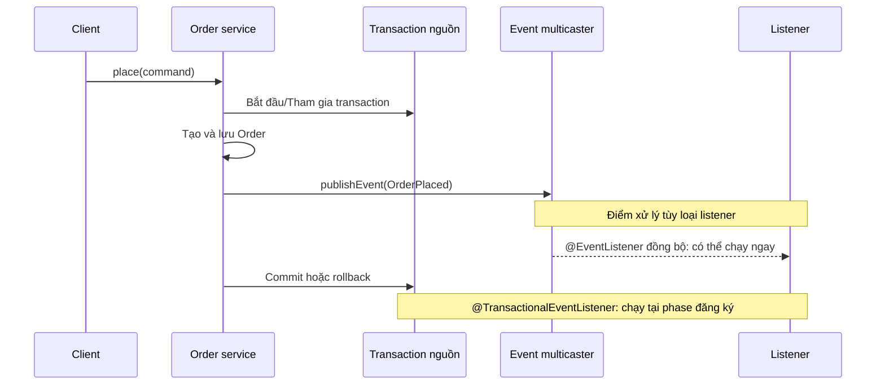
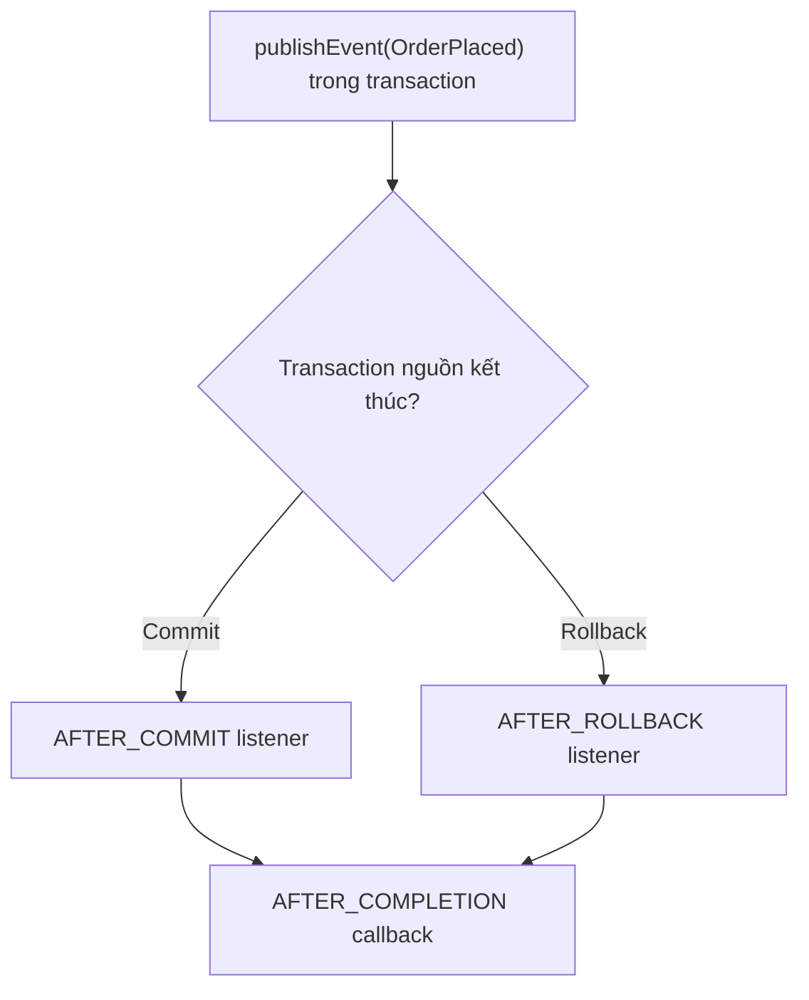
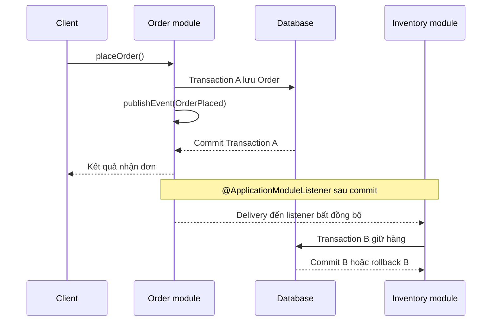
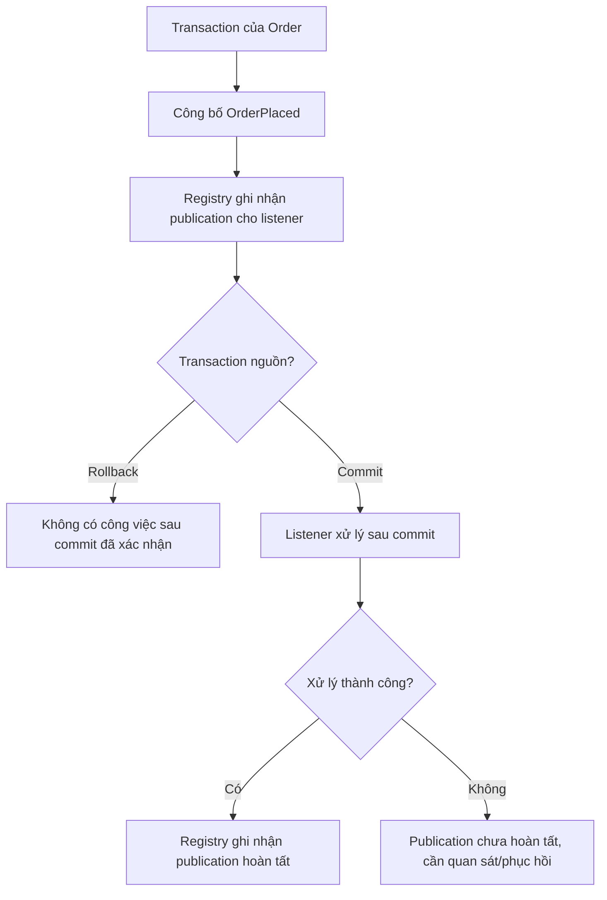
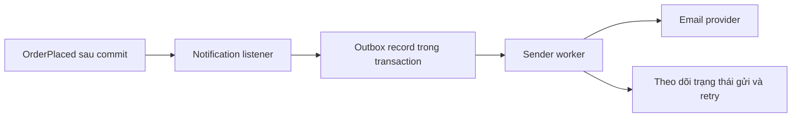

# Event trong transaction với Spring Modulith

## 1. Vấn đề cốt lõi: phát event không có nghĩa là commit

Khi đặt hàng thành công, module `order` cần lưu đơn và thông báo sự thật `OrderPlaced` cho những module quan tâm. Module `inventory` có thể giữ hàng, `notification` gửi thư tiếp nhận, còn `analytics` ghi nhận thống kê. **Application event** giúp publisher không phụ thuộc trực tiếp vào implementation của các consumer.

Tuy nhiên, lời gọi `ApplicationEventPublisher.publishEvent(event)` và việc **commit transaction** là hai hành động khác nhau. Nếu event được phát khi transaction đang mở, mã bên phát vẫn có thể ném exception hoặc bị rollback sau lời gọi đó. Một listener xử lý sự kiện quá sớm có thể thực hiện tác dụng phụ cho một đơn hàng **chưa bao giờ được commit**.

Bài thuộc chương **Giao dịch và event**, với chủ đề **Event trong transaction**, trong phạm vi **SPRING_MODULITH_APPLICATION_EVENTS**. Mục tiêu của module học là tổ chức giao tiếp giữa các module Spring Modulith bằng application events để giảm phụ thuộc, bảo vệ ranh giới nghiệp vụ; thực hành publisher, listener, xử lý sau commit, Event Publication Registry, retry, kiểm thử và quan sát giao sự kiện đáng tin cậy.

Sau bài này, bạn có thể:

1. Phân biệt event được **công bố trong transaction** với event được **xử lý sau commit**.
2. Giải thích cách `@EventListener`, `@TransactionalEventListener` và `@ApplicationModuleListener` tương tác với transaction.
3. Chọn transaction phase đúng với nhu cầu nghiệp vụ và nhận diện tác động của rollback.
4. Thiết kế listener có transaction riêng, khả năng retry và idempotency khi cần xử lý sau commit.
5. Viết kiểm thử cho commit, rollback, xử lý bất đồng bộ và event publication.

### Một ví dụ xuyên suốt

Giả sử quy tắc của hệ thống bán hàng là:

- `order` tiếp nhận và lưu đơn ở trạng thái `PENDING_STOCK`.
- `order` phát `OrderPlaced` ngay trong transaction lưu đơn.
- `inventory` chỉ bắt đầu giữ hàng **sau khi transaction của order đã commit**.
- `notification` có thể gửi thông báo đã tiếp nhận đơn sau commit, nhưng **không** được mặc định nói đã giữ đủ hàng.
- Khi listener gặp lỗi kỹ thuật, đơn gốc không bị “rollback ngược”; consumer phải có phương án phục hồi.

## 2. Transaction trong Spring bảo vệ điều gì?

Với mô hình điển hình sử dụng Spring Data JPA và một transaction manager, method `@Transactional` mở hoặc tham gia transaction theo propagation. Các thay đổi database nằm trong transaction sẽ commit khi method hoàn thành thành công theo các quy tắc được cấu hình; một exception phù hợp có thể khiến transaction rollback.

```java
@Service
class PlaceOrderService {

    @Transactional
    public UUID place(PlaceOrderCommand command) {
        Order order = Order.place(command);
        orders.save(order);
        return order.id();
    }
}
```

Đây là **đoạn code minh họa**: `Order`, `PlaceOrderCommand` và `orders` là kiểu/field giả định trong module `order`; class/service cần constructor injection và các import tương ứng trong ứng dụng thật.

Điều cần nhớ là transaction chỉ bao phủ những tài nguyên được transaction manager phối hợp. Việc gọi email API, REST API ngoài, ghi file hoặc đẩy một thông điệp tới hạ tầng khác **không tự động** trở thành một phần nguyên tử của database transaction.

| Hành động | Thông thường thuộc transaction database? | Ghi chú |
| --- | --- | --- |
| `orderRepository.save(order)` | Có, khi tham gia transaction nguồn | Dữ liệu có thể chưa thấy ở transaction khác trước commit |
| Gọi một method repository khác trong cùng transaction | Có, nếu dùng cùng transaction manager/resource | Cần xét propagation/isolation thực tế |
| `applicationEventPublisher.publishEvent(event)` | Không phải một lệnh commit | Chỉ công bố event cho cơ chế dispatch |
| Listener `@EventListener` đồng bộ | Chạy trong đường gọi publish, thường cùng thread | Có thể nhìn thấy transaction hiện tại |
| Gửi email hoặc gọi HTTP API | Không | Side effect có thể không hoàn tác khi database rollback |
| Listener chạy sau commit | Chạy khi transaction nguồn đã commit | Không thể làm rollback transaction nguồn đã commit |

**Lưu ý proxy:** `@Transactional` thường được Spring áp dụng qua proxy. Gọi nội bộ một method `@Transactional` khác bằng `this.method()` trong cùng bean có thể bỏ qua interception; thiết kế transaction dựa vào proxy phải được kiểm thử theo đường gọi thực tế.

## 3. Phát sự kiện bên trong transaction

Ví dụ một publisher thuộc module `order`:

```java
// com/example/shop/order/OrderPlaced.java
package com.example.shop.order;

import java.time.Instant;
import java.util.Objects;
import java.util.UUID;

public record OrderPlaced(UUID eventId, UUID orderId, Instant occurredAt) {
    public OrderPlaced {
        Objects.requireNonNull(eventId, "eventId");
        Objects.requireNonNull(orderId, "orderId");
        Objects.requireNonNull(occurredAt, "occurredAt");
    }
}
```

```java
// Ví dụ class thuộc com.example.shop.order.internal
@Service
class PlaceOrderService {

    private final OrderRepository orders;
    private final ApplicationEventPublisher publisher;
    private final Clock clock;

    PlaceOrderService(OrderRepository orders,
                      ApplicationEventPublisher publisher,
                      Clock clock) {
        this.orders = orders;
        this.publisher = publisher;
        this.clock = clock;
    }

    @Transactional
    public UUID place(PlaceOrderCommand command) {
        Order order = Order.placePendingStock(command);
        orders.save(order);

        publisher.publishEvent(new OrderPlaced(
                UUID.randomUUID(), order.id(), clock.instant()
        ));

        return order.id();
    }
}
```

Trong đoạn trích, các import cần có là `org.springframework.context.ApplicationEventPublisher`, `java.time.Clock`, `java.util.UUID`, `org.springframework.stereotype.Service` và `org.springframework.transaction.annotation.Transactional`; `OrderRepository`, `Order` và `PlaceOrderCommand` là thành phần nghiệp vụ minh họa. `OrderPlaced` nằm tại API công khai của `order`, không truyền entity JPA ra ngoài module.

Điểm quyết định: lời gọi `publishEvent(...)` xảy ra **trước khi method `place(...)` kết thúc và trước khi transaction nguồn hoàn tất**. Nếu sau đó một ràng buộc database bị vi phạm, hoặc một exception khiến transaction rollback, event đã được công bố trong quá trình xử lý nhưng đơn không được commit.

### Phân biệt “công bố” và “nhận ở thời điểm nào”



Mũi tên mô tả **vòng đời trong cùng ứng dụng**, không mặc định nói event đã được gửi qua message broker. Những annotation khác nhau có thời điểm thực thi và ảnh hưởng lỗi khác nhau, dù cùng nhận `OrderPlaced`.

## 4. `@EventListener`: callback thường chạy ngay trong transaction nguồn

Với cấu hình Spring mặc định và không bật dispatch bất đồng bộ riêng, listener `@EventListener` được gọi **đồng bộ** trong quá trình `publishEvent(...)`. Nếu caller đang ở trong transaction, listener thường chạy trên cùng thread và thấy transaction hiện tại.

```java
@Component
class ValidateOrderNotificationData {

    @EventListener
    public void on(OrderPlaced event) {
        // Minh họa thao tác đồng bộ, không gọi email provider ở đây.
        if (event.orderId() == null) {
            throw new IllegalArgumentException("Missing orderId");
        }
    }
}
```

Do callback chạy trong đường gọi của publisher, một unchecked exception không được xử lý từ listener đồng bộ có thể làm luồng gọi publisher thất bại và dẫn đến rollback theo quy tắc transaction của Spring. Tuy nhiên, **không nên dựa vào exception của một consumer độc lập để quyết định tính hợp lệ của module nguồn**: trách nhiệm validation của `order` nên được bảo vệ trước khi công bố sự kiện.

Các rủi ro khi dùng listener đồng bộ cho công việc độc lập:

1. **Rollback không hủy tác dụng phụ bên ngoài.** Listener gọi email API thành công, rồi `order` rollback; khách vẫn nhận email về đơn không tồn tại.
2. **Consumer làm chậm publisher.** Một truy vấn chậm ở `analytics` kéo dài transaction của `order`.
3. **Coupling về lỗi.** Một lỗi không quan trọng của thông báo có thể làm việc đặt đơn thất bại.
4. **Hiểu nhầm tính độc lập.** Dù các class nằm ở module khác, việc chạy đồng bộ vẫn khiến hành vi của consumer tham gia đường đi nghiệp vụ của publisher.

### Khi nào listener đồng bộ có thể phù hợp?

Khi công việc **thực sự là một phần của transaction nguồn**, cần kết quả ngay và được thiết kế cùng chính sách rollback, xử lý đồng bộ có thể có lý do chính đáng. Nhưng hãy cân nhắc xem đó nên là lời gọi API công khai trực tiếp thay vì event: một điều kiện nghiệp vụ bắt buộc thường dễ đọc và kiểm thử hơn bằng call có kết quả tường minh.

**Không mặc định** `@EventListener` luôn đồng bộ trong mọi môi trường: nếu dùng `@Async`, custom `ApplicationEventMulticaster` hoặc cấu hình executor bất đồng bộ, behavior thay đổi. Lúc ấy thread-local transaction nguồn không tự động đi theo thread xử lý.

## 5. `@TransactionalEventListener` liên kết event với transaction phase

`@TransactionalEventListener` là tiện ích của Spring Framework cho phép listener đăng ký ở **một giai đoạn của transaction**. Mặc định, annotation sử dụng `TransactionPhase.AFTER_COMMIT`.

```java
@Component
class OrderPlacedNotificationListener {

    @TransactionalEventListener(phase = TransactionPhase.AFTER_COMMIT)
    public void on(OrderPlaced event) {
        // Chỉ phản ứng khi transaction nguồn đã commit.
    }
}
```

| `TransactionPhase` | Thời điểm | Phù hợp với | Cần nhớ |
| --- | --- | --- | --- |
| `BEFORE_COMMIT` | Trước khi transaction chuẩn bị commit | Tác vụ gắn chặt với transaction nguồn, kiểm tra hoặc ghi dữ liệu có chủ đích | **Chưa chắc đã commit**; vẫn có thể rollback sau callback |
| `AFTER_COMMIT` | Sau commit thành công | Tác vụ phản ứng với sự thật đã commit, ví dụ gửi thông báo, cập nhật module khác | Không thể rollback transaction nguồn đã commit |
| `AFTER_ROLLBACK` | Sau rollback transaction | Cleanup/telemetry khi transaction bị hủy | Không coi event là nghiệp vụ đã commit |
| `AFTER_COMPLETION` | Khi transaction kết thúc, dù commit hay rollback | Cleanup/metric cho kết quả cuối transaction | Cần biết kết quả commit/rollback nếu logic phụ thuộc |

### 5.1. Hai luồng khác nhau cho commit và rollback



Sơ đồ chỉ thể hiện **phase liên quan**, không khẳng định thứ tự tương đối của nhiều listener đăng ký cùng phase. `AFTER_COMPLETION` chạy khi hoàn thành transaction, chứ không có nghĩa mọi callback khác và tác vụ bất đồng bộ đã kết thúc.

### 5.2. Nếu không có transaction đang hoạt động?

Theo mặc định, một `@TransactionalEventListener` yêu cầu event được phát trong ngữ cảnh transaction để có thể đăng ký callback theo phase. Nếu không có transaction phù hợp, event **không được xử lý bởi listener này**. Có thể bật `fallbackExecution = true` nếu chủ động muốn thực thi listener khi không có transaction, nhưng cần hiểu lúc đó **không còn bảo đảm “chạy sau commit”**:

```java
@TransactionalEventListener(
        phase = TransactionPhase.AFTER_COMMIT,
        fallbackExecution = true
)
void handle(OrderPlaced event) {
    // Khi có transaction: theo phase.
    // Khi không có transaction: thực thi fallback không chờ commit.
}
```

Không bật `fallbackExecution = true` chỉ để “chữa” test thiếu transaction. Hãy quyết định hợp đồng event phải luôn được phát trong transaction hay cũng chấp nhận từ nguồn không có transaction, rồi kiểm thử riêng hai trường hợp.

### 5.3. `AFTER_COMMIT` không có nghĩa listener tự chạy bất đồng bộ

`@TransactionalEventListener(phase = AFTER_COMMIT)` mặc định không tự tạo thread riêng. Nó là **ràng buộc thời điểm callback**. Việc listener có chạy bất đồng bộ hay không còn tùy `@Async` hoặc cấu hình thực thi. Vì thế cần phân biệt hai câu hỏi:

- **Khi nào?** `BEFORE_COMMIT`, `AFTER_COMMIT`, `AFTER_ROLLBACK` hay `AFTER_COMPLETION`.
- **Chạy ở đâu và trong transaction nào?** Đồng bộ/bất đồng bộ, thread nào, `REQUIRES_NEW` hay không có transaction mới.

Hai khía cạnh này độc lập về mặt ý nghĩa thiết kế; không được suy ra một khía cạnh chỉ từ tên class `AsyncOrderListener`.

## 6. Vì sao listener sau commit thường cần transaction mới?

Một điểm tinh tế: khi callback `AFTER_COMMIT` chạy, transaction nguồn **đã commit**, nhưng các tài nguyên của transaction (như connection/entity manager) có thể vẫn còn gắn với thread trong một khoảng ngắn. Theo semantics của Spring, thao tác truy cập dữ liệu tại các callback `AFTER_COMMIT`/`AFTER_COMPLETION` có thể vẫn thấy tài nguyên transaction cũ; **không được suy ra rằng một lần ghi mới sẽ có commit tiếp theo**.

Nếu listener cần ghi reservation, trạng thái gửi thông báo hoặc audit record **sau khi đơn đã commit**, hãy mở **transaction riêng**, chẳng hạn bằng `Propagation.REQUIRES_NEW`:

```java
// Cách kết hợp annotation Spring, dùng khi chủ động muốn xử lý sau commit.
@Component
class ReserveStockAfterOrderPlaced {

    private final StockReservationService reservations;

    ReserveStockAfterOrderPlaced(StockReservationService reservations) {
        this.reservations = reservations;
    }

    @TransactionalEventListener(phase = TransactionPhase.AFTER_COMMIT)
    @Transactional(propagation = Propagation.REQUIRES_NEW)
    public void on(OrderPlaced event) {
        reservations.reserveOnce(event.orderId());
    }
}
```

Các import tương ứng: `org.springframework.transaction.event.TransactionalEventListener`, `org.springframework.transaction.event.TransactionPhase`, `org.springframework.transaction.annotation.Transactional`, `org.springframework.transaction.annotation.Propagation`. `StockReservationService` là ví dụ về service nghiệp vụ thuộc `inventory`; method `reserveOnce` do ứng dụng định nghĩa.

`REQUIRES_NEW` yêu cầu tạo một transaction độc lập cho xử lý phía consumer, thay vì cố tiếp tục ghi trong transaction nguồn đã hoàn thành. Việc mở transaction và interception còn chịu ảnh hưởng cấu hình proxy/transaction manager; cần kiểm thử dữ liệu đã thực sự được commit.

### Transaction mới không tạo giao dịch phân tán

Giả sử:

1. `order` commit đơn hàng thành công.
2. Listener của `inventory` mở transaction mới để giữ hàng.
3. Transaction giữ hàng bị rollback do không kết nối database.

**Chỉ transaction của `inventory` rollback.** Đơn đã commit trong `order` vẫn tồn tại. Đây không phải lỗi của `REQUIRES_NEW`: đó là mô hình giao tiếp sau commit, đòi hỏi trạng thái chờ và chiến lược phục hồi/nhận kết quả.

Không được mô tả một event sau commit như thể nó mở rộng ACID transaction của publisher sang các module nhận. Ngay cả khi các module dùng chung database, việc tạo transaction mới sau commit đã tách ranh giới nguyên tử.

## 7. `@ApplicationModuleListener` trong Spring Modulith

Spring Modulith cung cấp `@ApplicationModuleListener` để thuận tiện tổ chức listener tương tác giữa các application module. Trong cách dùng phổ biến, annotation kết hợp các đặc điểm:

- Transactional event listener gắn với **giai đoạn sau commit**.
- Xử lý **bất đồng bộ**, tránh buộc publisher đợi toàn bộ công việc của consumer.
- Chạy công việc consumer trong **transaction riêng**.

Điều này phù hợp với các module có trách nhiệm tương đối độc lập: `order` chịu trách nhiệm tạo đơn, `inventory` tự giữ hàng, `notification` tự gửi thông báo.

```java
// com/example/shop/inventory/internal/OrderPlacedListener.java
package com.example.shop.inventory.internal;

import com.example.shop.order.OrderPlaced;
import org.springframework.modulith.events.ApplicationModuleListener;
import org.springframework.stereotype.Component;

@Component
class OrderPlacedListener {

    private final StockReservationService reservations;

    OrderPlacedListener(StockReservationService reservations) {
        this.reservations = reservations;
    }

    @ApplicationModuleListener
    void on(OrderPlaced event) {
        reservations.reserveOnce(event.orderId());
    }
}
```

`StockReservationService` thuộc module `inventory`. Listener nhận event công khai `order.OrderPlaced`, không truy cập `order.internal.OrderRepository`. Nhờ vậy, đường phụ thuộc mã nguồn đi **từ consumer đến hợp đồng công khai của publisher**, không phải publisher import implementation của consumer.

### 7.1. Mô hình thời gian cần hiểu



Trong sơ đồ, `Transaction A` và `Transaction B` độc lập. Nếu `Transaction A` rollback, listener dạng sau commit không được xử lý sự kiện như một đơn đã hoàn tất. Nếu `Transaction B` lỗi, nó không thể hủy `Transaction A` đã commit.

**Quan trọng:** Độ trễ giữa commit A và bắt đầu B không được bảo đảm bằng một thời gian cố định. Executor có thể bận, ứng dụng có thể restart, hoặc listener có thể cần retry. API HTTP trả về mã đơn không chứng minh reservation đã xong; trạng thái `PENDING_STOCK` và cơ chế đọc kết quả phải được thiết kế rõ.

### 7.2. Không suy diễn ý nghĩa của event

`OrderPlaced` nghĩa là đơn đã được tiếp nhận theo contract của `order`, **không có nghĩa tồn kho đã được giữ**. Nếu `inventory` từ chối giữ hàng vì không đủ số lượng, đó có thể là kết quả nghiệp vụ hợp lệ. Module `order` cần nhận kết quả qua một hợp đồng/luồng điều phối được thiết kế hợp lệ, không để `inventory` tự sửa entity nội bộ của `order`.

Nếu `order` phải import `StockReserved` từ `inventory` trong khi `inventory` đã import `OrderPlaced` từ `order`, có thể hình thành **phụ thuộc vòng tĩnh**. Cần cân nhắc module điều phối hoặc cấu trúc hợp đồng một chiều; application events không tự động xóa mọi vòng phụ thuộc.

## 8. Transaction phase nào phù hợp với use case nào?

Không phải mọi trường hợp đều nên dùng `AFTER_COMMIT`. Việc chọn phase là một **quyết định nghiệp vụ và nhất quán dữ liệu**, không chỉ là tối ưu hiệu năng.

| Use case | Cơ chế nên cân nhắc | Lý do |
| --- | --- | --- |
| Kiểm tra dữ liệu tạo đơn là hợp lệ | Domain/application service của `order` trước commit | Validation nguồn nên nằm ở module sở hữu; không phụ thuộc consumer độc lập |
| Ghi nhiều entity bắt buộc cùng commit | Lời gọi đồng bộ trong cùng transaction | Cần tính nguyên tử chung thực sự |
| Mở rộng logic trước commit có chủ đích | `@TransactionalEventListener(BEFORE_COMMIT)` khi có lý do phù hợp | Có thể tham gia công việc trước commit; phải hiểu failure/rollback |
| Gửi thông báo tiếp nhận sau khi đơn được commit | `AFTER_COMMIT` hoặc `@ApplicationModuleListener` | Tránh gửi email cho đơn bị rollback |
| Consumer khác ghi dữ liệu sau khi đơn commit | `@ApplicationModuleListener` hoặc listener sau commit với `REQUIRES_NEW` | Consumer có transaction riêng, không kéo dài transaction nguồn |
| Theo dõi transaction hủy | `AFTER_ROLLBACK` | Quan sát thất bại, không giả định nghiệp vụ đã tồn tại |
| Cleanup hoặc metric sau kết thúc transaction | `AFTER_COMPLETION` | Quan tâm transaction kết thúc bất kể outcome |
| Cần kết quả giữ hàng **trước khi** xác nhận đơn | API đồng bộ với quy tắc transaction rõ | Event bất đồng bộ sau commit không thể trả kết quả ngay |

### Phản ví dụ: gửi email trong `BEFORE_COMMIT`

```java
@TransactionalEventListener(phase = TransactionPhase.BEFORE_COMMIT)
void sendEmail(OrderPlaced event) {
    emailGateway.sendOrderReceived(event.orderId());
}
```

Thiết kế này có thể gửi thư thành công, rồi transaction nguồn rollback do lỗi ghi dữ liệu xảy ra sau callback. Email đã gửi không tự bị hủy. Vì vậy **tác vụ ngoài database không thể rollback** thường cần xảy ra sau commit hoặc qua cơ chế outbox đáng tin cậy.

### Phản ví dụ: dựa vào `AFTER_COMMIT` để kiểm tra tính hợp lệ đầu vào

```java
@TransactionalEventListener(phase = TransactionPhase.AFTER_COMMIT)
void validateOrderBusinessRules(OrderPlaced event) {
    // Quá muộn để làm transaction nguồn rollback theo quy tắc này!
}
```

Đơn đã commit trước khi callback này chạy. Nếu validation là điều kiện bắt buộc để đơn tồn tại, nó phải diễn ra trước commit trong module sở hữu. Listener sau commit chỉ nên xử lý quy trình hậu kỳ và kết quả được mô hình hóa rõ.

## 9. Mô hình lỗi và rollback thực tế

Một cách hiểu đúng transaction phải trả lời được: **Nếu lỗi xảy ra tại từng mốc, điều gì còn tồn tại?**

| Tình huống | Transaction `order` | Listener/transaction consumer | Phản ứng hợp lý |
| --- | --- | --- | --- |
| Validation ném lỗi trước khi publish | Có thể rollback | Listener sau commit không chạy cho giao dịch thất bại | Sửa dữ liệu đầu vào hoặc nghiệp vụ |
| `publishEvent` được gọi, transaction nguồn rollback sau đó | Rollback | Transactional listener `AFTER_COMMIT` không xử lý như đã commit | Không phát sinh hậu quả sau commit |
| `@EventListener` đồng bộ ném unchecked exception | Có thể khiến transaction nguồn rollback | Listener nằm trong đường gọi publish | Cân nhắc có nên coupling lỗi của consumer với nguồn |
| Transaction nguồn commit, listener chưa bắt đầu | Commit | Chưa ghi reservation | Trạng thái chờ và quan sát publication |
| Listener sau commit ném lỗi kỹ thuật | **Đã commit** | Transaction consumer có thể rollback | Phục hồi/retry consumer |
| Listener giữ hàng thành công nhưng ghi completion thất bại | Đã commit | Reservation có thể đã commit | Replay phải idempotent |
| Listener gặp kết quả `OUT_OF_STOCK` | Đã commit | Có thể ghi nhận từ chối nghiệp vụ | Chuyển trạng thái quy trình, không retry vô hạn |
| Listener phát event mới, transaction riêng rollback | Đã commit | Phụ thuộc transaction consumer | Listener của event mới sau commit không được coi như thành công nếu transaction consumer rollback |

**Ngoại lệ quan trọng:** Exception từ một callback sau commit chạy đồng bộ có thể được truyền ngược cho code gọi transaction và làm caller nhìn thấy lỗi, nhưng **không thể hoàn tác commit đã diễn ra**. Do đó không thể suy ra từ HTTP 500 rằng transaction nguồn chắc chắn đã rollback; hãy kiểm chứng trạng thái database thực tế.

### Transactional listener và exception bị nuốt

```java
@ApplicationModuleListener
void on(OrderPlaced event) {
    try {
        reservations.reserveOnce(event.orderId());
    } catch (RuntimeException error) {
        log.error("Failed to reserve stock", error);
        // Nuốt exception rồi kết thúc như đã xử lý thành công.
    }
}
```

Đây là **đoạn minh họa lỗi thiết kế**; `reservations` và `log` là các field giả định. Nếu hệ thống theo dõi trạng thái xử lý listener, một callback trở về bình thường có thể khiến publication bị coi là hoàn tất dù giữ hàng chưa thành công. Lỗi kỹ thuật cần phục hồi nên được truyền/ghi nhận như lỗi; còn kết quả nghiệp vụ hợp lệ như không đủ hàng nên có trạng thái được mô hình hóa tường minh.

## 10. Event Publication Registry giúp lấp khoảng trống nào?

Nếu chỉ dùng event nội bộ với listener chạy sau commit, vẫn có **khoảng thời gian** từ lúc transaction của publisher commit tới khi listener hoàn tất. Trong khoảng này, ứng dụng có thể crash, listener có thể lỗi hoặc executor bị quá tải. Nếu không có cơ chế lưu publication, event nằm trong bộ nhớ có nguy cơ không được xử lý lại.

Spring Modulith cung cấp **Event Publication Registry** nhằm theo dõi việc giao publication đến các transactional listener đủ điều kiện, khi được bật cùng triển khai lưu trữ phù hợp. Registry giúp nhận biết những publication chưa được ghi nhận hoàn tất và là nền tảng cho phục hồi theo chiến lược/cấu hình ứng dụng.

Ở mức khái niệm, luồng là:



Sơ đồ là mô hình logic. Vị trí và cách ghi bản ghi publication vào tài nguyên giao dịch, thời điểm phát hiện listener cũng như chính sách lưu/xóa publication hoàn tất phụ thuộc **phiên bản Spring Modulith**, store và cấu hình được lựa chọn. Không coi nó là schema SQL hoặc quy trình ACK cụ thể cho mọi triển khai.

### 10.1. Registry không đồng nghĩa exactly-once

Giả sử `inventory` đã commit reservation, nhưng ứng dụng bị ngắt trước khi publication được đánh dấu hoàn tất. Lần phục hồi tiếp theo có thể gọi lại cùng event. Registry giúp **không bỏ quên công việc chưa ghi nhận xong**, nhưng không tự bảo đảm mọi side effect bên ngoài chỉ xảy ra đúng một lần.

```text
OrderPlaced(eventId=E1, orderId=O42)
  Lần 1: Listener tạo Reservation(O42) thành công.
  Sự cố: Chưa kịp ghi nhận completion của publication.
  Lần 2: Khôi phục E1 -> reserveOnce(O42) được gọi lại.
  Kỳ vọng: Không tạo reservation hoặc trừ stock lần hai.
```

`eventId` hỗ trợ nhận diện cùng một event; `orderId` (có thể kết hợp mục đích reservation) là **khóa nghiệp vụ** để ngăn giữ hàng trùng. Hai khái niệm không hoán đổi cho nhau: một đơn hàng có thể phát nhiều event khác nhau.

### 10.2. Điều kiện vận hành cần xác định

- Ứng dụng đã thực sự bật một triển khai registry có persistence hay chưa?
- Publication nào được theo dõi và listener nào là target?
- Có cơ chế khôi phục chưa hoàn tất tự động hoặc theo tác vụ được cấu hình không?
- Lỗi nào được retry, bao nhiêu lần, khoảng cách và giới hạn ra sao?
- Khi side effect đã thành công nhưng completion chưa ghi nhận, logic idempotency có an toàn không?
- Publication đã hoàn tất được giữ lại, đánh dấu hay xóa theo chính sách nào?

Không được giả định chỉ thêm annotation `@ApplicationModuleListener` là mọi đường xử lý sẽ bền vững trước mọi sự cố. Cần **kiểm thử hạ tầng đã cấu hình** và phương án vận hành.

## 11. Idempotency và dữ liệu nhất quán khi listener retry

Với processing sau commit, **retry là một khả năng thiết kế phải dự kiến**, không chỉ là biện pháp tạm thời khi hệ thống lỗi. Module nhận event phải tự bảo vệ bất biến trong dữ liệu mình sở hữu.

### 11.1. Tránh giữ hàng hai lần

Một cách thiết kế là mỗi yêu cầu giữ hàng ban đầu của một đơn có khóa nghiệp vụ duy nhất `(orderId, purpose)`. `inventory` kiểm tra dữ liệu đã ghi nhận và trả lại kết quả trước đó nếu một sự kiện được phát lại.

```java
// Pseudocode nghiệp vụ thuộc inventory.internal
@Service
class StockReservationService {

    private final ReservationRepository reservations;
    private final StockAllocator allocator;

    StockReservationService(
            ReservationRepository reservations,
            StockAllocator allocator) {
        this.reservations = reservations;
        this.allocator = allocator;
    }

    @Transactional
    public void reserveOnce(UUID orderId) {
        var purpose = ReservationPurpose.INITIAL_HOLD;
        if (reservations.existsByOrderIdAndPurpose(orderId, purpose)) {
            return;
        }

        StockReservation reserved = allocator.reserve(orderId, purpose);
        reservations.save(reserved);
    }
}
```

Các kiểu repository, allocator và reservation là thành phần minh họa; không có implementation cụ thể trong đoạn trích. **Không thể chỉ dùng `exists...` rồi `save` để bảo đảm idempotency khi có nhiều luồng xử lý đồng thời.** Hai transaction có thể cùng thấy chưa có bản ghi. Cần kết hợp **unique constraint**, locking hoặc optimistic concurrency phù hợp và kiểm soát transaction cập nhật số lượng tồn.

Nếu một lần thử lại gặp unique conflict, cần đọc lại bản ghi và kiểm tra nó có cùng mục đích và nội dung không; không nuốt mọi lỗi database để coi là “đã xử lý”.

### 11.2. Không đồng nhất retry với lỗi nghiệp vụ

| Kết quả listener | Ví dụ | Chiến lược |
| --- | --- | --- |
| Thành công nghiệp vụ | Reservation đã commit | Hoàn tất callback, cho phép registry ghi nhận completion |
| Đã xử lý trước đó | Nhận lại cùng `OrderPlaced` | Trả kết quả đã ghi mà không trừ tồn lần nữa |
| Từ chối nghiệp vụ hợp lệ | Hết tồn kho hoặc quá giới hạn đặt trước | Ghi trạng thái từ chối, điều phối kết quả, không retry vô hạn |
| Lỗi kỹ thuật tạm thời | DB timeout, kết nối đứt | Để lỗi được nhận diện, retry/phục hồi sau khi xử lý nguyên nhân |
| Dữ liệu event không hợp lệ | Thiếu thông tin bắt buộc, contract sai | Điều tra và xử lý bất thường, không tự thay payload gốc rồi retry mù |

Sự kiện đến từ `order` không chuyển quyền sửa bảng đơn hàng sang `inventory`. Nếu giữ hàng thất bại, module sở hữu trạng thái đơn hoặc module điều phối sẽ quyết định bước tiếp theo thông qua hợp đồng công khai hợp lệ.

## 12. Side effect bên ngoài và outbox

Transaction database không tự bao phủ các hệ thống ngoài. Điều này dễ gây lỗi khi một listener vừa cập nhật database vừa gửi email hoặc gọi cổng thanh toán.

```text
Transaction nguồn commit thành công.
  → Notification listener gọi email provider.
  → Provider chấp nhận gửi.
  → Ứng dụng lỗi trước khi lưu trạng thái "đã gửi".
  → Listener được chạy lại.
  → Email có thể bị gửi thêm lần nữa.
```

Gắn `@Transactional` lên listener **không làm email trở thành tác vụ ACID**. Khi cần bảo đảm ghi nhận yêu cầu gửi và theo dõi kết quả lâu dài, có thể dùng **transactional outbox**:

1. Consumer nhận `OrderPlaced`.
2. Trong một transaction database, consumer ghi một bản ghi outbox có khóa idempotency và trạng thái `PENDING`.
3. Transaction commit; listener có thể được xem là đã **ghi nhận yêu cầu gửi một cách bền vững**.
4. Một worker khác gửi email và cập nhật trạng thái outbox, áp dụng retry/deduplication.



**Quan trọng về ngữ nghĩa completion:** Nếu listener chỉ ghi outbox rồi kết thúc, publication của listener được coi là hoàn tất theo **trách nhiệm ghi outbox**, không có nghĩa email đã đến hộp thư khách. Đây là hai vòng đời khác nhau và cần hai loại chỉ số/trạng thái quan sát.

Nếu hệ thống dùng các cơ chế event externalization hoặc message broker, còn phải xem transaction/acknowledgement của tầng truyền tải. Không mặc định Event Publication Registry nội bộ đã bảo đảm consumer bên ngoài cũng hoàn tất.

## 13. Kiểm thử event thực sự nằm trong transaction nào

Việc gọi trực tiếp `listener.on(event)` chỉ kiểm tra logic của method, **không kiểm chứng** listener được Spring gọi ở phase nào hoặc transaction có được commit hay không. Phải có test ở nhiều mức.

### 13.1. Kiểm tra event chỉ được xử lý sau commit

Với `@TransactionalEventListener`, có thể dùng `TransactionTemplate` trong integration test để chủ động tạo ranh giới transaction:

```java
// Đoạn JUnit/Spring integration test minh họa.
@Autowired TransactionTemplate transactionTemplate;
@Autowired ApplicationEventPublisher publisher;
@Autowired AfterCommitProbe probe;

@Test
void invokesListenerAfterSourceCommit() {
    UUID orderId = UUID.randomUUID();
    OrderPlaced event = new OrderPlaced(
            UUID.randomUUID(), orderId,
            Instant.parse("2026-11-25T08:00:00Z")
    );

    transactionTemplate.executeWithoutResult(status -> {
        publisher.publishEvent(event);
        assertThat(probe.hasReceived(orderId)).isFalse();
    });

    assertThat(probe.hasReceived(orderId)).isTrue();
}
```

Trong ví dụ này, `AfterCommitProbe` là một **test fixture** có listener `@TransactionalEventListener(phase = AFTER_COMMIT)` đồng bộ ghi nhận `orderId`; `probe.hasReceived(...)` đọc trạng thái fixture. Nó minh họa kiểm tra phase **trong cùng tiến trình**; không nên áp dụng assertion ngay sau `TransactionTemplate` cho `@ApplicationModuleListener` bất đồng bộ.

Một test tương tự cho rollback có thể dùng:

```java
@Test
void doesNotInvokeAfterCommitListenerWhenTransactionRollsBack() {
    UUID orderId = UUID.randomUUID();
    OrderPlaced event = new OrderPlaced(
            UUID.randomUUID(), orderId,
            Instant.parse("2026-11-25T08:00:00Z")
    );

    transactionTemplate.executeWithoutResult(status -> {
        publisher.publishEvent(event);
        status.setRollbackOnly();
    });

    assertThat(probe.hasReceived(orderId)).isFalse();
}
```

Hai test dùng `TransactionTemplate` để thực sự **commit/rollback** ở thời điểm xác định, thay vì dựa vào một method test `@Transactional` mặc định có thể rollback khi kết thúc. Những import và cấu hình bean test được lược bớt để nhấn mạnh ngữ nghĩa transaction.

### 13.2. Kiểm thử `@ApplicationModuleListener` bất đồng bộ

Với listener bất đồng bộ, test cần:

1. Tạo transaction nguồn và **commit thật**.
2. Chờ kết quả nghiệp vụ của consumer bằng cơ chế chờ điều kiện có timeout rõ ràng (ví dụ Awaitility nếu dự án dùng thư viện này).
3. Kiểm tra dữ liệu consumer đã commit và không chỉ có một callback được gọi.
4. Tạo lỗi kỹ thuật có kiểm soát, xác nhận cách hệ thống ghi nhận publication chưa hoàn tất theo registry được cấu hình.
5. Khôi phục và chạy lại **chính publication đó**, xác minh không tạo tác dụng phụ trùng.

Ví dụ ý tưởng kiểm tra điều kiện:

```java
// Giả sử transaction tạo đơn đã commit và có Awaitility trong test.
await().atMost(Duration.ofSeconds(10))
        .untilAsserted(() ->
                assertThat(reservations.countByOrderId(orderId))
                        .isEqualTo(1)
        );
```

`await()` ở đây là API của Awaitility, không phải API mặc định của Spring Modulith. Đây là ví dụ **cách chờ kết quả**, không phải kiểm thử nguyên khối có thể biên dịch ngay. Tránh dùng `Thread.sleep(...)` cố định như bằng chứng chắc chắn rằng một listener bất đồng bộ đã hoàn thành.

### 13.3. Ma trận kiểm thử nên có

| Kịch bản | Kết quả cần xác minh |
| --- | --- |
| Publisher trong transaction commit | Event của transactional after-commit listener được xử lý |
| Publisher trong transaction rollback | After-commit listener không thực thi nghiệp vụ đã commit |
| Publisher không có transaction | Listener theo transaction phase mặc định không thực thi; đánh giá riêng `fallbackExecution` |
| Listener đồng bộ ném lỗi | Ảnh hưởng tới transaction nguồn theo quy tắc rollback và cấu hình |
| Listener sau commit ném lỗi | Giao dịch nguồn đã commit; consumer lỗi độc lập |
| Listener mở `REQUIRES_NEW` | Ghi dữ liệu consumer được commit trong transaction riêng |
| Registry lưu publication, listener lỗi | Publication chưa hoàn tất có thể được nhận diện |
| Publication được retry | Cùng event không tạo reservation/email trùng |
| `BEFORE_COMMIT` listener thực hiện nhưng transaction cuối cùng rollback | Không được coi business event đã commit thành công |
| Hai listener khác nhau cùng event | Kết quả và trạng thái completion của từng consumer có thể khác nhau |

### 13.4. Kiểm thử ranh giới Spring Modulith

```java
import org.junit.jupiter.api.Test;
import org.springframework.modulith.core.ApplicationModules;

class ArchitectureTests {

    @Test
    void modulesRespectBoundaries() {
        ApplicationModules.of(ShopApplication.class).verify();
    }
}
```

`ShopApplication` là lớp `@SpringBootApplication` giả định ở package gốc. Phép `verify()` giúp kiểm tra dependency không hợp lệ và chu trình module; nó **không chứng minh** transaction phase hoặc publication registry chạy đúng. Cần cả architecture test và integration test.

## 14. Các lỗi thiết kế thường gặp

| Sai lầm | Hệ quả | Hướng sửa |
| --- | --- | --- |
| Coi `publishEvent()` là đã commit | Consumer suy ra nghiệp vụ đã hoàn tất quá sớm | Định nghĩa transaction phase rõ ràng |
| Gửi email trong `@EventListener` đồng bộ | Email vẫn gửi dù transaction nguồn rollback | Sau commit hoặc outbox có theo dõi |
| Coi `@TransactionalEventListener` mặc định là async | Callback có thể vẫn chạy đồng bộ | Xác định riêng phase và executor |
| Ghi database ở `AFTER_COMMIT` mà không có transaction mới phù hợp | Ghi dữ liệu không được commit như kỳ vọng | Dùng transaction riêng/`REQUIRES_NEW` và integration test |
| Bật `fallbackExecution` để test đỡ lỗi | Event ngoài transaction cũng chạy, thay đổi hợp đồng | Chủ động thiết kế ngữ nghĩa khi không có transaction |
| Listener nuốt exception | Hạ tầng có thể coi publication đã hoàn tất sai | Phản ánh lỗi kỹ thuật đúng cách |
| Dùng `REQUIRES_NEW` và nghĩ vẫn rollback nguyên tử với publisher | Consumer commit/rollback độc lập | Mô hình hóa eventual consistency và xử lý bù |
| Event sau commit chỉ nằm trong bộ nhớ | Có thể mất việc khi crash | Bật cơ chế publication persistence phù hợp nếu cần độ tin cậy |
| Cho rằng registry bảo đảm exactly-once | Retry có thể gây side effect trùng | Idempotency ở module sở hữu |
| Dựa vào `Thread.sleep` cho async test | Test không ổn định, có thể PASS sai | Chờ điều kiện có timeout và kiểm tra trạng thái bền vững |
| Dùng event để validation bắt buộc nhưng xử lý sau commit | Đơn đã commit trước khi phát hiện lỗi | Đưa validation vào domain/use case nguồn |

## 15. Bài tập thực hành: Transaction của đơn hàng và listener giữ hàng

**Bối cảnh:** Ứng dụng có module `order`, `inventory` và `notification`. Khi khách đặt hàng, `order` lưu trạng thái `PENDING_STOCK`, phát `OrderPlaced`, `inventory` giữ tồn kho sau commit và `notification` gửi thông báo tiếp nhận. Đôi khi database của inventory bị lỗi hoặc listener nhận lại cùng sự kiện.

**Yêu cầu thực hiện:**

1. Định nghĩa `OrderPlaced(eventId, orderId, occurredAt)` là Java record công khai của module `order`.
2. Tạo publisher dùng `ApplicationEventPublisher` bên trong method `@Transactional`. Giải thích vì sao `publishEvent` chưa có nghĩa transaction commit.
3. Cài đặt ba listener thực nghiệm cho **ba biến thể độc lập**: `@EventListener` đồng bộ, `@TransactionalEventListener(AFTER_COMMIT)` và `@ApplicationModuleListener`. Không để ba biến thể cùng chạy side effect trên một event trong môi trường nghiệp vụ thật.
4. Thử transaction nguồn commit và rollback; ghi lại listener nào được gọi, thời điểm gọi và vì sao.
5. Cho một listener sau commit ghi dữ liệu trong transaction mới và xác nhận dữ liệu đã được commit bằng truy vấn từ transaction khác.
6. Cho listener inventory ném lỗi kỹ thuật; xác minh đơn vẫn còn trong database sau khi transaction nguồn commit, còn tác vụ inventory có thể cần phục hồi.
7. Bật một triển khai Event Publication Registry phù hợp của dự án; tạo publication chưa hoàn tất, đối chiếu listener đích và trạng thái qua công cụ/API phiên bản đang sử dụng.
8. Triển khai `reserveOnce(orderId)` với khóa nghiệp vụ, unique constraint và kiểm thử hai lần xử lý cùng event; nếu có thể, kiểm thử cả hai lượt chạy đồng thời.
9. Gửi email thông qua một adapter thử nghiệm có khả năng trả lỗi sau khi provider chấp nhận; thiết kế outbox hoặc deduplication để tránh gửi lặp.
10. Thêm test dùng `TransactionTemplate` để chứng minh `AFTER_COMMIT` không chạy khi rollback; dùng cách chờ điều kiện khi test listener bất đồng bộ.
11. Chạy `ApplicationModules.of(ShopApplication.class).verify()` để xác minh `inventory` không truy cập `order.internal`.

### Câu hỏi suy luận

**Câu 1.** `@TransactionalEventListener(AFTER_COMMIT)` bắt exception trong listener và trả về bình thường. Registry sẽ luôn biết nghiệp vụ bị lỗi chứ?

**Gợi ý:** Không thể giả định vậy. Callback có thể được coi là thành công nếu không báo lỗi, và completion có thể được ghi nhận sai. Cần thiết kế hợp đồng thành công/thất bại và cơ chế ghi trạng thái nghiệp vụ phù hợp.

**Câu 2.** Một callback `AFTER_COMMIT` gặp exception, request HTTP trả lỗi. Có thể kết luận đơn hàng chắc chắn rollback không?

**Gợi ý:** Không. Transaction nguồn có thể đã commit trước khi callback báo lỗi; cần kiểm tra trạng thái bền vững và thiết kế phản hồi API phù hợp.

**Câu 3.** Đã có Event Publication Registry, có thể bỏ idempotency ở inventory không?

**Gợi ý:** Không. Publication có thể được xử lý lại khi chưa ghi nhận hoàn tất, trong khi side effect nghiệp vụ của lần trước đã thành công.

**Câu 4.** Khi nào cần `BEFORE_COMMIT` thay vì `AFTER_COMMIT`?

**Gợi ý:** Khi công việc có chủ đích tham gia giai đoạn trước commit của transaction nguồn. Không dùng `BEFORE_COMMIT` cho các tác dụng phụ ngoài database không thể rollback nếu không có chiến lược bù.

## 16. Checklist thiết kế event trong transaction

Trước khi merge một publisher hoặc listener, hãy trả lời:

- Sự kiện được tạo **ở mốc nghiệp vụ nào** và được phát trong transaction nào?
- Listener cần kết quả **trước commit**, **sau commit**, hay cả lúc rollback?
- Có **transaction đang hoạt động** khi phát event không? Có cần `fallbackExecution` không?
- `@EventListener` là đồng bộ hay có executor/`@Async` thay đổi semantics?
- Consumer ghi dữ liệu trong transaction nguồn hay trong **transaction độc lập**?
- Nếu publisher commit nhưng consumer lỗi, trạng thái nghiệp vụ nào thể hiện sự chờ và thất bại?
- Side effect có thể chạy lại an toàn không? Khóa idempotency và constraint là gì?
- Hệ thống có registry lưu publication chưa hoàn tất và cơ chế phục hồi được cấu hình, kiểm thử không?
- Có phân biệt lỗi kỹ thuật retry được và kết quả nghiệp vụ bị từ chối không?
- Test có chứng minh commit, rollback và completion bằng dữ liệu bền vững chứ không chỉ callback được gọi không?
- Các dependency giữa module có đi qua API/event công khai và được `ApplicationModules.verify()` chấp nhận không?

## 17. Ghi nhớ

**Event trong transaction** không chỉ là gọi `publishEvent()` giữa hai thao tác repository. Phải xác định **event được công bố khi nào, listener xử lý ở phase nào, và transaction nào bảo vệ tác vụ của từng module**.

- `@EventListener` thường xử lý đồng bộ trong đường gọi publisher; nó có thể tham gia transaction nguồn và gây coupling về lỗi.
- `@TransactionalEventListener` gắn xử lý với phase transaction, mặc định `AFTER_COMMIT`; không tự đồng nghĩa với async hoặc transaction mới.
- `@ApplicationModuleListener` của Spring Modulith thuận tiện cho xử lý bất đồng bộ sau commit với transaction riêng của listener.
- Khi transaction nguồn đã commit, một consumer thất bại **không rollback ngược** dữ liệu nguồn. Quy trình cần trạng thái chờ, phục hồi và kết quả nghiệp vụ rõ ràng.
- Event Publication Registry giúp theo dõi publication và xử lý lại theo cấu hình, **không thay thế idempotency hoặc bảo đảm exactly-once side effects**.
- Kiểm thử phải bao phủ transaction thật, rollback, listener sau commit, retry, dữ liệu consumer và ranh giới module.

Thiết kế đúng mối quan hệ giữa transaction và application event giúp các module Spring Modulith giao tiếp độc lập mà vẫn diễn giải chính xác một sự thật nghiệp vụ, phát hiện thất bại và phục hồi an toàn.
