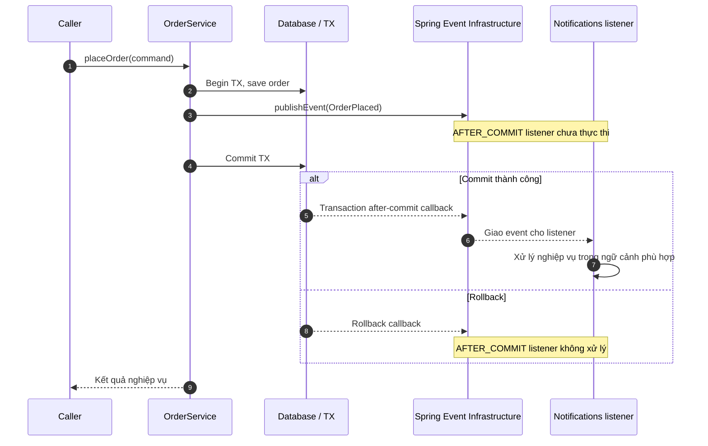
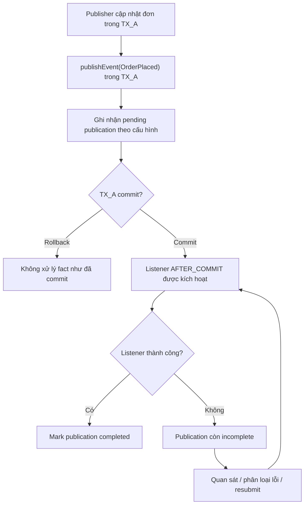
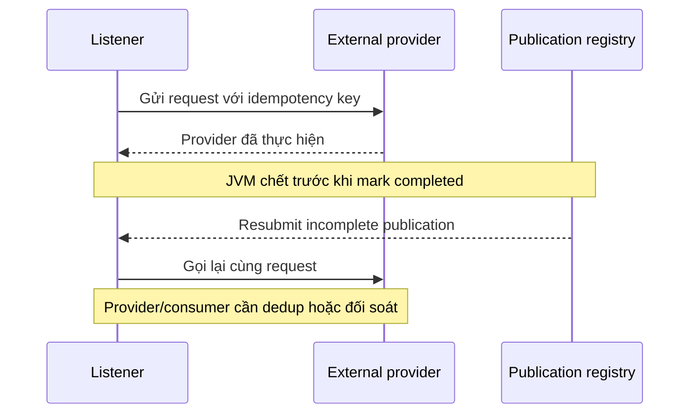

# Thời điểm publish application event trong giao dịch Spring Modulith

## 1. Vì sao phải xác định thời điểm publish?

Trong hệ thống được tổ chức theo **Spring Modulith**, module `orders` có thể dùng `ApplicationEventPublisher` để công bố `OrderPlaced` và cho module `notifications` hoặc `inventory` phản ứng. Việc tách giao tiếp bằng event giúp giảm lời gọi trực tiếp xuyên module, nhưng một câu hỏi quyết định tính đúng đắn là:

**Event được publish lúc nào so với transaction nghiệp vụ, và listener thực sự xử lý lúc nào?**

Giả sử hệ thống tạo đơn hàng như sau:

1. Kiểm tra điều kiện đặt hàng.
2. Lưu đơn hàng vào database.
3. Phát event `OrderPlaced`.
4. Commit transaction tạo đơn.
5. Listener gửi email xác nhận.

Nếu email được gửi ngay ở bước 3 nhưng commit bước 4 thất bại, khách nhận email cho đơn hàng không tồn tại. Nếu đổi thành “đợi commit xong mới gọi `publishEvent`” bằng mã thủ công, có thể tạo một khoảng mất event nếu tiến trình chết giữa commit và lời gọi publish.

Vì vậy, chủ đề **“Thời điểm publish”** trong chương **“Giao dịch và event”** không chỉ hỏi gọi API ở dòng nào. Nó bao gồm **thời điểm công bố trong tiến trình**, **thời điểm thay đổi dữ liệu trở nên bền vững**, **phase của listener**, **cách lưu publication**, và **thời điểm xác nhận side effect đã xử lý**.

Bài thuộc phạm vi **SPRING_MODULITH_APPLICATION_EVENTS**: thực hành publisher, listener, xử lý sau commit, event publication registry, retry, kiểm thử và quan sát giao sự kiện đáng tin cậy trong kiến trúc module.

### Mục tiêu học tập

Sau bài này, bạn có thể:

- Phân biệt `publishEvent(...)`, `flush`, database `commit` và thời điểm listener thực thi.
- Chọn `@EventListener`, `@TransactionalEventListener` hoặc `@ApplicationModuleListener` theo mục tiêu nghiệp vụ.
- Giải thích các phase `BEFORE_COMMIT`, `AFTER_COMMIT`, `AFTER_ROLLBACK`, `AFTER_COMPLETION`.
- Hiểu vì sao **publish trong transaction và consume sau commit** thường phù hợp cho giao tiếp liên module.
- Biết khi nào cần một transaction mới, khi nào không nên cho side effect ngoài database chạy trước commit.
- Phân tích khoảng lỗi giữa commit, giao event và hoàn thành listener.
- Kiểm thử commit, rollback, publish ngoài transaction, retry và publication tồn đọng.

> **Nguyên tắc quan trọng:** “Đã gọi `publishEvent`” không đồng nghĩa “database đã commit”; “listener được gọi” cũng không đồng nghĩa “side effect đã hoàn tất”.

## 2. Bốn mốc thời gian phải phân biệt

Cùng một nghiệp vụ có ít nhất bốn mốc cần đặt tên:

| Ký hiệu | Mốc | Điều được bảo đảm | Điều **chưa** được bảo đảm |
|---|---|---|---|
| **T1 – Business transition** | Domain/service xác lập thay đổi, ví dụ tạo `Order` hợp lệ | Quy tắc nghiệp vụ đã được xử lý trong bộ nhớ/transaction hiện tại | Dữ liệu đã commit bền vững |
| **T2 – Publish call** | `ApplicationEventPublisher.publishEvent(OrderPlaced)` | Event được đưa vào cơ chế ứng dụng của Spring; các listener phù hợp có thể được thông báo theo semantics của chúng | Listener sau commit đã chạy; transaction đã commit |
| **T3 – Transaction commit** | Transaction manager commit thành công | Thay đổi thuộc transaction đó được xác lập theo bảo đảm của database | Mọi consumer đã xử lý; email/API ngoài đã thành công |
| **T4 – Consumer completion** | Listener và/hoặc công việc tiếp theo hoàn thành | Bước được định nghĩa là completion đã thành công | Các bước hậu xử lý độc lập khác cũng hoàn tất |

Đối với mô hình **publish trong transaction, xử lý sau commit**, thứ tự logic điển hình là:



Sơ đồ là **trình tự khái niệm**; thời điểm trả response, việc lên lịch async và callback có thể khác tùy annotation, transaction manager và executor. Với listener bất đồng bộ, nghiệp vụ tạo đơn có thể trả về trước khi listener xử lý xong.

### 2.1. Một từ “publish” có thể chỉ hai hành động khác nhau

Trong thảo luận, nhiều người nói “publish sau commit” để chỉ **consumer được thông báo sau commit**. Nhưng trong mã Java, lời gọi `publishEvent(...)` thường nằm **trước commit**. Hai phát biểu chỉ mâu thuẫn khi không phân biệt:

- **Publish call:** publisher gửi event tới hạ tầng Spring.
- **Dispatch/handling phase:** listener thực sự chạy dựa trên điều kiện transaction.
- **Publication persistence:** nếu bật registry, ghi nhận công việc cần xử lý theo cơ chế lưu trữ phù hợp.
- **External delivery:** nếu có broker hoặc dịch vụ ngoài, lúc dữ liệu thật sự tới đích.

Khi review thiết kế, nên ghi chính xác “gọi publish trong TX” và “listener xử lý AFTER_COMMIT”, thay vì chỉ ghi “publish after commit”.

## 3. Thời điểm thực thi của listener phụ thuộc vào annotation

Spring Framework và Spring Modulith hỗ trợ những kiểu lắng nghe có đặc tính khác nhau.

| Cơ chế | Thời điểm điển hình | Quan hệ với transaction publisher | Khi cần dùng |
|---|---|---|---|
| `@EventListener` đồng bộ | Khi `publishEvent(...)` được gọi | Có thể chạy ngay khi transaction publisher còn mở | Phản ứng nội bộ cần đồng bộ, không có side effect không thể rollback |
| `@TransactionalEventListener(phase = BEFORE_COMMIT)` | Callback trước khi commit | Transaction chưa commit; lỗi có thể ảnh hưởng commit | Kiểm tra/chuẩn bị tác vụ cần diễn ra trong phase này |
| `@TransactionalEventListener(phase = AFTER_COMMIT)` | Sau commit thành công | Không rollback lại được transaction nguồn | Hậu xử lý chỉ nên bắt đầu khi dữ liệu đã commit |
| `@TransactionalEventListener(phase = AFTER_ROLLBACK)` | Sau rollback | Dữ liệu nguồn không được commit | Cleanup/quan sát kết quả rollback theo nhu cầu |
| `@TransactionalEventListener(phase = AFTER_COMPLETION)` | Khi transaction hoàn tất, thành công hoặc thất bại | Phải phân biệt outcome nếu hành vi cần | Cleanup/ghi nhận completion |
| `@ApplicationModuleListener` | Theo semantics Modulith: transactional after-commit, async và transaction xử lý riêng | Thích hợp cho listener liên module | Xử lý độc lập giữa các business capability |

**Mặc định:** `@TransactionalEventListener` sử dụng phase `AFTER_COMMIT` nếu không ghi rõ phase. `@EventListener` **không** tự đợi database commit.

Thông thường `@ApplicationModuleListener` là annotation tổng hợp cho listener giao dịch sau commit, xử lý bất đồng bộ và thực thi trong một transaction riêng (theo hành vi của release hỗ trợ). Cần xác minh phiên bản đang dùng trước khi dựa vào cấu hình executor/transaction để bảo đảm SLA.

### 3.1. Event application trong process khác broker message

`ApplicationEventPublisher` là API công bố sự kiện trong Spring application context. Nó không tự gửi thông điệp đến Kafka/RabbitMQ, không phải event store và không tự biến thao tác ngoài database thành atomic.

Nếu sau này có adapter chuyển event ra broker, phải xác định thêm **thời điểm gửi ra broker**, **outbox/registry**, xác nhận của broker và cơ chế retry. Không dùng giả định “Spring event đã publish thì broker đã nhận” nếu không có integration contract riêng.

## 4. Ví dụ minh họa: publisher phát trong transaction

Một event công khai đại diện cho fact đơn hàng đã được đặt:

```java
// orders/OrderPlaced.java
package com.example.shop.orders;

import java.time.Instant;
import java.util.UUID;

public record OrderPlaced(
        UUID eventId,
        UUID orderId,
        Instant occurredAt
) {
    public OrderPlaced {
        if (eventId == null || orderId == null || occurredAt == null) {
            throw new IllegalArgumentException("Required event fields missing");
        }
    }
}
```

Record không mang entity JPA, token hoặc dữ liệu khách hàng không cần thiết. `eventId` giúp truy vết một fact qua các lần giao lại; `orderId` chỉ ra đơn hàng liên quan; `occurredAt` là thời điểm fact được tạo theo quy ước, **không phải bảo đảm thứ tự commit toàn cục**.

Publisher thuộc module `orders`:

```java
// orders/internal/OrderService.java
package com.example.shop.orders.internal;

import com.example.shop.orders.OrderPlaced;
import java.time.Clock;
import java.util.UUID;
import org.springframework.context.ApplicationEventPublisher;
import org.springframework.stereotype.Service;
import org.springframework.transaction.annotation.Transactional;

@Service
public class OrderService {

    private final OrderRepository orders;
    private final ApplicationEventPublisher publisher;
    private final Clock clock;

    public OrderService(
            OrderRepository orders,
            ApplicationEventPublisher publisher,
            Clock clock
    ) {
        this.orders = orders;
        this.publisher = publisher;
        this.clock = clock;
    }

    @Transactional
    public UUID placeOrder(PlaceOrderCommand command) {
        // 1. Domain xác nhận command hợp lệ, tạo trạng thái đơn.
        Order order = orders.save(Order.place(command));

        // 2. Công bố fact BÊN TRONG TX, trước khi TX commit.
        publisher.publishEvent(new OrderPlaced(
                UUID.randomUUID(),
                order.id(),
                clock.instant()
        ));

        // 3. Spring TransactionInterceptor tiếp tục hoàn tất commit
        //    nếu method kết thúc thành công và không có rollback-only.
        return order.id();
    }
}
```

Các kiểu `Order`, `OrderRepository` và `PlaceOrderCommand` là domain mẫu; muốn chạy trong ứng dụng thật cần định nghĩa chúng, cung cấp bean `Clock`, transaction manager và persistence. Annotation `@Transactional` chỉ có hiệu lực khi lời gọi đi qua cơ chế AOP/transaction phù hợp.

**Điểm đặt publish quan trọng:**

- Không publish `OrderPlaced` **trước khi** domain xác định đơn có thể được tạo, nếu event có nghĩa “đơn đã được đặt”.
- Thường gọi publish **trong transaction** sau khi xác lập thay đổi; các transactional listener sẽ được kích hoạt theo phase thích hợp.
- Đừng ngầm biến event `OrderPlaced` thành `PaymentCaptured` hoặc `StockReserved`. Mỗi fact chỉ khẳng định điều module sở hữu thật sự đã bảo đảm.

### 4.1. Publish sau `save(...)` vẫn chưa phải sau commit

Phương thức repository `save(...)` có thể chỉ đưa thay đổi vào persistence context hoặc thực hiện một phần SQL. Ngay cả `saveAndFlush(...)` hoặc `EntityManager.flush()` cũng **không phải commit**: flush đồng bộ SQL vào database trong transaction, nhưng transaction vẫn có thể rollback.

Vì thế, gọi `@EventListener` đồng bộ sau `saveAndFlush(...)` không làm email an toàn hơn. Nếu commit cuối cùng thất bại, side effect bên ngoài không tự biến mất.

### 4.2. Thời điểm event được *tạo* cũng là một phần của domain contract

Một event có `occurredAt = Instant.now()` ngay trước commit. Nó không phải timestamp commit chính xác. Nếu domain cần một thứ tự theo aggregate, có thể thêm `orderVersion` được quản lý nhất quán ở module sở hữu dữ liệu, thay vì dùng timestamp làm thứ tự tuyệt đối.

Event phát trong transaction nhưng consumer đọc sau commit có thể thấy dữ liệu **mới hơn** snapshot tại thời điểm event. Nếu consumer cần dữ liệu đúng tại thời điểm fact, contract có thể cần snapshot tối thiểu hoặc phiên bản trạng thái.

## 5. Nếu dùng `@EventListener` đồng bộ thì chuyện gì xảy ra?

Một listener đơn giản:

```java
package com.example.shop.notifications.internal;

import com.example.shop.orders.OrderPlaced;
import org.springframework.context.event.EventListener;
import org.springframework.stereotype.Component;

@Component
class EagerNotificationListener {

    private final EmailGateway email;

    EagerNotificationListener(EmailGateway email) {
        this.email = email;
    }

    @EventListener
    void on(OrderPlaced event) {
        email.sendOrderReceived(event.orderId());
    }
}
```

`EmailGateway` chỉ là adapter minh họa. Nếu event được publish trong transaction tạo đơn, `on(...)` mặc định được gọi đồng bộ khi publisher phát event (trừ khi multicaster/async được cấu hình khác). Điều này tạo hai rủi ro:

1. **Lỗi sau side effect:** Email được gửi, nhưng commit đơn hàng thất bại; khách nhận thông tin sai.
2. **Exception lan về transaction nguồn:** Lỗi email ném exception có thể khiến `placeOrder(...)` fail và rollback transaction database, dù nghiệp vụ tạo đơn không thực sự phụ thuộc vào email.

Trong một số bài toán, listener đồng bộ là chủ đích và có thể tham gia transaction để duy trì một invariant **trong cùng database**. Tuy nhiên, nếu đó là một quy tắc cốt lõi bắt buộc trước commit, có thể lời gọi service/domain đồng bộ rõ ràng phù hợp hơn event; không nhất thiết dùng event để mô phỏng call stack.

**Không nên dùng `@EventListener` đồng bộ cho email, HTTP request hoặc thanh toán ngoài** nếu business không chấp nhận side effect xảy ra trước khi transaction đơn hàng commit.

## 6. Xử lý sau commit với `@TransactionalEventListener`

Cơ chế trực tiếp nhất để đảm bảo listener chỉ bắt đầu khi transaction đã commit là `@TransactionalEventListener`.

```java
package com.example.shop.notifications.internal;

import com.example.shop.orders.OrderPlaced;
import org.springframework.stereotype.Component;
import org.springframework.transaction.event.TransactionPhase;
import org.springframework.transaction.event.TransactionalEventListener;

@Component
class AfterCommitNotificationListener {

    private final NotificationService notifications;

    AfterCommitNotificationListener(NotificationService notifications) {
        this.notifications = notifications;
    }

    @TransactionalEventListener(phase = TransactionPhase.AFTER_COMMIT)
    void on(OrderPlaced event) {
        notifications.scheduleOrderReceived(event.orderId(), event.eventId());
    }
}
```

Trong ví dụ này:

- Publisher gọi `publishEvent(...)` khi transaction nguồn đang hoạt động.
- Spring đăng ký xử lý event theo transaction synchronization.
- Transaction commit thành công → callback sau commit được kích hoạt.
- Transaction rollback → method listener ở phase `AFTER_COMMIT` **không chạy**.
- Nếu không có transaction phù hợp, listener mặc định thường không chạy vì `fallbackExecution=false`.

**Sau commit không có nghĩa mọi failure đã biến mất.** Một listener có thể throw exception, mất kết nối database, hoặc tiến trình tắt trước khi thực thi. Không nên chỉ dựa vào callback sau commit nếu yêu cầu không được bỏ lỡ sự kiện qua restart/crash.

### 6.1. Sau commit vẫn cần giao dịch mới để ghi dữ liệu

Một chi tiết quan trọng của transaction synchronization: callback `AFTER_COMMIT` chạy sau khi transaction đã commit, nhưng một số transaction resources có thể vẫn gắn với thread đến khi cleanup hoàn tất. Một lời gọi persistence trong callback có thể nhìn như đang tham gia tài nguyên transaction cũ, nhưng **không có commit tiếp theo cho transaction đó**.

Do vậy, khi listener sau commit phải **ghi database**, nên đảm bảo thao tác dùng một transaction mới phù hợp. Ví dụ một service thực thi nghiệp vụ ghi thông báo:

```java
package com.example.shop.notifications.internal;

import java.util.UUID;
import org.springframework.stereotype.Service;
import org.springframework.transaction.annotation.Propagation;
import org.springframework.transaction.annotation.Transactional;

@Service
class NotificationService {

    private final NotificationJobRepository jobs;

    NotificationService(NotificationJobRepository jobs) {
        this.jobs = jobs;
    }

    @Transactional(propagation = Propagation.REQUIRES_NEW)
    public void scheduleOrderReceived(UUID orderId, UUID eventId) {
        // insertIfAbsent là API giả định, triển khai atomic ở DB.
        jobs.insertIfAbsent(orderId, "ORDER_RECEIVED", eventId);
    }
}
```

Điều này có ý nghĩa khi dùng **listener `@TransactionalEventListener` sau commit đơn thuần, không tự thiết lập transaction mới**. Nếu dùng `@ApplicationModuleListener` của Modulith vốn có transaction độc lập theo semantics của annotation, không nên máy móc gắn `REQUIRES_NEW` ở mọi tầng rồi tạo thêm transaction không cần thiết. Test propagation thực tế trên hệ thống đang chạy là bằng chứng quan trọng.

### 6.2. Sau commit mà throw exception: transaction nào bị ảnh hưởng?

Khi listener sau commit chạy đồng bộ và throw, exception có thể xuất hiện trên call stack đang hoàn tất commit; caller thậm chí có thể nhận lỗi. **Dữ liệu transaction gốc đã commit không thể rollback chỉ vì callback sau commit thất bại.** Đây là lý do không được suy diễn “HTTP nhận exception = đơn chưa tạo”.

Với `@ApplicationModuleListener` bất đồng bộ, lỗi thường xảy ra trên thread xử lý listener, không còn là cùng call stack của HTTP request; phải được quan sát qua exception handling/registry/monitoring thay vì kỳ vọng response phản ánh lỗi đó.

Khi thiết kế API tạo đơn, nên trả mã tham chiếu của trạng thái đã ghi nhận và có cách tra cứu lại nếu client không chắc request đã thành công hay chưa, đồng thời áp dụng idempotency cho command khi cần.

## 7. Các transaction phase và tác dụng cụ thể

### 7.1. `BEFORE_COMMIT` – trước commit, chưa phải fact bền vững

```java
@TransactionalEventListener(phase = TransactionPhase.BEFORE_COMMIT)
void beforeCommit(OrderPlaced event) {
    // Chỉ thao tác phù hợp với transaction đang chuẩn bị commit.
}
```

Một số logic chuẩn bị, kiểm tra hoặc ghi dữ liệu **trong cùng transaction** có thể đặt tại phase này khi có lý do rõ ràng. Tuy vậy:

- Commit chưa hoàn tất; database vẫn có thể từ chối khi commit.
- Callback có thể chạy khi transaction đang chuẩn bị commit, không bảo đảm toàn bộ tài nguyên đã bền vững.
- Exception tại đây có thể dẫn tới rollback, tùy transaction manager và cách ném lỗi.
- Không phù hợp để gửi email/SMS với ngụ ý fact đã commit.

Nếu đó là điều kiện kinh doanh cốt lõi, hãy cân nhắc đặt trực tiếp trong domain/service thay vì giấu precondition trong event listener.

### 7.2. `AFTER_COMMIT` – sau commit thành công

```java
@TransactionalEventListener(phase = TransactionPhase.AFTER_COMMIT)
void afterCommit(OrderPlaced event) {
    // Bắt đầu hậu xử lý: email, notification job, analytics...
}
```

Đây là phase phù hợp cho side effect chỉ nên xảy ra khi dữ liệu nguồn đã commit. **Không đồng nghĩa side effect được giao chắc chắn**, và ghi database mới cần transaction riêng khi phù hợp.

### 7.3. `AFTER_ROLLBACK` – khi transaction rollback

```java
@TransactionalEventListener(phase = TransactionPhase.AFTER_ROLLBACK)
void afterRollback(OrderPlaced event) {
    // Ghi metric hoặc cleanup không dựa vào fact đã commit.
}
```

Phase này không biến event thành một fact “đơn đã được đặt”. Có thể dùng để dọn dẹp/đo lỗi của công việc gắn với transaction; không được gửi thông báo thành công cho khách. Muốn ghi audit bền vững sau rollback có thể cần transaction độc lập hoặc cơ chế quan sát phù hợp, vì transaction nguồn đã bị rollback.

### 7.4. `AFTER_COMPLETION` – sau commit hoặc rollback

```java
@TransactionalEventListener(phase = TransactionPhase.AFTER_COMPLETION)
void afterCompletion(OrderPlaced event) {
    // Cleanup chung; chưa chắc biết outcome qua chữ ký event.
}
```

`AFTER_COMPLETION` chạy khi transaction kết thúc, không chỉ khi thành công. Do đó không được dùng một cách vô điều kiện cho hành động cần fact đã commit. Nếu cần biết chính xác outcome, sử dụng phase phù hợp hoặc transaction synchronization nhận trạng thái completion.

### Bảng chọn phase

| Câu hỏi nghiệp vụ | Phase/cơ chế nên cân nhắc |
|---|---|
| “Chỉ gửi email khi đơn đã lưu thành công?” | `AFTER_COMMIT` hoặc `@ApplicationModuleListener` |
| “Cập nhật invariant trong cùng database trước commit?” | Lời gọi domain/service trong transaction; `BEFORE_COMMIT` nếu thực sự cần hook |
| “Dọn tài nguyên khi rollback?” | `AFTER_ROLLBACK` |
| “Dọn tài nguyên bất kể kết quả?” | `AFTER_COMPLETION` |
| “Module khác cần kết quả tức thời để quyết định có commit?” | API/use case đồng bộ, không chuyển tùy tiện sang after-commit async |
| “Phải phục hồi event khi app chết sau commit?” | Publication registry bền vững hoặc transactional outbox phù hợp |

## 8. `@ApplicationModuleListener`: thời điểm và ranh giới xử lý

Spring Modulith cung cấp `@ApplicationModuleListener` để hỗ trợ mẫu listener hậu commit bất đồng bộ, dùng transaction riêng cho tác vụ của module nhận. Ví dụ:

```java
// notifications/internal/OrderPlacedListener.java
package com.example.shop.notifications.internal;

import com.example.shop.orders.OrderPlaced;
import org.springframework.modulith.events.ApplicationModuleListener;
import org.springframework.stereotype.Component;

@Component
class OrderPlacedListener {

    private final ConfirmationService confirmations;

    OrderPlacedListener(ConfirmationService confirmations) {
        this.confirmations = confirmations;
    }

    @ApplicationModuleListener
    void on(OrderPlaced event) {
        confirmations.schedule(
                event.orderId(), event.eventId()
        );
    }
}
```

Mẫu này giúp:

1. **Publisher giữ nguyên quyền sở hữu fact:** `orders` không inject service của `notifications`.
2. **Listener không chạy cho rollback:** việc hậu xử lý cần fact đã commit.
3. **Tách execution:** consumer có thể xử lý async, không chặn lâu request tạo đơn.
4. **Tách transaction:** lỗi ghi dữ liệu của notifications không biến ngược transaction orders đã commit thành thất bại.
5. **Hỗ trợ ghi nhận publication:** khi cấu hình registry phù hợp, lỗi xử lý có thể được theo dõi để phục hồi.

**Cần kiểm chứng:** bất đồng bộ hoạt động theo executor/transaction manager ứng dụng cấu hình và release đang dùng; `@ApplicationModuleListener` không tự tạo chiến lược retry vô hạn, không bảo đảm exactly-once, không tự gửi event tới broker, và không thay thế định nghĩa các yêu cầu nghiệp vụ xuyên module.

### 8.1. Listener hoàn thành không đồng nghĩa cả workflow hoàn thành

Nếu `ConfirmationService.schedule(...)` tạo **notification job** bền vững, publication của listener có thể được coi là hoàn thành khi job được tạo, dù delivery worker chưa gửi email. Đó là một contract hợp lệ nếu đội thống nhất:

- Mốc A: `OrderPlaced` đã commit.
- Mốc B: Notifications đã ghi job.
- Mốc C: Email provider đã chấp nhận email.
- Mốc D: Khách đọc email (không thể suy từ B/C).

Quan sát chỉ số publication registry sẽ không đủ để suy luận độ trễ ở C hoặc D. Mỗi mốc có trạng thái và failure path riêng.

### 8.2. Đặt transaction đúng nơi

Một service cùng module có thể có `@Transactional` để làm rõ use case độc lập, nhưng nếu listener Modulith đã mở transaction riêng thì service với propagation `REQUIRED` thường tham gia transaction đó. Không nên dùng `REQUIRES_NEW` tràn lan. Cần test commit của job, rollback khi service throw và completion của publication để hiểu trạng thái thực.

## 9. Phản mẫu: publish thủ công sau khi transaction method trả về

Một ý tưởng dễ gặp là tách `publishEvent` ra ngoài method `@Transactional`:

```java
// Ví dụ có khoảng lỗi, không phải mẫu reliable publication.
public UUID placeAndNotify(PlaceOrderCommand command) {
    UUID orderId = transactionalOrderService.placeOrder(command);
    publisher.publishEvent(new OrderPlaced(
            UUID.randomUUID(), orderId, clock.instant()
    ));
    return orderId;
}
```

Nếu `placeOrder(...)` kết thúc và commit thật trước khi trở về, publisher mới gọi `publishEvent`. Ưu điểm là event không được gửi trước commit, nhưng có **khoảng lỗi mới**:

```text
1. DB commit thành công
2. JVM/process bị dừng hoặc máy chủ mất điện
3. Dòng publisher.publishEvent(...) chưa chạy
4. Đơn đã có, nhưng không hề có thông tin cần xử lý tiếp
```

Hơn nữa, nếu listener là `@TransactionalEventListener` và lời gọi `publishEvent` ở ngoài mọi transaction, listener mặc định có thể **không được kích hoạt** vì `fallbackExecution=false`.

Vì vậy, để có **reliable publication**, không nên chỉ di chuyển dòng publish ra sau method. Mẫu thường phù hợp là **publish bên trong transaction nguồn** và để listener xử lý sau commit, kết hợp registry/outbox bền vững nếu không chấp nhận mất công việc khi ứng dụng crash.

### 9.1. `TransactionSynchronization.afterCommit()` thủ công có giải quyết hết không?

Có thể đăng ký callback với `TransactionSynchronizationManager` để chạy một đoạn mã sau commit. Nhưng nếu callback chỉ gọi hệ thống ngoài/in-memory publisher mà không có bản ghi công việc bền vững, process vẫn có thể chết sau commit nhưng trước khi callback hoàn thành. Đó là khoảng lỗi hệ thống chứ không chỉ là lỗi chọn phase.

Cũng cần hiểu rằng callback after-commit có thể chạy khi transaction resources chưa được cleanup hoàn toàn. Khi ghi dữ liệu mới, sử dụng transaction mới phù hợp hoặc để framework quản lý đúng ngữ cảnh.

Không tự thiết kế callback “chắc chắn chạy sau commit” rồi tuyên bố đạt exactly-once nếu không có chiến lược phục hồi và idempotency.

## 10. Registry giúp khép khoảng lỗi của hậu xử lý như thế nào?

Spring Modulith hỗ trợ **event publication registry** để ghi nhận việc một event cần được xử lý bởi listener phù hợp. Khi dùng persistence bền vững như JDBC/JPA tùy release, publication chưa hoàn thành có thể được theo dõi và phục hồi.

Một workflow logic:



Sơ đồ mô tả **mục tiêu bảo đảm logic**; thời điểm ghi record chính xác, schema, serializer, trạng thái và cách resubmission phải được xác minh theo phiên bản Spring Modulith và hạ tầng được cấu hình. Không mặc định mọi listener và mọi loại transaction đều được registry theo dõi như nhau.

### 10.1. Những giới hạn của registry

Registry không tự đảm bảo:

- Event tới một broker ngoài nếu ứng dụng chưa thiết kế adapter/outbox tương ứng.
- Một listener không bao giờ được gọi lại.
- Side effect như email/thanh toán **chỉ xảy ra đúng một lần**.
- Retry tự động vô hạn hoặc có backoff hợp lý ở mọi release.
- Event cũ luôn deserialize được sau thay đổi package/schema.
- Thông tin payload không còn tồn tại trong database/log/backup sau khi xử lý.

Registry giải quyết phần **ghi nhận và phát hiện việc giao chưa hoàn thành** theo khả năng lưu trữ được cấu hình. Business correctness vẫn cần idempotency, quy trình xử lý lỗi và kiểm thử.

### 10.2. Publish trước commit và persistence của publication

Nếu toàn bộ việc ghi nhận publication có thể kết hợp một cách phù hợp với transaction nghiệp vụ, hệ thống giảm nguy cơ đơn đã commit nhưng không có bản ghi cần giao. Điều này phải được xác thực bằng test rollback, commit, restart, dữ liệu cũ và đúng transaction manager.

Nếu nghiệp vụ ghi ở database A còn publication lưu ở database B hoặc broker C, không thể tự giả định atomic commit xuyên cả ba. Khi đó cân nhắc một **transactional outbox** trong cùng database nghiệp vụ hoặc một mô hình phối hợp tin cậy khác.

## 11. Mỗi thời điểm có một kiểu failure riêng

| Tình huống | Đã gọi `publishEvent`? | TX nguồn đã commit? | Listener AFTER_COMMIT có nên chạy? | Cách phục hồi |
|---|---|---|---|---|
| Validation thất bại trước khi publish | Không | Không có thay đổi hợp lệ | Không | Trả lỗi command; không phát fact sai |
| `@EventListener` đồng bộ ném exception trong TX | Có | Có thể rollback | Không nếu rollback | Sửa xử lý đồng bộ; review side effect đã xảy ra |
| Lỗi database lúc commit | Có thể có | Không | Không | Kiểm tra transaction và kết quả database |
| Commit thành công, process chết trước dispatch | Có | Có | Cần giao khi phục hồi nếu có bảo đảm bền vững | Registry/outbox + cơ chế resubmit |
| Listener sau commit lỗi DB | Có | Có | Đã được kích hoạt nhưng thất bại | Retry/resubmit sau khi xử lý nguyên nhân |
| Side effect đã xảy ra, chưa mark complete | Có | Có | Có thể được gọi lại | Idempotency + đối soát hệ thống ngoài |
| Publish ngoài transaction | Có | Không có TX nguồn | Mặc định không với transactional listener | Bổ sung transaction hợp lệ hoặc cân nhắc fallback có chủ đích |
| Publication cũ không deserialize được | Có từ release trước | Có thể đã commit | Không xử lý được | Compatibility migration/upcaster, review trước replay |

Phân tích theo bảng tránh một sai lầm phổ biến: lỗi listener được xem là lỗi tạo đơn, hoặc đơn đã commit bị xem là bằng chứng “email chắc chắn đã gửi”.

### 11.1. Giữ tín hiệu lỗi để hạ tầng nhận ra thất bại

Nếu listener xử lý không thành công nhưng bắt exception rồi kết thúc bình thường, cơ chế quản lý publication có thể xem publication đã hoàn thành.

```java
// Phản mẫu: biến lỗi thực thành xử lý thành công giả.
@ApplicationModuleListener
void on(OrderPlaced event) {
    try {
        confirmations.schedule(event.orderId(), event.eventId());
    } catch (RuntimeException ex) {
        log.warn("Scheduling failed", ex);
        // Không ném lại và không ghi trạng thái nghiệp vụ lỗi.
    }
}
```

Khi lỗi cần retry, nên để exception lan ra hoặc ném lại sau khi log đã được bảo vệ:

```java
@ApplicationModuleListener
void on(OrderPlaced event) {
    try {
        confirmations.schedule(event.orderId(), event.eventId());
    } catch (TransientSchedulingException ex) {
        log.warn("schedule-failed eventId={} type=TRANSIENT",
                 event.eventId());
        throw ex;
    }
}
```

Các đoạn trên là fragment của một listener đã có dependencies/logger. `TransientSchedulingException` là exception minh họa của ứng dụng.

Nếu “không gửi” là quyết định nghiệp vụ hợp lệ (ví dụ khách không nhận loại thông báo này), service có thể ghi nhận kết quả skip có chủ đích rồi hoàn thành bình thường. **Skip hợp lệ khác nuốt lỗi tạm thời**.

## 12. Idempotency gắn với thời điểm và nhiều lần giao event

Một event `OrderPlaced(eventId=A)` có thể được giao lại vì crash, timeout hoặc resubmission. Cùng một fact có thể được tiêu thụ nhiều lần; thời điểm publish không thay thế chiến lược chống lặp.

| Mục tiêu | Khóa tham khảo | Ý nghĩa |
|---|---|---|
| Mỗi consumer xử lý mỗi fact tối đa một lần theo state đã lưu | `(consumerId, eventId)` | Retry cùng event không tạo kết quả mới |
| Mỗi đơn một job email xác nhận | `(orderId, notificationType)` | Nhiều event có thể quy về cùng tác vụ nghiệp vụ |
| Nhiều reservation hợp lệ cho một đơn | `reservationRequestId` | Không dùng chỉ `orderId` nếu nghiệp vụ cho nhiều lần giữ hàng |
| Gọi API thanh toán | Idempotency key được provider công nhận | Ngăn tạo hai giao dịch vì cùng một yêu cầu |

Ví dụ bảng công việc:

```sql
CREATE TABLE notification_jobs (
    id UUID PRIMARY KEY,
    order_id UUID NOT NULL,
    notification_type VARCHAR(40) NOT NULL,
    source_event_id UUID NOT NULL,
    status VARCHAR(30) NOT NULL,
    CONSTRAINT uq_notification_per_order
        UNIQUE (order_id, notification_type)
);
```

Ràng buộc này phù hợp **khi** nghiệp vụ yêu cầu một email loại `ORDER_RECEIVED` cho mỗi đơn. Nó không phải cách đặt khóa chung cho mọi notification hoặc mọi event.

### 12.1. Điểm lỗi “đã gửi nhưng chưa ghi completion”



Đây là lý do **không thể cam kết exactly-once side effect** chỉ vì event được publish sau commit hay có registry. Nếu API bên ngoài có idempotency key, dùng và theo dõi thời hạn hiệu lực của key; nếu không, cần thiết kế đối soát và chấp nhận giới hạn thực tế.

## 13. Transaction propagation ảnh hưởng gì tới event?

Các propagation mode của Spring có thể làm phức tạp câu “đang trong transaction nào”.

### 13.1. `REQUIRED` – tham gia transaction hiện hữu

Một method `@Transactional` mặc định với propagation `REQUIRED` sẽ tham gia transaction hiện có nếu được gọi trong ngữ cảnh phù hợp. Event được publish trong method này gắn với transaction **thực tế đang hoạt động**, không nhất thiết là transaction do chính method đó mở.

Nếu một method bên trong đánh dấu rollback-only, dù method ngoài không ném exception, commit cuối cùng vẫn có thể fail/rollback. Khi đó listener `AFTER_COMMIT` không chạy.

### 13.2. `REQUIRES_NEW` – transaction độc lập

`REQUIRES_NEW` tạm tách transaction hiện hành và tạo transaction mới nếu cấu hình transaction manager hỗ trợ. Nếu publish event trong transaction mới:

- Event listener transactional gắn với transaction mới đó.
- Transaction mới **có thể commit**, trong khi transaction ngoài sau đó rollback.
- Một event `OrderPlaced` từ transaction mới không nhất thiết phản ánh kết quả cuối cùng của workflow thuộc transaction ngoài.

Ví dụ rủi ro:

```java
@Transactional
public void checkout() {
    // Transaction ngoài có thể rollback.
    paymentService.authorizeWithRequiresNew(...);
    // Sau đó checkout fail; payment fact đã commit riêng.
}
```

Điều này có thể hợp lệ nếu hệ thống mô hình hóa hai business fact độc lập và bồi hoàn phù hợp. Nhưng không được giả định transaction mới “đi theo” commit của transaction ngoài.

### 13.3. Self-invocation và proxy

`@Transactional` gắn trên method không tự động bảo đảm có transaction nếu gọi qua `this.method()` trong cùng bean theo cơ chế proxy mặc định. Khi transaction không hoạt động, `@TransactionalEventListener` mặc định có thể bỏ qua event.

Kiểm thử cần đi qua đường gọi ứng dụng thật, không chỉ instantiate service rồi gọi method; nếu cần, dùng integration test với Spring container/transaction manager. Không khắc phục bằng cách bật `fallbackExecution=true` một cách thiếu cân nhắc, vì điều đó có thể làm sự kiện được xử lý ngay cả khi không có commit bảo vệ.

## 14. Thời điểm đọc dữ liệu của listener

Một event có thể chỉ chứa `orderId`; listener sau commit sẽ truy vấn dữ liệu bằng public read API của module `orders`. Điều này thường giảm dữ liệu truyền nhưng tạo ra **câu hỏi nhất quán theo thời gian**.

Ví dụ:

1. `OrderPlaced(orderId=O)` được publish trong TX_A.
2. TX_A commit.
3. Một transaction khác cập nhật đơn O.
4. Listener chạy trễ và đọc trạng thái mới nhất của O.

Listener đang phản ứng với fact `OrderPlaced`, nhưng dữ liệu nó đọc có thể không phải snapshot tại thời điểm fact được phát. Đây không hẳn là lỗi: nếu consumer cần **trạng thái hiện tại**, cách đó phù hợp. Nếu consumer cần **giá trị đã chốt tại T1/T3**, nên dùng snapshot tối thiểu, aggregate version hoặc một bản ghi nghiệp vụ ổn định được chủ sở hữu lưu.

Không nhầm `AFTER_COMMIT` với “mọi consumer sẽ thấy cùng một ảnh chụp dữ liệu tại thời điểm commit”. Isolation level, replication lag, versioning và transaction mới của consumer đều ảnh hưởng kết quả đọc.

### 14.1. Read replica có thể trễ

Nếu consumer đọc qua replica bất đồng bộ, sau commit trên primary, replica có thể chưa kịp áp dụng thay đổi. Listener sau commit vẫn có thể không tìm thấy đơn dù transaction nguồn đã commit. Cần:

- Đọc từ nguồn có bảo đảm consistency phù hợp.
- Chấp nhận lag và retry có backoff.
- Hoặc dùng snapshot dữ liệu tối thiểu trong event, nếu domain và bảo mật cho phép.

Không coi “đã commit” đồng nghĩa “mọi replica đã đọc thấy”.

## 15. Dùng event cho workflow xuyên module: đừng lẫn commit với hoàn tất quy trình

Sau `OrderPlaced`, inventory có thể cần giữ hàng và payments xử lý thanh toán. Một event sau commit **không** làm các bước đó trở thành một transaction duy nhất.

Ví dụ một state machine:

```text
Order: PENDING
  --(StockReserved + PaymentCaptured)--> CONFIRMED
  --(StockReservationRejected)-------> CANCELLED
  --(PaymentFailed)------------------> PAYMENT_FAILED
```

Chỉ khi trạng thái `CONFIRMED` thực sự được xác lập và commit, module `orders` mới nên phát `OrderConfirmed` nếu tên đó mang nghĩa “đã đáp ứng các điều kiện xác nhận”.

Nếu UI cần câu trả lời “đơn được xác nhận chắc chắn ngay trong request”, một workflow nhiều event after-commit bất đồng bộ chưa đáp ứng yêu cầu đó. Cần đổi contract phản hồi (ví dụ trạng thái `PENDING`), hoặc chọn phối hợp đồng bộ/transactional thích hợp và kiểm soát lỗi.

**Thời điểm publish được quyết định bởi sự thật nghiệp vụ mà event cam kết, không phải bởi mong muốn giảm số lượng lời gọi service.**

## 16. Kiểm thử thời điểm publish và listener phase

Có ba nhóm test cần tách rõ:

1. **Publisher contract:** event được phát khi domain xác lập fact hợp lệ.
2. **Transaction phase:** listener sau commit chỉ chạy khi transaction thật commit.
3. **Reliability:** registry phát hiện publication chưa hoàn thành, replay được và consumer không tạo side effect trùng.

### 16.1. Test publisher bằng Spring Modulith

Spring Modulith cung cấp `@ApplicationModuleTest` và `PublishedEvents` để xác minh event được phát trong test context.

```java
// Test trong package có thể truy cập OrderService implementation.
package com.example.shop.orders.internal;

import static org.assertj.core.api.Assertions.assertThat;

import com.example.shop.orders.OrderPlaced;
import org.junit.jupiter.api.Test;
import org.springframework.beans.factory.annotation.Autowired;
import org.springframework.modulith.test.ApplicationModuleTest;
import org.springframework.modulith.test.PublishedEvents;

@ApplicationModuleTest
class OrderPublisherTests {

    @Autowired OrderService orders;
    @Autowired PublishedEvents events;

    @Test
    void publishesOrderPlacedForValidCommand() {
        // Fixture do ứng dụng định nghĩa; không phải API Modulith.
        PlaceOrderCommand command = OrderFixtures.validCommand();
        var id = orders.placeOrder(command);

        assertThat(events.ofType(OrderPlaced.class))
                .anySatisfy(event ->
                        assertThat(event.orderId()).isEqualTo(id));
    }
}
```

Test này xác nhận publisher **đã phát event**. Nó không chứng minh transaction đã commit, listener sau commit đã chạy, hoặc registry đã lưu publication bền vững. `OrderFixtures`, datasource và domain model cần được định nghĩa trong ứng dụng.

### 16.2. Test commit và rollback bằng `TransactionTemplate`

Với một listener **đồng bộ** ở phase `AFTER_COMMIT`, có thể dùng `TransactionTemplate` và một probe trong test context. Ví dụ test hoàn chỉnh về mặt cấu trúc dưới đây giả định ứng dụng đã có datasource, transaction manager, starter test và cấu hình Spring Boot:

```java
package com.example.shop;

import static org.assertj.core.api.Assertions.assertThat;

import java.time.Instant;
import java.util.UUID;
import java.util.concurrent.CopyOnWriteArrayList;
import com.example.shop.orders.OrderPlaced;
import org.junit.jupiter.api.Test;
import org.springframework.beans.factory.annotation.Autowired;
import org.springframework.boot.test.context.SpringBootTest;
import org.springframework.context.ApplicationEventPublisher;
import org.springframework.stereotype.Component;
import org.springframework.transaction.event.TransactionPhase;
import org.springframework.transaction.event.TransactionalEventListener;
import org.springframework.transaction.support.TransactionTemplate;

@SpringBootTest
class TransactionPhaseTests {

    @Autowired TransactionTemplate transactions;
    @Autowired ApplicationEventPublisher publisher;
    @Autowired AfterCommitProbe probe;

    @Test
    void receivesOnlySuccessfullyCommittedEvent() {
        probe.clear();

        var committed = new OrderPlaced(
                UUID.randomUUID(), UUID.randomUUID(), Instant.now());

        transactions.executeWithoutResult(status ->
                publisher.publishEvent(committed));

        assertThat(probe.received()).contains(committed);

        probe.clear();

        var rolledBack = new OrderPlaced(
                UUID.randomUUID(), UUID.randomUUID(), Instant.now());

        transactions.executeWithoutResult(status -> {
            publisher.publishEvent(rolledBack);
            status.setRollbackOnly();
        });

        assertThat(probe.received()).doesNotContain(rolledBack);
    }

    @Component
    static class AfterCommitProbe {

        private final CopyOnWriteArrayList<OrderPlaced> events =
                new CopyOnWriteArrayList<>();

        @TransactionalEventListener(phase = TransactionPhase.AFTER_COMMIT)
        void record(OrderPlaced event) {
            events.add(event);
        }

        void clear() {
            events.clear();
        }

        java.util.List<OrderPlaced> received() {
            return java.util.List.copyOf(events);
        }
    }
}
```

**Giới hạn:** Probe dùng `@TransactionalEventListener` **đồng bộ** để kiểm tra phase; nó không đại diện cho cách lập lịch và hoàn tất của `@ApplicationModuleListener` bất đồng bộ. Đây là test hành vi phase, chưa kiểm tra publication registry hay side effect ngoài database.

Lưu ý `@SpringBootTest` phải load được nested `@Component` probe theo component scan hoặc cấu hình test context cụ thể. Nếu test context không nhận bean này, khai báo probe trong một `@TestConfiguration` có bean phù hợp hoặc đặt lớp ở package được quét. Cách tổ chức fixture phải được xác minh khi tích hợp vào dự án.

### 16.3. Cẩn thận với `@Transactional` trên test method

Trong Spring Test, method test có `@Transactional` thường được rollback khi hoàn tất. Nếu test publish event trong transaction test mà không commit thật, listener `AFTER_COMMIT` không chạy, khiến người viết hiểu nhầm annotation bị lỗi.

Để test commit, có thể:

- Dùng `TransactionTemplate` như ví dụ.
- Dùng công cụ quản lý transaction của Spring Test phù hợp như `TestTransaction` khi có bối cảnh.
- Tách test transaction khỏi transaction của test method nếu cần.

Với listener async, đợi **điều kiện nghiệp vụ có timeout**, không dùng `Thread.sleep(...)` cố định. Phải chứng minh listener đã được đăng ký bằng **nhánh commit** trước khi dùng nhánh rollback như bằng chứng không xử lý.

### 16.4. Test publish ngoài transaction

Tạo một event qua `publisher.publishEvent(...)` từ một method không nằm trong transaction và xác nhận:

- `@TransactionalEventListener` mặc định không được thực thi.
- Nếu team đã chủ đích bật `fallbackExecution=true`, behavior khác đi và phải được test riêng.
- `@EventListener` đồng bộ có thể vẫn nhận event dù không có transaction.

Không bật fallback chỉ để “sửa test” nếu điều đó làm mất ý nghĩa chỉ xử lý sau commit.

### 16.5. Test crash, registry và replay

Khi yêu cầu giao event tin cậy, test với starter lưu registry và database thực tế:

| Trường hợp | Kỳ vọng cần kiểm tra |
|---|---|
| TX publisher commit và listener thành công | Publication được đánh dấu hoàn thành theo registry |
| TX publisher rollback | Không có publication hợp lệ bị xử lý như fact đã commit |
| Listener ném exception | Publication được nhận diện chưa hoàn thành |
| Resubmit khi lỗi được khắc phục | Listener xử lý lại và hoàn thành |
| Side effect thành công nhưng completion thất bại | Idempotency ngăn lặp tác động nghiệp vụ |
| Event từ phiên bản cũ còn pending | Serializer/migration đọc được hoặc có xử lý lỗi có kiểm soát |
| Hai listener với kết quả khác nhau | Theo dõi đúng publication của từng listener |

Không hardcode API registry giả định; chức năng và phương thức cụ thể phụ thuộc version/starter. Một test in-memory không thể thay thế test restart/crash và transaction persistence khi hệ thống có cam kết bền vững.

## 17. Các lỗi thường gặp về thời điểm publish

| Sai lầm | Vì sao sai | Cách khắc phục |
|---|---|---|
| Nghĩ `publishEvent` tự commit database | API event không phải transaction manager | Phân biệt publish call và commit |
| Nghĩ `saveAndFlush` tương đương commit | Flush vẫn rollback được | Chỉ xử lý hậu quả không thể đảo ngược sau commit |
| Dùng `@EventListener` đồng bộ để gửi email | Email có thể gửi trước rollback | Listener sau commit hoặc mô hình job phù hợp |
| Gọi publish sau khi transaction method trả về để “chắc ăn” | Tạo khoảng crash giữa commit và publish | Publish trong TX + registry/outbox bền vững khi cần |
| Dùng `AFTER_COMPLETION` như `AFTER_COMMIT` | Completion bao gồm rollback | Chọn đúng phase |
| Ghi DB tại callback `AFTER_COMMIT` không mở TX mới | Transaction nguồn đã commit; dữ liệu có thể không được commit tiếp | Dùng transaction mới phù hợp, hoặc `@ApplicationModuleListener` |
| Lạm dụng `REQUIRES_NEW` | Event commit độc lập với transaction ngoài | Chọn propagation theo ownership/invariant |
| Publish ngoài transaction nhưng mong listener AFTER_COMMIT chạy | Transactional listener không có synchronization phù hợp | Bảo đảm transaction thật; chỉ fallback khi có chủ đích |
| Catch exception trong listener rồi bỏ qua | Publication có thể bị đánh dấu hoàn thành sai | Ném lại lỗi cần phục hồi hoặc ghi kết quả nghiệp vụ có chủ đích |
| Cho rằng after-commit có exactly-once | Crash sau side effect vẫn gây replay | Registry + idempotency + đối soát |
| Cho rằng sau commit consumer đọc đúng snapshot lúc publish | Dữ liệu có thể cập nhật tiếp hoặc replica trễ | Snapshot/version hoặc consistency policy rõ |
| Bật async nhưng không theo dõi queue và lỗi | Side effect có thể chậm hoặc task bị từ chối | Executor, backlog metrics, alert và recovery |

## 18. Quy trình quyết định thời điểm publish cho use case mới

Khi xây dựng một event liên module, trả lời theo thứ tự:

1. **Fact gì đã xảy ra?** Chọn tên quá khứ và mô tả trạng thái nghiệp vụ mà event cam kết.
2. **Ai quyết định fact?** Module sở hữu invariant, dữ liệu và transaction.
3. **Khi nào fact hợp lệ?** Sau validation/chuyển trạng thái nào trong transaction?
4. **Gọi publish ở đâu?** Thường là trong transactional use case sau khi xác lập fact.
5. **Consumer cần kết quả lúc nào?** Có thể chờ sau commit hay phải đồng bộ trước khi trả về?
6. **Phase nào phù hợp?** `AFTER_COMMIT` cho side effect dựa trên dữ liệu đã lưu; các phase khác cho mục đích rõ ràng.
7. **Consumer có cần transaction riêng?** Nếu ghi database sau commit, bảo đảm có transaction thật.
8. **Nếu process chết sau commit?** Bật registry/outbox bền vững và recovery theo SLA nếu không được bỏ lỡ công việc.
9. **Nếu listener xử lý hai lần?** Chọn business key/idempotency và cơ chế đối soát.
10. **Test nào chứng minh?** Publisher contract, commit/rollback, no-TX, failure/retry/replay và publication status.
11. **Giám sát mốc nào?** Tách business commit, publication incomplete, listener completion và external delivery.
12. **Có yêu cầu bảo mật không?** Giữ event payload tối thiểu, kiểm soát dữ liệu ở registry/log/backup.

### Bài tập 1 – Chọn phase

Với bốn nhu cầu sau, hãy đề xuất phase hoặc cơ chế phù hợp và giải thích:

- Gửi email khi đơn đã commit.
- Ghi metric về transaction bị rollback.
- Kiểm tra invariant bắt buộc trước khi đơn được lưu.
- Lập job xử lý analytics sau khi business transaction hoàn tất thành công.

**Gợi ý:** Email và job analytics thường phù hợp `AFTER_COMMIT`; metric rollback cân nhắc `AFTER_ROLLBACK`; invariant cốt lõi nên nằm trong domain/service đồng bộ, không mặc định dùng hook event.

### Bài tập 2 – Phân tích dòng thời gian

Cho phương thức:

```java
@Transactional
public void placeOrder(Command command) {
    Order order = repository.save(Order.from(command));
    publisher.publishEvent(new OrderPlaced(
            UUID.randomUUID(), order.id(), Instant.now()
    ));
    performMoreWorkThatMayThrow();
}
```

Hãy xét trường hợp `performMoreWorkThatMayThrow()` ném exception làm rollback. So sánh hành vi của `@EventListener` đồng bộ, `@TransactionalEventListener(AFTER_COMMIT)` và `@ApplicationModuleListener`. Loại nào có thể gây side effect sai? Event nào có thể còn trong registry nếu cấu hình persistence đúng?

### Bài tập 3 – Lỗi sau commit

Đơn hàng đã commit, listener gọi nhà cung cấp email và gửi thành công nhưng process chết trước khi ghi completion. Sau restart event được resubmit. Hãy đề xuất:

- Khóa idempotency phù hợp.
- Nơi lưu/kiểm tra trạng thái gửi.
- Test xác nhận không sinh email trùng theo hợp đồng.
- Metric để phát hiện publication bị kẹt.

### Bài tập 4 – Tạo test commit/rollback

Thiết kế hai test cho `OrderPlaced` với `TransactionTemplate`:

- Event phát trong transaction **commit** thì synchronous `AFTER_COMMIT` probe nhận.
- Event phát trong transaction **rollback** thì probe không nhận.

Sau đó bổ sung test tích hợp cho listener `@ApplicationModuleListener` bất đồng bộ bằng cách chờ một notification job xuất hiện với timeout. Nêu rõ vì sao `PublishedEvents` chỉ chứng minh publish call.

## 19. Checklist review

- [ ] Tên event mô tả fact mà module sở hữu thật sự đã xác lập.
- [ ] Publisher nằm ở đúng use case và transaction boundary.
- [ ] Không nhầm save/flush với commit.
- [ ] `@EventListener` đồng bộ không thực hiện side effect không thể đảo ngược trước commit nếu nghiệp vụ không cho phép.
- [ ] Phase của transactional listener khớp mục đích; không nhầm `AFTER_COMPLETION` với `AFTER_COMMIT`.
- [ ] Đã xét event phát ngoài transaction và `fallbackExecution`.
- [ ] Listener sau commit ghi DB trong transaction mới/phù hợp.
- [ ] Không lạm dụng `REQUIRES_NEW` gây commit độc lập ngoài ý định.
- [ ] Khi cần bền vững đã có registry/outbox và kế hoạch recovery.
- [ ] Retry/idempotency bảo vệ side effect khi event được giao lại.
- [ ] Đã kiểm thử commit, rollback, listener lỗi và event cũ/replay.
- [ ] Có quan sát publication incomplete, độ trễ xử lý và SLA của consumer.
- [ ] Không đưa dữ liệu nhạy cảm không cần thiết vào event/log/registry.

## 20. Tổng kết

**Thời điểm publish** là một phần của hợp đồng giao tiếp bằng application events. Trong Spring Modulith, một mẫu thông dụng là **xác lập fact và gọi `ApplicationEventPublisher.publishEvent(...)` trong transaction nguồn**, sau đó dùng `@TransactionalEventListener(AFTER_COMMIT)` hoặc `@ApplicationModuleListener` để module nhận xử lý **sau khi commit thành công**. Cần phân biệt rõ publish call, transaction commit, callback của listener và side effect completion.

`@EventListener` đồng bộ có thể chạy trước commit; `saveAndFlush` không thay thế commit; ghi database từ callback after-commit cần transaction phù hợp. Khi nghiệp vụ cần giao sự kiện tin cậy qua crash và retry, hãy kết hợp registry/outbox bền vững, idempotency, kiểm thử commit/rollback và observability. Mục tiêu cuối cùng không phải chỉ phát event “đúng lúc”, mà là **bảo vệ sự thật nghiệp vụ và ranh giới module trong toàn bộ vòng đời xử lý**.

