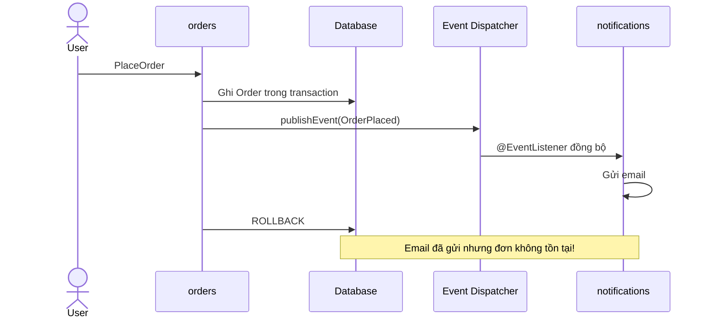
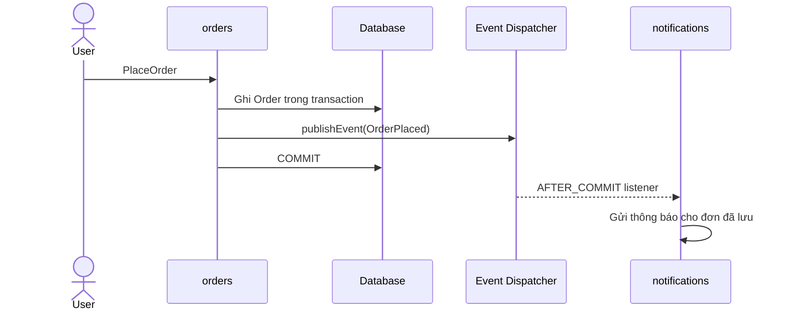
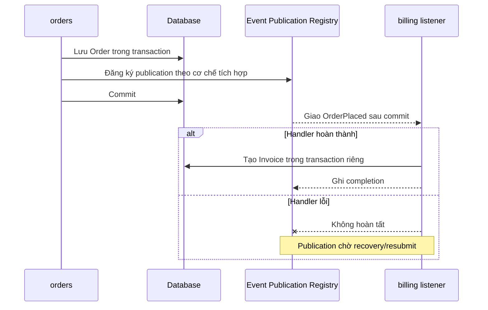

# Event sau khi commit trong Spring Modulith

Trong một ứng dụng Spring Modulith, một module có thể phát sự kiện `OrderPlaced` ngay khi xử lý đặt hàng. Nhưng nếu transaction đang lưu đơn **chưa commit**, các module nhận sự kiện có được phép tạo hóa đơn, gửi email, gọi webhook hay cập nhật hệ thống ngoài ngay lúc đó không?

Câu trả lời phụ thuộc **thời điểm xử lý**. Nếu side effect xảy ra trước khi transaction nguồn hoàn tất, nó có thể thông báo một đơn hàng sau đó bị rollback. Vì vậy, nhiều tác vụ giữa các module phải được thực thi **sau khi transaction nguồn commit thành công**. Spring hỗ trợ cơ chế này qua `@TransactionalEventListener`; Spring Modulith cung cấp `@ApplicationModuleListener` để tổ chức phản ứng liên module theo kiểu sau commit, bất đồng bộ và transaction riêng.

Bài học thuộc chương **Giao dịch và event** của `SPRING_MODULITH_APPLICATION_EVENTS`. Nội dung làm rõ ranh giới giữa **publish event** và **commit dữ liệu**, so sánh các listener, viết code Java, phân tích lifecycle, xử lý lỗi, Event Publication Registry, retry, idempotency, kiểm thử và quan sát nhằm giao sự kiện đáng tin cậy.

> **Nguyên tắc cốt lõi:** *Publish trong transaction* không có nghĩa event đã được commit; *xử lý sau commit* không có nghĩa listener đã thành công; và *chạy sau commit* không tự mang đến transaction mới hay độ bền trước crash.

## 1. Tại sao phải đợi commit?

Xét use case đặt hàng:

1. Khách hàng gọi `PlaceOrder`.
2. Module `orders` kiểm tra và lưu aggregate `Order` trong transaction.
3. Module phát `OrderPlaced`.
4. Database bắt đầu hoặc hoàn tất thao tác commit.
5. Module `billing` tạo hóa đơn; `notifications` gửi xác nhận.

Nếu bước 5 diễn ra **trước bước 4**, hệ thống có thể tạo hóa đơn/email cho một đơn chưa được commit. Những kịch bản lỗi điển hình:

- Transaction nguồn rollback vì ràng buộc database hoặc exception xảy ra sau lúc publish.
- Listener gửi email thành công, nhưng database lưu đơn không thành công.
- Listener đọc `Order` qua transaction riêng trước commit và **không tìm thấy dữ liệu**, vì thay đổi chưa visible theo isolation level.
- Listener lỗi khiến use case chính thất bại dù việc gửi thông báo không phải điều kiện nghiệp vụ của đặt hàng.
- Một retry bất đồng bộ xử lý lại side effect đã thực hiện trước đó.

Một listener **sau commit** chỉ được gọi khi transaction nguồn đã commit, nhờ đó tránh phản ứng với sự thật chưa bền vững. Tuy nhiên, nếu listener đã chạy và thất bại, đơn đã commit vẫn tồn tại: giữa các module có thể xuất hiện **eventual consistency** cần được vận hành rõ ràng.

### Minh họa bằng hai timeline





Hai sơ đồ mô tả quan hệ logic, không khẳng định thời điểm HTTP response hoặc thứ tự của các listener bất đồng bộ. Trường hợp sau commit cho phép tách nghiệp vụ lưu đơn khỏi side effect phụ trợ.

## 2. Phân biệt thời điểm publish và thời điểm xử lý

Cùng một event có các dấu mốc riêng:

| Dấu mốc | Ý nghĩa | Có bảo đảm gì? |
| --- | --- | --- |
| **Event được tạo** | Module nguồn hình thành object `OrderPlaced` | Chưa chứng minh transaction đã commit |
| **`publishEvent(...)` được gọi** | Application event được đưa vào cơ chế dispatch của Spring | Listener đồng bộ có thể chạy ngay; không tự commit |
| **Transaction commit** | Database xác nhận thay đổi của nghiệp vụ nguồn | Dữ liệu đã bền vững theo bảo đảm của database |
| **After-commit callback** | Listener đăng ký phase `AFTER_COMMIT` được kích hoạt | Sự kiện nguồn được phát trong transaction đã commit |
| **Listener hoàn thành** | Module nhận đã xử lý theo contract | Không có nghĩa mọi listener khác đã xong |
| **Publication completed** | Hạ tầng registry ghi nhận listener tương ứng đã hoàn thành | Không chứng minh side effect bên ngoài không bao giờ lặp |

Cần đặc biệt nhớ:

- **Publish không phải commit.** Trong Spring, `ApplicationEventPublisher` không tự mở/commit transaction cho sự kiện.
- **Commit không phải xử lý listener.** Callback có thể chạy sau đó, đặc biệt khi bất đồng bộ.
- **Listener hoàn thành không phải toàn hệ thống hoàn thành.** Các subscriber khác có thể đang xử lý hoặc lỗi.

Mô hình này chính là lý do Spring Modulith sử dụng application events để giảm phụ thuộc giữa module mà vẫn cần Event Publication Registry, recovery và idempotency cho các tác vụ quan trọng.

## 3. Thiết kế ranh giới module và public event

Giả sử có các module:

```text
com.example.shop
├── ShopApplication.java
├── orders
│   ├── Orders.java
│   ├── PlaceOrder.java
│   ├── OrderPlaced.java
│   └── internal
│       ├── Order.java
│       ├── OrderRepository.java
│       └── DefaultOrders.java
├── billing
│   └── internal
│       ├── IssueInvoiceOnOrderPlaced.java
│       └── InvoiceService.java
└── notifications
    └── internal
        └── OrderConfirmationListener.java
```

Theo cách tổ chức mặc định của Spring Modulith, các package trực tiếp dưới package ứng dụng tạo thành application modules. `orders` sở hữu trạng thái đơn và quyền công bố `OrderPlaced`. `billing` sở hữu hóa đơn; `notifications` sở hữu thao tác gửi thông báo. Các module nhận import **public event** của `orders`, không import repository hay entity nằm dưới `orders.internal`.

Ví dụ event công khai:

```java
// com.example.shop.orders.OrderPlaced.java
package com.example.shop.orders;

import java.time.Instant;
import java.util.UUID;

public record OrderPlaced(
        UUID eventId,
        UUID orderId,
        Instant occurredAt
) {}
```

Event được thiết kế bất biến, mang ID sự kiện và ID đơn, không chứa JPA entity mutable hoặc `EntityManager`. Điều này quan trọng vì sau commit persistence context của publisher không còn là ngữ cảnh đáng tin cậy cho xử lý độc lập.

### Command và event không cùng vai trò

- `PlaceOrder` là **command**: yêu cầu tạo đơn, có thể bị từ chối.
- `OrderPlaced` là **event**: thông báo sự thật đơn đã được ghi nhận hợp lệ.
- `IssueInvoice` (nếu cần) là một command dành cho module `billing`; `InvoiceIssued` là sự thật do chính `billing` xác nhận sau khi phát hành hóa đơn.

Khi một tác vụ là điều kiện bắt buộc để trả “đã đặt hàng thành công”, không nên tự động đẩy nó thành xử lý after-commit bất đồng bộ rồi trả thành công quá sớm. Cần thiết kế flow có kết quả tức thì, trạng thái chờ hoặc orchestration phù hợp.

## 4. Publisher phát event bên trong transaction

Public API của `orders`:

```java
// com.example.shop.orders.PlaceOrder.java
package com.example.shop.orders;

import java.util.UUID;

public record PlaceOrder(UUID customerId, String sku, int quantity) {
    public PlaceOrder {
        if (customerId == null || sku == null ||
            sku.isBlank() || quantity <= 0) {
            throw new IllegalArgumentException("Invalid order");
        }
    }
}
```

```java
// com.example.shop.orders.Orders.java
package com.example.shop.orders;

import java.util.UUID;

public interface Orders {
    UUID place(PlaceOrder command);
}
```

Implementation và điểm công bố:

```java
// com.example.shop.orders.internal.DefaultOrders.java
package com.example.shop.orders.internal;

import com.example.shop.orders.OrderPlaced;
import com.example.shop.orders.Orders;
import com.example.shop.orders.PlaceOrder;
import java.time.Clock;
import java.time.Instant;
import java.util.UUID;
import org.springframework.context.ApplicationEventPublisher;
import org.springframework.stereotype.Service;
import org.springframework.transaction.annotation.Transactional;

@Service
class DefaultOrders implements Orders {

    private final OrderRepository repository;
    private final ApplicationEventPublisher publisher;
    private final Clock clock;

    DefaultOrders(
            OrderRepository repository,
            ApplicationEventPublisher publisher,
            Clock clock) {
        this.repository = repository;
        this.publisher = publisher;
        this.clock = clock;
    }

    @Override
    @Transactional
    public UUID place(PlaceOrder command) {
        // Domain model giả định, kiểm tra các invariant tại đây.
        Order order = Order.place(
                command.customerId(),
                command.sku(),
                command.quantity()
        );

        repository.save(order);

        publisher.publishEvent(new OrderPlaced(
                UUID.randomUUID(),
                order.id(),
                Instant.now(clock)
        ));

        return order.id();
    }
}
```

`Order`, `OrderRepository` và bean `Clock` là những thành phần ví dụ cần hiện thực/cấu hình trong ứng dụng thực. `DefaultOrders` chỉ minh họa đúng điểm publish trong use case và không phải một project hoàn chỉnh.

**Điểm cần chú ý:** lời gọi `publishEvent` nằm **trong phương thức `@Transactional`**. Trong đa số cấu hình Spring sử dụng proxy transaction, commit xảy ra sau khi method trả về. Vì thế, mặc dù `repository.save(order)` đã được gọi, database vẫn có thể rollback.

Việc tạo `OrderPlaced` trước commit là bình thường khi listener dùng phase `AFTER_COMMIT`. Không nên “sửa” bằng cách gọi trực tiếp một side effect bên ngoài ngay tại publisher, vì không có cách tự động rollback email/webhook nếu transaction database thất bại.

## 5. So sánh listener đồng bộ, transactional và module listener

| Kiểu listener | Thời điểm thực thi mặc định | Async? | Transaction phía listener |
| --- | --- | --- | --- |
| `@EventListener` | Tại thời điểm publish | Không theo mặc định | Có thể đang dùng thread và transaction publisher |
| `@Async @EventListener` | Lên lịch khi publish; worker có thể chạy trước commit | Có khi async được bật | Không tự kế thừa transaction thread nguồn |
| `@TransactionalEventListener` | `AFTER_COMMIT` | Không mặc định | Không tự mở transaction ghi dữ liệu mới |
| `@Async @TransactionalEventListener` | Sau commit, chạy qua executor | Có | Cần cấu hình transaction riêng khi handler cần ghi |
| `@ApplicationModuleListener` | Sau commit, bất đồng bộ | Có | Transaction mới theo cơ chế kết hợp của Spring Modulith |

Một số điểm quan trọng:

1. `@EventListener` đồng bộ có thể làm tăng latency hoặc ném lỗi ngay trong transaction nguồn.
2. `@Async` không tự thêm ràng buộc **sau commit**.
3. `@TransactionalEventListener` mặc định `AFTER_COMMIT` nhưng **không tự bật async**.
4. `@ApplicationModuleListener` là lựa chọn tiện dụng cho phản ứng liên module, kết hợp transactional listener, async và `REQUIRES_NEW` theo semantics Spring Modulith.
5. Không có annotation nào tự tạo business idempotency hoặc bảo đảm một side effect ngoài database sẽ chỉ diễn ra đúng một lần.

## 6. Dùng `@TransactionalEventListener(AFTER_COMMIT)`

Ví dụ module `notifications` chỉ xử lý sau khi đơn hàng commit:

```java
// com.example.shop.notifications.internal.OrderConfirmationListener.java
package com.example.shop.notifications.internal;

import com.example.shop.orders.OrderPlaced;
import org.springframework.stereotype.Component;
import org.springframework.transaction.event.TransactionPhase;
import org.springframework.transaction.event.TransactionalEventListener;

@Component
class OrderConfirmationListener {

    private final NotificationTasks notifications;

    OrderConfirmationListener(NotificationTasks notifications) {
        this.notifications = notifications;
    }

    @TransactionalEventListener(phase = TransactionPhase.AFTER_COMMIT)
    void on(OrderPlaced event) {
        notifications.enqueueOnce(event.eventId(), event.orderId());
    }
}
```

Ở đây `NotificationTasks` là service nội bộ do module `notifications` cài đặt. Một cách mở transaction riêng để lưu queue/status thông báo:

```java
// com.example.shop.notifications.internal.NotificationTasks.java
package com.example.shop.notifications.internal;

import java.util.UUID;
import org.springframework.stereotype.Service;
import org.springframework.transaction.annotation.Propagation;
import org.springframework.transaction.annotation.Transactional;

@Service
class NotificationTasks {

    private final NotificationRepository notifications;

    NotificationTasks(NotificationRepository notifications) {
        this.notifications = notifications;
    }

    @Transactional(propagation = Propagation.REQUIRES_NEW)
    public void enqueueOnce(UUID eventId, UUID orderId) {
        if (notifications.existsByEventId(eventId)) {
            return;
        }
        notifications.save(new NotificationJob(eventId, orderId));
        // Persistence cần UNIQUE(event_id) để tránh race condition.
    }
}
```

`NotificationRepository` và `NotificationJob` là các thành phần giả định cần triển khai. Điểm quan trọng là listener gọi **bean service khác** có method `@Transactional(REQUIRES_NEW)` để giao dịch mới thực sự được mở qua Spring proxy.

### Vì sao sau commit vẫn cần transaction mới?

Spring Framework lưu ý rằng tại phase sau commit, tài nguyên transaction trước đó (ví dụ connection/persistence context) vẫn có thể còn gắn với thread trong lúc thực hiện callback, nhưng transaction ấy đã hoàn thành. Nếu listener thực hiện thao tác ghi dựa vào tài nguyên cũ, công việc có thể **không được commit theo cách bạn mong đợi**.

Vì vậy:

- Đọc dữ liệu nguồn đã commit qua API phù hợp có thể hợp lý.
- Khi cần **ghi dữ liệu**, chủ động mở transaction mới, điển hình là `REQUIRES_NEW` qua một bean được quản lý bởi Spring.
- Tránh chỉ dùng `@Transactional` mặc định và suy rằng sẽ có commit độc lập.
- Nếu dùng `@Async` hoặc `@ApplicationModuleListener`, xác nhận transaction thực sự được mở và kết thúc đúng tại worker.

**Không đặt `REQUIRES_NEW` cùng method và gọi nó bằng `this.enqueueOnce(...)` rồi kỳ vọng Spring AOP proxy hoạt động**. Self-invocation thường bỏ qua advice `@Transactional` trong mô hình proxy mặc định.

## 7. `@ApplicationModuleListener`: mẫu phản ứng liên module

Với Spring Modulith, `@ApplicationModuleListener` được thiết kế cho luồng sau commit của module khác, thực thi bất đồng bộ trong một transaction mới.

```java
// com.example.shop.billing.internal.IssueInvoiceOnOrderPlaced.java
package com.example.shop.billing.internal;

import com.example.shop.orders.OrderPlaced;
import org.springframework.modulith.events.ApplicationModuleListener;
import org.springframework.stereotype.Component;

@Component
class IssueInvoiceOnOrderPlaced {

    private final InvoiceService invoices;

    IssueInvoiceOnOrderPlaced(InvoiceService invoices) {
        this.invoices = invoices;
    }

    @ApplicationModuleListener
    void on(OrderPlaced event) {
        invoices.issueOnce(event.orderId(), event.eventId());
    }
}
```

Ở ví dụ này, listener đặt trong module `billing` và chỉ import public event `orders.OrderPlaced`. `InvoiceService` là service nội bộ của `billing`, có trách nhiệm kiểm tra xem hóa đơn đã tồn tại hoặc nghiệp vụ có cho phép phát hành không.

Ưu điểm:

- Transaction đặt hàng không bị kéo dài bởi việc tạo hóa đơn.
- Listener được kích hoạt khi dữ liệu đơn đã commit.
- Module `billing` có transaction riêng để bảo đảm invariant của hóa đơn.
- Publisher không phụ thuộc implementation của module `billing`.
- Nếu listener thất bại, publication có thể được theo dõi/khôi phục khi Event Publication Registry có storage phù hợp.

**Giới hạn:** vì listener chạy riêng, hóa đơn có thể hoàn tất sau HTTP response. Transaction nguồn không thể tự rollback để bù một lỗi tạo hóa đơn muộn. Nếu nghiệp vụ cần “hóa đơn phát hành xong mới xác nhận đơn”, phải đổi hợp đồng hoặc xây workflow có trạng thái chờ, không coi `@ApplicationModuleListener` là cam kết hoàn thành trước khi trả kết quả.

### Tránh đăng ký hai handler cho cùng một side effect

Các ví dụ `@TransactionalEventListener` và `@ApplicationModuleListener` là **hai lựa chọn triển khai**. Không bật đồng thời chúng nếu cả hai cùng tạo một hóa đơn hoặc gửi cùng email, trừ khi bạn đã có lý do và idempotency để bảo vệ việc xử lý trùng.

## 8. Điều kiện phase: `AFTER_COMMIT` khác các phase khác

`@TransactionalEventListener` hỗ trợ những phase thông dụng sau:

| Phase | Khi nào kích hoạt | Trường hợp sử dụng |
| --- | --- | --- |
| `BEFORE_COMMIT` | Trước commit của transaction đang hoạt động | Công việc gắn chặt với transaction, kiểm tra/chuẩn bị nội bộ có chủ đích |
| `AFTER_COMMIT` | Sau khi transaction commit thành công | Hệ quả chỉ hợp lệ khi dữ liệu nguồn đã commit |
| `AFTER_ROLLBACK` | Sau khi transaction rollback | Quan sát thất bại hoặc cleanup không tạo sự thật “đã thành công” |
| `AFTER_COMPLETION` | Sau khi transaction hoàn tất, bất kể commit/rollback | Cleanup/metrics cần biết giao dịch kết thúc |

Khi thiết kế `OrderPlaced`, chỉ dùng `AFTER_COMMIT` cho những subscriber khẳng định đơn đã được lưu thành công.

Ví dụ khai báo rõ phase:

```java
@TransactionalEventListener(phase = TransactionPhase.AFTER_COMMIT)
void onOrderPlaced(OrderPlaced event) {
    // Xử lý hậu quả của đơn đã commit.
}
```

Ngược lại, nếu muốn cleanup khi rollback, listener `AFTER_ROLLBACK` phải được đặt tên và xử lý đúng ý nghĩa, không phát `OrderPlaced` như thể nghiệp vụ thành công.

### `@TransactionalEventListener` có mặc định `AFTER_COMMIT` không?

Có. Ghi `phase = TransactionPhase.AFTER_COMMIT` rõ ràng giúp người đọc thấy chủ ý. Tuy nhiên, **annotation này không tự đảm bảo async**, cũng không tự ghi trạng thái completion vào một store bền vững nếu ứng dụng chưa cấu hình các module event publication cần thiết.

## 9. Publish ngoài transaction: `fallbackExecution` và điểm mù

Theo mặc định, listener `@TransactionalEventListener` chỉ tham gia vào chu kỳ transaction khi tại thời điểm publish **có transaction đang hoạt động**. Nếu event được phát ngoài transaction, listener mặc định **không được gọi**.

```java
// Ví dụ phát ngoài giao dịch:
publisher.publishEvent(new OrderPlaced(
        UUID.randomUUID(),
        orderId,
        Instant.now()
));
// @TransactionalEventListener mặc định không chạy nếu không có TX.
```

Có thể bật:

```java
@TransactionalEventListener(
    phase = TransactionPhase.AFTER_COMMIT,
    fallbackExecution = true
)
void on(OrderPlaced event) {
    // Nếu có TX: chờ phase; nếu không có TX: có thể chạy fallback.
}
```

Nhưng `fallbackExecution = true` **không biến lần publish không transaction thành một commit thật**. Nó chỉ cho phép listener chạy khi thiếu transaction. Với event tuyên bố một thay đổi dữ liệu đã bền vững, thường nên **sửa publisher để có transaction đúng** thay vì bật fallback nhằm che lỗi.

### Vì sao transaction có thể không hoạt động dù đã viết `@Transactional`?

- Method transactional bị gọi từ cùng bean bằng `this.method()`, đi vòng proxy.
- Bean được khởi tạo ngoài Spring nên annotation không được áp dụng.
- Transaction manager khác với tài nguyên dữ liệu đang sử dụng.
- Code chuyển sang async thread trước khi method cần transaction được gọi.
- Use case có nhiều lớp proxy/cấu hình transaction chưa đúng mong đợi.

Các tình huống này cần được xác minh bằng integration test và logging về transaction state, không nên suy từ annotation xuất hiện trong code.

## 10. Side effect quan trọng sau commit vẫn có thể thất bại

Một listener sau commit không thể khiến transaction đã commit “quay lại trạng thái trước đó” một cách tự động.

Ví dụ:

```text
10:00:00  orders: Order O-42 đã commit
10:00:01  billing: bắt đầu tạo Invoice cho O-42
10:00:02  billing: timeout database
10:00:03  notifications: email xác nhận đã gửi
10:02:00  billing: publication còn pending, chuẩn bị recovery
10:02:10  billing: retry thành công, tạo Invoice
```

Ở khoảng giữa, dữ liệu đơn và hóa đơn chưa nhất quán tức thì. Đây không phải sự cố transaction nguồn mà là **độ trễ xử lý liên module**.

Cách mô hình nghiệp vụ phù hợp:

- `orders` công khai trạng thái đơn chính xác: đã đặt/đã xác nhận.
- `billing` quản lý riêng việc lập hóa đơn.
- Nếu UI cần biết “đã có hóa đơn chưa?”, phải truy vấn trạng thái hoặc nhận event kết quả `InvoiceIssued`.
- Nếu tạo hóa đơn quan trọng, phải có recovery và cảnh báo cho publication quá hạn.
- Không gọi lại `PlaceOrder` để ép sự kiện phát lại: hành động này có thể tạo đơn hoặc event mới.

## 11. Event Publication Registry: theo dõi giao sự kiện sau commit

Spring Modulith cung cấp **Event Publication Registry** để theo dõi việc giao application events tới transactional event listeners. Với các implementation persistence thích hợp, registry ghi nhận publication chưa hoàn thành, đánh dấu hoàn thành khi listener xử lý thành công và cho phép xác định những publication cần phục hồi.

Một event có thể có nhiều target listener. Vì vậy theo dõi completion cần xét **từng publication/target**, không chỉ một cờ chung cho event:

| Event | Listener mục tiêu | Trạng thái logic |
| --- | --- | --- |
| `OrderPlaced(E-01)` | `billing.IssueInvoiceOnOrderPlaced` | INCOMPLETE |
| `OrderPlaced(E-01)` | `notifications.OrderConfirmationListener` | COMPLETED |
| `OrderPlaced(E-02)` | `billing.IssueInvoiceOnOrderPlaced` | COMPLETED |

Bảng trên chỉ mô tả trạng thái logic; schema và trạng thái cụ thể của registry phụ thuộc phiên bản Spring Modulith cùng storage backend (ví dụ JDBC, JPA, MongoDB).

### Mẫu luồng có registry



Đây là sơ đồ **khái niệm**. Việc lưu publication được phối hợp như thế nào với transaction nguồn phụ thuộc module, version và cấu hình persistence của Spring Modulith. Để có bảo đảm không mất publication khi crash, phải cấu hình/kiểm thử transaction và storage phù hợp; **không chỉ gắn annotation** rồi coi như đã giải quyết toàn bộ độ bền.

### Registry giải quyết và không giải quyết điều gì?

Registry hỗ trợ:

- Biết publication nào được giao đến transactional listener.
- Theo dõi publication chưa hoàn thành.
- Hỗ trợ resubmit/recovery theo khả năng phiên bản và chính sách vận hành.
- Góp phần cô lập lỗi của module nghe so với module phát.

Registry **không** tự đảm bảo:

- Mọi `@EventListener` đồng bộ cũng có bản ghi publication bền vững.
- Listener tự retry liên tục với lịch backoff đúng nhu cầu.
- Gửi email hoặc gọi API ngoài chỉ diễn ra đúng một lần.
- Một message đã tới Kafka/RabbitMQ chỉ bằng `publishEvent` nội bộ.
- Event mới được phát ngoài transaction sẽ có cùng bảo đảm transaction/registry như một event được phát trong transaction nguồn.

### Crash window vẫn cần xem xét

Nếu transaction đơn commit, JVM dừng ngay trước khi listener bắt đầu, publication bền vững giúp hệ thống có cơ sở khôi phục. Nếu listener đã thực hiện side effect nhưng JVM dừng **trước khi ghi completed**, khi resubmit listener có thể xử lý lại. Vì vậy độ tin cậy publication và idempotency của consumer **phải đi cùng nhau**.

## 12. Retry, resubmit và idempotency của module nhận

Một `OrderPlaced` có thể được xử lý lại vì timeout, crash, resubmit hoặc recovery. Đừng coi event delivery là exactly-once chỉ vì handler chạy sau commit.

### Idempotency theo khóa nghiệp vụ

Giả sử `billing` cần đảm bảo một đơn chỉ có một hóa đơn:

```java
// Pseudocode của billing service, chưa bao gồm repository/domain.
@Transactional
public void issueOnce(UUID orderId, UUID eventId) {
    if (invoiceRepository.existsByOrderId(orderId)) {
        return;
    }

    Invoice invoice = Invoice.forOrder(orderId, eventId);
    invoiceRepository.save(invoice);
    // Bắt buộc có ràng buộc UNIQUE(order_id) phù hợp.
}
```

`existsByOrderId` là bước kiểm tra tiện ích, nhưng **không đủ chống race condition** nếu hai listener xử lý song song. Database cần unique constraint, optimistic locking hoặc cách điều phối giao dịch khác. Khi insert trùng bị từ chối, phải xử lý theo transaction đúng, không chỉ nuốt exception trong transaction đã bị đánh dấu rollback.

### Idempotency với side effect ngoài database

Nếu `notifications` gửi email sau commit:

- Dùng một business key ổn định như `(orderId, confirmationType)` để biểu diễn yêu cầu gửi.
- Lưu trạng thái yêu cầu thông báo trong database nếu cần khôi phục.
- Dùng idempotency key ở nhà cung cấp email/API nếu họ hỗ trợ.
- Nhận thức rằng nếu nhà cung cấp đã nhận email nhưng kết nối timeout, hệ thống có thể **không chắc** email đã được gửi.
- Thiết kế workflow và giám sát để chấp nhận hoặc xử lý khả năng side effect lặp còn lại.

Một eventId riêng không tự ngăn một nghiệp vụ được yêu cầu hai lần tạo hai side effect. Cần phân biệt **duplicate event** với **duplicate business action**.

### Retry không phải gọi lại command gốc

Nếu hóa đơn lỗi, hãy resubmit **publication chưa hoàn thành** của listener hoặc chạy lại task idempotent. Không gọi lại `orders.place(...)` vì chỉ muốn gửi lại `OrderPlaced`.

## 13. Asynchronous after-commit: thread và thứ tự

`@TransactionalEventListener(AFTER_COMMIT)` mặc định không tự chạy async. Muốn tách thời gian xử lý, có thể kết hợp `@Async`:

```java
@Component
class AsyncAfterCommitListener {

    private final NotificationTasks notifications;

    AsyncAfterCommitListener(NotificationTasks notifications) {
        this.notifications = notifications;
    }

    @Async("eventExecutor")
    @TransactionalEventListener(phase = TransactionPhase.AFTER_COMMIT)
    void on(OrderPlaced event) {
        notifications.enqueueOnce(event.eventId(), event.orderId());
    }
}
```

Đây là minh họa đặt trong module `notifications` với các import tương ứng, giả định có `@EnableAsync` và bean executor tên `eventExecutor`. Listener chỉ được lên lịch sau khi transaction nguồn commit, nhưng **worker thread không kế thừa transaction nguồn**. `NotificationTasks` trong ví dụ mở transaction `REQUIRES_NEW` như phần trước.

So sánh ngắn:

- `@Async @EventListener`: async, có thể thực thi **trước commit**.
- `@Async @TransactionalEventListener(AFTER_COMMIT)`: async, đợi commit; transaction ghi DB ở listener cần cấu hình thích hợp.
- `@ApplicationModuleListener`: after-commit, async, transaction riêng theo cơ chế Spring Modulith.

### Đừng dựa vào thứ tự handler async

Hai listener nhận cùng một event có thể hoàn thành theo thứ tự khác nhau. Nếu `notifications` phải gửi email **sau khi hóa đơn đã phát hành**, đừng để cả hai nghe `OrderPlaced` rồi giả định `billing` chạy trước.

Thay vào đó:

1. `billing` nhận `OrderPlaced` và tạo hóa đơn.
2. `billing` phát `InvoiceIssued` khi sự thật hóa đơn hợp lệ.
3. `notifications` nghe `InvoiceIssued` để gửi email hóa đơn.

Với hai event của cùng một aggregate như `OrderPlaced` và `OrderCancelled`, cần state machine/version/ordering strategy vì async không tự đảm bảo xử lý tuần tự toàn cục.

## 14. Giải thích các tình huống sau commit thường bị hiểu sai

| Câu khẳng định | Đúng hay sai? | Giải thích |
| --- | --- | --- |
| “Đã gọi `publishEvent` nên database đã commit.” | Sai | Publish xảy ra trong transaction; commit có thể tới sau |
| “`@EventListener` mặc định chỉ chạy sau commit.” | Sai | Mặc định đồng bộ tại thời điểm publish |
| “Gắn `@Async` là event chờ commit.” | Sai | Async chỉ quyết định thread, không xác định transaction phase |
| “`@TransactionalEventListener` mặc định `AFTER_COMMIT`.” | Đúng | Nhưng không mặc định async hoặc có transaction mới |
| “Listener after-commit có thể làm rollback đơn đã commit.” | Sai | Transaction nguồn đã hoàn tất; cần xử lý lỗi riêng |
| “Ghi DB trong `AFTER_COMMIT` nên mở transaction mới khi cần.” | Đúng | Tài nguyên cũ có thể còn bound, nhưng commit đã xong |
| “`@ApplicationModuleListener` thích hợp cho tác vụ liên module sau commit.” | Thường đúng | Chạy async, transaction mới; cần cấu hình và idempotency |
| “Event Publication Registry đảm bảo side effect exactly-once.” | Sai | Resubmit có thể làm handler chạy lại |
| “Event phát ngoài transaction luôn kích hoạt transactional listener.” | Sai | Mặc định bỏ qua, trừ khi dùng fallback |
| “Sau commit thì mọi listener đã hoàn thành.” | Sai | Listener async có thể đang chờ hoặc lỗi |

## 15. Kiểm thử event sau commit đúng cách

Kiểm thử phải chứng minh **đúng event, đúng transaction phase, đúng kết quả nghiệp vụ và hành vi khôi phục**. Chỉ test producer đã gọi `publishEvent` là chưa đủ.

### 15.1. Test publisher phát event hợp lệ

Spring Modulith hỗ trợ `@ApplicationModuleTest` và `PublishedEvents`:

```java
package com.example.shop.orders;

import static org.assertj.core.api.Assertions.assertThat;
import java.util.UUID;
import org.junit.jupiter.api.Test;
import org.springframework.beans.factory.annotation.Autowired;
import org.springframework.modulith.test.ApplicationModuleTest;
import org.springframework.modulith.test.PublishedEvents;

@ApplicationModuleTest
class OrderEventContractTest {

    @Autowired Orders orders;

    @Test
    void placingOrderPublishesEvent(PublishedEvents events) {
        UUID orderId = orders.place(
                new PlaceOrder(UUID.randomUUID(), "BOOK-01", 2)
        );

        assertThat(events.ofType(OrderPlaced.class)
                .matching(OrderPlaced::orderId, orderId))
            .hasSize(1);
    }
}
```

Đây là ví dụ giả định có persistence test và dữ liệu phù hợp. Nó kiểm tra event **đã được publish**, không kiểm tra subscriber sau commit đã hoàn thành. Đặc biệt, nếu test chạy trong transaction rồi tự rollback, `PublishedEvents` có thể thấy event trong khi `AFTER_COMMIT` listener không chạy.

### 15.2. Test commit và rollback

Một ý tưởng integration test dùng `TransactionTemplate` để kiểm soát transaction thực sự:

```java
// Ví dụ logic test với bean publisher và transactionTemplate.
// Record event phải là kiểu public được định nghĩa sẵn.
OrderPlaced event = new OrderPlaced(
        UUID.randomUUID(), orderId, Instant.now());

transactionTemplate.executeWithoutResult(status -> {
    publisher.publishEvent(event);
});

// Khi có transaction commit, AFTER_COMMIT handler được kích hoạt;
// nếu handler async, đợi side effect bằng assertion có timeout.
```

Trường hợp rollback có thể dùng:

```java
transactionTemplate.executeWithoutResult(status -> {
    publisher.publishEvent(event);
    status.setRollbackOnly();
});

// AFTER_COMMIT handler không được thực hiện side effect.
```

Các đoạn mã chỉ minh họa **thời điểm dispatch**. Test đầy đủ cần những bean, dữ liệu nguồn và observer thật, kiểm tra database sau commit/rollback. Đừng dùng listener đồng bộ như bằng chứng cho `AFTER_COMMIT`.

### 15.3. Test lỗi và phục hồi

Các trường hợp quan trọng:

1. Source transaction commit → listener được gọi, side effect hợp lệ được ghi.
2. Source transaction rollback → không có side effect của `AFTER_COMMIT`.
3. Publish ngoài transaction → transactional listener mặc định không chạy.
4. Handler after-commit ném exception → thay đổi nguồn đã commit không biến mất.
5. Handler async mất kết nối database → publication quan trọng còn incomplete theo registry cấu hình.
6. Recovery/resubmit sau restart → listener xử lý lại thành công.
7. Handler tạo hóa đơn rồi crash trước completion → xử lý lại không tạo hóa đơn thứ hai.
8. Hai worker xử lý cùng orderId → unique constraint giữ invariant.
9. Event bị delivery lệch thứ tự → module nhận kiểm tra trạng thái/phiên bản.
10. Module `billing` import type `orders.internal` → test ranh giới phải phát hiện.

**Lưu ý:** test async nên dùng polling hoặc assertion với timeout có giới hạn, không `Thread.sleep(...)` theo cảm tính. Test `@Transactional` được framework tự rollback ở cuối cần điều chỉnh để **commit thật** khi muốn quan sát `AFTER_COMMIT`.

### 15.4. Kiểm tra module boundary

```java
package com.example.shop;

import org.junit.jupiter.api.Test;
import org.springframework.modulith.core.ApplicationModules;

class ModuleStructureTest {

    @Test
    void verifyModules() {
        ApplicationModules.of(ShopApplication.class).verify();
    }
}
```

`verify()` bảo vệ ranh giới phụ thuộc như import internal package, vòng dependency và allowedDependencies nếu được cấu hình. Nhưng `verify()` **không** chứng minh phase transaction hay idempotency, nên vẫn cần integration test thực tế.

## 16. Quan sát giao sự kiện sau commit

Để tìm nguyên nhân “đơn đã đặt nhưng chưa gửi email hoặc chưa có hóa đơn”, hệ thống cần biết:

- Transaction của `orders` có commit không?
- `OrderPlaced` nào được phát? `eventId` và `orderId` là gì?
- Listener nào đăng ký nhận event, phase nào và có chạy sau commit?
- Publication registry có bản ghi incomplete không?
- Handler bị exception, timeout hay chưa có worker thực thi?
- Side effect thực tế đã xảy ra nhưng chưa đánh dấu completed?
- Event có được resubmit hoặc xử lý trùng không?
- Công việc cần xử lý lại có nguy cơ tạo side effect lặp hay không?

Ví dụ log **do ứng dụng tự thiết kế**, không phải output bắt buộc của Spring Modulith:

```json
{
  "eventType": "OrderPlaced",
  "eventId": "9750f86f-c6fb-4b17-aed3-850946681f41",
  "aggregateId": "04fbbe41-740e-470d-8df9-9d8990812bf9",
  "sourceModule": "orders",
  "listener": "billing.IssueInvoiceOnOrderPlaced",
  "phase": "AFTER_COMMIT",
  "publicationStatus": "INCOMPLETE",
  "attempt": 2,
  "lastFailureCategory": "DATABASE_TIMEOUT",
  "correlationId": "0ee2b965-8614-44d7-9f27-95d68b44593a"
}
```

Các chỉ số thường hữu ích:

| Chỉ số | Ý nghĩa vận hành |
| --- | --- |
| Số publication incomplete theo listener | Tác vụ hậu xử lý chưa hoàn tất |
| Tuổi lớn nhất của publication incomplete | Phát hiện nhiệm vụ kẹt lâu |
| Tỉ lệ listener lỗi/được retry | Theo dõi độ tin cậy giữa các module |
| Độ trễ từ commit đến completion | Đánh giá eventual consistency |
| Số side effect bị deduplicate | Quan sát retry/giao trùng |
| Backlog của async executor | Phát hiện thiếu tài nguyên hoặc downstream chậm |
| Số đơn chưa có hóa đơn sau ngưỡng SLA | Tác động trực tiếp tới nghiệp vụ |

Không ghi dữ liệu nhạy cảm của khách hoặc nội dung tài khoản thanh toán vào log chỉ để truy vết. Metadata như `eventId`, `orderId` và `correlationId` thường đủ để điều tra có kiểm soát.

## 17. Sai lầm thường gặp và cách tránh

| Sai lầm | Hậu quả | Hướng sửa |
| --- | --- | --- |
| Dùng `@EventListener` để gửi email trước commit | Email có thể gửi cho đơn rollback | Listener sau commit |
| Cho rằng `@Async` bảo đảm dữ liệu nguồn đã commit | Worker có thể chạy trước commit | Dùng `@TransactionalEventListener(AFTER_COMMIT)` hoặc `@ApplicationModuleListener` |
| Ghi DB trong `AFTER_COMMIT` mà không mở transaction mới | Dữ liệu không được commit đúng mong đợi | Service với `REQUIRES_NEW` qua Spring proxy |
| Publish ngoài transaction nhưng mong transactional listener hoạt động | Listener không được gọi | Sửa publisher transaction; chỉ dùng fallback khi thật sự cần |
| Dùng `fallbackExecution=true` để che transaction sai | Listener chạy dù không có commit | Thiết kế lại transaction boundary |
| Gọi method `@Transactional` bằng self-invocation | Spring proxy không áp dụng advice | Gọi qua managed bean/proxy phù hợp |
| Listener tạo hóa đơn không idempotent | Retry có thể tạo nhiều hóa đơn | Unique business key và transaction |
| Bật registry nhưng không có storage/recovery phù hợp | Không phục hồi được khi crash | Cấu hình backend, test crash, monitoring |
| Nuốt exception rồi return bình thường | Publication có thể bị coi completed sai | Ghi nhận lỗi và retry đúng hợp đồng |
| Coi transaction nguồn + transaction listener là một transaction | Đánh giá sai rollback/consistency | Phân biệt commit và giao dịch riêng |
| Nhận hai event async rồi giả định có thứ tự | Race condition, trạng thái sai | State machine, version, event kết quả |
| Test `PublishedEvents` rồi kết luận side effect hoàn thành | Không bắt được lỗi sau commit | Thêm integration test phase/recovery |

## 18. Bài tập tự đánh giá

### Tình huống A: Email gửi rồi đơn rollback

Trong `OrderService.place()`, code lưu đơn và gọi `publishEvent(new OrderPlaced(...))`. Một `@EventListener` gửi email ngay, nhưng transaction sau đó rollback vì lỗi database.

**Câu hỏi:** lỗi nằm ở đâu? Bạn sẽ sửa listener bằng annotation gì để chỉ gửi sau commit?

### Tình huống B: Listener sau commit cập nhật database không như mong đợi

Một `@TransactionalEventListener(AFTER_COMMIT)` gọi trực tiếp repository để tạo bản ghi thông báo, nhưng việc ghi không được commit ổn định.

**Câu hỏi:** vì sao sau commit vẫn cần một transaction mới? `REQUIRES_NEW` nên được đặt ở đâu?

### Tình huống C: Publication còn thiếu khi JVM crash

Đơn `O-42` đã commit. `billing` đã tạo hóa đơn, nhưng ứng dụng crash trước khi registry đánh dấu publication hoàn thành. Sau restart, hệ thống resubmit `OrderPlaced`.

**Câu hỏi:** listener phải làm gì để không tạo hóa đơn thứ hai? Tại sao registry không tự giải quyết duplicate?

<details>
<summary>Gợi ý trả lời</summary>

- **A:** listener chạy quá sớm. Đối với side effect chỉ hợp lệ khi đơn đã commit, dùng `@TransactionalEventListener(phase = AFTER_COMMIT)`; nếu cần async và transaction riêng giữa các module, cân nhắc `@ApplicationModuleListener`.
- **B:** callback sau commit có thể còn tài nguyên của transaction cũ nhưng transaction nguồn đã kết thúc. Gọi một service khác với `@Transactional(propagation = REQUIRES_NEW)` qua Spring proxy để bảo đảm ghi dữ liệu có transaction/commit độc lập.
- **C:** `billing` phải idempotent theo khóa nghiệp vụ như `orderId`, dùng unique constraint và xử lý giao trùng an toàn. Registry theo dõi completion, nhưng crash có thể xảy ra **sau side effect trước completion**, vì vậy khi giao lại hệ thống không thể tự biết side effect đã xảy ra hay chưa nếu consumer không có idempotency.

</details>

### Câu hỏi mở rộng

1. Nếu `OrderPlaced` được phát bên ngoài transaction, listener `@TransactionalEventListener` mặc định có được gọi không?
2. `@Async @EventListener` khác `@Async @TransactionalEventListener(AFTER_COMMIT)` ở điểm quan trọng nào?
3. Khi hóa đơn và email đều xử lý sau commit, có nên trông đợi chúng hoàn thành theo thứ tự cố định không?
4. Một user API có thể trả `orderId` trước khi listener async hoàn tất không? Hệ quả với trạng thái nghiệp vụ là gì?
5. Nếu cần biết chắc email hóa đơn đã gửi **sau khi hóa đơn được phát hành**, subscriber nên nghe `OrderPlaced` hay `InvoiceIssued`?

## 19. Tổng kết

- **Event sau commit** bảo đảm listener phản ứng với một transaction nguồn đã commit thành công, thay vì một sự thật có thể bị rollback.
- `ApplicationEventPublisher.publishEvent(...)` không tự commit; `@EventListener` đồng bộ mặc định có thể chạy trước commit.
- `@TransactionalEventListener` mặc định `AFTER_COMMIT`, nhưng **không tự bất đồng bộ** và **không tự mở transaction ghi DB mới**.
- `@ApplicationModuleListener` là cách phù hợp thường gặp trong Spring Modulith cho phản ứng xuyên module **sau commit, bất đồng bộ, transaction mới**.
- Sau commit, transaction nguồn không thể tự rollback vì listener khác bị lỗi. Hãy thiết kế **eventual consistency**, retry, recovery và trạng thái quan sát được.
- Event Publication Registry cần storage và chính sách resubmit phù hợp; idempotency vẫn cần vì xử lý lại có thể xảy ra sau side effect nhưng trước completion.
- Kiểm thử phải phân biệt **publish, commit, dispatch, handler completion** và **publication status**. Quan sát từng listener giúp hệ thống đáng tin cậy khi gặp lỗi thật.

**Tài liệu tham khảo:**

- [Spring Framework — Transaction-bound Events](https://docs.spring.io/spring-framework/reference/data-access/transaction/event.html)
- [Spring Framework — TransactionalEventListener API](https://docs.spring.io/spring-framework/docs/current/javadoc-api/org/springframework/transaction/event/TransactionalEventListener.html)
- [Spring Modulith — Working with Application Events](https://docs.spring.io/spring-modulith/reference/events.html)
- [Spring Modulith — Application Module Fundamentals](https://docs.spring.io/spring-modulith/reference/fundamentals.html)
- [Spring Modulith — Testing Application Modules](https://docs.spring.io/spring-modulith/reference/testing.html)
